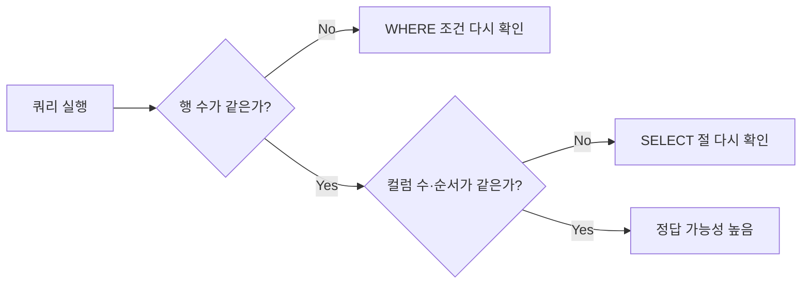
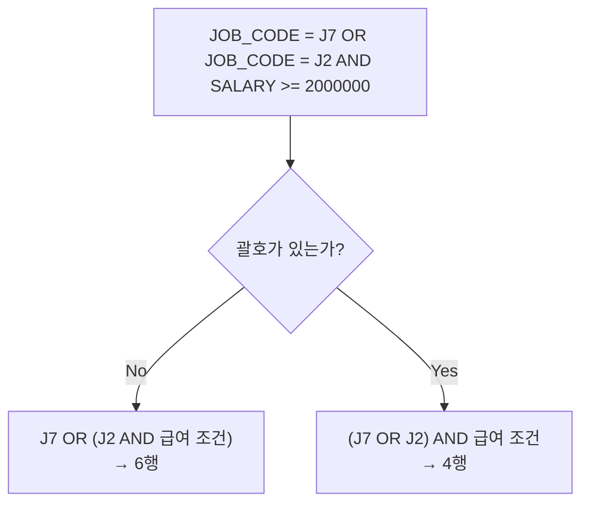

> 이 글은 **SELECT 실습 문제** devlog입니다.
> `EMPLOYEE` 테이블(23행, 14컬럼) 하나를 두고 `SELECT`·`WHERE`로 조건에 맞는 직원을 뽑는 15문제입니다. 문제마다 **행 수와 컬럼 수**가 주어져서, 쿼리를 실행한 뒤 결과 창 하단의 행 수와 비교해 검산할 수 있습니다.
> 아래 SQL은 내가 `04_MySQL/00_practice1.sql`에 직접 쓴 쿼리이고, 테이블은 `employeedb.tbl_employee`입니다. 행 수는 문제의 출력 예시와 대조한 값입니다.

## 과제 한눈에 보기

행 수가 같아도 조회한 컬럼이 다르면 틀린 답이라서, 행 수 → 컬럼 수 → 컬럼 순서 순으로 확인합니다.

| 번호 | 문제 요약 | 핵심 문법 | 행 수 | 컬럼 수 |
|---|---|---|---|---|
| 1 | 모든 행, 모든 컬럼 | `SELECT *` | 23 | 14 |
| 2 | 사번, 이름 | 컬럼 지정 | 23 | 2 |
| 3 | 부서코드 D9 | `=` | 3 | 14 |
| 4 | 급여 300만원 이상 | `>=` | 8 | 4 |
| 5 | D6이고 급여 200만원 초과 | `AND` | 3 | 3 |
| 6 | 보너스 NULL | `IS NULL` | 14 | 4 |
| 7 | 급여 350만~550만원 | `BETWEEN` | 5 | 5 |
| 8 | 김씨 | `LIKE '김%'` | 1 | 3 |
| 9 | 이름에 '하' 포함 | `LIKE '%하%'` | 4 | 3 |
| 10 | 국번이 9로 시작 | `LIKE '___9%'` | 4 | 3 |
| 11 | 국번 4자리 + 9로 시작 | `LIKE '___9_______'` | 3 | 3 |
| 12 | D6 또는 D8 | `IN` | 6 | 3 |
| 13 | 이씨가 아닌 직원 | `NOT LIKE` | 20 | 3 |
| 14 | (J2 AND 200만 이상) OR J7 | `AND`, `OR` | 6 | 3 |
| 15 | (J7 OR J2) AND 200만 이상 | 괄호 | 4 | 3 |

💡 출력 예시는 MySQL에서 `ORDER BY` 없이 실행했을 때의 순서(사번 순)입니다. `SALARY`는 `DECIMAL`이라 소수점 없이, 날짜는 `YYYY-MM-DD`로 표시됩니다.



## 문제 1~4: 기본 조회

### 1. EMPLOYEE 테이블에서 모든 정보 조회

#### 문제 상황
조건 없이 테이블 전체를 조회합니다. 결과는 23행, 14열이어야 합니다.

#### 시도한 방법
```sql
select * from employeedb.tbl_employee;
```

#### 해결 과정
🟢 `*`는 "모든 컬럼"이라서 `WHERE`가 없으면 23행 14열이 그대로 나옵니다. 이후 문제들의 기준이 되는 원본 데이터를 먼저 눈으로 확인하는 단계입니다.

#### 배운 점
💡 `SELECT *`는 컬럼 수를 확인할 때 편하지만, 어떤 컬럼이 필요한지 정해진 뒤에는 컬럼을 직접 적는 쪽이 의도가 분명합니다.

### 2. 사번, 이름 조회

#### 문제 상황
같은 23행에서 컬럼만 `EMP_ID`, `EMP_NAME` 두 개로 줄입니다.

#### 시도한 방법
```sql
select emp_id, emp_name from employeedb.tbl_employee;
```

#### 해결 과정
🟢 `SELECT` 뒤에 쓴 컬럼 순서가 결과의 컬럼 순서가 됩니다. 행 수는 그대로 23이고 컬럼 수만 2로 줄어듭니다.

#### 배운 점
💡 `SELECT`는 **어떤 컬럼을 보여줄지**, `WHERE`는 **어떤 행을 보여줄지**를 정합니다. 1번과 2번의 차이가 바로 이 구분입니다.

### 3. 부서코드가 D9인 사원 조회

#### 문제 상황
`DEPT_CODE`가 `D9`인 직원의 모든 컬럼을 조회합니다. 결과는 3행, 14열입니다.

#### 시도한 방법
```sql
select * from employeedb.tbl_employee where dept_code = "D9";
```

#### 해결 과정
🟢 선동일, 송종기, 노옹철 3명이 나왔고 행 수와 일치했습니다. 문자열 값은 작은따옴표로 감쌉니다.

#### 배운 점
💡 MySQL에서 같음 비교는 `==`가 아니라 `=` 하나입니다.

### 4. 급여가 300만원 이상인 사원의 사번, 이름, 부서코드, 급여

#### 문제 상황
`SALARY`가 3,000,000 이상인 직원을 4개 컬럼으로 조회합니다. 결과는 8행, 4열입니다.

#### 시도한 방법
```sql
select emp_id,emp_name,dept_code,salary from employeedb.tbl_employee where salary>=3000000;
```

#### 해결 과정
🟢 8행이 나왔습니다. "이상"은 `>=`, "초과"는 `>`입니다. 이 구분은 5번과 7번에서 다시 나옵니다.

#### 배운 점
💡 문제 문장의 "이상·이하·초과·미만"을 `>=`, `<=`, `>`, `<`로 바로 옮기는 습관이 필요합니다.

## 문제 5~7: AND, NULL, 범위 조건

### 5. D6이고 급여가 200만원보다 많은 직원

#### 문제 상황
부서코드 조건과 급여 조건을 **둘 다** 만족하는 직원의 이름, 부서코드, 급여를 조회합니다. 결과는 3행, 3열입니다.

#### 시도한 방법
```sql
select emp_name, dept_code,salary from employeedb.tbl_employee where dept_code = "D6" and salary >= 2000000;
```

#### 해결 과정
🟢 송은희(280만), 유재식(340만), 정중하(390만) 3명이 나왔습니다.

⚠️ 문제는 "200만원보다 많은"이라 엄밀히는 초과(`>`)인데, 나는 `>=`로 썼습니다. D6에는 급여가 정확히 200만원인 직원이 없어서 결과는 같지만, 조건 문장은 `>`로 옮기는 것이 맞습니다.

#### 배운 점
💡 `AND`는 두 조건을 모두 만족하는 행만 남기므로, 조건을 하나 더할수록 결과 행 수는 줄거나 같습니다.

### 6. 보너스를 지급받지 않는 사원의 사번, 이름, 급여, 보너스

#### 문제 상황
`BONUS`가 비어 있는(NULL) 직원을 조회합니다. 결과는 14행, 4열입니다.

#### 시도한 방법
```sql
-- 틀린 방법(비교용): 0행이 나온다
select emp_id, emp_name, salary, bonus from employeedb.tbl_employee where bonus = null;

-- 맞는 방법: 14행
select emp_id, emp_name, salary, bonus from employeedb.tbl_employee where bonus is null;
```

#### 해결 과정
🔴 `BONUS = NULL`은 에러 없이 실행되지만 **0행**이 나옵니다.

🟢 `IS NULL`로 바꾸면 14행이 나옵니다. 문제의 확인 포인트도 같은 내용입니다.

#### 배운 점
💡 NULL은 "값이 없음(알 수 없음)"이라서 `NULL = NULL`의 결과도 참이 아니라 NULL입니다. 그래서 `WHERE`에서는 `=` 대신 `IS NULL`, 반대는 `IS NOT NULL`을 씁니다.

### 7. 급여 350만원 이상 550만원 이하

#### 문제 상황
`SALARY`가 3,500,000 이상 5,500,000 이하인 직원의 사번, 이름, 급여, 부서코드, 직급코드를 조회합니다. 결과는 5행, 5열입니다.

#### 시도한 방법
```sql
select emp_id, emp_name, salary, dept_code, job_code from employeedb.tbl_employee where salary between 3500000 and 5500000;
select emp_id, emp_name, salary, dept_code, job_code from employeedb.tbl_employee where salary >= 3500000 and salary <= 5500000;
```

#### 해결 과정
🟢 `between`과 `>= … and <= …` 두 방식으로 모두 써서 결과가 같은지 비교했습니다. 급여가 정확히 3,500,000인 심봉선이 포함돼서 5행이 됩니다. 4행이 나왔다면 `>`와 `>=`를 확인하라는 것이 문제의 확인 포인트입니다.

#### 배운 점
💡 `BETWEEN A AND B`는 양쪽 끝값을 **포함**합니다. `SALARY >= 3500000 AND SALARY <= 5500000`과 같은 뜻입니다.

## 문제 8~11: LIKE 와일드카드

### 8. 성이 김씨인 직원

#### 문제 상황
사번, 이름, 입사일을 조회하고, 이름이 '김'으로 시작하는 직원만 남깁니다. 결과는 1행, 3열입니다.

#### 시도한 방법
```sql
select emp_id, emp_name, hire_date from employeedb.tbl_employee where emp_name like '김%';
```

#### 해결 과정
🟢 김해술 1명이 나왔습니다. `%`는 "0글자 이상 아무 글자"를 뜻해서 `김%`는 '김'으로 시작하는 모든 이름과 맞습니다.

#### 배운 점
💡 `LIKE`의 와일드카드는 두 개입니다. `%`는 0글자 이상, `_`는 정확히 1글자입니다.

### 9. 이름에 '하'가 포함된 직원

#### 문제 상황
이름의 어느 위치든 '하'가 들어간 직원의 이름, 주민번호, 부서코드를 조회합니다. 결과는 4행, 3열입니다.

#### 시도한 방법
```sql
select emp_name, emp_no, dept_code from employeedb.tbl_employee where emp_name like '%하%';
```

#### 해결 과정
🟢 '하'가 성(하이유, 하동운), 가운데(유하진), 끝(정중하)에 있는 경우가 모두 나와서 4행입니다. `'하%'`로 썼다면 성이 하씨인 2행만 나왔을 것입니다.

⚠️ 하동운은 `DEPT_CODE`가 NULL입니다. 결과에 NULL이 그대로 보이는 것이 정상입니다.

#### 배운 점
💡 `%`를 앞에만 두면 "끝이 ~", 뒤에만 두면 "시작이 ~", 양쪽에 두면 "포함"입니다.

### 10. 전화번호 국번이 9로 시작하는 직원

#### 문제 상황
`PHONE`의 국번(4번째 글자부터)이 9로 시작하는 직원의 사번, 이름, 전화번호를 조회합니다. 결과는 4행, 3열입니다.

#### 시도한 방법
```sql
select emp_id, emp_name, phone from employeedb.tbl_employee where phone like '___9%';
```

#### 해결 과정
🟢 앞 세 자리(`010`, `017` 등)를 `_` 3개로 건너뛰고 4번째 글자가 `9`인지 봅니다. 뒤는 `%`라서 길이에 상관없습니다.

🟢 10자리 번호인 윤은해(`0179964233`)도 4번째 글자가 9라서 함께 나옵니다. 그래서 4행입니다.

#### 배운 점
💡 `_`는 글자 수를 세는 도구입니다. 위치가 정해진 패턴은 `_`로 앞을 채우고, 뒤는 `%`로 열어 둡니다.

### 11. 전화번호 국번이 4자리이면서 9로 시작하는 직원

#### 문제 상황
10번에서 국번이 3자리인 번호(윤은해)를 빼야 합니다. 결과는 3행, 3열입니다.

#### 시도한 방법
```sql
select emp_id, emp_name, phone from employeedb.tbl_employee where phone like '___9_______';
```

#### 해결 과정
🟢 11자리 번호는 `앞 3자리 + 국번 4자리 + 뒤 4자리`입니다. 패턴을 `_` 3개 + `9` + `_` 7개(총 11글자)로 정확히 맞추면 10자리인 윤은해가 빠지고 3행이 됩니다.

⚠️ 4행이 나왔다면 전체 길이를 `_`로 정확히 맞췄는지 확인해야 합니다. 뒤를 `%`로 열어 두면 10번과 같은 결과가 됩니다.

#### 배운 점
💡 `%`는 길이를 열어 두고 `_`는 길이를 고정합니다. 10번과 11번은 이 차이만 다릅니다.

## 문제 12~15: IN, NOT LIKE, AND/OR 우선순위

### 12. 부서코드가 D6이거나 D8인 직원

#### 문제 상황
D6 또는 D8 부서의 직원의 이름, 부서, 급여를 조회합니다. 결과는 6행, 3열입니다.

#### 시도한 방법
```sql
select emp_name, dept_code, salary from employeedb.tbl_employee where dept_code in('D6','D8');
```

#### 해결 과정
🟢 D6 3명 + D8 3명 = 6행입니다. `DEPT_CODE = 'D6' OR DEPT_CODE = 'D8'`과 결과가 같습니다.

#### 배운 점
💡 같은 컬럼에 `OR`로 값을 여러 개 나열할 때는 `IN`이 더 짧고 읽기 쉽습니다.

### 13. 이씨 성이 아닌 직원

#### 문제 상황
성이 '이'가 아닌 직원의 사번, 이름, 이메일을 조회합니다. 결과는 20행, 3열입니다.

#### 시도한 방법
```sql
select emp_id, emp_name, email from employeedb.tbl_employee where emp_name not like '이%';
```

#### 해결 과정
🟢 전체 23명 중 이오리(218), 이중석(220), 이태림(222) 3명이 빠져 20행입니다.

#### 배운 점
💡 `NOT LIKE`는 `LIKE`의 반대입니다. 다만 비교 대상이 NULL이면 `NOT LIKE`도 결과가 NULL이라 그 행은 빠집니다. 이 데이터의 `EMP_NAME`에는 NULL이 없어서 문제가 되지 않았습니다.

### 14. (J2 직급이면서 급여 200만원 이상) 이거나 J7 직급

#### 문제 상황
J2 직급은 급여 조건까지 만족해야 하고, J7 직급은 급여와 상관없이 포함합니다. 이름, 급여, 직급코드를 조회하며 결과는 6행, 3열입니다.

#### 시도한 방법
```sql
select emp_name, salary, job_code from employeedb.tbl_employee where job_code = 'J2' and salary >= 2000000 or job_code = 'J7';
```

#### 해결 과정
🟢 급여 조건은 J2에만 걸립니다. 그래서 급여가 200만원 미만인 J7 박나라(180만), 방명수(138만)도 나와야 하고, 합쳐서 6행입니다.

#### 배운 점
💡 MySQL에서 `AND`는 `OR`보다 먼저 계산됩니다. 그래서 나는 괄호 없이 썼는데도 `(J2 AND 급여) OR J7`로 계산되어 6행이 나왔습니다. 다만 읽는 사람을 위해 괄호를 남겨 두는 편이 안전합니다.

### 15. (J7 또는 J2 직급) 중 급여 200만원 이상

#### 문제 상황
14번과 비슷하지만, 급여 조건이 **두 직급 모두**에 걸립니다. 결과는 4행, 3열입니다.

#### 시도한 방법
```sql
-- 내가 쓴 쿼리: 4행
select emp_name, salary, job_code from employeedb.tbl_employee where job_code in ('J7','J2') and salary >=2000000;

-- 비교용 (예시 코드): 괄호 없이 OR로 풀어 쓰면 14번과 같은 6행이 나온다
select emp_name, salary, job_code from employeedb.tbl_employee where job_code = 'J7' or job_code = 'J2' and salary >= 2000000;
```

#### 해결 과정
🔴 괄호 없이 쓰면 `AND`가 먼저 계산되어 `J7 OR (J2 AND 200만 이상)`이 되고, 14번과 같은 6행이 나옵니다.

🟢 나는 `job_code in ('J7','J2')`로 두 직급을 한 묶음으로 만들어 급여 조건이 둘 다에 걸리게 했고, 박나라와 방명수가 빠져 4행(송종기, 노옹철, 윤은해, 이오리)이 나왔습니다. `(job_code = 'J7' or job_code = 'J2') and …`처럼 괄호로 묶어도 같습니다.



#### 배운 점
💡 14번과 15번은 조건 세 개가 똑같고 **괄호 위치만** 다릅니다. 14번은 6행, 15번은 4행입니다. `AND`/`OR`를 섞을 때는 괄호로 의도를 못 박아야 합니다.

## 정리: 15문제 검산표

| 번호 | 쓴 조건 | 행 수 |
|---|---|---|
| 1~2 | 조건 없음 | 23 |
| 3 | `DEPT_CODE = 'D9'` | 3 |
| 4 | `SALARY >= 3000000` | 8 |
| 5 | `DEPT_CODE = 'D6' AND SALARY > 2000000` | 3 |
| 6 | `BONUS IS NULL` | 14 |
| 7 | `SALARY BETWEEN 3500000 AND 5500000` | 5 |
| 8 | `EMP_NAME LIKE '김%'` | 1 |
| 9 | `EMP_NAME LIKE '%하%'` | 4 |
| 10 | `PHONE LIKE '___9%'` | 4 |
| 11 | `PHONE LIKE '___9_______'` | 3 |
| 12 | `DEPT_CODE IN ('D6', 'D8')` | 6 |
| 13 | `EMP_NAME NOT LIKE '이%'` | 20 |
| 14 | `(J2 AND 200만 이상) OR J7` | 6 |
| 15 | `(J7 OR J2) AND 200만 이상` | 4 |

## 더 학습하면 좋은 개념

- **NULL과 3값 논리 (TRUE / FALSE / UNKNOWN)** — NULL과의 비교는 참도 거짓도 아닌 UNKNOWN이 되고 `WHERE`는 참인 행만 남깁니다. 6번의 `= NULL` 0행과 `NOT IN`에 NULL이 섞일 때의 함정을 같은 원리로 설명할 수 있습니다.
- **연산자 우선순위** — `AND`가 `OR`보다 먼저 계산된다는 규칙 하나가 14번과 15번의 결과를 갈랐습니다. 다른 연산자(`NOT`, 비교, 산술)의 순서까지 알면 괄호가 필요한 자리를 미리 알 수 있습니다.
- **`EXPLAIN`과 인덱스** — `LIKE '%하%'`처럼 앞이 `%`인 패턴은 인덱스를 타기 어렵습니다. 행이 23개일 때는 티가 안 나지만, 큰 테이블에서 조회가 느려지는 이유를 이해하는 출발점입니다.
- **`REGEXP` 정규식 검색** — `LIKE`의 `%`, `_`로 표현하기 번거로운 패턴(10, 11번 같은 자릿수 조건)을 한 줄로 쓰는 대안입니다.
- **`ORDER BY`와 결과 순서** — 이 문제의 출력 예시는 `ORDER BY` 없이 나온 사번 순서입니다. 정렬을 지정하지 않으면 순서가 보장되지 않는다는 점을 알아야 합니다.

## 참고 자료

- [MySQL 8.4 공식 문서 - SELECT Statement](https://dev.mysql.com/doc/refman/8.4/en/select.html)
- [MySQL 8.4 공식 문서 - Pattern Matching (LIKE, `%`, `_`)](https://dev.mysql.com/doc/refman/8.4/en/pattern-matching.html)
- [MySQL 8.4 공식 문서 - Working with NULL Values](https://dev.mysql.com/doc/refman/8.4/en/working-with-null.html)
- [MySQL 8.4 공식 문서 - Operator Precedence](https://dev.mysql.com/doc/refman/8.4/en/operator-precedence.html)
- [MySQL 8.4 공식 문서 - Comparison Functions and Operators (BETWEEN, IN)](https://dev.mysql.com/doc/refman/8.4/en/comparison-operators.html)
