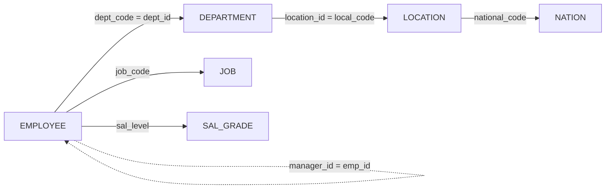
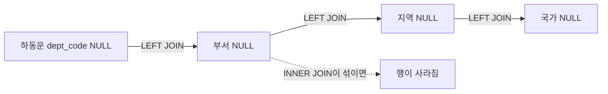

> 이 글은 **JOIN 실습 문제** devlog입니다.
> 문제는 총 14개로, 2개 테이블 `INNER JOIN`에서 시작해 4~5개 테이블 `LEFT JOIN` 연결과 `SELF JOIN`까지 단계적으로 어려워집니다. 문제에 JOIN 종류가 지정된 경우 그 JOIN을 써야 하고, 행 수가 같아도 지정된 JOIN이 아니면 다시 풀어야 합니다.
> **1~3번**은 내가 `04_MySQL/00_practice2.sql`에 직접 쓴 쿼리입니다(3번은 조건 컬럼만 고쳤습니다). **4~14번**은 시간이 부족해 풀이를 마치지 못해서, 배운 JOIN 문법으로 정리한 **예시 코드**입니다. 수업용 DB(`employeedb`) 스크립트의 데이터로 실행해서 행 수와 컬럼 수가 문제의 출력 예시와 모두 일치하는 것을 확인했습니다.

## 과제 한눈에 보기

| 번호 | 문제 요약 | JOIN 종류 | 테이블 수 | 행 수 |
|---|---|---|---|---|
| 1 | 사원의 부서명 | INNER | 2 | 21 |
| 2 | 직급이 대리인 사원 | INNER | 2 | 6 |
| 3 | 근무지역이 ASIA1인 사원 | INNER | 3 | 9 |
| 4 | 해외영업 부서, 급여 250만원 이상 | INNER | 3 | 6 |
| 5 | 부서 없는 사원까지 모든 사원의 부서명 | LEFT | 2 | 23 |
| 6 | 부서가 배정되지 않은 사원 | LEFT + INNER | 3 | 2 |
| 7 | 사원 없는 부서까지 모든 부서의 사원 | RIGHT | 2 | 24 |
| 8 | 사원이 한 명도 없는 부서의 지역과 국가 | RIGHT + INNER | 4 | 3 |
| 9 | 근무 국가가 한국이 아닌 사원 | INNER | 4 | 12 |
| 10 | 대리·사원의 부서와 국가 (부서 없는 사원 포함) | INNER + LEFT | 5 | 10 |
| 11 | 보너스를 받는 사원 (부서 없는 사원 포함) | LEFT + INNER | 3 | 9 |
| 12 | 대표·부사장·부장의 급여등급 범위 | INNER | 4 | 6 |
| 13 | 최소급여 400만원 이상 등급과 해당 사원 | RIGHT | 2 | 4 |
| 14 | 도전: 해외영업·기술지원 부서 사원의 관리자 | INNER + LEFT (SELF) | 3 | 12 |

💡 `INNER JOIN`은 연결 조건이 맞는 행만 남기고, `LEFT`/`RIGHT JOIN`은 기준이 되는 쪽 행을 전부 남깁니다. 14문제 전체가 "어떤 컬럼으로 이을까"와 "짝 없는 행을 남길까 버릴까" 두 가지 선택입니다.



⚠️ 짝이 없는 데이터를 미리 알아 두면 행 수를 설명하기 쉽습니다. 부서 없는 사원은 하동운, 이오리, 사원 없는 부서는 D3, D4, D7, 사원 없는 급여등급은 S2, S3입니다.

## 문제 1~4: INNER JOIN

### 1. 사원명과 부서명 조회 (2개 테이블)

#### 문제 상황
`INNER JOIN`으로 사원명과 부서명을 조회합니다. 결과는 21행, 2열이고, 사용 테이블은 `EMPLOYEE`, `DEPARTMENT`입니다.

#### 시도한 방법
```sql
desc tbl_employee;
desc tbl_department;

select
    emp_name,
    dept_title
from
    tbl_employee as e
    inner join
    tbl_department as d
    on e.dept_code = d.dept_id;
```

#### 해결 과정
🟢 먼저 `desc`로 두 테이블의 컬럼을 확인해서, 사원 쪽 `dept_code`와 부서 쪽 `dept_id`가 이어지는 컬럼이라는 것을 찾았습니다. 두 컬럼 이름이 달라서 이름만 보고는 연결 관계를 알기 어렵습니다.

⚠️ 전체 사원은 23명인데 결과는 21행입니다. 부서코드가 NULL인 하동운, 이오리는 연결할 부서가 없어서 `INNER JOIN`에서 빠집니다.

#### 배운 점
💡 `INNER JOIN`은 양쪽에서 짝이 맞는 행만 남기므로, 짝이 없는 행(NULL)은 결과에서 사라집니다. 행 수가 원본보다 줄어든 이유를 설명할 수 있어야 합니다.

### 2. 직급명이 '대리'인 사원 (2개 테이블)

#### 문제 상황
직급명이 '대리'인 사원의 사원명, 직급명, 급여를 조회합니다. 결과는 6행, 3열이고, 사용 테이블은 `EMPLOYEE`, `JOB`입니다.

#### 시도한 방법
```sql
desc tbl_employee;
desc tbl_job;

select
    emp_name, job_name, salary
from
    tbl_employee as e inner join tbl_job as j
    on e.job_code = j.job_code
where j.job_name = "대리";
```

#### 해결 과정
🟢 `EMPLOYEE`에는 직급코드(`job_code`)만 있고 직급명은 `JOB` 테이블에 있습니다. 두 테이블을 `job_code`로 연결해야 직급명(`job_name`)으로 행을 거를 수 있어서, `WHERE`에서 `j.job_name = "대리"`를 썼습니다.

🟢 직급코드(`J6`)가 아니라 직급명으로 거르는 것이 문제의 확인 포인트이고, 결과는 전형돈, 장쯔위, 하동운, 차태연, 전지연, 이태림 6행입니다.

#### 배운 점
💡 두 테이블에 같은 이름의 컬럼(`job_code`)이 있으면 `e.job_code`, `j.job_code`처럼 어느 테이블 것인지 별칭으로 구분해야 합니다.

### 3. 근무지역이 'ASIA1'인 사원 (3개 테이블)

#### 문제 상황
근무지역명이 'ASIA1'인 사원의 사원명, 부서명, 지역명을 조회합니다. 결과는 9행, 3열이고, 사용 테이블은 `EMPLOYEE`, `DEPARTMENT`, `LOCATION`입니다.

#### 시도한 방법
```sql
desc tbl_employee;
desc tbl_department;
desc tbl_location;

select
    emp_name, dept_title, local_name
from
    tbl_employee as e
    inner join
    tbl_department as d
    on e.dept_code = d.dept_id
    inner join
    tbl_location as l
    on
    d.location_id = l.local_code
where l.local_name = 'ASIA1';
```

#### 해결 과정
🟢 `EMPLOYEE`에는 지역 정보가 없습니다. 그래서 `EMPLOYEE → DEPARTMENT → LOCATION` 순서로 `INNER JOIN`을 두 번 이었고, 두 번째 연결은 부서의 `location_id`와 지역의 `local_code`를 맞췄습니다.

🔴 `where l.local_code = 'ASIA1'`로 걸면 0행이 나옵니다. 수업용 DB 스크립트에서 `local_code`의 값은 `L1`, `L2` 같은 코드이고, `ASIA1`은 지역명(`local_name`)의 값이기 때문입니다.

🟢 `where l.local_name = 'ASIA1'`로 바꾸면 9행이 나옵니다. ASIA1에는 마케팅부, 국내영업부도 있지만 소속 사원이 없어서 결과에 나오지 않고, 총무부·인사관리부·회계관리부 사원 9명이 나옵니다.

#### 배운 점
💡 컬럼 이름이 비슷해 보여도 `코드`와 `이름`은 값이 다릅니다. 조건을 걸기 전에 `select`로 실제 값을 확인하면 0행의 원인을 빨리 찾을 수 있습니다.

### 4. 해외영업 부서이면서 급여 250만원 이상 (3개 테이블)

#### 문제 상황
부서명이 '해외영업'으로 시작하고 급여가 250만원 이상인 사원의 사원명, 부서명, 직급명, 급여를 조회합니다. 결과는 6행, 4열이고, 사용 테이블은 `EMPLOYEE`, `DEPARTMENT`, `JOB`입니다.

#### 시도한 방법 (예시 코드)
```sql
select
    emp_name, dept_title, job_name, salary
from
    tbl_employee as e
    inner join
    tbl_department as d
    on e.dept_code = d.dept_id
    inner join
    tbl_job as j
    on e.job_code = j.job_code
where d.dept_title like '해외영업%'
  and e.salary >= 2500000;
```

#### 해결 과정
🟢 부서명과 직급명이 각각 다른 테이블에 있어서 `DEPARTMENT`와 `JOB`을 모두 `EMPLOYEE`에 이었습니다. 부서명 조건은 `like '해외영업%'`, 급여 조건은 `and`로 연결했습니다.

⚠️ 급여가 정확히 2,500,000인 김해술이 포함되어야 하므로 `>=`를 써야 합니다. 결과는 송은희, 유재식, 정중하, 김해술, 심봉선, 대북혼 6행입니다.

#### 배운 점
💡 `JOIN`으로 테이블을 이은 뒤에 `WHERE`로 조건을 거는 방식은 단일 테이블의 `WHERE`와 같습니다. 이어 붙인 결과를 하나의 큰 표로 생각하면 됩니다.

## 문제 5~8: LEFT / RIGHT JOIN

### 5. 부서가 없는 사원까지 모든 사원 (LEFT JOIN)

#### 문제 상황
`LEFT JOIN`으로 부서가 없는 사원까지 포함해 모든 사원의 사원명과 부서명을 조회합니다. 결과는 23행, 2열입니다.

#### 시도한 방법 (예시 코드)
```sql
select
    emp_name, dept_title
from
    tbl_employee as e
    left join
    tbl_department as d
    on e.dept_code = d.dept_id;
```

#### 해결 과정
🟢 1번의 `inner join`을 `left join`으로 바꿨습니다. 기준(왼쪽)인 `EMPLOYEE`의 행이 전부 남아서 하동운, 이오리가 부서명 NULL로 추가되고, 21행이 23행이 됩니다.

🔴 21행이 나왔다면 `INNER JOIN`으로 쓴 것입니다.

#### 배운 점
💡 `LEFT JOIN`은 `FROM` 뒤에 먼저 쓴 테이블(왼쪽)을 기준으로 모든 행을 남깁니다. 오른쪽에 짝이 없으면 그 컬럼이 NULL로 채워집니다.

### 6. 부서가 배정되지 않은 사원 (LEFT + INNER, 3개 테이블)

#### 문제 상황
부서가 배정되지 않은 사원의 사원명, 직급명, 급여를 조회합니다. 결과는 2행, 3열이고, 사용 테이블은 `EMPLOYEE`, `DEPARTMENT`, `JOB`입니다.

#### 시도한 방법 (예시 코드)
```sql
select
    emp_name, job_name, salary
from
    tbl_employee as e
    left join
    tbl_department as d
    on e.dept_code = d.dept_id
    inner join
    tbl_job as j
    on e.job_code = j.job_code
where d.dept_id is null;
```

#### 해결 과정
🟢 `LEFT JOIN`으로 부서가 없는 사원을 NULL 행으로 남기고, `WHERE d.dept_id is null`로 그 행만 골랐습니다. 직급명은 모든 사원이 가지고 있어서 `JOB`은 `INNER JOIN`으로 이어도 행이 줄지 않습니다.

🔴 `INNER JOIN`으로 부서를 연결하면 하동운, 이오리가 이미 빠져서 0행이 나옵니다.

#### 배운 점
💡 "짝이 없는 행 찾기"는 `LEFT JOIN`으로 NULL 행을 만든 뒤 `IS NULL`로 거르는 패턴입니다. NULL은 `= NULL`이 아니라 `IS NULL`로 비교한다는 규칙이 여기서도 그대로 쓰입니다.

### 7. 사원이 없는 부서까지 모든 부서 (RIGHT JOIN)

#### 문제 상황
`RIGHT JOIN`으로 사원이 없는 부서까지 포함한 모든 부서의 부서코드, 부서명, 소속 사원명을 조회합니다. 결과는 24행, 3열입니다.

#### 시도한 방법 (예시 코드)
```sql
select
    d.dept_id, dept_title, emp_name
from
    tbl_employee as e
    right join
    tbl_department as d
    on e.dept_code = d.dept_id
order by d.dept_id;
```

#### 해결 과정
🟢 `FROM` 뒤에 `EMPLOYEE`를 먼저 쓰고 `DEPARTMENT`를 `RIGHT JOIN`했습니다. 이제 기준은 오른쪽인 `DEPARTMENT`라서 사원이 있는 21행에, 사원이 없는 마케팅부, 국내영업부, 해외영업3부 3행이 사원명 NULL로 붙어 24행입니다.

⚠️ 부서가 없는 하동운, 이오리는 `DEPARTMENT` 쪽에 짝이 될 행이 없어서 나오지 않아야 합니다. 부서코드는 사원 쪽 `e.dept_code`가 아니라 부서 쪽 `d.dept_id`를 골라야 사원 없는 부서에서도 NULL이 되지 않습니다.

#### 배운 점
💡 `RIGHT JOIN`은 `LEFT JOIN`에서 테이블 순서만 바꾼 것과 같습니다. 이 문제는 `tbl_department as d left join tbl_employee as e`로 써도 같은 결과입니다.

### 8. 소속 사원이 한 명도 없는 부서의 지역과 국가 (RIGHT + INNER, 4개 테이블)

#### 문제 상황
소속 사원이 한 명도 없는 부서의 부서명, 지역명, 국가명을 조회합니다. 결과는 3행, 3열이고, 사용 테이블은 `EMPLOYEE`, `DEPARTMENT`, `LOCATION`, `NATION`입니다.

#### 시도한 방법 (예시 코드)
```sql
select
    dept_title, local_name, national_name
from
    tbl_employee as e
    right join
    tbl_department as d
    on e.dept_code = d.dept_id
    inner join
    tbl_location as l
    on d.location_id = l.local_code
    inner join
    tbl_national as n
    on l.national_code = n.national_code
where e.emp_id is null;
```

#### 해결 과정
🟢 7번의 결과에서 사원 쪽 값이 NULL인 부서만 남기고, 그 부서를 지역과 국가에 이어 붙였습니다. 사원이 없다는 판단은 `EMPLOYEE`의 기본키인 `e.emp_id is null`로 했습니다. 다른 컬럼은 원래 NULL일 수도 있지만 기본키는 NULL일 수 없어서 안전합니다.

🟢 결과는 마케팅부(ASIA1, 한국), 국내영업부(ASIA1, 한국), 해외영업3부(AMERICA, 미국) 3행입니다.

#### 배운 점
💡 JOIN은 앞에서 만든 결과 위에 계속 이어 붙는 구조입니다. `RIGHT JOIN`으로 만든 NULL 행도 부서 쪽 값은 있어서, 뒤의 `INNER JOIN`을 걸어도 행이 사라지지 않습니다.

## 문제 9~14: 3~5개 테이블 JOIN 종합

### 9. 근무 국가가 한국이 아닌 사원 (4개 테이블)

#### 문제 상황
근무 국가가 한국이 아닌 사원의 사원명, 부서명, 지역명, 국가명을 조회합니다. 결과는 12행, 4열이고, 사용 테이블은 `EMPLOYEE`, `DEPARTMENT`, `LOCATION`, `NATION`입니다.

#### 시도한 방법 (예시 코드)
```sql
select
    emp_name, dept_title, local_name, national_name
from
    tbl_employee as e
    inner join
    tbl_department as d
    on e.dept_code = d.dept_id
    inner join
    tbl_location as l
    on d.location_id = l.local_code
    inner join
    tbl_national as n
    on l.national_code = n.national_code
where n.national_name != '한국';
```

#### 해결 과정
🟢 `EMPLOYEE → DEPARTMENT → LOCATION → NATION`으로 세 번 연결했습니다. 국가 조건은 국가코드(`'KO'`)가 아니라 국가명(`'한국'`)으로 걸라는 것이 확인 포인트입니다. 3번과 같은 코드·이름 구분입니다.

🟢 `INNER JOIN`이라 부서 없는 하동운, 이오리는 빠지고, 일본·중국·러시아 근무자 12명이 나옵니다.

#### 배운 점
💡 테이블이 4개로 늘어도 연결 컬럼만 정확히 알면 같은 패턴을 반복하면 됩니다. 연결 순서는 ERD(또는 `desc`)에서 외래키를 따라가며 찾습니다.

### 10. 대리·사원의 부서와 국가, 부서 없는 직원 포함 (INNER + LEFT, 5개 테이블)

#### 문제 상황
직급명이 '대리' 또는 '사원'인 직원의 사원명, 직급명, 부서명, 국가명을 조회하되, 부서가 없는 직원도 포함합니다. 결과는 10행, 4열이고, 사용 테이블은 `EMPLOYEE`, `JOB`, `DEPARTMENT`, `LOCATION`, `NATION`입니다.

#### 시도한 방법 (예시 코드)
```sql
select
    emp_name, job_name, dept_title, national_name
from
    tbl_employee as e
    inner join
    tbl_job as j
    on e.job_code = j.job_code
    left join
    tbl_department as d
    on e.dept_code = d.dept_id
    left join
    tbl_location as l
    on d.location_id = l.local_code
    left join
    tbl_national as n
    on l.national_code = n.national_code
where j.job_name in ('대리', '사원');
```

#### 해결 과정
🟢 직급은 모든 사원에게 있으니 `INNER JOIN`, 부서부터는 NULL이 생길 수 있으니 `LEFT JOIN`으로 이었습니다. 하동운(대리), 이오리(사원)가 부서명과 국가명 NULL로 포함되어 10행이 됩니다.

🔴 `DEPARTMENT`까지만 `LEFT JOIN`하고 `LOCATION`이나 `NATION`을 `INNER JOIN`으로 이으면 8행이 나옵니다. 앞에서 생긴 NULL 행이 뒤의 `INNER JOIN`에서 다시 사라지기 때문입니다.



#### 배운 점
💡 한 번 `LEFT JOIN`을 쓴 뒤에는 그 뒤로 이어지는 모든 연결도 `LEFT JOIN`이어야 NULL 행이 끝까지 살아남습니다.

### 11. 보너스를 받는 사원, 부서 없는 사원 포함 (LEFT + INNER, 3개 테이블)

#### 문제 상황
보너스를 받는 사원의 사원명, 부서명, 직급명, 급여, 보너스를 조회하되, 부서가 없는 사원도 포함합니다. 결과는 9행, 5열이고, 사용 테이블은 `EMPLOYEE`, `DEPARTMENT`, `JOB`입니다.

#### 시도한 방법 (예시 코드)
```sql
select
    emp_name, dept_title, job_name, salary, bonus
from
    tbl_employee as e
    left join
    tbl_department as d
    on e.dept_code = d.dept_id
    inner join
    tbl_job as j
    on e.job_code = j.job_code
where e.bonus is not null;
```

#### 해결 과정
🟢 부서가 없는 하동운도 보너스(0.1)를 받으므로 `DEPARTMENT`는 `LEFT JOIN`이어야 합니다. 보너스 조건은 `IS NOT NULL`로 걸어서 9행이 나옵니다.

🔴 `INNER JOIN`으로 부서를 이으면 하동운이 빠져 8행이 나옵니다.

#### 배운 점
💡 "~도 포함"이라는 문구가 보이면 어느 테이블 기준으로 행을 남겨야 하는지부터 정하고, 그 방향으로 `LEFT`/`RIGHT`를 고릅니다.

### 12. 대표·부사장·부장의 급여등급 범위 (4개 테이블)

#### 문제 상황
직급명이 '대표', '부사장', '부장'인 사원의 사원명, 부서명, 직급명, 급여등급, 최소급여, 최대급여를 조회합니다. 결과는 6행, 6열이고, 사용 테이블은 `EMPLOYEE`, `DEPARTMENT`, `JOB`, `SAL_GRADE`입니다.

#### 시도한 방법 (예시 코드)
```sql
select
    emp_name, dept_title, job_name, e.sal_level, min_sal, max_sal
from
    tbl_employee as e
    inner join
    tbl_department as d
    on e.dept_code = d.dept_id
    inner join
    tbl_job as j
    on e.job_code = j.job_code
    inner join
    tbl_sal_grade as s
    on e.sal_level = s.sal_level
where j.job_name in ('대표', '부사장', '부장');
```

#### 해결 과정
🟢 `SAL_GRADE`는 `EMPLOYEE`의 `sal_level`로 연결합니다. 직급 조건은 `or`를 세 번 쓰는 대신 `in`으로 간단히 썼습니다.

⚠️ `sal_level`은 `EMPLOYEE`와 `SAL_GRADE` 양쪽에 있는 이름이라 `select`에서 `e.sal_level`처럼 별칭을 붙여야 합니다. 안 붙이면 어느 테이블 것인지 모호하다는 에러가 납니다. 부사장 노옹철은 급여등급이 S4라서 송종기(S1)와 범위가 다릅니다.

#### 배운 점
💡 연결에 쓰는 컬럼 이름이 양쪽 테이블에서 같으면(`sal_level`) `select`에도 별칭을 붙여야 합니다.

### 13. 최소급여 400만원 이상인 급여등급과 해당 사원 (RIGHT JOIN, 2개 테이블)

#### 문제 상황
`RIGHT JOIN`으로 최소급여가 400만원 이상인 급여등급의 급여등급, 최소급여, 최대급여, 해당 등급 사원명을 조회하되, 사원이 없는 등급도 포함합니다. 결과는 4행, 4열입니다.

#### 시도한 방법 (예시 코드)
```sql
select
    s.sal_level, min_sal, max_sal, emp_name
from
    tbl_employee as e
    right join
    tbl_sal_grade as s
    on e.sal_level = s.sal_level
where s.min_sal >= 4000000;
```

#### 해결 과정
🟢 기준은 `SAL_GRADE`이므로 `RIGHT JOIN`을 썼습니다. 최소급여가 400만원 이상인 등급은 S1, S2, S3이고, S1에는 사원이 2명(선동일, 송종기), S2와 S3에는 사원이 없어서 사원명이 NULL로 나옵니다. 합쳐서 4행입니다.

🔴 2행이 나왔다면 `INNER JOIN`을 썼거나, `WHERE`에서 사원 쪽 컬럼(`e.salary` 등)을 조건으로 건 것입니다. 사원 쪽 컬럼에 조건을 걸면 NULL 행이 걸러져서 `LEFT/RIGHT JOIN`의 의미가 사라집니다. 여기서는 등급 쪽 컬럼(`s.min_sal`)으로 걸었습니다.

#### 배운 점
💡 `WHERE`는 `JOIN`이 끝난 뒤에 적용되므로, 짝 없는 쪽(NULL이 될 쪽) 컬럼에 조건을 걸면 `OUTER JOIN`이 `INNER JOIN`처럼 동작합니다. 기준 쪽 컬럼에 조건을 걸어야 합니다.

### 14. 도전: 해외영업·기술지원 부서 사원의 관리자 (SELF JOIN)

#### 문제 상황
부서코드가 D5, D6, D8인 사원의 사원명, 부서명, 관리자 이름을 조회하되, 관리자가 없는 사원도 포함합니다. 결과는 12행, 3열이고, 사용 테이블은 `EMPLOYEE`(2번), `DEPARTMENT`입니다.

#### 시도한 방법 (예시 코드)
```sql
select
    e.emp_name, dept_title, m.emp_name as manager
from
    tbl_employee as e
    inner join
    tbl_department as d
    on e.dept_code = d.dept_id
    left join
    tbl_employee as m
    on e.manager_id = m.emp_id
where e.dept_code in ('D5', 'D6', 'D8');
```

#### 해결 과정
🟢 관리자도 `EMPLOYEE`에 있는 사원이라서, 같은 테이블을 별칭 `e`(사원)와 `m`(관리자) 두 개로 나눠 자기 자신과 이었습니다. 연결 조건은 사원의 `manager_id`와 관리자의 `emp_id`입니다.

🟢 대북혼은 관리자 사번이 없고, 이태림의 관리자 사번 `'100'`은 `EMPLOYEE`에 없는 번호라서 둘 다 관리자 이름이 NULL입니다. 관리자 연결을 `LEFT JOIN`으로 했기 때문에 이 2명이 남아 12행이 됩니다.

🔴 10행이 나왔다면 관리자 연결을 `INNER JOIN`으로 한 것입니다.

⚠️ 같은 테이블을 두 번 쓰므로 별칭이 없으면 `emp_name`이 어느 쪽인지 구분할 수 없습니다. 관리자 이름 컬럼에는 `as manager`로 이름도 붙였습니다.

#### 배운 점
💡 `SELF JOIN`은 새로운 문법이 아니라 같은 테이블에 별칭 두 개를 붙여 일반 `JOIN`처럼 쓰는 것입니다. 사원-관리자처럼 한 테이블 안의 계층 관계를 풀 때 씁니다.

## 더 학습하면 좋은 개념

- **OUTER JOIN과 WHERE의 적용 순서** — 13번처럼 `WHERE`가 `JOIN` 뒤에 적용되어 NULL 행을 걸러낼 수 있습니다. 조건을 `ON`에 둘지 `WHERE`에 둘지에 따라 `LEFT JOIN` 결과가 달라지는 이유를 이해하는 출발점입니다.
- **외래키(FOREIGN KEY)** — `dept_code`와 `dept_id`처럼 테이블을 잇는 컬럼은 보통 외래키로 정의합니다. 연결 관계를 컬럼 이름이 아니라 제약 조건으로 확인할 수 있습니다.
- **테이블 별칭(alias)과 컬럼 모호성** — 여러 테이블에 같은 컬럼명이 있을 때 `e.`, `d.`로 구분하는 이유입니다. 테이블이 3개 이상이 되면 필수입니다.
- **`EXPLAIN`으로 JOIN 실행 계획 보기** — 테이블이 커지면 어떤 순서·방식으로 JOIN하는지가 성능을 좌우합니다.
- **계층 데이터와 재귀 쿼리(`WITH RECURSIVE`)** — 14번의 `SELF JOIN`은 관리자 한 단계만 따라갑니다. 관리자의 관리자까지 끝까지 따라가려면 MySQL 8.0의 재귀 CTE가 필요합니다.

## 참고 자료

- [MySQL 8.4 공식 문서 - JOIN Clause](https://dev.mysql.com/doc/refman/8.4/en/join.html)
- [MySQL 8.4 공식 문서 - FOREIGN KEY Constraints](https://dev.mysql.com/doc/refman/8.4/en/create-table-foreign-keys.html)
- [MySQL 8.4 공식 문서 - EXPLAIN Statement](https://dev.mysql.com/doc/refman/8.4/en/explain.html)
- [MySQL 8.4 공식 문서 - WITH (Common Table Expressions)](https://dev.mysql.com/doc/refman/8.4/en/with.html)
