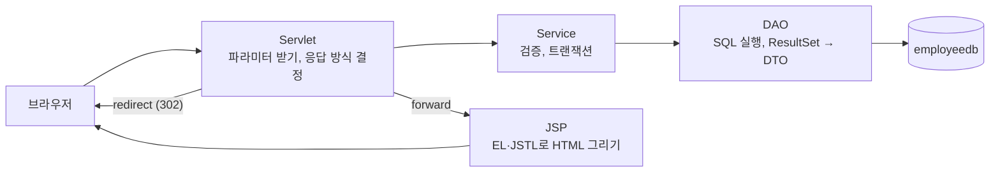
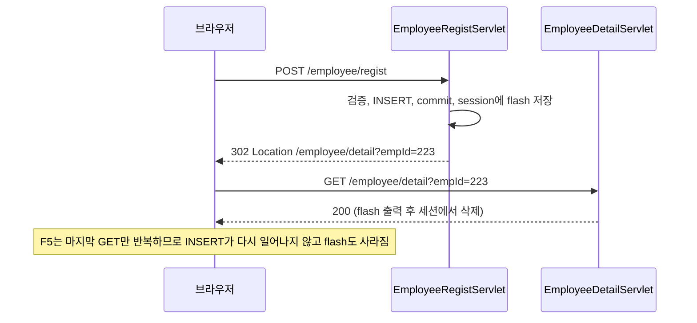

> 이 글은 **사원 관리 시스템 실습**(05_JDBC · 06_Servlet 복습 개인 과제)의 devlog입니다.
> `employeedb`로 사원 목록·상세·등록·수정·삭제를 처음부터 만드는 과제입니다. 조회는 forward, 데이터 변경은 redirect로 응답하는 이유와, redirect 뒤에 메시지를 한 번만 보여 주는 방법을 실험으로 확인하게 합니다.
> 문제 원문: [Claude Artifact — 사원 관리 시스템 실습](https://claude.ai/artifact/3nbAtniJ6G85gwD1pNEzAj?sk=m2OgIPnpZjoBJ23w_NPw-Q)

## 이 글이 다루는 것

이 과제는 단계마다 요구사항을 읽고 직접 구현하도록 만들어져 있지만, 나는 **정답 코드를 프로젝트로 옮겨서 완성**했다. 직접 한 것과 옮긴 것을 먼저 구분해 둔다.

| 단계 | 한 일 |
|---|---|
| STEP 01 · 준비 | IntelliJ에서 프로젝트를 만들고 `build.gradle`의 의존성을 MySQL 드라이버·JSTL로 바꿨다 (직접) |
| STEP 02 · 공통 설정 | `JDBCTemplate`, `QueryUtil`, `EncodingFilter`, `db-info.properties`를 정답 코드를 보고 직접 옮겨 작성했다 |
| STEP 03 · JSP 문법 | 읽기 단계라 코드가 없다. 문서 속 실험은 하지 않았다 |
| STEP 04~10 · 구현 | DTO, DAO, Service, Servlet 5개, JSP 5개를 정답 코드로 채웠다. 옮기는 작업은 Claude Code가 했다 |
| 확인 | 완성한 앱을 임시 Tomcat에 올려 HTTP 요청으로 문제의 "확인 포인트"를 검증했다. 검증 작업도 Claude Code가 했고, 결과는 아래 표에 정리했다 |

⚠️ 그래서 이 글의 "막혔던 점"에는 **직접 코드를 짜다 막힌 이야기가 없다.** 대신 프로젝트를 준비하고 검증하는 과정에서 실제로 마주친 문제만 적었다. 정답 코드의 일부 조각만 인용했고, 전체 코드는 문제 원문의 "정답 코드 보기"에 있다.

## 과제 한눈에 보기

규칙은 하나다. **조회는 forward, 데이터 변경(DML)은 redirect, 검증 실패는 forward로 폼에 되돌린다.**

| 화면·기능 | 요청 | 응답 방식 |
|---|---|---|
| 목록 | `GET /employee/list` | forward → `list.jsp` |
| 상세 | `GET /employee/detail?empId=` | forward, 없으면 404 |
| 등록 | `GET`·`POST /employee/regist` | 성공 redirect → 상세, 실패 forward → 폼 |
| 수정 | `GET`·`POST /employee/modify` | 성공 redirect → 상세, 실패 forward → 폼 |
| 삭제 | `POST /employee/delete` | redirect → 목록 |

콘솔로 만들었던 `chap03-crud`의 Controller → Service → DAO 구조를 그대로 쓰고, 화면 출력(View)만 Servlet + JSP가 맡는다.



## STEP 01~02. 준비와 공통 설정

### 문제 상황

`employeedb`를 쓰는 웹 프로젝트를 만들고, DB 접속·쿼리·인코딩을 한곳에 모으는 공통 코드를 갖춰야 한다. 수업 때 쓴 `chap03-crud`의 `JDBCTemplate`, `QueryUtil`을 재사용하고, SQL은 자바 코드에 쓰지 않고 `queries.xml`에 모은다.

### 시도한 방법

`build.gradle`의 의존성을 이렇게 나눴다.

```groovy
compileOnly('jakarta.servlet:jakarta.servlet-api:6.1.0')
implementation 'com.mysql:mysql-connector-j:8.4.0'
implementation 'jakarta.servlet.jsp.jstl:jakarta.servlet.jsp.jstl-api:3.0.2'
implementation 'org.glassfish.web:jakarta.servlet.jsp.jstl:3.0.1'
```

Servlet API는 Tomcat이 이미 가지고 있어서 컴파일할 때만 필요하다(`compileOnly`). MySQL 드라이버와 JSTL은 Tomcat에 없으므로 war 안(`WEB-INF/lib`)에 같이 넣는다(`implementation`).

`JDBCTemplate`의 `static` 블록에는 `Class.forName("com.mysql.cj.jdbc.Driver")` 한 줄이 추가된다. 콘솔 프로젝트에서는 필요 없었지만, Tomcat 위에서는 드라이버가 웹 애플리케이션 안에 들어 있어서 `DriverManager`가 자동으로 찾지 못하는 경우가 있기 때문이다.

### 막혔던 점

🔴 **프로젝트 템플릿이 달랐다.** 처음 생성된 프로젝트에는 REST(JAX-RS) 템플릿이 붙인 Jersey·Weld 의존성과 `HelloApplication.java`, `HelloResource.java`, `META-INF/beans.xml`이 들어 있었고, MySQL 드라이버와 JSTL은 없었다. 이 실습에는 쓰지 않는 파일이라 `dependencies`를 위 네 줄로 바꾸고 나머지는 지웠다.

🔴 **DB 접속 비밀번호가 틀렸다.** `db-info.properties`의 `db.password`가 DB의 `wanted` 계정 비밀번호와 달랐다. 같은 계정으로 `mysql` 클라이언트에 접속해 보니 `Access denied for user 'wanted'@'localhost'`가 나왔고, 수업에서 쓰는 비밀번호로 바꾸자 접속됐다. 문제 원문의 "자주 만나는 오류"에도 `Access denied`는 계정·비밀번호를 확인하라고 적혀 있다.

⚠️ `sourceCompatibility`가 `'8'`로 생성돼 있었는데 Tomcat 11과 JDK 17 기준에 맞춰 `'17'`로 바꿨다.

### 해결 과정

🟢 `SELECT COUNT(*) FROM tbl_employee;`는 **23**, 재직자(`ent_yn = 'N'`)는 **22**로 문제가 안내한 값과 같았다. 완성한 war를 Tomcat에 올리면 `/`가 `/employee/list`로 이동했다.

## STEP 04~06. 조회: 목록과 상세

### 문제 상황

재직자만 사번순으로 보여 주고, 부서가 없는 사원은 "미배정"으로 나와야 한다. 상세에서는 주민등록번호 뒷자리를 가리고, 보너스율이 `NULL`이면 "없음", 있으면 %로 보여 줘야 한다.

### 시도한 방법

부서가 없는 사원이 목록에서 사라지지 않도록 부서는 `LEFT JOIN`, 직급은 `JOIN`으로 가져온다.

```sql
SELECT E.EMP_ID, E.EMP_NAME, D.DEPT_TITLE, J.JOB_NAME
FROM tbl_employee E
LEFT JOIN tbl_department D ON E.DEPT_CODE = D.DEPT_ID
JOIN tbl_job J ON E.JOB_CODE = J.JOB_CODE
WHERE E.ENT_YN = 'N'
ORDER BY E.EMP_ID
```

`BONUS`는 `NULL`일 수 있는 숫자 컬럼이라 `getDouble()`만 쓰면 안 된다. 읽은 직후 `wasNull()`로 확인한다.

```java
double bonus = rset.getDouble("BONUS");
emp.setBonus(rset.wasNull() ? null : bonus);   // DTO 필드는 래퍼 타입 Double
```

### 해결 과정

🟢 확인 포인트를 요청으로 검증한 결과는 이렇다.

| 확인 포인트 | 결과 |
|---|---|
| 목록 인원 | 22명 |
| 하동운(213), 이오리(218) | 부서 "미배정" |
| 이태림(222) | 퇴사자라 목록에 없음 |
| 선동일(200) 급여 | `8,000,000원 (S1)`, 보너스율 `30%`, 입사일 `1990년 02월 06일` |
| 201번 | 보너스율 "없음"(0%가 아님) |
| 없는 사번·사번 없음 | 404 |
| `/WEB-INF/views/employee/list.jsp` 직접 접근 | 404 |

### 막혔던 점

🔴 확인용 클라이언트(`curl`)로 상세를 처음 요청했을 때 급여가 `8000000원`, 보너스가 `0.3`, 날짜가 `1990-02-06`으로 **서식 없이** 나왔다. `<fmt:formatNumber>`와 `<fmt:formatDate>`가 동작하지 않는 것처럼 보였지만 코드 문제가 아니었다. JSTL `fmt`는 서식을 정할 로케일을 요청의 `Accept-Language` 헤더 등에서 찾는데, `curl`에는 그 헤더가 없어서 값을 그대로 출력한 것이다. `Accept-Language: ko-KR`을 붙여 다시 요청하자 콤마·%·한글 날짜가 나왔다. 브라우저는 항상 이 헤더를 보내서 화면에서는 문제가 없다.

### 배운 점

💡 `PreparedStatement`로 NULL을 다룰 때는 읽을 때(`wasNull`)와 쓸 때(`setNull`)를 따로 챙겨야 한다. 래퍼 타입 `Double`로 "값 없음"과 "0"을 구분할 수 있다는 점이 DTO 설계와 이어진다.

💡 JSP를 `/WEB-INF/views` 아래에 두면 주소창으로 직접 열 수 없고 **서블릿을 거쳐 forward로만** 열린다. 그래서 JSP는 데이터가 준비된 상태에서만 실행된다.

## STEP 07~08. 등록과 PRG, 그리고 redirect 뒤의 메시지

### 문제 상황

등록 성공 뒤 새로고침해도 사원이 또 등록되면 안 되고, 검증에 실패하면 입력값이 남은 채 폼으로 돌아와야 한다. 성공하면 "등록되었습니다" 메시지를 한 번만 보여 줘야 한다.

### 시도한 방법

성공은 redirect, 실패는 forward로 나눈다. 실패는 forward라서 `request`를 공유하므로 `${param.empName}`으로 이전 입력값을 그대로 꺼낼 수 있다.

```java
try {
    String empId = employeeService.registEmployee(emp);
    req.getSession().setAttribute("flash", "사원이 등록되었습니다. (사번 " + empId + ")");
    resp.sendRedirect(req.getContextPath() + "/employee/detail?empId=" + empId);
} catch (IllegalArgumentException e) {
    req.setAttribute("errorMessage", e.getMessage());
    doGet(req, resp);   // forward 로 폼을 다시 보여 준다
}
```

redirect는 새 요청이라 `request`에 담은 메시지가 전달되지 않는다. 그래서 `session`에 담고, 모든 화면이 공통으로 쓰는 `header.jsp`가 **보여 준 뒤 바로 지운다.**

```html
<c:if test="${not empty flash}">
    <p>${flash}</p>
    <c:remove var="flash" scope="session"/>
</c:if>
```

등록은 여러 SQL(급여등급 조회, 사번 생성, INSERT)을 한 작업으로 묶어야 해서 Service에서 자동 커밋을 끄고 직접 commit·rollback 한다. 사번은 문자열 컬럼이라 `MAX(EMP_ID)`를 그냥 쓰면 `'99'`가 `'223'`보다 크다. 그래서 숫자로 바꿔 최댓값에 1을 더한다.

```sql
SELECT IFNULL(MAX(CAST(EMP_ID AS UNSIGNED)), 199) + 1 AS NEXT_ID FROM tbl_employee
```



### 해결 과정

🟢 검증한 결과다. 시험으로 사번 223을 등록·수정·삭제했고, 끝난 뒤 DB는 원래대로 전체 23명, 재직 22명이었다.

| 확인 포인트 | 결과 |
|---|---|
| 급여 500000으로 등록 | "급여는 1,000,000 ~ 10,000,000 원 사이로…" 메시지, 입력했던 이름 유지 |
| 주민번호를 하이픈 없이 입력 | 형식 오류 메시지 |
| 정상 입력 | 302, `Location: /employee/detail?empId=223` |
| 상세 화면 | 등록 메시지, 급여등급 S4, 부서 미배정, 보너스율 없음 |
| 상세에서 새로고침 | 메시지가 사라지고 목록은 23명 그대로 |

### 막혔던 점

🔴 한글 이름을 POST로 보내는 확인 요청이 처음에는 **400 오류**(`MalformedInputException`)를 냈다. 서버 코드 문제가 아니라, 확인용 클라이언트가 본문을 UTF-8이 아닌 인코딩으로 보냈기 때문이다. `EncodingFilter`가 요청을 UTF-8로 읽도록 정해 두므로, 본문이 UTF-8이 아니면 파싱에서 실패한다. UTF-8로 인코딩해 보내자 정상 처리됐다.

⚠️ 첫 방문에서는 Tomcat이 redirect 주소 끝에 `;jsessionid=…`를 붙여 응답했다. 쿠키를 아직 받기 전이라 세션 ID를 주소에 실어 보내는 동작이고, 쿠키가 생기면 사라진다.

### 배운 점

💡 redirect는 **새로운 요청**이라서 이전 `request`를 모른다. 그래서 redirect 뒤에 값을 넘기려면 `session`처럼 요청보다 오래 사는 저장소를 써야 하고, "한 번만 쓰고 지우는 값"은 쓰고 나서 직접 지워야 한다(flash attribute).

💡 DML을 redirect로 응답하는 이유는 새로고침 때문이다. forward로 응답하면 새로고침이 "POST 다시 보내기"가 된다. 이 흐름이 **PRG(Post → Redirect → Get) 패턴**이다.

⚠️ 문제 원문의 실험 A·B(성공을 forward로, 실패를 redirect로 바꿔 보기)는 하지 않았다. 위 설명은 코드와 문서에서 읽은 것이고, 직접 바꿔서 확인한 것이 아니다.

## STEP 09~10. 수정과 삭제

### 문제 상황

수정 폼에는 기존 값이 채워져 있어야 하고, 주민번호와 입사일은 보여 주기만 해야 한다. 삭제는 주소만 알면 누구나 실행되는 일이 없도록 해야 한다.

### 시도한 방법

수정은 등록과 같은 구조다. GET은 `emp`를 담아 forward, POST는 성공 시 redirect, 실패 시 forward한다. 수정 폼의 값은 `param`이 아니라 `emp`에서 꺼내고, 부서·직급 선택 상자는 `selected`를 비교해서 출력한다.

```html
<option value="${dept.deptId}" ${dept.deptId eq emp.deptCode ? 'selected' : ''}>${dept.deptTitle}</option>
```

삭제 서블릿은 `doPost`만 구현한다. 링크(GET)로 만들면 주소만 알아도, 브라우저의 미리 불러오기나 크롤러가 따라가는 것만으로도 삭제될 수 있기 때문이다.

### 해결 과정

🟢 검증한 결과다.

| 확인 포인트 | 결과 |
|---|---|
| 200번 수정 폼 | 부서 "총무부" 선택됨, 보너스율 `0.3` |
| 223번 급여를 6500000으로 수정 | 302 후 "사원 정보가 수정되었습니다." 와 급여등급 S1 |
| 급여를 20000000으로 수정 | 수정 폼에 오류 메시지, DB 값은 6,500,000 그대로 |
| `GET /employee/delete?empId=200` | **405** (GET 미지원) |
| 223번 삭제 | 목록으로 redirect, "사번 223 사원이 삭제되었습니다.", 22명 |
| 목록에서 새로고침 | 메시지만 사라짐 |
| 이미 없는 사원 삭제 | "삭제할 사원이 없습니다." |

### 배운 점

💡 같은 폼 화면이라도 등록은 `param`(방금 입력한 값), 수정은 `emp`(DB에서 읽은 값)에서 값을 꺼낸다. 수정이 실패했을 때 DB 값으로 돌아가는 현재 동작은 도전 과제 7번이 개선하라고 하는 부분이다.

## 확인 결과 한눈에

완성한 앱을 임시 Tomcat에 올려 HTTP 요청으로 **검증 항목 34개**(문제의 확인 포인트를 요청 단위로 나눈 것이라, 위 표의 행 수와는 다르다)를 확인했고 모두 통과했다. 브라우저 화면을 눈으로 확인한 것은 아니다.

| 구분 | 상태 |
|---|---|
| STEP 01~02 준비·공통 설정 | 완료 (프로젝트·의존성·공통 클래스) |
| STEP 04~10 구현 | 정답 코드로 완성, 확인 포인트 검증 완료 |
| STEP 03 JSP 실험 (list_jsp.java 열어 보기) | 하지 않음 |
| 실험 A~E (forward/redirect 바꾸기, 세션 쿠키 지우기 등) | 하지 않음 |
| 도전 과제 7개 (검색, 필터, 퇴사 처리, 페이징, 로그인 등) | 하지 않음 |

## 더 학습하면 좋은 개념

- **PRG 패턴과 HTTP 상태 코드(302·303·307)** — DML 뒤 redirect가 왜 `GET`으로 이어지는지, POST를 보존하는 redirect는 무엇이 다른지 알아야 오늘 규칙("변경은 redirect")의 근거가 선명해진다.
- **트랜잭션과 격리 수준** — 등록이 `MAX + 1`로 사번을 만드는 방식은 두 사람이 동시에 등록하면 사번이 겹칠 수 있다. `AUTO_INCREMENT`나 락이 필요한 이유를 이해하는 출발점이다.
- **XSS와 출력 이스케이프(`c:out`, `fn:escapeXml`)** — 입력값을 그대로 `${...}`로 출력하면 스크립트가 실행될 수 있다. 오늘 정답 코드가 입력값 출력에만 `c:out`을 쓰는 이유를 알 수 있다.
- **JSTL `fmt`와 로케일** — 서식이 요청의 언어 설정에 따라 달라진다는 점을 알면 화면마다 숫자·날짜 표기가 다른 문제를 설명할 수 있다.
- **필터를 이용한 인증(도전 과제 6)** — 17일차에 배운 `LoginFilter`로 등록·수정·삭제를 로그인한 사용자만 하게 만드는 다음 단계다.

## 참고 자료

- [Jakarta Servlet 6.1 명세](https://jakarta.ee/specifications/servlet/6.1/jakarta-servlet-spec-6.1.html)
- [Jakarta Tags(JSTL) 명세](https://jakarta.ee/specifications/tags/)
- [Java SE 21 — ResultSet API](https://docs.oracle.com/en/java/javase/21/docs/api/java.sql/java/sql/ResultSet.html) — `wasNull()`
- [MDN - HTTP 리다이렉션](https://developer.mozilla.org/ko/docs/Web/HTTP/Guides/Redirections)
