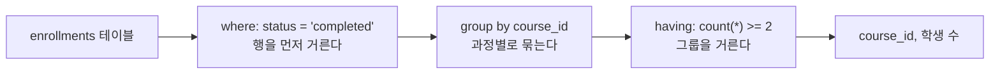
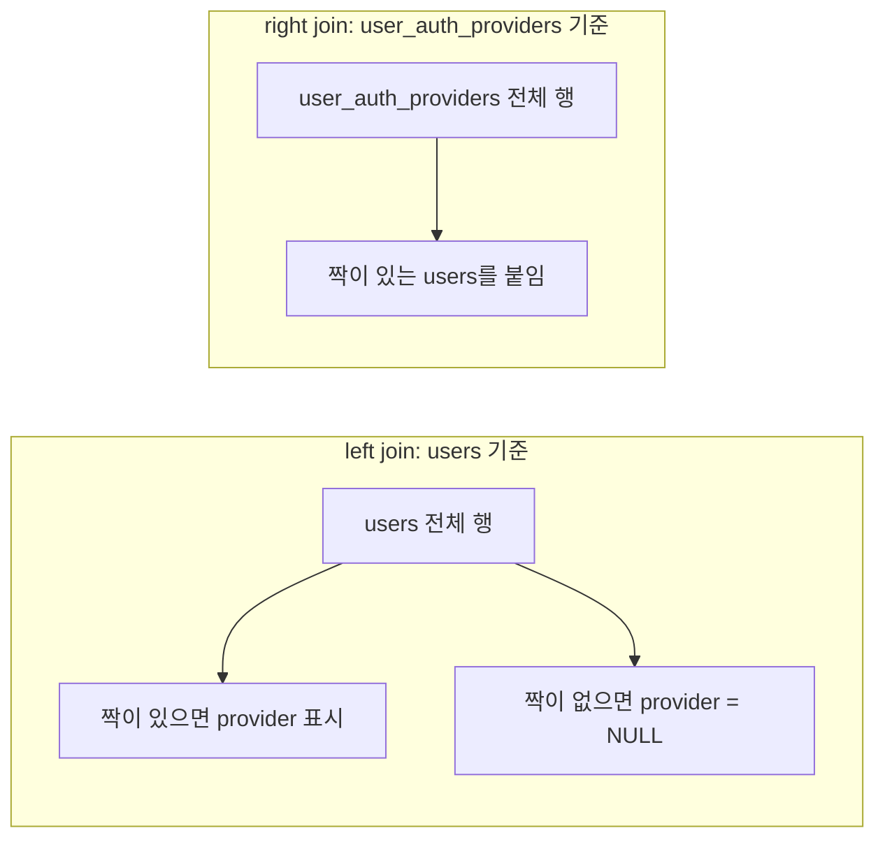

# 오늘 배운 것: SQL로 조회하기: SELECT부터 GROUP BY·JOIN까지

## 들어가며 (Situation)

모듈 2 9일차. 지난 8일차까지는 자바 안에서 데이터를 다뤘다. 오늘부터는 데이터를 자바 밖, 데이터베이스에 두고 꺼내 쓰는 방법인 **SQL**을 시작했다. 노션 `4. SQL_이해하기` 폴더를 따라가며, MySQL에서 실습 쿼리를 직접 타이핑했다.

쿼리를 치기 전에, 데이터베이스가 왜 필요한지부터 짚고 시작했다. 이 내용은 [왜 데이터베이스가 필요할까? JVM 메모리와 데이터의 수명](https://claude.ai/artifact/F49HUztyDnjxtbMEaYqyW3) 아티팩트로 정리했고, 아래 해결 과정 1번에 요약한다.

- `01_select.sql` — `select`, `as`, 기본 함수
- `02_orderby.sql` — `order by`, NULL 정렬
- `03_where.sql` — 조건절과 비교·논리·`like`·`in`·`between`·NULL 연산자
- `04_distinct.sql` — 중복 제거
- `05_limit.sql` — 결과 개수 제한
- `06_grouping.sql` — 집계 함수, `group by`, `having`
- `07_Join.sql` — `join`, `left join`, `right join`, NULL 비교



실습 테이블은 두 종류다. 메뉴 예제(`tbl_menu`, `tbl_category`)로 `select`부터 `limit`까지 하고, LMS 예제(`users`, `courses`, `grades`, `enrollments`)로 `group by`와 `join`을 했다. 오늘은 `limit`만 처음 보는 개념이었고, 나머지는 막힘 없이 따라갔다.

## 문제 상황 (Task)

실습 코드의 주석이 던진 질문으로 오늘의 과제를 정리한다.

- 서버를 껐다 켜면 `ArrayList`에 담아 둔 회원은 어디로 가는가. 자바만으로는 왜 부족하고, 왜 데이터베이스가 필요한가
- 원하는 **열(정보의 종류)** 과 **행(정보의 범위)** 만 어떻게 가져오는가
- 수백만 건을 한 번에 조회하면 시스템에 부하가 크다. 개수를 어떻게 제한하는가
- "총 사용자 수", "가장 많이 신고당한 사람"처럼 **행 전체를 요약**한 값은 어떻게 구하는가
- 데이터가 여러 테이블에 나뉘어 저장되어 있다. 과정 제목과 그 과정을 만든 교육자 이름처럼 **테이블을 가로질러** 어떻게 합쳐 보는가

## 해결 과정 (Action)

### 1. 먼저 왜 데이터베이스가 필요한가

🔗 [아티팩트 바로가기: 왜 데이터베이스가 필요할까? JVM 메모리와 데이터의 수명](https://claude.ai/artifact/F49HUztyDnjxtbMEaYqyW3)

아티팩트는 회원 관리 서비스를 예로 든다. 회원 목록은 `new ArrayList<>()`로 만든 리스트에 들어 있고, 이 리스트도 결국 JVM 메모리 안의 객체다. 서버를 재시작하면 리스트가 새로 만들어지므로 가입한 회원이 모두 사라진다.

JVM은 운영체제에게서 메모리를 빌려 세 구역으로 나눠 쓴다. 구역마다 생기고 사라지는 때가 다르다.

| 구역 | 무엇이 사나요 | 언제 사라지나요 |
|------|--------------|----------------|
| Stack | 지역변수, 매개변수, 참조변수 | 메서드가 끝날 때 |
| Heap | `new`로 만든 객체 | 아무도 참조하지 않아 GC가 수거할 때 |
| Method Area | 클래스 정보, `static` 변수 | JVM이 종료될 때 |

🔴 가장 오래 사는 `static` 변수도 JVM보다 오래 살 수 없다. JVM 프로세스가 끝나면 OS가 메모리를 회수하고, RAM 자체도 전원이 꺼지면 내용이 지워지는 **휘발성** 메모리다. "서버를 절대 끄지 않으면 되지 않나"도 답이 아니다. 배포, 보안 업데이트, 장애, 정전으로 JVM은 반드시 꺼지고, Heap 크기는 정해져 있어서 회원이 계속 늘면 `OutOfMemoryError`가 난다.

그럼 파일(`members.txt`)에 저장하면 어떨까. 파일은 디스크에 남으니 **영속성** 문제는 풀린다. 하지만 여러 사람이 동시에 쓰는 서비스에서는 새 문제가 생긴다.

| 상황 | 파일로 처리하면 |
|------|----------------|
| 재고 1개인 상품을 A·B가 동시에 주문 | 두 요청이 같은 값을 읽고 고쳐서 서로 덮어쓴다 |
| 회원 100만 명 중 한 명 찾기 | 처음부터 한 줄씩 읽어 비교한다 |
| 서버를 2대로 늘림 | 서버마다 자기만의 파일이 있어 데이터가 갈라진다 |
| 이체 도중(①철수 잔액 빼기, ②영희 잔액 더하기 사이) 서버가 멈춤 | 돈이 사라진 채 반쪽짜리 데이터가 남는다 |

💡 파일은 영속성만 해결해 준다. 동시 수정, 빠른 검색, 여러 서버의 공유, 작업 도중의 장애까지 직접 해결하려면 결국 데이터베이스를 직접 만드는 셈이다. 그래서 이 일을 전문으로 하는 프로그램인 **DBMS**를 쓰고, 우리가 배울 MySQL이 DBMS다.

- **영속성 (Persistence)**
  - 디스크에 저장해 프로그램이 꺼져도 데이터를 남기는 성질입니다.
  - MySQL은 Java와 별개로 실행되는 서버 프로세스라서 Java 서버를 몇 번 재시작해도 데이터가 그대로입니다.

- **트랜잭션 (Transaction)**
  - 여러 번의 저장을 전부 성공하거나 전부 취소하는 하나의 작업으로 묶는 기능입니다.
  - `START TRANSACTION`, `COMMIT`, `ROLLBACK`으로 다루며, 이체 도중 멈춰도 반쪽짜리 데이터가 남지 않습니다.

- **무결성 (Integrity)**
  - 테이블에 규칙을 선언해 두면 DB가 어긴 데이터를 거부하는 기능입니다.
  - `PRIMARY KEY`, `NOT NULL`, `UNIQUE`, `CHECK`가 그 예입니다.

그 밖에 DB가 주는 것은 책 뒤의 찾아보기처럼 위치를 바로 찾는 **빠른 검색**(인덱스), 여러 서버가 같은 DB를 쓰는 **공유**, 원하는 데이터만 꺼내는 **쿼리**(SQL), 잠금으로 순서를 지키는 **동시성 제어**, 계정별 권한과 백업을 쓰는 **보안과 복구**다.

역할은 이렇게 나뉜다. Java는 요청을 받아 데이터를 처리하고, DB는 데이터를 안전하게 보관한다. 아티팩트는 열람실 책상(JVM 메모리)과 서고(데이터베이스)로 비유한다. 책상 위는 문 닫을 때 치워지지만, 서고는 정해진 규칙대로 오래 보관한다. 신청서(SQL)를 내면 사서(DBMS)가 찾아서 꺼내 준다. 객체와 테이블은 이렇게 대응한다.

| Java | MySQL |
|------|-------|
| 클래스 (`Member`) | 테이블 (`member`) |
| 필드 | 컬럼 |
| 객체 | 행(Row) |

이제부터 배울 SQL이 바로 그 신청서다.

### 2. SELECT와 ORDER BY: 열을 고르고 줄 세운다

`select`는 "무엇을(컬럼) 어디에서(테이블) 조회해줘"로 읽는다. `*`는 모든 열이고, `as`로 결과 열에 별칭을 붙인다.

```sql
select
	menu_name as '메뉴이름',
    menu_price as '가격'
from
	tbl_menu;
```

`order by`는 기본이 `asc`(오름차순)이고 `desc`가 내림차순이다. 계산식에 별칭을 붙이고 그 별칭으로 정렬하는 것도 해 봤다.

```sql
select
	menu_code,
    menu_price,
    menu_code * menu_price as `연산결과`
from
	tbl_menu
order by
	`연산결과` desc;
```

NULL이 있는 열을 정렬할 때는 정렬 기준에 `is null`을 쓴다. 실습 주석대로 `order by ref_category_code is null asc`를 쓰면 NULL이 뒤로 빠지고 나머지가 오름차순으로 정렬된다.

### 3. WHERE: 어떤 행을 가져올 것인가

수업 주석은 select를 이렇게 정리한다. 핵심은 두 가지, **어떤 열을 가져올 것인가**와 **어떤 행을 가져올 것인가**다. `where`가 두 번째를 맡는다.

| 연산자 | 뜻 | 실습에서 쓴 예 |
|--------|-----|---------------|
| `=`, `!=`, `<>` | 같다 / 같지 않다 | `orderable_status = 'Y'` |
| `>`, `<`, `>=`, `<=` | 크기 비교 | `menu_price <= 13000` |
| `and`, `or` | 조건을 모두 / 하나라도 만족 | `orderable_status = 'Y' or category_code = 10` |
| `between` | 두 값 사이 | `menu_price between 10000 and 20000` |
| `like` | 패턴 포함 | `menu_name like '생마늘%'` |
| `in` | 목록 중 하나와 일치 | `category_code not in(4,5,6)` |
| `is null`, `is not null` | NULL 여부 | `ref_category_code is not null` |

`like`의 `%` 위치가 뜻을 정한다. `단어%`는 단어로 **시작**, `%단어`는 단어로 **끝남**, `%단어%`는 단어를 **포함**한다.

🔴 NULL은 `= null`로 비교하지 않는다. NULL 여부는 `is null`, `is not null`로 확인한다.

같은 조건을 `or`와 `and`로 바꿔 실행해 본 것도 의미가 있었다. `판매상태 = 'Y' or 카테고리 = 10`과 `판매상태 = 'Y' and 카테고리 = 10`은 같은 테이블에서도 가져오는 행의 범위가 달라진다.

### 4. DISTINCT: 중복을 제거한다

```sql
select
	distinct category_code
from
	tbl_menu
order by
	category_code;
```

`distinct`가 없으면 메뉴마다 카테고리 코드가 한 줄씩 나오고, 있으면 코드 종류만 한 번씩 나온다.

### 5. LIMIT: 개수를 제한한다 (오늘 처음 본 개념)

`limit`는 조회 결과의 개수를 제한한다. 수업 주석에 따르면 "상위 5개만", "1페이지에 10개만" 같은 **웹·앱의 페이징 기능을 만들 때 필수**다.

```sql
-- 가격이 비싼 상위 5개
select * from tbl_menu
order by menu_price desc
limit 5;

-- limit [offset, ] row_count
select * from tbl_menu
order by menu_price desc
limit 1,5;
```

`limit offset, row_count`에서 offset은 시작할 행의 **인덱스 번호**다. 인덱스는 0부터 세므로 `limit 1,5`는 **두 번째 행부터 5개**를 가져온다. 수업에서 설명을 듣고, 두 쿼리를 모두 실행해 결과로 확인했다.

💡 `limit`는 `order by` 뒤에 둔다. "정렬한 결과의 상위 N개"가 되기 때문이다.

### 6. GROUP BY와 HAVING: 행을 묶어서 요약한다

집계 함수는 여러 행을 하나의 값으로 요약한다.

| 함수 | 하는 일 |
|------|---------|
| `count(컬럼)` | 데이터 개수 (NULL 제외) |
| `sum(컬럼)` | 합계 |
| `avg(컬럼)` | 평균 |
| `max(컬럼)` | 최댓값 |
| `min(컬럼)` | 최솟값 |

```sql
-- 과정을 등록한 교육자가 중복 없이 몇 명인가
select count(distinct author_id) as '총 교육자 수'
from courses;

-- 제출물의 총점과 평균
select sum(score) as '총점', avg(score) as '평균'
from grades;
```

실습 파일에는 주석으로 따로 표시한 **에러 케이스**도 들어 있다.

```sql
select
	name,
    count(*) as '총 사용자 수'
from
	users;
```

🔴 비집계 컬럼(`name`)과 집계 함수(`count(*)`)를 같이 쓰면 에러가 난다. 주석의 설명은 "어떤 `name` 값을 `count(*)`와 함께 묶어야 할지 모르기 때문"이다.

묶는 기준을 알려 주는 것이 `group by`다. 특정 열을 기준으로 그룹을 만들고, 그룹마다 집계 함수를 적용한다.

```sql
-- status별 사용자 수
select status, count(*) as '사용자 수'
from users
group by status;

-- 교육자별 개설 강좌 수
select author_id as '교육자 번호', count(*) as '개설 강좌 수'
from courses
group by author_id;
```

그룹을 만든 뒤에 거르려면 `having`을 쓴다. 수업 주석이 정리한 차이는 이렇다.

| 항목 | `where` | `having` |
|------|---------|----------|
| 거르는 시점 | 그룹으로 묶기 **전** | 그룹으로 묶은 **후** |
| 대상 | 개별 행 | 그룹(집계 결과) |
| 집계 함수 조건 | 쓸 수 없음 | `count(*) >= 3`처럼 쓸 수 있음 |

둘을 한 쿼리에 같이 쓴 예제가 이 차이를 가장 잘 보여 줬다.

```sql
-- 'completed' 상태인 과정 중, 2명 이상이 등록한 과정과 학생 수
select
	course_id,
    count(*) as '학생 수'
from enrollments
where
	status = 'completed'
group by
	course_id
having
	count(*) >= 2;
```



🔴 **타이핑 실수:** 개설 강좌 수가 3개 이상인 교육자를 구하는 `having` 예제에서 `author_id`가 아니라 `course_id`로 묶어 적었다. `course_id`가 과정마다 하나뿐인 값이라면 그룹마다 `count(*)`가 1이라서 `>= 3` 조건을 만족하는 행이 없다. 교육자별로 묶으려면 `author_id`로 적어야 한다.

### 7. JOIN: 나뉜 테이블을 합친다

실제 데이터베이스는 비슷한 의미의 데이터를 테이블별로 나눠 저장한다. `join`은 두 테이블에 **공통으로 들어 있는 값**을 기준으로 합쳐 하나의 결과 집합으로 만든다.

`courses.author_id`는 `users.user_id`를 가져온 값이다. 이런 열을 **외래키(FK)** 라고 부르고, 오늘은 "두 테이블을 연결하기 위한 열" 정도로 이해하고 넘어갔다.

```sql
-- 과정 제목과 그 과정을 만든 교육자 이름
select
	c.title as '과정 제목',
    u.name as '교육자 이름'
from
	courses as c
join
	users as u
on c.author_id = u.user_id;
```

`on`에 합칠 기준을 쓰고, 테이블에는 `c`, `u` 같은 별칭을 붙여 열 앞에 `c.title`처럼 어느 테이블의 열인지 밝혔다.

`left join`은 **왼쪽 테이블(from 쪽)을 기준**으로 출력한다. 오른쪽에 짝이 없어도 행이 남고, 그 자리는 NULL이 된다.

```sql
select
	u.name as '사용자 이름',
    uap.provider as '소셜 로그인 제공자'
from users as u left join user_auth_providers as uap
on u.user_id = uap.user_id;
```

같은 쿼리의 `left join`을 `right join`으로 바꿔 실행했다. 기준 테이블이 오른쪽(`user_auth_providers`)으로 바뀌어서, 소셜 로그인 정보가 있는 행 중심으로 나온다.



⚠️ 수업은 join 종류로 `inner join`, `left join`, `right join`, `self join`, `outer join`을 소개했다. 오늘 직접 실습한 것은 기본 `join`, `left join`, `right join`이다. 나머지는 노션 `7 JOIN`으로 이어서 복습이 필요하다.

### 8. NULL: 값이 아니라 비어 있는 공간이다

`07_Join.sql`의 마지막에는 NULL에 대한 정리를 적었다. `left join`에서 짝이 없는 자리가 NULL로 채워지는 것과 이어지는 내용이다.

```sql
-- null 값은 실제로 null 이 값으로서 들어있는 것이 아닌 비어있는 공간을 의미한다.
-- 따라서 ex) where user_name = null 비교식은 불가하다.
-- user_name is null 이렇게 비교해야 한다.
```

NULL은 "NULL이라는 값"이 들어 있는 것이 아니라 **값이 비어 있는 공간**이다. 비어 있는 것은 어떤 값과도 같다고 할 수 없어서 `=`로 비교할 수 없다. 그래서 `is null`, `is not null`로 확인한다.

| 쓰는 법 | 가능 여부 |
|---------|-----------|
| `where user_name = null` | 불가 |
| `where user_name is null` | 가능 |
| `where user_name is not null` | 가능 |

💡 3번 WHERE에서 쓴 `ref_category_code is not null`과 `left join` 결과의 NULL은 같은 개념이다. 예를 들어(예시 코드) 소셜 로그인이 없는 사용자만 보려면 `left join` 뒤에 `where uap.provider is null`을 붙인다.

## 결과 (Result)

| 항목 | 내용 |
|------|------|
| 오늘 타이핑한 파일 | `01_select` ~ `07_Join` 7개 |
| 오늘 처음 본 개념 | `limit` (offset, row_count) |
| 개념 정리 | JVM 메모리의 수명, 파일 저장의 한계, 데이터베이스가 필요한 이유 |
| 막힌 곳 | 없음 |
| 실수 | `having` 예제에서 `author_id` 대신 `course_id`로 타이핑 |

배운 점을 정리한다.

- JVM 안의 모든 것은 지역변수든 객체든 `static` 변수든 JVM이 꺼지면 사라진다. 오래 남겨야 하는 서비스 데이터는 밖에 저장해야 한다.
- 파일은 영속성만 해결한다. 동시성, 검색, 공유, 장애 대응까지 맡는 것이 DBMS다.
- where와 having은 "그룹 전 거르기 / 그룹 후 거르기"로 구분한다. 집계 결과를 조건으로 쓸 때만 `having`이 필요하다.
- 집계 함수와 일반 컬럼을 같이 쓸 때는 `group by`로 기준을 알려 줘야 한다.
- `limit`는 정렬과 함께 써야 "상위 N개"가 된다. 페이징의 기초다.
- join은 연결 기준 열이 무엇인지(`author_id = user_id`)를 먼저 찾는 것이 출발점이다.
- 코드를 타이핑하다 열 이름이 바뀌어도 에러가 나지 않을 수 있다. 쿼리가 돌아가는 것과 의도한 결과가 나오는 것은 다르다는 점을 기억해 둔다.

## 더 학습하면 좋은 개념

- **SQL 실행 순서 (FROM → WHERE → GROUP BY → HAVING → SELECT → ORDER BY → LIMIT)**
  - 쿼리를 쓰는 순서와 DB가 처리하는 순서는 다르다.
  - `where`에서는 집계 함수를 못 쓰고 `having`에서는 쓸 수 있는 이유가 이 순서에서 나온다.
- **외래키 (Foreign Key) 와 제약 조건**
  - 두 테이블을 연결하는 열이 잘못된 값을 갖지 못하게 DB가 막아 주는 장치다.
  - join의 기준 열이 왜 그 열인지 이해하려면 필요하다. 노션 `14 CONSTRAINT`에서 이어진다.
- **서브쿼리 (Subquery)**
  - 쿼리 안에 쿼리를 넣어 결과를 조건으로 쓴다.
  - join과 같은 문제를 다른 방식으로 풀 수 있어서 비교해 볼 만하다. 노션 `9 SUBQUERIES`로 이어진다.
- **인덱스 (Index)**
  - `where`와 `join`이 큰 테이블에서도 빠르게 도는 이유를 설명한다.
  - `limit`로 줄이는 것과는 다른 방식의 성능 개선이다. 노션 `18 INDEX`에서 다룬다.
- **페이징 (OFFSET 방식의 한계)**
  - `limit offset, row_count`로 페이지를 만들 때 offset이 커지면 느려질 수 있다.
  - 오늘 배운 `limit`가 실제 서비스에서 어떻게 쓰이는지 연결해 준다.

## 참고 자료

- [왜 데이터베이스가 필요할까? JVM 메모리와 데이터의 수명 (수업 아티팩트)](https://claude.ai/artifact/F49HUztyDnjxtbMEaYqyW3)
- [MySQL 8.0 Reference Manual - SELECT Statement](https://dev.mysql.com/doc/refman/8.0/en/select.html)
- [MySQL 8.0 Reference Manual - JOIN Clause](https://dev.mysql.com/doc/refman/8.0/en/join.html)
- [MySQL 8.0 Reference Manual - GROUP BY and HAVING](https://dev.mysql.com/doc/refman/8.0/en/group-by-handling.html)
- [MySQL 8.0 Reference Manual - Aggregate Functions](https://dev.mysql.com/doc/refman/8.0/en/aggregate-functions.html)
