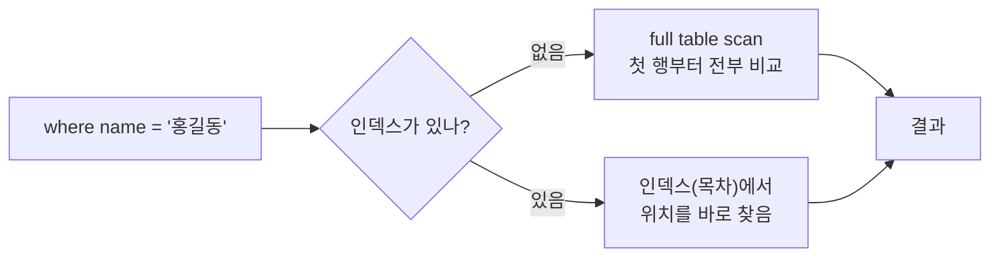
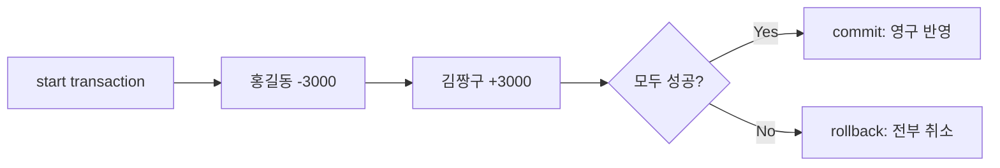

# 오늘 배운 것: 서브쿼리·DDL·DML·뷰·인덱스·트랜잭션까지 SQL 마무리

## 들어가며 (Situation)

모듈 2 10일차. 9일차에는 `SELECT`부터 `JOIN`까지, 이미 있는 데이터를 **조회**하는 방법을 배웠다. 오늘은 `04_MySQL`의 08번부터 14번까지 끝까지 진행했다. 조회한 결과를 다시 조합하고(서브쿼리, UNION), 테이블과 데이터를 직접 만들고 고치고(DDL, DML), 자주 쓰는 조회를 편하게 만들고(뷰), 빠르게 만들고(인덱스), 안전하게 묶는(트랜잭션) 내용이다. 막히는 부분 없이 모두 이해하고 넘어갔다.

- `08_subquery.sql` — 쿼리 안의 쿼리 (`where`절, `from`절)
- `09_ddl.sql` — `create table`, 데이터 타입, 제약 조건, `alter`, `drop`, `truncate`
- `10_dml.sql` — `insert`, `update`, `delete`와 에러 케이스
- `11_union.sql` — 쿼리 결과 합치기
- `12_view.sql` — 가상 테이블 `view`
- `13_index.sql` — `index`와 `explain`
- `14_transactional.sql` — `start transaction`, `commit`, `rollback`



실습은 대부분 LMS 데이터베이스(`wanted_lms`)의 `users`, `courses`, `enrollments` 테이블로 했고, 트랜잭션은 새로 만든 `accounts` 테이블로 했다.

## 문제 상황 (Task)

실습 코드의 주석이 던진 질문으로 오늘의 과제를 정리한다.

- "평균보다 높은 점수", "홍길동과 같은 해에 가입한 사용자"처럼 **먼저 구해야 할 값이 있는 조건**은 어떻게 한 번에 조회하는가
- 테이블은 어떤 **규칙**(데이터 타입, 제약 조건)을 갖도록 만들어야 데이터가 오염되지 않는가
- 데이터를 넣고 고치고 지울 때 **어떤 에러**가 나고, 그때 무엇을 확인해야 하는가
- 복잡한 쿼리를 매번 쓰지 않고, 민감한 컬럼은 숨기고 보여 줄 수 있는가
- 사용자가 100만 명이어도 한 명을 빠르게 찾으려면 어떻게 하는가
- 계좌이체처럼 두 번의 수정이 하나의 작업일 때, 중간에 문제가 생기면 어떻게 되돌리는가

## 해결 과정 (Action)

### 1. 서브쿼리: 쿼리 안에 쿼리를 넣는다

서브쿼리는 문제의 조건이 충분하지 않을 때 **2개 이상의 쿼리문을 조합해서 1개의 쿼리문**으로 만드는 것이다. 실습 문제는 "'홍길동'과 같은 해에 가입한 모든 사용자의 이름과 가입일"이었고, 두 단계로 쪼개서 풀었다.

1. '홍길동'의 가입 연도를 구한다.
2. 그 연도에 가입한 사용자의 이름과 가입일을 조회한다.

```sql
-- 1번: 홍길동의 가입 연도
select year(created_at) from users where name = '홍길동';

-- 1번을 2번의 where 안에 넣는다 (서브쿼리)
select
	name,
    created_at
from
	users
where
	year(created_at) = (
select
	year(created_at)
from
	users
where
	name = '홍길동');
```

서브쿼리는 쓰는 위치가 두 가지다.

| 위치 | 하는 일 | 실습 예 |
|------|---------|---------|
| `where`절 | 서브쿼리 결과를 조건의 값으로 쓴다 | `year(created_at) = (홍길동의 가입 연도)` |
| `from`절 | 서브쿼리 결과를 하나의 **가상 테이블**처럼 쓴다 | 교육자별 개설 과정 수를 먼저 만들고 `users`와 join |

`from`절 서브쿼리는 이렇게 썼다.

```sql
select
	u.name as '교육자 이름',
    aut.course_count as '교육자 개설 과정 수'
from
	users u
    join
    (
    select
		author_id,
        count(*) as course_count
	from
		courses
	group by
		author_id
    ) as aut
    on u.user_id = aut.author_id
order by `교육자 개설 과정 수` desc;
```

💡 9일차에 배운 `group by`, `join`이 여기서 한 쿼리로 합쳐진다. 안쪽 쿼리가 `courses`를 교육자별로 묶어 `aut`라는 가상 테이블을 만들고, 바깥 쿼리가 그것을 `users`와 join한다.

정리하면 서브쿼리는 `where`절에서는 값으로, `from`절에서는 가상 테이블로 쓰는 "쿼리 안의 쿼리"다.

### 2. DDL: 테이블에 규칙을 정의한다

DDL(Data Definition Language)은 데이터를 어떤 식으로 정의할지 정하는 언어로, 테이블을 만들고 고치는 데 쓴다. 수업 주석은 테이블을 만드는 일을 "단순히 칸을 나누는 작업이 아니라, 데이터가 지켜야 할 규칙을 정의하고 DB가 스스로 데이터의 품질을 유지하게 만드는 시스템 설계"라고 설명한다. 규칙의 두 축은 **데이터 타입**과 **제약 조건**이다.

| 데이터 타입 | 저장하는 것 | 예 |
|-------------|-------------|-----|
| `INT` / `BIGINT` | 정수 | `user_id`, `author_id` |
| `VARCHAR(n)` | 최대 n글자의 가변 길이 문자열 | `email`, `name` |
| `TEXT` | 매우 긴 텍스트 | `description`, `content` |
| `DATE` | 날짜 (`YYYY-MM-DD`) | |
| `DATETIME` / `TIMESTAMP` | 날짜와 시간 | 가입 일시 |

| 제약 조건 | 뜻 |
|-----------|-----|
| `NOT NULL` | NULL이 들어올 수 없다 (필수 입력) |
| `UNIQUE` | 테이블 안에서 값이 유일하다 (중복 방지) |
| `PRIMARY KEY` | `NOT NULL`과 `UNIQUE`를 모두 가진 대표 식별자 |
| `FOREIGN KEY` | 다른 테이블의 기본 키를 참조해 테이블 간 관계를 맺는다 |
| `DEFAULT` | 값을 안 넣었을 때 쓰는 기본값 |

9일차에 "연결하기 위한 열" 정도로만 이해했던 외래키를 오늘 직접 만들었다.

```sql
create table tb1(
		user_id int primary key,
        user_pwd varchar(12) not null comment '사용자 비밀번호',
        email varchar(30) not null unique comment '이메일',
        user_status varchar(10) default 'active' comment '계정 활성 상태',
        created_at timestamp not null default current_timestamp comment '가입 일시'
) comment '서비스 유저 정보 테이블';

create table tb2(
		user_id int primary key,
        author_id int not null comment 'tb1 에서 전달받는 외래키',
        -- (나머지 컬럼은 tb1과 같다)
        foreign key (`author_id`) references `tb1` (`user_id`)
) comment '서비스 유저 정보 테이블2';
```

`foreign key (author_id) references tb1 (user_id)`는 `tb2.author_id`가 부모 테이블 `tb1`의 `user_id`를 참조한다는 선언이다. 부모에 없는 값을 자식에 넣으려 하면 DB가 막는다. 수업 주석은 이것을 **참조 무결성** 원칙을 지키는 장치라고 설명한다.

- **참조 무결성 (Referential Integrity)**
  - 외래키가 참조하는 값은 반드시 부모 테이블에 존재해야 한다는 규칙입니다.
  - 부모 없는 자식 데이터(고아 데이터)가 생기지 않도록 DB가 막아 줍니다.

이미 만들어진 테이블은 `alter table`로 구조를 바꾼다. 실습은 `courses`를 복제한 임시 테이블 `courses_temp`로 했다.

```sql
create table courses_temp as select * from courses;     -- 복제

alter table courses_temp add column price int not null default 0;           -- 컬럼 추가
alter table courses_temp modify column price varchar(200) not null default 0; -- 컬럼 수정
alter table courses_temp drop column price;                                 -- 컬럼 삭제
```

테이블을 지우는 명령은 둘이다.

| 항목 | `truncate` | `drop` |
|------|-----------|--------|
| 데이터 | 삭제 | 삭제 |
| 테이블 구조 | **남긴다** | 영구 삭제 |
| 롤백 | 불가 | 불가 |

수업 주석은 `drop`만 롤백이 안 된다고 적었다. `truncate`도 롤백할 수 없다는 점은 수업 주석이 아니라 별도로 보충한 내용이니, [MySQL 공식 문서](https://dev.mysql.com/doc/refman/8.0/en/truncate-table.html)의 `TRUNCATE TABLE` 항목을 함께 확인한다.

🚨 `drop`은 테이블의 데이터와 구조를 영구 삭제하고 되돌릴 수 없다. 수업 주석도 "매우 빠르지만 롤백이 불가해서 신중하게 사용해야 한다"고 적었다.

### 3. DML: 데이터를 넣고, 고치고, 지운다

DML(Data Manipulation Language)은 데이터 조작 언어로 `INSERT`, `UPDATE`, `DELETE`다. 수업 주석이 "매우 중요"라고 표시한 부분이다. 가장 인상 깊은 점은 실습 파일이 **에러가 나는 쿼리를 일부러 포함**하고, 에러가 나면 "테이블의 제약 조건과 데이터 타입을 확인하라"고 반복해서 강조한다는 것이다.

```sql
insert into users (`email`, `name`) values ('email@gmail.com', '김예린');
```

| 에러 케이스 | 쿼리 | 원인 |
|-------------|------|------|
| `unique` 위반 | 같은 이메일로 다시 `insert` | 중복 이메일 불허 |
| `not null` 위반 | `name` 없이 `insert` | `name`은 반드시 값이 있어야 함 |
| 외래키 위반 (`insert`) | `courses`에 `author_id = 999`로 `insert` | `users`에 없는 회원을 참조 |
| 외래키 위반 (`delete`) | 과정을 만든 `user_id = 1`을 `delete` | 부모를 지우면 자식이 고아 데이터가 됨 |

9일차의 NULL과 오늘의 제약 조건이 여기서 만난다. `not null`을 어기면 막히는 것은, 테이블을 만들 때 선언한 규칙을 DB가 지키기 때문이다.

⚠️ **에러가 나지 않는 경우도 있다.** `name` 열에 `123`처럼 정수를 넣어도 DB가 문자열로 자동 형변환해서 `insert`해 버린다. 수업 주석은 "예외에 대한 처리는 DB가 아니라 front, back에서 해야 한다"고 정리한다.

`update`와 `delete`에서 가장 필수적으로 생각할 것은 `where`절이다.

```sql
update users set `name` = '김예린';                           -- where 없음
update users set `name` = '김파래' where `user_id` = 1;       -- 한 행만
delete from users where email = 'email@gmail.com';
```

🔴 `where` 없이 `update`를 실행하면 **테이블의 모든 행**이 바뀐다. 첫 번째 쿼리는 `users`의 모든 사용자 이름을 '김예린'으로 만든다. 수업 주석은 `where`에 **행을 하나로 식별할 수 있는 유일한 값**(PK, UNIQUE)을 걸 것을 권장한다.

### 4. UNION: 쿼리 결과를 위아래로 합친다

`union`은 각 쿼리의 결과를 합치는 **합집합**이고, 중복된 행은 제거한다. 실습 문제는 "active 사용자와 suspended 사용자 모두에게 이메일을 보내려 한다. deleted 유저는 제외하고 이름, 이메일, 상태를 조회하라"였다.

```sql
select `name`, `email`, `status` from users where status = 'active'
union
select `name`, `email`, `status` from users where status = 'suspended';
```

합칠 때는 조건이 있다.

- 조회하는 **컬럼 개수가 같아야** 한다.
- **컬럼 순서와 데이터 타입이 호환**돼야 한다.

join이 테이블을 옆으로 이어 붙인다면, union은 결과를 **아래로 쌓는다**.

### 5. VIEW: 쿼리에 이름을 붙여 가상 테이블로 쓴다

시나리오는 이렇다. 데이터분석팀은 "과정별 등록 학생 수"를 매일 확인하고, 마케팅팀에는 사용자 전체 정보를 열어 주지 않고 이메일과 이름만 전달하려 한다. `view`는 이런 때 쓰는 **가상의 테이블**이다.

수업 주석이 정리한 view를 쓰는 이유는 이렇다.

| 이유 | 설명 |
|------|------|
| 편의성 | 복잡한 쿼리를 뷰로 만들어 두면 이후에는 간단한 테이블처럼 조회한다 |
| 보안성 | 민감한 컬럼을 숨기고, 허용한 컬럼으로만 구성한 뷰를 제공한다 |
| 가독성 | 자주 쓰는 컬럼만 모아 읽기 쉽다 |

```sql
-- create view [뷰 이름] as [쿼리문]
create view v_courses_stats as
select
	c.course_id,
    c.title,
    count(e.enrollment_id) as '등록 학생 수'
from
	courses as c
left join
	enrollments as e on c.course_id = e.course_id
group by c.course_id, c.title;

-- 뷰를 테이블처럼 조회한다
select * from v_courses_stats where `등록 학생 수` >= 3;
```

9일차에 배운 `left join`과 `group by`가 뷰 안에 들어 있다. `left join`이라서 **등록한 학생이 0명인 과정도** 결과에 남는다. 뷰를 지우는 것은 `drop view`, 수정은 `create or replace view 뷰이름 as 쿼리문`이다.

⚠️ 수업 주석은 뷰의 장점으로 "조회 속도 향상"도 언급하지만, MySQL의 일반 뷰는 데이터를 따로 저장하지 않는 **저장된 쿼리**다. 조회할 때마다 안쪽 쿼리가 실행된다는 점은 [MySQL 공식 문서](https://dev.mysql.com/doc/refman/8.0/en/create-view.html)에서 확인하는 것이 좋다. 속도보다는 편의성과 보안성이 뷰의 본래 목적이다.

- **뷰 (View)**
  - 쿼리문에 이름을 붙여 두고 가상의 테이블처럼 조회하는 객체입니다.
  - 복잡한 쿼리를 단순화하고, 민감한 컬럼을 숨길 때 사용합니다.

### 6. INDEX: 목차를 만들어 검색을 빠르게 한다

100만 명의 `users`에서 '홍길동'을 찾는다고 하자. DB는 기본적으로 첫 행부터 마지막 행까지 하나씩 비교한다. 이것이 **full table scan**이다. 인덱스는 "목차"라는 뜻이고, 컬럼 값과 데이터의 물리적 위치를 목차 형태로 미리 저장해 두어서 원하는 위치로 바로 이동하게 한다.

9일차 `LIMIT`에서 "인덱스는 0부터 시작하는 번호"라고 했던 것과 뜻이 다르다. 데이터베이스의 인덱스는 번호가 아니라 **목차**다.



실행 계획은 `explain`으로 확인한다. 인덱스를 만들기 전과 후를 같은 쿼리로 비교했다.

```sql
explain select * from users where name = '홍길동';

-- create index 인덱스이름 on 테이블명(컬럼명)
create index udx_users_name on users(name);

explain select * from users where name = '홍길동';
```

| 시점 | 스캔한 행 |
|------|-----------|
| 인덱스 적용 전 | 120 row를 full scan |
| 인덱스 적용 후 | 1개 row만 scan |

인덱스는 **양날의 검(trade-off)** 이다.

- 🔴 **저장 공간 비용:** 인덱스는 테이블과 별도의 공간을 차지하므로 많이 만들수록 전체 용량이 커진다.
- 🔴 **DML 성능 저하:** `SELECT`는 빨라지지만 `INSERT`, `DELETE`, `UPDATE`는 느려진다. 인덱스에도 같은 변경을 해야 하기 때문이다. 특히 인덱스가 걸린 컬럼 값을 `UPDATE`하면 기존 항목 삭제와 새 항목 삽입이 함께 일어나 가장 나쁜 경우가 된다.
- 🟢 **인덱스를 걸 대상:** 조회 비율이 압도적으로 높은 테이블, 그리고 수정이 자주 일어나지 않는 컬럼이다.

PK와 UNIQUE 제약 조건이 걸린 컬럼은 유일성이 보장되어 테이블을 만들 때 **자동으로 인덱스가 생긴다**. 2번의 DDL에서 만든 제약 조건이 여기서 다시 이어진다.

- **풀 테이블 스캔 (Full Table Scan)**
  - 인덱스 없이 테이블의 첫 행부터 마지막 행까지 모두 비교하는 조회 방식입니다.
  - 데이터가 많을수록 느려지며, `explain`으로 확인할 수 있습니다.

### 7. TRANSACTION: 여러 작업을 하나로 묶는다

계좌이체는 논리적으로 하나의 작업이지만 실제로는 업데이트가 두 번이다. 홍길동의 계좌에서 3000원을 빼고, 김짱구의 계좌에 3000원을 더한다. 둘 사이에서 문제가 생기면(주석의 표현으로 "은행 정전") 돈이 사라진다. 이 문제는 9일차에 파일 저장으로 이체할 때 본 것과 같다. 트랜잭션은 **여러 작업을 하나의 논리적 작업 단위로 묶고, 하나라도 잘못되면 전부 롤백**하는 것이 핵심이다.

```sql
create table accounts (
	id int primary key,
    owner varchar(50),
    balance decimal(10,2)
);

insert into accounts (id, owner, balance)
values (1,'홍길동',10000.00), (2,'김짱구',5000.00);
```

| 명령 | 하는 일 |
|------|---------|
| `start transaction` | 트랜잭션을 시작한다 |
| `commit` | 모든 작업이 성공했으니 영구 반영한다 |
| `rollback` | 문제가 생겼으니 시작 전 상태로 되돌린다 |



정상 흐름은 두 번의 `update`를 한 뒤 `commit` 하는 것이다.

```sql
start transaction;

update accounts set balance = balance - 3000 where id = 1;
update accounts set balance = balance + 3000 where id = 2;

select * from accounts;   -- 중간 확인: 아직 영구 반영된 상태는 아니다
commit;
```

비정상 흐름에서는 일부러 **없는 계좌**(`id = 99`)에 입금을 시도하고 `rollback` 했다.

```sql
start transaction;

update accounts set balance = balance - 3000 where id = 1;
update accounts set balance = balance + 3000 where id = 99;   -- 없는 계좌

rollback;   -- 일부에 문제가 생겼으니 돌이킨다
```

⚠️ 없는 `id`에 대한 `update`는 에러 없이 **0행을 바꾸고 끝난다.** 문제가 생겼는지는 DB가 알려 주지 않으므로, 결과를 보고 `commit`할지 `rollback`할지는 사람(또는 애플리케이션 코드)이 정한다. `commit` 전에는 `select`로 확인해도 영구 반영된 상태가 아니고, `rollback`하면 홍길동의 차감도 함께 사라진다.

💡 9일차에 DB가 필요한 이유로 꼽은 "저장 도중 멈추면?"에 대한 답이 바로 트랜잭션이다.

## 결과 (Result)

| 항목 | 내용 |
|------|------|
| 오늘 진행한 파일 | `08_subquery` ~ `14_transactional` 7개 |
| 막힌 곳 | 없음 |
| 9일차와 합친 SQL 범위 | `SELECT`·`JOIN` → 서브쿼리·UNION → DDL·DML → 뷰·인덱스·트랜잭션 |
| 인덱스 효과 (실습 주석) | full scan 120 row → 1 row |

배운 점을 정리한다.

- 서브쿼리는 "먼저 구해야 할 값"을 쿼리 안에 넣는 것이다. 문제를 단계로 쪼갠 다음 합치면 쉬워진다.
- 테이블을 만들 때 선언한 **데이터 타입과 제약 조건**이 이후 `insert`, `update`, `delete`에서 에러로 나타난다. 에러가 나면 제약 조건과 데이터 타입부터 확인한다.
- `update`와 `delete`에는 `where`를 붙이고, `drop`과 `truncate`는 되돌릴 수 없다.
- 인덱스는 조회를 빠르게 하는 대신 저장 공간과 DML 성능을 쓴다. 필요한 컬럼에만 건다.
- 둘 이상의 수정이 하나의 작업이면 트랜잭션으로 묶고, 결과를 확인해 `commit` 또는 `rollback` 한다.

## 더 학습하면 좋은 개념

- **트랜잭션의 ACID와 격리 수준 (Isolation Level)**
  - 원자성·일관성·격리성·지속성이라는 트랜잭션의 4가지 성질과, 동시에 실행되는 트랜잭션이 서로 얼마나 영향을 줄지 정하는 설정입니다.
  - 오늘은 `commit`과 `rollback`만 다뤘는데, 여러 사용자가 동시에 쓰는 서비스에서 왜 필요한지 이어서 이해하게 해 줍니다.
- **B-Tree 인덱스와 `explain` 읽는 법**
  - 인덱스가 내부적으로 어떤 구조로 위치를 찾는지, 실행 계획의 `type`, `rows`가 무엇을 뜻하는지 배우는 개념입니다.
  - 오늘은 "120 row에서 1 row"라는 결과만 봤는데, 인덱스가 언제 쓰이고 언제 안 쓰이는지 판단하는 근거가 됩니다.
- **`UNION`과 `UNION ALL`의 차이**
  - `UNION`은 중복 행을 제거하고, `UNION ALL`은 제거하지 않고 모두 합칩니다.
  - 중복 제거는 비용이 들기 때문에 중복이 없다고 확신하면 `UNION ALL`이 더 적합할 수 있습니다.
- **외래키의 삭제·수정 동작 (`ON DELETE`, `ON UPDATE`)**
  - 부모 행을 지울 때 자식 행을 막을지(`RESTRICT`), 함께 지울지(`CASCADE`) 등을 정하는 옵션입니다.
  - 오늘은 "부모를 지우면 거부된다"만 확인했는데, 이 옵션으로 그 동작을 바꿀 수 있습니다.
- **서브쿼리와 JOIN의 선택**
  - 같은 결과를 서브쿼리로도, join으로도 만들 수 있을 때 어느 쪽을 고를지 비교하는 관점입니다.
  - 어느 쪽이 읽기 쉽고 실행 계획이 나은지 비교해 보면 쿼리를 보는 눈이 생깁니다.

## 참고 자료

- [MySQL 8.0 Reference Manual - Subqueries](https://dev.mysql.com/doc/refman/8.0/en/subqueries.html)
- [MySQL 8.0 Reference Manual - CREATE TABLE](https://dev.mysql.com/doc/refman/8.0/en/create-table.html)
- [MySQL 8.0 Reference Manual - FOREIGN KEY Constraints](https://dev.mysql.com/doc/refman/8.0/en/create-table-foreign-keys.html)
- [MySQL 8.0 Reference Manual - ALTER TABLE](https://dev.mysql.com/doc/refman/8.0/en/alter-table.html)
- [MySQL 8.0 Reference Manual - INSERT](https://dev.mysql.com/doc/refman/8.0/en/insert.html)
- [MySQL 8.0 Reference Manual - UPDATE](https://dev.mysql.com/doc/refman/8.0/en/update.html)
- [MySQL 8.0 Reference Manual - DELETE](https://dev.mysql.com/doc/refman/8.0/en/delete.html)
- [MySQL 8.0 Reference Manual - UNION](https://dev.mysql.com/doc/refman/8.0/en/union.html)
- [MySQL 8.0 Reference Manual - CREATE VIEW](https://dev.mysql.com/doc/refman/8.0/en/create-view.html)
- [MySQL 8.0 Reference Manual - CREATE INDEX](https://dev.mysql.com/doc/refman/8.0/en/create-index.html)
- [MySQL 8.0 Reference Manual - START TRANSACTION, COMMIT, and ROLLBACK](https://dev.mysql.com/doc/refman/8.0/en/commit.html)
