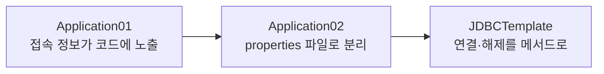
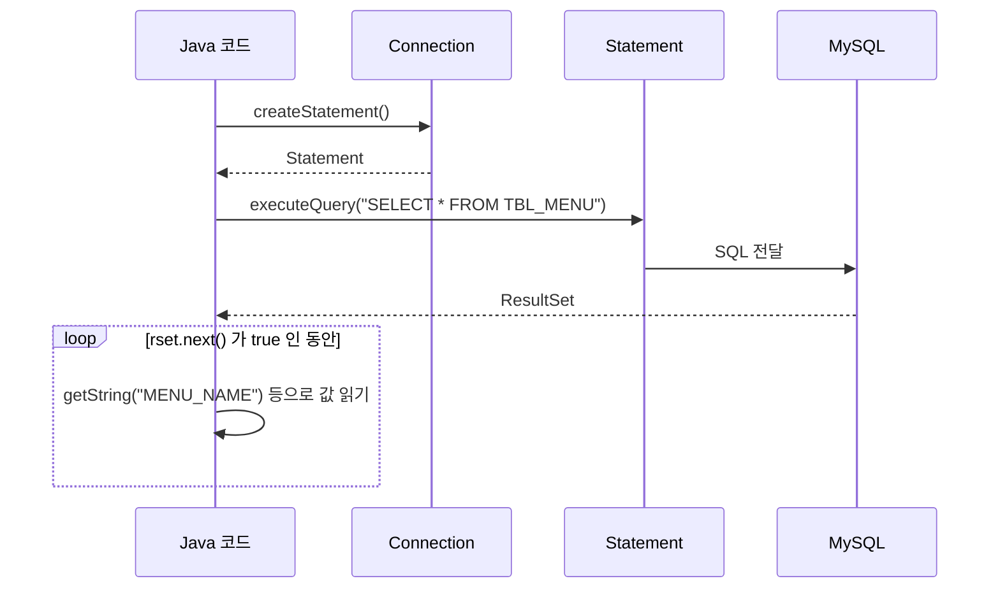

# 오늘 배운 것: JDBC로 Java에서 MySQL 연결하고 조회하기

## 들어가며 (Situation)

모듈 2 11일차. 10/13(10일차)까지 `04_MySQL`에서 SQL로 데이터베이스를 직접 다뤘다면, 오늘은 `05_JDBC`에서 **Java 코드가 데이터베이스에 접속해서 SQL을 실행하고 결과를 받아 오는 방법**을 배웠다. 프로젝트는 Gradle 기반 두 개이고, `menudb` 데이터베이스의 `TBL_MENU` 테이블로 실습했다. 수업 중에 막히는 부분은 없었고, `chap02`의 마지막 과제(`Application04`)만 남겼다. 다만 노트를 정리하려고 코드를 다시 읽다가 `Application03`의 오류를 하나 발견했다(6장).

- `chap01-jdbc-connection` · `a_connection` — `DriverManager`로 `Connection` 만들기, 접속 정보를 properties 파일로 분리하기
- `chap01-jdbc-connection` · `b_template` — 반복되는 연결·해제 코드를 `JDBCTemplate`로 묶기
- `chap02-statement` · `a_statements` — `Statement`로 SQL 실행, `ResultSet`으로 결과 읽기, `MenuDTO`에 옮겨 담기
- `chap02-statement` · `common` — `JDBCTemplate`(Statement·ResultSet 해제 추가), `MenuDTO`



MySQL 연동에는 외부 라이브러리가 필요해서 `build.gradle`에 `implementation 'com.mysql:mysql-connector-j:8.4.0'` 의존성을 추가했다.

## 문제 상황 (Task)

실습 코드의 주석이 던진 질문으로 오늘의 과제를 정리한다.

- `Connection`은 인터페이스인데 객체를 어떻게 만드는가
- 접속 주소·계정·비밀번호가 클래스 안에 그대로 노출되어 있는데, 어떻게 숨기는가
- 회원가입, 로그인, 정보 수정, 삭제처럼 DB 접근이 4번 필요하면 연결 코드를 4번 반복해야 하는가
- SQL 실행 결과(`ResultSet`)를 화면에 출력하는 데서 끝내지 않고, Java 객체로 옮겨 담으려면 어떻게 하는가

## 해결 과정 (Action)

### 1. DriverManager로 Connection 만들기

`Connection`은 인터페이스라서 `new`로 직접 만들 수 없다. 수업 주석은 이 인터페이스를 구현한 `DriverManager`를 통해 연결 객체를 만든다고 설명한다. 드라이버 클래스를 읽어 오고(`Class.forName`), 접속 주소와 계정으로 연결을 요청한다.

```java
Class.forName("com.mysql.cj.jdbc.Driver");

con = DriverManager.getConnection(
        "jdbc:mysql://localhost/menudb",
        "user",
        "password"
);

System.out.println("con = " + con);   // 값이 나오면 menudb 접근 가능
```

| 값 | 의미 |
|----|------|
| `com.mysql.cj.jdbc.Driver` | MySQL과 통신하는 드라이버 클래스 (`mysql-connector-j`에 들어 있다) |
| `jdbc:mysql://localhost/menudb` | 접속 주소: 프로토콜 + 호스트 + 데이터베이스 이름 |
| `"user"`, `"password"` | 접속 계정과 비밀번호 (글에서는 자리표시로 바꿨다) |

⚠️ `Application01`의 `finally`는 `con = null;`로 끝난다. 변수를 `null`로 바꾸는 것은 연결을 닫는 것이 아니다. 연결을 실제로 닫는 코드는 3번의 `JDBCTemplate.close()`에서 나온다.

### 2. 접속 정보를 properties 파일로 분리하기

`Application01`의 문제는 DB 접근 정보가 클래스에 그대로 노출되어 있다는 것이다. 수업 주석은 **파일 입출력으로 민감정보를 숨기자**고 했다. 8일차에 배운 `Properties`와 `FileReader`가 여기서 쓰인다.

```java
Properties prop = new Properties();
prop.load(new FileReader("src/main/java/com/wanted/a_connection/jdbc-config.properties"));

String driver = prop.getProperty("driver");
String url = prop.getProperty("url");
String user = prop.getProperty("user");
String password = prop.getProperty("password");

Class.forName(driver);
con = DriverManager.getConnection(url, user, password);
```

`jdbc-config.properties`에는 `driver`, `url`, `user`, `password` 네 개의 키가 있고, 접속 정보는 코드가 아니라 이 파일에 둔다. 파일 경로는 프로젝트 루트 기준의 상대 경로로 적었다.

⚠️ 실습 코드는 확인용으로 `System.out.println("prop = " + prop)`을 출력한다. `prop`에는 `password` 값도 들어 있어서 비밀번호가 콘솔에 그대로 찍힌다. 확인이 끝나면 지우는 것이 좋다.

### 3. JDBCTemplate: 반복되는 코드를 메서드로

`Application`(b_template)의 주석은 회원가입·로그인·정보 수정·회원 삭제에 **4번의 DB 접근**이 필요하고, 그때마다 `Application02`의 코드가 반복되는 것을 문제로 꼽았다. 반복되는 것은 세 가지다.

- 커넥션 생성
- 프로퍼티 객체 생성
- 커넥션 자원 해제

그래서 `JDBCTemplate` 클래스에 `static` 메서드 `getConnection()`과 `close(Connection)`을 만들었다.



```java
public static void close(Connection con) {
    try {
        // 커넥션이 존재하거나, 닫혀있지 않다면
        if (con != null && !con.isClosed()) {
            con.close();
        }
    } catch (SQLException e) {
        throw new RuntimeException(e);
    }
}
```

`static` 메서드라서 객체를 만들지 않고 `클래스명.메서드명()`으로 부르고, `import static`을 쓰면 클래스명도 생략된다. 이제 호출하는 쪽은 두 줄이면 된다.

```java
import static com.wanted.b_template.JDBCTemplate.close;
import static com.wanted.b_template.JDBCTemplate.getConnection;

Connection con = getConnection();
// ... DB 작업 ...
close(con);
```

🟢 연결 방법이 바뀌어도 `JDBCTemplate` 한 곳만 고치면 된다. 10/8 파일 입출력과 10/6 `static`에서 배운 것이 이 한 클래스에 모였다.

`chap02`에서는 템플릿이 `common` 패키지로 옮겨가고, properties도 `config` 폴더로 정리됐다. 그리고 `close`가 `Statement`, `ResultSet`용으로 **오버로딩**됐다. 같은 이름의 `close`를 받는 타입만 다르게 만든 것이다.

### 4. Statement와 ResultSet: SQL을 실행하고 결과를 받는다

수업 주석이 정리한 JDBC의 핵심 인터페이스는 두 가지다.

- **Statement**
  - SQL 쿼리문을 저장하고 실행할 수 있는 기능을 가진 인터페이스입니다.
  - `Connection`이 제공하는 `createStatement()`로 만들고, `executeQuery()`로 조회 SQL을 실행합니다.
- **ResultSet**
  - SQL 쿼리문의 결과를 결과 집합으로 받아올 수 있는 인터페이스입니다.
  - `next()`가 다음 행으로 이동하며, 행이 있으면 `true`, 없으면 `false`를 돌려줍니다.



메뉴 전체 조회(`Application01`)는 이 흐름 그대로다.

```java
Connection con = getConnection();
Statement stmt = null;
ResultSet rset = null;

try {
    stmt = con.createStatement();
    rset = stmt.executeQuery("SELECT * FROM TBL_MENU");

    while (rset.next()) {
        System.out.println(
                rset.getString("MENU_NAME") + " 은/는 "
                        + rset.getString("MENU_PRICE") + "원 입니다. "
        );
    }
} catch (SQLException e) {
    throw new RuntimeException(e);
} finally {
    close(con);
    close(rset);
    close(stmt);
}
```

`ResultSet`은 처음에는 첫 행 **앞**을 가리킨다. 그래서 `next()`를 먼저 호출해야 첫 행으로 이동하고, `while`로 돌리면 모든 행을 차례로 읽는다. 컬럼 값은 컬럼 이름(`"MENU_NAME"`)으로 꺼냈다.

자원 해제는 `finally`에 둔다. 예외가 나도 `Connection`, `ResultSet`, `Statement`를 닫기 위해서다.

### 5. Scanner로 입력받아 조건 조회하기

`Application02`의 실습 요구사항은 "메뉴 이름을 입력받아 그 메뉴의 메뉴번호, 가격, 판매상태를 출력하라"였다. SQL의 `where` 조건에 입력값을 이어 붙였다.

```java
String menuName = sc.nextLine();

rset = stmt.executeQuery(
        "SELECT MENU_CODE, MENU_PRICE , ORDERABLE_STATUS FROM TBL_MENU WHERE MENU_NAME = '"
        + menuName + "'");

if (rset.next()) {
    System.out.println(
            menuName + " 의 정보 : " +
            rset.getString("MENU_CODE") + " , " +
            rset.getString("MENU_PRICE") + " 원 , " +
            rset.getString("ORDERABLE_STATUS")
    );
}
```

한 행만 필요하므로 `while` 대신 `if (rset.next())`를 썼다.

🔴 이 방식은 **사용자 입력이 SQL 문장의 일부가 된다.** 입력에 따옴표와 SQL 조각이 들어 있으면 `where` 조건의 의미가 바뀐다(SQL 인젝션). 이 내용은 수업 코드의 주석이 아니라 따로 보충한 것이다. 입력값을 `?` 자리표시자로 넘기는 `PreparedStatement`가 이를 해결하는 방법이며, [Oracle JDBC 튜토리얼](https://docs.oracle.com/javase/tutorial/jdbc/basics/prepared.html)에서 확인할 수 있다.

### 6. DTO: 조회 결과를 Java 객체에 옮겨 담기

`Application03`의 목표는 "데이터베이스의 정보를 단순 출력으로 끝내는 것이 아닌 Java 객체로 옮겨 담아서 추가적인 작업을 할 준비를 해보자"였다. 이를 위해 `MenuDTO`를 만들었다.

- **DTO (Data Transfer Object)**
  - 데이터를 전달하기 위한 객체로, DB의 한 행을 담는 그릇으로 씁니다.
  - 수업 주석이 정리한 구성 요소는 필드, 기본 생성자, 모든 필드를 초기화하는 생성자, Getter·Setter, `toString()`입니다.

`TBL_MENU`의 컬럼과 `MenuDTO`의 필드는 이렇게 대응된다.

| 컬럼 | 필드 | 타입 | 읽는 메서드 |
|------|------|------|-------------|
| `MENU_CODE` | `menuCode` | `int` | `getInt` |
| `MENU_NAME` | `menuName` | `String` | `getString` |
| `MENU_PRICE` | `menuPrice` | `int` | `getInt` |
| `CATEGORY_CODE` | `categoryCode` | `int` | `getInt` |
| `ORDERABLE_STATUS` | `orderableStatus` | `char` | `getString` 후 `charAt(0)` |

DB의 한 행을 `MenuDTO` 하나에 담는다.

```java
MenuDTO menu = null;

if (rset.next()) {
    menu = new MenuDTO();
    menu.setMenuCode(rset.getInt("MENU_CODE"));
    menu.setMenuPrice(rset.getInt("MENU_PRICE"));
    menu.setOrderableStatus(rset.getString("ORDERABLE_STATUS").charAt(0));
    // ...
}

System.out.println("menu = " + menu);
```

`ORDERABLE_STATUS`는 `Y`/`N` 한 글자라서, 문자열로 읽은 뒤 `charAt(0)`으로 `char` 필드에 맞췄다. `toString()`을 오버라이딩해 두었기 때문에 `menu`를 출력하면 필드 값이 보인다.

🔴 **발견한 오류: `menuName`이 채워지지 않는다.** 노트를 정리하며 `Application03`을 다시 읽다가 찾았다. 실제 코드에는 `menuName`을 담는 줄이 이렇게 되어 있다.

```java
menu.getMenuName(rset.getString("MENU_NAME"));   // setMenuName 이어야 한다
```

`setMenuName`이 아니라 `getMenuName`을 불렀다. 그런데도 컴파일이 되는 이유는 `MenuDTO` 맨 아래에 본문이 빈 `getMenuName(String menuName)` 메서드가 있기 때문이다. 이 메서드는 인자를 받고 아무것도 하지 않으므로, 실행하면 `menuName` 필드는 기본값 `null`로 남아 `menu = MenuDTO{..., menuName='null', ...}`처럼 출력될 것이다. 이 출력은 코드를 읽고 추론한 것이며 DB에 연결해 실행해 확인하지는 않았다. 고치려면 `setMenuName(...)`으로 바꾸고 빈 오버로드를 지우면 된다.

오류가 에러 메시지 없이 지나가는 점이 눈에 띈다. 이름이 같은 메서드가 있으면 잘못 불러도 컴파일러가 막아 주지 않으므로, 담은 결과를 출력해서 필드마다 값이 들어갔는지 확인하는 습관이 필요하다.

### 7. 남은 과제: Application04

`Application04`는 하브루타 시간의 과제 두 가지가 주석으로 적혀 있고, 아직 구현하지 않았다.

1. 메뉴 전체 조회 값을 Java 객체로 옮겨 담기
2. `EmployeeDB`를 사용해서 각자 1개 이상의 DB 접속 및 조회 결과 객체 옮겨 담기

1번은 `Application01`의 `while (rset.next())`와 `Application03`의 `MenuDTO`를 합치는 것이다. 한 행이 아니라 여러 행이므로 `MenuDTO`를 담을 `List`가 필요해 보인다.

## 결과 (Result)

| 항목 | 내용 |
|------|------|
| 오늘 진행한 프로젝트 | `chap01-jdbc-connection`, `chap02-statement` |
| 완료한 실습 | `a_connection` 2개, `b_template` 1개, `a_statements` 3개 |
| 남은 과제 | `Application04` (메뉴 전체 조회 → 객체 옮겨 담기, `EmployeeDB` 조회) |
| 막힌 곳 | 수업 중에는 없음. 정리하며 `Application03`의 `menuName` 미저장 오류 발견 (원본 코드는 아직 미수정) |

배운 점을 정리한다.

- `Connection`은 `DriverManager`로 만들고, 접속 주소는 `jdbc:mysql://호스트/DB이름` 형태다.
- 접속 정보는 코드에 두지 않고 properties 파일에서 읽는다. 반복되는 연결·해제 코드는 `JDBCTemplate`로 묶는다.
- `Statement`로 SQL을 실행하고 `ResultSet`의 `next()`로 행을 하나씩 읽는다. 다 쓴 자원은 `finally`에서 닫는다.
- 조회 결과를 출력하는 데서 끝내지 않고 DTO 객체에 옮겨 담으면 이후 작업에 쓸 수 있다.
- SQL에 입력값을 문자열로 이어 붙이면 위험하다. 이를 막는 `PreparedStatement`를 다음에 확인한다.

## 더 학습하면 좋은 개념

- **PreparedStatement와 SQL 인젝션**
  - SQL 틀을 먼저 보내고 값은 `?` 자리에 따로 바인딩해서, 입력값이 SQL 문장으로 해석되지 않게 하는 방식입니다.
  - 오늘 `Application02`, `Application03`의 입력값 이어 붙이기가 왜 위험한지, 어떻게 고치는지 이해하게 해 줍니다.
- **try-with-resources와 AutoCloseable**
  - `Connection`, `Statement`, `ResultSet`은 `AutoCloseable`을 구현해서, `try (...)` 괄호 안에 선언하면 자동으로 닫힙니다.
  - 오늘 `finally`에서 직접 `close`를 세 번 부른 코드를 짧고 안전하게 줄이는 방법입니다.
- **JDBC 트랜잭션 (`setAutoCommit`, `commit`, `rollback`)**
  - 10/13 SQL의 `start transaction`을 Java 코드에서 `Connection`으로 제어하는 방법입니다.
  - 계좌이체처럼 둘 이상의 수정을 하나로 묶는 일을 애플리케이션에서 어떻게 하는지 이어서 보여 줍니다.
- **커넥션 풀 (Connection Pool)**
  - 연결을 요청할 때마다 새로 만들지 않고, 미리 만들어 둔 연결을 빌려 쓰고 반납하는 방식입니다.
  - 오늘 `getConnection()`은 호출할 때마다 새 연결을 만드는데, 실제 서비스에서는 이 비용이 왜 문제가 되는지 알게 됩니다.
- **DAO 패턴과 계층 구조**
  - DB 접근 코드를 전담하는 클래스(DAO)로 분리해서, 화면·비즈니스 로직과 나누는 설계입니다.
  - `JDBCTemplate`과 `MenuDTO`에서 한 걸음 더 나아가 코드를 어디에 두어야 하는지 기준이 됩니다.

## 참고 자료

- [Oracle Java Tutorials - JDBC Basics](https://docs.oracle.com/javase/tutorial/jdbc/basics/index.html)
- [Oracle Java Tutorials - Using Prepared Statements](https://docs.oracle.com/javase/tutorial/jdbc/basics/prepared.html)
- [Java SE API - java.sql.DriverManager](https://docs.oracle.com/en/java/javase/21/docs/api/java.sql/java/sql/DriverManager.html)
- [Java SE API - java.sql.Statement](https://docs.oracle.com/en/java/javase/21/docs/api/java.sql/java/sql/Statement.html)
- [Java SE API - java.sql.ResultSet](https://docs.oracle.com/en/java/javase/21/docs/api/java.sql/java/sql/ResultSet.html)
- [MySQL Connector/J Developer Guide](https://dev.mysql.com/doc/connector-j/en/)
