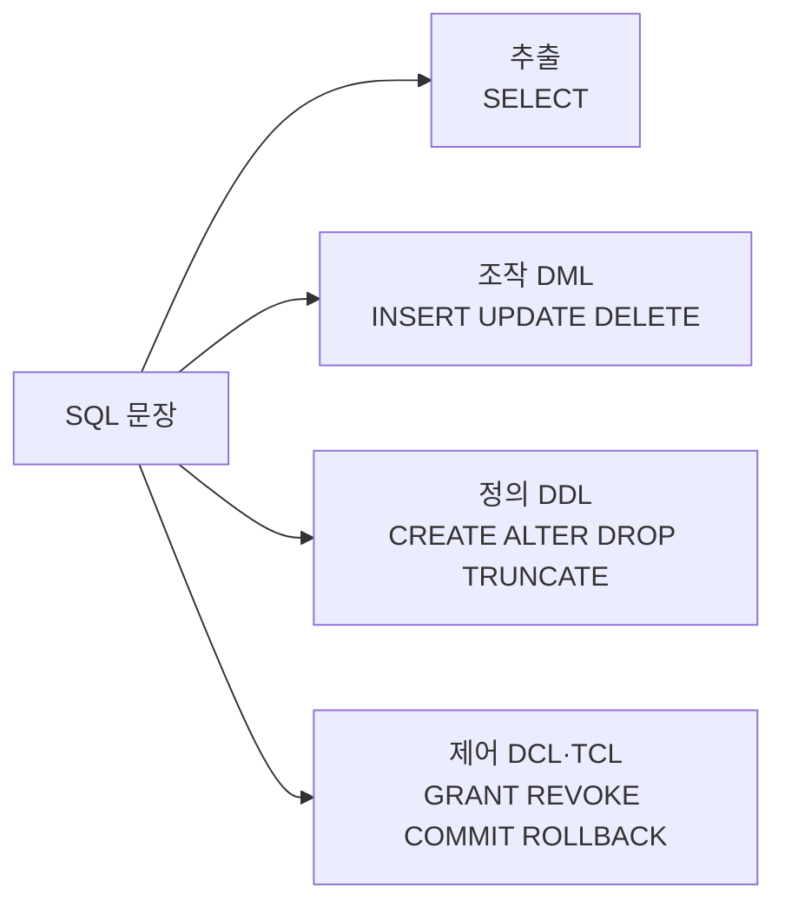

# 오늘 배운 것: SQL 이론: 제약조건·데이터 타입·내장 함수

## 들어가며 (Situation)

모듈 2 11일차. 10/12(9일차)와 10/13(10일차)에는 `04_MySQL`의 SQL 파일을 직접 실행하며 `SELECT`부터 트랜잭션까지 따라갔다. 오늘은 실습 코드가 아니라 **Notion의 `4. SQL_이해하기` 이론 자료**로 공부했고, 아티팩트로 받은 **SELECT 실습 문제**를 풀었다. 문제 풀이는 [SELECT 실습 · EMPLOYEE 조회 15문제]({{ site.baseurl }}/cloud/select-practice-employee/) 글에 따로 정리했다.

이 글은 9·10일차 실습 내용을 이론으로 복습하고, 새로 나온 부분(`CHECK`, 복합키, `ON DELETE SET NULL`, 형변환, 내장 함수)을 더하는 방식으로 정리한다.

- SQL 문장의 유형, 방언(dialect), 키워드와 식별자
- 제약조건 6가지 (`NOT NULL`, `UNIQUE`, `PRIMARY KEY`, `FOREIGN KEY`, `CHECK`, `DEFAULT`)
- 데이터 타입과 형변환
- 내장 함수 (문자열·수학·날짜)

오늘은 실습 프로젝트(`chap...`)가 없어서 코드 팝업은 붙이지 않았다. 코드는 Notion 자료의 예제를 정리한 것이다.

## 문제 상황 (Task)

이론 자료가 던지는 질문으로 오늘의 과제를 정리한다.

- SQL은 표준이 있는데 DBMS마다 문법이 다른 이유는 무엇이고, 어떻게 대비하는가
- 테이블에 데이터가 들어올 때 지켜야 할 **규칙**을 DB가 스스로 검사하게 하려면 어떤 제약조건을 쓰는가
- 숫자·문자·날짜는 어떤 타입으로 저장해야 공간을 아끼고 입력 검증도 되는가
- 타입이 다른 값을 섞어 쓰면 DB는 어떻게 처리하는가
- 문자열·숫자·날짜를 가공할 때 쿼리를 직접 짜지 않고 쓸 수 있는 내장 함수에는 무엇이 있는가

## 해결 과정 (Action)

### 1. SQL 문장의 유형과 방언

SQL은 목적에 따라 네 가지로 나뉜다. 9·10일차에 따로따로 배운 명령어들이 어느 범주인지 한 번에 정리된다.

| 범주 | 주요 목적 | 명령어 |
|------|-----------|--------|
| 데이터 추출 (Retrieval) | 저장된 데이터를 조회 | `SELECT` |
| 데이터 조작 (DML) | 데이터를 삽입·수정·삭제 | `INSERT`, `UPDATE`, `DELETE` |
| 데이터 정의 (DDL) | 데이터 구조를 정의 | `CREATE`, `ALTER`, `DROP`, `TRUNCATE` |
| 데이터 제어 (DCL·TCL) | 권한과 트랜잭션 제어 | `GRANT`, `REVOKE`, `COMMIT`, `ROLLBACK`, `SAVEPOINT` |



SQL은 ANSI와 ISO가 정한 국제 표준이지만, DBMS마다 자기만의 문법을 더한다.

- **방언 (Dialect)**
  - 표준 SQL에 DBMS가 독자적으로 더한 문법과 기능입니다.
  - 개발은 편해지지만 DBMS를 바꿀 때 호환성 문제가 생길 수 있어서, 가능하면 표준 SQL을 기본으로 쓰는 것이 좋습니다.

| DBMS | 방언 예시 | 설명 |
|------|-----------|------|
| PostgreSQL | `SERIAL`, `RETURNING` 절 | 기본 키 자동 증가, INSERT 후 결과 반환 |
| MySQL | `AUTO_INCREMENT`, `LIMIT` | 간단한 페이징 처리 |
| Oracle | `ROWNUM`, `SEQUENCE` 객체 | 대규모 트랜잭션 처리에 강점 |

9일차에 처음 본 `LIMIT`이 MySQL의 방언이라는 점이 눈에 띈다. Oracle에서 MySQL로 바꾸는 상황이면 표준 SQL로 쓴 쿼리가 재사용하기 쉽다는 것이 자료의 실무 팁이다.

SQL 문장은 **키워드**와 **식별자**로 이루어진다. 키워드는 `SELECT`, `FROM`처럼 명령을 정의하는 예약어이고, 식별자는 테이블명·컬럼명·별칭처럼 사용자가 정한 이름이다. 키워드는 대소문자를 구분하지 않지만 관례상 대문자로 쓰고, 키워드를 식별자로 쓰는 것은 피한다.

⚠️ 자료의 식별자 규칙(최대 63자, 소문자 변환, 큰따옴표로 감싸기)은 PostgreSQL 기준에 가깝다. 이 부분은 수업 자료가 아니라 따로 보충한 내용으로, MySQL은 식별자 길이 제한이 64자이고 감싸는 기호도 백틱(`` ` ``)이다. 정확한 규칙은 [MySQL 공식 문서](https://dev.mysql.com/doc/refman/8.0/en/identifiers.html)에서 확인한다.

### 2. 제약조건: 테이블이 데이터를 스스로 검사한다

제약조건은 테이블에 데이터가 입력되거나 수정될 때의 규칙이고, 데이터 **무결성**을 지키는 데 도움이 된다.

- **무결성 (Integrity)**
  - 데이터가 정확하고 서로 모순되지 않는 상태를 말합니다.
  - 제약조건은 규칙을 어기는 입력을 DB가 거부하게 만들어서 이 상태를 유지합니다.

자료는 제약조건마다 테이블을 만들고, 규칙을 어기는 `INSERT`를 일부러 넣어서 에러를 확인하는 방식으로 설명한다.

| 제약조건 | 뜻 | 규칙을 어기는 예 (자료의 에러 케이스) |
|----------|-----|----------------------------------------|
| `NOT NULL` | NULL 불허 | `user_pwd`에 `null` 입력 |
| `UNIQUE` | 중복 불허 | 이미 있는 `phone` 번호 입력 |
| `PRIMARY KEY` | 행을 식별하는 대표 컬럼. `NOT NULL` + `UNIQUE` | `user_no`에 `null` 또는 중복값 입력 |
| `FOREIGN KEY` | 참조하는 부모 테이블에 있는 값만 허용 | 부모에 없는 `grade_code` 50 입력 |
| `CHECK` | 조건을 어기면 불허 | `gender`에 '남성'(두 글자), `age`에 17 입력 |
| `DEFAULT` | 값이 없을 때 쓰는 기본값 | (에러가 아니라 기본값이 들어간다) |

`PRIMARY KEY`는 한 테이블에 한 개만 둘 수 있고, 컬럼 옆에 직접 쓰는 컬럼 레벨과 맨 아래에 따로 쓰는 테이블 레벨 모두 가능하다. 여러 컬럼을 묶어서 하나의 키로 만들 수도 있다(복합키). 10/13에 배운 "PK와 UNIQUE는 자동으로 인덱스가 생긴다"가 여기서 이어진다.

`FOREIGN KEY`는 부모 행이 지워지거나 수정될 때 자식을 어떻게 할지 **삭제·수정 규칙**을 정할 수 있다. 10/13에는 "부모를 지우면 거부된다"만 확인했는데, 자료는 `SET NULL` 규칙을 보여 준다.

```sql
CREATE TABLE IF NOT EXISTS user_foreignkey2 (
    user_no INT PRIMARY KEY,
    user_name VARCHAR(255) NOT NULL,
    grade_code INT,
    FOREIGN KEY (grade_code)
        REFERENCES user_grade (grade_code)
        ON UPDATE SET NULL
        ON DELETE SET NULL
) ENGINE=INNODB;

-- 부모(user_grade)에서 grade_code = 20 인 행을 지운다
DELETE FROM user_grade WHERE grade_code = 20;
-- 자식에서 grade_code 가 20 이던 회원의 값이 NULL 이 된다
SELECT * FROM user_foreignkey2;
```

이 코드는 자료의 예제에서 컬럼 일부를 줄인 것이다. 규칙이 없는 테이블(`user_foreignkey1`)에서는 이 동작이 적용되지 않아서, 자료는 비교 전에 그 테이블을 `DROP`하라고 안내한다. 부모의 삭제·수정 규칙은 자식 테이블을 만들 때 `FOREIGN KEY`에 적어 두어야 하기 때문이다.

`DEFAULT`는 컬럼 타입에 따라 쓸 수 있는 값이 다르다. 자료는 `DATE` 컬럼에는 `current_date`만, `DATETIME` 컬럼에는 `current_time`, `current_timestamp`, `now()`를 모두 쓸 수 있다고 정리한다. `INSERT`에서 `default`라고 적으면 기본값이 들어간다.

```sql
CREATE TABLE IF NOT EXISTS tbl_country (
    country_code INT AUTO_INCREMENT PRIMARY KEY,
    country_name VARCHAR(255) DEFAULT '한국',
    population VARCHAR(255) DEFAULT '0명',
    add_day DATE DEFAULT (current_date),
    add_time DATETIME DEFAULT (current_time)
) ENGINE=INNODB;

INSERT INTO tbl_country VALUES (null, default, default, default, default);
```

🟢 에러를 일부러 내 보는 방식이 제약조건을 이해하는 가장 빠른 길로 보인다. 10/13의 DML 실습도 같은 방식이었고, 에러가 나면 제약조건과 데이터 타입부터 확인한다는 원칙이 여기서 하나로 합쳐진다.

⚠️ `CHECK`는 MySQL 8.0.16부터 실제로 검사한다(그 전 버전은 문법만 받고 무시한다). 수업 자료가 아니라 따로 보충한 내용이니 [MySQL 공식 문서](https://dev.mysql.com/doc/refman/8.0/en/create-table-check-constraints.html)에서 사용하는 버전을 확인한다.

### 3. 데이터 타입과 형변환

적절한 타입을 정하면 저장 공간을 효율적으로 쓰고 입력 검증에도 도움이 된다. 10/13의 DDL에서 쓴 타입을 포함해 전체 타입을 표로 정리했다.

| 분류 | 타입 | 특징 |
|------|------|------|
| 정수 | `TINYINT`(1바이트) · `SMALLINT`(2) · `MEDIUMINT`(3) · `INT`(4) · `BIGINT`(8) | 바이트 수가 커질수록 범위가 넓다. `INT`는 약 ±21억 |
| 실수 | `FLOAT`(4) · `DOUBLE`(8) · `DECIMAL(m,d)` | `FLOAT`·`DOUBLE`은 근사치를 저장. 정확한 값은 `DECIMAL` |
| 문자 | `CHAR(n)` · `VARCHAR(n)` | `CHAR`는 고정 길이, `VARCHAR`는 가변 길이 |
| 대용량 | `TEXT` 계열 · `BLOB` 계열 | 긴 문서는 `TEXT`, 사진·동영상 같은 이진 데이터는 `BLOB` |
| 날짜·시간 | `DATE` · `TIME` · `DATETIME` · `TIMESTAMP` · `YEAR` | `TIMESTAMP`는 UTC로 변환해 저장, `time_zone` 설정과 관련 |
| 기타 | `ENUM` · `SET` · `JSON` | 열거형, 집합, JSON 문서 |

자료가 강조하는 선택 기준은 이렇다.

- 실수는 `FLOAT`·`DOUBLE`이 아니라 `DECIMAL`을 쓰는 것이 바람직하다. 근사치를 저장하기 때문이다. 10/13의 계좌 이체 예제에서 `balance`를 `decimal(10,2)`로 만든 이유가 이것이다.
- `VARCHAR`는 큰 길이를 지정해도 저장 공간을 효율적으로 쓴다. 자료는 `CHAR`가 `INSERT`/`UPDATE`에서 일반적으로 더 좋은 성능을 낸다고도 적었다.
- `DATETIME`과 `TIMESTAMP`는 표현하는 형식은 같지만, `TIMESTAMP`만 시간대 변환이 개입한다.

값의 타입이 다를 때는 **형변환**이 일어난다. 직접 지정하는 명시적 형변환과 DB가 알아서 하는 암시적 형변환이 있다.

```sql
-- 명시적: CAST, CONVERT
SELECT CAST(AVG(menu_price) AS SIGNED INTEGER) AS '평균 메뉴 가격' FROM tbl_menu;
SELECT CONVERT(AVG(menu_price), SIGNED INTEGER) AS '평균 메뉴 가격' FROM tbl_menu;

-- 가격 뒤에 '원' 붙이기: 숫자를 문자로 바꿔서 이어 붙인다
SELECT CONCAT(CAST(menu_price AS CHAR(5)), '원') FROM tbl_menu;
```

암시적 형변환의 규칙은 자료의 예제로 확인한다. 아래 결과는 자료가 정리한 규칙대로 계산한 것이다.

| 쿼리 | 적용되는 규칙 | 결과 |
|------|----------------|------|
| `SELECT '1' + '2';` | 문자가 정수로 변환된다 | 3 |
| `SELECT 3 > 'MAY';` | 숫자로 시작하지 않는 문자는 0이 된다 | 3 > 0 이므로 참(1) |
| `SELECT 5 > '6MAY';` | 문자 앞에 나온 숫자는 정수로 변환된다 | 5 > 6 이므로 거짓(0) |
| `SELECT 5 > 'M6AY';` | 숫자가 뒤에 나오면 문자로 보고 0이 된다 | 5 > 0 이므로 참(1) |

🔴 `'6MAY'`와 `'M6AY'`처럼 비슷해 보이는 값이 전혀 다른 결과를 낸다. 암시적 형변환에 기대면 결과를 예측하기 어렵다. 의도한 변환은 `CAST`나 `CONVERT`로 직접 적는 것이 안전하다.

- **암시적 형변환 (Implicit Conversion)**
  - 따로 지정하지 않아도 DB가 연산 중에 값의 타입을 자동으로 바꾸는 것입니다.
  - 편하지만 `'M6AY'` 같은 값이 0으로 바뀌는 식으로 결과가 달라질 수 있어서, 의도한 변환은 `CAST`로 명시하는 편이 낫습니다.

### 4. 내장 함수: 문자열·수학·날짜

MySQL은 문자열·숫자·날짜를 다루는 내장 함수를 많이 제공한다. 자료의 함수를 분류별로 묶어서 자주 쓸 만한 것을 골랐다.

| 분류 | 함수 | 하는 일 |
|------|------|---------|
| 문자열 | `CONCAT`, `CONCAT_WS` | 이어 붙인다(`_WS`는 구분자를 넣는다) |
| 문자열 | `SUBSTRING`, `LEFT`, `RIGHT` | 일부를 잘라 낸다 |
| 문자열 | `TRIM`, `LTRIM`, `RTRIM` | 공백(또는 지정한 문자)을 제거한다 |
| 문자열 | `REPLACE`, `INSERT` | 문자열을 찾아 바꾸거나 끼워 넣는다 |
| 문자열 | `LPAD`, `RPAD` | 길이를 맞춰 빈 곳을 채운다 |
| 수학 | `CEILING`, `FLOOR`, `ROUND`, `TRUNCATE` | 올림, 버림, 반올림, 자릿수 버림 |
| 수학 | `MOD`, `POW`, `SQRT`, `ABS`, `SIGN` | 나머지, 거듭제곱, 제곱근, 절댓값, 부호 |
| 날짜 | `NOW`, `CURDATE`, `CURTIME` | 현재 일시, 날짜, 시간 |
| 날짜 | `ADDDATE`, `SUBDATE`, `DATEDIFF` | 날짜를 더하고 빼고, 일수 차이를 구한다 |
| 날짜 | `LAST_DAY`, `DAYOFWEEK`, `QUARTER` | 그 달 마지막 날, 요일, 분기 |

값이 눈에 보이는 예제를 몇 개 골랐다. 결과는 함수의 정의대로 계산한 것이다.

```sql
SELECT CONCAT_WS('-', '2023', '05', '31');                    -- 2023-05-31
SELECT INSERT('내 이름은 아무개입니다.', 7, 3, '홍길동');      -- 내 이름은 홍길동입니다.
SELECT SUBSTRING_INDEX('hong.test@gmail.com', '.', 2);        -- hong.test@gmail
SELECT SUBSTRING_INDEX('hong.test@gmail.com', '.', -2);       -- test@gmail.com
SELECT TRUNCATE(12345.12345, 2), TRUNCATE(12345.12345, -2);   -- 12345.12, 12300
SELECT FLOOR(RAND() * (11 - 1) + 1);                          -- 1 이상 10 이하의 정수
```

`SUBSTRING_INDEX`는 구분자가 몇 번째 나오는지 세어서 그 앞(양수) 또는 뒤(음수)를 남긴다. 이메일에서 아이디나 도메인을 뽑을 때 쓸 수 있어 보인다. `RAND()`로 `m` 이상 `n` 미만의 정수를 뽑는 식은 `FLOOR(RAND() * (n - m) + m)`이다.

문자열 길이를 구하는 함수는 세 개라서 구분이 필요하다.

| 함수 | 반환 |
|------|------|
| `BIT_LENGTH` | 할당된 비트 크기 |
| `CHAR_LENGTH` | 문자열의 글자 수 |
| `LENGTH` | 할당된 바이트 크기 |

⚠️ 글자 수는 `CHAR_LENGTH`, 바이트 수는 `LENGTH`다. 자료의 예제는 영어 `'pie'`라서 둘 다 3이지만, `utf8mb4`에서 한글은 한 글자가 3바이트라 `LENGTH('안녕')`은 6이고 `CHAR_LENGTH('안녕')`은 2다. 이 부분은 수업 자료가 아니라 따로 보충한 내용이다.

⚠️ 자료는 `NOW()`와 `SYSDATE()`를 같은 것으로 묶는다. 둘의 차이(`NOW()`는 문장이 시작된 시각, `SYSDATE()`는 실행되는 시각)는 [MySQL 날짜 함수 문서](https://dev.mysql.com/doc/refman/8.0/en/date-and-time-functions.html)에서 확인한다. 이것도 따로 보충한 내용이다.

### 5. 9·10일차 실습과의 연결

자료의 다른 장은 9·10일차에 실습한 내용이어서 새로 확인한 점만 적는다.

- **`SET OPERATORS`**: 자료는 MySQL이 `INTERSECT`와 `MINUS`를 제공하지 않아서 `INNER JOIN`·`IN`·`LEFT JOIN`으로 대신한다고 설명한다. 이 부분은 따로 보충하자면 MySQL 8.0.31부터 `INTERSECT`와 `EXCEPT`가 추가되었으니 [MySQL 공식 문서](https://dev.mysql.com/doc/refman/8.0/en/intersect.html)에서 사용하는 버전을 확인한다. (`MINUS`는 Oracle 용어이고 MySQL에서는 `EXCEPT`다.)
- **`Transaction`**: 10/13에 `commit`과 `rollback`으로 다룬 내용에 **ACID** 이름이 붙는다.

| ACID | 뜻 | 자료의 예 |
|------|-----|-----------|
| Atomicity (원자성) | 모두 성공하거나 아무것도 실행되지 않는다 | 계좌 이체의 출금과 입금 |
| Consistency (일관성) | 실행 전후에 데이터가 규칙을 지킨다 | 도서 대출 규칙 |
| Isolation (독립성) | 동시에 실행돼도 서로의 중간 결과를 보지 못한다 | 영화관 좌석 예약 |
| Durability (영속성) | 완료된 결과는 오류가 나도 유지된다 | 쇼핑몰 주문 내역 |

💡 10/13의 계좌 이체 예제는 4가지 중 **원자성**의 예다. 자료도 원자성 예시로 은행 계좌 이체를 든다.

## 결과 (Result)

| 항목 | 내용 |
|------|------|
| 공부한 자료 | Notion `4. SQL_이해하기` 이론 (SQL 유형·제약조건·데이터 타입·내장 함수 중심) |
| 풀어 본 문제 | SELECT 실습 문제 (devlog에 따로 정리) |
| 제약조건 | 6가지, 에러 케이스 7개 확인 |
| 데이터 타입 | 정수·실수·문자·날짜 등 6분류, 형변환 규칙 4개 |

배운 점을 정리한다.

- SQL은 추출·조작·정의·제어 네 범주로 나뉘고, `LIMIT` 같은 것은 MySQL의 방언이다.
- 제약조건 6가지는 규칙을 어기는 입력을 DB가 거부하게 만든다. 에러를 일부러 내 보면 이해가 빠르다.
- 실수는 `DECIMAL`, 시간대가 필요하면 `TIMESTAMP`처럼 타입에는 고르는 기준이 있다.
- 암시적 형변환은 예측하기 어렵다. 의도한 변환은 `CAST`로 적는다.
- 자료의 설명은 DBMS와 버전에 따라 다를 수 있어서(식별자 규칙, `CHECK`, `INTERSECT`) 공식 문서로 확인한다.

## 더 학습하면 좋은 개념

- **트랜잭션 격리 수준 (Isolation Level)**
  - 동시에 실행되는 트랜잭션이 서로의 중간 결과를 얼마나 볼 수 있게 할지 정하는 설정입니다.
  - 오늘 ACID의 독립성을 이름만 봤는데, 영화관 좌석 예약 같은 동시 접근에서 실제로 어떻게 지켜지는지 알게 해 줍니다.
- **문자 집합과 콜레이션 (Character Set, Collation)**
  - 문자를 어떤 인코딩으로 저장하고 어떤 기준으로 비교·정렬할지 정하는 설정입니다.
  - `LENGTH`와 `CHAR_LENGTH`가 다른 이유와 `utf8mb4`가 왜 쓰이는지 이해하는 바탕이 됩니다.
- **정규화와 데이터베이스 설계**
  - 중복과 이상 현상이 없도록 테이블을 나누고 관계를 정하는 설계 방법입니다.
  - 제약조건 중 `PRIMARY KEY`와 `FOREIGN KEY`가 설계에서 어떤 역할을 하는지 이어서 이해하게 해 줍니다.
- **외래키의 `ON DELETE` 옵션 비교 (`CASCADE`, `RESTRICT`, `SET NULL`)**
  - 부모 행이 지워질 때 자식 행을 함께 지울지, 거부할지, NULL로 바꿀지 정하는 옵션입니다.
  - 오늘은 `SET NULL`만 봤는데, 데이터의 성격에 따라 어느 것을 고를지 비교하면 설계 감각이 생깁니다.
- **MySQL 버전별 차이 읽는 법**
  - 같은 SQL이 버전에 따라 다르게 동작하거나 아예 안 되는 경우(`CHECK`, `INTERSECT`)를 릴리스 노트로 확인하는 습관입니다.
  - 오늘 자료의 설명과 공식 문서가 어긋나는 곳을 직접 겪어 봤으니 다음에도 확인하는 기준이 됩니다.

## 참고 자료

- [MySQL 8.0 Reference Manual - Data Types](https://dev.mysql.com/doc/refman/8.0/en/data-types.html)
- [MySQL 8.0 Reference Manual - CHECK Constraints](https://dev.mysql.com/doc/refman/8.0/en/create-table-check-constraints.html)
- [MySQL 8.0 Reference Manual - FOREIGN KEY Constraints](https://dev.mysql.com/doc/refman/8.0/en/create-table-foreign-keys.html)
- [MySQL 8.0 Reference Manual - Type Conversion in Expression Evaluation](https://dev.mysql.com/doc/refman/8.0/en/type-conversion.html)
- [MySQL 8.0 Reference Manual - Built-In Function and Operator Reference](https://dev.mysql.com/doc/refman/8.0/en/built-in-function-reference.html)
- [MySQL 8.0 Reference Manual - Schema Object Names](https://dev.mysql.com/doc/refman/8.0/en/identifiers.html)
- [MySQL 8.0 Reference Manual - INTERSECT Clause](https://dev.mysql.com/doc/refman/8.0/en/intersect.html)
