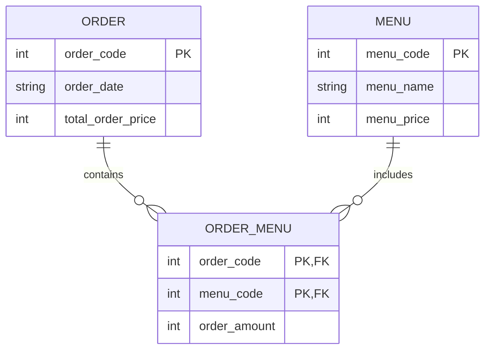

# 오늘 배운 것: DB 설계: 요구사항에서 물리 모델링까지 4단계

## 들어가며 (Situation)

모듈 2 11일차. 10/12(9일차)와 10/13(10일차)에는 `04_MySQL`의 SQL 파일을 직접 실행하며 `SELECT`부터 트랜잭션까지, 이미 만들어진 `wanted_lms` 데이터베이스를 **쓰는** 법을 배웠다. 오늘은 방향을 바꿔 **데이터베이스를 처음부터 어떻게 설계하는가**를 공부했다. 자료는 Notion의 `데이터베이스 설계` 5개 챕터이고, 그 사이에 아티팩트로 받은 SELECT 실습 문제도 풀었다. 문제 풀이는 [SELECT 실습 · EMPLOYEE 조회 15문제]({{ site.baseurl }}/cloud/select-practice-employee/) 글에 따로 정리했다.

- 0장 — 설계가 필요한 이유와 4단계 절차
- 1장 — 요구사항 분석과 데이터 사전
- 2장 — 개념적 모델링 (엔티티, 관계, ERD)
- 3장 — 논리적 모델링 (속성, 키, 정규화)
- 4장 — 물리적 모델링 (MySQL 타입, 키, 참조 무결성)

오늘은 실습 프로젝트(`chap...`)가 없어서 코드 팝업은 붙이지 않았다. 아래 코드는 자료의 조각을 모아 만든 **예시 코드**이고, 직접 실행해 본 결과는 아니다.

## 문제 상황 (Task)

9·10일차에는 테이블이 이미 있었다. 그런데 실제 프로젝트에서는 그 테이블을 **누가, 어떤 근거로 만드는가**가 먼저 문제가 된다. 자료가 던지는 질문으로 오늘의 과제를 정리한다.

- 설계 없이 바로 테이블을 만들면 어떤 문제가 생기는가
- 요구사항이라는 말에서 테이블과 컬럼까지는 어떤 단계를 거쳐 내려가는가
- 엔티티 사이의 관계, 특히 N:M은 테이블로 어떻게 표현하는가
- 중복과 이상 현상을 막는 정규화는 어디까지 하면 되는가
- 논리 모델을 MySQL 8.0에 옮길 때 이름, 타입, 키, 참조 옵션은 무엇을 기준으로 고르는가

## 해결 과정 (Action)

### 1. 왜 설계부터 하는가, 그리고 4단계

자료는 다리를 예로 든다. 시냇물의 디딤돌은 설계도 없이 놓아도 되지만, 큰 다리는 설계도가 없으면 지을 수 없다. 데이터베이스도 같아서, 설계가 없으면 아래 세 가지가 먼저 무너진다.

| 문제 | 설명 | 예시 |
|------|------|------|
| 중복과 불일치 | 같은 정보가 여러 테이블에 저장되면 한쪽만 고쳐져 값이 어긋난다 | 연락처가 주문과 고객 테이블에 둘 다 있고 한쪽만 수정됨 |
| 참조·도메인 무결성 | 관계와 규칙이 빠지면 잘못된 데이터가 들어온다 | 없는 회원이 주문에 등장, 성별에 '남성'·'여성' 외의 값 |
| 접근 효율 | 접근 패턴을 고려하지 않으면 조회가 느려진다 | 자주 찾는 컬럼에 인덱스가 없음 |

설계는 단순히 테이블을 만드는 일이 아니라 **현실의 정보를 분석하고 구조화해 DB에 맞게 표현하는 과정**이고, 보통 4단계로 나뉜다.


| 단계 | 목표 | 산출물 | DBMS 종속 |
|------|------|--------|-----------|
| 요구사항 분석 | 어떤 데이터를 관리해야 하는지 정의 | 요구사항 정의서 | 아니오 |
| 개념적 모델링 | 무엇이 있고 어떻게 연결되는지 시각화 | ERD | 아니오 |
| 논리적 모델링 | 컬럼·타입·키를 정하고 정규화 | 논리 데이터 모델 | 아니오 |
| 물리적 모델링 | 성능을 고려해 실제 DBMS에 구현 | DDL 스크립트 + 물리 모델 | 예 |

💡 핵심은 **앞 세 단계가 DBMS와 무관하다**는 점이다. 9·10일차에 쓴 `CREATE TABLE`은 사실 마지막 단계의 산출물이었고, 자료는 처음에는 코드 레벨을 고려하지 말고 현실의 흐름부터 모델링하라고 한다.

### 2. 요구사항 분석: 기능에서 데이터로

요구사항 분석은 설계의 출발점이다. 기능 요구사항이 "무엇을 해야 하는가"라면, 데이터 요구사항은 "무엇을 저장해야 하는가"다. 기능을 하나씩 데이터로 바꿔 쓰면 나중에 엔티티와 속성 후보가 된다.

| 기능 요구사항 | 데이터 요구사항 |
|---------------|-----------------|
| 메뉴 조회 | 메뉴명, 가격, 주문 가능 여부, 카테고리 코드 |
| 주문 생성 | 주문일자, 주문시간, 주문상품 목록, 주문 수량, 총금액 |
| 결제 처리 | 결제일, 결제시간, 결제 금액, 결제 방식 |

이 단계에서 제약조건도 같이 파악한다. 6가지 제약조건 중 `CHECK`를 뺀 5가지는 10일차 DDL에서 이미 썼고(`CHECK`는 오늘 처음 나왔다), 설계 단계에서는 "이 항목은 필수인가, 중복되면 안 되는가"를 문장으로 먼저 정해 두는 용도다.

| 제약조건 | 설계 단계에서 던질 질문 |
|----------|------------------------|
| `NOT NULL` | 반드시 값이 있어야 하는가 |
| `UNIQUE` | 중복되면 안 되는가 |
| `PRIMARY KEY` | 행을 고유하게 식별하는 값은 무엇인가 |
| `FOREIGN KEY` | 다른 테이블의 어떤 값을 참조하는가 |
| `CHECK` | 허용되는 값의 범위가 있는가 |
| `DEFAULT` | 값이 없을 때 자동으로 채울 값이 있는가 |

⚠️ `CHECK`는 MySQL **8.0.16부터** 실제로 검사한다. 그 이전 버전은 문법만 통과시키고 조용히 무시해서, 제약을 건 것처럼 보이는데 잘못된 값이 그대로 저장된다. 자료도 같은 점을 짚는다.

그다음은 **데이터 사전**이다. 업무 용어를 하나의 의미로 정하고, 항목마다 타입·길이·NULL 여부·제약을 적는다. 자료의 정의서 예시는 이런 모양이다.

| 항목명 | 타입 | 길이 | NULL | 제약조건 | 예시값 |
|--------|------|------|------|----------|--------|
| `menu_code` | INT AUTO_INCREMENT | - | NO | PRIMARY KEY | 1 |
| `menu_name` | VARCHAR | 30 | NO | - | 불타는 치킨 |
| `menu_price` | INT | - | NO | CHECK (>= 0) | 9900 |
| `orderable_status` | CHAR | 1 | NO | CHECK ('Y', 'N') | Y |
| `add_time` | DATETIME | - | YES | DEFAULT CURRENT_TIMESTAMP | 2025-05-20 10:32 |

이 표가 곧 뒤에 나오는 DDL의 초안이 된다.

### 3. 개념적 모델링: 엔티티와 관계

#### 엔티티 도출

- **엔티티 (Entity)**
  - 시스템에서 저장·관리해야 할 데이터의 주체가 되는 객체입니다.
  - 사람, 사물, 사건, 장소가 모두 엔티티가 될 수 있습니다.
  - 요건은 고유하게 식별 가능할 것, 여러 인스턴스를 가질 것, 의미 있는 속성을 가질 것, 독립적으로 존재할 것입니다.
  - 예: 고객(Customer), 주문(Order), 메뉴(Menu), 결제(Payment).

수업 자료가 예로 드는 `menudb`의 테이블을 엔티티로 추상화하면 아래처럼 된다.

| 테이블 | 엔티티 | 분류 | 역할 |
|--------|--------|------|------|
| `tbl_menu` | 메뉴 (Menu) | 기본 | 실제 판매되는 개별 상품 |
| `tbl_category` | 카테고리 (Category) | 기본 | 메뉴 분류 체계 |
| `tbl_order` | 주문 (Order) | 중심 | 고객의 구매 행위 |
| `tbl_payment` | 결제 (Payment) | 중심 | 결제 정보 기록 |
| `tbl_order_menu` | 주문상세 (OrderItem) | 행위 | 주문별 메뉴 항목 |
| `tbl_payment_order` | 결제연결 (PaymentMap) | 행위 | 결제와 주문의 연결 |

엔티티를 찾는 순서는 요구사항에서 핵심 명사를 뽑고, 비슷한 용어를 합치고, 독립 식별이 되는지 아니면 속성인지 가려낸 뒤, 테이블 후보로 확정하는 것이다. 자료는 도서관 대출 시스템에서 도서·회원·대출 세 엔티티를 뽑는 예로 보여 준다. 상태 코드 같은 단순 참조 값은 꼭 독립 엔티티로 만들 필요가 없다.

#### 관계의 세 유형과 N:M 해소

| 유형 | 의미 | 예시 |
|------|------|------|
| 1:1 | 한 인스턴스가 상대 한 개와만 연결 | 사용자 ↔ 사용자 프로필 |
| 1:N | 한 인스턴스가 여러 개와 연결, 가장 흔함 | 카테고리 : 메뉴 |
| N:M | 양쪽 모두 여러 개와 연결 | 주문 : 메뉴 |

관계형 DB에서는 N:M을 그대로 둘 수 없어서, 관계 자체를 **행위(교차) 엔티티**로 만들어 1:N 두 개로 쪼갠다.



`ORDER_MENU`는 두 부모의 PK를 FK로 가지면서 동시에 **복합 PK**를 이룬다. 자료의 학생 ↔ 시험(학생별시험) 예시도 같은 모양이다.

#### 필수 관계와 선택 관계

관계는 방향마다 필수성이 다르다. 메뉴는 반드시 카테고리에 속해야 하지만, 카테고리는 메뉴가 하나도 없어도 존재할 수 있다.

| 관계 방향 | 필수성 | FK 쪽 설정 |
|-----------|--------|------------|
| 메뉴 → 카테고리 | 필수 | `category_code`는 `NOT NULL` |
| 카테고리 → 메뉴 | 선택 | 메뉴 없는 카테고리 허용 |

자료는 이렇게 비유한다. 파일은 반드시 어떤 폴더 아래에 있지만, 빈 폴더를 만들 때 파일을 하나라도 먼저 만들어야 하지는 않는다.

#### ERD 표기법

| 표기법 | 특징 | 쓰임 |
|--------|------|------|
| 피터첸 | 엔티티는 사각형, 관계는 마름모, 속성은 타원 | 이론 설명, 시험 |
| IE (Crow's Foot 포함) | 속성을 엔티티 안에 쓰고 관계선 끝으로 카디널리티 표시 | 실무 도구 |
| Barker | 속성에 `#`(식별자), `*`(필수), `O`(선택) 표시 | Oracle Designer 등 |

수업 자료는 IE 계열을 지원하는 **ERDCloud**로 그린 `menudb` ERD를 예로 보여 준다. ERD를 다 그린 뒤에는 바로 다음 단계로 가지 않고 체크리스트로 검토한다. 자료가 `menudb`에 대해 제시한 검토 포인트는 이렇다.

- `tbl_order_menu`가 반드시 `tbl_order`와 `tbl_menu`를 참조하는가
- 계층형인 `tbl_category`의 **자기 참조 외래키**가 올바른가
- 결제와 주문의 N:M이 `tbl_payment_order`로 정확히 표현됐는가
- `orderable_status` 같은 업무 속성을 도메인 제약으로 통제할 수 있는가

### 4. 논리적 모델링: 속성, 키, 정규화

논리 모델링은 ERD를 실제 테이블이 될 구조로 상세화하는 단계다. 속성을 전부 정하고, 키를 고르고, **정규화**로 중복을 걷어낸다.

#### 속성의 종류

| 기준 | 분류 | 설명과 예시 |
|------|------|-------------|
| 분해 여부 | 단일 | 하나의 의미 (상품명, 수량) |
| | 복합 | 의미상 쪼갤 수 있음 (주소: 시·구·동) |
| | 다가 | 한 속성에 값이 여러 개 (전화번호 여러 개) |
| 특성 | 기초 | 엔티티 본질 (고객명, 단가) |
| | 관계 | 다른 엔티티와의 연결, FK로 구현 |
| | 추출 | 연산으로 얻는 값 (주문금액 = 수량 × 단가) |

복합·다가 속성은 1정규형을 만족하도록 분해하거나 별도 엔티티로 뺀다. 널 허용 여부는 업무상 반드시 필요한지, 생성 시점에 알 수 있는지, 계산으로 얻을 수 있는지로 정한다. `NOT NULL`과 `DEFAULT`를 함께 쓰면 누락을 막으면서 흐름도 단순해진다.

#### 키 설계

- **후보키 (Candidate Key)**
  - 행을 유일하게 식별할 수 있는 속성 또는 속성 집합입니다.
  - 한 엔티티에 여러 개 있을 수 있고, 이 중 하나를 기본키로 고릅니다.

- **기본키 (Primary Key)**
  - 후보키 중 대표로 뽑힌 식별자로, `NULL`과 중복이 모두 허용되지 않습니다.
  - 실무에서는 `AUTO_INCREMENT` 정수 같은 시스템 코드를 기본키로 둡니다.

- **대체키 (Alternate Key)**
  - 후보키 중 기본키로 선택되지 않고 남은 키입니다.
  - 전화번호·이메일 같은 자연키는 바뀔 수 있고 개인정보라서 기본키 대신 `UNIQUE`로 관리합니다.

- **복합키 (Composite Key)**
  - 속성 하나로는 기본키 역할을 할 수 없을 때 후보키 여러 개를 묶어 만든 키입니다.
  - 장바구니처럼 고객과 상품의 N:M을 푼 연관 엔티티가 대표적이고, 보통 구성 속성이 동시에 FK입니다.

⚠️ 자료는 기본키 선정 기준으로 유일성·불변성·최소성·단순성을 드는데, "불변성"의 설명이 사실상 **최소성**(더 뺄 수 없는 최소 집합)과 같다. 일반적으로 불변성은 키 값이 한번 정해지면 바뀌지 않아야 한다는 뜻이라서, 이 부분은 자료가 아니라 따로 보충한 내용이다. 앞의 전화번호를 기본키로 쓰지 않는 이유가 바로 이 불변성이다.

#### 정규화 (Normalization)

정규화는 테이블을 규칙에 따라 분해해 중복을 줄이고 삽입·수정·삭제 이상(Anomaly)을 막는 절차다.

| 정규형 | 제거하는 것 | 처리 방법 |
|--------|-------------|-----------|
| 1NF | 한 칸에 여러 값 | 모든 속성이 원자값이 되게 분해 |
| 2NF | 부분 함수 종속 (복합키의 일부에만 종속) | 일부에만 종속된 속성을 새 테이블로 분리 |
| 3NF | 이행적 함수 종속 (비키 속성이 다른 비키 속성에 종속) | 종속되는 속성을 새 테이블로 분리 |
| BCNF (심화) | 후보키가 아닌 결정자 | 결정자를 후보키로 만들도록 분해 |
| 4NF (심화) | 다치 종속 (독립적인 여러 값이 한 테이블에 섞임) | 자격증·관심분야처럼 독립적인 관계를 각각 별도 테이블로 분리 |
| 5NF (심화) | 조인 종속 | 조합 테이블을 추가해, 조인했을 때 원본이 정확히 복구되고 의미 없는 조합이 생기지 않게 함 |

자료의 2NF 예시는 이렇다. `날짜별회원음식섭취량`의 기본키는 날짜, 음식번호, 고객번호인데, 음식명과 그램당칼로리는 **음식번호에만** 종속된다. 이 상태면 같은 음식 정보가 행마다 반복 저장된다. 음식명·칼로리를 `음식` 테이블로 빼고 섭취량 테이블에는 섭취량만 남기면, 음식 정보는 한 곳에서만 고치면 된다.

3NF 예시도 같은 방식이다. `개설강좌` 테이블에서 과목명과 학점은 기본키(개설강좌코드)가 아니라 `개설과목코드`가 결정한다. 이를 `과목` 테이블로 분리하고 `개설강좌`에는 `개설과목코드`를 FK로만 남긴다.

그렇다고 정규화가 무조건 좋은 것은 아니다. 지나치면 조인이 늘어 쿼리가 복잡해지고 느려진다.

- 🟢 자료의 실무 전략은 **기본적으로 3NF 또는 BCNF까지 정규화**하고, 쿼리 패턴·데이터 용량·트래픽을 보고 병목이 생기는 곳만 **비정규화**하는 것이다. 인덱스, 캐싱, 파티셔닝도 함께 쓴다.

### 5. 물리적 모델링: MySQL 8.0에 구현하기

#### 명명 규칙과 예약어

| 규칙 | 이유 |
|------|------|
| 소문자 + `snake_case` | MySQL은 OS와 `lower_case_table_names` 설정에 따라 테이블명 대소문자 구분이 달라서, 소문자로 통일하면 환경이 바뀌어도 안전 |
| 단수형 | `order_detail`, `menu`처럼 엔티티 하나를 가리키는 이름 |
| 접두어 (`tbl_`) | 팀 컨벤션. 예약어 충돌을 없애고 객체 종류를 구분 |

- 🔴 가장 자연스러운 단수형 이름인 `order`는 MySQL **예약어**라서 `CREATE TABLE order (...)`는 문법 오류가 난다. 자료는 `user`도 함께 드는데, `user`는 MySQL 8.0 키워드 목록에서 예약어가 아닌 키워드로 알고 있어 이 부분은 [공식 키워드 목록](https://dev.mysql.com/doc/refman/8.0/en/keywords.html)에서 따로 확인해야 한다. 백틱으로 감싸면 되지만 모든 쿼리에서 매번 감싸야 한다.
- 🟢 `tbl_order`, `tbl_user`처럼 접두어를 붙이면 충돌이 사라진다. 수업의 `menudb`가 이 컨벤션이고, 자료는 정답이 있는 영역이 아니라 **하나로 정해 끝까지 지키는 것**이 중요하다고 말한다.

#### 타입 선택

| 항목 | 권장 | 이유 |
|------|------|------|
| 고유번호 | `INT`/`BIGINT AUTO_INCREMENT` | 기본키용 자동 증가 |
| 금액 | `DECIMAL(P,S)` | 소수점 정밀도 |
| 상태값 | `CHAR(1)` + `CHECK` 또는 코드 테이블 | `ENUM`은 값 추가 시 `ALTER TABLE`, 이식성, 순서 변경 사고 때문에 지양 |
| 날짜·시간 | `DATETIME` (기본 권장) | 아래 비교 참고 |

| 타입 | 저장 방식 | 범위 | 크기 |
|------|-----------|------|------|
| `DATE` | 날짜만 | 1000-01-01 ~ 9999-12-31 | 3바이트 |
| `DATETIME` | 입력값 그대로, 타임존 변환 없음 | 1000-01-01 ~ 9999-12-31 | 5바이트 |
| `TIMESTAMP` | UTC로 변환해 저장, 조회 시 세션 타임존으로 재변환 | 1970-01-01 ~ **2038-01-19** | 4바이트 |

- ⚠️ 10일차 DDL 예시에서 `created_at`에 쓴 `timestamp`는 연습용이었고, 설계 기준으로는 `DATETIME`이 기본이다. `TIMESTAMP`는 2038년까지만 표현하고 타임존 설정에 따라 같은 행이 다른 값으로 보인다. 구독 만료일처럼 미래 날짜를 다루는 컬럼에서는 지금도 문제가 되고, 크기 차이는 1바이트뿐이라 `DATETIME`이 기본값이다.
- ⚠️ 날짜를 `VARCHAR`로 둔 테이블도 수업 자료에 있다. 자료는 무조건 잘못이라고 하지 않고 외부 값을 원본 그대로 보존하거나 날짜라기보다 코드에 가까운 경우처럼 요구사항에 따라 달라진다고 본다. 원칙은 "날짜는 날짜 타입으로"이고, 선택의 근거를 설명할 수 있어야 한다.

`DEFAULT`는 `DATETIME`/`TIMESTAMP`의 `CURRENT_TIMESTAMP`만 괄호 없이 쓸 수 있고, 다른 함수나 수식은 `DEFAULT (CURRENT_DATE)`처럼 괄호로 감싸야 한다(8.0.13 이상). `ON UPDATE CURRENT_TIMESTAMP`는 수정할 때마다 시각을 갱신하고, `TEXT`와 `BLOB`은 기본값을 가질 수 없다.

#### 키 구현 전략

| 대상 | 전략 | 예시 |
|------|------|------|
| 기본키 | 단일 키(`AUTO_INCREMENT`) | `user_id INT AUTO_INCREMENT PRIMARY KEY` |
| | 복합 키 | `PRIMARY KEY (order_id, menu_id)` |
| | UUID | `BINARY(16)` + `UUID_TO_BIN(UUID(), 1)`. `CHAR(36)`보다 공간이 절반 이하이고, `1`을 주면 시간순으로 재배치되어 InnoDB 페이지 분할이 줄어든다 |
| 외래키 | 즉시 참조(`CREATE` 안에 명시), 지연 참조(`ALTER TABLE`), 옵션 지정, 이름 부여 | `CONSTRAINT fk_order_menu FOREIGN KEY ...` |
| 고유키 | 단일, 다중 컬럼 조합, 대체키 보호 | `UNIQUE (category_id, menu_name)` |

`UNIQUE`를 걸면 인덱스가 자동으로 생기므로 남용하지 않는다. 제약조건에 이름을 붙여 두면 삭제와 디버깅이 쉽다.

#### 참조 무결성 옵션

부모 행이 수정·삭제될 때 자식 행을 어떻게 할지를 `ON DELETE`/`ON UPDATE`로 정한다. 10일차의 "더 학습하면 좋은 개념"에서 예고했던 내용을 오늘 자료로 정리한 것이다.

| 옵션 | 동작 | 쓸 때와 주의점 |
|------|------|----------------|
| `CASCADE` | 자식도 같이 수정·삭제 | 연관 데이터를 전부 동기화해야 할 때. 대량 삭제가 전파될 수 있음 |
| `SET NULL` | 자식의 FK를 `NULL`로 | 참조는 끊고 자식은 남길 때. FK 컬럼이 `NULL` 허용이어야 함 |
| `RESTRICT` | 참조 중이면 변경·삭제 불가 | 기본값. 의도하지 않은 삭제 방지 |

- 🔴 `SET NULL`을 `NOT NULL` 컬럼에 지정하면 테이블 생성 자체가 실패한다.
- ⚠️ 표준 SQL의 `SET DEFAULT`는 InnoDB에서 지원하지 않는다. `NO ACTION`도 표준과 달리 `RESTRICT`처럼 즉시 검사해서, MySQL에서는 두 옵션이 사실상 같다.
- ⚠️ 외래키는 **InnoDB에서만** 동작한다. MyISAM은 문법이 통과돼도 조용히 무시하니 테이블 엔진을 확인한다.

#### 위 내용을 한 번에 적용한 예시

아래는 자료의 조각을 모아 `menudb`와 비슷하게 만든 **예시 코드**이고, 실제 `menudb`의 DDL이나 실행 결과가 아니다.

```sql
CREATE TABLE tbl_category (
    category_code     INT AUTO_INCREMENT PRIMARY KEY,
    category_name     VARCHAR(30) NOT NULL,
    ref_category_code INT NULL,
    CONSTRAINT fk_category_ref FOREIGN KEY (ref_category_code)
        REFERENCES tbl_category (category_code)
        ON DELETE SET NULL
);

CREATE TABLE tbl_menu (
    menu_code        INT AUTO_INCREMENT PRIMARY KEY,
    menu_name        VARCHAR(30) NOT NULL,
    menu_price       INT NOT NULL CHECK (menu_price >= 0),
    category_code    INT NOT NULL,
    orderable_status CHAR(1) NOT NULL DEFAULT 'Y' CHECK (orderable_status IN ('Y', 'N')),
    created_at       DATETIME DEFAULT CURRENT_TIMESTAMP,
    CONSTRAINT fk_menu_category FOREIGN KEY (category_code)
        REFERENCES tbl_category (category_code)
);

CREATE TABLE tbl_order (
    order_code        INT AUTO_INCREMENT PRIMARY KEY,
    order_datetime    DATETIME DEFAULT CURRENT_TIMESTAMP,
    total_order_price INT NOT NULL
);

CREATE TABLE tbl_order_menu (
    order_code   INT NOT NULL,
    menu_code    INT NOT NULL,
    order_amount INT NOT NULL,
    PRIMARY KEY (order_code, menu_code),
    CONSTRAINT fk_order_menu_order FOREIGN KEY (order_code) REFERENCES tbl_order (order_code),
    CONSTRAINT fk_order_menu_menu  FOREIGN KEY (menu_code)  REFERENCES tbl_menu (menu_code)
);
```

각 단계의 결정이 코드에 그대로 남는다. 필수 관계는 `category_code INT NOT NULL`로, 선택적인 자기 참조는 `ref_category_code INT NULL`과 `ON DELETE SET NULL`로, N:M 해소는 `tbl_order_menu`의 복합 PK 두 FK로 나타난다.

## 결과 (Result)

오늘 정리한 범위를 숫자로 요약하면 이렇다.

| 항목 | 내용 |
|------|------|
| 공부한 자료 | Notion `데이터베이스 설계` 5개 챕터 |
| 설계 단계 | 4단계 (요구사항, 개념, 논리, 물리) |
| 단계별 산출물 | 요구사항 정의서, ERD, 논리 데이터 모델, DDL 스크립트 |
| 정규화 | 3NF까지 본문, BCNF·4NF·5NF는 심화 |
| 참조 무결성 옵션 | `CASCADE`, `SET NULL`, `RESTRICT` 3개 |
| 자료 설명을 일반적인 정의로 보충한 곳 | 2곳 (키 선정 기준의 "불변성", `user` 예약어) |

배운 점은 이렇다.

- 💡 9·10일차의 SQL은 **설계의 마지막 단계(물리)** 에서 쓰는 도구였다. 앞 단계에서 엔티티, 관계, 키, 정규형이 정해져야 `CREATE TABLE`이 나온다.
- 💡 같은 제약조건이 요구사항(질문), 개념(필수·선택 관계), 논리(널 허용·키), 물리(`NOT NULL`, `CHECK`, FK 옵션)에서 **모양만 바꿔 계속 등장한다.**
- 💡 정답이 하나로 정해지지 않는 곳(`tbl_` 접두어, `DATETIME` vs `VARCHAR`)에서는 **근거를 설명할 수 있는 선택**이 기준이라는 것이 자료의 입장이다.

## 더 학습하면 좋은 개념

- **인덱스 설계 관점의 `EXPLAIN`** — 10일차에서 인덱스와 `explain`을 맛봤다면, 설계 단계에서는 "어떤 컬럼에 왜 거는가"가 문제다. `UNIQUE`가 인덱스를 자동으로 만든다는 점까지 `EXPLAIN`으로 확인해 봐야 정규화와 성능의 균형을 판단할 수 있다.
- **비정규화 (반정규화) 전략** — 3NF까지 정규화한 뒤 병목이 있는 곳만 풀어 준다는 원칙을 실제 사례(집계 컬럼, 조회 전용 테이블)로 익히면 "언제 정규화를 멈출지" 기준이 생긴다.
- **BCNF·4NF·5NF와 함수 종속 판별** — 오늘은 3NF까지만 정리했다. 결정자와 후보키 개념을 정확히 알아야 1~3NF의 위반 사례를 스스로 찾아낼 수 있다.
- **JPA 엔티티 매핑 (`@GeneratedValue`, `@ManyToOne`)** — 자료가 `AUTO_INCREMENT`, 외래키 설계와 JPA를 직접 연결해 둔 부분이다. 오늘의 모델링 용어가 코드의 어노테이션으로 그대로 옮겨진다.
- **기본키 전략으로서의 UUID** — 시간순으로 재배치하는 `UUID_TO_BIN(UUID(), 1)`이 InnoDB 클러스터형 인덱스와 어떻게 맞물리는지 알면, 분산 환경에서 `AUTO_INCREMENT` 대신 UUID를 고를 때의 비용을 따질 수 있다.

## 참고 자료

- [MySQL 8.0 공식 문서 - FOREIGN KEY 제약조건](https://dev.mysql.com/doc/refman/8.0/en/create-table-foreign-keys.html)
- [MySQL 8.0 공식 문서 - CHECK 제약조건](https://dev.mysql.com/doc/refman/8.0/en/create-table-check-constraints.html)
- [MySQL 8.0 공식 문서 - 데이터 타입 기본값](https://dev.mysql.com/doc/refman/8.0/en/data-type-defaults.html)
- [MySQL 8.0 공식 문서 - DATE, DATETIME, TIMESTAMP 타입](https://dev.mysql.com/doc/refman/8.0/en/datetime.html)
- [MySQL 8.0 공식 문서 - 키워드와 예약어](https://dev.mysql.com/doc/refman/8.0/en/keywords.html)
- [MySQL 8.0 공식 문서 - UUID_TO_BIN()](https://dev.mysql.com/doc/refman/8.0/en/miscellaneous-functions.html#function_uuid-to-bin)
