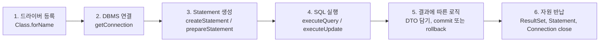
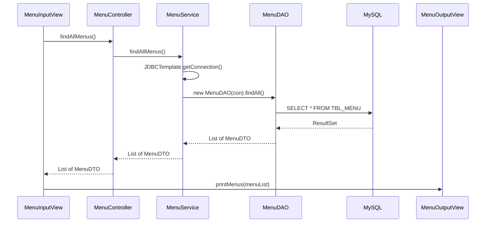

# 오늘 배운 것: PreparedStatement와 계층 구조로 JDBC 코드 정리하기

## 들어가며 (Situation)

모듈 2 13일차. 10/15(12일차)에는 `Statement`로 SQL을 실행하고 `ResultSet`을 DTO에 옮겨 담았다. 10/16은 휴강이라 오늘이 그 다음 수업이다. 오늘은 같은 `05_JDBC` 안에서 두 가지를 했다.

- `chap02-statement` · `b_preparedstatements` — `Statement`를 `PreparedStatement`로 바꾸고, SQL을 XML 파일로 분리하고, 조회가 아닌 수정(`UPDATE`)까지 실행하기
- `chap03-crud` — 한 파일에 몰려 있던 코드를 View · Controller · Service · DAO 계층으로 나누기

이번 글은 막혀서 헤맨 기록이라기보다 **왜 이렇게 바꾸는지**를 따라가며 정리한 개념 노트다. 실습 코드의 주석에 적힌 설명을 바탕으로 쓰고, 주석에 없는 내용은 보충이라고 표시한 뒤 공식 문서 링크를 붙였다. 오늘 노션에 올라온 `JDBC 주요 클래스` 자료의 이론은 첫 소절에 정리하고, 관련 있는 곳마다 "노션 자료"라고 밝히고 붙였다.



접속 정보는 12일차와 같이 properties 파일에서 읽고, 연결·해제는 `JDBCTemplate`가 맡는다(`chap02`의 `common` 패키지는 12일차 글의 코드 팝업에 있다).

## 문제 상황 (Task)

12일차 코드를 다시 보면 불편한 점이 세 군데 있었다.

- **입력값 이어 붙이기** — `Application02`에서 `"... WHERE MENU_NAME = '" + menuName + "'"`처럼 자바 변수를 SQL 문자열에 직접 붙였다. 따옴표를 빠뜨리기 쉽고, 입력값이 SQL의 일부가 된다.
- **긴 SQL 문자열** — 수업 주석의 표현으로는 한 문장이면 문자열로 써도 무리가 없지만, `JOIN`을 하거나 `WHERE` 조건이 길어지면 문자열을 합쳐서 SQL을 쓰는 일이 굉장히 복잡해진다.
- **조회 말고 수정은?** — 지금까지는 `SELECT`만 했다. 데이터를 바꾸는 SQL은 결과가 `ResultSet`이 아닐 텐데 어떻게 실행하고, 성공 여부를 어떻게 아는가.

그리고 `chap03`에서는 규모가 커진 코드를 **어디에 무엇을 두는가**가 과제였다. 화면 출력, 입력, SQL 실행, 연결 생성을 한 `main`에 다 쓰면 수정할 때마다 전부 건드려야 한다.

## 해결 과정 (Action)

### 1. 먼저 정리: JDBC 주요 클래스와 작성 순서

노션 자료의 첫 문장은 JDBC(Java DataBase Connectivity)를 **자바에서 데이터베이스에 접근할 수 있게 해 주는 프로그래밍 API**라고 정의한다. 오늘 코드에 나오는 클래스를 이 자료의 설명과 이어 보면 다음과 같다.

| 클래스 | 노션 자료의 설명 | 오늘 코드에서 만난 곳 |
|--------|-----------------|----------------------|
| `DriverManager` | 드라이버를 통해 DB와 `Connection`을 만든다. 직접 인스턴스를 만들 수 없고 `getConnection()` static 메서드로만 만든다. 예외 처리가 필수다. | `JDBCTemplate.getConnection()` |
| `Connection` | 특정 DB와 연결된 상태를 나타내고, `Statement`·`PreparedStatement`를 만들어 준다. 사용 후 반드시 반납한다. | `close(con)`, `try-with-resources` |
| `Statement` | SQL을 저장·실행하고 결과를 돌려주는 메서드 묶음이다. | 12일차 `a_statements` |
| `PreparedStatement` | 완성된 쿼리와 `?`가 있는 미완성 쿼리를 모두 쓸 수 있다. `Statement`의 한 종류다. | `b_preparedstatements`, `MenuDAO` |
| `ResultSet` | `SELECT` 결과 테이블을 담고, 커서(cursor)로 특정 행을 가리킨다. | `while (rset.next())` |

- **JDBC (Java Database Connectivity)**
  - 자바 프로그램이 DB 종류에 상관없이 같은 방식으로 DB에 접속하고 SQL을 실행하게 해 주는 프로그래밍 API입니다.
  - 노션 자료는 그 사이에서 연결을 맡는 것이 드라이버(Driver)이고, 오늘 쓴 MySQL 드라이버는 `com.mysql.cj.jdbc.Driver`라고 정리합니다.
- **ResultSet 커서 (cursor)**
  - 결과 테이블에서 지금 읽을 수 있는 "현재 행"을 가리키는 위치 표시입니다.
  - `next()`를 부르면 커서가 한 행 내려가고, 다음 행이 있으면 `true`, 없으면 `false`를 돌려줍니다. 결과가 1건이 확실하면 `while` 대신 `if (rset.next())`를 쓸 수 있습니다.

노션 자료는 JDBC 코드를 쓰는 순서를 6단계로 정리한다. 오늘 코드를 읽는 지도가 된다.



단계마다 예외 처리가 붙는다. 1번은 `ClassNotFoundException`, 2번 이후는 `SQLException`이다. 6번의 반납 순서는 노션 예시가 `rset`, `stmt`, `conn` 순서다. 수업 코드의 `finally`는 `con`부터 닫고 있어서 순서가 다르다. 닫는 순서가 결과를 바꾸는지는 직접 확인하지 않았다.

⚠️ 노션의 `JDBCTemplate` 예시는 `if (con != null & !con.isClosed())`처럼 `&` 한 개를 쓴다. 수업 코드는 `&&`다. `&`는 왼쪽이 거짓이어도 오른쪽까지 계산하므로, `con`이 `null`이면 `con.isClosed()`에서 `NullPointerException`이 날 것이다. 필기 오타로 보이고 실행해 본 것은 아니다.

⚠️ 노션 자료는 `Class.forName()`이 클래스를 메모리에 올려 드라이버를 로딩한다(동적 로딩)고 설명한다. 보충으로 [DriverManager API 문서](https://docs.oracle.com/en/java/javase/21/docs/api/java.sql/java/sql/DriverManager.html)를 찾아보니, `DriverManager`는 초기화될 때 서비스 제공자(service provider) 방식으로도 드라이버를 불러온다고 되어 있다. 그래서 드라이버 JAR가 이 방식을 지원하면 `Class.forName` 없이도 될 것으로 보이지만, 문서가 "불필요하다"고 명시한 것은 아니고 오늘 코드에서 빼서 실험해 보지도 않았다.

### 2. Statement와 PreparedStatement는 무엇이 다른가

`Application01`의 주석이 두 방식의 차이를 이렇게 정리한다.

| 항목 | Statement | PreparedStatement |
|------|-----------|-------------------|
| SQL 전달 시점 | 실행할 때마다 SQL 구문 전체를 DB에 전송 | 객체를 만들 때 SQL 틀(`prepareStatement(sql)`)을 넘기고, 실행 시 값을 채움 |
| 파싱·컴파일 | 실행할 때마다 거침 | 최초 1회 후 같은 SQL이면 컴파일해 둔 것을 재사용 |
| 값 넣는 방법 | 문자열 이어 붙이기 | `?`에 `setXxx()`로 채우기 |
| 수업 주석의 결론 | — | 파싱·컴파일이 생략되어 성능이 향상된다 |

노션 자료도 같은 내용을 비교표로 정리하고, 언제 무엇을 쓸지 기준을 덧붙인다. 한 번 실행하고 버릴 간단한 쿼리나 테스트에는 `Statement`도 쓸 수 있다. 사용자 입력에 따라 조건이 달라지거나 같은 쿼리를 여러 번 실행한다면 `PreparedStatement`를 권장한다(로그인, 검색 기능 등).

그리고 노션 자료는 `PreparedStatement`도 `Statement`라고 짚는다. 정말 그런지 `chap02`의 `common/JDBCTemplate`로 확인할 수 있다. 이 클래스에는 `close(Statement)`만 있고 `close(PreparedStatement)`는 없는데도, `Application01`의 `close(pstmt)`가 컴파일된다. `PreparedStatement`가 `Statement`의 하위 타입이라서 `close(Statement)`가 받아 주기 때문이다. 12일차에 배운 오버로딩이 여기서 쓰인다.

코드로 보면 실행 방식의 차이가 바로 보인다. 전체 조회(`Application01`)는 SQL이 고정이라 `Statement`일 때와 거의 같은데, **SQL을 객체를 만들 때 넘긴다**는 점만 다르다.

```java
pstmt = con.prepareStatement("SELECT * FROM tbl_menu");
rset = pstmt.executeQuery();   // 실행할 때는 SQL을 다시 넘기지 않는다
```

`Statement`는 `executeQuery("SELECT ...")`처럼 실행 메서드에 SQL을 넘겼다. 이 차이가 다음 단계에서 `?`를 쓸 수 있게 만든다.

⚠️ 수업 주석의 "컴파일해 둔 SQL을 재사용해서 성능이 향상된다"는 설명은 **DB 서버가 SQL을 미리 준비(prepare)하는 방식**을 전제로 한다. 보충으로 [MySQL Connector/J 설정 문서](https://dev.mysql.com/doc/connector-j/en/connector-j-reference-configuration-properties.html)를 찾아보니, `useServerPrepStmts`의 기본값이 `false`였다. 이 값이 `false`이면 드라이버가 prepared statement를 클라이언트에서 흉내 내는 방식(emulate)으로 동작한다고 한다. 우리 `jdbc-config.properties`의 url에는 이 옵션이 없으므로 기본 설정에서는 주석이 말하는 서버 쪽 재사용 효과를 그대로 기대하기는 어렵다. 오늘 실습에서 성능 차이를 직접 측정해 보지는 않았다. 그래도 `PreparedStatement`를 쓰는 더 큰 이유는 다음에 나오는 `?` 바인딩이다. 참고로 노션 자료의 성능 설명도 "한 번 컴파일한 뒤 캐시에 담아 두고 수행한다"로 수업 주석과 같은 관점이고, 위 옵션까지는 다루지 않는다.

### 3. placeholder(?)로 값 채우기

`Application02`는 메뉴 이름을 입력받아 그 메뉴의 번호·가격·판매 상태를 조회한다. 주석은 `Statement`에서 자바 변수를 SQL에 넣을 때 `"'" + menuName + "'"`처럼 따옴표를 직접 붙여야 하는 불편을 지적하고, `?`로 두고 메서드로 채우자고 한다.

- **placeholder (?)**
  - SQL 안에서 "여기에 값이 들어온다"는 자리를 표시하는 기호입니다.
  - 자바 변수를 SQL에 직접 삽입하지 않고, `?`로 두었다가 `setString()`, `setInt()` 같은 메서드로 채웁니다.

```java
pstmt = con.prepareStatement(
        "SELECT MENU_CODE, MENU_PRICE , ORDERABLE_STATUS FROM TBL_MENU WHERE MENU_NAME = ?");

// ? 의 갯수에 따라 parameterIndex 가 결정된다.
pstmt.setString(1, menuName);

rset = pstmt.executeQuery();
```

주석이 짚은 규칙이 두 가지다.

- `?`의 위치에 따라 `parameterIndex`가 정해진다. 첫 번째 `?`가 `1`이고, 배열처럼 `0`부터가 아니다.
- `?`는 **반드시** `set` 메서드로 값을 채워야 한다. 채우지 않고 실행하면 SQL이 완성되지 않는다.

값의 타입에 맞는 메서드를 고른다. 문자열이면 `setString`, 정수면 `setInt`다. 12일차에 `ResultSet`에서 `getInt`와 `getString`을 골랐던 것과 짝이 맞는다.

🟢 `Statement` 때 `'" + menuName + "'"`로 따옴표를 직접 맞추던 일이 사라졌다. 값은 `setString(1, menuName)`이 SQL의 값 자리로 넣어 준다.

🟢 12일차에 짚은 문제(입력값이 SQL 문장의 일부가 되는 SQL 인젝션)도 이 방식으로 막는다. 값이 SQL 구조와 분리되어 전달되기 때문이다. 이 설명은 수업 주석이 아니라 보충이며, [Oracle JDBC 튜토리얼](https://docs.oracle.com/javase/tutorial/jdbc/basics/prepared.html)에서 확인할 수 있다. 직접 인젝션 입력을 넣어 실험해 보지는 않았다.

노션 자료에는 구체적인 예시가 있다. `Statement`로 직원 이름을 조회하는 쿼리에 이런 값을 넣는다.

```java
empName = "홍길동' OR 1=1 AND EMP_ID = '200";
```

문자열을 이어 붙인 SQL은 이렇게 된다(`EMPLOYEE` 테이블은 노션 예시의 것이다).

```sql
SELECT * FROM EMPLOYEE WHERE EMP_NAME = '홍길동' OR 1=1 AND EMP_ID = '200'
```

`AND`가 `OR`보다 먼저 계산되므로 `EMP_NAME = '홍길동'`인 행이거나 `EMP_ID = '200'`인 행이 나온다. 노션 자료의 설명도 의도한 홍길동이 아니라 `EMP_ID`가 200인 사람의 정보가 조회된다는 것이다. 이 연산자 우선순위는 보충 설명이고, 실행해 보지는 않았다. `PreparedStatement`는 `setString`이 값을 따옴표로 감싸는 등 SQL 문법에 맞게 처리해 주므로, 위 문자열 전체가 하나의 이름 값으로 취급되어 `OR 1=1`이 조건으로 쓰이지 않는다고 노션 자료는 설명한다.

### 4. SQL을 XML 파일로 분리하기

`Application03`의 주석은 SQL이 길어질 때의 문제를 지적하고, **XML 파일을 이용한 File I/O로 SQL 구문을 따로 분리하자**고 한다. `menu-query.xml`에는 쿼리가 키(key)별로 들어 있다.

```xml
<?xml version = "1.0" encoding="UTF-8" ?>
<!DOCTYPE properties SYSTEM "http://java.sun.com/dtd/properties.dtd">
<properties>

    <entry key="findMenuByMenuName">
        SELECT
            *
        FROM
            TBL_MENU
        WHERE
            MENU_NAME = ?
    </entry>

    <entry key="modifyMenuPriceByMenuName">
        UPDATE TBL_MENU
        SET MENU_PRICE = ?
        WHERE MENU_NAME = ?
    </entry>
</properties>
```

- **XML (확장 마크업 언어)**
  - 태그로 데이터의 구조를 표현하는 파일 형식입니다.
  - 파일 맨 위의 `DOCTYPE`을 `properties`로 쓰면, 이 파일을 `Properties` 객체처럼 읽어 `key`로 값을 꺼낼 수 있습니다.

읽는 쪽 코드는 `Properties`의 `loadFromXML`을 쓴다. 8일차에 배운 `Properties`의 확장이다.

```java
Properties prop = new Properties();

// 어떤 파일을 읽어들일지
prop.loadFromXML(
        new FileInputStream("src/main/java/com/wanted/b_preparedstatements/menu-query.xml")
);

// 읽은 파일에서 어떤 Key 를 가져올 지
String query = prop.getProperty("findMenuByMenuName");

pstmt = con.prepareStatement(query);
pstmt.setString(1, menuName);
```

처음에는 `DOCTYPE`의 `http://java.sun.com/dtd/properties.dtd` 주소가 마음에 걸렸다. 이 주소로 접속해서 파일을 받아 오는 걸까? [Properties API 문서](https://docs.oracle.com/en/java/javase/21/docs/api/java.base/java/util/Properties.html)에는 이 URI를 읽거나 쓸 때 **접근하지 않으며**, DTD를 구분하는 문자열 역할만 한다고 적혀 있다. 그러니 인터넷이 안 되어도 읽을 수 있다. 이 `DOCTYPE` 선언이 없거나 DTD에 맞지 않으면 `InvalidPropertiesFormatException`이 발생한다고도 한다.

이렇게 분리하고 나니 `Application03`의 `catch`가 눈에 띈다. `SQLException` 외에 `FileNotFoundException`, `InvalidPropertiesFormatException`, `IOException`까지 4개인데, 모두 `throw new RuntimeException(e)`로 똑같이 처리한다. `FileNotFoundException`은 `IOException`의 하위 클래스이고, `InvalidPropertiesFormatException`도 `IOException`을 상속하므로 `IOException` 하나로 묶을 수도 있다(이 상속 관계는 API 문서에서 확인한 것이 아니라 알고 있던 내용이므로, 줄이려면 문서로 한 번 더 확인해야 한다).

⚠️ `Application03`과 `Application04`의 파일 경로 `src/main/java/com/wanted/...`는 **프로그램을 실행하는 위치(작업 디렉터리)** 기준의 상대 경로다. 프로젝트 루트에서 실행해야 파일을 찾는다. 또 `new FileInputStream(...)`은 닫는 코드가 없다. 이 두 가지는 `chap03`에서 `getResourceAsStream`으로 바뀐다(6번).

이번에는 조회 결과를 `MenuDTO`에 담았다. 12일차의 `Application03`과 같은 흐름이다. 다만 12일차 코드에는 `menuName`이 DTO에 안 담기는 오류가 있었는데, 오늘 `b_preparedstatements/Application03`은 `menu.setMenuName(...)`을 제대로 호출하고 있다.

### 5. 수정(UPDATE)은 executeUpdate()로

`Application04`의 주석이 CRUD를 정리한다. 앞의 세 실습은 모두 READ(조회)였고, 오늘 처음 데이터를 바꿨다.

- **CRUD**
  - Create(생성), Read(조회), Update(수정), Delete(삭제)의 앞 글자입니다.
  - 조회는 `SELECT`이고, 나머지 셋은 데이터를 조작하는 DML(`INSERT`, `UPDATE`, `DELETE`)입니다.

| 작업 | 메서드 | 반환 |
|------|--------|------|
| 조회 (`SELECT`) | `executeQuery()` | `ResultSet` |
| 생성·수정·삭제 (DML) | `executeUpdate()` | `int` (영향을 받은 행의 수) |

DML은 조회가 아니라서 `ResultSet`이 필요 없다. 그래서 `Application04`의 `finally`에는 `close(con)`과 `close(pstmt)`만 있고 `rset`이 없다.

🔴 노션 자료의 `PreparedStatement` 사용 예시에는 어긋난 부분이 있다. `INSERT INTO MEMBER VALUES(?, ?)`를 실행하면서 `rset = pstmt.executeQuery()`를 쓰고, 객체를 만드는 메서드 이름도 `conn.preparedStatement(query)`로 적혀 있다. 실제 메서드 이름은 `prepareStatement`다. 위의 표대로라면 `INSERT`는 `executeUpdate()`로 실행해야 한다. 같은 자료의 `UPDATE` 예시는 `executeUpdate`를 쓰고 있어서 필기 오타로 보인다. 이 코드를 그대로 돌려 보지는 않았고, API 문서와 오늘 수업 코드를 기준으로 판단했다.

```java
String query = prop.getProperty("modifyMenuPriceByMenuName");

pstmt = con.prepareStatement(query);
pstmt.setInt(1, price);          // 첫 번째 ? : 변경할 가격
pstmt.setString(2, menuName);    // 두 번째 ? : 메뉴 이름

// C U D 작업을 할 때 사용되는 메서드
// 반환 타입 int : DML 수행 후 영향을 받은 행의 수를 return
result = pstmt.executeUpdate();
```

`?`가 두 개이므로 `parameterIndex`는 `1`, `2`이고, XML에 쓴 SQL의 `SET MENU_PRICE = ?`가 1번, `WHERE MENU_NAME = ?`가 2번이다. 순서가 바뀌면 가격 자리에 이름이 들어가 오류가 난다.

성공 여부는 반환값으로 판단한다. 주석은 "정상적으로 실행되면 0 초과, 비정상이면 0"이라고 설명한다.

```java
if (result > 0) {
    System.out.println(menuName + " 메뉴 가격 수정 성공! (영향 받은 행 : )" + result + ")");
} else {
    System.out.println(menuName + "메뉴 가격 변경 실패! 메뉴 이름을 다시 확인해주세요..");
}
```

🔴 "비정상적으로 실행되면 0"은 정확하게는 **"조건에 맞는 행이 없으면 0"**이다. [Statement API 문서](https://docs.oracle.com/en/java/javase/21/docs/api/java.sql/java/sql/Statement.html)에 `executeUpdate`는 DML이면 영향받은 행 수, 아무것도 반환하지 않는 SQL이면 0을 반환한다고 되어 있다. 오늘 코드에서 없는 메뉴 이름을 넣으면 SQL 오류가 아니라 "0행이 바뀜"으로 끝나서, 위의 `else` 메시지가 뜬다. SQL 문법이 틀리면 `SQLException`이 던져진다. 이 부분은 문서와 코드를 읽고 정리한 것이고, 없는 메뉴 이름으로 실제 실행해 보지는 않았다.

코드에서 눈에 띈 점이 두 가지 있다.

- 성공 메시지의 괄호 위치가 어긋나 있다. 문자열이 `"(영향 받은 행 : )"`로 닫히고 그 뒤에 `result`와 `")"`가 붙어서, 실행하면 `(영향 받은 행 : )1)`처럼 출력될 것이다. 코드를 읽고 추론한 것이다.
- 실패 메시지에는 `menuName` 뒤에 공백이 없어 "메뉴이름메뉴 가격 변경 실패!"처럼 붙어 나온다.

한 가지 더, 이 코드에는 `commit` 호출이 없는데도 수정이 반영된다. JDBC `Connection`은 기본이 auto-commit이라서, SQL을 실행하면 바로 확정(commit)되기 때문이라고 알고 있다(보충이며, 공식 문서로 다시 확인할 예정이다). 10/13에 배운 트랜잭션을 자바에서 직접 다루는 방법이 이어지는 주제다.

⚠️ `Application04`는 `sc.nextInt()`로 가격을 입력받는다. `nextInt()`는 숫자만 읽고 줄바꿈은 남겨 두는데, 지금은 `nextLine()`을 먼저 호출하고 `nextInt()`를 나중에 호출하는 순서라 문제가 없다. 순서가 반대였다면 남은 줄바꿈 때문에 `nextLine()`이 빈 문자열을 읽었을 것이다.

### 6. chap03: 계층을 나눠서 구조 잡기

`chap03-crud`는 프로젝트 이름에 CRUD가 붙어 있지만, 오늘 기준으로 구현된 기능은 **메뉴 전체 조회(R) 하나**뿐이다. 대신 기능을 하나 만드는 데 코드가 어떤 순서로 흐르고, 어디에 놓이는지에 집중했다. 패키지는 이렇게 구성되어 있다.

| 패키지 | 클래스 | 역할 |
|--------|--------|------|
| `restaurant` | `Application` | 객체를 조립하고 시작 |
| `menu.view.input` | `MenuInputView` | 사용자 입력(Scanner), 결과 출력 요청 |
| `menu.view.output` | `MenuOutputView` | 결과 출력 |
| `menu.controller` | `MenuController` | View와 Service 사이를 연결 |
| `menu.model.service` | `MenuService` | 비즈니스 로직, Connection 생성 |
| `menu.model.dao` | `MenuDAO` | SQL 실행, 결과를 객체로 변환 |
| `menu.model.dto` | `MenuDTO` | 데이터를 담는 그릇 |
| `global.config` | `JDBCTemplate` | DB 연결 생성 |
| `global.common` | `QueryUtil` | XML에서 SQL 읽기 |

사용자가 "1. 메뉴 전체 조회"를 선택했을 때의 흐름이다.



각 클래스 주석이 "해야 할 일"과 "하면 안 되는 일"을 구분해서 적어 두었다. 이 기준이 오늘의 핵심이다.

| 계층 | 해야 할 일 | 하면 안 되는 일 |
|------|-----------|----------------|
| View | Scanner로 입력받기, Controller에 값 전달, 출력 요청 | SQL 작성, 비즈니스 로직, commit/rollback |
| Controller | View의 요청 받기, 알맞은 Service 호출, 필요하면 DTO 조립·간단한 유효성 처리 | Scanner 입력, 비즈니스 로직, SQL 작업 |
| Service | DAO 호출, 데이터 검증·가공, 여러 DAO 조합, 트랜잭션(commit/rollback)과 Connection 생성, 예외 처리 | — (주석에 적힌 금지 항목 없음) |
| DAO | SQL 실행, Statement 생성, 파라미터 바인딩, ResultSet 받기, 결과를 자바 객체로 변환 | — (주석에 적힌 금지 항목 없음) |

💡 이 표에서 가장 눈에 띄는 규칙은 **SQL은 DAO에만, 입력은 View에만**이다. 12일차 `Application`처럼 `main` 하나에 연결, SQL, 출력이 섞여 있던 것을 역할별로 쪼갠 셈이다.

실제로 `MenuDAO`에는 `Scanner`도 `System.out`도 없고, `MenuOutputView`에는 SQL이 없다. 그래서 출력 형식을 바꾸려면 `MenuOutputView`만, SQL을 바꾸려면 `queries.xml`만 열면 된다.

`Application`은 이 클래스들을 손으로 조립한다.

```java
MenuService service = new MenuService();
MenuController controller = new MenuController(service);
MenuOutputView outputView = new MenuOutputView();
MenuInputView inputView = new MenuInputView(controller, outputView);

inputView.displayMainView();
```

주석에 따르면 이것은 **나중에 배울 Spring**에서 `Application`이 실행될 때 모든 객체가 조립되는 구조를 미리 맛본 것이다. 각 클래스가 필요한 객체를 `new`로 직접 만들지 않고 생성자 매개변수로 받는 점(`new MenuController(service)`)이 그 핵심이다.

#### chap02에서 달라진 점

`chap03`의 `JDBCTemplate`와 SQL 로딩은 `chap02`와 다음처럼 바뀌었다.

| 항목 | chap02 | chap03 |
|------|--------|--------|
| 설정 파일 읽기 | `FileReader("src/main/java/...")` — 실행 위치에 의존 | `getClassLoader().getResourceAsStream("db-info.properties")` — 클래스패스(`src/main/resources`)에서 읽음 |
| 읽는 시점 | `getConnection()` 호출할 때마다 | `static` 블록에서 클래스 로딩 시 한 번 |
| 자원 해제 | `finally`에서 `close()` 직접 호출 | `try-with-resources` |
| 예외 | `getConnection()` 안에서 `RuntimeException`으로 감쌈 | `getConnection()`이 `SQLException`을 던짐 |
| SQL 위치 | 파일 경로를 코드에 직접 씀 | `QueryUtil.getQuery("menu.findAll")`로 key만 사용 |

🟢 `getResourceAsStream`으로 바꾸면 `src/main/java/...` 경로 문제가 사라진다. 앞서 `Application03`에서 걱정한 "프로젝트 루트에서 실행해야 한다"는 제약이 풀린다. 자원은 클래스패스에서 찾는다. 이 설명은 코드 구조에서 이해한 것이고, 다른 위치에서 실행해 비교해 보지는 않았다.

`QueryUtil`도 같은 방식이다. `static` 블록에서 `queries.xml`을 한 번 읽어 `Properties`에 담아 두고, `getQuery(key)`로 꺼내며 `trim()`으로 앞뒤 공백·줄바꿈을 제거한다. XML에 SQL을 보기 좋게 줄 바꿔 적어서 공백이 붙기 때문이다. key는 `menu.findAll`처럼 `기능.메서드` 형태로 붙였다.

```java
// MenuService
try (Connection con = JDBCTemplate.getConnection()) {

    return new MenuDAO(con).findAll();

} catch (SQLException e) {
    throw new RuntimeException(e);
}
```

주석이 설명하는 `try-with-resources`는 `try()` 소괄호 안에 선언한 자원을 자동으로 해제해 준다. `close(con)`을 `finally`에 직접 쓰던 것이 사라졌다. 연결은 `Service`가 만들어서 `new MenuDAO(con)`으로 `DAO`에게 넘긴다. 여기에는 이유가 있다.

💡 `Service`의 해야 할 일에 "트랜잭션 처리(commit, rollback) & Connection 생성"이 같이 있는 이유는, 하나의 비즈니스 작업이 여러 DAO를 부를 때(주석의 예: 메뉴 생성 시 카테고리도 같이 삽입) **같은 `Connection`을 공유해야 한꺼번에 commit하거나 rollback할 수 있기 때문**이다. DAO가 스스로 연결을 만들면 그게 불가능하다. 이 해석은 주석의 해야 할 일 목록과 코드 구조(`new MenuDAO(con)`)를 이어서 내린 것이고, 아직 트랜잭션 코드를 직접 짜 보지는 않았다.

`MenuDAO`도 `PreparedStatement`를 `try-with-resources`로 열고, `ResultSet`은 따로 닫지 않는다.

```java
try (PreparedStatement pstmt = connection.prepareStatement(query)) {

    ResultSet rset = pstmt.executeQuery();

    while (rset.next()) {
        MenuDTO menu = new MenuDTO(
                rset.getInt("MENU_CODE"),
                rset.getString("MENU_NAME"),
                rset.getInt("MENU_PRICE"),
                rset.getInt("CATEGORY_CODE"),
                rset.getString("ORDERABLE_STATUS")
        );

        menus.add(menu);
    }
}
```

`rset`을 닫지 않아도 되는 이유는 Statement API 문서에 있다. `Statement`가 닫히면 그 `ResultSet`도 함께 닫힌다. 12일차에서는 `rset`을 직접 `close`했는데, 이제는 `pstmt`를 닫으면 같이 정리되는 셈이다. 또 `MenuDTO`의 `orderableStatus`는 `char`가 아니라 `String`으로 바뀌었고, 모든 값을 한 번에 받는 생성자로 DTO를 만든다.

⚠️ `MenuInputView.displayMainView()`는 `switch`에 `case 1`만 있고, 한 번 실행하고 끝난다(반복 메뉴가 아직 없다). 아직 구현 중이라고 이해했고, 생성·수정·삭제 메뉴는 이 구조에서 `Controller` → `Service` → `DAO` 메서드와 `queries.xml` 항목을 추가하는 식으로 이어질 것 같다.

### 7. 실행 흐름 순서로 쌓아 보기

`chap03-crud` 파일을 만든 순서는 파일 시각이 모두 같아서 알 수 없었다. 대신 사용자가 `1`을 입력했을 때 **호출이 지나가는 순서**를 따라가며 한 겹씩 쌓아 보았다. 아래 순서는 수업에서 만든 순서가 아니라 실행 흐름 순서다. 노션 자료에 링크된 [MVC 식당: 패키지 책임 따라가기](https://claude.ai/artifact/MPkknZmHtbYtPrZvhTTpC7) 시각 자료(외부 페이지)를 열어 보니 호출이 흐르는 순서대로 단계를 나눈 구성이어서, 그 구성만 참고했다. 그 페이지의 주문·재고 시나리오는 지금 코드에 없어서 쓰지 않았다.

각 단계에서 호출 스택(지금 실행 중인 메서드들이 쌓인 모양)이 이렇게 자란다.

```text
1단계  Application.main
2단계  Application.main → MenuInputView.displayMainView
3단계  ... → MenuController.findAllMenus
4단계  ... → MenuService.findAllMenus
5단계  ... → MenuDAO.findAll → QueryUtil.getQuery        (가장 깊다)
6단계  DAO가 List를 반환하며 한 겹씩 풀린다 → OutputView.printMenus가 출력
```

| 단계 | 등장하는 파일 | 이 단계에서 일어나는 일 | 다음으로 넘기는 것 |
|------|---------------|------------------------|-------------------|
| 1 | `Application` | 객체를 만들어 연결한다. 안쪽부터 `MenuService`, `MenuController`(Service를 받음), `MenuOutputView`, 마지막으로 `MenuInputView`(Controller와 OutputView를 받음) 순서다. | `inputView.displayMainView()` 호출 |
| 2 | `MenuInputView` | "1. 메뉴 전체 조회"를 출력하고 `sc.nextInt()`로 입력받는다. `case 1`이면 Controller에게 요청한다. | `menuController.findAllMenus()` |
| 3 | `MenuController` | 입력 처리도 SQL도 하지 않고 Service를 부른다. | `menuService.findAllMenus()` |
| 4 | `MenuService` | `JDBCTemplate.getConnection()`으로 연결을 만들고, `new MenuDAO(con)`에 넘긴다. | `findAll()` 호출 |
| 5 | `QueryUtil`, `MenuDAO` | `menu.findAll` key로 `queries.xml`의 SQL을 얻어 `prepareStatement`, `executeQuery`를 실행하고, 행마다 `MenuDTO`를 만들어 리스트에 담는다. | `List<MenuDTO>` 반환 |
| 6 | `MenuOutputView` | 리스트가 Service, Controller, View로 올라온 뒤 출력한다. | 끝 |

1단계의 조립 순서에는 이유가 있다. 만드는 쪽이 필요한 객체를 **이미 만들어 둔 상태**여야 생성자에 넘길 수 있기 때문이다. `MenuController`는 `MenuService`가, `MenuInputView`는 `MenuController`와 `MenuOutputView`가 먼저 있어야 한다. 의존하는 쪽이 가장 나중에 만들어지는 셈이다.

5단계에서 눈에 띄는 점은 두 `static` 블록이다. `JDBCTemplate`는 4단계에서 처음 쓰일 때, `QueryUtil`은 5단계에서 처음 쓰일 때 클래스가 초기화되며 `db-info.properties`와 `queries.xml`을 읽는다. 프로그램이 시작할 때 한꺼번에 읽는 것이 아니라 **처음 필요한 순간**에 읽는다(자바가 클래스를 처음 사용할 때 초기화하는 방식에 기대한 해석이며, 로그로 확인하지는 않았다).

6단계에서 `MenuDTO`가 필요한 이유도 보인다. `MenuService`의 `try (Connection con = ...)` 블록은 `return new MenuDAO(con).findAll();`이 끝나면 연결을 닫고, DAO의 `PreparedStatement`가 닫힐 때 `ResultSet`도 함께 닫힌다. 그 뒤에도 값을 들고 있으려면 `ResultSet`을 그대로 넘기는 것이 아니라 **`MenuDTO`로 옮겨 담은 `List`**를 반환해야 한다.

실제로 입력 `1`을 넣어 `chap03-crud`를 실행해 보았다. 로컬 MySQL의 `menudb`에 연결해 `MenuDTO` 줄이 36개 출력됐다. 앞부분은 이렇다.

```text
실습 TEST
1. 메뉴 전체 조회
메뉴를 입력해주세요 : 메뉴 전체조회 리스트!!
MenuDTO{menuCode=1, menuName='열무김치라떼', menuPrice=4500, categoryCode=8, orderableStatus='Y'}
MenuDTO{menuCode=2, menuName='우럭스무디', menuPrice=5000, categoryCode=10, orderableStatus='Y'}
MenuDTO{menuCode=3, menuName='생갈치쉐이크', menuPrice=6000, categoryCode=10, orderableStatus='Y'}
...
```

입력 프롬프트 뒤에 줄바꿈이 없어서 "메뉴를 입력해주세요 : 메뉴 전체조회 리스트!!"가 한 줄로 이어진다. 입력을 파이프로 넣어서 생긴 모양이라, 키보드로 입력하면 입력한 숫자 뒤에서 줄이 바뀔 것이다.

🟢 지금은 `case 1` 하나지만, 기능을 하나 더하면 같은 순서로 한 겹씩 쌓으면 된다. `queries.xml`에 SQL 한 항목, `MenuDAO` 메서드, `MenuService` 메서드, `MenuController` 메서드, `MenuInputView`의 `case`, 필요하면 `MenuOutputView` 메서드다. 추가 기능을 실제로 만들어 본 것은 아니고 현재 구조에서 따라 해 볼 순서를 정리한 것이다.

## 결과 (Result)

| 항목 | 내용 |
|------|------|
| 오늘 진행한 프로젝트 | `chap02-statement` (`b_preparedstatements`), `chap03-crud` |
| 완료한 실습 | `b_preparedstatements` 4개 (`Application01`~`04`), `chap03-crud` 메뉴 전체 조회 흐름 |
| 새로 쓴 JDBC 메서드 | `prepareStatement()`, `setString()`, `setInt()`, `executeUpdate()` |
| 분리한 것 | SQL → XML 파일, 연결 설정 → 클래스패스 리소스, 역할 → 6개 클래스(View 2 · Controller · Service · DAO · DTO) |
| 실행 확인 | `chap03-crud`는 로컬 MySQL(`menudb`)에서 입력 `1`로 실행해 36행 출력 확인. `b_preparedstatements`는 코드를 읽고 분석했다 |

수치로 보이는 개선(응답 시간 등)은 측정하지 않았다. 대신 오늘 배운 점을 정리한다.

- `PreparedStatement`는 SQL 틀을 `prepareStatement(sql)`에 먼저 넘기고, `?`를 `setXxx(번호, 값)`으로 채운다. 번호는 `1`부터다.
- 조회는 `executeQuery()`(`ResultSet` 반환), 생성·수정·삭제는 `executeUpdate()`(영향받은 행 수 반환)를 쓴다. `0`은 오류가 아니라 **조건에 맞는 행이 없다**는 뜻일 수 있다.
- 긴 SQL은 `Properties.loadFromXML`로 XML에 분리해서 key로 꺼내 쓴다.
- 코드를 View, Controller, Service, DAO로 나누고 **각 계층이 하지 않는 일**을 정해 두면 수정 범위가 줄어든다.
- 연결은 `Service`가 만들고 `DAO`에 넘기며, `try-with-resources`로 자원을 자동 해제한다.
- 한 기능은 `Application` 조립 → View → Controller → Service → DAO로 내려갔다가 `List<MenuDTO>`로 올라온다. `ResultSet`은 닫히기 때문에 DTO로 옮겨 담아야 한다.
- JDBC 코드는 드라이버 등록, 연결, Statement 생성, SQL 실행, 결과 처리, 자원 반납의 6단계로 읽을 수 있다.

참고로 이 글의 코드 팝업에는 실행 결과 탭(`.out.txt`)이 없다. `b_preparedstatements`의 `Application01`은 입력이 필요 없어서 돌릴 수 있는 프로그램이지만, 공통 `JDBCTemplate`가 `prop = {...}`를 출력하면서 비밀번호까지 콘솔에 찍기 때문에 실행하지 않았고 결과 파일도 만들지 않았다. 나머지는 Scanner 입력이 필요하다. 7번의 출력은 `chap03-crud`에 입력 `1`을 넣어 따로 실행한 결과다.

## 더 학습하면 좋은 개념

- **JDBC 트랜잭션 (`setAutoCommit`, `commit`, `rollback`)**
  - 여러 SQL을 하나의 작업 단위로 묶어 한꺼번에 확정(`commit`)하거나 취소(`rollback`)하는 방식을 자바 `Connection`으로 제어하는 방법입니다.
  - 오늘 `executeUpdate()`는 `commit` 없이도 반영되었는데, 이는 `Connection`이 기본적으로 auto-commit이기 때문입니다.
  - `Service`가 `Connection`을 만들고 여러 DAO에 넘기는 이유가 바로 이 트랜잭션입니다. 10/13에 배운 `start transaction`을 자바에서 제어하는 방법을 알아야 구조의 이유가 완성됩니다.
- **SQL 인젝션과 PreparedStatement의 바인딩 방식**
  - SQL 인젝션은 입력값이 SQL 문장의 일부로 해석되어 쿼리의 의미가 바뀌는 공격이고, `PreparedStatement`의 바인딩은 값을 SQL 구조와 분리해 전달해서 이를 막는 방식입니다.
  - 오늘은 "따옴표 붙이기가 편하다" 정도로 이해했는데, 보안 관점에서 왜 필수인지 직접 실험해 보면 훨씬 확실해집니다.
- **서버 사이드 PreparedStatement와 `useServerPrepStmts`**
  - `useServerPrepStmts`는 MySQL Connector/J가 prepared statement를 DB 서버에서 준비하게 할지 정하는 옵션입니다.
  - Connector/J는 기본값에서는 prepared statement를 클라이언트에서 흉내 내므로, 수업 주석의 "컴파일 재사용" 효과를 얻으려면 옵션을 켜야 한다고 합니다.
  - 성능 향상이라는 설명이 어떤 조건에서 성립하는지 이해하게 됩니다.
- **try-with-resources와 AutoCloseable**
  - `AutoCloseable`을 구현한 자원을 `try()` 안에 선언하면 블록이 끝날 때 자동으로 닫아 주는 문법입니다.
  - 오늘 `chap03`에서 처음 썼습니다.
  - `finally`에서 `close`를 여러 번 부르던 코드가 왜 줄어드는지, 자원이 여러 개일 때 닫히는 순서는 어떻게 되는지 알아 두면 좋습니다.
- **계층형 아키텍처와 의존성 주입 (DI)**
  - 코드를 화면·제어·업무·DB 접근 계층으로 나누고, 각 객체가 필요한 객체를 직접 만들지 않고 밖에서 받아 쓰게 하는 설계입니다(의존성 주입, DI).
  - 오늘 `Application`에서 객체를 손으로 조립한 것은 Spring이 자동으로 해 주는 일의 축소판입니다.
  - 생성자로 필요한 객체를 받는 방식이 왜 테스트와 교체에 유리한지 알면 Spring 수업을 훨씬 쉽게 따라갈 수 있습니다.

## 참고 자료

- [Oracle Java Tutorials - Using Prepared Statements](https://docs.oracle.com/javase/tutorial/jdbc/basics/prepared.html)
- [Java SE API - java.sql.DriverManager](https://docs.oracle.com/en/java/javase/21/docs/api/java.sql/java/sql/DriverManager.html)
- [Java SE API - java.sql.Statement (executeUpdate, close)](https://docs.oracle.com/en/java/javase/21/docs/api/java.sql/java/sql/Statement.html)
- [Java SE API - java.sql.PreparedStatement](https://docs.oracle.com/en/java/javase/21/docs/api/java.sql/java/sql/PreparedStatement.html)
- [Java SE API - java.util.Properties (loadFromXML)](https://docs.oracle.com/en/java/javase/21/docs/api/java.base/java/util/Properties.html)
- [MySQL Connector/J - Configuration Properties](https://dev.mysql.com/doc/connector-j/en/connector-j-reference-configuration-properties.html)
- [Oracle Java Tutorials - The try-with-resources Statement](https://docs.oracle.com/javase/tutorial/essential/exceptions/tryResourceClose.html)
- [MVC 식당: 패키지 책임 따라가기](https://claude.ai/artifact/MPkknZmHtbYtPrZvhTTpC7) — 노션 자료에 링크된 시각 자료(외부 페이지)
