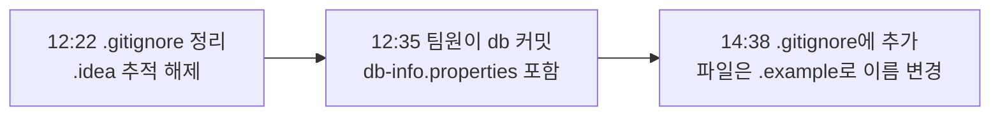
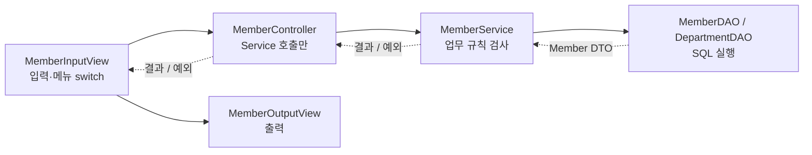
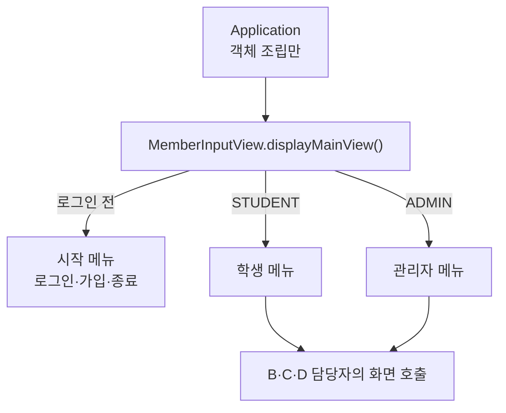
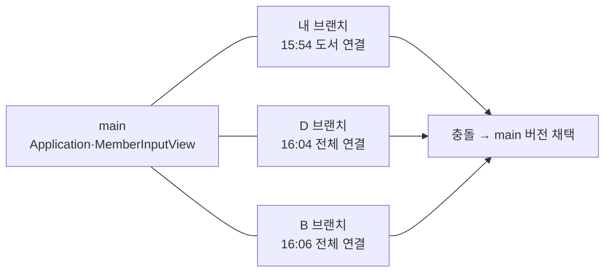

# 오늘 배운 것: JDBC MVC 팀 프로젝트로 도서 대여 앱 만들기

## 들어가며 (Situation)

모듈 2 14일차. 오늘은 새 진도를 나가지 않고, 지금까지 배운 것을 **한 프로젝트 안에서 전부 써 보는 통합 팀 과제**를 했다. 과제 이름은 "기획부터 JDBC MVC 구현까지"다.

| 항목 | 과제 조건 |
|------|-----------|
| 팀 구성 | 4인 팀 (우리 팀은 4명) |
| 개발 환경 | JDK 21, MySQL, MySQL Connector/J, Git·GitHub, Claude |
| 프로그램 형태 | Java 콘솔 프로그램 (웹 화면 없음) |
| 최소 규모 | 테이블 3개 이상, 1:N 관계 2개 이상, 팀원 1명당 CRUD 1세트 이상 |
| 진행 순서 | Git 협업 세팅 → Claude로 기획 → DB 모델링 → MVC 뼈대 → 기능 구현·통합 → 발표 |

우리 팀은 과제 목록의 "도서 대여 관리"를 골라 **을지대학교 성남캠퍼스 도서 대여 서비스**로 좁혔다. 결과물은 [bk-book 레포](https://github.com/bukkeu/bk-book)에 있다. 이 글은 그중 **내가 맡은 부분(기획서, DB 스키마, 공통 코드, A 회원 기능)** 을 중심으로, 팀 협업에서 막힌 순간을 커밋 기록을 따라 되짚은 것이다.



코드 팝업에는 내가 만든 `member` 패키지, 공통 `global` 패키지, `Application`, `sql/` 두 파일이 들어 있다. 다른 팀원의 패키지는 레포에서 볼 수 있다.

## 문제 상황 (Task)

하루 안에 4명이 같은 코드베이스에 기능을 얹어야 했고, 과제가 정한 제약은 다음과 같았다.

- **계층 규칙** — Controller에는 SQL을 쓰지 않고, Service에는 `Scanner`·`System.out`을 쓰지 않으며, DAO에는 사용자 입출력을 두지 않는다. "하면 안 되는 일"을 지키는 것이 평가의 핵심이다.
- **협업 규칙** — 레포를 만들어 브랜치별로 작업하고 PR로 병합한다. DB 비밀번호가 든 파일은 올리지 않는다.
- **공통 코드를 먼저 합치기** — DB 연결, 메인 메뉴 뼈대, DTO를 개발 전에 합쳐야 각자 만든 기능이 한 프로그램에서 돌아간다.

내가 풀어야 할 일은 세 가지였다.

1. 4명이 같은 그림을 보고 만들 수 있도록 **기획서와 스키마를 먼저 끝낸다.**
2. **공통 코드**(`JDBCTemplate`, `Session`, `InputUtil`)와 **회원·학과 기능(F-01~F-06)** 을 만든다.
3. 다른 팀원의 코드와 합칠 때 **빌드가 깨지지 않게** 맞춘다.

## 해결 과정 (Action)

### 1. 코드보다 먼저 기획서와 스키마를 만들었다

커밋 시각 기준으로 11:38에 팀원이 패키지 구조 init 커밋을 올렸고, 11:48에 내가 기획서를, 12:10에 기획서 수정과 `schema.sql`·`sample-data.sql`을 올렸다. 코딩 전에 문서와 DB를 먼저 확정한 셈이다. 과제 안내의 "기획서의 기능 목록이 테이블이 되고, 테이블이 DTO·DAO가 된다"는 흐름을 그대로 따랐다.

기획서에서 정한 것은 다음과 같다.

| 항목 | 내용 |
|------|------|
| 사용자 | 학생(STUDENT), 관리자(ADMIN) — `TBL_MEMBER.role` 값으로 메뉴를 나눔 |
| 테이블 | `TBL_DEPARTMENT`, `TBL_MEMBER`, `TBL_CATEGORY`, `TBL_BOOK`, `TBL_RENTAL` 5개 (1:N 관계 4개) |
| 업무 규칙 | R-01~R-12 (대여 5권 제한, 연체 중 대여 금지, 대여 기록 있는 도서 삭제 금지 등) |
| 기능 | F-01~F-24 (필수 19개, 선택 5개) |
| 담당 | A 회원·학과, B 도서, C 대여, D 카테고리·통계 |

💡 규칙마다 ID(R-07 등)를 붙여 두니, 코드 주석(`R-07 반납하지 않은 대여 권수`)과 스키마 주석(`R-06 대여 기록이 있는 도서는 삭제 불가`)이 같은 번호로 서로를 가리킬 수 있었다. 어느 계층이 어떤 규칙을 책임지는지 말할 때 기준이 됐다.

스키마에서는 규칙 몇 개를 **Service가 아니라 DB의 외래키 삭제 규칙으로** 옮겼다.

| 외래키 | 삭제 규칙 | 대응하는 업무 규칙 |
|--------|-----------|-------------------|
| `TBL_MEMBER.dept_id` → 학과 | `ON DELETE RESTRICT` | 학생이 있는 학과는 삭제 불가 |
| `TBL_BOOK.category_id` → 카테고리 | `ON DELETE RESTRICT` | R-10 도서가 있는 카테고리는 삭제 불가 |
| `TBL_RENTAL.member_id` → 회원 | `ON DELETE CASCADE` | R-07 탈퇴 시 반납 완료 기록은 함께 삭제 |
| `TBL_RENTAL.book_id` → 도서 | `ON DELETE RESTRICT` | R-06 대여 기록이 있는 도서는 삭제 불가 |

- **ON DELETE RESTRICT**
  - 부모 행을 지우려 할 때 자식 행이 남아 있으면 삭제를 거부하는 외래키 규칙입니다.
  - 코드에서 검사하는 것을 빠뜨려도 DB가 마지막으로 막아 줍니다.
- **ON DELETE CASCADE**
  - 부모 행을 지우면 그 부모를 참조하는 자식 행도 함께 지우는 외래키 규칙입니다.
  - 우리 스키마에서는 회원이 탈퇴하면 반납 완료된 대여 기록이 같이 사라지게 하는 데 썼습니다.

회원 탈퇴(F-04)는 이 둘이 같이 일한다. Service는 **미반납 대여가 있는지**만 확인해 막고(`countUnreturned`), 통과하면 `DELETE FROM TBL_MEMBER`만 실행한다. 반납 완료 기록은 코드가 지우지 않고 `CASCADE`가 지운다. `MemberDAO`의 주석에도 "반납 완료된 대여 기록은 FK ON DELETE CASCADE로 함께 삭제된다"고 적어 두었다.

⚠️ 이 구조에서는 `CASCADE`가 대여 기록을 조용히 지우므로, 통계에서 "탈퇴한 학생의 과거 대여"는 집계되지 않는다. 이번 과제 범위에서는 수용했지만, 기록을 남겨야 하는 서비스라면 다른 설계가 필요하다.

### 2. 공통 코드: 접속 정보를 classpath 파일로 분리했다

과제 안내의 `DBUtil` 예시는 `FileInputStream("db.properties")`로 프로젝트 루트의 파일을 읽는다. 우리 프로젝트는 Gradle 구조(`src/main/resources`)라서, `JDBCTemplate`가 **classpath에서 `db-info.properties`를 읽도록** 했다. 12일차에 배운 "properties 분리 + `JDBCTemplate`" 방식과 같은 계열이다.

```java
try (InputStream in = JDBCTemplate.class.getClassLoader()
        .getResourceAsStream("db-info.properties")) {
    props.load(in);
}
```

공통 코드는 세 개를 만들었다.

| 클래스 | 역할 | 왜 공통으로 뒀나 |
|--------|------|------------------|
| `JDBCTemplate` | `Connection` 생성, 자원 `close` | 모든 DAO·Service가 같은 방식으로 연결 |
| `Session` | 로그인한 `Member`를 static 필드에 보관 | 대여·탈퇴처럼 "지금 로그인한 사람"이 필요한 기능이 모두 씀 |
| `InputUtil` | `Scanner`를 하나만 만들어 공유 | 화면마다 `new Scanner(System.in)`을 만들지 않으려고 |

`InputUtil`은 주석에 "System.in을 읽는 Scanner를 하나만 만들어 모든 InputView가 함께 쓴다"고 적었다. 화면마다 `Scanner`를 새로 만들면 입력이 어느 `Scanner`에 쌓이는지 꼬일 수 있어 하나로 묶었다. 이 부분은 직접 오류를 재현해 본 것은 아니고, 설계 단계에서 피한 것이다.

### 3. 첫 번째 시행착오: 접속 정보 파일이 이미 올라가 있었다

과제 안내는 "`db.properties`는 절대 올리지 않는다"고 강조한다. 그런데 12:35에 팀원이 올린 `db` 커밋에 `src/main/resources/db-info.properties`가 그대로 들어 있었다. 12:22에는 내가 `.gitignore`를 정리하고 IntelliJ `.idea` 파일의 추적을 해제했는데, 접속 정보 파일은 그 뒤에 올라온 것이다.



14:38에 `db-info.properties`를 `.gitignore`에 넣고, 파일을 `db-info.properties.example`로 바꿔 양식으로 남겼다. README에는 "example을 복사해 `user`, `password`를 본인 값으로 수정"하는 순서를 적었다.

🔴 `.gitignore`에 추가하는 것만으로는 **이미 추적 중인 파일이 추적에서 빠지지 않는다.** 그래서 파일을 이름 변경(`db-info.properties` → `.example`)하는 방식으로 정리했다. 그리고 이미 올라간 커밋 기록에는 파일이 그대로 남아 있다(`git show 4a0e1a7:src/main/resources/db-info.properties`로 지금도 볼 수 있다). 기록까지 지우는 작업은 하지 않았다.

🟢 처음부터 `.gitignore`와 `.example` 파일을 **개발 시작 전에** 같이 올리는 것이 맞다. 과제 안내가 "팀장이 첫 커밋에 `.gitignore`를 만든다"고 한 순서에는 이유가 있었다.

### 4. 회원 기능(F-01~F-06)을 계층별로 쪼갰다

내 담당은 로그인·가입·내 정보·탈퇴·회원 검색·학과 등록이다. 과제 안내의 계층 표를 기준으로 클래스를 나눴다.



가입(F-01)을 예로 따라가면 이렇다.

1. `MemberInputView.signUp()`이 학과 목록을 보여 주고 `Scanner`로 값을 받아 `Member` DTO에 담는다.
2. `MemberController.signUp()`은 Service에 그대로 넘긴다.
3. `MemberService.signUp()`이 필수값·비밀번호 길이를 확인하고, 학번 중복(R-08)과 학과 존재(R-11)를 DAO로 확인한 뒤 INSERT를 요청한다.
4. 규칙에 어긋나면 `IllegalArgumentException`을 던지고, View가 받아 메시지를 출력한다.

```java
public void signUp(Member member) {
    // ... 필수값·비밀번호 길이 검사 생략
    try (Connection con = JDBCTemplate.getConnection()) {
        if (memberDAO.existsByLoginId(con, member.getLoginId())) {
            throw new IllegalArgumentException("이미 가입된 학번입니다");
        }
        if (member.getDeptId() == null || !departmentDAO.existsById(con, member.getDeptId())) {
            throw new IllegalArgumentException("없는 학과 번호입니다");
        }
        memberDAO.insert(con, member);
    } catch (SQLException e) {
        throw new RuntimeException("회원 가입 중 오류가 발생했습니다", e);
    }
}
```

이 구조에서 눈여겨 둘 설계가 세 가지 있다.

- **DAO가 `Connection`을 만들지 않고 인자로 받는다.** Service가 `try-with-resources`로 `Connection`을 하나 열어 DAO 여러 개에 넘긴다. 과제 안내가 트랜잭션을 "Service에서 하나의 `Connection`으로 묶는다"고 설명한 형태와 맞는다. 우리 회원 기능에는 트랜잭션이 필요한 곳이 없어 `commit`·`rollback`은 쓰지 않았다.
- **업무 규칙 위반은 예외 메시지로 위로 올린다.** Service에는 `System.out`을 쓸 수 없으니, `IllegalArgumentException`의 메시지를 View가 출력하게 했다. 기획서의 예외 메시지(`"이미 가입된 학번입니다"` 등)가 그대로 Service의 예외 메시지가 된다.
- **NULL이 가능한 컬럼은 `wasNull()`로 다뤘다.** 관리자는 `dept_id`가 NULL이다. `rs.getInt("dept_id")`는 NULL을 0으로 돌려주므로, `rs.wasNull()`로 확인해 `Integer`에 `null`을 담았다. 같은 이유로 학생·관리자를 함께 조회하는 쿼리는 `JOIN`이 아니라 `LEFT JOIN`을 썼다.

회원 검색(F-05)의 SQL은 `LEFT JOIN`과 `GROUP BY`가 함께 있어 눈여겨볼 만했다.

```sql
SELECT m.member_id, m.login_id, m.name, m.phone, d.dept_name,
       COUNT(r.rental_id) AS rental_count
FROM TBL_MEMBER m
LEFT JOIN TBL_DEPARTMENT d ON m.dept_id = d.dept_id
LEFT JOIN TBL_RENTAL r ON r.member_id = m.member_id AND r.return_date IS NULL
WHERE m.role = 'STUDENT' AND (m.name LIKE ? OR d.dept_name LIKE ?)
GROUP BY m.member_id, m.login_id, m.name, m.phone, d.dept_name
ORDER BY m.member_id
```

`r.return_date IS NULL` 조건을 `WHERE`가 아니라 **`ON` 절에** 둔 점이 중요해 보인다. `WHERE`에 두면 반납 완료 기록만 있는 학생의 행이 모두 걸러져 목록에서 사라질 것이다. `ON`에 두면 "대여 중인 건만 `JOIN`하되 학생은 남기고", 대여 중이 없으면 `COUNT`가 0이 된다. 다만 이 설명은 SQL을 읽고 추론한 것이고, MySQL에서 두 방식의 결과를 직접 비교해 보지는 않았다.

🔴 가입 비밀번호는 DB에 **평문**으로 저장한다. `sample-data.sql` 첫머리에도 "비밀번호는 모두 1234 (과제 범위상 평문 저장)"이라고 적었다. 로그인은 `WHERE login_id = ? AND password = ?`로 한 번에 비교한다. 과제 안내가 "아이디·비밀번호를 DB에서 비교하는 수준이면 충분"하다고 했기 때문이지, 실제 서비스에서 써도 된다는 뜻은 아니다.

### 5. 두 번째 시행착오: 병합하자 컴파일이 깨졌다

15:01에 B가 도서 기능과 자기 `JDBCTemplate`를 올렸고, 15:05에 C가 대여를, 15:09에 내가 회원 기능을 올렸다. 그런데 `JDBCTemplate`가 **사람마다 다른 패키지**에 있었다. 나는 `com.eulji.global.config`에, B는 `com.eulji.config`에 뒀고, C의 레포 경로에는 `library/common/DBUtil`도 있었다.

15:24에 main을 내 브랜치로 병합했더니 `BookService`가 `com.eulji.config` 패키지를 못 찾아 컴파일이 실패했다. 아래가 이어진 커밋 순서다.

| 시각 | 누가 | 커밋 | 의미 |
|------|------|------|------|
| 15:24 | 나 | `fix: BookService의 JDBCTemplate import를 global.config로 수정` | 컴파일을 살리려고 B의 파일을 직접 고침 |
| 15:26 | 나 | `revert: BookService import 수정 취소 (B 담당 코드는 B가 수정)` | 남의 담당 코드는 직접 안 고치기로 하고 되돌림 |
| 15:31 | B | `fix: BookService JDBCTemplate import를 global.config로 변경` | 담당자가 같은 수정을 직접 반영 |

결과적으로 같은 import 한 줄이 두 번 고쳐졌고, 15:24부터 B가 고친 15:31까지 7분이 걸렸다. 과제 안내는 `DBUtil`·모든 DTO·메인 메뉴 뼈대를 "개발 전에 함께 만들어 develop에 먼저 병합"하라고 하는데, 우리는 공통 코드를 병합하기 전에 각자 만들기 시작한 것으로 보인다.

- **git revert**
  - 이미 만든 커밋의 변경을 **거꾸로 적용하는 새 커밋**을 만들어 되돌리는 명령입니다.
  - 기록을 지우지 않고 "고쳤다가 취소했다"는 이력을 남깁니다. 공식 문서: [git-revert](https://git-scm.com/docs/git-revert)

🟢 이후로는 남의 담당 파일에서 오류가 보이면 **직접 고치지 않고 담당자에게 알리는** 쪽으로 정했다. 이 방식은 과제 안내의 "충돌이 나면 혼자 해결하지 말고, 같은 파일을 수정한 팀원과 함께 해결한다"와도 같은 방향이다.

### 6. 세 번째 시행착오: Controller가 너무 많은 일을 하고 있었다

15:09에 올린 내 첫 구현에는 `MainController`와 `menu` 패키지가 있었고, `MemberController`가 157줄이었다. 과제 안내의 계층 표는 Controller가 "메뉴 흐름 제어, View와 Service 연결"을 하고 SQL은 쓰지 않는다고 정해 두었다.

15:37에 구조를 바꿨다. 커밋 메시지의 정리는 다음과 같다.

- `Controller`는 Service 호출만 담당하고, Service는 생성자로 주입받는다
- 메인 메뉴 흐름은 `MemberInputView.displayMainView()`로 옮긴다
- `menu` 패키지(`MainController` 등)는 삭제한다

| 항목 | 바꾸기 전 | 바꾼 후 |
|------|-----------|---------|
| `MemberController` | 약 157줄 | Service를 호출만 하는 얇은 클래스 |
| 메인 메뉴 | `menu.MainController` | `MemberInputView.displayMainView()` |
| `Application` | 메뉴 연결 포함 | **객체 조립만** 하고 메인 화면을 호출 |



그리고 15:42에 B가 "Book 구조를 팀 규칙에 맞게 변경" 커밋을 올렸다. 어떤 규칙에 맞췄는지는 커밋 메시지에 없지만, 같은 시간대에 정리한 구조를 따른 것으로 보인다.

⚠️ 다만 이 결정은 과제 안내와 **다르다.** 안내는 `MainController`는 분기만 하고 팀원은 자기 줄 한 줄만 추가하라고 했다. 우리는 `MainController`를 없애고 분기를 A의 `MemberInputView`로 모았다. 그 결과가 다음 시행착오로 이어졌다.

### 7. 네 번째 시행착오: 메인 메뉴 연결을 세 명이 동시에 했다

메인 메뉴는 한 파일에서 모든 담당자의 화면을 이어 줘야 했다. 그런데 연결 작업을 서로 모른 채 각자 했다.

| 시각 | 누가 | 커밋 |
|------|------|------|
| 15:54 | 나 | `feat: Application에서 Book 객체 조립, 도서 메뉴를 메인 메뉴에 연결` |
| 16:04 | D | `feat: 모든 팀원 화면을 메인 메뉴에 연결` |
| 16:06 | B | `feat: 메인 메뉴에 도서·카테고리·대여·연체·통계 연결` |

12분 사이에 세 사람이 같은 두 파일(`Application`, `MemberInputView`)을 고쳤다. 16:15에 내가 main을 내 브랜치로 병합하면서 두 파일은 **main 버전을 채택**하는 것으로 충돌을 정리했다. D가 `sbranch`에서 main을 병합한 기록에도 "`MainController`는 main에서 삭제된 대로 제거"라고 남아 있다.



🔴 세 사람이 같은 일을 했으니, 마지막에 채택된 것 외의 작업은 버려졌다. 과제 안내의 "메인 메뉴 충돌 줄이기"를 지키려면 **누가 메인 메뉴를 연결할지 먼저 정하고**, 나머지는 자기 화면의 진입 메서드(`displayBookMenu()` 같은 것)만 만들어 두면 됐다.

### 8. 코드가 바뀔 때마다 기획서를 맞췄다

패키지 구조가 바뀔 때마다 기획서의 "패키지 구조" 절을 고쳤다. 오늘 이 절을 고친 커밋이 네 번이다.

| 시각 | 커밋 | 반영한 내용 |
|------|------|-------------|
| 14:39 | 패키지 구조·DB 설정 방식 반영, 병합 대상 main으로 수정 | 패키지 구조 절과 접속 정보 설정 방식 추가 |
| 15:17 | 패키지 구조를 코드에 맞게 수정 (global, menu 반영) | `global`, `menu` 패키지 |
| 15:37 | Application은 객체 조립만 (메뉴 구조 설명 수정) | `menu` 패키지 삭제 |
| 16:16 | 패키지 구조를 전체 팀원 코드 기준으로 수정 | B·C·D 패키지와 SQL 작성 방식 |

마지막 수정에는 SQL 작성 방식도 들어갔다. 나는 `MemberDAO` 안에 텍스트 블록(`"""`)으로 SQL을 썼고, 다른 팀원들은 13일차에 배운 방식대로 `resources/*-queries.xml`에 두었다. 둘 중 하나로 통일하지 않고, 기획서에 "DAO 내부에 쓰거나 XML에 둔다"고 **둘 다 허용**하는 것으로 적었다.

한편 14:39 커밋의 "병합 대상 main으로 수정"에서 보듯, 우리 레포에는 과제 안내의 `develop` 브랜치가 없고 사람마다 브랜치(`Ybranch`, `Jbranch`, `sbranch` 등)에서 main으로 PR을 올리는 2단 구조를 썼다. 이유는 이전 수업의 Git 실습이 `develop` 없이 진행됐고, 이번에도 그때 방식을 그대로 따랐기 때문이다. 오늘 겪은 컴파일 실패(5번)가 "main을 내 브랜치로 병합한 뒤" 드러난 것도 이 구조와 맞닿아 있다. 통합용 `develop`이 있었다면 깨진 코드가 main에 들어가기 전에 한 번 더 걸러졌을 것이다. 다만 이것은 구조에서 추론한 것이고, 3단 구조로 해 보고 비교한 것은 아니다.

## 결과 (Result)

레포 기록으로 확인한 것과 직접 확인한 것을 나눠 적는다.

| 항목 | 결과 | 출처 |
|------|------|------|
| 작업 시간 | 첫 커밋 11:38 ~ 마지막 커밋 16:21 (약 4시간 43분) | `git log` |
| 커밋·PR | 병합 제외 커밋 28개, 병합 커밋 18개, PR #1~#13 | `git log` |
| 기획 규모 | 기능 24개(필수 19·선택 5), 업무 규칙 12개, 테이블 5개(1:N 4개) | `docs/기획서.md` |
| 내 담당 | 기획서·스키마·공통 코드(`global`)·회원 기능 F-01~F-06 | 커밋 작성자 기록 |
| 컴파일 | main 브랜치 소스 전체가 `javac`로 컴파일됨 | 이 글을 쓰며 직접 실행 |
| 메인 메뉴 | 학생·관리자 메뉴에서 도서·카테고리·대여·연체·통계 화면까지 연결 | 커밋 메시지 |

⚠️ MySQL에 연결해 전체 기능을 끝까지 실행해 본 결과는 이 글에 넣지 않았다. 컴파일 성공은 확인했지만, 기능별 동작은 확인하지 않았으므로 "모든 기능이 동작한다"고 쓰지 않는다.

### 배운 점

- **공통 코드는 개발 전에 한 사람이 만들어 먼저 병합한다.** 오늘 겪은 시행착오 중 5번과 7번이 모두 이 순서를 건너뛴 데서 나왔다.
- **남의 담당 코드는 직접 고치지 않고 알린다.** 한 줄을 두 번 고친 일이 이를 보여 준다.
- **구조를 바꿀 때는 문서도 같이 바꾼다.** 기획서의 패키지 구조 절을 하루에 네 번 고쳤다. 코드와 문서가 어긋나면 팀원이 서로 다른 그림을 보게 된다.
- **업무 규칙은 Service와 DB 제약이 나눠서 책임진다.** 미반납 확인은 Service가, 삭제 연쇄는 `CASCADE`가 맡았다. 한쪽만 믿으면 빈틈이 생긴다.

## 더 학습하면 좋은 개념

- **트랜잭션 (commit / rollback)** — 대여 등록처럼 INSERT와 재고 UPDATE가 함께 성공해야 하는 기능을 묶는 방법이다. 우리 설계는 DAO가 `Connection`을 받는 형태라 확장하기 쉬운데, 아직 적용하지 않았다.
- **비밀번호 해시 (BCrypt 등)** — 오늘은 평문으로 저장했다. 해시와 솔트를 이해해야 "비교는 가능하지만 복원은 안 되는" 저장 방식을 쓸 수 있다.
- **Git 브랜치 전략과 PR 리뷰** — `main ← develop ← feature` 3단 구조가 왜 있는지, 계층 규칙을 리뷰에서 어떻게 잡는지 알면 오늘의 병합 문제를 줄일 수 있다.
- **외래키 삭제 규칙과 소프트 삭제** — `CASCADE`로 과거 기록이 사라지는 문제를 `deleted_at` 같은 컬럼으로 푸는 방법이 있다.
- **SQL JOIN의 `ON`과 `WHERE` 차이** — `LEFT JOIN`에서 조건 위치에 따라 결과가 달라진다. 직접 데이터를 넣고 두 쿼리를 비교해 보면 확실해진다.

## 참고 자료

- [git-revert 공식 문서](https://git-scm.com/docs/git-revert)
- [gitignore 공식 문서](https://git-scm.com/docs/gitignore)
- [GitHub Docs - 병합 충돌 정보](https://docs.github.com/en/pull-requests/collaborating-with-pull-requests/addressing-merge-conflicts/about-merge-conflicts)
- [MySQL 8.4 Reference - FOREIGN KEY Constraints](https://dev.mysql.com/doc/refman/8.4/en/create-table-foreign-keys.html)
- [Java Tutorials - The try-with-resources Statement](https://docs.oracle.com/javase/tutorial/essential/exceptions/tryResourceClose.html)
