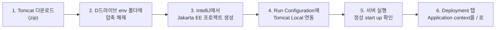
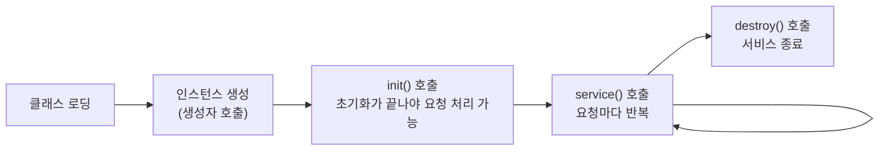
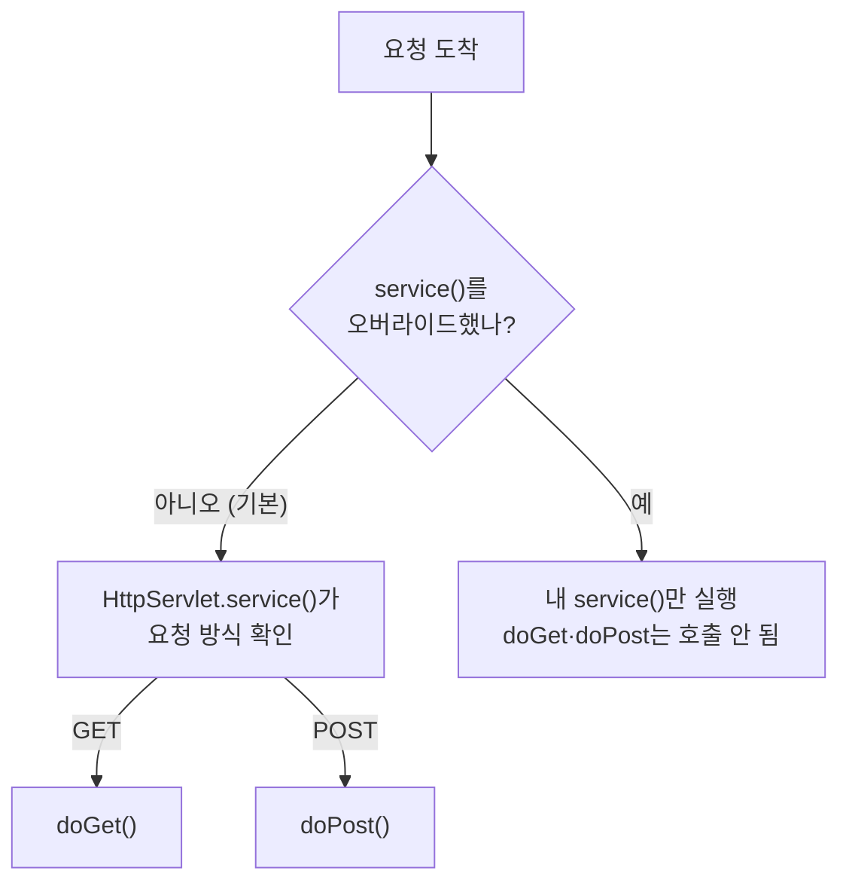
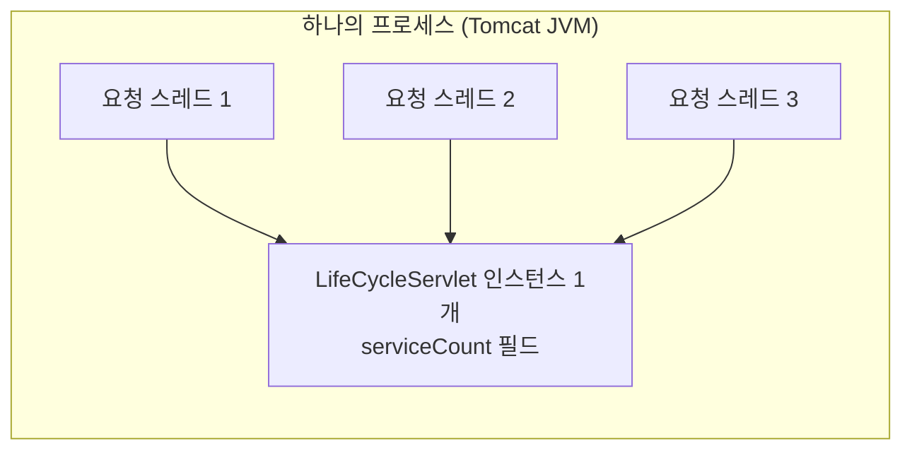

# 오늘 배운 것: Servlet 라이프사이클·service()·요청 파라미터 확인

## 들어가며 (Situation)

모듈 2 15일차. 지금까지는 `main()`에서 시작하는 콘솔 프로그램이었는데, 오늘부터 `06_Servlet`에서 **브라우저 요청을 자바 클래스가 받는** 웹 프로그램을 시작했다. 프로젝트는 `chap01-servlet`이고 Gradle `war` 프로젝트에 Jakarta Servlet 6.1 API를 `compileOnly`로 넣은 구조다. 코드는 세 묶음이다.

| 패키지 | 클래스 | 확인하려던 것 |
|--------|--------|---------------|
| `a_lifecycle` | `LifeCycleServlet` | 생성자·`init`·`service`·`destroy`가 언제 몇 번 호출되는가 |
| `b_service` | `ServiceMethodServlet` | `service()`와 `doGet`·`doPost`를 같이 오버라이드하면 어느 쪽이 실행되는가 |
| `c_parameter` | `QueryStringServlet`, `FormDataServlet` | GET·POST로 보낸 값을 `getParameter`로 어떻게 받는가 |

오늘 수업의 학습 목표는 "Servlet 개요와 Web Server·WAS 이해", "Servlet Container의 Life-Cycle 이해"였고, 수업 교안(Claude 아티팩트 두 편과 Notion 정리 `01 Servlet 개요`, `02 Servlet Life-Cycle`, `01. Web Application 개발 환경 구축`)으로 이론을 먼저 본 뒤 **Tomcat WAS 서버 환경을 구축**(해결 과정 1번)하고 위 프로젝트를 만들었다. 교안은 Tomcat을 수업에서 쓰는 WAS로 소개한다.

`main()`이 없으므로 이전 글들처럼 실행 결과 파일은 만들지 않았다. 서블릿은 웹 서버(서블릿 컨테이너)가 요청을 받아야 실행되기 때문이다.



## 문제 상황 (Task)

콘솔 프로그램에서는 내가 `main()`을 시작하고 끝냈다. 서블릿에는 `main()`이 없고, 누가 객체를 만들고 메서드를 언제 부르는지가 코드에 보이지 않는다. 그래서 오늘의 과제는 세 가지 질문이었다.

1. 서블릿 객체는 누가, 언제, 몇 개 만드는가? 메서드는 어떤 순서로 불리는가?
2. 요청이 들어오면 `service()`, `doGet()`, `doPost()` 중 무엇이 실행되는가?
3. 브라우저가 보낸 값은 서블릿에서 어떤 타입으로 받아지는가?

## 해결 과정 (Action)

### 1. 먼저 Tomcat(WAS) 환경을 구축했다

서블릿은 `main()`이 없어서 실행할 서버부터 있어야 한다. Notion 정리 `01. Web Application 개발 환경 구축`의 순서를 따라 Tomcat을 설치하고 IntelliJ에 연동했다.



**① Tomcat 내려받기**

Notion 정리는 Tomcat 공식 다운로드 페이지에서 Tomcat 11을 골라 받으라고 한다. 먼저 [버전별 지원 정보](https://tomcat.apache.org/whichversion.html)를 확인하고, 다운로드 링크 중 가장 위의 zip 파일을 받는다. 이 zip은 Windows, Unix, Linux에서 모두 쓸 수 있는 배포판이다. 받은 파일은 D드라이브에 만든 `env` 폴더에 압축을 풀었다. 설치 프로그램 없이 압축만 풀면 되는 방식으로 보인다(내 해석이다).

**② IntelliJ에서 프로젝트 만들기**

New Project 창에서 **Jakarta EE**를 고르고 아래처럼 설정했다(Notion 정리 기준).

| 항목 | 설정 |
|------|------|
| Template | Web application |
| Application server | Tomcat |
| Language | Java |
| Build system | Gradle |
| JDK | 17 |
| Version / Specifications | Jakarta EE 9.1, Specifications에서 Servlet 선택 (Servlet 라이브러리 dependency 추가) |

프로젝트를 만들면 IntelliJ가 기본 파일 세 개를 생성한다.

| 파일 | 역할 (Notion 정리 기준) |
|------|-------------------------|
| `build.gradle` | 빌드에 필요한 dependencies, plugin 같은 Gradle 구성 정보 |
| `index.jsp` | root 디렉토리 URL로 접근할 때 열리는 시작 페이지. `Hello World!`를 렌더링하고 `/hello-servlet` 링크가 있다 |
| `HelloServlet.java` | `HttpServlet`을 상속하고 `@WebServlet`이 붙은 클래스. `/hello-servlet` GET 요청에 `Hello World!` HTML을 돌려준다 |

**③ Tomcat 연동 (Run Configuration)**

1. `Run > Edit Configurations…`를 열고 `Add New…` → **Tomcat Server > Local**을 고른다.
2. Server 탭의 Application server 옆 `Configure…`에서 **압축을 푼 Tomcat 경로**를 지정한다.
3. 실행 이름, URL, 포트 번호, VM options를 쓴다. VM options에는 `-Dfile.encoding=UTF-8`을 넣어 인코딩을 맞춘다. 포트는 Tomcat이 실행될 포트 번호다.
4. 서버를 실행해 정상적으로 뜨는지 확인한다.
5. 실행하면 URL이 길게 찍히므로, 다시 `Edit Configurations…`의 **Deployment** 탭에서 `+ > Artifact…`를 눌러 추가하고 **Application context를 `/`만 남기고 지운다**.

💡 5번의 Application context 설정이 우리 프로젝트의 주소 모양을 정했다. 이렇게 하면 프로젝트 이름이 주소에 끼지 않아 `http://localhost:8080/querystring`처럼 바로 접근할 수 있다. 코드의 `action="/request-service"`나 `<a href="/life-cycle">` 같은 `/`로 시작하는 절대 경로가 그대로 동작하는 것도 이 설정 덕분으로 보인다. 컨텍스트 경로가 `/chap01-servlet`처럼 남아 있으면, `/`로 시작하는 링크는 그 경로 밖의 루트를 가리키기 때문이다(이 부분은 URL 해석 규칙에서 따라 나오는 추론이고, 경로가 남은 상태로 실행해 확인하지는 않았다).

⚠️ Notion 정리에는 버전 표기가 섞여 있다. 개요에서는 Tomcat 11을 받으라고 하는데, 설치 단계에는 `10.1.17`을 받는다는 문장과 IntelliJ 설정의 `Tomcat 10.1.17`, 라이브러리 경로 확인 단계의 `Tomcat 9.0.74`가 함께 나온다. 이 글에서는 내가 실제로 어느 버전을 깔았는지 확정하지 못했다. 버전에 따라 지원하는 Servlet 스펙과 패키지 이름이 달라지므로, 서버 버전은 실행 화면이나 `env` 폴더 이름으로 확인해 두는 것이 좋다.

### 2. 라이프사이클: 호출 시점을 로그로 찍어 확인하는 구조

`LifeCycleServlet`은 `/life-cycle` 요청을 받는 서블릿이다. `@WebServlet(value = "/life-cycle")` 어노테이션이 "이 클래스가 서블릿이고, 이 URL 패턴을 처리한다"를 알려 준다(수업 주석의 설명). 생성자·`init`·`service`·`destroy`에서 각각 메시지를 찍고, 호출 횟수를 세는 `int` 필드 세 개를 뒀다.

```java
@WebServlet(value = "/life-cycle")
public class LifeCycleServlet extends HttpServlet {

    private int initCount = 1;
    private int serviceCount = 1;
    private int destroyCount = 1;

    @Override
    protected void service(HttpServletRequest req, HttpServletResponse resp) {
        System.out.println("service() 호출됨... :" + serviceCount++);
    }
    // 생성자, init(), destroy()도 같은 방식으로 출력 (전체는 코드 팝업 참고)
}
```

서블릿 스펙의 라이프사이클 규정은 다음과 같다.



- **서블릿 인스턴스 개수**
  - 서블릿 선언 하나당 컨테이너가 만드는 서블릿 객체의 개수를 가리키는 말입니다.
  - 분산 환경이 아닌 기본 설정에서는 하나만 만들어야 합니다(공식 스펙 2.2절).
  - 그래서 `/life-cycle`을 100번 요청해도 생성자와 `init()`은 보통 한 번, `service()`만 요청 횟수만큼 불립니다.

💡 이 카운터가 **인스턴스 필드**라는 점이 단서가 된다. 요청마다 객체가 새로 만들어진다면 `serviceCount`는 항상 1이어야 한다. 값이 쌓이며 올라간다면 같은 객체가 계속 재사용된다는 뜻이다.

Notion 정리 `02 Servlet Life-Cycle`은 각 메서드가 불리는 시점을 이렇게 적는다.

| 메서드 | 호출 시점 (Notion 정리 기준) |
|--------|------------------------------|
| 생성자·`init()` | 첫 요청이 오면 객체를 만들고 호출한다. `load-on-startup`을 설정하면 서버가 구동될 때 미리 만든다 |
| `service()` | 요청마다 호출한다. 요청 방식에 따라 `doGet()`·`doPost()`로 넘긴다 |
| `destroy()` | 서버가 종료될 때, 또는 서블릿 내용이 바뀌어 재컴파일될 때 호출한다. 주로 자원을 반납하는 용도다 |

`LifeCycleServlet`에는 `loadOnStartup` 설정이 없으므로, 이 정리대로라면 서버를 켠 직후가 아니라 `/life-cycle`을 **처음 요청했을 때** 생성자와 `init()` 메시지가 찍힐 것이다. 이 정리는 수업 자료이고, 글을 쓰며 공식 스펙으로 따로 확인하지는 않았다.

⚠️ 이 글에는 `/life-cycle`을 실제로 여러 번 요청했을 때의 콘솔 출력을 기록하지 못했다. 위 설명은 코드와 스펙, 수업 자료에서 읽은 것이다.

### 3. service()를 오버라이드하면 doGet·doPost는 어떻게 되는가

`ServiceMethodServlet`은 `service()`, `doGet()`, `doPost()`를 **모두** 오버라이드하고 각각 출력문을 둔다. 의도는 "상위 메서드인 `service()`가 있으면 `doGet`·`doPost`를 덮는지" 확인하는 것이었다.

```java
@Override
protected void service(HttpServletRequest req, HttpServletResponse resp) {
    String httpMethod = req.getMethod();
    System.out.println("httpMethod = " + httpMethod);
}

@Override
protected void doGet(HttpServletRequest req, HttpServletResponse resp) {
    System.out.println("GET 요청을 처리할 메소드 호출됨...");
}
```

공식 API 문서의 설명이 이 구조를 설명해 준다.

> `HttpServlet.service(...)`: "Receives standard HTTP requests from the public `service` method ... dispatches them to the `do`XXX methods defined in this class."
>
> "There's almost no reason to override the `service` method." — [HttpServlet API](https://jakarta.ee/specifications/servlet/6.1/apidocs/jakarta.servlet/jakarta/servlet/http/HttpServlet.html)

`HttpServlet`의 `service()`가 하는 일이 바로 요청 방식을 보고 `doGet`·`doPost`로 나눠 주는 것이다. 그런데 내가 `service()`를 **통째로 덮어쓰면** 그 분배 코드가 실행되지 않는다. 그래서 `doGet`·`doPost`에 출력문이 있어도 호출되지 않고, `service()` 안의 `httpMethod = ...`만 찍힐 것이다.



- **service() 덮어쓰기 (Override)**
  - 부모 클래스의 메서드를 자식 클래스에서 같은 시그니처로 다시 정의해, 호출 시 자식 버전이 실행되게 하는 것입니다.
  - 서블릿에서는 `HttpServlet.service()`를 덮으면 GET·POST 분배가 사라지므로, 보통 `doGet`·`doPost`만 오버라이드합니다.

🟢 요청 방식별로 처리를 나누려면 `service()`는 그대로 두고 `doGet`·`doPost`만 오버라이드한다. `service()`를 꼭 덮어야 한다면 안에서 `super.service(req, resp)`를 호출해야 분배가 유지된다(이 부분은 문서의 설명에서 따라 나오는 것이고, 오늘 코드에서 직접 시험하지는 않았다).

### 4. 시행착오: POST 버튼에 오타가 있었다

`service.html`에는 방식별 요청 버튼이 있다. 그런데 POST 폼의 속성이 `method="host"`로 오타가 나 있었다.

```html
<form action="/request-service" method="host">
    <input type="submit" value="POST 방식 요청!!">
</form>
```

`host`는 허용된 값이 아니다. HTML 표준에서 `method` 속성의 허용 키워드는 `get`, `post`, `dialog`이고, 속성이 없거나 잘못된 값이면 **GET으로 처리**한다.

> "The `method` attribute's missing value default and invalid value default are both the GET state." — [WHATWG HTML Standard](https://html.spec.whatwg.org/multipage/form-control-infrastructure.html)

| 버튼 | 속성 | 표준상 보내는 방식 |
|------|------|--------------------|
| `a href` 링크 | (링크 이동) | GET |
| GET 폼 | `method="get"` | GET |
| "POST 방식 요청!!" 폼 | `method="host"` (오타) | **GET** |

🔴 표준대로라면 버튼 이름이 "POST"여도 `doPost()`가 아니라 GET 요청이 간다. 이 오타가 있으면 "POST 요청이 왜 POST로 안 들어오지?" 하고 헤맬 수 있다. 원인은 서버 코드가 아니라 **HTML 쪽 속성값**이다. 이 버튼을 눌렀을 때 브라우저가 실제로 보낸 요청은 이 글에서 확인하지 못했다.

🟢 `method="post"`로 고치면 POST 방식으로 전송된다. 요청 방식이 이상하면 서블릿 코드보다 먼저 브라우저가 실제로 보낸 요청(개발자 도구의 Network 탭)을 확인하는 것이 빠르다.

### 5. 요청 파라미터: GET은 쿼리스트링, POST는 본문

`parameter.html`은 이름·나이·생일·성별·국적·취미를 입력받는 폼을 GET용(`/querystring`)과 POST용(`/formdata`)으로 하나씩 둔다. `a` 태그에 쿼리스트링을 직접 써서 보내는 링크도 있다.

| 항목 | GET (`QueryStringServlet`) | POST (`FormDataServlet`) |
|------|---------------------------|--------------------------|
| 값 위치 | URL의 쿼리스트링 (`?name=홍길동&age=20`) | 요청 본문(Payload/Body) |
| URL 노출 | 노출됨 | 노출되지 않음 |
| 오버라이드한 메서드 | `doGet` | `doPost` |
| 수업 주석의 용도 | 조회 (속도가 빠르다) | 게시글 등록처럼 큰 데이터 |

값은 두 서블릿 모두 `req.getParameter("name")`처럼 이름으로 꺼낸다. `QueryStringServlet`은 `name`과 `age`를, `FormDataServlet`은 `name`만 꺼낸다. 수업 주석이 짚는 점은 **URL로 전달되는 값은 모두 `String`이라는 것**이다.

```java
// QueryStringServlet.doGet()
String name = req.getParameter("name");
int age = Integer.parseInt(req.getParameter("age"));   // String → int 파싱 필요
```

⚠️ `QueryStringServlet`에서 `age`를 `Integer.parseInt`로 바꾸는 이 코드는 값이 비어 있으면 `NumberFormatException`이 날 수 있다. 입력 칸을 비워 두고 보내면 어떻게 되는지는 오늘 확인하지 않았다.

⚠️ 취미(`hobbies`) 체크박스는 같은 이름으로 여러 값이 넘어오는데, 두 서블릿 모두 `hobbies`는 꺼내지 않는다. 여러 값을 받으려면 `getParameter`가 아니라 `getParameterValues`를 써야 한다는 점은 API 설명에서 알게 된 것이고, 오늘 코드에는 없다.

### 6. 서블릿 매핑: `@WebServlet`과 `web.xml`

클라이언트가 `/life-cycle`로 요청하면 Tomcat이 이 주소를 해석해 매핑된 서블릿으로 연결한다. Notion 정리 `02 Servlet Life-Cycle`은 매핑 방법을 두 가지로 비교한다.

| 방법 | 장점 | 단점 |
|------|------|------|
| `web.xml` (`<servlet>` + `<servlet-mapping>`) | 매핑 정보를 한 파일에서 한눈에 볼 수 있다 | 서블릿을 추가할 때마다 파일을 열어 매핑해야 한다 |
| `@WebServlet` 어노테이션 | 클래스 위에 한 줄만 쓰면 되어 간편하다 | 별도 문서가 없으면 전체 매핑을 한눈에 볼 수 없다 |

우리 프로젝트의 `web.xml`은 루트 `<web-app>` 요소만 있고 `<servlet>` 항목이 없다. 서블릿 네 개(`/life-cycle`, `/request-service`, `/querystring`, `/formdata`)는 모두 `@WebServlet`으로 매핑했다.

- **배포 서술자 (Deployment Descriptor, web.xml)**
  - 웹 애플리케이션의 설정 정보를 담은 xml 파일로, `WEB-INF` 폴더 안에 둡니다.
  - 컨테이너가 이 파일을 보고 서블릿 정의, 매핑, 시작 페이지, 에러 페이지 같은 설정대로 애플리케이션을 구동합니다(Notion 수업 정리).

⚠️ Notion 정리에는 "매핑 경로가 정의되지 않았거나 **중복되면** Tomcat 서버 실행 오류가 난다"고 적혀 있다. 서블릿이 늘어날수록 URL 패턴이 겹치지 않는지 확인해야 한다는 뜻이다. 오늘 일부러 중복을 만들어 보지는 않았다.

한편 코드 주석의 접속 주소(`http://localhost:8080/querystring`)와 HTML의 `action="/request-service"` 같은 절대 경로는, 1번에서 Deployment 탭의 Application context를 `/`로 둔 설정과 맞는다. Notion 정리 `02 Servlet Life-Cycle`은 컨텍스트 경로가 있으면 `http://localhost:8800/first/test1.do`(포트는 예시 값이다)처럼 주소에 프로젝트 별칭이 끼어든다고 설명한다.

## 추가 질문과 답변

### Q1. 웹 서버와 WAS는 무엇이 다른가?

오늘 프로젝트에서 보면 `index.html`은 만들어 둔 파일을 **그대로 돌려주면** 되고, `/life-cycle`은 자바 클래스가 **실행돼야** 응답이 나온다. 앞의 것을 하는 쪽이 웹 서버, 뒤의 것을 하는 쪽이 WAS(Web Application Server)다.

| 구분 | 웹 서버 | WAS |
|------|---------|-----|
| 주 역할 | HTTP 요청을 받아 정적 파일(HTML·이미지 등) 응답 | 서블릿·JSP 같은 자바 웹 프로그램을 실행해 동적 응답 |
| 예시 | Apache HTTP Server, Nginx | Apache Tomcat |
| 우리 프로젝트 | `index.html`, `parameter.html` 같은 정적 파일 | `LifeCycleServlet` 등 서블릿 실행 |


Notion 정리 `01 Servlet 개요`는 장단점도 비교한다. 웹 서버는 만들어 둔 결과만 보내서 **빠르고 구현이 쉽지만** 서비스가 한정적이고 내용을 바꾸려면 문서를 직접 고쳐야 한다. WAS는 **서비스가 다양하고 글의 추가·수정·삭제가 쉽지만** 데이터를 처리해야 해서 느리고, 서비스에 해당하는 소스를 직접 써야 한다. 같은 정리에서 WAS는 서블릿을 보관하고 생성·소멸을 맡기 때문에 **서블릿 컨테이너**라고도 부른다.

⚠️ 둘의 경계는 생각보다 흐리다. Tomcat 공식 문서는 HTTP Connector를 "Catalina가 서블릿과 JSP 페이지를 실행하는 기능에 더해 **단독(stand-alone) 웹 서버로 동작**할 수 있게 한다"고 설명한다. 즉 Tomcat 혼자서도 정적 파일을 응답할 수 있다. 그리고 서블릿 스펙은 WAS라는 말 대신 **서블릿 컨테이너**라는 용어를 쓴다. 웹 서버를 앞에 두고 Tomcat에 요청을 넘기는 구성(문서에는 AJP 커넥터와 프록시 뒤에서 실행할 때의 설정이 있다)은 흔한 배치로 알려져 있다. 아티팩트 교안 1편(Web Server와 WAS)은 "Web Server는 있는 것을 주고, WAS는 없는 것을 만들어 준다"고 정리하고, 브라우저 → 웹 서버 → WAS 순서의 요청 흐름을 소개한다. 다만 오늘 프로젝트는 `localhost:8080` 한 주소로 정적 페이지(`index.html`)와 서블릿을 모두 요청하는 구조(코드 주석의 URL 기준)라서, 앞단에 웹 서버를 따로 둔 구성은 아닌 것으로 보인다.

### Q2. 스레드와 프로세스는 무엇이 다른가?

| 구분 | 프로세스 | 스레드 |
|------|----------|--------|
| 정의 | 독립된 실행 환경. 자기만의 메모리 공간을 가진다 | 프로세스 안에서 실행되는 흐름. 프로세스마다 최소 하나 있다 |
| 메모리 | 프로세스마다 따로 가진다 | 같은 프로세스의 메모리·열린 파일을 **공유**한다 |
| 만드는 비용 | 상대적으로 크다 | 프로세스보다 적은 자원으로 만든다 |
| 통신 | 파이프·소켓 같은 프로세스 간 통신(IPC) 필요 | 메모리를 공유하므로 효율적이지만 문제가 생기기 쉽다 |

위 표의 내용은 Oracle의 Java 튜토리얼 [Processes and Threads](https://docs.oracle.com/javase/tutorial/essential/concurrency/procthread.html)를 기준으로 했다. 문서는 스레드가 메모리를 공유해 통신이 효율적이지만 "잠재적으로 문제가 될 수 있다"고 짚는다.

이 차이가 서블릿과 바로 이어진다. 스펙은 서블릿 인스턴스를 **선언당 하나**로 정하고, 컨테이너가 같은 서블릿의 `service`로 **동시 요청을 보낼 수 있다**고 한다(2.2절, 2.3.3.1절). 요청들이 여러 스레드에서 동시에 실행될 수 있지만 서블릿 객체는 하나라는 뜻이다. Tomcat의 HTTP Connector는 요청 처리 스레드 수의 상한인 `maxThreads`를 기본 200으로 둔다.



Notion 정리 `01 Servlet 개요`의 CGI와 WAS 비교도 이 차이와 이어진다. CGI는 웹 서버가 요청마다 프로그램을 따로 실행해 요청과 프로그램이 1:1로 대응하고, WAS는 한 개의 프로그램으로 여러 요청을 처리한다고 정리한다. 이것을 프로세스와 스레드로 옮겨 보면, 요청마다 실행 환경을 새로 만드는 쪽(CGI)과 하나의 실행 환경 안에서 요청마다 스레드를 쓰는 쪽(서블릿)의 차이로 읽힌다. 다만 "CGI는 요청마다 새 프로세스"라는 부분은 수업 자료에 적힌 말이 아니라 내 해석이다.

아티팩트 교안 2편(Servlet의 역할)도 같은 점을 짚는다. 서블릿 객체는 하나이고 여러 스레드가 공유하므로, 사용자마다 다른 값은 필드가 아니라 지역 변수나 세션에 두라는 것이다.

🔴 그래서 `LifeCycleServlet`의 `serviceCount++`는 문제가 될 수 있다. 여러 스레드가 같은 인스턴스 필드를 동시에 고치면 증가분이 사라질 수 있기 때문이다. 스펙도 `service` 안에서 다중 스레드 실행을 개발자가 다뤄야 한다고 하고, `service` 전체를 `synchronized`로 막는 것은 성능을 크게 해치므로 권장하지 않는다고 한다. 다만 이것은 코드와 스펙에서 따라 나오는 결론이고, 동시에 요청을 보내 값이 틀어지는 것을 직접 재현해 보지는 않았다.

## 결과 (Result)

| 확인한 것 | 정리 |
|-----------|------|
| 서블릿 객체 수 | 스펙상 선언당 인스턴스 1개, 요청들이 여러 스레드에서 동시에 `service`를 실행할 수 있음 |
| `service()` 오버라이드 | `HttpServlet.service()`의 분배를 덮어 `doGet`·`doPost`가 호출되지 않는 구조 |
| `method="host"` 오타 | HTML 표준상 잘못된 값은 GET으로 처리되어, POST 버튼이 GET으로 전송되어야 함 |
| 요청 파라미터 | `getParameter`는 항상 `String`, 숫자는 직접 파싱 |

수치로 표현할 만한 성능 비교는 오늘 하지 않았다. 대신 "무엇을 직접 확인했고 무엇은 문서로만 확인했는지"를 구분해 적었다. 콘솔 출력과 브라우저 요청을 실제로 비교한 기록은 이 글에 없다.

### 아직 모르는 것

- `build.gradle`의 `sourceCompatibility`는 `'8'`, 의존성은 Jakarta Servlet **6.1**이다. 그런데 Notion 정리의 프로젝트 생성 단계는 **JDK 17**과 **Jakarta EE 9.1**을 고르라고 한다. Tomcat 공식 문서에서 Jakarta EE 9에 해당하는 것은 Servlet 5.0(Tomcat 10.0.x)이고, Servlet 6.1은 **Tomcat 11.0.x**(최소 Java 17), Tomcat 10.1.x는 Servlet 6.0(최소 Java 11)이다. Notion 정리의 설정대로 Tomcat 10.1.17(Servlet 6.0)을 연동했다면, Servlet 6.1 API(`jakarta.servlet-api:6.1.0`)로 빌드한 코드를 6.0 서버에서 돌리는 셈일 수 있다. 즉 생성 단계의 설정과 지금 `build.gradle`이 달라 보이는데, 중간에 내가 바꿨는지 템플릿이 그렇게 만들었는지, 그리고 `sourceCompatibility '8'`이 실행에 영향을 주는지는 아직 모른다.
- `index.jsp`는 IntelliJ 템플릿이 만든 시작 페이지라는 것은 Notion 정리로 확인했다. 다만 템플릿의 `HelloServlet.java`는 이 프로젝트에 없는데 `index.jsp`에는 `hello-servlet`으로 가는 상대 경로 링크가 남아 있고, `index.html`도 있다. 루트 주소로 들어가면 둘 중 어느 쪽이 먼저 열리는지는 모른다.

### 배운 점

- **메서드 호출의 주도권이 컨테이너에 있다.** 서블릿은 내가 `new`하거나 `main()`에서 호출하지 않고, 컨테이너가 만들고 부른다.
- **상위 메서드를 덮어쓰면 그 안의 기본 동작도 같이 사라진다.** `service()`가 분배를 맡고 있었다는 것을 알아야 `doGet`이 안 불리는 이유를 이해한다.
- **요청이 이상하면 서버 코드보다 요청 자체를 먼저 본다.** `method="host"` 오타가 그 예다.
- **주소 모양은 코드가 아니라 서버 설정이 정하기도 한다.** Deployment 탭의 Application context를 `/`로 두는 설정 하나로 프로젝트 이름이 주소에서 빠졌다.
- **서블릿 필드는 스레드들이 공유한다.** 콘솔 프로그램에서 하던 대로 필드에 상태를 쌓으면 안 될 수 있다.

## 더 학습하면 좋은 개념

- **`getParameterValues`와 요청 인코딩** — 체크박스처럼 같은 이름의 값이 여러 개 오는 경우를 받는 방법이다. 오늘 `hobbies`가 정확히 이 경우였다.
- **HTTP 메서드의 의미(안전성·멱등성)** — GET과 POST가 "URL 노출 여부"만이 아니라 서버 상태를 바꾸는지로도 구분된다는 점을 알면 오늘 표의 주석 설명이 더 정확해진다.
- **동기화와 스레드 안전성(`synchronized`, `AtomicInteger`)** — `serviceCount++`가 왜 위험할 수 있고 어떻게 고치는지 알려 준다.
- **`ServletConfig`·`ServletContext`와 컨텍스트 경로** — `web.xml`의 초기값을 서블릿 하나가 쓸지 애플리케이션 전체가 쓸지 나누는 방법이다. 오늘 `web.xml`이 비어 있던 이유를 이해하는 다음 단계다. 참고로 `LifeCycleServlet.init(ServletConfig)`는 `super.init(config)`를 호출하지 않고 로그만 찍는다. 이 차이가 `ServletConfig`를 쓸 때 어떤 영향을 주는지는 오늘 확인하지 않았다.
- **JSP와 서블릿의 관계** — `index.jsp`가 왜 프로젝트에 생겼는지, JSP가 결국 서블릿으로 변환된다는 점과 이어진다.

## 참고 자료

- [Jakarta Servlet 6.1 명세](https://jakarta.ee/specifications/servlet/6.1/jakarta-servlet-spec-6.1.html) — 2.2 Number of Instances, 2.3 Servlet Life Cycle, 2.3.3.1 Multithreading Issues
- [HttpServlet API 문서](https://jakarta.ee/specifications/servlet/6.1/apidocs/jakarta.servlet/jakarta/servlet/http/HttpServlet.html)
- [WHATWG HTML Standard - Form control infrastructure](https://html.spec.whatwg.org/multipage/form-control-infrastructure.html)
- [Apache Tomcat 11 - HTTP Connector](https://tomcat.apache.org/tomcat-11.0-doc/config/http.html)
- [Apache Tomcat - Which Version Do I Want?](https://tomcat.apache.org/whichversion.html)
- [Apache Tomcat 11 다운로드](https://tomcat.apache.org/download-11.cgi) — 수업 정리에서 안내한 링크
- [JetBrains - Creating and running your first Java EE application](https://www.jetbrains.com/help/idea/creating-and-running-your-first-java-ee-application.html) — 수업 정리가 참고한 튜토리얼
- [Java Tutorials - Processes and Threads](https://docs.oracle.com/javase/tutorial/essential/concurrency/procthread.html)
