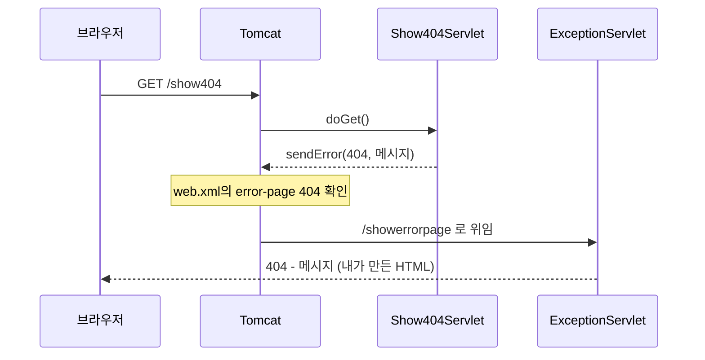
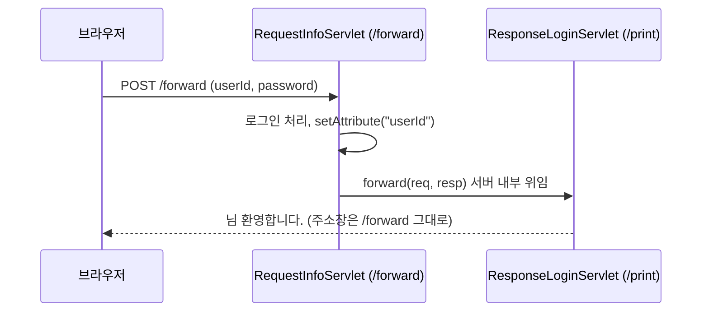
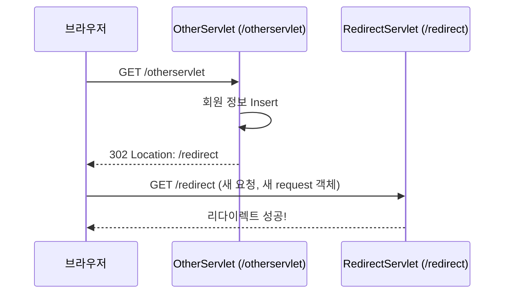

# 오늘 배운 것: 응답 작성·에러 페이지·forward와 redirect의 차이

## 들어가며 (Situation)

모듈 2 16일차. 어제(15일차)는 서블릿이 요청을 **받는** 쪽(라이프사이클, `service()`, 요청 파라미터)을 봤다. 오늘은 반대로 서블릿이 **응답을 돌려주는** 쪽과, 요청을 다른 곳으로 넘기는 방법을 배웠다. 프로젝트는 어제와 같은 `chap01-servlet`이고, 패키지 네 개가 추가됐다.

| 패키지 | 클래스 | 확인하려던 것 |
|--------|--------|---------------|
| `d_response` | `ResponseServlet` | `HttpServletResponse`로 HTML을 만들어 내보내는 순서 |
| `e_exception` | `Show404Servlet`, `Show500Servlet`, `ExceptionServlet` | `sendError()`와 `web.xml`의 `error-page` 동작 |
| `f_forward` | `RequestInfoServlet`, `ResponseLoginServlet` | 요청을 다른 서블릿에 위임하는 `forward` |
| `g_redirect` | `OtherServlet`, `RedirectServlet` | 브라우저에게 재요청을 시키는 `sendRedirect` |

참고한 자료는 어제 날짜의 Notion 정리(`01 Servlet Method`)와 위 프로젝트 코드의 수업 주석이다. 서블릿은 `main()`이 없어서 어제와 마찬가지로 실행 결과 파일은 만들지 않았다.



## 문제 상황 (Task)

어제까지는 서블릿이 요청 값을 콘솔에 `System.out.println`으로 찍기만 했다. 브라우저에는 아무것도 돌려주지 않았다. 오늘의 과제는 세 가지였다.

1. 서블릿이 브라우저 화면에 HTML을 어떻게 내보내는가? 한글은 왜 깨질 수 있는가?
2. 에러가 났을 때 사용자에게 기본 오류 화면 대신 내가 만든 화면을 보여주려면?
3. 한 서블릿이 요청을 받고 **다른 서블릿이 응답**하게 하고 싶을 때 `forward`와 `redirect` 중 무엇을 써야 하는가?

## 해결 과정 (Action)

### 1. 응답은 "타입 설정 → 스트림 얻기 → 쓰기 → 닫기" 순서다

`ResponseServlet`은 `StringBuilder`로 HTML 문자열을 만들고 `PrintWriter`로 내보낸다.

```java
resp.setContentType("text/html; charset=UTF-8");

PrintWriter out = resp.getWriter();
out.print(response);
out.flush();
out.close();
```

Notion 정리의 설명을 코드에 맞춰 풀면 이렇다.

| 순서 | 코드 | 이유 |
|------|------|------|
| 1 | `setContentType("text/html; charset=UTF-8")` | 브라우저에게 응답이 HTML이고 UTF-8이라고 알린다. 안 하면 기본값이 `text/plain`이라 태그가 그대로 글자로 보인다 |
| 2 | `getWriter()` | 문자 단위 출력 스트림을 얻는다. byte 단위는 `getOutputStream()` |
| 3 | `print()`, `flush()` | 응답 본문을 쓰고 내보낸다 |
| 4 | `close()` | 스트림을 닫는다 |

🔴 Notion 정리에 따르면 인코딩을 지정하지 않으면 기본 인코딩(ISO-8859-1)으로 나가서 한글이 깨진다. 그래서 `setContentType`에 `charset=UTF-8`을 같이 적는다.

⚠️ 이 설정은 **`getWriter()`로 스트림을 얻기 전에** 해야 한다. 순서가 바뀌면 인코딩 설정이 반영되지 않는다. 수업 코드의 `ExceptionServlet` 주석도 "응답할 때마다 항상 해줘야 하는, 계속 반복되는 코드"라고 적어 두었다. 서블릿마다 똑같은 `StringBuilder` + `setContentType` + `PrintWriter` 덩어리가 반복되는 것이 눈에 띄었고, 이런 반복이 JSP 같은 화면 전용 기술이 나온 이유라고 이해했다(이 부분은 수업에서 직접 들은 설명이 아니라 내 추측이다).

- **MIME type과 Content-Type**
  - 응답 본문이 어떤 종류의 데이터인지 브라우저에게 알려 주는 응답 헤더 값이다.
  - `text/html`이면 HTML로 렌더링하고, `text/plain`이면 글자 그대로 보여 준다.
  - 서블릿에서는 `setContentType()`으로 설정하고, 뒤에 `; charset=UTF-8`을 붙여 인코딩도 함께 알린다.

### 2. 에러 처리: sendError로 에러를 만들고, web.xml로 가로챈다

`Show404Servlet`과 `Show500Servlet`은 일부러 에러를 응답한다. "예외가 터진다는 가정"이라는 주석이 있고, 실제로는 `sendError()`를 호출한다.

```java
resp.sendError(404, "페이지가 없습니다!");
resp.sendError(500, "500번대 Error 는 순전히 개발자의 잘못.");
```

그리고 `WEB-INF/web.xml`에 404·500 에러가 나면 `/showerrorpage`로 보내라는 설정을 넣었다.

```xml
<error-page>
    <error-code>404</error-code>
    <location>/showerrorpage</location>
</error-page>
<error-page>
    <error-code>500</error-code>
    <location>/showerrorpage</location>
</error-page>
```



`ExceptionServlet`은 `req.getAttribute("jakarta.servlet.error.status_code")`와 `"jakarta.servlet.error.message"`로 에러 코드와 메시지를 꺼내 `<h1>404 - 페이지가 없습니다!</h1>` 같은 HTML로 응답한다. 이 서블릿에도 `doGet`이 있는 이유는 Tomcat이 에러 위치로 위임할 때 원래 요청의 방식을 이어 가기 때문이라고 이해했다.

🔴 Notion 예시는 `<location>/showErrorPage</location>`로 대문자가 섞여 있는데, 우리 서블릿 매핑은 `@WebServlet("/showerrorpage")` 전부 소문자다. URL 경로는 대소문자를 구분하므로 `location` 값은 서블릿의 URL 패턴과 **글자까지 똑같아야** 한다. 코드는 소문자로 맞춰져 있다.

⚠️ `ExceptionServlet`은 `jakarta.servlet.forward.request_uri` 속성도 꺼내 출력하는데, 에러 위임 때 이 속성이 항상 채워지는지는 확인하지 못했다. 속성이 `null`이면 `.toString()`에서 `NullPointerException`이 나므로, 이 줄은 실행해 보고 검증해야 한다.

⚠️ 이 글에서는 `/show404`, `/show500`을 실제로 눌러 본 화면과 콘솔 출력을 기록하지 못했다. 위 흐름은 코드와 Notion 설명에서 읽은 것이다.

- **에러 페이지 매핑 (error-page)**
  - `web.xml`에 에러 상태 코드(또는 예외 타입)와 보여 줄 위치를 짝지어 두는 설정이다.
  - 해당 에러가 응답될 시점에 컨테이너가 기본 오류 화면 대신 지정한 위치로 요청을 넘긴다.
  - 우리 코드에서는 404와 500을 모두 `ExceptionServlet`(`/showerrorpage`) 하나로 모았다.

### 3. forward: 서버 안에서 다른 서블릿에게 응답을 넘긴다

`forward.html`의 로그인 폼은 `/forward`로 POST를 보낸다. `RequestInfoServlet`은 아이디·비밀번호를 받아 로그인 처리(수업 코드에서는 서비스 호출이 주석 처리되어 있다)까지만 하고, 응답은 `/print`의 `ResponseLoginServlet`에게 넘긴다.

```java
req.setAttribute("userId", id);

RequestDispatcher rd = req.getRequestDispatcher("/print");
rd.forward(req, resp);
```

받는 쪽은 `req.getAttribute("userId")`로 값을 꺼내 "○○님 환영합니다." HTML을 만든다.



수업 코드 주석이 정리한 forward의 특징은 세 가지다.

| 특징 | 내용 |
|------|------|
| 객체 공유 | 두 서블릿이 `req`, `resp`를 공유하므로 `setAttribute`로 담은 값을 받는 쪽이 꺼낼 수 있다 |
| URL 변화 없음 | 위임받은 서블릿은 클라이언트에게 노출되지 않는다. 주소창은 계속 `/forward` |
| 새로고침 주의 | 새로고침하면 같은 요청이 반복된다. `insert`·`update`·`delete`를 forward로 구현하면 중복 실행된다 |

🟢 받는 서블릿은 **요청 방식에 맞는 메서드**를 오버라이드해야 한다. `/forward`가 POST로 들어왔으므로 `ResponseLoginServlet`도 `doPost`만 구현했다. 주석에도 "forward를 요청한 서블릿이 get이면 받는 서블릿도 get을 오버라이딩한다"고 적혀 있다.

- **RequestDispatcher**
  - 요청을 서버 안의 다른 자원(서블릿, JSP 등)으로 넘기는 역할을 하는 객체다.
  - `req.getRequestDispatcher("경로")`로 얻고 `forward(req, resp)`를 호출한다.
  - Notion에서는 '배차관리자'라는 뜻으로, 어디로 보낼지 결정하는 역할이라고 설명한다.

### 4. redirect: 브라우저에게 "그 주소로 다시 요청해"라고 시킨다

`g_redirect`의 `OtherServlet`은 회원가입 로직이 동작했다고 가정하고("DB에 Insert 완료!"), 마지막에 한 줄을 호출한다.

```java
resp.sendRedirect("/redirect");
```

서버는 `302` 상태 코드와 `Location` 헤더로 응답하고, 브라우저가 `/redirect`를 **새 GET 요청**으로 다시 보낸다. 그래서 `RedirectServlet`은 `doGet`이다. 수업 주석의 표현으로는 "URL 변경은 `a` 태그를 누르는 것과 같아서 GET 방식"이다.



- 새로고침하면 바뀐 주소(`/redirect`)에 대한 요청만 반복되므로 `insert`가 다시 실행되지 않는다.
- 반대로 첫 요청과 재요청은 **서로 다른 request 객체**라서, 첫 요청의 `setAttribute` 값을 공유할 수 없다.

🟢 수업 주석은 이 단점을 "이전 요청을 아예 모른다가 장점이자 단점"이라고 정리하고, 단점을 극복하는 개념으로 쿠키·세션을 예고했다.

### 5. 시행착오 아닌 시행착오: forward와 redirect 중 무엇을 쓸지 고르는 기준

처음엔 "둘 다 다른 서블릿으로 보내는 건데 뭐가 다르지?"가 헷갈렸다. 표로 나란히 놓으니 차이가 분명해졌다.

| 항목 | forward | redirect |
|------|---------|----------|
| 누가 이동시키나 | 서버(컨테이너) 내부 | 브라우저(서버가 302로 알려 줌) |
| 요청 횟수 | 1번 | 2번 |
| 주소창 | 변하지 않음 | 새 주소로 변함 |
| request·response | 공유됨 | 별개의 새 객체 |
| 새로고침 | 같은 요청 반복 | 바뀐 주소만 반복 |
| 어울리는 기능 | 조회(select) | 삽입·수정·삭제(DML) |

⚠️ 다만 Notion 정리도 "정해진 방식이 있는 것은 아니다"라고 한다. 예를 들어 로그인은 조회 기능이지만 redirect로 로그인 횟수 제한을 거는 경우도 있다. 그래서 외우기보다 "새로고침했을 때 같은 요청이 반복돼도 괜찮은가?"를 기준으로 고르기로 했다.

### 6. Notion 정리를 코드와 대조하며 걸린 부분

- POST 방식을 Notion은 한 곳에서 "HTTP header의 내용으로 전송", 다른 곳에서 "페이로드(body)에 key&value로 담아 전송"이라고 적었다. 수업 코드 주석(`FormDataServlet`)과 맞는 쪽은 **Payload(Body)** 이다. 앞쪽 문장은 정확하지 않다고 판단했다.
- Notion은 POST의 한글 깨짐을 막으려면 `setCharacterEncoding("UTF-8")`을 파라미터를 꺼내기 **전에** 호출하라고 한다. 그런데 `FormDataServlet`에는 이 호출이 없다. Tomcat 위키 설명에 따르면 서블릿 스펙은 인코딩이 표시되지 않은 POST 본문을 ISO-8859-1로 보는 것으로 알려져 있다. 다만 Servlet 6.1/Tomcat 11에서 기본값이 어떻게 되는지는 공식 스펙 원문으로 확인하지 못했다. 내일 한글로 POST를 보내 직접 확인하고 정리하겠다.
- Notion의 `getAttributeName()`은 API상 이름이 `getAttributeNames()`일 가능성이 있다. 공식 API 문서로 확인이 필요하다.

## 결과 (Result)

이번 글은 서블릿을 직접 실행해서 얻은 수치가 아니라 코드와 수업 자료를 정리한 것이라 정량 지표는 없다. 대신 얻은 것은 다음과 같다.

- 응답은 `Content-Type 설정 → getWriter → 출력 → 닫기` 순서이고, 한글 설정은 `getWriter()` 전에 한다.
- 에러는 `sendError()`로 만들고, `web.xml`의 `error-page`에서 상태 코드별 위치를 지정해 가로챈다.
- forward는 요청 1번·주소 유지·객체 공유, redirect는 요청 2번·주소 변경·객체 별개. 그래서 조회는 forward, DML은 redirect 쪽이 자연스럽다.
- 아직 못 한 것: `/show404`, `/forward`, `/otherservlet`을 실제로 눌러 본 결과 기록, POST 한글 인코딩 동작 확인.

## 더 학습하면 좋은 개념

- **HTTP 상태 코드 (301, 302, 303, 307)** — redirect의 `302`가 정확히 무엇을 뜻하는지, 그리고 POST 뒤에 어떤 코드를 쓰면 안전한지 알아야 한다. 오늘 표의 "redirect는 항상 GET"이 왜 그런지 이해하는 출발점이 된다.
- **Post/Redirect/Get (PRG) 패턴** — 폼 제출(POST) 뒤 redirect로 GET 화면을 보여 주는 관례다. 새로고침 중복 제출 문제를 오늘 배운 두 방식으로 어떻게 푸는지 한 번에 정리해 준다.
- **쿠키와 세션 (Cookie / HttpSession)** — redirect하면 request 객체가 끊긴다는 한계를 넘는 방법으로 수업 주석이 예고한 내용이다. 로그인 상태 유지의 기초가 된다.
- **문자 인코딩 (UTF-8, ISO-8859-1, URL 인코딩)** — GET은 `%` 인코딩, POST는 본문 인코딩 등 한글 깨짐의 원인이 요청 방식마다 달라서, 원리를 알아야 디버깅할 수 있다.
- **JSP와 MVC 패턴의 View** — 서블릿에서 HTML 문자열을 직접 이어 붙이는 반복을 줄이려는 방향이고, forward의 진짜 쓰임(컨트롤러 → 뷰)으로 이어진다.

## 참고 자료

- [Jakarta Servlet 6.1 명세](https://jakarta.ee/specifications/servlet/6.1/)
- [Apache Tomcat Wiki - Character Encoding Issues](https://cwiki.apache.org/confluence/display/TOMCAT/Character+Encoding)
- [MDN - HTTP 리다이렉션](https://developer.mozilla.org/ko/docs/Web/HTTP/Guides/Redirections)
- [MDN - 302 Found](https://developer.mozilla.org/ko/docs/Web/HTTP/Reference/Status/302)
