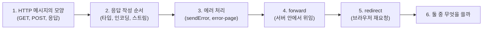
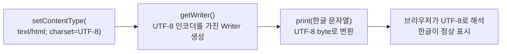
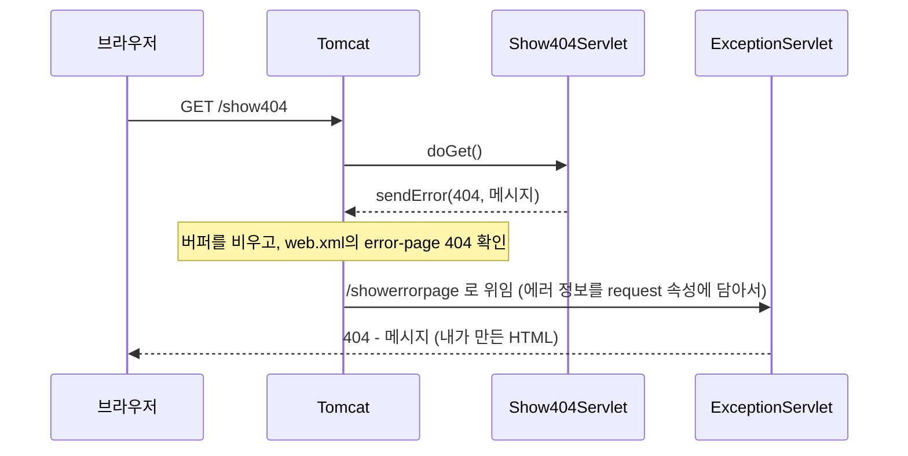
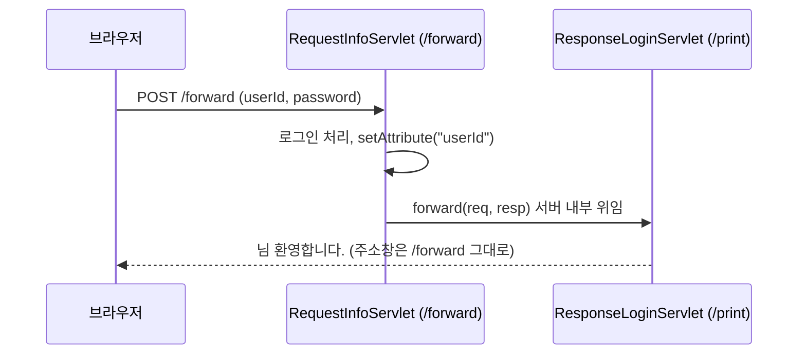
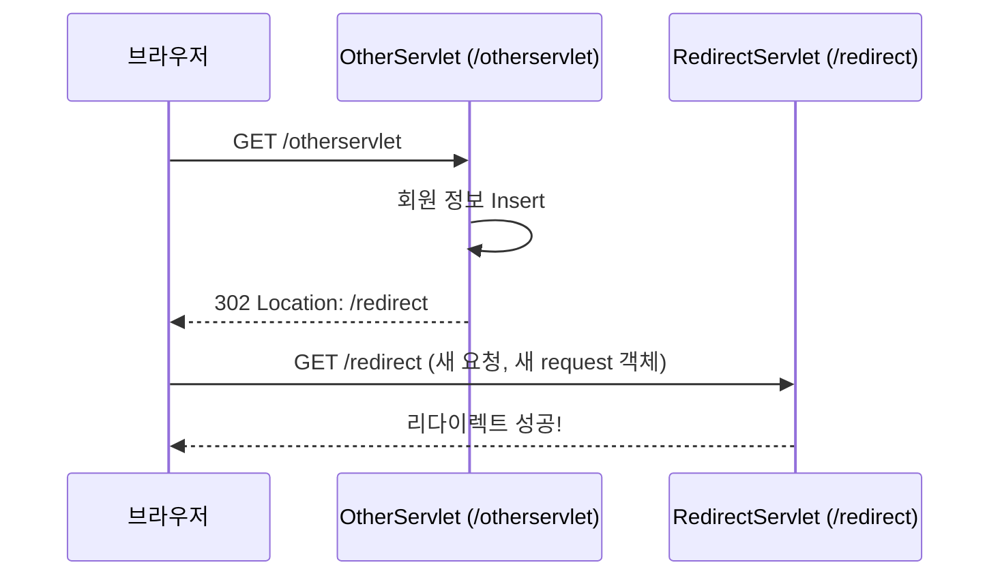
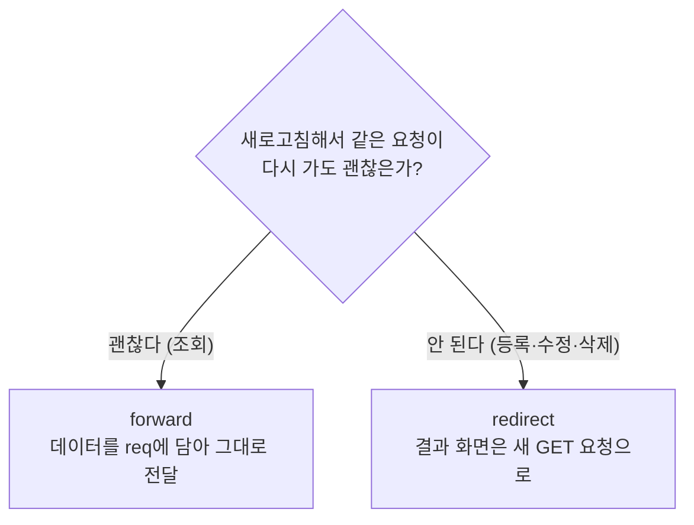

# 오늘 배운 것: 응답 작성·에러 페이지·forward와 redirect의 차이

## 들어가며 (Situation)

모듈 2 16일차. 어제(15일차)는 서블릿이 요청을 **받는** 쪽(라이프사이클, `service()`, 요청 파라미터)을 봤다. 오늘은 반대로 서블릿이 **응답을 돌려주는** 쪽과, 요청을 다른 곳으로 넘기는 방법을 배웠다. 프로젝트는 어제와 같은 `chap01-servlet`이고, 패키지 네 개가 추가됐다.

| 패키지 | 클래스 | 확인하려던 것 |
|--------|--------|---------------|
| `d_response` | `ResponseServlet` | `HttpServletResponse`로 HTML을 만들어 내보내는 순서 |
| `e_exception` | `Show404Servlet`, `Show500Servlet`, `ExceptionServlet` | `sendError()`와 `web.xml`의 `error-page` 동작 |
| `f_forward` | `RequestInfoServlet`, `ResponseLoginServlet` | 요청을 다른 서블릿에 위임하는 `forward` |
| `g_redirect` | `OtherServlet`, `RedirectServlet` | 브라우저에게 재요청을 시키는 `sendRedirect` |

참고한 자료는 이 날짜의 수업 Notion 정리(`01 Servlet Method`), 위 프로젝트 코드의 수업 주석, 그리고 글 끝의 공식 문서(Jakarta Servlet 6.1 API, Tomcat 11 문서)다. 서블릿은 `main()`이 없어서 어제와 마찬가지로 실행 결과 파일은 만들지 않았다.



이 글의 순서는 "요청을 받고 → 응답을 만들고 → 에러를 다루고 → 다른 곳으로 넘긴다"이다.



## 문제 상황 (Task)

어제까지는 서블릿이 요청 값을 콘솔에 `System.out.println`으로 찍기만 했다. 브라우저에는 아무것도 돌려주지 않았다. 오늘의 과제는 세 가지였다.

1. 서블릿이 브라우저 화면에 HTML을 어떻게 내보내는가? 한글은 왜 깨질 수 있는가?
2. 에러가 났을 때 사용자에게 기본 오류 화면 대신 내가 만든 화면을 보여주려면?
3. 한 서블릿이 요청을 받고 **다른 서블릿이 응답**하게 하고 싶을 때 `forward`와 `redirect` 중 무엇을 써야 하는가?

## 해결 과정 (Action)

### 1. 먼저 HTTP 메시지가 어떻게 생겼는지 봤다

오늘 내용(인코딩, 상태 코드, 헤더, redirect)은 전부 **HTTP 메시지의 모양**에서 나온다. 그래서 코드로 들어가기 전에 요청과 응답이 실제로 어떻게 생겼는지부터 그려 봤다. 아래는 이해를 위해 쓴 **예시**이고, 개발자도구에서 캡처한 실제 값이 아니다.

```text
(GET 요청) 값이 주소 끝 쿼리스트링에 있고, 본문이 없다
GET /sendMessage?message=abc&code=20 HTTP/1.1
Host: localhost:8080
Accept: text/html

(POST 요청) 값이 헤더 아래 빈 줄 뒤의 본문(payload)에 있다
POST /forward HTTP/1.1
Host: localhost:8080
Content-Type: application/x-www-form-urlencoded

userId=kim&password=1234

(응답) 상태 줄 + 응답 헤더 + 빈 줄 + 본문
HTTP/1.1 200
Content-Type: text/html;charset=UTF-8

<!doctype html><html>...
```

Notion 정리는 요청과 응답이 "요청 정보와 응답 정보를 직렬화한 byte 단위의 문자열 데이터로, 인코딩과 디코딩이 필요하다"고 설명한다. 컨테이너가 이 문자열을 파싱해서 헤더, 데이터 등을 `HttpServletRequest`·`HttpServletResponse` 객체로 쪼개 `doGet()`·`doPost()`에 넘겨 준다는 구조다.

| 구분 | GET | POST |
|------|-----|------|
| 값의 위치 | URL의 `?` 뒤 쿼리스트링 (여러 개면 `&`로 연결) | 요청 본문(payload)에 `key=value` 형태 |
| 본문 | 보통 없다 (리소스를 가져오는 요청) | 있다 (리소스에 내용을 추가하는 요청) |
| 노출 | 주소창에 보인다 | 주소창에는 안 보이지만 개발자도구로는 볼 수 있다 |
| 서블릿 메서드 | `doGet()` | `doPost()` |
| 수업의 용도 | 조회, 검색 | 등록처럼 큰 데이터 |

💡 `doGet`과 `doPost`가 나뉜 이유가 여기에 있다. 두 요청은 값이 **담긴 위치부터 다르고**, 컨테이너가 요청의 시작 줄(`GET`/`POST`)을 보고 맞는 메서드를 부른다. 어제 `service()`가 이 분배를 해 준다고 배운 내용과 이어진다.

⚠️ Notion은 POST를 한 곳에서 "HTTP header의 내용으로 데이터를 전송"한다고 쓰고, 다른 곳에서는 "페이로드에 key&value 방식으로 담아 전송"한다고 쓴다. 위 예시처럼 값은 헤더가 아니라 **본문**에 있다. 앞쪽 문장은 정확하지 않다고 판단했고, 수업 코드 주석(`FormDataServlet`의 Payload)과도 뒤쪽 설명이 맞는다.

### 2. 응답은 "타입 설정 → 스트림 얻기 → 쓰기 → 닫기" 순서다

#### 2-1. ResponseServlet 코드 읽기

`ResponseServlet`은 `StringBuilder`로 HTML 문자열을 만들고 `PrintWriter`로 내보낸다.

```java
System.out.println("response type : " + resp.getContentType());
resp.setContentType("text/html; charset=UTF-8");

PrintWriter out = resp.getWriter();
out.print(response);
out.flush();
out.close();
```

| 순서 | 코드 | 이유 |
|------|------|------|
| 1 | `setContentType("text/html; charset=UTF-8")` | 브라우저에게 응답이 HTML이고 UTF-8이라고 알린다 |
| 2 | `getWriter()` | 문자 단위 출력 스트림을 얻는다. byte 단위는 `getOutputStream()` |
| 3 | `print()`, `flush()` | 응답 본문을 쓰고 내보낸다 |
| 4 | `close()` | 스트림을 닫는다 |

#### 2-2. 설정 순서가 왜 중요한가

⚠️ `setContentType`(또는 `setCharacterEncoding`)은 **`getWriter()`를 부르기 전에** 해야 한다. 이건 Notion의 주의 사항이기도 하고, Jakarta Servlet 6.1 API 문서에도 그대로 적혀 있다.

> `setContentType`: "The response's character encoding is only set from the given content type if this method is called before getWriter() is called."
>
> `setCharacterEncoding`: "This method has no effect if it is called after getWriter has been called or after the response has been committed." — [ServletResponse API](https://jakarta.ee/specifications/servlet/6.1/apidocs/jakarta.servlet/jakarta/servlet/ServletResponse.html)

이유를 풀어 보면 `PrintWriter`는 만들어질 때 **어떤 문자 인코딩으로 글자를 byte로 바꿀지** 정해 두기 때문이다. 그 뒤에 인코딩을 바꿔도 이미 만들어진 `PrintWriter`는 처음 인코딩을 쓴다고 이해했다.



#### 2-3. 인코딩을 안 하면 한글은 왜 깨지는가

한글이 깨지는 건 **글자를 byte로 바꾸는 쪽(서버)과 byte를 글자로 읽는 쪽(브라우저)의 약속이 다를 때** 생긴다.

| 상황 | 서버가 쓰는 인코딩 | 브라우저가 읽는 인코딩 | 결과 |
|------|--------------------|------------------------|------|
| `charset=UTF-8`을 지정한 경우 | UTF-8 | 응답 헤더를 보고 UTF-8 | 정상 |
| 지정하지 않은 경우 | 기본값(ISO-8859-1) | 서버 기본값이나 브라우저 추측 | 한글이 깨질 수 있다 |

Notion은 인코딩을 지정하지 않으면 기본 인코딩인 ISO-8859-1을 따라 한글이 깨진다고 설명한다. Tomcat 11 설정 문서에도 `enforceEncodingInGetWriter`가 기본 `true`일 때, 인코딩을 지정하지 않고 `getWriter()`를 부르면 `ISO-8859-1`로 정해지고 `Content-Type` 헤더에 `charset=ISO-8859-1`이 붙는다고 적혀 있다.

⚠️ Notion은 "응답 타입의 기본값이 `text/plain`"이라고도 설명한다. 그런데 API 문서는 `getContentType()`이 "지정한 타입이 없으면 `null`을 반환한다"고 적는다. `ResponseServlet`의 첫 줄(`System.out.println("response type : " + resp.getContentType())`)이 바로 이 값을 설정 **전에** 찍는 코드인데, 문서대로라면 `null`이 찍힐 것이다. 이 출력은 직접 확인하지 못했다. 그래서 "타입을 안 정하면 태그가 글자로 보인다"는 설명은 브라우저가 타입 없는 응답을 어떻게 다루는지에 달린 이야기이고, 서버가 `text/plain`을 기본으로 보낸다고 단정할 수 없다고 정리했다.

🟢 응답 한 줄 요약: `setContentType("text/html; charset=UTF-8")`을 **`getWriter()` 전에** 호출한다. `ExceptionServlet`의 주석도 이 코드가 "응답할 때마다 항상 해줘야 하는, 계속 반복되는 코드"라고 적어 두었다. 서블릿마다 똑같은 `StringBuilder` + `setContentType` + `PrintWriter` 덩어리가 반복되는 것이 눈에 띄었고, 이런 반복이 JSP 같은 화면 전용 기술이 나온 이유라고 짐작했다. 이 부분은 수업에서 들은 설명이 아니라 내 추측이다.
- **MIME type과 Content-Type**
  - 응답 본문이 어떤 종류의 데이터인지 브라우저에게 알려 주는 응답 헤더 값이다.
  - `text/html`이면 HTML로 렌더링하고, `text/plain`이면 글자 그대로 보여 준다.
  - 서블릿에서는 `setContentType()`으로 설정하고, 뒤에 `; charset=UTF-8`을 붙여 인코딩도 함께 알린다.

#### 2-4. 요청 쪽 한글 인코딩은 다르다

응답과 반대 방향인 **요청**의 한글은 GET과 POST가 서로 다르게 처리된다고 Notion은 설명한다.

| 항목 | GET | POST |
|------|-----|------|
| 한글이 가는 모양 | 브라우저가 `%EC%95%88`처럼 `%` 인코딩(URL 인코딩)해서 주소에 싣는다 | 본문에 들어가며 `%` 인코딩과 별개로 처리한다 |
| 서버가 읽는 방식 | 전부 ASCII 범위라서 서버 설정과 맞기만 하면 문제없다 | 인코딩을 명시하지 않으면 ISO-8859-1로 해석한다고 Notion은 설명한다 |
| 한글이 깨지나 | 보통 안 깨진다 | 깨질 수 있다 |
| 해결 | 서버 쪽 URI 인코딩 설정(Tomcat 기본 UTF-8) | 파라미터를 꺼내기 **전에** `request.setCharacterEncoding("UTF-8")` |

Notion은 확인 방법도 알려 준다. POST를 받는 `doPost`에서 `request.getCharacterEncoding()`을 호출하면 `null`이 나온다는 것이다. `null`이라는 말은 **요청이 인코딩을 선언하지 않았다**는 뜻이므로, 서버가 알아서 추측해 읽게 된다.

⚠️ 오늘 수업 코드의 `FormDataServlet`에는 `setCharacterEncoding` 호출이 없다. Tomcat 11 설정 문서에는 요청 인코딩을 알 수 없을 때 기본값이 `ISO-8859-1`이라는 설명이 있고, URI(쿼리스트링) 인코딩의 기본은 `UTF-8`이라고 적혀 있다. 다만 버전에 따라 기본값이 바뀌었을 수 있어서 이 설명도 확정으로 받아들이지 않는다. 한글을 POST로 보내 직접 확인하는 숙제로 남긴다.
### 3. 에러 처리: sendError로 에러를 만들고, web.xml로 가로챈다

#### 3-1. sendError()가 하는 일

`Show404Servlet`과 `Show500Servlet`은 일부러 에러를 응답한다. "예외가 터진다는 가정"이라는 주석이 있고, 실제로는 `sendError()`를 호출한다.

```java
resp.sendError(404, "페이지가 없습니다!");
resp.sendError(500, "500번대 Error 는 순전히 개발자의 잘못.");
```

공식 API 문서는 `sendError`를 이렇게 설명한다.

> "Sends an error response to the client using the specified status and clears the buffer." / "After using this method, the response should be considered to be committed and should not be written to." / 해당 상태 코드에 에러 페이지가 선언돼 있으면 "it will be served back in preference to the suggested msg parameter." — [HttpServletResponse API](https://jakarta.ee/specifications/servlet/6.1/apidocs/jakarta.servlet/jakarta/servlet/http/HttpServletResponse.html)

정리하면 세 가지다.

- 지금까지 쓴 응답 버퍼를 **비우고** 에러 응답을 보낸다.
- 호출한 뒤에는 응답이 확정된 것으로 봐야 해서 **더 이상 쓰면 안 된다.**
- 에러 코드에 맞는 `error-page`가 있으면 **내가 준 메시지 대신 그 페이지가 우선**한다. 우리 서블릿이 `"페이지가 없습니다!"`를 넘겨도 사용자가 보는 것은 `error-page`가 지정한 `/showerrorpage`의 결과다.

그리고 `WEB-INF/web.xml`에 404·500 에러가 나면 `/showerrorpage`로 보내라는 설정을 넣었다.

```xml
<error-page>
    <error-code>404</error-code>
    <location>/showerrorpage</location>
</error-page>
<error-page>
    <error-code>500</error-code>
    <location>/showerrorpage</location>
</error-page>
```



🔴 Notion 예시는 `<location>/showErrorPage</location>`로 대문자가 섞여 있는데, 우리 서블릿 매핑은 `@WebServlet("/showerrorpage")` 전부 소문자다. URL 경로는 대소문자를 구분하므로 `location` 값은 서블릿의 URL 패턴과 **글자까지 똑같아야** 한다. 코드는 소문자로 맞춰져 있다.

- **에러 페이지 매핑 (error-page)**
  - `web.xml`에 에러 상태 코드(또는 예외 타입)와 보여 줄 위치를 짝지어 두는 설정이다.
  - 해당 에러가 응답될 시점에 컨테이너가 기본 오류 화면 대신 지정한 위치로 요청을 넘긴다.
  - 우리 코드에서는 404와 500을 모두 `ExceptionServlet`(`/showerrorpage`) 하나로 모았다.

#### 3-2. ExceptionServlet은 에러 정보를 어디서 꺼내는가

`ExceptionServlet`은 에러 코드와 메시지를 **`req.getAttribute(...)`**로 꺼낸다. 에러 페이지로 넘어갈 때 컨테이너가 에러 정보를 request 속성에 담아 주기 때문이다. API 문서가 이 속성들을 정의한다.

| 속성 이름 (상수) | 담기는 값 | 우리 코드 |
|------------------|-----------|-----------|
| `jakarta.servlet.error.status_code` (`ERROR_STATUS_CODE`) | 에러 상태 코드 | `(int) req.getAttribute(...)` |
| `jakarta.servlet.error.message` (`ERROR_MESSAGE`) | 에러 메시지 | `.toString()` 후 출력 |
| `jakarta.servlet.error.request_uri` (`ERROR_REQUEST_URI`) | 에러를 일으킨 요청의 URI | **사용하지 않음** |
| `jakarta.servlet.forward.request_uri` (`FORWARD_REQUEST_URI`) | forward의 **대상 서블릿**에게 전달되는 원래 요청 URI | `.toString()` 후 출력 |

⚠️ 표의 마지막 두 줄이 걸린다. API 문서에서 `FORWARD_REQUEST_URI`는 "forward의 대상에게 원래 요청 URI를 알려 주는 속성"이고, 에러 처리 중 에러를 일으킨 URI를 알려 주는 속성은 `ERROR_REQUEST_URI`로 따로 있다. 그런데 `ExceptionServlet`은 에러 페이지 안에서 `forward.request_uri`를 꺼내 `.toString()`을 부른다. 에러 처리로 넘어올 때 이 속성이 채워지지 않으면 `null.toString()`으로 **NPE가 나서 에러 페이지 자체가 실패**할 수 있다. 다만 컨테이너(Tomcat 11)가 에러 위임 때 실제로 어떤 속성을 채우는지는 직접 확인하지 못했다. 수업 코드는 이 줄에서 `forwardUrl = ...`을 출력하도록 되어 있고, 에러 화면이 정상적으로 떴다면 채워졌다는 뜻이다. 실행해서 확인할 항목이다.

🔴 `req.getAttribute(...)`는 속성이 없으면 `null`을 돌려주므로, `(int) req.getAttribute(...)`나 `.toString()`처럼 **바로 쓰면** `null`일 때 NPE가 난다. `(int)`는 `Object`를 `Integer`로 보고 풀어 내는 형변환이라서, `null`이면 이 형변환에서 NPE가 난다고 이해했다.

🔴 `ExceptionServlet`에는 `doGet`만 있다. 에러가 `/show404`(GET)에서 났으니 이번에는 맞지만, 에러 위임이 원래 요청의 방식을 따라간다는 것은 내 이해일 뿐 문서로 확인하지 못했다. POST 요청에서 에러가 나는 경우는 시험하지 않았다.

⚠️ 이 글에서는 `/show404`, `/show500`을 실제로 눌러 본 화면과 콘솔 출력을 기록하지 못했다. 위 흐름은 코드와 API 문서, Notion 설명에서 읽은 것이다.

### 4. forward: 서버 안에서 다른 서블릿에게 응답을 넘긴다

#### 4-1. 무엇을 위임하는가

`forward.html`의 로그인 폼은 `/forward`로 POST를 보낸다. `RequestInfoServlet`은 아이디·비밀번호를 받아 로그인 처리(수업 코드에서는 서비스 호출이 주석 처리되어 있다)까지만 하고, 응답은 `/print`의 `ResponseLoginServlet`에게 넘긴다. 수업 주석은 이 구조를 "비즈니스 로직 처리는 이 서블릿의 책임, **응답은 응답을 책임지는 서블릿에게 위임**"이라고 정리한다. 책임을 쪼개자는 설계 이야기다.

```java
req.setAttribute("userId", id);

RequestDispatcher rd = req.getRequestDispatcher("/print");
rd.forward(req, resp);
```

받는 쪽은 `req.getAttribute("userId")`로 값을 꺼내 "○○님 환영합니다." HTML을 만든다.



#### 4-2. forward에서 일어나는 일 자세히

Notion은 forward 구조를 이렇게 설명한다. 서버가 요청 문자열을 파싱해 `request`·`response`로 쪼개 첫 서블릿에 주고, 첫 서블릿이 이 객체를 다른 서블릿에 **담아 넘기면** 같은 속성을 가진 채로 처리 권한이 위임된다. 브라우저에게는 위임한 경로가 노출되지 않는다.

| 질문 | 답 |
|------|----|
| 브라우저는 요청을 몇 번 보내나? | **1번.** 위임은 서버 안에서만 일어난다 |
| `req`, `resp`는 같은 객체인가? | 수업 주석은 "서로 다른 서블릿들이 req, resp를 공유한다"고 적는다 |
| 주소창은? | `/forward` 그대로. 위임받은 서블릿은 노출되지 않는다 |
| 값은 어떻게 넘기나? | `req.setAttribute()`로 담고, 받는 쪽이 `getAttribute()`로 꺼낸다 |
| 새로고침하면? | 같은 요청(`POST /forward`)이 다시 간다 |

⚠️ Notion은 forward 때 request·response를 "깊은 복사로 새로 만든다"고도 설명하는데, 수업 주석의 "req, resp를 공유한다"와 표현이 다르다. API 문서의 `RequestDispatcher.forward` 설명은 "아직 확정되지 않은 응답 버퍼는 forward 전에 자동으로 지워지고, **응답이 이미 확정(committed)됐다면 `IllegalStateException`이 난다**"는 점을 알려 준다. 이 말은 두 서블릿이 한 응답을 이어받아 쓴다는 뜻으로 읽혔고, 복사 여부는 확정하지 못했다. 이 글에서는 "받는 쪽이 보낸 쪽이 담은 속성을 그대로 꺼낼 수 있다"까지만 정리한다.

🔴 위 `IllegalStateException` 때문에, `forward`를 부르기 **전에** `out.close()`나 `flush()`로 응답을 확정해 버리면 안 된다. 우리 `RequestInfoServlet`은 forward 전에 응답을 쓰지 않아서 괜찮다.

#### 4-3. 받는 서블릿의 메서드와 경로 규칙

🟢 받는 서블릿은 **요청 방식에 맞는 메서드**를 오버라이드해야 한다. `/forward`가 POST로 들어왔으므로 `ResponseLoginServlet`도 `doPost`만 구현했다. 수업 주석에도 "forward를 요청한 서블릿이 get이면 받는 서블릿도 get을 오버라이딩한다"고 적혀 있다. 기본 `HttpServlet`은 구현이 없는 `doGet`·`doPost`를 호출받으면 405(허용되지 않는 메서드) 오류를 응답하는 것으로 알고 있어서, 만약 `/print`를 주소창에 직접 입력해(GET) 호출하면 `doGet`이 없으니 그런 오류가 나올 것이다. 이 부분은 직접 확인하지 않았다.

`getRequestDispatcher("/print")`의 경로는 `/`로 시작하는 **컨텍스트 루트 기준** 경로다. Notion 예시는 `getRequestDispatcher("print")`처럼 `/`가 없는데, 이렇게 쓰면 현재 서블릿의 경로를 기준으로 상대 경로가 해석된다고 알고 있다(API 문서에서 직접 확인하지는 않았다). 우리 코드는 `/`를 붙여 안전하게 썼다.

- **RequestDispatcher**
  - 요청을 서버 안의 다른 자원(서블릿, JSP 등)으로 넘기는 역할을 하는 객체다.
  - `req.getRequestDispatcher("경로")`로 얻고 `forward(req, resp)`를 호출한다.
  - Notion에서는 '배차관리자'라는 뜻으로, 어디로 보낼지 결정하는 역할이라고 설명한다.

### 5. redirect: 브라우저에게 "그 주소로 다시 요청해"라고 시킨다

#### 5-1. 302 응답과 Location 헤더

`g_redirect`의 `OtherServlet`은 회원가입 로직이 동작했다고 가정하고("DB에 Insert 완료!"), 마지막에 한 줄을 호출한다.

```java
resp.sendRedirect("/redirect");
```

`sendRedirect`의 정체는 **응답 한 개를 만드는 일**이다. API 문서는 기본 상태 코드가 `SC_FOUND`, 즉 **302 (Found)**라고 설명한다. 응답은 다음과 같은 모양이 된다(예시).

```text
HTTP/1.1 302
Location: /redirect
```

브라우저는 이 응답을 받으면 본문 없이 **`Location`에 적힌 주소로 새 GET 요청**을 자동으로 보낸다. 사용자가 링크를 따로 누르지 않았는데 주소가 바뀌는 이유다. 수업 주석은 이를 "URL 변경은 `a` 태그를 누르는 것과 같아서 GET 방식"이라고 표현한다.



Notion은 `sendRedirect("http://www.naver.com")`처럼 **다른 사이트**로도 보낼 수 있다고 하고, 개발자도구 Network 탭에서 302와 `Location` 헤더를 볼 수 있다고 한다. forward는 서버 안에서만 넘기므로 다른 사이트로는 보낼 수 없다는 차이가 여기서 나온다.

#### 5-2. 경로 규칙: `/redirect`의 `/`는 어디를 뜻하나

🔴 `sendRedirect("/redirect")`의 앞 `/`가 걸렸다. API 문서(`sendRedirect(String, int, boolean)`)는 "위치가 `/`로 시작하는 상대 경로이면 컨테이너는 이를 **서블릿 컨테이너 루트** 기준으로 해석한다"고 적는다. **컨텍스트 경로가 아니라 서버 루트**라는 말이다. 어제 Application context를 `/`로 설정했기 때문에 서버 루트와 컨텍스트 루트가 같아서 우리 코드가 동작하는 것이다. 만약 컨텍스트 경로가 `/chap01-servlet`이었다면 `/redirect`는 그 밖으로 나가 404가 났을 것이다(이 부분은 문서의 규칙에서 따라 나오는 추론이고, 실제로 시험하지 않았다).

그래서 `resp.sendRedirect(req.getContextPath() + "/cookie")`처럼 **컨텍스트 경로를 붙여서** 쓰는 방식이 있다고 알고 있는데, 배포 경로가 바뀌어도 안전하다. 오늘 코드에는 이렇게 쓴 곳이 없다. 반면 `forward`의 `"/print"`는 컨텍스트 루트 기준이라 이런 문제가 없다는 점이 두 방식의 경로 규칙의 차이다.

#### 5-3. 새로고침과 request 객체

- 새로고침하면 바뀐 주소(`/redirect`)에 대한 요청만 반복되므로 `insert`가 다시 실행되지 않는다.
- 반대로 첫 요청과 재요청은 **서로 다른 request 객체**라서, 첫 요청의 `setAttribute` 값을 공유할 수 없다. Notion은 HTTP가 요청마다 연결을 맺었다 끊어서 요청 단위당 request 객체가 하나만 생기기 때문이라고 설명한다.

🟢 수업 주석은 이 단점을 "이전 요청을 아예 모른다가 장점이자 단점"이라고 정리하고, 단점을 극복하는 개념으로 쿠키·세션을 예고했다.
### 6. 시행착오 아닌 시행착오: forward와 redirect 중 무엇을 쓸지 고르는 기준

처음엔 "둘 다 다른 서블릿으로 보내는 건데 뭐가 다르지?"가 헷갈렸다. 표로 나란히 놓으니 차이가 분명해졌다.

| 항목 | forward | redirect |
|------|---------|----------|
| 누가 이동시키나 | 서버(컨테이너) 내부 | 브라우저(서버가 302로 알려 줌) |
| 브라우저 요청 횟수 | 1번 | 2번 |
| 주소창 | 변하지 않음 | 새 주소로 변함 |
| request·response | 공유됨 | 별개의 새 객체 |
| 다른 사이트로 이동 | 불가 | 가능 |
| 경로의 `/` 기준 | 컨텍스트 루트 | 서버(컨테이너) 루트 |
| 새로고침 | 같은 요청 반복 | 바뀐 주소만 반복 |
| 어울리는 기능 | 조회(select) | 삽입·수정·삭제(DML) |

"새로고침했을 때 같은 요청이 반복돼도 괜찮은가?"를 기준으로 시나리오를 따라가 봤다.



예를 들어 회원가입(insert)을 `forward`로 구현하면 완료 화면에서 새로고침할 때 `POST`가 다시 전송되어 **회원이 중복 등록**될 수 있다. `OtherServlet`이 insert 뒤에 `redirect`하는 이유다. 반대로 조회는 새로고침하면 최신 데이터를 다시 가져오는 편이 자연스럽고, `forward`는 많은 조회 결과를 `req`에 담아 한 번에 넘길 수 있다.

⚠️ 다만 Notion 정리도 "정해진 방식이 있는 것은 아니다"라고 한다. 예를 들어 로그인은 조회 기능이지만 redirect로 로그인 횟수 제한을 거는 경우도 있다. 그래서 외우기보다 위 기준으로 고르기로 했다.

### 7. Notion 정리를 코드와 대조하며 걸린 부분

- POST의 값이 헤더가 아니라 본문에 있다는 점은 1절에서 정리했다.
- Notion은 POST의 한글 깨짐을 막으려면 `setCharacterEncoding("UTF-8")`을 파라미터를 꺼내기 **전에** 호출하라고 한다. 그런데 `FormDataServlet`에는 이 호출이 없다. Tomcat 문서의 기본값 설명과 버전별 차이는 직접 한글을 POST해서 확인하겠다(2-4절).
- Notion의 `getAttributeName()`은 이름이 `getAttributeNames()`일 가능성이 있다. 같은 표에서 `setAttribute`·`getAttribute`·`removeAttribute`는 `ServletContext`, `ServletRequest`, `HttpSession` 세 객체가 모두 같은 이름으로 가진다고 하니, 마지막 것도 `getAttributeNames()`일 가능성이 높다. 공식 API 문서로 확인이 필요하다.
- Notion의 요청 헤더 표에 `host`는 "없거나 둘 이상이면 404"라고 적혀 있다. HTTP 규격에서는 이 경우 400(잘못된 요청)을 돌려주는 것으로 알고 있어서, 어느 쪽이 맞는지 공식 문서로 확인이 필요하다.
- `getHeader()`로 읽는 헤더(`accept`, `host`, `referer`, `user-agent`, `sec-fetch-*` 등)는 수업 교안에는 있지만 오늘 코드에는 쓰이지 않았다. 헤더를 읽는 실습은 하지 않았다.

## 결과 (Result)

이번 글은 직접 실행해서 얻은 수치가 아니라 코드, 수업 자료, 공식 문서를 정리한 것이라 정량 지표는 없다. 대신 얻은 것은 다음과 같다.

| 질문 | 오늘 얻은 답 |
|------|---------------|
| 응답은 어떤 순서로 만드나? | `Content-Type·인코딩 설정 → getWriter → 출력 → 닫기`. 설정은 `getWriter()` **전에** 한다 (API 문서로 확인) |
| 한글은 왜 깨지나? | 글자를 byte로 바꾸는 쪽과 읽는 쪽의 인코딩이 다르면 깨진다. 응답은 `charset=UTF-8`을 지정한다 |
| 에러 화면을 바꾸려면? | `sendError()`로 에러를 만들고, `web.xml`의 `error-page`가 상태 코드별로 가로챈다. 지정된 에러 페이지가 내가 준 메시지보다 우선한다 |
| forward란? | 요청 1번, 주소 유지, 객체 공유. 조회에 어울린다 |
| redirect란? | 302 + `Location`으로 브라우저가 새 GET을 보냄. 요청 2번, 주소 변경, 객체 별개. DML에 어울린다 |
| 경로의 `/`는? | forward는 컨텍스트 루트, `sendRedirect`는 서버(컨테이너) 루트 기준 |

공식 문서로 직접 확인한 것: `setContentType`·`setCharacterEncoding`이 `getWriter()` 이후에는 인코딩에 영향을 주지 못한다는 것, `getContentType()`이 지정한 타입이 없으면 `null`이라는 것, `sendError`가 버퍼를 비우고 에러 페이지를 우선한다는 것, `sendRedirect`의 기본 상태 코드가 302이고 `/`로 시작하는 경로는 컨테이너 루트 기준이라는 것, `forward`가 확정된 응답에 `IllegalStateException`을 낸다는 것.

아직 못 한 것은 다음과 같다. 모두 직접 해 볼 항목이다.

- `/show404`, `/forward`, `/otherservlet`을 실제로 눌러 본 결과 기록
- `ExceptionServlet`의 `forward.request_uri` 속성이 에러 위임 때 채워지는지 확인
- `/response`에서 `resp.getContentType()`이 `null`로 찍히는지 확인
- POST 한글 인코딩 동작 확인
- `/print`를 GET으로 직접 호출했을 때의 응답 확인

## 더 학습하면 좋은 개념

- **HTTP 상태 코드 (301, 302, 303, 307, 308)** — redirect의 `302`가 정확히 무엇을 뜻하는지, 그리고 POST 뒤에 어떤 코드를 쓰면 안전한지 알아야 한다. 오늘 표의 "redirect는 항상 GET"이 왜 그런지 이해하는 출발점이 된다.
- **Post/Redirect/Get (PRG) 패턴** — 폼 제출(POST) 뒤 redirect로 GET 화면을 보여 주는 관례다. 새로고침 중복 제출 문제를 오늘 배운 두 방식으로 어떻게 푸는지 한 번에 정리해 준다.- **쿠키와 세션 (Cookie / HttpSession)** — redirect하면 request 객체가 끊긴다는 한계를 넘는 방법으로 수업 주석이 예고한 내용이다. 로그인 상태 유지의 기초가 된다.
- **문자 인코딩 (UTF-8, ISO-8859-1, URL 인코딩)** — GET은 `%` 인코딩, POST는 본문 인코딩 등 한글 깨짐의 원인이 요청 방식마다 달라서, 원리를 알아야 디버깅할 수 있다.
- **JSP와 MVC 패턴의 View** — 서블릿에서 HTML 문자열을 직접 이어 붙이는 반복을 줄이려는 방향이고, forward의 진짜 쓰임(컨트롤러 → 뷰)으로 이어진다.

## 참고 자료

- [Jakarta Servlet 6.1 명세](https://jakarta.ee/specifications/servlet/6.1/jakarta-servlet-spec-6.1.html)
- [ServletResponse API](https://jakarta.ee/specifications/servlet/6.1/apidocs/jakarta.servlet/jakarta/servlet/ServletResponse.html) — `getContentType`, `setContentType`, `setCharacterEncoding`, `getWriter`
- [HttpServletResponse API](https://jakarta.ee/specifications/servlet/6.1/apidocs/jakarta.servlet/jakarta/servlet/http/HttpServletResponse.html) — `sendError`, `sendRedirect`
- [RequestDispatcher API](https://jakarta.ee/specifications/servlet/6.1/apidocs/jakarta.servlet/jakarta/servlet/RequestDispatcher.html) — `forward`, 에러·forward 속성 상수
- [Apache Tomcat 11 - HTTP Connector](https://tomcat.apache.org/tomcat-11.0-doc/config/http.html) — 요청·응답 인코딩 기본값 설명
- [Apache Tomcat Wiki - Character Encoding Issues](https://cwiki.apache.org/confluence/display/TOMCAT/Character+Encoding)
- [MDN - HTTP 리다이렉션](https://developer.mozilla.org/ko/docs/Web/HTTP/Guides/Redirections)
- [MDN - 302 Found](https://developer.mozilla.org/ko/docs/Web/HTTP/Reference/Status/302)
