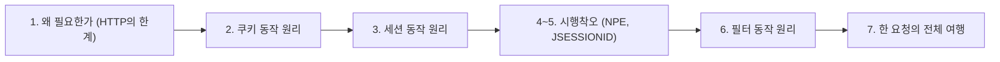
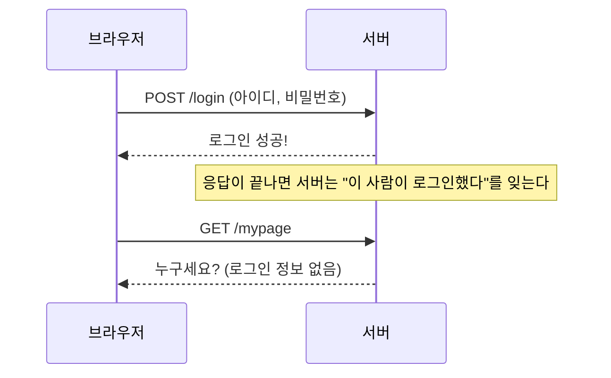
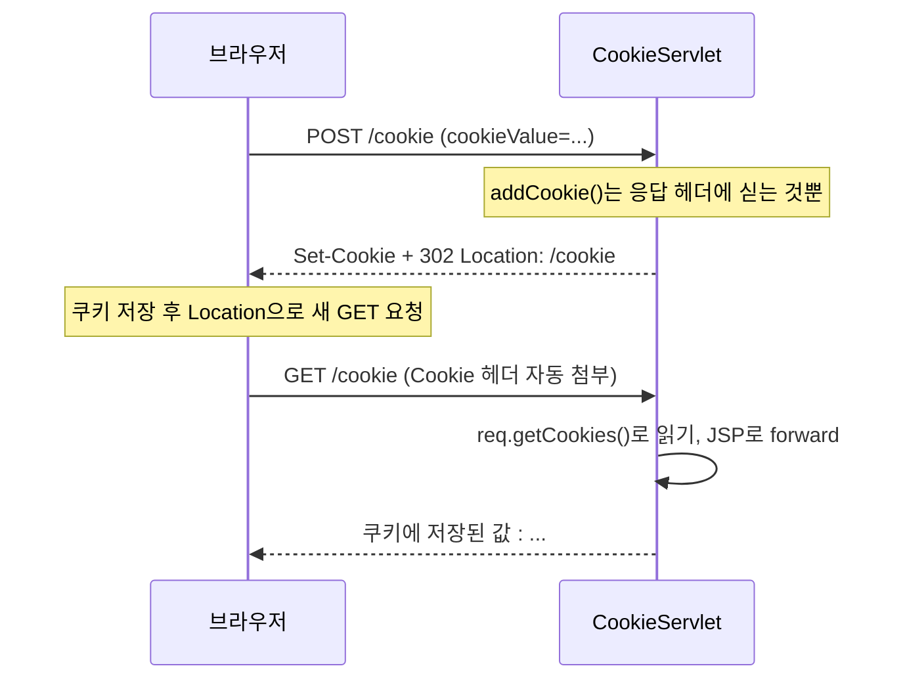
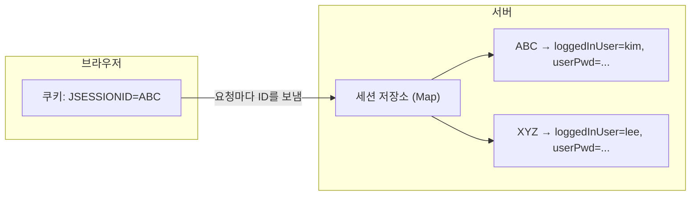
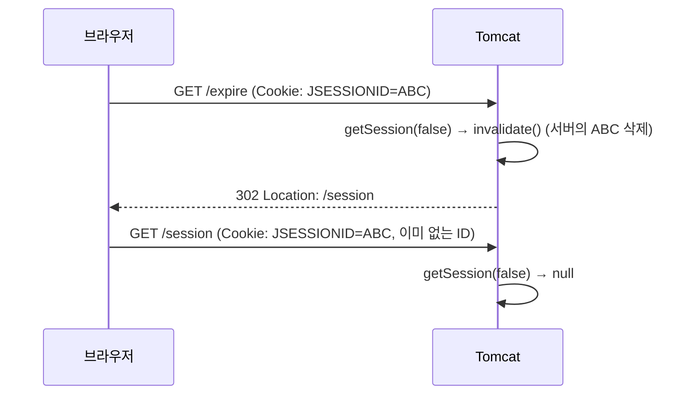
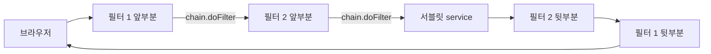
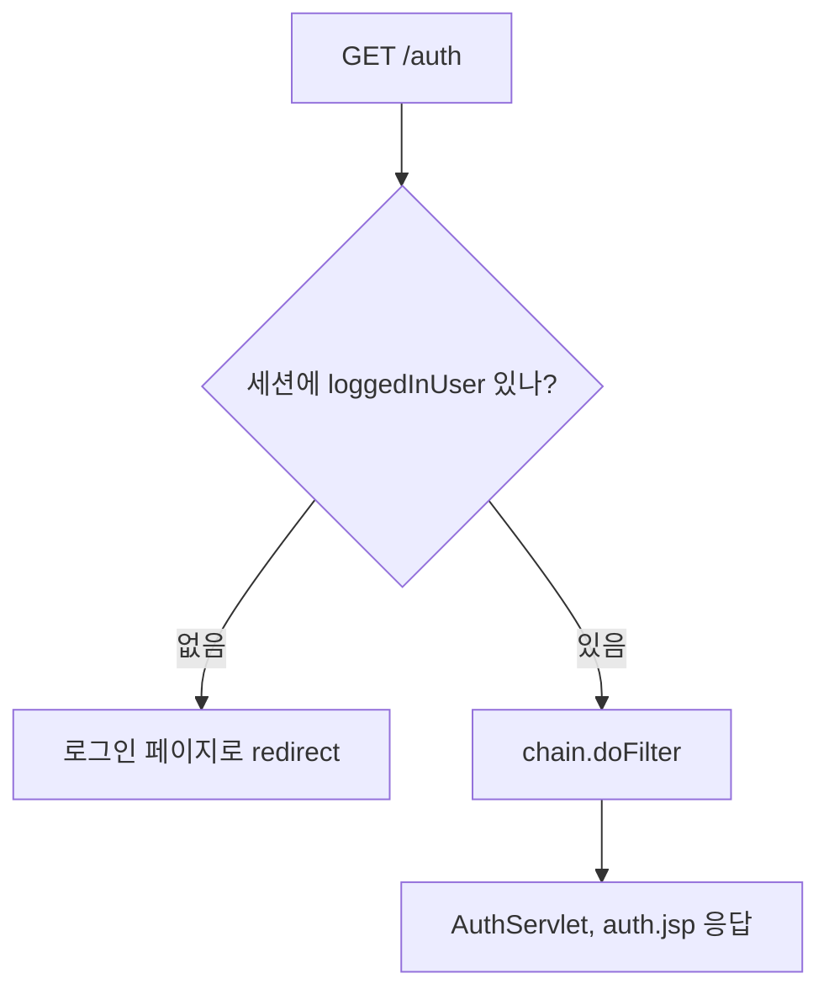
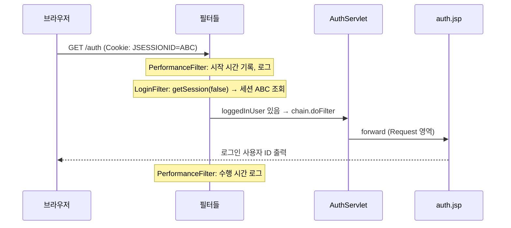

# 오늘 배운 것: 쿠키·세션으로 상태 유지, 필터로 공통 처리

## 들어가며 (Situation)

모듈 2 17일차. 어제(16일차) 마지막에 "redirect하면 request 객체가 새로 만들어져 이전 요청을 모른다"는 한계를 적고, 그 해결책으로 쿠키·세션이 예고됐다고 썼다. 오늘은 그 예고를 회수하는 날이었다. 오전에는 쿠키와 세션으로 **요청 사이에 값을 남기는 법**을, 오후에는 모든 요청이 지나가는 길목에서 일하는 **필터**를 배웠다.

프로젝트는 어제와 같은 `chap01-servlet`이고 패키지 두 개가 추가됐다.

| 패키지 | 클래스 | 확인하려던 것 |
|--------|--------|---------------|
| `h_cookie_session` | `CookieServlet` | 쿠키를 심고(POST) 꺼내 보는(GET) 흐름 |
| `h_cookie_session` | `SessionServlet`, `ExpireServlet` | 세션에 로그인 정보를 저장하고 만료시키는 흐름 |
| `i_filter` | `PerformanceFilter`, `EncodingFilter` | 모든 요청에 끼어드는 공통 필터 |
| `i_filter` | `LoginFilter`, `AuthServlet` | 로그인하지 않은 요청을 서블릿 앞에서 막기 |

참고한 자료는 오늘 날짜의 Notion 정리(`01 Session & Cookie`, `02 Filter`), 프로젝트 코드의 수업 주석, 그리고 글 끝의 공식 문서다. 서블릿에는 `main()`이 없고 Tomcat이 호출하므로, 이번에도 실행 결과 파일은 만들지 않았다.



이 글은 단순히 사용법을 적기보다 "왜 이렇게 동작하는가"를 끝까지 풀어 쓰는 데 중점을 뒀다. 순서는 다음과 같다.



## 문제 상황 (Task)

어제까지의 서블릿은 요청 하나를 처리하고 나면 그 요청에 대해 모든 것을 잊었다. 오늘의 과제는 세 가지였다.

1. 로그인 정보나 입력값처럼 **요청이 끝나도 남아 있어야 하는 값**은 어디에, 어떤 원리로 저장하는가?
2. 쿠키와 세션은 둘 다 "상태 유지"인데 무엇이 다르고, 서버는 "이 요청이 아까 그 사람"임을 **어떻게 알아보는가**?
3. "로그인했는지 확인"처럼 **모든 서블릿에 똑같이 필요한 검사**를 서블릿마다 복붙하지 않고 한곳에서 처리하려면?

## 해결 과정 (Action)

### 1. 왜 상태를 따로 저장해야 하는가: HTTP는 연결도 상태도 없다

Notion 정리는 HTTP의 특징을 두 가지로 설명한다.

- **무연결 (Connectionless)**
  - 서버가 응답을 마치면 연결을 끊고, 다음 요청은 새로 연결해서 보낸다.
  - HTTP는 TCP 위에서 동작하지만, 요청할 때와 응답할 때만 잠깐 연결하는 방식으로 쓴다는 설명이다.
- **무상태 (Stateless)**
  - 서버는 이전 요청이 무엇이었는지 기억하지 않는다. 요청 하나하나가 서로 모르는 사이다.
  - 그래서 로그인 계정 정보, 장바구니 같은 값이 요청이 끝나면 사라진다.

무상태가 얼마나 불편한지 장면으로 그려 보면 이해가 빨랐다.



💡 해결 방향은 하나다. **"이 요청은 아까 그 사람의 요청"이라고 알아볼 수 있는 표식을 매 요청에 실어 보내게 하는 것**이다. 그 표식을 어디에 두느냐로 갈린 것이 쿠키(데이터를 클라이언트에 둠)와 세션(데이터를 서버에 두고 표식만 클라이언트에 둠)이다.

| 항목 | Cookie | Session |
|------|--------|---------|
| 데이터 저장 위치 | 클라이언트(브라우저) | 서버 |
| 클라이언트가 가진 것 | 데이터 자체 | Session ID 하나 |
| 패키지 | `jakarta.servlet.http.Cookie` | `jakarta.servlet.http.HttpSession` |
| 보안 | 사용자 PC에 남아서 상대적으로 취약 | 서버가 관리해서 상대적으로 안전 |
| 유지 시간 | `setMaxAge()`로 지정, 없으면 브라우저가 켜져 있는 동안 | 비활동 시간 기준(`setMaxInactiveInterval`) |
| 적합한 용도 | 간단한 설정값, "오늘 하루 보지 않기" 팝업 | 로그인 상태 유지 |

### 2. 쿠키: 서버가 심고, 브라우저가 다음 요청마다 들고 온다

#### 2-1. 쿠키의 실체는 HTTP 헤더 두 개다

쿠키는 별도의 마법이 아니라 **HTTP 헤더 두 개**로 이루어진다. 아래 메시지는 동작을 이해하려고 쓴 **예시**이고, 실제 개발자도구에서 캡처한 것이 아니다.

```text
(서버 → 브라우저, 응답)
HTTP/1.1 302
Set-Cookie: cookieValue=hello; Max-Age=3600
Location: /cookie

(브라우저 → 서버, 이후의 모든 요청)
GET /cookie HTTP/1.1
Cookie: cookieValue=hello
```

- 서버는 응답의 `Set-Cookie` 헤더로 "이걸 저장해 둬"라고 시킨다.
- 브라우저는 저장해 두었다가 **같은 서버로 가는 이후 요청마다 `Cookie` 헤더에 자동으로** 실어 보낸다. 서블릿 코드가 보내라고 시키지 않아도 브라우저가 알아서 한다.
- 서버는 `Cookie` 헤더를 읽어서 `req.getCookies()`로 돌려준다.

💡 쿠키가 "상태를 유지"하는 원리는 이것이 전부다. 서버가 기억하는 것이 아니라 **브라우저가 매번 다시 알려 주는** 것이다. Notion이 "Cookie에 대한 보관 정보는 클라이언트가 주축"이라고 한 말과 같다.

#### 2-2. CookieServlet 코드 읽기

`CookieServlet`은 POST로 값을 받아 쿠키로 만들고, GET으로 쿠키를 꺼내 JSP로 보여 준다.

```java
// doPost
Cookie cookie = new Cookie("cookieValue", cookieValue);
cookie.setMaxAge(60 * 60); // 만료 1시간
resp.addCookie(cookie);
resp.sendRedirect(req.getContextPath() + "/cookie");

// doGet
Cookie[] cookies = req.getCookies();
if (cookies != null) {
    for (Cookie cookie : cookies) {
        if ("cookieValue".equals(cookie.getName())) {
            savedValue = cookie.getValue();
            break;
        }
    }
}
```

Notion의 쿠키 설정 절차를 우리 코드에 대응시키면 이렇다.

| 순서 | Notion 설명 | 우리 코드 |
|------|-------------|-----------|
| 1 | Cookie 객체 생성 | `new Cookie("cookieValue", cookieValue)` |
| 2 | 설정값 지정 (`setMaxAge`, `setPath`, `setDomain`) | `setMaxAge(60 * 60)`만 사용 |
| 3 | 응답 헤더에 담기 | `resp.addCookie(cookie)` |
| 4 | 응답 보내기 | `sendRedirect(...)` |

코드에서 던질 수 있는 질문이 네 가지였고, 하나씩 답을 찾았다.

**질문 1. 왜 심은 뒤에 `forward`가 아니라 `sendRedirect`인가?**

`addCookie()`는 쿠키를 **응답 헤더에 싣는** 메서드다. 브라우저가 그 응답을 받아 저장한 뒤에야 **다음 요청부터** `Cookie` 헤더에 담겨 온다. 그래서 같은 요청 안에서 `req.getCookies()`를 해도 방금 넣은 쿠키는 없다. 수업 주석도 "방금 add한 쿠키는 다음 요청부터 req에 담겨 오므로 redirect로 GET 재요청"이라고 적었다.



🟢 이 구조에는 덤이 있다. POST 뒤에 redirect로 GET을 새로 보내므로, 결과 화면에서 새로고침해도 POST가 다시 전송되지 않는다. 어제 forward와 redirect를 비교하며 배운 "새로고침했을 때 같은 요청이 반복돼도 괜찮은가?"라는 기준이 그대로 쓰인 것이다.

**질문 2. `getCookies()`가 `null`일 수 있다는 건 무슨 뜻인가?**

쿠키가 하나도 없으면 `req.getCookies()`는 빈 배열이 아니라 `null`을 돌려준다. 코드가 `if (cookies != null)`로 감싼 이유다. 이 검사를 빼면 쿠키가 없는 첫 방문에서 `for`문이 `null`을 순회하려다 `NullPointerException`이 난다.

⚠️ 쿠키는 이름이 같은 것이 여러 개 올 수 있는 **배열**이라, 원하는 이름을 찾는 `for` + `equals` 패턴이 필요하다. `"cookieValue".equals(cookie.getName())`처럼 **상수를 앞에** 둔 것도 같은 맥락이다. `cookie.getName()` 쪽이 `null`이어도 NPE가 나지 않는다.

**질문 3. `setMaxAge`를 안 주면?**

Notion은 "설정이 따로 없으면 브라우저 동작 동안 유지한다"고 설명한다. 브라우저를 닫으면 사라지는 쿠키가 된다. 우리 코드는 `60 * 60`(초 단위, 1시간)을 줬다.

**질문 4. 쿠키는 어느 요청에 따라가는가?**

`path`와 `domain` 속성이 정한다. 서버가 `setPath`로 지정한 경로에 해당하는 요청에만 브라우저가 쿠키를 붙인다. 우리 코드는 `path`를 지정하지 않아서 기본값이 적용되는데, 기본 경로가 정확히 어디까지인지는 확인하지 못했다.

- **쿠키 속성 (Cookie attributes)**
  - 쿠키 값과 함께 브라우저에 전달되어 "언제까지, 어디로 보낼지"를 정하는 설정이다.
  - `expire`(유지 시간), `path`(전달되는 경로), `domain`(전달되는 서버), `secure`(https일 때만 전송)를 Notion이 설명한다.
  - 쿠키 이름에는 ASCII 문자만 쓸 수 있고, 공백과 일부 특수문자(`( ) = , " \ ? @ : ;`)는 쓸 수 없다. 한번 정한 쿠키 이름은 수정할 수 없다.

### 3. 세션: 데이터는 서버에 두고, 브라우저에는 번호표만 준다

#### 3-1. 세션의 원리: 번호표와 보관함

세션을 은행 사물함에 비유하면 이해가 쉬웠다. 서버는 사용자마다 **보관함**(`HttpSession` 객체)을 만들고, 사용자에게는 **보관함 번호**(Session ID)만 준다. 사용자가 번호를 내밀면 서버는 그 번호의 보관함을 열어 준다. Notion도 "브라우저마다 제공하는 HashMap을 서버에서 클라이언트에게 제공한다"고 설명하는데, 서버 쪽 구조는 `Map<세션ID, 그 사용자의 속성 Map>`과 비슷하다.



중요한 점은 **번호표를 운반하는 수단이 쿠키**라는 것이다. 서버가 세션을 만들면 응답에 `Set-Cookie: JSESSIONID=...`를 실어 보내고, 브라우저는 이후 요청마다 그 쿠키를 보낸다. 서블릿 명세 7.1.1절은 세션 추적 쿠키의 표준 이름이 `JSESSIONID`여야 한다고 정해 둔다. 즉 세션과 쿠키는 대립 관계가 아니라, **세션은 쿠키 위에 올라탄 기술**이다.

💡 정리하면 이렇다. 쿠키는 "데이터를 들고 다니는 방식", 세션은 "데이터는 서버에 두고 ID만 쿠키로 들고 다니는 방식"이다. 그래서 세션 쪽 데이터는 사용자가 PC에서 고칠 수 없다. 사용자가 바꿀 수 있는 것은 ID뿐이다.

#### 3-2. getSession(true)와 getSession(false)

`SessionServlet`의 `doPost`는 로그인 폼 값을 세션에 저장하고, `doGet`은 세션에서 꺼내 JSP로 forward한다. 코드를 읽으며 가장 먼저 걸린 것은 `getSession()`의 인자였다.

| 호출 | 세션이 있으면 | 세션이 없으면 | 우리 코드에서의 쓰임 |
|------|--------------|--------------|----------------------|
| `getSession(true)` (인자 없는 `getSession()`과 같음) | 그 세션 반환 | **새로 만들어서** 반환 | 로그인(`doPost`)에서 세션을 만들 때 |
| `getSession(false)` | 그 세션 반환 | `null` 반환 | 조회·만료·필터처럼 "있을 때만" 쓸 때 |

🟢 로그인 확인용 코드(`doGet`, `ExpireServlet`, `LoginFilter`)에서 `getSession(false)`를 쓴 이유가 여기 있다. "로그인했는지" 확인하려고 호출했는데 빈 세션이 새로 만들어지면 확인이 의미가 없고, 서버 메모리도 낭비된다.

세션에 값을 넣고 빼는 코드는 `Map`과 거의 같다.

```java
// (doPost의 핵심만 줄인 코드. 원본은 userPwd가 비어 있는지 검사하는 if로 setAttribute를 한 번 더 감싼다)
HttpSession session = req.getSession(true);
String existUser = (String) session.getAttribute("loggedInUser");

if (existUser == null || existUser.equals(userId)) {
    session.setAttribute("loggedInUser", userId);
    session.setAttribute("userPwd", userPwd);
    session.setMaxInactiveInterval(30); // 유효 기간 30초
}
```

#### 3-3. 세션이 사라지는 세 가지 경로

| 경로 | 설명 | 우리 코드 |
|------|------|-----------|
| 시간 만료 | 마지막 요청 이후 `maxInactiveInterval`이 지나면 자동 만료 | `setMaxInactiveInterval(30)` → 30초 |
| 속성만 삭제 | `session.removeAttribute("이름")` | 사용하지 않음 |
| 통째로 무효화 | `session.invalidate()` | `ExpireServlet` |

시간 만료에서 헷갈린 점이 둘 있었다.

- **"비활동" 기준이다.** 로그인 후 30초가 아니라, **마지막으로 요청이 온 뒤** 30초다. 30초가 지나기 전에 요청을 보내면 시계가 다시 시작된다. (API 이름이 `MaxInactiveInterval`인 이유다.)
- **단위가 곳마다 다르다.** 코드의 `setMaxInactiveInterval(int)`는 **초** 단위인데, `web.xml`의 `<session-timeout>`은 **분** 단위다. 서블릿 명세 7.5절에도 "세션 타임아웃 시간은 분 단위로 정의된다"고 되어 있다. 같은 "60"이어도 코드에서는 1분, `web.xml`에서는 60분이다.

세션 유효 시간은 세 곳에서 정할 수 있고, 위에 있는 것이 이긴다고 Notion은 정리한다.

1. 코드의 `session.setMaxInactiveInterval(초)` (세션 개별 적용)
2. 웹 애플리케이션 `WEB-INF/web.xml`의 `<session-config>`
3. Tomcat 설치 폴더 `conf/web.xml`

🔴 `invalidate()` 뒤에는 그 세션 객체를 다시 쓰면 안 된다. Notion도 "실행 이후 세션을 이용하려고 하면 에러가 발생한다"고 적는다. 서블릿 명세 7.5절은 한 걸음 더 나아가, 무효화가 시작되면 **새 요청은 그 세션을 볼 수 없어야 한다**고 정한다. 이후 `getSession(false)`가 `null`을 돌려주는 이유다.

#### 3-4. 데이터를 담는 네 개의 영역(scope)

Notion은 데이터가 머무는 영역을 네 단계로 정리한다. 세션이 왜 로그인 정보의 자리인지 이 표로 이해됐다.

| 영역 | 공유 범위 | 우리가 배운 것과 연결 |
|------|-----------|----------------------|
| Page | 하나의 서블릿·클래스 안 | 지역 변수 정도 |
| Request | `forward`까지 | 어제 `req.setAttribute("userId", id)` |
| Session | `redirect`를 넘어서도, 같은 사용자의 모든 페이지에서 | 오늘 `session.setAttribute("loggedInUser", ...)` |
| Application | 사용자 구분 없이 전체 | 오늘은 쓰지 않음 |

💡 어제 redirect의 한계는 "request가 새로 만들어져 값이 끊긴다"였다. 세션은 request보다 한 단계 넓은 영역이라서 redirect를 건너서도 값이 남는다. 어제와 오늘이 한 줄로 이어진다.

#### 3-5. 코드를 읽다 눈에 띈 점들

- `doPost`는 마지막에 `doGet(req, resp)`를 **직접 호출**한다. 쿠키 때와 달리 redirect하지 않아서, 로그인 직후 화면의 주소는 `/session`이어도 실제로는 POST로 받은 응답이다. 이 화면에서 새로고침하면 로그인 POST가 다시 전송될 수 있다. 쿠키 예제의 "POST → redirect → GET" 구조와 대비된다.
- `userId != null && !userPwd.isEmpty()`에서 `userId`만 `null` 검사를 하고 `userPwd`는 하지 않는다. 폼에는 비밀번호 칸이 항상 있어서 지금은 문제가 없다고 이해했다.
- `if / else` 두 갈래가 완전히 같은 일을 한다. 주석은 "동일한 사용자인지 확인"하려던 의도인데, 아직 두 경우를 다르게 처리하지 않는다.

🚨 `SessionServlet`은 비밀번호(`userPwd`)까지 세션에 저장한다. 세션 연습으로 저장·조회를 화면에서 눈으로 확인하려는 코드로 이해했다. 실제 서비스에서는 평문 비밀번호를 세션에 저장하지 않는다.

### 4. 시행착오 ① `.toString()`은 500 에러, `(String)` 캐스팅은 괜찮은 이유

`SessionServlet.doPost`에는 수업 중에 직접 겪은 에러의 흔적이 있다. 처음에는 아래 첫 줄처럼 썼다가 500 에러가 났고, 둘째 줄로 고쳤다. (원본 코드에는 첫 줄이 주석 처리되어 남아 있고, 코드 끝의 `// 500 에러`, `// 정상`은 이해를 돕기 위해 내가 붙인 설명이다.)

```java
// String existUser = session.getAttribute("loggedInUser").toString();   // 500 에러
String existUser = (String) session.getAttribute("loggedInUser");        // 정상
```

#### 왜 500 에러가 났는가

처음 로그인하는 사용자의 세션에는 `loggedInUser`가 아직 없다. 이때 `session.getAttribute("loggedInUser")`는 예외를 던지지 않고 `null`을 돌려준다. 첫 줄은 그 `null`에 곧바로 `.toString()`을 호출하므로 `NullPointerException`이 난다. 서블릿에서 처리되지 않은 예외는 컨테이너가 500 응답으로 바꾼다.

#### "그런데 왜 `String loggedInUser = null;`은 되는가?"

수업 중에 가진 의문이다. 결론부터 말하면, NPE는 **`null`이라는 값 때문이 아니라 `null` 참조를 통해 메서드(또는 필드)에 접근하려 할 때** 난다.

비유하면 이렇다. 변수는 객체를 가리키는 **화살표**다. `null`은 "아무것도 가리키지 않는 화살표"다.

- 화살표를 `null`로 **만드는 것**(`String s = null;`)은 아무것도 시도하지 않으므로 문제없다.
- 화살표가 가리키는 객체의 **메서드를 부르는 것**(`s.toString()`)은 "가리키는 객체가 없는데 그 객체에게 일을 시켜라"라는 뜻이라서 실패한다.

| 코드 | 하는 일 | 값이 `null`일 때 |
|------|---------|------------------|
| `String s = null;` | 변수에 `null` 대입 | 문제 없음. 메서드를 부르지 않았다 |
| `(String) obj` | `obj`를 `String` 타입으로 취급하겠다는 **형변환** | `obj`가 `null`이면 결과도 `null`, 예외 없음 |
| `obj.toString()` | `obj`가 가리키는 객체의 **메서드 호출** | 가리키는 객체가 없으니 **NPE** |
| `existUser == null` | 참조 비교 | 메서드 호출이 아니라 비교라서 문제 없음 |
| `"abc".equals(obj)` | 상수 쪽에서 메서드 호출 | `obj`가 `null`이어도 `false`, 예외 없음 |

`getAttribute()`의 반환 타입은 `Object`다. `(String)`으로 형변환하면 "이 `Object`는 `String`일 것"이라고 컴파일러에게 알리는 것일 뿐 메서드를 호출하지 않는다. `null`은 어떤 타입으로 변환해도 `null`이라서 안전하다. 수업 주석의 결론(`null`이 나올 수 있는 값은 메서드로 바꾸는 것보다 캐스트 연산자를 쓰는 편이 안정적이라는 내용)이 이 표에서 나온다.

🟢 이어지는 `existUser == null || existUser.equals(userId)`도 같은 원리다. `||`는 앞이 `true`이면 **뒤를 평가하지 않는다**(단락 평가). `existUser`가 `null`이면 앞이 `true`가 되어 `existUser.equals(...)`가 실행되지 않으므로, `null`일 때 안전하다. 순서를 거꾸로 쓰면 NPE가 난다.

⚠️ 같은 위험이 `doGet`에 남아 있어 보인다. `session != null`만 확인하고 `session.getAttribute("loggedInUser").toString()`을 부르므로, **세션은 있는데 `loggedInUser` 속성만 없는** 경우 NPE가 날 수 있다. 그런 세션이 생기는 경로는 다음 절에서 설명한다. 이 부분은 코드를 읽고 추론한 것이고, 실제로 재현해 보지는 못했다.

### 5. 시행착오 ② 세션을 만료시켰는데 F12 쿠키에 JSESSIONID가 보인다

`ExpireServlet`은 `session.invalidate()` 뒤에 `/session`으로 redirect한다. 이때 F12 개발자도구(Application → Cookies)를 보면 `JSESSIONID`가 보인다. "세션을 없앴는데 왜 세션 쿠키가 있지?"가 궁금했다.

- **JSESSIONID**
  - 서블릿 컨테이너(Tomcat)가 세션을 만들 때 응답의 `Set-Cookie` 헤더로 브라우저에 내려 주는 쿠키의 이름이고, 값이 Session ID다.
  - 브라우저는 이후 요청마다 이 쿠키를 자동으로 보내고, 컨테이너는 그 값으로 서버에 있는 `HttpSession` 객체를 찾는다.
  - 서블릿 명세 7.1.1절이 세션 추적 쿠키의 표준 이름으로 정한 값이다.

#### 5-1. 현상 ① 만료 직후에도 쿠키가 남아 있는 경우

`invalidate()`는 **서버 쪽 세션 객체**를 지운다. 브라우저에 저장된 쿠키 값을 직접 지우는 메서드가 아니다. 그래서 브라우저는 이미 무효가 된 ID를 계속 들고 다닐 수 있다. 서버는 그 ID로 세션을 찾아보지만 이미 없으므로, `getSession(false)`는 `null`을 돌려준다(명세 7.5절: 무효화가 시작되면 새 요청은 그 세션을 볼 수 없다).



#### 5-2. 현상 ② 만료 뒤에 새 ID가 생기는 경우

만료 뒤에 `JSESSIONID`의 **값이 바뀌어** 새로 보이는 경우는 JSP 때문이라고 이해했다. `/session`은 `session-result.jsp`로 forward하고, `auth.jsp`도 `session.getAttribute(...)`를 쓴다. JSP 명세(Jakarta Server Pages 4.0, `page` 지시자)는 `session` 속성의 **기본값이 `true`**라고 정하고, 이때 `session` 암묵 객체가 "현재 또는 새 세션"을 가리킨다고 설명한다. 우리 JSP에는 `session="false"`를 쓴 곳이 없으므로 기본값이 적용된다. 즉 JSP 페이지가 실행되면 세션이 없을 때 **새로 만들어진다**.

| 단계 | 일어나는 일 |
|------|-------------|
| 1 | `/expire`에서 기존 세션 `ABC`가 무효화된다 |
| 2 | `/session`의 `doGet`은 `getSession(false)` → `null`이라서 `"로그인 안됨!!"`을 req에 담는다 |
| 3 | `session-result.jsp`가 실행되며 기본 설정(`session` = `true`)에 따라 **새 세션 `DEF`가 만들어진다** |
| 4 | 응답에 `Set-Cookie: JSESSIONID=DEF...`가 실려 F12에 새 `JSESSIONID`가 나타난다 |

⚠️ 위 4단계는 공식 문서(JSP 명세의 기본값)와 우리 코드를 연결해 낸 **추론**이다. 개발자도구 Network 탭에서 `/session` 응답의 `Set-Cookie` 헤더를 직접 열어 보지는 못했다. 내일 `/expire` 직후 응답 헤더를 확인해서 검증하겠다.

🔴 이 해석이 맞다면 앞 절의 NPE 위험도 설명된다. 로그인 없이 JSP(`auth.jsp`, `session-result.jsp`)를 거치면 **속성이 하나도 없는 빈 세션**이 생기고, 그 세션을 가진 채 `SessionServlet.doGet`을 호출하면 `session != null`은 통과하지만 `getAttribute("loggedInUser")`가 `null`이라서 `.toString()`에서 NPE가 날 수 있다. 확인용 코드에 `getSession(false)`를 쓰는 습관만으로는 JSP가 만든 세션까지 막지 못한다는 뜻이다.

### 6. 필터: 요청이 서블릿에 닿기 전후에 끼어드는 공통 처리

#### 6-1. 필터가 필요한 이유

오늘 오전 코드를 다시 보면, 로그인한 사람만 접근해야 하는 서블릿이 열 개라면 열 곳 모두에 같은 `getSession(false)` 검사 코드를 복붙해야 한다. 한 곳이라도 빠뜨리면 보안 구멍이 되고, 검사 방식을 바꾸려면 열 곳을 고쳐야 한다. 필터는 이런 **공통 처리를 서블릿 밖, 요청이 들어오는 길목 한곳에** 모으는 도구다.

- **필터 (Filter)**
  - `jakarta.servlet.Filter` 인터페이스를 구현한 클래스로, 요청이 서블릿에 도달하기 전과 응답이 돌아가기 전에 끼어들어 데이터를 가로채고 변경하거나 걸러낸다.
  - 인코딩 설정, 인증, 로깅, 압축 같은 **공통 관리 기능**에 쓴다.
  - 여러 필터를 체인(chain)으로 연결해서 차례로 실행할 수 있다.

#### 6-2. 필터의 생명주기와 메서드 세 개

필터 인터페이스에는 메서드가 세 개 있다. (Notion의 메서드 목록에는 `doFilter`가 두 번 적히고 `destroy`가 빠져 있는데, 아래 클래스 작성 예시와 우리 코드로 확인하면 세 개가 맞다.)

| 메서드 | 호출 시점 | 호출 횟수 | 우리 코드에서 |
|--------|-----------|-----------|----------------|
| `init(FilterConfig)` | 컨테이너가 필터를 만들고 초기화할 때 | 배포(시작) 시 **한 번** | `System.out.println("로그인 관련 필터 초기화됨...")`, `EncodingFilter`는 `init-param` 읽기 |
| `doFilter(req, res, chain)` | 요청이 필터 범위에 해당할 때마다 | **요청마다** | 본 작업 |
| `destroy()` | 필터가 제거될 때(앱 종료·재배포) | **한 번** | `"...파괴됨..."` 로그 |

여기서 중요한 사실은 필터 객체가 **하나만 만들어져 모든 요청이 공유한다**는 점이다. 서블릿과 마찬가지로 여러 요청(스레드)이 동시에 같은 필터 객체의 `doFilter`를 실행한다. 그래서 `PerformanceFilter`는 시작 시간을 필드가 아니라 **`doFilter` 안의 지역 변수**(`long startTime`)로 둔다. 필드에 두면 동시에 들어온 요청들이 서로의 값을 덮어쓴다. 반대로 `EncodingFilter.encodingType`은 `init`에서 한 번 읽고 이후 **읽기만** 하므로 필드여도 안전하다. 이 구분은 코드를 읽으며 스스로 정리한 것이다.

#### 6-3. chain.doFilter()가 필터의 핵심이다



요청은 필터를 차례로 지나 서블릿에 닿고, 응답은 **같은 필터를 거꾸로** 지나 나온다. Notion이 "필터가 여러 개면 stack 방식"이라고 한 것이 이 그림이다. 메서드 호출이 겹겹이 들어갔다 나오는 구조라서 그렇다.

- **FilterChain.doFilter()**
  - 다음 필터, 또는 마지막이면 서블릿으로 요청을 넘기는 메서드다.
  - 이 호출 **앞**에 쓴 코드는 요청 단계에, **뒤**에 쓴 코드는 응답 단계에 실행된다.
  - 호출하지 않으면 요청은 거기서 멈추고 서블릿에 도달하지 않는다.

#### 6-4. 우리 프로젝트의 필터 세 개

| 필터 | 등록 방식 | 적용 범위 | 하는 일 |
|------|-----------|-----------|---------|
| `EncodingFilter` | `web.xml` (`<filter>` + `<filter-mapping>`) | `/*` | `init-param`으로 받은 값으로 `response.setContentType()` |
| `PerformanceFilter` | `@WebFilter("/*")` | 모든 요청 | 요청 URL과 처리 시간(ms)을 콘솔에 출력 |
| `LoginFilter` | `@WebFilter("/auth/*")` | `/auth` 계열 | 세션에 `loggedInUser`가 없으면 로그인 페이지로 redirect |

필터를 등록하는 방법은 수업 주석대로 두 가지다.

| 방식 | 장점 | 단점 |
|------|------|------|
| `@WebFilter("패턴")` | 클래스 위에 한 줄, 설정이 코드 옆에 있다 | 필터 간 실행 순서를 지정하기 어렵다 |
| `web.xml` | `init-param`으로 **코드 수정 없이** 값을 바꿀 수 있고, 등록 순서가 곧 실행 순서 | XML을 따로 관리해야 한다 |

`EncodingFilter`가 XML을 쓰는 이유는 `init-param`(`encoding-type`)을 쓰기 위해서라고 이해했다.

**필터 실행 순서.** 서블릿 명세 6.2.4절은 체인을 만드는 순서를 이렇게 정한다. 먼저 `<url-pattern>`이 일치하는 필터 매핑을 **`web.xml`에 나타난 순서대로** 넣고, 그다음 `<servlet-name>`으로 일치하는 매핑을 넣는다. Notion의 "url-pattern이 우선 적용된다"와 같은 설명이다. 다만 내가 읽은 부분에는 **어노테이션으로 등록한 필터끼리의 순서**에 대한 규칙이 없었다. 우리처럼 XML 필터 하나와 어노테이션 필터 둘이 섞이면 정확한 순서를 단정하지 못한다. 순서가 중요한 필터는 `web.xml`에 순서대로 등록하는 편이 안전하다는 결론으로 정리했다.

#### 6-5. PerformanceFilter: "전후" 구조를 가장 잘 보여 주는 필터

```java
long startTime = System.currentTimeMillis();
System.out.println("[요청 된 URL] : " + req.getRequestURI());

chain.doFilter(request, response);   // 여기서 서블릿까지 다녀온다

long endTime = System.currentTimeMillis();
System.out.println("[" + req.getRequestURI() + " 의 최종 수행 시간] : " + (endTime - startTime) + "(ms)");
```

`chain.doFilter()` 한 줄을 사이에 두고 앞은 요청 단계, 뒤는 응답 단계다. 서블릿 코드는 한 줄도 건드리지 않고 **모든 요청의 처리 시간을 잴 수 있다**는 것이 필터의 장점을 잘 보여 준다.

#### 6-6. LoginFilter: 요청을 막는 필터

```java
HttpSession session = req.getSession(false);

if (session == null || session.getAttribute("loggedInUser") == null) {
    resp.sendRedirect("/h_cookie_session/cookie_session.html");  // 여기서 끝. 서블릿에 가지 않는다
} else {
    chain.doFilter(req, resp);   // 통과
}
```



여기서 짚고 넘어갈 점이 세 가지다.

- 🟢 `AuthServlet`은 로그인 여부로 요청을 막는 코드가 없는데도 안전하다. (세션을 꺼내 보는 코드는 있지만, 막는 일은 필터가 맡는다.) 수업 주석이 "null이나 500 에러를 발생시키는 것이 아니라 로그인할 수 있는 페이지로 redirect"라고 한 것은 앞 4절의 NPE 경험과 이어진다. 에러로 터뜨리는 대신 흐름으로 처리하는 방식이다.
- 🔴 `LoginFilter`의 `if` 분기가 통하는 이유는 `chain.doFilter()`를 **부르지 않으면 요청이 거기서 끊기기** 때문이다. 반대로 통과시켜야 하는 경로(`else`)에서 이 호출을 빼먹으면 서블릿에 닿지 못해 응답이 오지 않는다.
- ⚠️ 이 필터는 `/auth/*`에만 걸려 있고, 보내는 곳인 `cookie_session.html`은 `/h_cookie_session/` 아래라서 필터 범위 밖이다. 만약 로그인 페이지까지 필터 범위였다면 "로그인 페이지에 가려다 필터에 걸려 다시 로그인 페이지로 redirect"를 반복하는 **무한 redirect**가 생긴다. 범위를 정할 때 "막은 뒤 보낼 곳"이 범위 밖인지 확인해야 한다.

`@WebFilter("/auth/*")`가 정확히 `/auth` 요청도 잡는지는 서블릿 명세 12장에서 찾아보았지만 해당 예시를 확인하지 못했다. 경로 패턴이 `/`로 시작해 `/*`로 끝나면 경로 매핑이라는 규칙(12.2절)과 "가장 긴 경로 접두사부터 매칭한다"는 규칙(12.1절)까지만 확인했다. `/auth` 자체의 포함 여부는 내일 `/auth`를 로그인 없이 호출해 로그인 페이지로 redirect되는지 보고 검증하겠다.

#### 6-7. EncodingFilter가 실제로 하는 일, 그리고 Notion 예시와의 차이

Notion의 예시와 우리 코드는 이름이 같지만 하는 일이 다르다.

| 항목 | Notion 예시 | 우리 `EncodingFilter` |
|------|-------------|------------------------|
| 대상 | **요청**(`request.setCharacterEncoding`) | **응답**(`response.setContentType`) |
| 조건 | `POST`일 때만 | 모든 요청 |
| `init-param` 값 | `UTF-8` (인코딩 이름) | `text/html; charset=UTF-8` (Content-Type 값) |
| 막아 주는 것 | 요청 본문(POST 한글)의 깨짐 | 응답 한글의 깨짐 |

`init-param` 이름은 `encoding-type`인데 담긴 값은 인코딩 이름이 아니라 Content-Type 문자열이다. 이름 때문에 "POST 한글 깨짐을 막아 주는 필터"로 오해하기 쉽다. 응답 쪽은 필터가 먼저 `Content-Type`을 정해 두고, 서블릿이 `setContentType`을 다시 호출하면 그 값으로 덮어쓴다고 이해했다.

⚠️ 그러면 POST 요청 본문의 한글은 어떻게 되는가? Tomcat 11 설정 문서(HTTP Connector)에는 요청 본문의 인코딩을 알 수 없을 때의 기본값이 **`ISO-8859-1`**이라는 설명이 있었다. 다만 버전이 올라가며 기본값이 바뀌었을 수 있어서 이 문장도 확정으로 받아들이지 않는다. 한글 POST 값이 깨질 가능성이 있다면 해결책은 해결책은 서블릿이나 **필터에서 파라미터를 읽기 전에** `request.setCharacterEncoding("UTF-8")`을 호출하는 것이다. 어제 남긴 "POST 한글 인코딩 확인" 숙제가 오늘 필터와 만나는 지점이다. 다만 서블릿 명세 3.13절을 읽은 요약에서는 폼 데이터의 기본 인코딩이 이것과 다르게 나와서, 명세와 Tomcat의 실제 동작 차이를 **직접 한글을 POST해서 확인**해야 한다. 지금은 단정하지 않는다.

#### 6-8. 필터는 forward에도 걸릴까?

Notion의 참고 항목은 `dispatcher` 설정(`REQUEST`, `INCLUDE`, `FORWARD`, `ERROR`)을 소개한다. 필터가 어떤 종류의 요청에 반응할지를 정하는 값이다. 내가 알기로는 이 값을 따로 지정하지 않으면 **브라우저에서 들어온 요청(`REQUEST`)에만** 필터가 동작한다. 이 이해가 맞다면 다음이 따라온다.

- `CookieServlet`이 JSP로 `forward`하는 구간에는 필터가 다시 실행되지 않는다. (`PerformanceFilter`가 `/cookie` 한 번만 기록)
- 어제 배운 `error-page`로 넘어가는 구간(`ERROR`)도 기본 설정이면 필터를 거치지 않는다.

⚠️ 이 부분은 Notion의 `dispatcher` 설명과 내 기억에서 정리한 것이고, 공식 문서 확인과 콘솔 로그 확인이 필요하다.

### 7. 한 요청의 전체 여행: 오늘 배운 것을 한 장으로

로그인 후 `/auth`를 요청하는 장면을 오늘 만든 요소로 이어서 그리면 이렇게 된다.



이 한 장에 오늘 내용이 모두 들어 있다. **쿠키**(`JSESSIONID`가 `Cookie` 헤더로 따라온다) → **세션**(그 ID로 서버의 세션을 찾는다) → **필터**(서블릿 전에 세션을 검사한다) → **forward**(어제 배운 위임)다.

### 8. Notion 정리와 코드를 대조하며 걸린 부분

- Notion 쿠키 예시의 `HttpRequest.getCookies()`는 클래스 이름처럼 보이지만, 실제로는 `HttpServletRequest` 타입의 변수(우리 코드의 `req`)에서 호출한다.
- Notion의 쿠키·세션 확인 경로(IE의 `INetCache`, Chrome의 `Cache` 폴더)는 쿠키가 실제로 저장되는 파일 위치가 아닐 수 있어서, 오늘은 F12 개발자도구(Application → Cookies)로만 확인했다. 저장 위치는 단정하지 않는다.
- `LoginFilter`의 `redirect`는 `"/h_cookie_session/..."`처럼 컨텍스트 경로 없이 적었다. 지금은 앱이 루트(`/`)에 배포되어 동작하지만, `CookieServlet`처럼 `req.getContextPath()`를 붙이는 쪽이 배포 경로가 바뀌어도 안전하다.
- Notion의 "클라이언트가 보낸 Session ID가 없으면 새로 세션 객체를 생성한다"는 문장은 `getSession()` 또는 `getSession(true)`일 때만 맞는다. `getSession(false)`는 새로 만들지 않고 `null`을 돌려준다.

## 결과 (Result)

이번 글은 코드와 수업 자료, 공식 문서를 정리한 것이라 응답 시간 같은 정량 지표는 없다. 대신 얻은 것은 다음과 같다.

| 질문 | 오늘 얻은 답 |
|------|---------------|
| 서버는 "아까 그 사람"을 어떻게 알아보나? | 쿠키: 브라우저가 `Cookie` 헤더로 매번 알려 준다. 세션: 그 헤더로 `JSESSIONID`를 보내면 서버가 보관함을 찾는다 |
| 왜 쿠키를 심고 redirect하나? | `addCookie`는 응답 헤더에 싣는 것뿐이라, 다음 요청부터 읽힌다 |
| `getSession(true)`와 `(false)`? | 없으면 만든다 / 없으면 `null`. 확인용에는 `false` |
| `.toString()`은 NPE, 캐스팅은 안전한 이유? | NPE는 `null` 값이 아니라 `null`을 통한 메서드 호출 때문이다 |
| 만료 뒤 JSESSIONID? | `invalidate()`는 서버 객체만 지운다. JSP는 기본값으로 세션을 새로 만든다(추론, 검증 예정) |
| 필터는 무엇이고 어떻게 막나? | `chain.doFilter()` 전후에 실행되고, 호출하지 않으면 요청이 끊긴다 |

공식 문서로 직접 확인한 것: `JSESSIONID`가 표준 세션 쿠키 이름이라는 것(서블릿 명세 7.1.1), 세션 타임아웃의 단위가 분이라는 것(7.5), 필터 체인에서 `web.xml`의 url-pattern 매핑이 순서대로 먼저 들어간다는 것(6.2.4), JSP의 `session` 속성 기본값이 `true`라는 것(JSP 명세).

아직 못 한 것은 다음과 같다. 모두 내일 직접 해 볼 항목이다.

- 오늘 코드를 브라우저로 돌려 본 화면·콘솔 로그 기록
- `/expire` 직후 `/session` 응답의 `Set-Cookie`로 5절 추론 검증
- 로그인 없이 `/auth` 호출 시 redirect 확인(6절의 `/auth/*` 매핑)
- 필터 실행 순서와 forward 구간의 필터 동작 확인
- 한글 POST 값의 인코딩 확인

## 더 학습하면 좋은 개념

- **쿠키 보안 속성 (HttpOnly, Secure, SameSite)** — `JSESSIONID`는 탈취되면 로그인이 그대로 넘어가는 값이다. 스크립트가 쿠키를 못 읽게 하거나(HttpOnly), 다른 사이트에서 보내지 못하게 하는(SameSite) 설정을 알아야 오늘 배운 쿠키를 안전하게 쓸 수 있다.
- **세션 고정 공격 (Session Fixation)과 `changeSessionId()`** — 로그인 전후로 Session ID를 그대로 쓰면 위험하다는 개념이다. 우리 로그인 코드가 실제 서비스에는 부족한 이유를 이해하는 출발점이 된다.
- **필터(Filter)와 인터셉터(Interceptor), 그리고 Spring Security** — 오늘 만든 `LoginFilter`가 하는 일을 프레임워크가 어떻게 대신하는지 비교할 수 있다. 다음 단계의 인증·인가를 이해하는 바탕이다.
- **세션 방식과 토큰(JWT) 방식 인증** — 세션은 서버가 상태를 들고 있어서 서버가 여러 대일 때 세션을 공유해야 하는 문제가 생긴다. "무상태 서버"를 선호하는 이유와 연결된다.
- **JSP의 암묵 객체와 `page` 지시자** — 오늘 `auth.jsp`에서 선언 없이 쓴 `session`이 어디서 오는지, JSP가 결국 서블릿으로 변환된다는 것을 이해하면 5절의 JSESSIONID 의문이 풀린다.

## 참고 자료

- [Jakarta Servlet 6.1 명세](https://jakarta.ee/specifications/servlet/6.1/jakarta-servlet-spec-6.1.html) — 3.13 요청 데이터 인코딩, 6.2.4 필터 설정, 7.1.1 쿠키(`JSESSIONID`), 7.5 세션 타임아웃, 12장 URL 매핑
- [Jakarta Server Pages 4.0 명세](https://jakarta.ee/specifications/pages/4.0/jakarta-server-pages-spec-4.0.html) — `page` 지시자의 `session` 속성, 암묵 객체
- [Apache Tomcat 11 - HTTP Connector 설정](https://tomcat.apache.org/tomcat-11.0-doc/config/http.html) — 요청 본문 인코딩 기본값 관련 설명
- [MDN - HTTP 쿠키 사용하기](https://developer.mozilla.org/ko/docs/Web/HTTP/Guides/Cookies)
- [MDN - Set-Cookie 헤더](https://developer.mozilla.org/en-US/docs/Web/HTTP/Reference/Headers/Set-Cookie)
