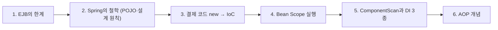
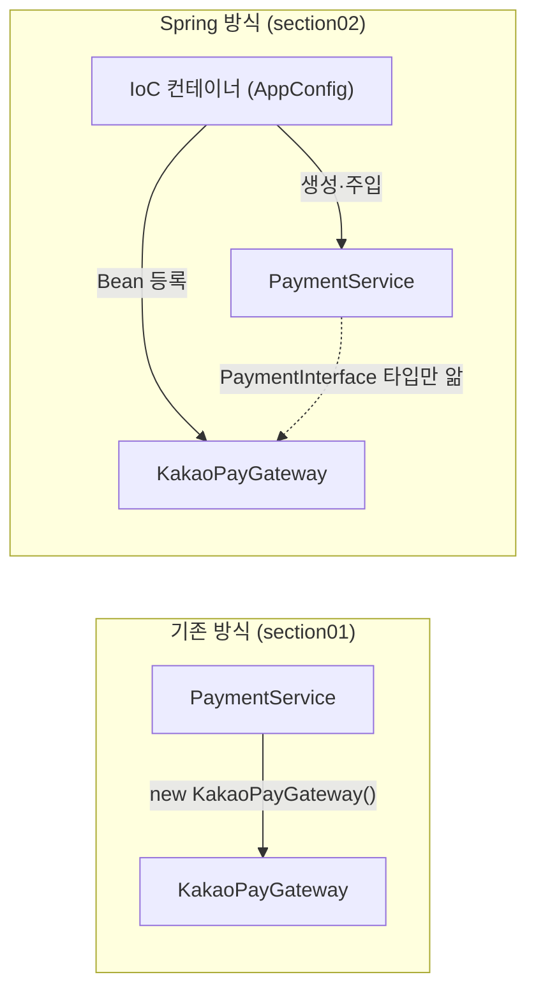
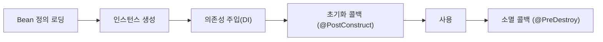

# 오늘 배운 것: new를 없애고 IoC가 객체를 만들어 DI로 연결한다

## 들어가며 (Situation)

모듈 2 18일차. 지난주까지 Servlet·Filter를 배우며 "요청이 들어오면 우리가 만든 클래스가 어떻게 호출되는가"를 봤다. 오늘부터는 **Spring Framework**다. 오전에는 Notion 자료(`Spring OverView` 세 편: 탄생 배경, 핵심 철학, 핵심 개념)로 **왜 Spring이 생겼고 무엇을 지향하는지**를 배우고, 오후에는 `07_Spring-Core`의 실습 프로젝트 두 개를 직접 읽고 실행했다.

| 프로젝트 | 패키지 | 확인하려던 것 |
|----------|--------|---------------|
| `chap01-IoC-container` | `section01` | Spring 없이 `new`로 만든 결제 코드의 문제 |
| `chap01-IoC-container` | `section02` | `@Configuration` + `@Bean`으로 IoC 컨테이너에 객체 등록 |
| `chap01-IoC-container` | `section03` | Bean의 Scope (`singleton` vs `prototype`) |
| `chap02-dependency-injection` | `section01` | `@ComponentScan`으로 Bean 자동 등록 |
| `chap02-dependency-injection` | `section02` | 필드·세터·생성자 세 가지 의존성 주입 |



다음 날(10/27) Notion `Spring Beans의 이해`를 읽어 보니 앞부분이 어제 실습과 겹쳤다. 겹치는 내용은 아래 각 절에 **"10/27 Notion 보충"** 으로 덧붙였다. 어제 실습에 없던 내용(`@Primary`·`@Qualifier`, 웹 스코프, `@Value`, `@Profile` 등)은 이 글에 넣지 않았다.

이 글에서 쓴 코드는 모두 위 팝업의 실제 수업 코드이고, `.java` 옆의 `실행 결과` 탭은 내가 직접 컴파일해서 돌린 출력이다. 순서는 아래와 같다.



## 문제 상황 (Task)

오늘 해결하려던 질문은 세 가지였다.

1. Java EE(EJB)가 이미 있었는데 **Spring은 왜 따로 만들어졌는가?**
2. 수업 예제의 "KakaoPay → NaverPay로 바꿔 주세요" 같은 요구사항 변경이 왜 `new`로 만든 코드에서는 여러 파일을 고쳐야 하는가? 그리고 **IoC·DI는 그 문제를 어떻게 푸는가?**
3. "Bean은 기본이 싱글톤"이라는 말이 **코드에서는 어떤 위험**으로 나타나는가?

## 해결 과정 (Action)

### 1. Spring이 태어난 이유: EJB가 너무 무거웠다

Notion 1편의 흐름을 내 말로 줄이면 이렇다. 1990년대 말 기업용 Java에는 트랜잭션·분산 처리·보안을 컨테이너가 대신 해 주는 **EJB**가 표준이었다. 그런데 이 방식에는 비용이 있었다.

| EJB의 한계 | 구체적인 모습 |
|------------|---------------|
| 복잡한 구조 | 단순 기능에도 Home Interface, Remote Interface, Bean Class 등 3개 이상 필요 |
| 기술 종속 | 특정 WAS(WebLogic, WebSphere 등)와 EJB 컨테이너에 결합, 이식성 낮음 |
| 테스트 어려움 | 컨테이너 없이 실행할 수 없어서 서버를 띄워야 단위 테스트 가능 |
| 설정·배포 부담 | 방대한 XML 설정, 변경 시 EAR 단위로 다시 패키징·배포 |

로드 존슨이 2002년 책 *Expert One-on-One J2EE Design and Development*에서 이 구조를 비판하며 경량 대안을 코드와 함께 공개했고, 이것이 Spring의 시작이라고 Notion은 정리한다. Spring이 내세운 해법은 네 가지다.

- **POJO 기반 개발**
  - 특정 프레임워크의 인터페이스·상속을 강제하지 않는 순수 Java 객체로 비즈니스 로직을 쓴다는 철학이다.
  - Notion은 이 용어를 마틴 파울러 등이 2000년에 EJB 같은 복잡한 구조를 비판하며 퍼뜨렸다고 소개한다.
  - 모든 Bean은 POJO이지만, 모든 POJO가 Bean은 아니다. Spring이 관리하기 시작한 순간 Bean이라고 부른다.
- **IoC (Inversion of Control, 제어의 역전)**
  - 객체의 생성·연결·소멸을 개발자가 아니라 컨테이너가 맡는 구조다.
  - 프레임워크와 라이브러리를 가르는 기준이기도 하다. 라이브러리는 내가 부르고, 프레임워크는 나를 부른다.
- **AOP (Aspect-Oriented Programming)**
  - 로깅·트랜잭션처럼 여러 곳에 반복되는 공통 기능을 핵심 로직에서 떼어내는 방식이다.
- **경량 컨테이너**
  - 전체 WAS 없이도 단독 실행할 수 있다. 오늘 실습의 `main()`이 그 증거였다. Tomcat 없이 `java`로 그냥 돌아간다.

💡 정리하면 Spring은 EJB의 기능을 버린 것이 아니라 **"컨테이너가 해 주는 일은 유지하되, 그 대가로 개발자 코드를 오염시키지 않는다"**는 방향으로 바꾼 것이다. Notion이 인용한 공식 문서의 표현이 `non-invasiveness`(비침투성)다.

### 2. Spring의 설계 철학: 원칙을 구조로 강제한다

2편은 Spring이 객체지향 설계 원칙을 어떻게 지원하는지를 정리한다. 용어만 외우기보다 "Spring의 어떤 기능과 짝인지"로 묶어서 이해했다.

| 원칙 | 의미 | Spring에서의 짝 |
|------|------|------------------|
| DRY | 중복하지 않는다 | AOP(공통 기능 추출), `@Transactional` 같은 선언적 설정 |
| SRP | 클래스는 변경 이유가 하나 | Controller / Service / Repository 계층 분리 |
| SoC | 관심사를 나눠 위임한다 | DI(구현 선택을 밖으로), AOP(횡단 관심사), `ApplicationContext`(설정과 생성 분리) |
| 테스트 용이성(TDD 지원) | 컨테이너 없이도 객체를 만들어 검증 | POJO, 생성자로 의존성을 받아 Mock 주입 |

⚠️ TDD는 Notion에서도 "향후 커리큘럼에서 더 자세히 다룰 내용"이라 개념만 소개하고 넘어갔다. 순서는 "요구사항 이해 → 실패하는 테스트 작성 → 최소 구현으로 통과 → 리팩토링 → 반복"이다. 오늘은 이 설명을 직접 코드로 해 보지 않았고, 아래 3절의 **"의존 객체를 밖에서 받으면 테스트가 쉬워진다"**가 그 준비 단계라고 이해했다.

### 3. 결제 코드를 `new`에서 IoC 컨테이너로 옮기기

수업은 하나의 시나리오로 진행됐다. 결제 시스템에 카카오페이와 네이버페이가 있고, `PaymentService.processPay()`를 부르면 상황에 맞는 페이 구현체가 결제를 처리한다. 같은 시나리오를 세 단계로 고쳐 가며 IoC의 필요성을 눈으로 확인하는 구성이다.

#### 3-1. section01: `new`로 직접 만든 코드의 문제

```java
public class PaymentService {
    // 네이버 페이 구현
//    private NaverPayGateway naverPayGateway;
    private KakaoPayGateway kakaoPayGateway;

    public PaymentService() {
//        this.naverPayGateway = new NaverPayGateway();
        this.kakaoPayGateway = new KakaoPayGateway();
    }
    // ... processPay() 안에서도 kakaoPayGateway.pay(...) 호출
}
```

코드에 남은 주석 처리된 `naverPayGateway` 줄이 요구사항 변경의 흔적이다. 네이버페이에서 카카오페이로 바꾸려면 **필드, 생성자, 호출부 세 곳**을 고쳐야 했다. 게다가 두 게이트웨이의 메서드 이름이 `pay()`로 같지 않거나 매개변수가 다르면 호출부를 전부 바꿔야 한다. 수업 주석은 이를 SOLID의 **개방-폐쇄 원칙(OCP) 위반**이라고 부른다. 소프트웨어는 확장에는 열려 있고 변경에는 닫혀 있어야 하는데, 지금은 구현체를 바꿀 때마다 `PaymentService` 자체를 열어야 한다.

🔴 이 문제의 뿌리는 `PaymentService`가 **구체 클래스(`KakaoPayGateway`)를 직접 알고, 직접 만든다**는 것이다. 이 두 가지가 결합도를 만든다.

#### 3-2. section02: 인터페이스로 "알기"를 줄이고, 컨테이너가 "만들기"를 맡는다

고친 방법은 두 가지다.

1. **인터페이스 도입** — 게이트웨이들이 구현할 `PaymentInterface`를 만들고, `PaymentService`는 이 타입만 안다.
2. **객체 생성을 컨테이너에 위임** — `PaymentService`가 `new`하지 않고, 생성자로 받는다.

```java
public class PaymentService {
    private final PaymentInterface paymentInterface;

    public PaymentService(PaymentInterface paymentInterface) {
        this.paymentInterface = paymentInterface;
    }
    // ... paymentInterface.processPay(orderId, amount) 호출
}
```

그리고 "어떤 구현체를 쓸지"는 설정 클래스 한곳에서 정한다.

```java
@Configuration
public class AppConfig {

    @Bean
    public KakaoPayGateway kakaoPayGateway() { return new KakaoPayGateway(); }

    @Bean
    public NaverPayGateway naverPayGateway() { return new NaverPayGateway(); }

    @Bean
    public PaymentService paymentService() {
        return new PaymentService(kakaoPayGateway());   // 여기만 바꾸면 구현체 교체
    }
}
```

`main()`에서는 컨테이너를 만들고 Bean을 꺼내 쓴다.

```java
ApplicationContext context = new AnnotationConfigApplicationContext(AppConfig.class);
PaymentService paymentService = context.getBean("paymentService", PaymentService.class);
paymentService.processPay("order-001", 3);
```

실행하면 카카오페이로 결제가 진행된다. 이제 네이버페이로 바꾸려면 `AppConfig`의 `kakaoPayGateway()`를 `naverPayGateway()`로 **한 줄만** 바꾸면 된다. `PaymentService`는 열어 보지도 않는다.



수업 화이트보드도 같은 그림이었다. 왼쪽 "기존 방식"에서는 `Application`이 `Payment p = new Payment();`로 `Payment`를 직접 만들고 호출하고, 오른쪽 "Spring 방식"에서는 `Application`과 `Payment`가 **둘 다 IoC 컨테이너를 거쳐서** 연결된다.

- **Configuration Metadata**
  - IoC 컨테이너가 "어떤 객체를, 어떻게 만들고, 무엇을 주입할지"를 읽는 작업 명세서다.
  - XML, Java Config(`@Configuration`), 어노테이션(`@Component`) 세 가지 방식이 있고, Notion은 Java Config를 기본으로 두고 어노테이션을 보완적으로 섞어 쓰는 것이 실무라고 정리한다.
- **ApplicationContext**
  - `BeanFactory`를 확장한 IoC 컨테이너로, Bean 관리 외에 이벤트 처리·메시지 국제화(i18n)·리소스 로딩 같은 부가 기능이 붙어 있다.
  - 오늘 코드의 `AnnotationConfigApplicationContext`는 Java Config를 읽는 구현체다.

**10/27 Notion 보충: BeanFactory와 ApplicationContext, Bean 메타정보**

| 항목 | `BeanFactory` | `ApplicationContext` |
|------|---------------|----------------------|
| 위치 | 컨테이너의 최상위 인터페이스 | `BeanFactory`를 상속한 확장 인터페이스 |
| 제공 기능 | Bean 생성·조회 등 최소 기능, 지연 초기화(Lazy) | 위 기능 + 메시지 소스(i18n), 이벤트 발행·수신, AOP 연동, 빈 후처리기(`BeanPostProcessor`), 자동 Bean 등록 |
| 실제 사용 | `XmlBeanFactory`는 deprecated, 일반 앱에서는 거의 안 씀 | 사실상 표준. Spring Boot도 자동으로 사용 |

| 주요 구현체 | 설명 |
|-------------|------|
| `AnnotationConfigApplicationContext` | Java 기반 설정용. `@Configuration` 클래스를 읽는다 (오늘 실습에서 쓴 것) |
| `ClassPathXmlApplicationContext` | XML 설정용. 과거 호환용이라 지금은 잘 안 쓴다 |
| `GenericWebApplicationContext`, `WebApplicationContext` | 웹 환경용. Spring MVC와 Boot의 기반 |

- **Bean 메타정보**
  - 컨테이너가 객체를 Bean으로 관리하려고 읽는 정보로, 이름(ID)·클래스·의존성·스코프·초기화/소멸 메서드·생성 시점(Lazy 또는 Eager)으로 구성된다.
  - section03의 `@Bean("single")`, `@Scope("singleton")`은 이 메타정보 중 이름과 스코프를 코드로 적은 것이라고 이해했다.

⚠️ 코드를 읽다가 `AppConfig`에서 `paymentService()`가 `kakaoPayGateway()`를 **메서드로 직접 호출**한다는 점이 궁금했다. 일반 Java라면 호출할 때마다 `new`가 일어나서 Bean과 별개의 새 객체가 될 텐데 왜 괜찮은가? 내가 알기로는 `@Configuration` 클래스는 Spring이 프록시로 감싸서 `@Bean` 메서드 호출을 가로채고 이미 있는 Bean을 돌려주기 때문이다(공식 문서의 Java-based configuration 설명). 다만 이 부분은 문서로만 이해했고 직접 두 번 호출해서 같은 객체인지 확인하지는 않았다.

**10/27 Notion 보충:** 이 의문의 답이 Notion 2편에 그대로 있었다. "Spring이 내부적으로 `@Configuration` 클래스에 **CGLIB 프록시를 적용**하기 때문에 `orderService()`가 `memberService()`를 직접 호출해도 동일한 인스턴스를 반환한다"는 설명이다. 위 추측이 맞았다. 같은 자료에서 함께 얻은 사실은 세 가지다.

- `@Configuration`은 내부에 `@Component`를 포함하므로 컴포넌트 스캔의 대상이 되기도 한다.
- `@Bean` 메서드의 이름이 Bean 이름이 되고, 이름은 중복될 수 없다. 같은 이름이 있으면 덮어쓰거나 예외가 난다.
- `@Bean` 메서드가 다른 `@Bean` 메서드를 호출하는 것이 곧 명시적인 DI 구성이다.

#### 3-3. 시행착오: Notion 예제 코드의 `@AutoWired`

Notion의 IoC 구조 예제는 생성자에 `@AutoWired`라고 적혀 있다. 하지만 실제 어노테이션 이름은 `@Autowired`(소문자 w)다. 그대로 따라 치면 컴파일 에러가 날 것이다. 수업 코드(`PaymentServiceField`)에는 `org.springframework.beans.factory.annotation.Autowired`로 정확히 import되어 있어서, 오늘은 수업 코드를 기준으로 삼았다.

### 4. Bean의 Scope: 싱글톤이 위험해지는 순간 (section03)

Bean은 별도 설정이 없으면 **컨테이너 안에 단 하나만 존재하는 singleton**이다. section03은 같은 `PaymentService`를 Scope만 다르게 두 개 등록한다.

```java
@Bean("single")
@Scope("singleton")
public PaymentService paymentService() { return new PaymentService(kakaoPayGateway()); }

@Bean("proto")
@Scope("prototype")
public PaymentService paymentService2() { return new PaymentService(kakaoPayGateway()); }
```

그리고 `PaymentService`에는 **일부러 상태(필드) `orderId`를 두었다.** `processPay()`가 호출될 때마다 이 필드에 주문 번호를 저장하고, `getOrderId()`로 꺼낼 수 있다. 각각 `getBean()`을 두 번씩 해서 확인한 실행 결과는 이렇다.

| 호출 | Bean | 첫 `processPay` 후 | `getBean()` 다시 꺼낸 뒤 `getOrderId()` |
|------|------|--------------------|------------------------------------------|
| `single` → `single2` | singleton | `order-001` | `order-001` (같은 인스턴스를 공유) |
| `proto` → `proto2` | prototype | `order-002` | `null` (새 인스턴스) |

(실행 결과 탭의 `single 의 주문 ID = order-001 / single2 의 주문 ID = order-001`, `proto 의 주문 ID = order-002 / proto2 의 주문 ID = null`이 위 표와 같다.)

💡 `single2`에서는 `processPay()`를 부르지 않았는데도 `order-001`이 나왔다. 같은 객체이기 때문이다. 반대로 `proto2`는 `getBean()`할 때마다 새로 만들어져서 `orderId`가 비어 있다.

🚨 이것이 수업 주석이 "가장 주의!!"라고 적은 이유다. 웹 서버에서는 여러 요청이 **동시에 같은 싱글톤 Bean**을 호출한다. 이때 Bean이 `orderId` 같은 요청별 데이터를 필드에 들고 있으면 요청 A의 주문 번호를 요청 B가 덮어쓰거나 읽을 수 있다. 지난 수업(17일차)에 필터를 배울 때 `PerformanceFilter`가 시작 시간을 필드가 아니라 `doFilter` 안의 지역 변수로 둔 것과 같은 이유다. 수업 결론은 이렇다.

- Service·DAO처럼 **행위 위주** 클래스만 Bean으로 만들고 필드에는 의존 객체만 둔다.
- 요청마다 달라지는 데이터는 **DTO**에 담아 메서드 인자로 주고받는다.

| Scope | 설명 | 기본 여부 |
|-------|------|-----------|
| `singleton` | 컨테이너당 단일 인스턴스, 메모리 효율적 | 기본값 |
| `prototype` | `getBean()` 할 때마다 새 인스턴스 | |
| `request` | HTTP 요청마다 (웹 컨텍스트) | |
| `session` | HTTP 세션마다 (웹 컨텍스트) | |

**10/27 Notion 보충:** 스코프 설명에 실습 결과를 설명해 주는 두 문장이 있었다.

- 싱글톤은 **컨테이너가 시작될 때 객체가 생성**되고 모든 주입 지점이 같은 인스턴스를 공유한다. 상태를 들고 있으면 동시성 문제가 생긴다는 경고도 같다.
- 프로토타입은 Bean을 만들어 준 뒤 **Spring이 생명주기 관리를 바로 끝낸다.** 그래서 소멸 메서드(`@PreDestroy` 등)가 호출되지 않는다. `proto`·`proto2`가 매번 새 객체인 것까지는 확인했지만 소멸 콜백이 안 불리는 것은 직접 확인하지 않았다.

⚠️ 오늘 실습한 것은 `singleton`과 `prototype`뿐이다. `request`·`session` Scope는 Notion 표로만 확인했고 아직 쓰지 않았다.

Bean의 전체 생명주기도 Notion에 정리되어 있다. 컨테이너가 객체를 만들고 끝나는 것이 아니라 아래 단계를 모두 관리한다.



이 흐름은 Notion을 정리한 것이고, 콜백 메서드를 직접 만들어 호출 순서를 찍어 보지는 못했다. 10/27 Notion의 팁에 따르면 초기화·소멸 훅은 DB 연결이나 스레드 풀 같은 외부 자원을 준비하고 정리할 때 쓰고, 순서 충돌을 피하려고 `@PostConstruct`와 `InitializingBean` 같은 방식을 **하나만 골라 쓰는 것**을 권장한다.

### 5. `@ComponentScan`과 DI 세 가지 (chap02)

#### 5-1. 문제 제기: Bean이 100개면?

`AppConfig`에서 `@Bean` 메서드를 하나씩 쓰는 방식은 Bean이 100개면 설정 클래스가 100개 메서드가 된다. chap02 `section01`의 수업 주석이 던진 질문이다. 해법은 클래스에 어노테이션을 붙이고 **스캔으로 자동 등록**하는 것이다.

```java
@Configuration
@ComponentScan(basePackages = "com.wanted.di.section01")
public class AppConfig { }
```

```java
@Service
public class PaymentService { ... }      // 스캔되어 Bean이 된다

@Component
public class NaverPayGateway implements PaymentInterface { ... }
```

- **`@Component` 계열**
  - 스캔 대상이 되는 어노테이션이다. `@Service`는 `@Component`의 특수한 형태이고, MVC의 Service 계층에 붙인다고 수업 주석이 설명한다.
  - `@Controller`, `@Repository`도 같은 방식이라고 Notion이 소개한다.
- **`basePackages`와 `excludeFilters`**
  - `basePackages`를 쓰지 않으면 `@ComponentScan`이 붙은 클래스의 패키지부터 아래로 스캔한다.
  - 스캔에서 빼고 싶으면 클래스(`ASSIGNABLE_TYPE`)·어노테이션(`ANNOTATION`)·정규식(`REGEX`) 세 가지 필터를 쓸 수 있다. 수업 코드에는 이 세 가지가 주석으로 남아 있다.

**10/27 Notion 보충: 스캔 대상과 범위**

| 어노테이션 | 계층 | 한 줄 설명 |
|------------|------|------------|
| `@Component` | 일반 | 객체를 나타내는 일반 타입 (XML의 `<bean>`과 같은 역할) |
| `@Controller` | 프레젠테이션 | 웹 요청·응답 처리 |
| `@Service` | 서비스 | 비즈니스 로직 |
| `@Repository` | 퍼시스턴스 | DAO처럼 파일·DB 접근 |
| `@Configuration` | 설정 | Bean을 등록하는 설정 클래스 |

- 스캔 시작점은 `@ComponentScan`이 붙은 클래스의 패키지이고, 그 아래 하위 패키지를 모두 스캔한다. `@SpringBootApplication`도 내부에 `@ComponentScan`을 포함해서 같은 규칙이 적용된다.
- 경로는 `basePackages`로 여러 개를 줄 수 있고, `basePackageClasses`로 "이 클래스가 있는 패키지"를 지정할 수도 있다. 문자열 대신 클래스를 쓰므로 패키지 이름을 바꾸는 리팩토링에 더 안전하다고 Notion은 설명한다.
- `excludeFilters`로 제외한 클래스는 Bean이 되지 않아서, 그 이름으로 `getBean()`하면 "해당 이름의 빈이 없다"는 오류가 난다. 5-2의 에러와 같은 종류(`NoSuchBeanDefinitionException`)다. 오늘은 필터 세 가지를 주석으로만 두고 켜서 실행해 보지는 않았다.

⚠️ `@ComponentScan`으로 등록된 Bean의 기본 이름은 클래스 이름의 첫 글자를 소문자로 바꾼 것이다(`PaymentService` → `paymentService`). `@Service("field")`처럼 괄호 안에 직접 지정할 수도 있다.

#### 5-2. 실행해 보니 에러가 났다: `No bean named 'paymentServiceField'`

`chap02` `section01`을 폴더에 있는 그대로 실행하면 `NoSuchBeanDefinitionException`이 난다. (실행 결과 탭 참고)

```text
Exception in thread "main" org.springframework.beans.factory.NoSuchBeanDefinitionException: No bean named 'paymentServiceField' available
```

`Application`이 `context.getBean("paymentServiceField", ...)`로 꺼내는데, 이 패키지에 있는 Bean은 `@Service`만 붙은 `PaymentService`라서 이름이 `paymentService`이기 때문이다. `paymentServiceField`는 다음 단계 `section02`에서 필드 주입 클래스에 붙이는 이름(`@Service("field")`)과 이어지는 흔적으로 보인다. 의도한 에러가 아니라 수업 중 코드를 고치다 이 폴더에 반영이 덜 된 흔적이다.

🟢 에러 메시지가 원인을 정확히 알려 준다는 점이 인상 깊었다. `getBean()`의 이름이 컨테이너에 등록된 이름과 다르면 `NoSuchBeanDefinitionException`이다. 이름을 `"paymentService"`로 고치면 해결될 것이다. (고쳐서 다시 돌려 보지는 않았다. 원본을 건드리지 않으려고 에러가 나는 상태 그대로 두었다.)

그리고 `config/Test.java`라는 클래스가 `@ComponentScan` 한 줄만 붙인 채 비어 있다. 무엇을 확인하려던 파일인지 수업 주석이 없어서 알 수 없다. `@Configuration`이 없어서 컨테이너에 등록되지 않는 한 스캔이 일어나지 않을 것 같지만, 이것도 확인하지 않았다.

#### 5-3. 의존성 주입 세 가지: 필드 · 세터 · 생성자

DI는 "의존하는 객체를 `new`하지 않고 밖에서 받는 것"이다. `section02`는 같은 일을 하는 `PaymentService`를 세 가지 방식으로 만들어 놓았다.

| 방식 | 코드 | 장점 | 단점 | 권장 |
|------|------|------|------|------|
| 필드 주입 | `@Autowired private PaymentInterface paymentInterface;` | 코드가 짧다 | `final` 불가, `new`로 직접 대입해도 컴파일 에러 없음, 컨테이너 없이는 주입 불가 | 비권장 |
| 세터 주입 | `@Autowired public void setPaymentInterface(...)` | 선택적 의존 관계 가능 | `final` 불가, 세터가 안 불리면 `null` | 선택적 의존성일 때 |
| **생성자 주입** | `public PaymentServiceConstructor(PaymentInterface p)` | `final`로 불변성 보장, 필수 의존성 강제 | 의존성이 많으면 생성자가 길어짐 | **권장** |

세 클래스는 `@Service("field")`, `@Service("setter")`, `@Service("constructor")`로 이름을 나눠서 한 컨테이너에 같이 올라가고, `Application`이 `getBean("field", ...)`, `getBean("setter", ...)`로 꺼내 호출한다. 실행하면 둘 다 `NaverPayGateway`로 결제가 진행된다. 의존 대상 `PaymentInterface`의 구현체가 `NaverPayGateway` 하나뿐이라서, Spring이 **타입으로** 찾아 주입하기 때문이다.

🟢 생성자 주입은 생성자가 **하나뿐이면 `@Autowired`를 생략해도** 주입된다. `PaymentServiceConstructor`의 `@Autowired`가 주석으로 남아 있는 이유다. `final` 필드는 반드시 초기화해야 하므로 컴파일러가 "의존성 누락"을 막아 준다는 점이 가장 큰 장점으로 이해됐다. Notion이 인용한 공식 문서도 "Spring 팀은 일반적으로 생성자 주입을 권장한다"고 적는다.

**10/27 Notion 보충:** 세 방식을 "주입 시점" 기준으로도 비교한 표가 있었다.

| 구분 | 생성자 주입 | Setter 주입 | 필드 주입 |
|------|-------------|-------------|-----------|
| 주입 시점 | 객체 생성 시점 | 생성 이후 | 리플렉션으로 주입 |
| 불변성(`final`) | 가능 | 불가능 | 불가능 |
| 테스트 용이성 | 높음 | 중간 | 낮음 |
| 권장 | 권장 | 상황에 따라 | 지양 |

필드 주입을 지양하는 이유로 Notion은 세 가지를 든다. Reflection 없이는 Mock을 주입하기 어렵고, 생성자·메서드 시그니처에 의존성이 드러나지 않으며, Spring에 강하게 묶인다. 오늘 `PaymentServiceField`를 `new`로 만들면 `paymentInterface`가 `null`로 남는 것도 같은 이야기라고 이해했다(직접 `new`해서 실행해 보지는 않았다).

⚠️ `PaymentServiceConstructor`는 `Application`에서 한 번도 `getBean()`으로 꺼내지 않아서 **실행 결과에는 나오지 않는다.** 이름 `"constructor"`로 등록만 되어 있다. 세 방식 중 필드·세터만 오늘 실제로 호출해 봤다.

🔴 `PaymentInterface`를 구현한 Bean이 두 개(예: `KakaoPayGateway`도 `@Component`)가 되면 타입만으로는 어느 것을 넣을지 알 수 없다. 이때 에러가 날 것으로 짐작하지만, 오늘 코드에는 구현체가 하나뿐이라 직접 재현하지 못했다. 이름으로 구분하는 방법은 내일 이후 배울 부분으로 남겨 둔다.

### 6. AOP: 개념만 먼저

Notion 3편의 마지막이 AOP다. 오늘은 코드 실습이 없고 개념만 이해했다.

OOP는 역할별로 책임을 나누는 데 좋지만, **로깅·트랜잭션·보안·실행 시간 측정**처럼 모든 클래스에 반복되는 코드는 클래스 안에서 중복을 없애기 어렵다. Notion의 예시에서는 `MemberService.join()` 안에 시간 측정 코드가 핵심 로직과 섞여 있다. AOP를 쓰면 이 코드를 `@Aspect` 클래스로 빼고, 핵심 로직은 `memberRepository.save(member)` 한 줄만 남는다.

| 용어 | 한 줄 정의 |
|------|------------|
| Aspect | 공통 기능을 모아 둔 모듈 |
| Join Point | Advice를 적용할 수 있는 지점 (Spring에서는 메서드 호출 시점만) |
| Advice | 실제로 실행될 공통 기능 (`@Before`, `@After`, `@Around` 등) |
| Pointcut | Join Point 중 적용할 대상을 고르는 표현식 |
| Weaving | Advice를 핵심 로직에 끼워 넣는 일 |

Spring AOP는 **프록시 기반**이라서 메서드 호출 시점에만 동작하고, 같은 클래스 안에서 자기 메서드를 부르는 self-invocation에는 적용되지 않는다고 Notion은 짚는다.

⚠️ 이 한계는 3-2의 `@Configuration` 프록시와 이어지는 이야기일 수 있지만, 지금은 그저 "Spring이 프록시로 일하는 부분이 여럿 있다"는 정도로만 기억해 둔다.

### 7. 오늘 읽다 걸린 부분

- Notion 3편의 `📈nnotationConfigApplicationContext`는 앞글자 `A`가 빠진 오타로 보인다. 실제 클래스는 `AnnotationConfigApplicationContext`이다.
- `section02/Beam_diagram.png`라는 이미지 파일이 소스 폴더에 같이 있었지만, 블로그에는 복사하지 않았다(`.java`만 복사).
- Notion에서 `ApplicationContext`의 부가 기능으로 소개한 `ListableBeanFactory`는 "`BeanFactory`가 제공하는 모든 기능을 포함한다"고 되어 있는데, 이름대로라면 Bean 목록을 열거하는 기능에 가깝다. 정확한 역할은 공식 문서로 확인이 필요해서 단정하지 않는다.
- `build.gradle`의 `spring-context:7.0.8` 한 줄이 IoC 컨테이너 생성에 필요한 핵심 의존성이라고 수업 주석이 설명한다. 그런데 이 하나로 `spring-core`, `spring-beans`, `spring-aop` 등이 따라오는 것은 Gradle 캐시에 함께 내려받아진 것으로 확인했다.

## 결과 (Result)

이번 글은 응답 시간 같은 정량 지표를 잴 수 있는 성격이 아니라서, 대신 "무엇이 어떻게 바뀌었는가"를 코드로 정리했다.

| 비교 | 직접 `new` (section01) | IoC + DI (section02) |
|------|-------------------------|-----------------------|
| 카카오 → 네이버 교체 시 수정 | `PaymentService`의 필드·생성자·호출부 **3곳** | `AppConfig`의 한 줄 |
| `PaymentService`가 아는 것 | 구체 클래스 `KakaoPayGateway` | 인터페이스 `PaymentInterface` |
| 객체 생성 책임 | 개발자 (`new`) | IoC 컨테이너 |
| 테스트 시 가짜 객체 주입 | 어려움 | 생성자로 넘기면 됨 |

| 질문 | 오늘 얻은 답 |
|------|---------------|
| Spring은 왜 생겼나? | EJB의 복잡한 구조·기술 종속·테스트 어려움 때문에, POJO 중심의 경량 대안으로 |
| IoC와 DI의 관계는? | IoC는 "제어권을 컨테이너가 가진다"는 개념, DI는 그중 "의존 객체를 밖에서 넣어 준다"는 구현 방식 |
| Bean은 몇 개 만들어지나? | 기본 singleton, 즉 1개. 실행으로 확인: `single2`는 `order-001`, `proto2`는 `null` |
| 필드를 가진 Bean이 위험한 이유? | 모든 요청이 같은 인스턴스를 공유해서 값이 섞인다. 요청 데이터는 DTO로 |
| 권장 주입 방식? | 생성자 주입. `final`·필수 의존성 강제·테스트 용이 |

직접 실행해서 확인한 것: section01~03, chap02 section02의 정상 출력, chap02 section01의 `NoSuchBeanDefinitionException`. 아직 하지 못한 것은 다음과 같다.

- `@Configuration` 안에서 `@Bean` 메서드를 직접 호출해도 같은 Bean이 오는지 직접 확인(3-2, 설명은 10/27 Notion에서 확인함)
- chap02 section01의 빈 이름을 고쳐 실행하기(5-2)
- 구현체가 둘일 때의 에러 재현(5-3)
- 생명주기 콜백(`@PostConstruct`, `@PreDestroy`) 순서 출력
- AOP `@Around`로 실행 시간 측정 직접 만들기

## 더 학습하면 좋은 개념

- **`@Qualifier`와 `@Primary`** — 같은 타입의 Bean이 둘 이상일 때 어느 것을 주입할지 정하는 방법이다. 오늘 `PaymentInterface` 구현체가 하나뿐이라 가려진 문제이고, 실무에서는 구현체 교체가 일상이라 곧 만난다.
- **`@Configuration`의 프록시와 `proxyBeanMethods`** — 3-2에서 남긴 의문의 답이다. `@Bean` 메서드 간 호출이 왜 같은 Bean을 돌려주는지 이해하면 Spring의 "프록시로 일한다"는 원리가 한 번에 잡힌다.
- **Bean 생명주기 콜백 (`@PostConstruct`, `@PreDestroy`, `InitializingBean`)** — 컨테이너가 객체를 만들고 없애는 시점에 개입하는 방법이다. 커넥션 풀 같은 자원을 열고 닫을 때 필요하다.
- **스레드 안전성(Thread Safety)과 DTO 설계** — 싱글톤 Bean에 상태를 두면 안 되는 이유의 근본이다. 17일차 필터의 지역 변수 이야기와 같은 뿌리다.
- **Spring AOP의 프록시 방식 (JDK 동적 프록시 vs CGLIB)** — self-invocation 한계가 왜 생기는지 설명해 준다. `@Transactional`이 가끔 안 먹는 이유를 이해하는 출발점이다.

## 참고 자료

- [Spring Framework 공식 문서 - Container Overview (Configuration Metadata)](https://docs.spring.io/spring-framework/reference/core/beans/basics.html)
- [Spring Framework 공식 문서 - Bean Scopes](https://docs.spring.io/spring-framework/reference/core/beans/factory-scopes.html)
- [Spring Framework 공식 문서 - Dependency Injection (생성자·세터 주입)](https://docs.spring.io/spring-framework/reference/core/beans/dependencies/factory-collaborators.html)
- [Spring Framework 공식 문서 - Classpath Scanning and Managed Components](https://docs.spring.io/spring-framework/reference/core/beans/classpath-scanning.html)
- [Spring Framework 공식 문서 - Java-based Container Configuration](https://docs.spring.io/spring-framework/reference/core/beans/java.html)
- [Spring Framework 공식 문서 - Spring AOP Capabilities and Goals](https://docs.spring.io/spring-framework/reference/core/aop/introduction-spring-defn.html)
- [Martin Fowler - POJO](https://martinfowler.com/bliki/POJO.html)
