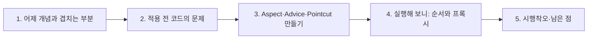
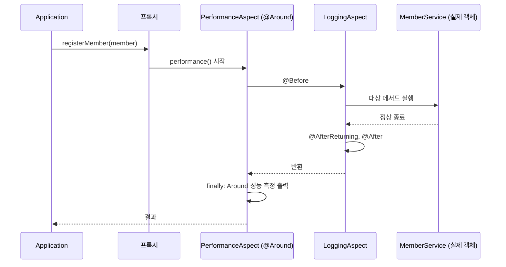
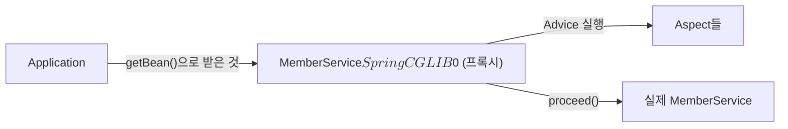

# 오늘 배운 것: 반복되는 로깅·성능 측정을 AOP로 떼어낸다

## 들어가며 (Situation)

모듈 2 19일차. 어제(18일차)는 IoC·DI로 "객체를 누가 만들고 연결하는가"를 배웠다. 어제 글 6절에서 AOP를 **개념만** 짚고 "직접 만들어 보지 못했다"고 남겼는데, 오늘 그 숙제를 `chap03-aop` 실습으로 풀었다.

| 패키지 | 클래스 | 확인하려던 것 |
|--------|--------|---------------|
| `section01` | `Application`, `MemberService`, `MemberDTO` | AOP 적용 **전**: 로깅·성능 측정이 비즈니스 로직에 섞인 코드 |
| `section02` | `MemberService`, `MemberDTO` | AOP 적용 **후**: 핵심 로직만 남긴 서비스 |
| `section02.aspect` | `LoggingAspect`, `PerformanceAspect` | 공통 기능을 모은 Aspect (`@Before`, `@After`, `@AfterReturning`, `@AfterThrowing`, `@Around`) |
| `section02.config` | `AppConfig` | `@EnableAspectJAutoProxy`로 AOP 켜기 |



참고한 자료는 네 가지다.

- 오늘 수업의 코드와 수업 주석, 그리고 화이트보드 그림 `AOP 관련 용어`(오늘 날짜 Notion 폴더의 `today.png`)
- **어제 Notion 폴더**(`2026-10-26.SpringOverView`, 3편 4장 AOP). 오늘 실습과 겹치는 부분이 가장 많았다.
- **오늘 Notion 폴더**(`2026-10-27.SpringBeans의 이해`)에서는 7편 `@Order`가 실습과 이어졌다. 이 폴더에 AOP 전용 교안은 없고, 4편에 프록시 설명이 조금 있다.
- 글 끝의 공식 문서



## 문제 상황 (Task)

오늘의 과제는 세 가지였다.

1. 회원 가입·조회·비밀번호 변경·탈퇴 네 메서드에 **똑같이 반복되는 로깅·성능 측정 코드**를 어떻게 한곳에 모으는가?
2. `@Before`, `@After`, `@AfterReturning`, `@AfterThrowing`, `@Around`는 **언제, 어떤 순서로** 실행되는가?
3. 서비스 코드를 한 줄도 안 고치고 어떻게 기능이 끼어드는가? (Spring AOP의 동작 원리)

## 해결 과정 (Action)

### 1. 어제 Notion과 겹치는 부분, 오늘 새로 나온 부분

어제 Notion(3편 4장)이 AOP 개념을 먼저 깔아 둔 덕분에, 오늘 수업은 "그걸 코드로 만든다"가 중심이었다. 겹치는 부분과 새로 나온 부분을 나눠 보면 이렇다.

| 내용 | 어제 Notion | 오늘 수업 | 관계 |
|------|-------------|-----------|------|
| OOP의 한계(로깅·트랜잭션이 여러 클래스에 반복) | 설명 | `section01` 주석 "문제점 3가지"로 코드로 확인 | **겹침** (개념 → 실제 코드) |
| 횡단 관심사(로깅·트랜잭션·보안·성능 측정) | 표로 설명 | 비기능 요구사항: "로깅, 성능측정" | **겹침** |
| AOP 전/후 비교 (`MemberService.join` + `TimeTraceAspect`) | 예시 코드 | 같은 구조를 `MemberService` 네 메서드로 직접 실행 | **겹침** (예시가 거의 같은 모양) |
| 용어: Aspect, Join Point, Advice, Pointcut, Weaving | 5개 용어 표 | 화이트보드 `AOP 관련 용어`, 코드 주석 | **겹침** |
| 프록시 기반, 메서드 조인 포인트만 | 설명 | `getClass()`로 프록시 종류 확인 (4-3절) | **겹침** (직접 확인으로 이어짐) |
| 프록시 개념 | 없음 | 오늘 Notion 4편: 프록시는 원본 객체의 대리자이고 AOP에도 쓰인다 | 오늘 보강 |
| Advice 종류별 `@Before`, `@After`, `@AfterReturning`, `@AfterThrowing` | 이름만 나열 | 코드와 실행 결과로 각각 확인 | **오늘 새로 배움** |
| `JoinPoint`, `ProceedingJoinPoint` | 없음 | 코드에서 사용 | 새로 배움 |
| Pointcut 표현식 문법 `execution(...)` | 없음 | 코드 주석으로 문법 해설 | 새로 배움 |
| `@EnableAspectJAutoProxy`, `@Order`로 Aspect 순서 | 없음 | `AppConfig`, `PerformanceAspect` | 새로 배움 (`@Order`는 오늘 Notion 7편과 연결) |
| Self-invocation 한계 | 설명 | 오늘은 실행해 보지 않음 | 어제 개념 그대로 |

💡 한 줄로 줄이면 어제는 "AOP가 **무엇이고 왜** 필요한가", 오늘은 "AOP를 **어떻게** 쓰는가"였다.

화이트보드 그림이 각 용어를 이렇게 풀이했다. 이 설명이 가장 이해하기 쉬웠다.

| 용어 | 수업 설명 (요약) | 오늘 코드에서 |
|------|------------------|---------------|
| Aspect | 반복적으로 동작하는 코드를 모아 둔 **클래스**를 지칭 | `LoggingAspect`, `PerformanceAspect` |
| Advice | 반복적으로 동작하는 코드가 **어느 시점에** 동작할지 정의 | `@Before`, `@After`, `@Around` 등을 붙인 메서드 |
| Pointcut | 반복적으로 동작하는 코드가 **어디에** 적용될지 | `execution(* com.wanted.aop.section02.MemberService.*(..))` |
| JoinPoint | 적용될 **위치 및 객체 정보** | 메서드 매개변수로 받는 `JoinPoint` |
| Weaving | 반복 동작 코드가 적용될 위치에 **전달되는 행위** | Spring이 프록시로 끼워 넣는 일 (4-3절) |

### 2. 적용 전 (section01): 핵심 로직이 부가 코드에 묻혀 있다

`section01`의 `MemberService`는 회원 관리라는 **기능**에 로깅·성능 측정이라는 **비기능**이 섞여 있다. 수업 주석이 각 부분에 `횡단 관심사 #1`(성능 측정), `#2`(로깅), `#3`(트랜잭션, 의사코드)이라고 번호를 붙여 두었다.

```java
public void registerMember(MemberDTO member) {
    long startTime = System.currentTimeMillis();          // 횡단 관심사 #1
    try {
        System.out.println("[로그] 회원 가입 시작: " + member.getEmail());   // #2
        // ----- 핵심 비즈니스 로직 시작 -----
        // (이메일·비밀번호 검증, 중복 확인) ...
        memberRepository.put(member.getEmail(), member);
        // ----- 핵심 비즈니스 로직 종료 -----
        System.out.println("[로그] 회원 가입 성공: " + member.getEmail());   // #2
    } catch (Exception e) {
        System.out.println("[로그] 회원 가입 실패: " + e.getMessage());     // #2
        throw e;
    } finally {
        long endTime = System.currentTimeMillis();        // #1
        System.out.println("[성능] 회원 가입 처리 시간: " + (endTime - startTime) + "ms");
    }
}
```

(위는 원본에서 검증 코드 일부를 줄인 것이다. 원본은 네 메서드 모두 같은 틀이다.)

실행 결과 탭을 보면 다섯 번의 테스트(가입·조회·비밀번호 변경·탈퇴·없는 회원 조회) 모두 `[로그] … 시작`, `[로그] … 성공/실패`, `[성능] … ms`가 반복된다. 수업 주석이 꼽은 문제는 세 가지다.

| 문제 | 구체적인 모습 |
|------|---------------|
| 코드 중복 | 네 메서드마다 로깅·성능 측정 코드가 반복 |
| 낮은 응집도 | 한 메서드가 핵심 로직 외의 일까지 한다 |
| 유지보수 어려움 | 로그 양식이나 성능 기준이 바뀌면 여러 메서드를 전부 수정 |

🔴 이 문제는 어제 글 3-1절의 **개방-폐쇄 원칙(OCP) 위반** 이야기와 같은 모양이다. 어제는 "구현체를 바꿀 때 서비스를 열어야 했고", 오늘은 "로그 양식을 바꿀 때 서비스 네 메서드를 열어야 한다".

### 3. 적용 후 (section02): Aspect로 공통 기능을 분리

#### 3-1. AOP를 켜는 설정

```java
@Configuration
@ComponentScan("com.wanted.aop.section02")
@EnableAspectJAutoProxy
public class AppConfig { }
```

`@ComponentScan`은 어제 배운 그대로 `@Service`, `@Component` 클래스를 Bean으로 올린다. 새로 나온 것은 `@EnableAspectJAutoProxy`다. 이 한 줄이 "`@Aspect`가 붙은 Bean을 찾아서 대상 Bean에 AOP를 적용하라"는 스위치라고 이해했다. `build.gradle`에도 `spring-aop`, `aspectjrt`, `aspectjweaver`가 추가돼 있었다. `@Before` 같은 어노테이션이 `org.aspectj` 패키지에서 오기 때문이다.

⚠️ `@Aspect` 클래스에는 `@Component`도 함께 붙어 있다(`LoggingAspect`, `PerformanceAspect`). `@Aspect` 자체는 Bean 등록을 해 주지 않아서, 스캔되게 하려고 `@Component`를 같이 붙인 것으로 이해했다. 이 부분은 공식 문서로 확인하지 못했다.

#### 3-2. Pointcut: "어디에" 적용할지 표현식으로 고른다

```java
@Before("execution(* com.wanted.aop.section02.MemberService.*(..))")
```

수업 주석이 이 문자열을 분해해 설명한다.

| 조각 | 의미 |
|------|------|
| `execution(` … `)` | 메서드 실행 지점을 고르는 표현식 |
| 첫 `*` | 반환 타입이 무엇이든 |
| `com.wanted.aop.section02.MemberService` | 패키지와 클래스 |
| `.*` | 그 클래스의 모든 메서드 |
| `(..)` | 매개변수가 0개 이상 |

매개변수 부분은 `()`는 매개변수 없음, `(String)`은 String 하나, `(String, ..)`는 첫 번째가 String이고 나머지는 무관이라고 주석에 적혀 있다. (오늘은 `.*(..)`만 썼고 나머지 형태는 실행해 보지 못했다.)

#### 3-3. Advice 다섯 가지: "언제" 동작할지

`LoggingAspect`는 네 가지를 한 클래스에 두었다. `JoinPoint`는 "Advice가 적용되는 지점의 정보"를 주는 객체라서, 메서드 이름(`getSignature().getName()`)과 인자(`getArgs()`)를 꺼내 쓴다.

| 어노테이션 | 실행 시점 | 코드에서 받는 것 | 수업 주석의 용도 |
|------------|-----------|------------------|------------------|
| `@Before` | 대상 메서드 **실행 전** | `JoinPoint` | 시작 로그 |
| `@After` | 대상 메서드가 **끝난 뒤**(성공이든 예외든) | `JoinPoint` | 타이머 종료, 종료 로그, 자원 정리 |
| `@AfterReturning` | **정상 종료**하고 값을 반환한 뒤 | `JoinPoint`, 반환값(`returning = "result"`) | 반환값 확인·변환 |
| `@AfterThrowing` | **예외가 났을 때** | `JoinPoint`, 예외(`throwing = "exception"`) | 예외 로그 |
| `@Around` | 대상 메서드의 **앞뒤 모두** | `ProceedingJoinPoint` | 가장 강력, 실행을 직접 제어 |

`@Around`는 `PerformanceAspect`에 있다.

```java
@Around("execution(* com.wanted.aop.section02.MemberService.*(..))")
public Object performance(ProceedingJoinPoint joinPoint) {
    long startTime = System.currentTimeMillis();
    try {
        Object result = joinPoint.proceed();     // 여기서 실제 대상 메서드가 실행된다
        return result;
    } catch (Throwable e) {
        throw new RuntimeException(e);
    } finally {
        long endTime = System.currentTimeMillis();
        System.out.println("[Around 성능 측정] " + joinPoint.getSignature().getName()
                + " 메서드 실행 시간 : " + (endTime - startTime) + "(ms)");
    }
}
```

💡 `joinPoint.proceed()`가 이 코드의 핵심이다. 17일차 필터의 `chain.doFilter()`와 똑같은 구조다. 그 앞에 쓴 코드는 대상 실행 전에, 뒤에 쓴 코드는 실행 후에 동작하고, **호출하지 않으면 대상 메서드가 아예 실행되지 않는다.** `@Around`가 가장 강력하다는 말이 이 뜻이라고 이해했다. 나머지 네 가지는 "끼어들 시점"만 정해 주지만, `@Around`는 실행 여부와 반환값까지 쥔다.

- **Aspect**
  - 반복적으로 동작하는 공통 코드(로깅, 성능 측정 등)를 모아 둔 클래스다.
  - 오늘은 `LoggingAspect`(로깅)와 `PerformanceAspect`(성능)로 관심사별로 두 클래스를 나눴다.
- **Weaving**
  - Advice를 핵심 로직의 적용 지점에 끼워 넣는 일이다.
  - Spring AOP에서는 런타임에 프록시가 대신 하므로, 서비스 소스는 한 줄도 바뀌지 않는다.

### 4. 실행해 보니: 다섯 가지를 직접 확인

실행 결과 탭은 내가 컴파일해서 돌린 출력이다. (`[성능] … ms`, `[Around 성능 측정] … (ms)`의 숫자는 실행할 때마다 달라진다.)

#### 4-1. 정상 호출 한 번의 로그 순서

테스트 1(회원 가입)의 출력을 순서대로 보면 이렇다.

```text
[Before 로그] registerMember 메서드 실행 시작 됨, 매개변수 : MemberDTO(...) ,
회원 정보 저장 완료: user@example.com
[성능] 회원 가입 처리 시간: 0ms
[AfterReturn 로그] registerMember 메소드 정상 종료, 종료 시 반환값 : null
[After 로그] registerMember 메서드 실행 완료!
[Around 성능 측정] registerMember 메서드 실행 시간 : 7(ms)
```

(매개변수 `MemberDTO(...)`는 줄여 썼다.)



이 순서가 말해 주는 것은 다음과 같다. (그림은 출력 순서에서 추론한 것이다.)

- `@Before`는 서비스 코드(`회원 정보 저장 완료`)보다 먼저, `@AfterReturning`과 `@After`는 그 뒤에 찍힌다.
- **`[Around 성능 측정]`이 가장 마지막**에 찍힌다. `PerformanceAspect`에 `@Order(1)`이 붙어 있어서 가장 바깥쪽 감싸기가 되고, `LoggingAspect`는 그 안쪽에서 동작한다고 이해했다. 바깥쪽의 `finally`는 안쪽이 모두 끝난 뒤에야 실행되므로 마지막에 찍힌다.
- 정상 종료에서는 `@AfterReturning`이 `@After`보다 먼저 찍혔다. 이 순서는 실행 결과로만 확인했고, 어떤 규칙 때문인지는 공식 문서에서 찾아보지 못했다.

#### 4-2. 예외가 나면: `@AfterThrowing`, 그리고 예외가 바뀐다

테스트 5(없는 회원 조회)의 출력이다.

```text
[Before 로그] getMember 메서드 실행 시작 됨, 매개변수 : user@example.com ,
[성능] 회원 조회 처리 시간: 0ms
[AfterThrowing 로그] getMember 메소드 실행 중 예외 발생 : 존재하지 않는 회원입니다: user@example.com
[After 로그] getMember 메서드 실행 완료!
[Around 성능 측정] getMember 메서드 실행 시간 : 1(ms)
예외 발생!! : java.lang.IllegalArgumentException: 존재하지 않는 회원입니다: user@example.com
```

- 예외일 때는 `@AfterReturning` 대신 **`@AfterThrowing`**이 찍히고, `@After`는 정상이든 예외든 똑같이 찍힌다. "끝난 뒤"를 정상·예외 구분 없이 처리하는 `finally` 같은 Advice라는 것을 눈으로 확인했다.
- 🔴 마지막 줄이 `section01`과 다르다. `section01`의 결과는 `예외 발생!! : 존재하지 않는 회원입니다: ...`이고, AOP를 적용하면 `예외 발생!! : java.lang.IllegalArgumentException: 존재하지 않는 회원입니다: ...`다. `e.getMessage()`에 **예외 클래스 이름이 앞에 붙었다.**

**왜 달라졌는가.** `PerformanceAspect`의 `catch (Throwable e) { throw new RuntimeException(e); }` 때문이라고 판단했다. 원래 예외(`IllegalArgumentException`)를 `RuntimeException`으로 한 번 감싸서 던지면, 감싼 예외의 메시지가 원인 예외의 `toString()`(`클래스이름: 메시지`)이 된다. 이 메시지가 `Application`의 `catch`로 전달된다.

| 구분 | `Application`이 받는 예외 | `getMessage()` |
|------|--------------------------|----------------|
| section01 (AOP 없음) | `IllegalArgumentException` | `존재하지 않는 회원입니다: ...` |
| section02 (`@Around`가 감쌈) | `RuntimeException`(원인 `IllegalArgumentException`) | `java.lang.IllegalArgumentException: 존재하지 않는 회원입니다: ...` |

⚠️ 실무에서는 이 점이 중요하다. 호출하는 쪽이 `catch (IllegalArgumentException e)`로 잡고 있었다면, `@Around`가 예외를 감싸는 순간 **그 catch가 동작하지 않을 것이다.** 감싸지 않고 `throw e`로 그대로 던지는 것이 안전하다고 이해했다. 오늘은 `catch (Exception e)`로만 받아서 에러가 나지 않았고, 구체적인 예외 타입으로 잡는 코드는 직접 실행해 보지 않았다. (`throws Throwable`을 메서드에 선언하면 감싸지 않을 수 있다는 점은 확인하지 못했다.)

#### 4-3. 프록시의 정체: CGLIB

Weaving이 "프록시로 일어난다"는 설명을 직접 확인하고 싶어서, 저장소 밖 임시 파일에 몇 줄을 만들어 실행했다. (수업 코드는 건드리지 않았다.)

```java
var s = context.getBean(MemberService.class);
System.out.println(s.getClass().getName());
System.out.println("isAopProxy=" + AopUtils.isAopProxy(s) + " cglib=" + AopUtils.isCglibProxy(s)
        + " jdk=" + AopUtils.isJdkDynamicProxy(s));
```

실행 결과는 다음과 같다. (이 코드는 예시 코드이고 저장소에는 넣지 않았다.)

```text
com.wanted.aop.section02.MemberService$$SpringCGLIB$$0
isAopProxy=true cglib=true jdk=false
```

- `getBean(MemberService.class)`로 받은 객체의 클래스가 `MemberService`가 **아니라** `MemberService$$SpringCGLIB$$0`이었다. Spring이 `MemberService`를 상속한 프록시 클래스를 만들어서 Bean으로 내놓은 것이다.
- 우리 `MemberService`는 인터페이스를 구현하지 않아서 CGLIB 방식이 쓰인 것으로 이해했다. (인터페이스가 있을 때 달라지는지는 확인하지 않았다.)

💡 어제 글 3-2절에서 `@Configuration` 클래스가 CGLIB 프록시로 감싸진다고 했던 것과, 오늘 `@Aspect`가 적용된 서비스가 CGLIB 프록시라는 것이 **같은 도구**였다. "Spring은 프록시로 일한다"는 말이 이제 코드에서 보인다.



### 5. 시행착오와 남은 점

#### 5-1. 서비스에 남은 `[성능]` 코드 때문에 성능 로그가 두 번 찍힌다

실행 결과를 보면 한 호출마다 `[성능] … 처리 시간`(서비스 안의 코드)과 `[Around 성능 측정] …`(Aspect)이 **둘 다** 찍힌다. `section02/MemberService`를 열어 보면 이유가 보인다. 시작 로그(`[로그] … 시작`)와 성공 로그는 주석 처리했지만, **성능 측정 `try/finally`와 일부 실패 로그는 그대로 남아 있다.** 아직 정리가 덜 된 상태로 이해했다. 수업 중 코드를 하나씩 걷어내는 과정의 중간 모습으로 보인다(이 추측은 확인하지 않았다).

🟢 이 중복 덕분에 오히려 비교가 쉬웠다. 서비스 안에서 직접 잰 시간과 `@Around`로 잰 시간이 같은 일을 한다는 것이 한 화면에 나란히 보이고, Aspect 쪽이 서비스 코드를 건드리지 않고 같은 측정을 한다는 것을 알 수 있다. 원본은 고치지 않고 그대로 두었다.

#### 5-2. 서비스 코드의 `// 로깅 - 횡단 관심사 #2` 주석

`section02/MemberService`에는 이미 로그를 걷어낸 자리에 `// 로깅 - 횡단 관심사 #2`라는 주석과 `// 트랜잭션 시작 (의사코드)` 주석이 남아 있다. 지금은 설명용이지만 AOP로 옮기고 나면 지워도 되는 주석이다.

#### 5-3. 오늘 Notion 7편 `@Order`와 연결

`PerformanceAspect`에 `@Order(1)`이 붙은 이유가 오늘 Notion 7편(Bean 순서 등록 제어)에 설명돼 있다.

- `@Order`는 **낮은 숫자가 먼저**이고, 기본값은 `Ordered.LOWEST_PRECEDENCE`(`Integer.MAX_VALUE`)다.
- Spring은 내부적으로 `@Order`를 `Ordered` 인터페이스로 바꿔 처리한다.

이 설명대로면 `@Order`가 없는 `LoggingAspect`는 가장 낮은 우선순위이고, `@Order(1)`인 `PerformanceAspect`가 더 높아서 바깥쪽이 된다. 4-1절에서 `[Around 성능 측정]`이 마지막에 찍힌 것과 맞아떨어진다. 다만 Notion 7편의 예시는 `CommandLineRunner`·`ApplicationRunner` 같은 일반 Bean이고, **AOP Aspect의 순서도 같은 규칙인지**는 Notion에는 없었다. `@Order`를 지웠을 때 순서가 어떻게 바뀌는지는 실행해 보지 않았다.

⚠️ 그래서 "`@Order(1)`이라서 바깥쪽이다"는 실행 결과와 Notion 설명을 연결한 **추론**이다. `@Order`를 빼고 다시 돌려 보면 확인할 수 있다.

#### 5-4. 코드를 읽다 눈에 띈 점

- `MemberDTO`는 Lombok(`@Getter`, `@Setter`, `@ToString` 등)을 쓴다. `build.gradle`에 `compileOnly`와 `annotationProcessor`로 들어 있다. 실행 결과의 `MemberDTO(email=..., password=..., ...)`가 `@ToString`이 만든 출력이다.
- ⚠️ `@ToString`이 `password`까지 출력하고, `LoggingAspect`의 `@Before`가 인자를 그대로 찍어서 **비밀번호가 로그에 평문으로 나온다.** 연습 코드라서 괜찮지만, 실제로는 로깅 Aspect가 민감 정보를 노출할 수 있다는 점을 기억해 둔다.
- `section01/MemberDTO`에 쓰이지 않는 `import org.springframework.stereotype.Service`가 있다. 동작에는 영향이 없다.

## 결과 (Result)

이번 글도 응답 시간을 개선하는 종류가 아니라서 정량 지표는 없다. 대신 코드 구조가 이렇게 바뀌었다.

| 비교 | 적용 전 (section01) | 적용 후 (section02) |
|------|--------------------|--------------------|
| 로깅·성능 코드 위치 | 네 메서드 안에 각각 | `LoggingAspect`, `PerformanceAspect` 두 클래스에 한 번씩 |
| 서비스 메서드가 하는 일 | 핵심 로직 + 로깅 + 성능 측정 | 핵심 로직 (성능 측정은 5-1절의 정리되지 않은 코드가 남아 있음) |
| 로그 양식 변경 시 | 여러 메서드 수정 | Aspect 한 곳 수정 |
| 적용 대상 지정 | 코드 안에 직접 | Pointcut 표현식 한 줄 |
| 대상 메서드가 넘기는 정보 | 없음 | `JoinPoint`로 메서드 이름·인자, `returning`·`throwing`으로 반환값·예외 |

| 질문 | 오늘 얻은 답 |
|------|---------------|
| Advice 다섯 개의 시점은? | `@Before` 전, `@After` 후(항상), `@AfterReturning` 정상 후, `@AfterThrowing` 예외 시, `@Around` 앞뒤 전부 |
| `@Around`가 가장 강력한 이유? | `proceed()`를 직접 호출해서 대상 실행 여부·반환값을 쥐기 때문 (필터의 `chain.doFilter()`와 같은 구조) |
| 실행 순서는? | `@Order(1)`인 Around가 바깥, Logging Aspect가 안쪽. 안쪽 `Before → 서비스 → AfterReturning → After` 뒤에 바깥 Around의 `finally`가 찍힘 |
| 예외를 `@Around`에서 감싸면? | `RuntimeException`으로 바뀌어 호출한 쪽의 `catch`와 메시지가 달라진다 |
| 프록시의 정체? | 이 코드에서는 `MemberService$$SpringCGLIB$$0`, CGLIB 프록시 (`AopUtils`로 확인) |

직접 확인한 것: section01·02 전체 출력, Advice 실행 순서, 예외 시 흐름, 프록시 클래스 이름(`getClass()`, `AopUtils`). 아직 하지 못한 것은 다음과 같다.

- `@Order`를 빼거나 숫자를 바꿔서 순서가 어떻게 달라지는지 확인(5-3)
- `@Around`에서 `throw e`로 예외를 그대로 던질 때 메시지가 section01과 같아지는지 확인(4-2)
- 같은 클래스 안에서 자기 메서드를 부를 때(self-invocation) Advice가 적용되지 않는 것 직접 재현
- 인터페이스가 있는 대상에서 프록시가 JDK 동적 프록시가 되는지 확인
- 다른 Pointcut 표현식(`(String, ..)`, 어노테이션 기반 등) 사용

## 더 학습하면 좋은 개념

- **Pointcut 표현식 심화 (`within`, `@annotation`, `bean()`, `&&`/`||` 조합)** — 오늘은 `execution(* ...MemberService.*(..))`만 썼다. 커스텀 어노테이션을 붙인 메서드에만 적용하는 방식을 알아야 실무의 `@Transactional`이 왜 선언만으로 동작하는지 이해된다.
- **`@Transactional`과 프록시** — 오늘 section01 주석의 `beginTransaction()`/`commitTransaction()`/`rollbackTransaction()` 의사코드가 실제로는 Spring이 AOP로 대신 해 주는 기능이다. "트랜잭션이 안 먹는다"는 문제 대부분이 프록시 한계(self-invocation)에서 온다.
- **JDK 동적 프록시 vs CGLIB** — 오늘 대상이 CGLIB 프록시였던 이유(인터페이스 없음)를 정확히 이해하려면 둘의 차이를 알아야 한다. `final` 클래스·메서드에 AOP가 안 먹는 이유와도 이어진다.
- **어드바이스 실행 순서와 `@Order`/`Ordered`** — 5-3절에서 추론으로 남긴 부분이다. Aspect가 여러 개일 때 순서가 결과를 바꾸므로(예: 인증 → 로깅 → 성능) 공식 문서로 확인해 둘 필요가 있다.
- **AspectJ 컴파일 타임·로드 타임 위빙** — Spring AOP는 프록시 방식이라 메서드 호출만 가로챌 수 있다. 필드 접근이나 self-invocation까지 다뤄야 할 때의 대안이다.

## 참고 자료

- [Spring Framework 공식 문서 - Aspect Oriented Programming with Spring](https://docs.spring.io/spring-framework/reference/core/aop.html)
- [Spring Framework 공식 문서 - Declaring Advice (`@Before`, `@AfterReturning`, `@Around` 등)](https://docs.spring.io/spring-framework/reference/core/aop/ataspectj/advice.html)
- [Spring Framework 공식 문서 - Declaring a Pointcut](https://docs.spring.io/spring-framework/reference/core/aop/ataspectj/pointcuts.html)
- [Spring Framework 공식 문서 - Proxying Mechanisms (JDK 동적 프록시와 CGLIB)](https://docs.spring.io/spring-framework/reference/core/aop/proxying.html)
- [Spring Framework 공식 문서 - Enabling @AspectJ Support](https://docs.spring.io/spring-framework/reference/core/aop/ataspectj/aspectj-support.html)
