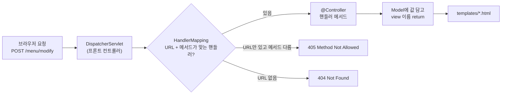

# 오늘 배운 것: Servlet 매핑을 어노테이션 한 줄로 대체한다

## 들어가며 (Situation)

모듈 2 20일차. 어제(19일차)까지는 Spring Core(IoC·DI·AOP)였고, 오늘부터 **Spring Web MVC**로 넘어왔다. 오늘은 이론보다 실습이 중심이었다. 프로젝트 두 개를 만들었다.

| 프로젝트 | 확인하려던 것 | 파일 |
|----------|---------------|------|
| `chap01-request-mapping` (포트 7777) | URL과 HTTP 메서드로 요청을 핸들러 메서드에 연결하기 | `MethodController`, `ClassController` |
| `chap02-handler-method` | 핸들러 메서드가 요청 파라미터를 받는 세 가지 방법 | `RequestController`, `MenuDTO` |



참고한 자료는 다음과 같다.

- 오늘 수업의 코드와 수업 주석
- **오늘 날짜 Notion 폴더**(`2026-10-28.SpringWebMVC`): 3편(DispatcherServlet·HandlerMapping), 6편(요청 매핑), 7편(요청 데이터 처리). 참고용으로만 봤고 실습 코드와 겹치는 부분만 가져왔다.
- 글 끝의 공식 문서

오늘 실습을 하며 가장 크게 와닿았던 점은 **요청 URL·메서드 매핑이 어노테이션 한 줄로 끝난다**는 것이었다. 그래서 이 글은 매핑을 중심에 두고, 요청이 어긋났을 때 어떤 응답이 오는지를 직접 확인한 과정을 적었다.



## 문제 상황 (Task)

오늘의 과제는 세 가지였다.

1. Servlet에서 `@WebServlet`과 `doGet`·`doPost`로 하던 "이 URL·이 방식은 이 코드가 받는다"를 Spring MVC에서는 어떻게 쓰는가?
2. 폼 값을 `WebRequest`, `@RequestParam`, `@ModelAttribute`로 받으면 무엇이 달라지는가?
3. 매핑이나 파라미터 이름이 어긋나면 어떤 오류가 나는가?

## 해결 과정 (Action)

### 1. Servlet에서 하던 일을 Spring MVC로 옮기면

수업 주석(`MethodController`)이 흐름을 이렇게 정리해 준다. Spring Boot에는 Tomcat이 내장돼 있고, Servlet이 HTTP 요청을 받으면 `@Controller` 클래스에 위임한다. Notion 3편에서는 이 Servlet이 `DispatcherServlet`이고, 요청에 맞는 핸들러를 찾아 주는 쪽이 `HandlerMapping`(어노테이션 방식에서는 `RequestMappingHandlerMapping`)이라고 설명한다.

아래는 비교를 위해 새로 쓴 **예시 코드**다(내 Servlet 실습 코드가 아니다).

```java
// Servlet 방식 (예시 코드)
@WebServlet("/menu/regist")
public class RegistServlet extends HttpServlet {
    @Override
    protected void doPost(HttpServletRequest req, HttpServletResponse resp) { ... }
}
```

```java
// Spring MVC (오늘 MethodController)
@RequestMapping(value = "/menu/regist", method = RequestMethod.POST)
public String postRegistMenu(Model model) { ... }
```

| 항목 | Servlet | Spring MVC (오늘 실습) |
|------|---------|------------------------|
| URL 연결 | 클래스마다 `@WebServlet("/url")` | 메서드에 `@RequestMapping`·`@GetMapping`·`@PostMapping` |
| 메서드 구분 | `doGet`/`doPost`를 오버라이드 | `method = RequestMethod.POST` 또는 `@PostMapping` |
| 한 클래스에 URL 여러 개 | 어렵다(URL마다 클래스) | 컨트롤러 한 클래스에 핸들러 메서드 여러 개 |
| 결과 화면 | `forward(req, res)` | view 이름 문자열 return (`templates/` + `.html` 자동) |
| 값 전달 | `request.setAttribute` | `Model.addAttribute` |

💡 오늘 한 줄 요약: Servlet에서는 **클래스가 URL을 갖고**, Spring MVC에서는 **메서드가 URL과 방식을 갖는다**.

### 2. 메서드 매핑 (chap01 `MethodController`)

`/menu/regist`에는 `@RequestMapping("/menu/regist")`(방식 미지정)와 `@RequestMapping(value=..., method=POST)`, 두 메서드가 같은 URL로 걸려 있다. `/menu/modify`는 `@GetMapping`과 `@PostMapping`으로 나눴다.

실제로 요청을 보내 보니 이렇게 갈렸다.

| 요청 | 응답 | 어느 메서드가 받았나 |
|------|------|----------------------|
| `GET /menu/regist` | 200 | 방식 미지정 `@RequestMapping` |
| `POST /menu/regist` | 200 "POST 방식의 메뉴 등록…" | `method = POST`인 쪽 |
| `GET /menu/modify` | 200 | `@GetMapping` |
| `POST /menu/modify` | 200 | `@PostMapping` |
| `PUT /menu/modify` | **405** Method Not Allowed | 받을 메서드 없음 |

🟢 `/menu/regist`는 방식을 안 적은 메서드가 "모든 방식"처럼 보이는데도, POST 요청은 `method = POST`로 적은 **더 구체적인 쪽**으로 갔다. 이 우선순위는 공식 문서로 확인하지 못했고, 실행 결과로만 확인했다.

⚠️ `PUT /menu/modify`가 404가 아니라 **405**인 이유가 오늘 가장 도움이 됐다. URL은 맞는데 방식이 맞는 핸들러가 없을 때 Spring이 405로 알려 준다. "URL 오타"(404)와 "방식 불일치"(405)를 구분해서 디버깅할 수 있다.

### 3. 클래스 매핑과 `@PathVariable` (chap01 `ClassController`)

```java
@Controller
@RequestMapping("/order/*")
public class ClassController {
    @GetMapping("/regist")
    public String registOrder(Model model) { ... }

    @GetMapping("/detail/{orderNo}")
    public String pathVariable(Model model, @PathVariable("orderNo") int no) { ... }
}
```

클래스에 공통 경로(`/order/*`)를 걸고 메서드에 나머지를 붙인다. `/detail/{orderNo}`의 `{orderNo}`가 PathVariable이다. 수업 주석에 "변수명을 URL의 이름과 같게 쓰면 `@PathVariable int orderNo`로 줄일 수 있다"는 형태가 주석 처리돼 있었고, 오늘은 `("orderNo") int no`처럼 **이름을 분리하는 쪽**을 썼다.

`index.html`에는 컨트롤러에 없는 버튼도 있어서(`/order/modify`, `/order/delete`) 같이 눌러 봤다.

| 요청 | 응답 | 이유 |
|------|------|------|
| `GET /order/regist` | 200 | 핸들러 있음 |
| `POST /order/regist` | **405** | URL은 있는데 `@GetMapping`만 있음 |
| `GET /order/modify` | **404** | 이 URL의 핸들러가 아예 없음 |
| `POST /order/delete` | **404** | 동일 |
| `GET /order/detail/3` | 200 "3 번 주문 상세조회!!" | `{orderNo}` = 3 |
| `GET /order/detail/abc` | **400** | `int`로 바꿀 수 없음 |

🔴 `index.html`의 `/order/modify`·`/order/delete` 버튼은 눌러도 **404**가 나온다. 아직 만들지 않은 핸들러에 버튼만 먼저 둔 상태다. 404는 코드 오류가 아니라 "그 경로에 아무도 없다"는 뜻이다.

### 4. 파라미터 받기 세 가지 (chap02 `RequestController`)

같은 "메뉴 정보를 받는" 일을 세 방식으로 나눠 구현했다.

| 방식 | 코드 | 특징 (수업 주석 기준) |
|------|------|------------------------|
| `WebRequest` | `request.getParameter("name")` 후 직접 `Integer.parseInt` | Servlet의 `HttpServletRequest`와 같은 역할. 형변환을 직접 한다 |
| `@RequestParam` | `@RequestParam("modifyName") String name, @RequestParam int modifyPrice` | 꺼내기와 형변환까지 해 준다. 이름이 안 맞으면 400 |
| `@ModelAttribute` | `@ModelAttribute("menu") MenuDTO menu` | 입력값을 객체 하나로 묶는다. 기본 이름은 클래스명 `menuDTO` |

**`@RequestParam`: 이름이 어긋나면**

주석이 "input의 `name` 속성과 변수명을 일치시키지 않으면 400 Bad Request가 발생한다"고 경고한다. 폼에서는 `modifyName`·`modifyPrice`를 보내고, 컨트롤러도 같은 이름으로 받는다. 요청을 바꿔 보내 확인했다.

| 보낸 값 | 응답 |
|---------|------|
| `modifyName=latte&modifyPrice=5000` | 200 |
| `name=latte&price=5000` (이름이 다름) | **400** |
| `modifyName=latte&modifyPrice=abc` (숫자가 아님) | **400** |

🟢 `@RequestParam`은 **필수 파라미터가 없을 때**와 **형변환에 실패할 때** 둘 다 400으로 돌려준다. `WebRequest`로 직접 `parseInt` 하던 것과 가장 크게 다른 점이다.

**`WebRequest`: 폼과 코드가 어긋난 곳**

`registMenu`는 `name`, `price`, `categoryCode`를 모두 읽는데, `regist.html`에는 `name`과 `price` 입력만 있었다. 같은 두 값만 보내 봤다.

```bash
# 예시 요청: 폼과 같은 name, price만 보낸다
curl -X POST -d "name=latte&price=5000" http://localhost:8080/request/regist
# → 500 Internal Server Error
```

🔴 `request.getParameter("categoryCode")`는 값이 없으면 `null`을 돌려주고, `Integer.parseInt(null)`이 예외를 던져 **500**이 났다. `@RequestParam`이었다면 400이었을 상황이다. 이 비교가 `WebRequest`를 직접 쓰는 방식의 단점을 가장 잘 보여 줬다. (원인이 `parseInt(null)`이라는 점은 로그 대신 코드와 응답 코드로 추정한 것이다.)

**`@ModelAttribute`: 이름을 `"menu"`로 지정하면**

주석에는 "이름을 안 주면 `MenuDTO`가 `menuDTO`라는 이름으로 쓰인다"고 되어 있다. 그런데 현재 컨트롤러는 `@ModelAttribute("menu")`로 이름을 지정했고, `searchResult.html`은 `${menuDTO.getName()}`을 읽는다. 이 코드를 임시 폴더에서 그대로 띄워 요청했다.

```text
POST /request/search  (name=latte&price=5000&orderableStatus=Y)
→ 500
  Method call: Attempted to call method getName() on null context object
  (template: request/searchResult, "menuDTO.getName()")
```

🔴 `@ModelAttribute("menu")`라고 이름을 지으면 화면에서는 `menu`로 꺼내야 하고, `menuDTO`는 비어 있다. 컨트롤러에서 이름을 바꾸면 **템플릿도 같이 바꿔야** 한다. 이름을 안 준 상태(`menuDTO`)로 돌아가면 화면에 `latte`, `5000`, `0`, `Y`가 나오는 것도 같은 앱의 다른 실행에서 확인했다. `categoryCode`가 `0`인 것은 값을 보내지 않으면 `int`의 기본값이 들어가기 때문이다.

### 5. 시행착오와 확인하지 못한 것

- `chap02` 메인 화면의 `@RequestBody` 버튼(`/request/body`)과 `modify.html`의 두 번째 폼(`modifyAll`)은 대응하는 핸들러가 아직 없어 **404**다. 오늘 범위는 아니었다.
- `modify` 요청은 200이지만 화면 `<h3>`가 **비어 있다**. `printResult.html`은 `message`를 읽는데 `modifyMenu`가 `Model`에 `message`를 담지 않기 때문이다. 이름·가격은 콘솔 출력(`System.out.println`)으로만 확인한다.
- 위 요청 결과는 `curl`로 확인했다. 브라우저 폼 제출과 인코딩 처리(한글 값)까지는 확인하지 못했다. Windows `curl`로 한글 값을 보냈을 때는 400이 나왔는데, 요청 인코딩 문제로 보고 영어 값으로 바꿔서 확인했다. 원인은 따로 조사하지 않았다.
- `@PathVariable`의 이름 생략 형태(`@PathVariable int orderNo`)는 직접 실행해 보지 않았다.

## 결과 (Result)

직접 요청을 보내 확인한 결과를 응답 코드별로 정리하면 이렇게 갈렸다.

| 응답 코드 | 원인 | 사례 |
|-----------|------|------|
| 200 | 핸들러가 맞음 | `GET/POST /menu/regist`, `GET /order/detail/3` |
| 400 | 파라미터 이름·타입이 안 맞음 | `@RequestParam` 이름 불일치, `/order/detail/abc` |
| 404 | 그 URL의 핸들러가 없음 | `/order/modify`, `/request/body` |
| 405 | URL은 있으나 방식이 안 맞음 | `PUT /menu/modify`, `POST /order/regist` |
| 500 | 코드 안에서 예외 | `parseInt(null)`, 템플릿의 `menuDTO`가 null |

- **Before(Servlet)**: URL마다 클래스를 만들고 `doGet`/`doPost`를 구현, 파라미터는 `getParameter` + 직접 형변환
- **After(Spring MVC)**: 컨트롤러 한 클래스에 매핑 어노테이션과 파라미터 어노테이션으로 정리

💡 응답 코드만 봐도 어디를 의심할지 정해진다. **404는 URL·핸들러 존재, 405는 메서드, 400은 파라미터 이름·타입, 500은 코드 안 예외**였다. 다만 이 대응은 오늘 확인한 사례만으로 정리한 것이다.

## 더 학습하면 좋은 개념

- **DispatcherServlet과 요청 처리 흐름** — 오늘 매핑이 "어노테이션 한 줄"로 보였던 건 뒤에서 `HandlerMapping`이 서버 시작 때 매핑 정보를 모아 두기 때문이다(Notion 3편). 이 흐름을 알면 404·405가 어느 단계에서 나오는지 설명할 수 있다.
- **`@RequestBody`와 `HttpMessageConverter`** — 오늘 메인 화면에 버튼만 있고 구현하지 못한 부분이다. JSON 요청을 객체로 받는 방식이고, 폼 데이터를 받는 `@ModelAttribute`와 어떻게 다른지 이어서 봐야 한다.
- **`@ModelAttribute`의 이름 규칙과 데이터 바인딩** — 오늘 `"menu"`와 `menuDTO`가 어긋나 500이 난 것처럼, 모델에 담기는 이름을 정확히 알아야 화면에서 값을 꺼낼 수 있다. 세터·기본 생성자가 필요한 이유도 함께 확인해 볼 만하다.
- **HTTP 상태 코드 설계 (400·404·405·500)** — 같은 오류도 어떤 코드로 돌려줄지가 API 사용자의 디버깅 경험을 좌우한다. Notion 10편 예외 처리와 이어진다.
- **Thymeleaf 템플릿 문법** — 오늘 `th:text`를 설명 없이 썼다. 수업에서도 뒤에서 다룬다고 한 내용이다.

## 참고 자료

- [Spring Framework 공식 문서 - Mapping Requests](https://docs.spring.io/spring-framework/reference/web/webmvc/mvc-controller/ann-requestmapping.html)
- [Spring Framework 공식 문서 - @RequestParam](https://docs.spring.io/spring-framework/reference/web/webmvc/mvc-controller/ann-methods/requestparam.html)
- [Spring Framework 공식 문서 - @ModelAttribute](https://docs.spring.io/spring-framework/reference/web/webmvc/mvc-controller/ann-methods/modelattrib-method-args.html)
- [Spring Framework 공식 문서 - DispatcherServlet](https://docs.spring.io/spring-framework/reference/web/webmvc/mvc-servlet.html)
- [MDN - 405 Method Not Allowed](https://developer.mozilla.org/en-US/docs/Web/HTTP/Reference/Status/405)
