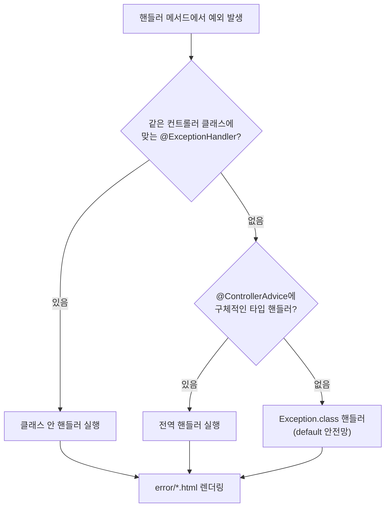
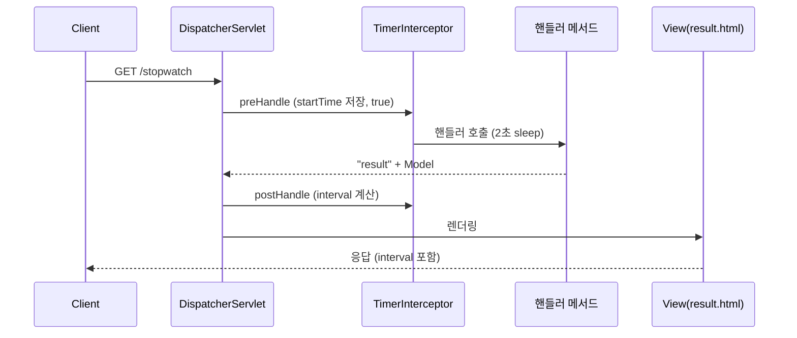

# 오늘 배운 것: 인터셉터는 컨트롤러 앞뒤를 감싼다

## 들어가며 (Situation)

모듈 2 21일차. 어제(20일차)는 요청을 컨트롤러 메서드에 **연결**하는 것(매핑·파라미터)을 했고, 오늘은 그 메서드가 **끝난 뒤와 어긋났을 때, 그리고 앞뒤에서** 무슨 일이 일어나는지를 다뤘다. 프로젝트 세 개를 만들었다.

| 프로젝트 | 확인하려던 것 | 파일 |
|----------|---------------|------|
| `chap03-view-resolver` | 핸들러가 뷰를 돌려주는 세 가지 방법, forward와 redirect 차이 | `MainController`, `ResolverController` |
| `chap04-exception-handler` | 예외를 컨트롤러 안에서, 또는 전역에서 가로채기 | `ExceptionTestController`, `GlobalExceptionHandler` |
| `chap05-interceptor` | 컨트롤러 앞뒤에서 요청을 가로채 처리 시간 재기 | `TimerInterceptor`, `WebConfig` |



참고한 자료는 다음과 같다.

- 오늘 수업의 코드와 수업 주석, 수업 중 그린 `process.png`
- **어제 날짜 Notion 폴더**(`2026-10-28.SpringWebMVC`): 2편(MVC 아키텍처), 3편(Spring MVC의 구조), 9편(응답 데이터), 10편(예외 처리). 그림이 많은 자료라서 오늘 실습과 겹치는 부분만 가져왔다.
- 글 끝의 공식 문서

오늘 가장 오래 걸린 건 **인터셉터의 실행 순서**였다. 처음 예상과 달라서 한참 헤맸다(정확히 어떻게 달랐는지는 기억나지 않아 적지 않는다). 그래서 이 글은 인터셉터를 중심에 두고, 실습한 코드를 직접 다시 실행해서 순서를 확인한 과정을 적었다. 먼저 어제 그림으로 세 프로젝트가 **어디에 놓이는지**부터 정리한다.

### 한 요청이 지나가는 길

MVC 패턴은 `View → Controller → Service → DAO → DB`로 책임을 나눈 구조다. 이 중 Controller·View·Model(Service+DAO+DB)이 MVC이고, 계층으로 보면 `presentation / service / persistence`로 나뉜다.


Spring MVC에서는 이 맨 앞의 View·Controller 사이에 `DispatcherServlet`이 서 있다. 3편 그림에서 오늘 다룬 세 가지가 어디에 있는지 보인다.


| 오늘 프로젝트 | 구조도에서의 위치 |
|---------------|-------------------|
| chap03 뷰 반환 | `ViewResolver`·`View` (6-1. Template 기반 응답) |
| chap04 예외 처리 | `HandlerExceptionResolver` (핸들러 호출 중 예외가 났을 때 DispatcherServlet이 찾는 곳) |
| chap05 인터셉터 | `HandlerInterceptor` (HandlerMapping 다음, HandlerAdapter가 컨트롤러를 부르기 전후) |

## 문제 상황 (Task)

오늘의 과제는 세 가지였다.

1. 핸들러 메서드가 `return "result"` 한 줄로 어떻게 `result.html`이 되는가? redirect는 무엇이 다른가?
2. 컨트롤러에서 예외가 났을 때, 클래스 안의 `@ExceptionHandler`와 전역 `@ControllerAdvice` 중 누가 먼저 일하는가?
3. 인터셉터는 정확히 **언제** 실행되는가? 컨트롤러 실행 시간을 어떻게 재는가?

## 해결 과정 (Action)

### 1. 뷰를 돌려주는 세 가지 (chap03)

수업 주석(`ResolverController`)은 `@Controller`가 View를 반환해야 하는 책임을 가진다고 하고, 방법을 세 가지로 정리한다.

| 반환 타입 | 뷰 경로 | 오늘 실습 |
|-----------|---------|-----------|
| `void` | 요청 URL이 곧 뷰 경로 | 쓰지 않았다 |
| `String` | 반환 문자열이 뷰 경로 | `/string` → `"result"` |
| `ModelAndView` | `setViewName("result")` | `/modelAndView` |

Notion 9편에서는 문자열을 반환했을 때 `ThymeleafViewResolver`가 앞에 `resources/templates/`, 뒤에 `.html`을 붙여 템플릿을 찾는다고 설명한다. 그래서 `"result"`가 `templates/result.html`이 된다. 실행해 보니 `GET /string`은 `문자열로 View 반환`, `GET /modelAndView`는 `MV 활용 뷰와 데이터!`를 화면에 그렸다.

- **ViewResolver**
  - 핸들러가 돌려준 논리 뷰 이름에 접두사·접미사를 붙여 실제 템플릿을 찾아 주는 컴포넌트다.
  - Thymeleaf는 `resources/templates/` + 이름 + `.html` 규칙을 쓴다. (Notion 9편)
  - Java 객체를 그대로 돌려주는 `@ResponseBody` 방식에서는 ViewResolver가 아니라 `HttpMessageConverter`가 일한다.

**forward와 redirect**

`return "redirect:/"`처럼 접두사를 붙이면 redirect가 된다. 수업 주석은 redirect는 요청이 **두 번** 일어나서 처음 요청의 `Model` 값이 사라진다고 설명하고, 값을 넘기려면 `RedirectAttributes`의 `addFlashAttribute`를 쓰라고 한다. 확인한 결과다.

| 요청 | 응답 | 화면에 보인 것 |
|------|------|----------------|
| `GET /string` | 200 | `문자열로 View 반환` |
| `GET /string-redirect` | **302** (Location: `/`) | 브라우저가 `/`를 다시 요청 |
| 그 직후 `GET /` (같은 세션) | 200 | `리다이랙트 된 페이지에서도 유지되는 값!` |
| 다시 `GET /` | 200 | 빈 `<h3>` |

🟢 flash 속성은 **리다이렉트된 다음 요청 한 번만** 보이고 사라진다. 새로고침하면 메시지가 없어지는 이유다.

🔴 `main.html`의 세 번째 버튼(`/string-redirect-attr`)은 누르면 **404**다. 컨트롤러에는 `/string-redirect`만 있고 `flashAttribute`도 거기서 쓴다. 버튼 이름과 핸들러 경로가 어긋난 채로 남아 있다.

### 2. 예외 처리: 가까운 쪽이 먼저 (chap04)

어제 Notion 10편의 흐름은 이렇다. 핸들러 실행 중 예외가 나면 `DispatcherServlet`이 `HandlerExceptionResolver` 구현체들을 차례로 돌며 처리할 수 있는 쪽을 찾고, `@ExceptionHandler` 메서드를 처리하는 것이 `ExceptionHandlerExceptionResolver`다.



- **@ExceptionHandler**
  - 컨트롤러 안(또는 `@ControllerAdvice` 클래스 안)에서 특정 예외 타입을 받아 처리하는 메서드를 표시한다.
  - 예외가 나면 컨트롤러의 원래 흐름을 가로채 이 메서드가 뷰 이름을 돌려준다.
  - 수업 주석: 같은 클래스 안의 핸들러가 전역 핸들러보다 우선한다.

- **@ControllerAdvice**
  - 여러 컨트롤러에서 공통으로 발생할 수 있는 예외 처리 메서드를 한 클래스에 모아 둔다.
  - 수업 주석은 Advice를 AOP 챕터에서 배운 "반복 동작하는 코드를 모아 둔 것"과 같은 단어로 연결한다.
  - 상위 타입 `Exception.class` 핸들러를 두면 구체적으로 안 적은 예외를 받는 default 역할을 한다. (Notion 10편)

NPE를 일부러 내는 요청 둘을 보내 누가 처리하는지 확인했다.

| 요청 | 어디서 예외가 났나 | 처리한 쪽 | 근거 |
|------|--------------------|-----------|------|
| `/nullpointer` | `ExceptionTestController` | **클래스 안** `nullHandler` | 콘솔에 `전역 예외처리 핸들러 동작!!`이 **안 찍힘** |
| `/global-nullpointer` | `GlobalTestController` | **전역** `GlobalExceptionHandler` | 콘솔에 `전역 예외처리 핸들러 동작!!` 출력 |
| `/userexception` | `ExceptionTestController` | 클래스 안 `userException` | 화면에 `아프지 말자 우리` |
| `/global-default` | `GlobalTestController` (배열 범위 초과) | 전역 `Exception.class` | `Default 예외 페이지!`, `ArrayIndexOutOfBoundsException` |

🟢 같은 NPE라도 `GlobalTestController`에는 클래스 안 핸들러가 없어서 전역으로 갔다. 수업 주석("다른 클래스 내부의 메서드는 알 수 없다")이 그대로 확인됐다.

⚠️ 위 네 요청의 응답 코드는 전부 **200**이었다. Notion 10편도 예외 응답의 기본 상태 코드는 200이라고 하고, `@ResponseStatus`로 따로 지정해야 한다고 한다. 오늘 실습에서는 지정하지 않아서 에러 화면인데도 200이다.

🔴 `index.html`의 `전역 - 사용자 정의 예외` 버튼(`/global-userexception`)을 눌렀더니 이상한 결과가 나왔다. 그 경로에는 핸들러가 없다. 그런데 응답은 404가 아니라 **200**이었고, 화면에는 `NoResourceFoundException 에러 발생! 원인 : No static resource global-userexception ...`이 찍힌 `Default 예외 페이지!`가 떴다. 전역 `Exception.class` 핸들러가 "그런 경로가 없다"는 예외까지 받아서 default 페이지로 바꿔 버린 것이다. 안전망 핸들러가 너무 넓은 타입을 잡으면 **404도 200 화면으로 가려진다**는 것을 이번에 알았다.

### 3. 인터셉터: 컨트롤러 앞뒤에 끼워 넣기 (chap05)

#### 3-1. 인터셉터가 있는 자리

수업 중 그린 `process.png`에는 `Servlet Container` 안에 **filter**, `Spring IoC Container` 안에 **interceptor**가 있다. 요청은 `filter → DispatcherServlet → interceptor → @Get 핸들러 메서드`로 들어가고 같은 길로 나온다.


3편 구조도와 겹쳐 보면 **필터는 DispatcherServlet 앞(Servlet Container)**, **인터셉터는 DispatcherServlet이 핸들러를 찾은 뒤 HandlerAdapter 앞뒤(Spring Container)**에 있다. 순서가 헷갈린 지점이 이 두 층을 섞어 생각한 데 있었을 가능성이 있지만, 당시 어떻게 생각했는지는 기억나지 않아 확정하지 않는다.

- **HandlerInterceptor**
  - 컨트롤러의 핸들러 메서드가 실행되기 전과 후에 끼어드는 Spring MVC의 확장 지점이다.
  - `preHandle`(실행 전, `boolean` 반환), `postHandle`(실행 후, 뷰 렌더링 전)을 구현한다.
  - `WebMvcConfigurer`의 `addInterceptors`로 등록하고, 적용할 경로를 지정한다.

#### 3-2. 오늘 만든 코드

아래는 수업 코드의 핵심만 줄여 옮긴 것이다(주석과 `endTime` 변수는 생략). 전체 원본은 위 코드 팝업에 있다.

```java
@Component
public class TimerInterceptor implements HandlerInterceptor {

    @Override
    public boolean preHandle(HttpServletRequest request, HttpServletResponse response, Object handler) throws Exception {
        System.out.println("prehandle() 동작함...");
        request.setAttribute("startTime", System.currentTimeMillis());
        return true;   // true: 다음 인터셉터나 컨트롤러로 진행
    }

    @Override
    public void postHandle(HttpServletRequest request, HttpServletResponse response, Object handler,
                           @Nullable ModelAndView modelAndView) throws Exception {
        System.out.println("postHandler() 호출됨..");
        long startTime = (long) request.getAttribute("startTime");
        modelAndView.addObject("interval", System.currentTimeMillis() - startTime);
    }
}
```

`preHandle`에서 시작 시각을 `request`에 담고, `postHandle`에서 꺼내 걸린 시간을 `ModelAndView`에 넣는다. `WebConfig`는 `WebMvcConfigurer`를 구현해서 이 인터셉터를 `/*`에 붙이고 `/css/**`·`/images/**`·`/js/**`·`/video/**`는 제외한다. 핸들러(`/stopwatch`)는 `Thread.sleep(2000)` 후 `"result"`를 돌려주고, `result.html`이 `${interval}`을 보여 준다.

#### 3-3. 실행 순서를 직접 확인

한참 헤맸던 순서를 말로 외우지 않으려고, 같은 코드를 임시 폴더에 복사해 띄운 뒤 `/stopwatch`만 한 번 요청하고 콘솔을 봤다.

```text
prehandle() 동작함...
stopwatch 요청을 처리하는 핸들러 메서드 동작..
postHandler() 호출됨..
```



| 단계 | 콘솔 | 설명 |
|------|------|------|
| 1 | `prehandle() 동작함...` | 핸들러보다 **먼저** |
| 2 | `stopwatch 요청을 처리하는 핸들러 메서드 동작..` | 컨트롤러 (2초 정지) |
| 3 | `postHandler() 호출됨..` | 핸들러가 **끝난 직후**, 화면 렌더링 전 |

🟢 응답 화면에는 `핸들러메서드 호출 수행 시간 : 2030`이 나왔다. `Thread.sleep(2000)`에 약 30ms가 더해진 값이다(한 번 측정한 값이다). `postHandle`이 뷰 렌더링 **전**에 불리기 때문에 `interval`을 `ModelAndView`에 넣어 `result.html`에서 쓸 수 있다. 아래 3-4절의 NPE 스택트레이스를 이어서 보면, `DispatcherServlet.doDispatch`가 970행에서 `applyPostHandle`(= `postHandle` 호출)을 부르고 980행에서 `processDispatchResult` → `render`로 넘어간다. 호출 순서가 그대로 보였다.

⚠️ `postHandle`이 `render` 앞에 있다는 것까지는 확인했지만, `preHandle`이 `false`를 돌려주면 핸들러가 막히는지, 인터셉터를 여러 개 등록하면 `postHandle`이 역순인지는 **오늘 직접 실행해 보지 않았다.** 수업 주석("true: 다음 인터셉터가 있다면 호출")만 근거다.

#### 3-4. 실행하다 발견한 함정

`/stopwatch` 말고 `/`(메인 화면)도 요청해 봤더니 이 요청도 `prehandle()`, `postHandler()`를 지났다(`/*`에 걸리기 때문이다). 그리고 `/` 요청 직후 콘솔에 이런 오류가 찍혔다(응답 코드는 200이었다).

```text
java.lang.NullPointerException: Cannot invoke "org.springframework.web.servlet.ModelAndView.addObject(String, Object)"
because "modelAndView" is null
	at com.wanted.interceptor.TimerInterceptor.postHandle(TimerInterceptor.java:37)
```

🔴 `postHandle`의 `ModelAndView`가 `null`일 수 있다. 시그니처에 `@Nullable`이 붙어 있는데 `modelAndView.addObject(...)`를 바로 호출해서, 뷰 이름과 모델을 돌려주지 않는 요청이 `/*`에 걸리면 NPE가 난다. `/` 요청 직후에 이 오류가 찍혔으니 정적 `index.html`로 가는 흐름이 유력한 후보지만, 오류 처리용 `/error` 같은 다른 요청이 섞였을 가능성도 있어 하나로 단정하지는 못했다. 오늘 수업 코드는 `/stopwatch`만 눌러 보면 문제가 없어서 눈에 띄지 않는다. 어떤 요청에서 어떤 경로로 `null`이 들어왔는지는 로그만으로 전부 가려내지 못했다.

⚠️ 수업 주석에 `/**`는 모든 하위 경로를 포함하는 패턴이라고 적혀 있다. 코드는 `/*`로 등록했는데, `/a/b` 같은 하위 경로가 인터셉터를 지나는지는 직접 확인하지 못했다.

🟢 고치려면 `postHandle`에서 `if (modelAndView != null)`를 확인하거나, 인터셉터를 컨트롤러 경로(`/stopwatch`)에만 붙이면 된다. 오늘은 수업 코드를 그대로 두고, 위험만 기록해 둔다.

### 4. 시행착오와 확인하지 못한 것

- `MemberNotFoundException`은 `Exception`이 아니라 `Throwable`을 상속한다. 클래스 안 `@ExceptionHandler(MemberNotFoundException.class)`로 받는 `/userexception`은 동작했지만, 이 타입을 전역 `Exception.class` 핸들러가 받을 수 있는지는 확인하지 못했다.
- 어제 Notion 10편에는 `@ResponseStatus`와 `@Order`, `basePackages` 범위 지정이 나온다. 오늘 실습 코드에는 없어서 직접 확인하지 않았다.
- 모든 요청 결과는 `curl`로 확인했다. 브라우저에서 버튼을 눌러 본 결과와 다를 수 있다.
- 오늘 날짜 Notion 폴더(`2026-10-29.SpringDataJPA`)는 JPA 자료여서 오늘 실습(Web MVC)과 관련이 없어 쓰지 않았다.

## 결과 (Result)

세 프로젝트를 요청별로 확인한 결과다.

| 프로젝트 | 요청 | 결과 |
|----------|------|------|
| chap03 | `/string`, `/modelAndView` | 200, `templates/result.html` 렌더링 |
| chap03 | `/string-redirect` | **302** → `/`, flash 메시지는 한 번만 표시 |
| chap03 | `/string-redirect-attr` | **404** (핸들러 없음) |
| chap04 | `/nullpointer` | 200, 클래스 안 핸들러 |
| chap04 | `/global-nullpointer`, `/global-default` | 200, 전역 핸들러 |
| chap04 | `/global-userexception` | 200, `NoResourceFoundException`이 default 페이지로 |
| chap05 | `/stopwatch` | 200, `interval` **2030** (sleep 2000 포함) |

배운 점은 이렇다.

💡 인터셉터는 컨트롤러를 **감싼다**. `preHandle`(앞) → 핸들러 → `postHandle`(뒤, 렌더링 전) 순서이고, 필터(Servlet Container)와 달리 DispatcherServlet이 핸들러를 정한 **뒤** Spring 쪽에서 일한다.

💡 예외 핸들러는 **가까운 쪽(같은 클래스) → 전역(구체 타입) → `Exception` default** 순이다. 다만 default를 넓게 잡으면 404도 200 화면으로 가려진다.

⚠️ 어제 실습처럼 "버튼은 있는데 핸들러가 없는" 경우가 오늘도 두 곳(`/string-redirect-attr`, `/global-userexception`)이었다. 화면에서 눌러 보는 습관과 함께, 응답 코드를 같이 확인해야 한다.

## 더 학습하면 좋은 개념

- **Filter와 HandlerInterceptor의 차이** — 3편 구조도에서 필터는 Servlet Container, 인터셉터는 Spring Container에 있다. 어떤 일을 어느 층에서 해야 하는지(인코딩·보안은 필터, 핸들러 정보가 필요한 일은 인터셉터) 구분하면 오늘 헤맨 순서 문제가 정리된다.
- **`afterCompletion`과 다중 인터셉터 순서** — 오늘은 `preHandle`·`postHandle`만 구현했다. 뷰 렌더링까지 끝난 뒤 불리는 `afterCompletion`과, 인터셉터가 여러 개일 때의 호출 순서를 알아야 로깅·트랜잭션성 작업을 안전하게 붙일 수 있다.
- **`@ResponseStatus`와 `ResponseEntity`로 예외 응답 코드 정하기** — 예외 핸들러는 기본 200을 돌려준다. REST API라면 상태 코드를 명시해야 클라이언트가 실패를 구분한다.
- **`@RestControllerAdvice`** — API 서버에서는 전역 예외를 HTML 뷰가 아니라 JSON으로 돌려준다. `@ControllerAdvice` + `@ResponseBody`의 합성이다.
- **PRG(Post-Redirect-Get) 패턴** — 오늘 본 redirect와 flash 속성이 존재하는 이유다. 폼 제출 후 새로고침해도 중복 제출이 되지 않게 하는 웹 개발의 기본 패턴이다.

## 참고 자료

- [Spring Framework 공식 문서 - DispatcherServlet](https://docs.spring.io/spring-framework/reference/web/webmvc/mvc-servlet.html)
- [Spring Framework 공식 문서 - View Resolution](https://docs.spring.io/spring-framework/reference/web/webmvc/mvc-servlet/viewresolver.html)
- [Spring Framework 공식 문서 - Interception](https://docs.spring.io/spring-framework/reference/web/webmvc/mvc-servlet/handlermapping-interceptor.html)
- [Spring Framework 공식 문서 - @ExceptionHandler](https://docs.spring.io/spring-framework/reference/web/webmvc/mvc-controller/ann-exceptionhandler.html)
- [Spring Framework 공식 문서 - Controller Advice](https://docs.spring.io/spring-framework/reference/web/webmvc/mvc-controller/ann-advice.html)
