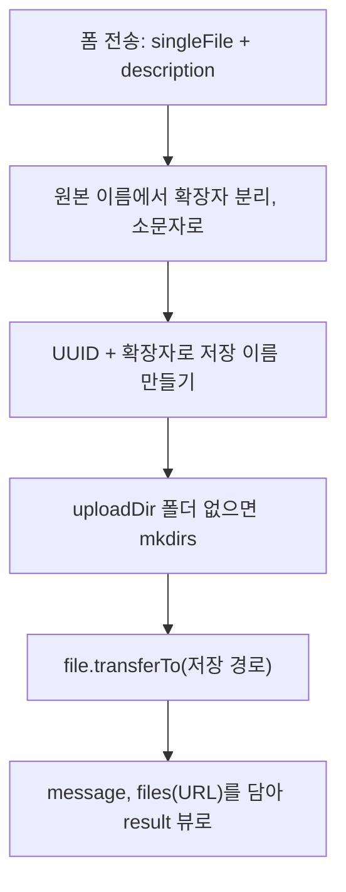
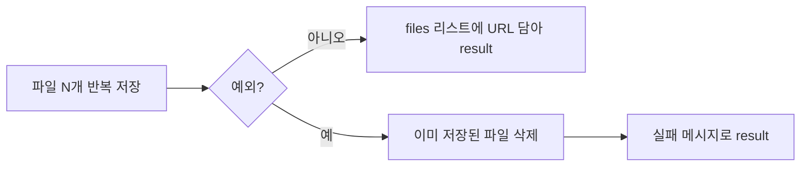

# 오늘 배운 것: 파일 업로드는 multipart, 화면은 타임리프

## 들어가며 (Situation)

모듈 2 22일차. 어제까지는 요청이 컨트롤러에 도착하고 뷰로 나가는 길 위의 장치(뷰 리졸버·예외 처리·인터셉터)를 봤다. 오늘은 그 길 위에 **실제로 실어 나르는 것** 두 가지를 다뤘다. 하나는 브라우저가 올린 **파일**이고, 하나는 서버가 만든 **HTML**이다.

| 프로젝트 | 확인하려던 것 | 파일 |
|----------|---------------|------|
| `chap06-file-upload` | 파일 한 개·여러 개를 받아 저장하고, 저장한 파일을 다시 화면에 보여주기 | `FileController`, `WebConfig`, `FileDTO`, `main.html`, `result.html` |
| `chap07-thymeleaf` | 컨트롤러가 담은 값을 타임리프로 꺼내고, 반복·조건·공통 조각으로 화면 만들기 | `LectureController`, `expression.html`, `conditional.html`, `etc.html`, `fragment.html` |



참고한 자료는 다음과 같다.

- 오늘 수업의 코드와 수업 주석
- **Notion 폴더**(`2026-10-28.SpringWebMVC`): 8편(파일 업로드)과 보충편(타임리프). 내용을 그대로 옮기지 않고, 오늘 실습과 겹치는 부분만 내 문장과 다이어그램으로 다시 정리했다.
- 글 끝의 공식 문서

오늘 어디서 막혔는지는 따로 적어 두지 못했다. 그래서 이 글은 수업 코드를 **직접 다시 실행해서**, 정상 동작과 어긋나는 경우(한도 초과, 확장자 없는 파일, 파라미터 누락)를 하나씩 확인한 기록으로 썼다.

## 문제 상황 (Task)

- 파일은 글자 폼과 다르게 **바이너리**라서 `<form>`의 기본 전송 방식으로는 서버에 가지 않는다. 서버는 그걸 어떻게 받는가?
- 받은 파일을 **어디에 어떤 이름으로** 저장하고, 저장한 이미지를 브라우저가 ``로 다시 요청할 때 어떻게 내어 주는가?
- 여러 파일을 한 번에 올리다 **중간에 하나가 실패**하면 먼저 저장된 파일은 어떻게 되는가?
- 컨트롤러가 `Model`에 담은 값을 HTML 안에서 어떻게 꺼내고, 반복되는 헤더·푸터는 어떻게 한 번만 쓰는가?

## 해결 과정 (Action)

### 1. 파일 업로드: 요청이 어떻게 생겼는가

일반 폼은 `이름=값&이름=값` 문자열(`application/x-www-form-urlencoded`)로 가는데, 파일은 이 방식에 담을 수 없다. 그래서 `enctype="multipart/form-data"`를 붙이면 브라우저가 요청 본문을 **경계선(boundary)으로 나눈 여러 조각**으로 만들어 보낸다. 조각마다 헤더가 있어서 파일 조각에는 `filename`이 들어간다.

```text
POST /single-file HTTP/1.1
Content-Type: multipart/form-data; boundary=----X1

------X1
Content-Disposition: form-data; name="singleFile"; filename="a.PNG"
Content-Type: image/png

(바이너리 데이터)
------X1
Content-Disposition: form-data; name="description"

d
------X1--
```

이 모양은 `main.html`의 폼 두 개(단일·다중)가 만드는 요청을 단순화한 예시다.

- **multipart/form-data**
  - 요청 본문을 boundary로 나눈 여러 조각(part)으로 보내는 인코딩 방식입니다.
  - 파일 조각에는 `filename`이 있고, 일반 입력값도 조각 하나로 들어갑니다.
  - `enctype`을 빼면 브라우저가 URL 인코딩 방식으로 보내서 파일 내용이 서버에 오지 않습니다.

- **MultipartFile**
  - Spring MVC가 파일 조각 하나를 감싸서 컨트롤러 파라미터로 넘겨 주는 인터페이스입니다.
  - `getOriginalFilename()`으로 원래 이름을, `transferTo(File)`로 저장을 처리합니다.
  - 여러 개는 같은 `name`으로 오기 때문에 `List<MultipartFile>`로 받습니다.

💡 컨트롤러 입장에서는 `@RequestParam MultipartFile singleFile`이 `@RequestParam String description`과 똑같이 보인다. 파싱은 Spring Boot가 자동 구성한 멀티파트 리졸버가 먼저 끝내 놓는다.

### 2. 업로드 한도: 기본값을 넘으면 어떻게 되는가

`application.yaml`에는 파일 한 개 최대 크기와 요청 전체 최대 크기를 `200MB`, `1000MB`로 올려 놨다. 이 설정이 왜 필요한지 확인하려고 **설정을 지운 프로젝트 사본**에 파일을 올려 봤다. (수업 원본은 건드리지 않았다.)

| 올린 파일 크기 | 한도 설정 없음(기본값) | 결과 |
|----------------|------------------------|------|
| 0.9MB | 한도 이내 | 200, 저장됨 |
| 1.5MB | 한도 초과 | 413, `MaxUploadSizeExceededException: Maximum upload size exceeded` |
| 11MB | 한도 초과 | 413 |

⚠️ 기본 한도가 생각보다 작다. 1.5MB부터 막힌다. 공식 문서 기준 `max-file-size`는 1MB, `max-request-size`는 10MB다. Notion 8편에는 기본값이 `10MB`/`20MB`라고 적혀 있는데, 내 실험 결과와는 맞지 않아서 글에는 실험으로 확인한 값을 썼다.

### 3. 단일 파일 저장: 다섯 단계

`FileController`의 주석에 적힌 순서를 그림으로 옮기면 다음과 같다.



이름을 바꾸는 이유는 두 가지다. 같은 이름의 파일이 서로 덮어쓰지 않게 하려는 것(UUID)과, 사용자가 보낸 파일 이름(한글·공백·경로 문자)을 서버 저장 이름으로 그대로 쓰지 않으려는 것이다. 확장자는 `.PNG`를 `.png`로 통일하려고 `toLowerCase()`를 붙였다. 실제로 `a.PNG`를 올리니 `4b847d5c-….png`로 저장됐다.

저장 위치는 `file.upload-dir: ./uploads`로 코드 밖에 뺐고, `@Value("${file.upload-dir}")`로 읽는다. 경로를 바꿀 때 코드를 고치지 않아도 된다.

### 4. 저장한 이미지를 다시 보여주기

저장은 끝났지만, `result.html`의 ``는 **브라우저가 서버에 다시 보내는 요청**이다. 저장 폴더(`./uploads`)는 `static` 밖이라서 Spring이 모르는 경로다. `WebConfig`가 이 연결을 만든다.

```java
registry.addResourceHandler("/uploads/**")
        .addResourceLocations("file:" + uploadDir + "/");
```

`WebMvcConfigurer`를 구현해서 `/uploads/**` 요청을 파일 시스템의 저장 폴더로 연결한 것이다. 직접 올린 `b.jpg`의 URL을 다시 요청하니 `200 image/jpeg`가 돌아왔다.

수업 자료는 파일을 프로젝트 안(`src/main/resources/static/...`)에 저장하는 방식과 밖에 저장하는 방식을 비교했다. 오늘 코드는 밖에 저장하는 쪽이다.

| 항목 | 프로젝트 내부(static, 빌드 폴더) | 프로젝트 외부(OS 폴더) |
|------|---------------------------------|------------------------|
| 빌드·재배포 | 파일이 초기화되거나 함께 패키징됨 | 빌드와 무관하게 유지 |
| 접근 방법 | static으로 바로 접근 | 리소스 핸들러 등록 필요 |
| 실제 서비스와의 거리 | 멀다 | 가깝다(클라우드 스토리지로 확장하는 첫 단계) |

### 5. 여러 파일: 하나가 실패하면 앞의 것도 지운다

`multi-file`은 `List<MultipartFile>`을 반복하며 저장하고, 저장할 때마다 `FileDTO`(원본 이름·저장 이름·경로·설명)를 리스트에 쌓는다. 중간에 예외가 나면 `catch`에서 **그때까지 쌓인 DTO의 저장 이름으로 파일을 삭제**한다. 코드 주석의 표현대로 트랜잭션의 롤백과 같은 발상이다.



실제로 맞게 동작하는지 확인했다. 폴더에 파일이 4개 있는 상태에서 `a.PNG`와 확장자 없는 `noext`를 같이 올렸다. 응답은 "멀티 파일 업로드 실패!"였고, 폴더의 파일 수는 **4개 그대로**였다. 앞의 `a.PNG`가 저장됐다가 지워진 것이다.

🟢 정상 케이스로 `a.PNG`와 `b.jpg` 두 개를 올렸을 때는 "멀티 파일 업로드 성공!"과 이미지 2장이 나오고 폴더의 파일이 2개에서 4개로 늘었다. 삭제는 **실패했을 때만** 일어난다.

### 6. 시행착오: 같은 실패인데 단일 업로드는 500이다

같은 `noext`를 **단일 업로드**로 보내면 롤백 메시지가 아니라 **500**이 나왔다.

🔴 원인은 `save()`의 이 줄이다.

```java
String ext = originName.substring(originName.lastIndexOf(".")).toLowerCase();
```

확장자가 없으면 `lastIndexOf(".")`가 `-1`을 돌려주고, `substring(-1)`이 `StringIndexOutOfBoundsException: Range [-1, 5) out of bounds for length 5`를 던진다. `multi-file`은 `catch (Exception e)`라서 이 예외를 잡아 실패 처리를 하지만, `single-file`은 `catch (IOException e)`만 있어서 예외가 그대로 올라가 500이 된다. 파일을 고르지 않고 제출해도(원본 이름이 빈 문자열) 같은 500이 났다.

| 입력 | 단일 업로드 | 다중 업로드 |
|------|-------------|-------------|
| 정상 파일 | 성공 | 성공 |
| 확장자 없는 파일 | 500 | "실패" 화면, 앞서 저장된 파일 삭제 |
| 파일 미선택(빈 파일) | 500 | 확인하지 않음 |

수업 자료가 이 문제를 따로 다룬 건 아니고, 3절의 "추가 고려사항"에서 확장자 검증을 권한다. 아래는 그 방향으로 고친다면 어떨지 적은 **예시 코드**이고, 수업 원본에는 적용하지 않았다.

```java
// 예시 코드: 허용 확장자만 통과시키는 검사
private boolean isAllowed(String originName) {
    if (originName == null || !originName.contains(".")) return false;
    String ext = originName.substring(originName.lastIndexOf(".")).toLowerCase();
    return List.of(".png", ".jpg", ".jpeg", ".gif").contains(ext);
}
```

🚨 확장자 검사만으로는 부족하다. 파일 이름과 `Content-Type` 헤더는 사용자가 마음대로 바꿔서 보낼 수 있다. 실행 가능한 파일(`.jsp`, `.sh` 등)이 올라오지 않게 막는 것은 서비스에서는 필수다. `main.html`의 안내 문구도 오늘 방식은 "추후에는 권장하지 않는 방식"이라고 적고 있다.

### 7. 타임리프: 왜 JSP가 아니라 이걸 쓰는가

`build.gradle`에 `spring-boot-starter-thymeleaf`를 넣으면 **설정 없이** 뷰 이름 앞뒤에 `classpath:/templates/`와 `.html`이 붙는다(`application.yaml`에 주석으로 남겨 둔 기본값). 컨트롤러가 `"lecture/expression"`을 돌려주면 `templates/lecture/expression.html`을 찾는다. 뷰 이름 앞에 `/`를 붙이지 않는 것은 코드 주석에 적힌 대로, jar로 배포했을 때 경로가 `templates//lecture/...`가 되어 템플릿을 못 찾을 수 있어서다.

| 항목 | JSP | Thymeleaf |
|------|-----|-----------|
| 파일 형태 | 서블릿이 처리하는 `.jsp` | 일반 `.html` |
| 파일을 그냥 열면 | 서버 없이는 못 봄 | 브라우저에서 정적 HTML로 열림(Natural Template) |
| Spring Boot 연동 | 별도 설정 필요 | 스타터만 넣으면 됨 |
| 기존 JSP 태그 라이브러리 | 사용 | 사용 불가 |

- **Natural Template**
  - 서버를 켜지 않으면 순수 HTML로, 서버를 켜면 값이 채워진 HTML로 보이는 템플릿 방식입니다.
  - `th:text="${member.name}"`처럼 기존 태그에 속성을 덧붙이는 구조라서 가능합니다.
  - 디자이너·퍼블리셔가 같은 파일을 열어 볼 수 있다는 장점으로 이어집니다.

### 8. 표현식: 값이 어디에 있느냐에 따라 문법이 다르다

`expression.html`은 표현식 종류를 한 페이지에 모아 놨다. 여섯 가지를 표로 정리한다.

| 표현식 | 문법 | 쓰임 | 이 프로젝트의 예 |
|--------|------|------|------------------|
| 변수 | `${...}` | Model·파라미터·세션 값 | `${member.name}` |
| 선택 변수 | `*{...}` | `th:object`로 고른 객체의 필드 | `th:object="${member}" th:text="*{age}"` |
| 메시지 | `#{...}` | `messages.properties`의 키 | `#{message.value}` → `hello world` |
| 링크 | `@{...}` | URL 만들기 | `@{/lecture/expression(title='링크', no=1)}` |
| 인라인 | `[[...]]`, `[(...)]` | 태그 안에 값 직접 쓰기 | `[[${hello}]]` |
| 조각 | `~{...}` | fragment 불러오기 | `~{common/header :: headerFragment}` |

값의 위치에 따라 꺼내는 방법이 다르다는 점이 헷갈렸다. 요청 파라미터는 `${param.이름}`, 세션은 `${session.이름}`, `ModelAndView`에 담은 값은 **아무것도 붙이지 않고** `${이름}`이다.

🔴 `index.html`의 버튼은 일부러 `?title=표현식&no=5&no=6`을 붙여서 `/lecture/expression`으로 보낸다. 주소창에 `/lecture/expression`만 입력하면 `${param.no[0]}`에서 `SpelEvaluationException: EL1012E: Cannot index into a null value`가 나면서 **500**이 된다. 파라미터가 없는 건 빈 값이 아니라 `null`이라서 인덱스로 접근하는 순간 터진다. 파라미터를 붙여 요청하면 `5`, `6`이 정상 출력된다.

### 9. th:text와 th:utext, 그리고 자바스크립트 안의 값

컨트롤러는 `"hello!<h3>Thymeleaf</h3>"`를 담았다. 서버 응답을 그대로 받아 보면 다음과 같다.

| 속성 | 응답 HTML | 화면 |
|------|-----------|------|
| `th:text` | `hello!&lt;h3&gt;Thymeleaf&lt;/h3&gt;` | 태그가 글자로 보임 |
| `th:utext` | `hello!<h3>Thymeleaf</h3>` | 태그가 적용됨 |

🚨 `th:utext`는 escape를 하지 않는다. 사용자가 입력한 값에 쓰면 `<script>`가 그대로 실행될 수 있다(XSS). 기본은 `th:text`로 쓰고, 신뢰할 수 있는 값에만 `th:utext`를 쓴다.

자바스크립트 안에서 값을 쓰는 방식은 세 가지를 비교해 놨다. `<script th:inline="javascript">` 안에서 `[[${hello}]]`를 쓰면 **값의 타입에 맞는 자바스크립트 리터럴**로 바뀐다. 문자열이면 따옴표까지 붙여 준다. 그래서 `"[[${hello}]]"`처럼 직접 따옴표를 감싸면 `""hello!...""`가 되어 문법 오류가 난다. 수업 코드가 고른 방식은 아래 형태다.

```javascript
let hello = /*[[${ hello }]]*/ '기본값';
```

이 줄은 정적 HTML로 열면 `'기본값'`이 쓰이고, 서버에서는 주석과 기본값이 지워지고 값으로 바뀐다. 실제 응답에서는 `let hello = "hello!<h3>Thymeleaf<\/h3>";`로 나왔다. 닫는 태그의 `/`가 `\/`로 escape 된 것도 확인했다. 정적일 때와 동적일 때 모두 문법 오류가 나지 않는 쓰기 방식이다.

### 10. 제어문과 기타

`conditional.html`과 `etc.html`에서 확인한 것을 정리한다.

- **th:if / th:unless / th:switch**
  - `th:if`는 조건이 참일 때, `th:unless`는 거짓일 때 태그를 출력합니다.
  - `th:switch`의 `th:case="*"`는 어느 case에도 해당하지 않을 때 쓰는 default입니다.
  - `th:block`은 태그를 남기지 않고 범위만 묶을 때 씁니다.

- **th:each와 반복 상태**
  - `th:each="member, stat : ${memberList}"`처럼 두 번째 이름을 주면 `index`(0부터), `count`(1부터), `size`, `first`, `last`, `even`, `odd`를 쓸 수 있습니다.
  - 두 번째 이름을 생략하면 `변수명 + Stat`(`memberStat`)이 자동으로 만들어집니다.
  - `#numbers.sequence(5, 10)`으로 숫자 범위를 반복할 수 있습니다.

- **th:with와 리터럴 치환**
  - `th:with="start=${selectCriteria.startPage}"`로 템플릿 안에서 쓸 지역 변수를 만듭니다.
  - `|name = *{name}|`처럼 `|...|`로 감싸면 `+` 없이 문자열과 변수를 이어 붙입니다.

실행해 보니 `stat` 없이 `memberStat`을 써도 첫 행은 `index 0, count 1, size 4, first true, last false`로 똑같이 나왔다. `SelectCriteria(1, 10, 3)`으로 만든 페이지 버튼은 1~10이 나오고 **3번 버튼만 `disabled`**였다(`pageNo eq p`일 때). `<a th:href="@{|/numbering/${numStat.count}|}">`는 `/numbering/1`~`/numbering/6` 링크 여섯 개를 만들지만 대응하는 컨트롤러가 없어서 눌러 보면 404다. 이건 링크 생성만 보여 주는 예제라고 주석에 적혀 있다.

⚠️ `mv.addObject(selectCriteria)`처럼 **이름 없이 객체만** 담으면 키가 클래스 이름의 첫 글자를 소문자로 바꾼 `selectCriteria`가 된다. 템플릿에서 `${selectCriteria.pageNo}`로 꺼낼 수 있는 이유다.

객체 접근에는 `.name`, `['age']`, `.getGender()` 세 방식이 모두 되고, 내부적으로는 getter를 부른다. Map을 `th:each`로 돌리면 각 항목이 `entry`가 되어 `entry.key`, `entry.value.name`으로 꺼낸다. `memberMap`을 `LinkedHashMap`으로 만든 건 넣은 순서(`m01`~`m04`)대로 출력하려는 것이고, 실제로 그 순서로 나왔다. `sec:authorize`는 Spring Security가 있어야 해석되기 때문에 예제가 주석 처리돼 있다.

### 11. fragment: replace와 insert는 어디가 다른가

`header.html`, `footer.html`, `aside.html`에 `th:fragment`로 이름을 붙여 두고, `fragment.html`에서 `~{템플릿 :: 조각이름}`으로 불러온다. 같은 조각을 `th:replace`와 `th:insert`로 불러서 응답 HTML을 비교했다.

| 속성 | 불러온 쪽 태그 | 응답에서의 결과 |
|------|----------------|------------------|
| `th:replace` (header) | 태그째 사라지고 조각으로 교체 | `<header class="header"><h1> header Fragment</h1></header>` |
| `th:insert` (footer) | 태그는 남고 안쪽에 조각이 삽입 | `<footer><footer class="footer"><h1> footer Fragment</h1></footer></footer>` |

`aside`는 `th:fragment="asideFragment(parameter, parameter1)"`로 **매개변수**를 받고, 호출 쪽에서 `asideFragment(${test1}, ${test2})`로 값을 넘긴다. 응답에는 컨트롤러가 담은 `values1`, `values2`가 `<li>`로 들어가 있었다.

참고로 `ContextConfiguration`은 `@ComponentScan(basePackages = "com.wanted.thymeleaf")`로 스캔 범위를 직접 지정한다. `@SpringBootApplication`이 `config` 패키지에 있어서 기본 스캔 범위에 `controller` 패키지가 들어가지 않기 때문이라고 주석에 적혀 있다.

## 결과 (Result)

오늘 만든 프로젝트와 확인한 동작을 표로 모았다.

| 프로젝트 | 확인 항목 | 결과 |
|----------|-----------|------|
| chap06 | 단일 업로드 `a.PNG` | 성공, `UUID.png`로 저장 |
| chap06 | 저장한 `.jpg` URL 재요청 | 200 `image/jpeg` |
| chap06 | 한도 설정 없이 0.9MB / 1.5MB / 11MB | 200 / 413 / 413 |
| chap06 | 확장자 없는 파일 단일 / 다중 | 500 / 실패 화면 + 롤백(파일 수 4 → 4) |
| chap07 | 파라미터 없이 `/lecture/expression` | 500 (`EL1012E`) |
| chap07 | 페이지 4개(`expression`, `conditional`, `etc`, `fragment`) | 모두 200 |

- 파일 업로드 핵심은 **multipart 요청 → `MultipartFile` → 이름 바꿔 `transferTo` → 리소스 핸들러로 다시 노출**의 네 걸음이다.
- 단일과 다중의 `catch` 범위가 달라서 같은 입력에 다른 결과가 나온다는 점을 직접 확인한 게 가장 큰 수확이다.
- 타임리프는 문법을 외우는 것보다 **값이 어디 있느냐**(param·session·Model)와 **escape 여부**(`th:text`/`th:utext`)를 구분하는 게 먼저였다.

💡 오늘 요약: 파일은 **받는 것(multipart)**, **저장하는 것(이름·위치)**, **다시 보여주는 것(리소스 핸들러)** 세 단계로 나눠서 보면 어디서 깨졌는지 찾기 쉽다. 타임리프는 서버 값을 HTML에 꽂는 규칙이다.

## 더 학습하면 좋은 개념

- **PRG(Post-Redirect-Get) 패턴** — 업로드 후 `return "result"`로 바로 뷰를 그리면 새로고침 시 파일이 다시 올라간다. 수업 자료는 `RedirectAttributes`의 flash attribute로 리다이렉트하는 방식을 소개했다. 폼 중복 제출을 막는 기본 패턴이라서 알아 둘 만하다.
- **파일 업로드 보안(확장자·MIME·Apache Tika)** — 오늘 500이 난 지점이 검증의 시작점이다. 이름과 헤더는 조작할 수 있어서 내용 기반 검증까지 가야 하는 이유를 이해하면 업로드 기능을 안전하게 설계할 수 있다.
- **클라우드 객체 스토리지(S3 등)와 presigned URL** — 서버 디스크 대신 외부 저장소를 쓰는 방식이다. `WebConfig`로 연결한 외부 폴더가 그 전 단계라서 확장 방향을 알아 두면 좋다.
- **HTML escape와 XSS** — `th:text`와 `th:utext`의 차이가 곧 XSS 방어선이다. 출력 위치(HTML·속성·JS)마다 escape가 다른 이유를 알면 템플릿 엔진 선택 기준이 생긴다.
- **Thymeleaf 레이아웃과 Spring Security 연동** — fragment를 넘어서 페이지 전체 레이아웃을 재사용하는 방법, 그리고 오늘 주석 처리해 둔 `sec:authorize`로 로그인 상태에 따라 화면을 나누는 방법으로 이어진다.

## 참고 자료

- [Spring Framework - Multipart Resolver](https://docs.spring.io/spring-framework/reference/web/webmvc/mvc-servlet/multipart.html)
- [Spring Boot - Application Properties (`spring.servlet.multipart.*`)](https://docs.spring.io/spring-boot/appendix/application-properties/index.html)
- [Spring Framework API - MultipartFile](https://docs.spring.io/spring-framework/docs/current/javadoc-api/org/springframework/web/multipart/MultipartFile.html)
- [Thymeleaf - Using Thymeleaf 3.1](https://www.thymeleaf.org/doc/tutorials/3.1/usingthymeleaf.html)
- [Thymeleaf - Thymeleaf + Spring 3.1](https://www.thymeleaf.org/doc/tutorials/3.1/thymeleafspring.html)
- [MDN - HTTP POST와 multipart/form-data](https://developer.mozilla.org/en-US/docs/Web/HTTP/Methods/POST)
