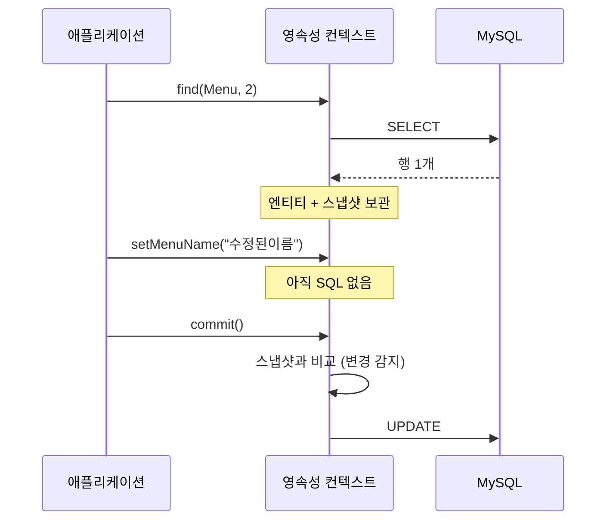
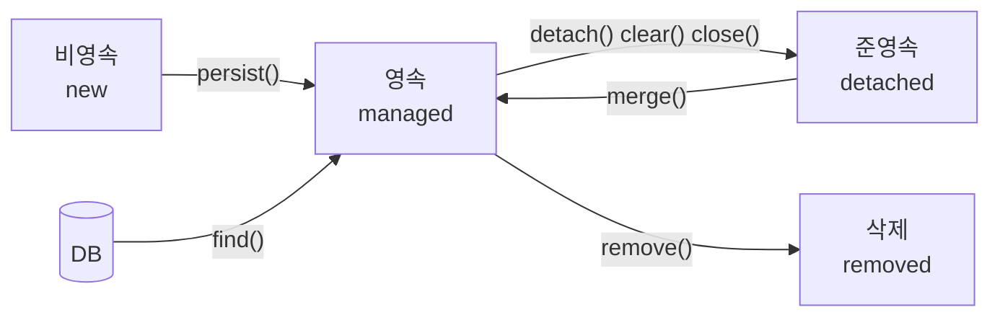

# 오늘 배운 것: JPA는 객체를 영속성 컨텍스트로 관리한다

## 들어가며 (Situation)

모듈 2 23일차. 지난주까지는 Spring MVC로 요청과 응답을 다뤘고, 오늘부터는 그 뒤에 있는 **데이터 접근**을 JPA로 바꾸기 시작했다. 대상은 `04_MySQL`부터 써 온 `menudb`(`tbl_menu` 37행, `tbl_category`)다. 오늘 `09_JPA` 폴더의 프로젝트 두 개를 모두 진행했다.

| 프로젝트 | 확인하려던 것 | 파일 |
|----------|---------------|------|
| `chap01-jpa-intro` | JDBC로 `menudb`를 다룰 때의 불편 네 가지, 같은 일을 JPA로 하면 어떻게 달라지는지 | `JdbcProblem`, `JpaSolution`, `Menu`, `Category` |
| `chap02-persistence-context` | `EntityManager`로 CRUD를 하고, 엔티티가 영속성 컨텍스트 안에서 어떤 상태를 거치는지 | `EntityManagerCRUD`, `EntityLifeCycle`, `Menu` |



코드 팝업에서 `main`이 있는 파일을 열면 **코드 | 실행 결과** 탭이 있다. 아래에서 말하는 "실행 로그"는 그 탭의 내용이다. 실행 결과 맨 위의 `키보드 입력` 줄은 콘솔 메뉴에 어떤 번호를 넣었는지 적은 것이다.

참고한 자료는 다음과 같다.

- 오늘 수업의 코드와 수업 주석
- **Notion의 "Spring Data JPA" 자료** 중 1편(ORM과 JPA의 이해). 오늘 실습과 겹치는 부분만 가져와서 내 문장과 다이어그램으로 다시 정리했다.
- 글 끝의 공식 문서

오늘 어디서 막혔는지는 따로 적어 두지 못했다. 그래서 이 글은 수업 코드를 **직접 다시 실행해서** 주석이 말하는 내용을 하나씩 로그로 확인한 기록으로 썼다. `chap02`의 등록·수정·삭제는 `menudb`의 실제 데이터를 바꾸기 때문에, 실행할 때는 `tbl_menu`를 복사한 임시 테이블로 바꿔서 돌렸고 끝난 뒤 지웠다. 원본 `tbl_menu`는 그대로다(37행).

## 문제 상황 (Task)

- JDBC만으로 `menudb`를 다루면 코드와 SQL이 어디까지 늘어나는가? `chap01`의 주석은 이를 네 가지 문제로 나눠 놨다.
- JPA를 쓰면 위 네 가지가 각각 어떻게 해결되는가?
- JPA가 SQL을 대신 만들어 준다면, **언제** DB로 보내는가? `persist()`나 setter를 호출한 순간인가, 아니면 다른 시점인가?
- 엔티티 객체가 "관리되고 있다"는 것은 정확히 어떤 상태이고, 그 상태가 바뀌면 무슨 일이 생기는가?

## 해결 과정 (Action)

### 1. JDBC로 해 보면: 네 가지 불편을 직접 확인

`JdbcProblem`은 일부러 불편하게 만든 코드다. 메뉴 번호 1~4를 차례로 실행해 봤다.

| 번호 | 문제 | 실행해서 확인한 것 |
|------|------|--------------------|
| 1 | 반복되는 JDBC 코드, 수작업 매핑 | 37행을 조회하는 데 `Connection`·`Statement`·`ResultSet`을 열고, 컬럼 5개를 `rset.getXxx()`로 한 줄씩 `Menu`에 옮겼다 |
| 2 | SQL에 의존적인 개발 | "카테고리 이름도 보여 달라"는 요구 하나에 SQL을 `JOIN`으로 고치고, `MenuCategoryDTO`를 새로 만들고, 매핑 코드를 다시 썼다 |
| 3 | 패러다임 불일치 | 2번 메뉴를 조회하면 `categoryCode=10`이라는 **숫자만** 들어 있어서, `tbl_category`를 SQL로 한 번 더 조회해야 `기타`라는 이름을 얻는다. 실행 SQL이 2번 나갔다 |
| 4 | 동일성 보장 | 같은 2번 메뉴를 두 번 조회하니 `menu1 == menu2`가 `false`였고, `menu1`의 이름만 바꾸자 `menu2`는 `광어스무디` 그대로였다 |

💡 같은 행을 두 번 읽으면 **서로 다른 객체 두 개**가 생긴다. 한쪽을 고쳐도 다른 쪽은 모른다. 4번이 JPA의 영속성 컨텍스트가 필요한 이유를 가장 잘 보여 준다.

### 2. JPA는 무엇이고, Hibernate와는 어떤 관계인가

- **ORM(Object-Relational Mapping)**
  - 객체와 테이블 사이의 변환을 자동으로 해 주는 기술입니다.
  - 객체는 참조로 관계를 맺고, 테이블은 외래 키로 맺는데 이 둘의 차이를 패러다임 불일치라고 부릅니다.
  - SQL을 덜 쓰는 대신, 내부 동작을 모르면 성능 문제가 생길 수 있습니다.

- **JPA(Java Persistence API)**
  - 자바 ORM의 **표준 명세(인터페이스)**입니다. `EntityManager`, `@Entity` 같은 것이 여기에 속합니다.
  - 지금은 `javax.persistence`가 아니라 `jakarta.persistence` 패키지를 씁니다. 오늘 코드의 `import`도 모두 `jakarta`입니다.
  - 명세일 뿐이라서 실제로 동작하는 구현체가 따로 필요합니다.

- **Hibernate**
  - JPA 명세를 구현한 가장 널리 쓰이는 **구현체**입니다.
  - Spring Boot에서는 `spring-boot-starter-data-jpa`를 추가하면 별도 설정 없이 Hibernate가 JPA 구현체로 동작합니다.
  - 실제로 실행 로그에 `Database dialect: MySQLDialect`와 `Hibernate: select ...`가 찍히는 것으로 확인했습니다.

`build.gradle`의 의존성은 `spring-boot-starter-data-jpa`와 `mysql-connector-j` 두 개가 핵심이다. 그리고 `application.yaml`에 DB 접속 정보와 JPA 설정을 둔다.

```yaml
spring:
  datasource:
    driver-class-name: com.mysql.cj.jdbc.Driver
    url: jdbc:mysql://localhost:3306/menudb
  jpa:
    show-sql: true          # JPA 가 만든 SQL 을 콘솔에 출력
    hibernate:
      ddl-auto: none        # 테이블을 만들거나 바꾸지 않는다
```

`ddl-auto`는 `create`(실행 때마다 새로 생성), `create-drop`, `update`(바뀐 구조 반영), `none` 중에서 고른다. 오늘은 이미 있는 `menudb` 테이블을 쓰므로 `none`이다. `show-sql: true` 덕분에 아래의 모든 "언제 SQL이 나가는가"를 로그로 볼 수 있었다.

### 3. 같은 일을 JPA로: 네 가지 문제가 사라지는 모습

엔티티는 클래스에 어노테이션을 붙여서 만든다. `chap01`의 `Menu`는 이렇게 생겼다.

```java
@Entity
@Table(name = "tbl_menu")
public class Menu {
    @Id
    @Column(name = "menu_code")
    private int menuCode;
    // ... menuName, menuPrice, orderableStatus

    @ManyToOne
    @JoinColumn(name = "category_code")
    private Category categoryCode;   // 숫자(FK)가 아니라 Category 객체
}
```

JDBC 때 숫자 `10`만 들고 있던 필드가 `Category` **객체**가 됐다. 그리고 조회는 한 줄이다.

```java
Menu foundMenu = manager.find(Menu.class, menuCode);
```

실행 결과를 JDBC와 비교하면 다음과 같다.

| 항목 | JDBC | JPA (`chap01` section02) |
|------|------|---------------------------|
| 1. 반복 코드·매핑 | 연결·SQL·`ResultSet` 매핑을 직접 | `find()` 한 줄 |
| 2·3. 메뉴와 카테고리 | SQL 2번 (메뉴, 카테고리) | SQL 1번: `select ... from tbl_menu left join tbl_category ...` 결과에 `Category(categoryCode=10, categoryName=기타, ...)`가 들어 있음 |
| 4. 같은 메뉴 2번 조회 | SELECT 2번, `==`가 `false` | SELECT 1번, `==`가 `true`, `hashCode`도 같음 |

⚠️ 이 `Menu`의 필드 이름이 `categoryCode`인데 타입은 `Category`다. 이름은 JDBC 때 쓰던 흔적이라서, 필드 이름만 보면 숫자인 줄 알기 쉽다.

동일성은 이렇게 보장된다. 같은 트랜잭션 안에서 같은 `@Id`로 다시 조회하면 DB에 가지 않고 영속성 컨텍스트 안에 이미 있는 객체를 돌려준다. 그래서 첫 번째 조회에서만 SQL이 찍히고 `menu1`과 `menu2`는 같은 객체다.

🔴 `compareSameMenu`는 이름을 `테스트!`로 바꾸는데, `@Transactional(readOnly = true)` 안에 있다. 실행하니 `menu1`과 `menu2` 둘 다 `테스트!`로 출력됐지만 **UPDATE는 한 번도 나가지 않았고**, 끝난 뒤 DB를 직접 조회하니 2번 메뉴는 `광어스무디` 그대로였다. 메모리 안에서만 바뀐 것이다. 값을 DB에 반영하려는 코드라면 `readOnly`를 빼야 한다.

### 4. 영속성 컨텍스트와 엔티티 매니저

- **영속성 컨텍스트(Persistence Context)**
  - 엔티티를 `@Id`를 key로 해서 보관하는 메모리 속 저장소입니다. 엔티티 매니저를 만들 때 함께 만들어집니다.
  - 안에는 1차 캐시, 쓰기 지연 SQL 저장소, 엔티티의 처음 모습(스냅샷)이 들어 있습니다.
  - 컨텍스트가 관리하고 있는 엔티티를 영속(managed) 상태라고 부릅니다.

- **엔티티 매니저(EntityManager)**
  - 엔티티 조회·저장·삭제를 맡는 객체이고, 영속성 컨텍스트에 접근하는 창구입니다.
  - **스레드 안전하지 않아서** 여러 요청이 공유하면 안 됩니다. 웹에서는 요청 하나에 하나씩 쓰는 것이 원칙입니다.
  - `chap01`처럼 `@PersistenceContext`로 주입받으면 Spring이 관리해 주고, `chap02`처럼 `EntityManagerFactory`를 주입받아 `createEntityManager()`를 직접 부르면 쓰고 `close()`까지 내가 맡는다.

`chap02`의 `EntityManagerCRUD`는 후자다. 메서드 하나가 시작할 때 매니저를 만들고 끝날 때 닫는다. 주석의 표현으로는 "기능 1개당 매니저 1개"다.

### 5. CRUD: SQL이 나가는 시점을 로그로 확인

`EntityManagerCRUD`의 네 메서드를 순서대로 실행했다(임시 테이블 사본 대상).

| 기능 | 호출 | 로그에서 확인한 것 |
|------|------|--------------------|
| 조회 | `find(Menu.class, 2)` | `select ... where menu_code=?` |
| 등록 | `persist(menu)` + `commit()` | `insert into ... (category_code, menu_name, menu_price, orderable_status, menu_code)` |
| 수정 | `find()` 후 **setter만** 호출 + `commit()` | `==========commit 하기 전=========` **다음에** `update ... set category_code=?, menu_name=?, ...` |
| 삭제 | `find()` 후 `remove()` + `commit()` | `delete from ... where menu_code=?` 후 다시 `find()`하니 `null` |

수정에는 `update()` 같은 메서드가 없다. `find()`로 가져온 엔티티는 영속성 컨텍스트가 처음 모습(스냅샷)을 보관하고, 커밋 시점에 지금 모습과 비교해서 달라진 것이 있으면 UPDATE를 만든다. 이것이 **변경 감지(Dirty Checking)**다. 실제로 `commit 하기 전` 출력이 UPDATE 로그보다 위에 있었다. 값을 바꾼 시점이 아니라 커밋 시점에 SQL이 나간다는 뜻이다.



수정 쪽에서 눈에 띈 것이 두 가지 있었다.

- ⚠️ 이름만 바꿨는데 UPDATE는 `category_code, menu_name, menu_price, orderable_status` **네 컬럼 모두** 넣어서 나갔다. 바뀐 컬럼만 보내려면 별도 설정이 필요하다는 점을 기억해 둔다.
- 수정 뒤에 `manager.find()`를 다시 불렀을 때는 SELECT가 찍히지 않았다. 같은 매니저가 열려 있어서 1차 캐시에서 돌려준 것이다. 반대로 삭제 뒤의 `find()`는 SELECT가 한 번 나갔고 결과가 `null`이었다.

🔴 등록에서는 실행 후 출력이 `등록 된 메뉴 : Menu(menuCode=0, ...)`였다. `Menu`에 `@GeneratedValue`가 없어서 JPA는 id를 `0` 그대로 INSERT에 넣었다. MySQL이 `0`을 자동 증가 값으로 처리해서 DB에는 38번이 생겼지만, **메모리 속 객체의 `menuCode`는 0 그대로**다. 임시 테이블을 직접 조회해서 38번 행을 확인했다. 우연히 동작한 것이라서, id 생성 방식을 JPA에 맡기는 `@GeneratedValue` 전략을 따로 공부해야 한다.

### 6. 엔티티의 생명주기: 다섯 가지 상태

`EntityLifeCycle`의 다섯 메서드는 한 장의 그림으로 정리된다.



| 상태 | 만든 방법 | 실행해서 확인한 것 |
|------|-----------|--------------------|
| 비영속 | `new Menu()`로 값만 복사 | 2번 메뉴와 필드가 완전히 같은데도 `foundMenu == newMenu`는 `false`, `contains()`는 각각 `true`/`false` |
| 영속 | `find()` | 두 번 조회해도 SELECT는 1번, `hashCode`가 같고 `==`가 `true` |
| 준영속 | `detach()` | 두 메뉴의 가격을 모두 +1000 했지만, flush 때 UPDATE는 **영속 상태인 4번 하나**만 나갔다. 5번은 `contains()`가 `false` |
| 삭제 | `remove()` | 삭제 직후 `find()`는 `null`, `contains()`는 `false`. DELETE는 `===== flush =====` **아래**에 찍힘 |
| 병합 | `merge(detachMenu)` | `find()` 때 한 번, `merge()` 호출 때 SELECT가 **다시** 한 번 나갔다(`detach()`로 1차 캐시에서 빠졌기 때문). `detachMenu == mergedMenu`는 `false`이고 `detachMenu`는 여전히 준영속(`false`), 반환된 `mergedMenu`가 영속(`true`). flush 때 UPDATE |

💡 `merge()`는 파라미터로 넘긴 객체를 영속으로 **바꿔 주는 것이 아니다.** 같은 PK의 영속 엔티티를 찾아서 값을 복사한 뒤, 그 **새로운 영속 객체를 반환**한다. 반환값을 써야 한다.

수정·삭제·병합을 보여 주는 메서드들은 마지막에 `flush()` 후 `rollback()`을 한다. 여기서 flush의 성격이 보인다.

- **flush**
  - 영속성 컨텍스트의 변경 내용을 SQL로 만들어 DB에 **전송**하는 단계입니다.
  - 영속성 컨텍스트를 비우는 것이 아니고, 커밋도 아닙니다.
  - `commit()` 시 자동으로 일어나고, `flush()`를 직접 호출하거나 JPQL 실행 직전에도 일어납니다.

- **쓰기 지연(Write-Behind)**
  - `persist`, 변경, `remove`로 생기는 INSERT/UPDATE/DELETE를 즉시 보내지 않고 쓰기 지연 SQL 저장소에 모아 두는 동작입니다.
  - flush 시점에 한꺼번에 DB로 보냅니다.
  - 그래서 `setMenuPrice()`를 호출한 코드보다 UPDATE 로그가 늦게 나옵니다.

flush만 하고 `rollback()` 하면 보낸 SQL도 취소된다. 실행 뒤 임시 테이블을 확인하니 4번 메뉴 가격은 `7000` 그대로였고, `remove()`한 2번 메뉴 행도 남아 있었다.

### 7. 실행하면서 마주친 일

`removeMenu`로 3번 메뉴를 지운 임시 테이블에 그대로 준영속 실습을 이어서 3번을 넣었더니 `존재하지 않는 메뉴 코드가 있습니다`라는 메시지가 나왔다. 실습 코드가 `null` 검사 뒤 `rollback()`·`close()`를 하고 일찍 끝내도록 만들어져 있어서 예외 없이 끝났다. 앞 실습이 다음 실습의 데이터를 바꿔 버리는 구조라서, 순서를 바꿔 실행하면 결과가 달라질 수 있다는 점은 메모해 둔다. 그래서 4, 5번 메뉴로 다시 실행했다.

## 결과 (Result)

| 항목 | JDBC (`chap01` section01) | JPA |
|------|---------------------------|-----|
| 같은 메뉴를 2번 조회할 때 SELECT | 2번 | 1번 |
| 메뉴와 카테고리를 함께 가져올 때 SQL | 2번(수동 조합) | 1번(JOIN, 객체로 연결) |
| 같은 행의 두 객체 비교 | `==` `false`, 한쪽 수정이 다른 쪽에 안 보임 | `==` `true`, 같은 객체 |
| 값 수정 | 직접 `UPDATE` SQL 작성 | setter 호출 + 커밋(변경 감지) |

- 실행 확인한 시나리오는 `chap01` 7개(JDBC 4 + JPA 3), `chap02` 11개(CRUD 5 + 생명주기 6)였고, 원본 `tbl_menu`는 37행·가격 합계 364,700 그대로였다.
- 오늘의 핵심은 **"SQL은 호출한 줄이 아니라 flush 시점에 나간다"**는 것이다. 이 한 문장으로 변경 감지, 쓰기 지연, 준영속에서 UPDATE가 안 나가는 이유가 모두 설명된다.
- 로그를 보면 알 수 있는 것들(언제 SELECT가 나가는지, 어떤 컬럼이 UPDATE되는지)을 눈으로 확인하는 습관이 JPA를 이해하는 가장 빠른 길이라고 느꼈다.

## 더 학습하면 좋은 개념

- **`@GeneratedValue`와 기본 키 생성 전략** — 오늘 `persist` 뒤에도 메모리 객체의 id가 `0`이었다. IDENTITY·SEQUENCE 같은 전략에 따라 id가 언제 채워지고 INSERT가 언제 나가는지가 달라진다.
- **지연 로딩과 N+1 문제** — 오늘 `@ManyToOne`은 `join` 한 번으로 카테고리까지 함께 가져왔다. 목록을 조회할 때 연관 객체가 이렇게 따라오면 어떤 SQL이 몇 번 나가는지 이해해야 성능 문제를 피할 수 있다.
- **`@Transactional`과 Spring이 관리하는 EntityManager** — `@PersistenceContext`로 주입받는 매니저와 `createEntityManager()`로 직접 만든 매니저는 수명을 누가 맡는지가 다르다. `readOnly = true`일 때 UPDATE가 안 나간 것도 이 영역이다.
- **JPQL** — `find()`는 PK 조회용이고, 조건 검색은 객체 기반 쿼리 언어인 JPQL을 쓴다. JPQL 실행 직전에 flush가 자동으로 일어나는 이유와 함께 보면 오늘 내용이 이어진다.
- **Spring Data JPA Repository** — 오늘 손으로 쓴 `EntityManager` 코드를 `JpaRepository` 인터페이스가 대신해 준다. 직접 써 봐야 그 편의가 무엇을 숨기는지 보인다.

## 참고 자료

- [Hibernate ORM User Guide - Persistence Context](https://docs.hibernate.org/orm/current/userguide/html_single/)
- [Jakarta Persistence 명세](https://jakarta.ee/specifications/persistence/)
- [Spring Framework - JPA](https://docs.spring.io/spring-framework/reference/data-access/orm/jpa.html)
- [Spring Data JPA 레퍼런스](https://docs.spring.io/spring-data/jpa/reference/)
- [Spring Boot - SQL Databases](https://docs.spring.io/spring-boot/reference/data/sql.html)
