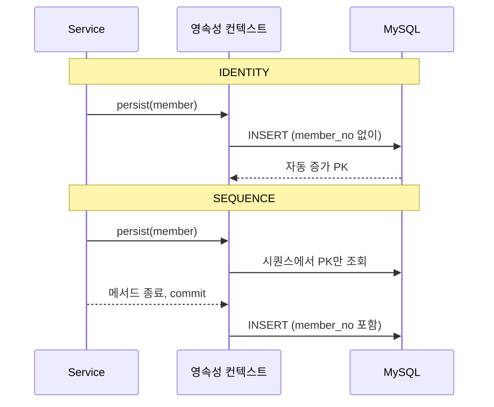
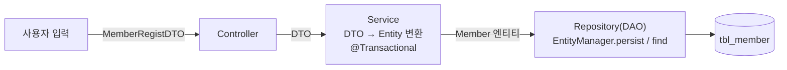

# 오늘 배운 것: 엔티티 매핑: 어노테이션이 테이블을 만든다

## 들어가며 (Situation)

모듈 2 24일차. 어제는 `EntityManager`로 CRUD를 하며 영속성 컨텍스트를 봤다. 오늘은 그 앞단, **엔티티 클래스를 어떻게 테이블에 매핑하는가**와 그 엔티티를 **Controller → Service → Repository 계층**에 올리는 것을 `chap03-entity-mapping` 한 프로젝트로 다뤘다. 오늘 만든 파일은 모두 `section01` 패키지에 있다.

| 파일 | 역할 |
|------|------|
| `Member`, `MemberRole` | 엔티티(`tbl_member`)와 권한 enum |
| `MemberRegistDTO` | 화면(콘솔)과 주고받는 DTO |
| `MemberController` → `MemberService` → `MemberRepository` | 계층별 역할, 트랜잭션은 Service에서 |
| `Section01Application` | 콘솔 메뉴(1. 회원 등록, 2. 회원 번호로 조회) |



코드 팝업에서 `Section01Application`을 열면 **코드 | 실행 결과** 탭이 있다. 본문의 "실행 로그" 중 수업 코드의 정상 시나리오(등록 2회, 조회 2회)는 그 탭의 내용이다. 3~4절의 전략·enum 비교, 6절의 트랜잭션 실험, 7절의 예외 결과는 **내가 만든 사본에서 따로 실행한 것**이라 탭에는 없다.

참고한 자료는 다음과 같다.

- 오늘 수업의 코드와 수업 주석, 수업 중 그린 필기 그림 두 장(`repeat.png`, `매커니즘.png`)
- **Notion의 "Spring Data JPA" 자료** 중 3편(Entity 설계 기초). 오늘 실습과 겹치는 부분만 내 문장으로 다시 정리했다.
- 글 끝의 공식 문서

막혔던 부분은 없었다. 대신 수업 주석이 "이렇게 동작한다"고 말하는 부분과, 코드가 **어긋났을 때** 어떻게 되는지를 직접 실행해서 확인했다. 이 프로젝트의 `application.yaml`은 `ddl-auto: create`라서 **실행할 때마다 `tbl_member`를 지우고 다시 만든다.** 그래서 `menudb`에 이미 있는 `tbl_member`(이전 실행 때 만들어진 1행)를 건드리지 않도록, 실행은 사본에서 **임시 테이블 이름**으로 했고 끝난 뒤 지웠다. 원본 `tbl_member`와 `tbl_menu`는 그대로다.

## 문제 상황 (Task)

- 클래스에 붙인 `@Column`, `@Enumerated` 같은 어노테이션은 정확히 **어떤 테이블 정의**가 되는가?
- 기본 키 생성 전략(`IDENTITY`, `SEQUENCE`)에 따라 **INSERT가 나가는 시점**이 달라진다고 주석에 적혀 있다. 정말 그런가?
- `enum`을 `ORDINAL`로 저장하든 `STRING`으로 저장하든 겉보기엔 똑같이 동작한다. 무엇이 다른가?
- 엔티티를 Controller까지 그대로 내보내지 않고 DTO를 두는 이유는 무엇이고, `@Transactional`은 예외가 났을 때 언제 commit하고 언제 rollback하는가?

## 해결 과정 (Action)

### 1. 큰 그림: JPA는 어디에 서 있는가

수업 시간에 그린 필기 그림이다. 서블릿 컨테이너의 `DispatcherServlet`과 IoC 컨테이너 안의 Bean(`c`, `s`, `d`: Controller·Service·DAO) 뒤에 JPA가 서 있고, JPA는 안쪽에서 JDBC를 거쳐 DB와 이어진다. 오른쪽 위에는 영속성 컨텍스트가 따로 그려져 있고, 아래에는 "JPA는 DB에 의존적인 개발을 방지한다"는 메모가 있다.


💡 어제 `chap01`에서 본 것처럼 JPA는 내부에서 JDBC를 쓴다. 달라지는 것은 SQL과 매핑 코드를 개발자가 쓰지 않는다는 점이고, 오늘은 그 "자동으로 만들어 주는 것"의 **입력이 되는 클래스 설계**를 배웠다.

### 2. 어노테이션이 어떤 DDL이 되는가

`Member` 엔티티를 앱이 시작할 때 Hibernate가 만든 DDL과 나란히 놓으면 대응이 보인다. (테이블 이름과 제약 이름만 정리한 로그다.)

| 필드 | 어노테이션 | 생성된 컬럼 |
|------|-----------|-------------|
| `memberNo` | `@Id`, `@GeneratedValue(IDENTITY)` | `member_no integer not null auto_increment`, `primary key` |
| `memberId` | `nullable=false, unique=true, columnDefinition="varchar(10)"` | `member_id varchar(10) not null` + unique 제약 |
| `memberPwd` | `nullable=false` | `member_pwd varchar(255) not null` |
| `memberName` | `@Column(name=...)`만 | `member_name varchar(255)` |
| `phone` | `unique=true` | `phone varchar(255)` + unique 제약 |
| `address` | `length=900` | `address varchar(900)` |
| `enrollDate` | `LocalDateTime` | `enroll_date datetime(6)` |
| `memberRole` | `@Enumerated(STRING)` | `member_role enum ('ROLE_ADMIN','ROLE_MEMBER')` |
| `status` | `columnDefinition="char(1) default 'Y'"` | `status char(1) default 'Y'` |

- **@Entity / @Table**
  - `@Entity`는 이 클래스가 JPA가 관리하는 엔티티라는 선언이고, 기본 생성자와 `@Id`가 필요합니다.
  - `@Table(name = "tbl_member")`는 매핑할 테이블 이름입니다. 생략하면 클래스 이름이 쓰입니다.
  - 오늘 코드는 `@NoArgsConstructor`로 기본 생성자를 만들고, setter 없이 `@Getter`와 생성자만 둡니다.

- **@Column**
  - 필드와 매핑될 컬럼의 이름·제약을 정하는 어노테이션입니다.
  - `nullable`, `unique`, `length`, `columnDefinition` 같은 속성은 JPA가 **DDL을 만들 때** 쓰이고, 위 표처럼 그대로 컬럼 정의가 됩니다.
  - `length`를 안 쓰면 문자열은 `varchar(255)`입니다. `address`처럼 길이를 바꿀 필드만 명시했습니다.

- **@GeneratedValue**
  - 기본 키 값을 JPA가 자동으로 만들게 하는 어노테이션이고 전략을 고를 수 있습니다.
  - `IDENTITY`(DB 자동 증가), `SEQUENCE`(DB 시퀀스), `TABLE`(키 전용 테이블), `AUTO`(DB에 맞춰 선택, 기본값)가 있습니다.
  - 어제는 이 어노테이션이 없어서 `persist` 뒤에도 `menuCode`가 0이었습니다.

🚨 `ddl-auto: create`는 앱을 실행할 때마다 `drop table if exists tbl_member`를 먼저 실행한다. 실행 로그 첫머리에서 확인했다. 데이터가 쌓인 테이블에 그대로 두면 **실행할 때마다 지워진다.** 개발 중에만 쓰고, 이미 있는 테이블을 그대로 쓸 때는 `none`으로 바꿔야 한다. (`update`는 구조 변경만 반영한다.)

### 3. 기본 키 전략: INSERT는 언제 나가는가

`Member`의 주석은 `IDENTITY`는 `persist()` 시점에 바로 INSERT가 나가고, `SEQUENCE`는 키만 먼저 가져온 뒤 flush 시점에 INSERT가 나간다고 적고 있다. 이것을 확인하려고 **실험용 사본**에 출력 표시 세 개(`persist 직후`, `save 반환 직후`, `트랜잭션 종료 후`)를 넣고 전략만 바꿔서 같은 입력으로 실행했다.

| 순서 | `IDENTITY` (수업 코드) | `SEQUENCE` (사본에서 변경) |
|------|------------------------|-----------------------------|
| 1 | `persist()` 호출 → **`insert`가 바로 실행됨** | `persist()` 호출 → `select next_val ... for update`, `update ..._seq set next_val=?` (키만 가져옴) |
| 2 | `[persist 직후] memberNo=1` | `[persist 직후] memberNo=1` |
| 3 | `[save 반환 직후, 아직 트랜잭션 안]` | `[save 반환 직후, 아직 트랜잭션 안]` |
| 4 | (이미 끝남) | **이제 `insert` 실행** (커밋 시점) |
| 5 | `[트랜잭션 종료 후] memberNo=1` | `[트랜잭션 종료 후] memberNo=1` |



- `IDENTITY`는 INSERT를 실행해야 PK를 알 수 있다. 그래서 **쓰기 지연이 되지 않는다.** INSERT 문에는 `member_no` 컬럼이 아예 없고, DB가 채워 준다.
- `SEQUENCE`는 PK를 먼저 받아 두고 INSERT를 뒤로 미룬다. INSERT 문에 `member_no`가 포함됐다.
- MySQL에는 시퀀스 객체가 없어서, `SEQUENCE`로 바꿨더니 Hibernate가 `tbl_member_..._seq`라는 **키 전용 테이블**을 따로 만들었다. `ddl-auto: create`가 이 테이블도 만들어 준다.

💡 수업 코드가 `IDENTITY`를 쓰는 이유는 MySQL의 `AUTO_INCREMENT`와 자연스럽게 맞기 때문이다. 대신 INSERT가 `persist()` 시점에 나간다는 점(쓰기 지연 효과가 줄어드는 것)을 알고 써야 한다.

### 4. enum은 STRING으로: ORDINAL과 비교

`Member`의 주석이 "ORDINAL로 바꿔서 실행해 보고 DDL과 저장되는 값을 비교해 보라"고 했다. 사본에서 `EnumType.ORDINAL`로만 바꿔서 비교했다. `MemberRole`은 `ROLE_MEMBER, ROLE_ADMIN` 순서로 선언돼 있다.

| 항목 | `STRING` (수업 코드) | `ORDINAL` (사본) |
|------|---------------------|------------------|
| 생성된 컬럼 | `member_role enum ('ROLE_ADMIN','ROLE_MEMBER')` | `member_role tinyint check ((member_role between 0 and 1))` |
| 저장되는 값 | 이름 (`ROLE_MEMBER`, `ROLE_ADMIN`) | 선언 순서 (일반회원 `0`, 관리자 `1`) |

🔴 `ORDINAL`은 DB 값에 `0`, `1`만 남는다. DB만 봐서는 무슨 권한인지 모르고, 코드에서 enum 상수의 **선언 순서를 바꾸거나 중간에 끼워 넣으면** 이미 저장된 `0`, `1`의 뜻이 달라진다. 그래서 `STRING`이 안전하다. 대신 데이터가 조금 커지지만 큰 단점은 아니라는 수업 주석에 동의한다.

⚠️ 수업 코드의 DDL은 `enum ('ROLE_ADMIN','ROLE_MEMBER')`로, **선언한 순서(MEMBER, ADMIN)가 아니라 이름 순서**로 나왔다. MySQL에서 `varchar`로 저장하고 싶으면 주석대로 `columnDefinition = "varchar(20)"`을 직접 지정해야 한다.

### 5. 계층 구조: 왜 DTO와 Entity를 나누는가

두 번째 필기 그림이다. 요청(`req`)은 DTO를 들고 Controller, Service로 들어오고, Service 안에서 **DTO ↔ Entity 변환**이 일어난다. Service와 DAO 사이를 오가는 것은 Entity이고, DAO 뒤에 JPA가 있다.




- **DTO(Data Transfer Object)**
  - 계층 사이에서 값을 실어 나르는 용도의 객체입니다.
  - `MemberRegistDTO`는 입력용 필드(`memberId`, `memberPwd`, `memberName`, `phone`, ...)를 담고 setter를 가집니다.
  - 엔티티와 달리 영속성 컨텍스트가 관리하지 않습니다.

- **Repository(DAO)**
  - 데이터베이스에 접근하는 계층입니다. JDBC에서는 DAO라고 부르던 것을 Spring과 JPA 환경에서는 Repository라고 표현합니다.
  - `@PersistenceContext`로 주입받은 `EntityManager`로 `persist(member)`와 `find(Member.class, memberNo)`를 호출합니다.
  - 이 계층은 SQL을 쓰지 않습니다.

`MemberService`가 하는 일은 주석의 세 줄로 요약된다. 비즈니스 로직(정책), DAO 호출, 트랜잭션 관리다. 그림에서 DTO ↔ Entity 변환이 Service 박스 안에 그려진 이유가 이것이다. 엔티티에는 setter가 없고 생성자로만 만들 수 있게 해 둔 것도, 값 변경이 아무 곳에서나 일어나지 않게 하려는 설계로 읽힌다.

### 6. @Transactional: 예외 종류에 따라 commit과 rollback이 갈린다

`MemberService`의 주석에는 강사님이 직접 "블로그 작성 키워드(중요!)"라고 적어 둔 항목이 있다. **Checked/Unchecked 예외에서 `@Transactional`이 어떻게 동작하는가**, 그리고 **트랜잭션 전파**다. 수업 코드는 이 둘을 다루지 않으니, 사본에 실험 클래스를 만들어 확인했다. 회원 저장 직후 일부러 예외를 던지고, 그 뒤 DB에 회원이 남아 있는지 봤다. (아래 코드는 **예시 코드**다.)

```java
// 예시 코드: 저장 직후 예외를 던진다
@Transactional
public void unchecked() {
    memberService.registMember(dto("unchecked", ...));
    throw new RuntimeException("unchecked");           // Unchecked 예외
}

@Transactional
public void checked() throws Exception {
    memberService.registMember(dto("checked", ...));
    throw new Exception("checked");                    // Checked 예외
}
```

| 실험 | 결과 (회원이 남았는가) |
|------|------------------------|
| `RuntimeException`(Unchecked)을 던짐 | **남지 않음** (rollback) |
| `Exception`(Checked)을 던짐 | **남음** (commit) |
| Checked 예외 + `@Transactional(rollbackFor = Exception.class)` | 남지 않음 (rollback) |
| 바깥이 실패, 안쪽 메서드는 `REQUIRED`(기본) | 둘 다 남지 않음 |
| 바깥이 실패, 안쪽 메서드는 `REQUIRES_NEW` | **안쪽만 남음**, 바깥에서 저장한 회원은 사라짐 |

🔴 **Checked 예외는 기본적으로 rollback되지 않는다.** 메서드가 예외로 끝났는데도 앞에서 저장한 회원이 commit됐다. 이름에 `Exception`이 들어 있어도 `Exception`을 던지면 rollback이 안 되므로, 그렇게 하고 싶으면 `rollbackFor`를 지정해야 한다.

- **전파(propagation)**
  - 이미 진행 중인 트랜잭션이 있을 때 호출된 메서드가 그것에 참여할지, 새로 만들지를 정하는 속성입니다.
  - 기본값 `REQUIRED`는 기존 트랜잭션에 참여해서 바깥이 실패하면 안쪽 작업도 함께 rollback됩니다.
  - `REQUIRES_NEW`는 새 트랜잭션을 따로 열어서 바깥이 실패해도 안쪽은 이미 commit된 상태로 남습니다.

⚠️ 안쪽 메서드를 **다른 빈**(별도 `@Service`)으로 만들어 호출했다. 같은 클래스 안에서 자기 메서드를 부르면 이 속성들이 적용되지 않을 수 있다는 점은 확인하지 않았다.

### 7. 경계에서 확인한 것

코드가 의도한 입력이 아닐 때 어떻게 되는지도 실행해 봤다.

| 입력 | 결과 |
|------|------|
| 아이디 11자 이상 | `DataIntegrityViolationException: Data truncation: Data too long for column 'member_id'` |
| 이미 있는 아이디 | `DataIntegrityViolationException: Duplicate entry 'user01' for key 'tbl_member.UK…'` (첫 번째 INSERT는 성공) |
| 없는 회원 번호(999) 조회 | `NullPointerException: ... because "foundMember" is null` |

- 세 경우 모두 프로그램이 **그대로 종료됐다.** `Section01Application`은 `NumberFormatException`만 잡기 때문이다.
- 아이디 길이 제한(`varchar(10)`)과 unique 제약은 DB가 막은 것이다. 2절 표의 DDL이 실제로 작동한다는 증거이기도 하다.
- 없는 번호 조회가 NPE가 나는 이유는 `find()`가 없으면 `null`을 돌려주는데, Service가 바로 `foundMember.getMemberId()`를 호출하기 때문이다.

⚠️ 조회 결과를 보면 `MemberRegistDTO(memberId=user01, memberPwd=pass01, memberName=홍길동, phone=010-1111-2222, address=null, enrollDate=null, memberRole=null, status=null)`처럼 **주소와 가입일, 권한이 `null`**이다. Service가 엔티티에서 네 필드만 DTO로 옮기기 때문이다.

🚨 비밀번호가 **평문으로 저장**되고 조회 DTO에도 담겨 콘솔에 그대로 출력됐다. 실습용이라 괜찮지만 실제 서비스에서는 해시로 저장해야 한다.

## 결과 (Result)

| 확인한 것 | 결과 |
|-----------|------|
| 엔티티 → DDL | 컬럼 9개, 기본 키 1개, unique 제약 2개가 어노테이션 그대로 생성됨 |
| `IDENTITY` vs `SEQUENCE` | INSERT가 `persist()` 시점(IDENTITY)과 commit 시점(SEQUENCE)으로 갈림 |
| `STRING` vs `ORDINAL` | `enum('ROLE_ADMIN','ROLE_MEMBER')` vs `tinyint` (`0`, `1`) |
| 예외와 트랜잭션 | Unchecked는 rollback, Checked는 commit, `rollbackFor`로 바꿀 수 있음 |
| 전파 | `REQUIRED`는 바깥과 함께 rollback, `REQUIRES_NEW`는 안쪽만 commit |
| 원본 데이터 | 실행 전후로 `tbl_member` 1행, `tbl_menu` 37행(가격 합계 364,700) 그대로 |

- 오늘 실행한 시나리오는 수업 코드 7개(등록 2, 조회 2, 예외 3)와 사본 실험 8개(전략 2, enum 1, 트랜잭션 5)다.
- 수업 주석이 말하는 내용(DDL 제약, enum 타입, INSERT 시점)은 모두 실행 로그로 맞았다. 대신 주석이 말하지 않은 부분, 즉 예외 종류별 rollback과 입력 경계에서의 종료는 직접 확인해서 채웠다.
- 💡 오늘의 한 줄 요약: **엔티티의 어노테이션은 곧 테이블 정의이고, 그 엔티티를 다루는 Service의 `@Transactional`은 예외의 종류에 따라 commit 여부가 갈린다.**

## 더 학습하면 좋은 개념

- **`@Transactional`의 rollback 규칙과 프록시 동작** — Checked 예외가 commit된 것은 설정 때문이 아니라 기본 규칙이다. 같은 클래스 안에서 메서드를 호출할 때(자기 호출) 속성이 적용되지 않는 이유를 이해하면 예상 밖의 commit을 막을 수 있다.
- **연관관계 매핑(`@ManyToOne`, `@OneToMany`)** — 오늘은 테이블 하나였다. 어제 `Menu`와 `Category`에서 본 객체 참조가 어떤 외래 키가 되고, 양방향일 때 연관관계의 주인은 누구인지로 이어진다.
- **DDL 관리 도구(Flyway, Liquibase)** — `ddl-auto: create`가 실행 때마다 테이블을 지우는 것을 확인했다. 운영 DB의 구조 변경을 코드로 버전 관리하는 방법을 알아야 개발용 설정에서 벗어날 수 있다.
- **비밀번호 해시와 Spring Security** — 평문 저장·출력을 확인했다. 단방향 해시(BCrypt)와 `PasswordEncoder`가 이 자리를 어떻게 대체하는지 배워야 한다.
- **입력 검증(Bean Validation)과 예외 처리** — 아이디 길이와 중복을 DB가 막고 프로그램이 종료되는 것을 봤다. 앞에서 막는 `@Valid`와 `@ControllerAdvice`로 사용자에게 의미 있는 응답을 주는 방법으로 이어진다.

## 참고 자료

- [Jakarta Persistence 명세](https://jakarta.ee/specifications/persistence/)
- [Hibernate ORM User Guide](https://docs.hibernate.org/orm/current/userguide/html_single/)
- [Spring Framework - Using @Transactional](https://docs.spring.io/spring-framework/reference/data-access/transaction/declarative/annotations.html)
- [Spring Framework - Rolling Back a Declarative Transaction](https://docs.spring.io/spring-framework/reference/data-access/transaction/declarative/rolling-back.html)
- [Spring Framework - Transaction Propagation](https://docs.spring.io/spring-framework/reference/data-access/transaction/declarative/tx-propagation.html)
- [Spring Boot - Database Initialization](https://docs.spring.io/spring-boot/how-to/data-initialization.html)
