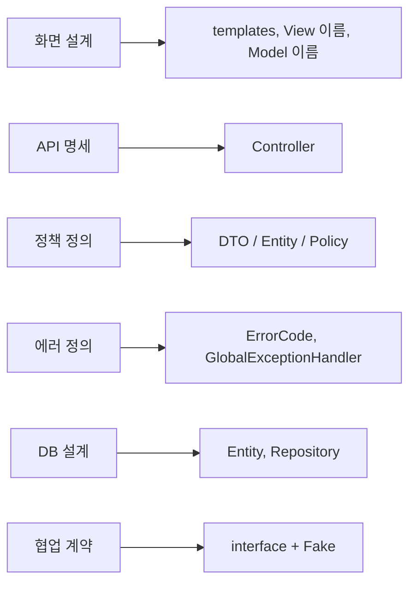
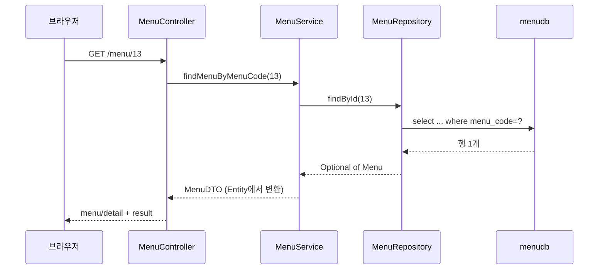
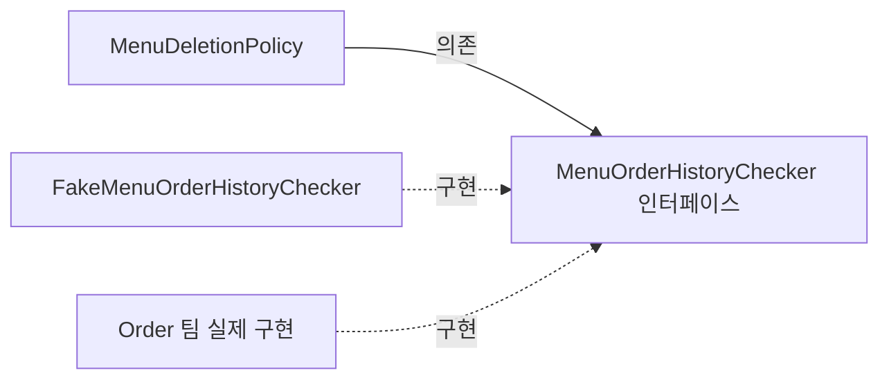

# 오늘 배운 것: PRD로 시작하는 JPA 미니 프로젝트: Entity부터 에러 화면까지

## 들어가며 (Situation)

모듈 2 25일차. 어제까지는 챕터별로 JPA 기능 하나씩(`EntityManager`, 엔티티 매핑)을 다뤘고, 오늘부터는 `module07-jpa-mini-project`로 **여러 기능을 한 프로젝트에 묶는 미니 프로젝트**를 시작했다. 주제는 레스토랑 메뉴 관리 웹 서비스이고, 프로젝트 루트의 `README.md`가 곧 **PRD(제품 요구사항 문서)**다. 화면 설계, API 명세, 정책, 에러, DB 설계가 모두 이 문서 한 곳에 있다.

프로젝트는 **TODO 번호가 붙은 뼈대 코드**로 주어진다. 오늘은 그중 PRD가 정한 개발 순서의 앞부분을 채웠다. 이 글은 코드에서 확인되는 범위만 다룬다.

| 영역 | 오늘의 상태 | 파일 |
|------|-------------|------|
| DB → Entity | 매핑 완료 (`Menu` 필드, `Category` 전체) | `Menu`, `Category` |
| Repository | 쿼리 메서드 1개, native query 1개 | `MenuRepository`, `CategoryRepository` |
| DTO | Entity → DTO 변환 `from()` | `MenuDTO`, `CategoryDTO` |
| Service | 메뉴 1건 조회, 가격 검색, 하위 카테고리 조회 | `MenuService` |
| Controller | 위 세 기능 + 입력 검증(`@Min`) | `MenuController` |
| 예외 처리 | 비즈니스 예외, 검증 실패 처리 | `GlobalExceptionHandler` |
| 아직 TODO | 전체 목록, 등록·수정·삭제, 판매중지·재개, 정책 클래스 3개, `Menu.create()` 등 | 각 파일의 `TODO` |



코드 팝업에서 `Module07JpaMiniProjectApplication`을 열면 **코드 | 실행 결과** 탭이 있다. 이 프로젝트는 입력 없이 서버가 뜨는 프로그램이라서, 실행 결과 탭에는 서버를 띄우고 `curl`로 호출한 요청과 응답, 서버 콘솔의 SQL을 모아 두었다. 포트만 18088로 바꿔서 실행했다.

참고한 자료는 다음과 같다.

- 프로젝트의 `README.md`(PRD)와 코드에 적힌 수업 주석
- **Notion의 "Spring Data JPA" 자료** 중 5편(Repository 활용). 쿼리 메서드와 `@Query`가 겹치는 부분만 내 문장으로 다시 정리했다.
- 글 끝의 공식 문서

막혔던 부분은 없었다. 대신 구현한 기능이 PRD대로 응답하는지, 그리고 **TODO로 남겨 둔 곳을 호출하면 어떻게 되는지**를 서버를 띄워서 확인했다. 확인은 `menudb`를 읽기만 하는 기능(조회)만 호출했다. DB를 초기화하는 `sql/menudb-script.sql`은 실행하지 않았고, 서버는 원본 폴더가 아니라 복사본에서 띄웠다.

## 문제 상황 (Task)

이번 프로젝트는 코드를 짜기 전에 **무엇을 어디에 둘지**를 정하는 것이 먼저였다.

- 테이블은 스크립트로 만들어져 있고 `ddl-auto: none`이다. **Entity를 바꿔서 테이블을 바꿀 수 없으니**, Entity가 테이블에 정확히 맞아야 한다.
- 같은 "규칙"이라도 입력 형식(DTO), 현재 상태(Entity), DB 조회가 필요한 규칙(Policy)으로 판단하는 곳이 나뉜다.
- Controller는 `try-catch`를 쓰지 않고 DTO만 다룬다. 실패는 전부 `GlobalExceptionHandler`가 에러 화면으로 바꾼다.

## 해결 과정 (Action)

### 1. PRD의 각 장은 코드의 한 계층이다

README 10장이 말하는 핵심은 "PRD의 장마다 코드가 놓일 자리가 정해져 있다"는 것이다.



정책은 "어디서 판단하는가"로 세 종류로 나눈다. 코드 주석에서도 같은 기준을 반복해서 말한다.

- **입력 정책 (DTO / Controller)**
  - 입력값만 보면 판단할 수 있는 규칙이다. 빈 값, 길이, 범위가 여기에 든다.
  - 예: 메뉴 이름은 30자 이하, 가격은 0원 이상. `@Valid`, `@Min`으로 선언한다.
- **도메인 정책 (Entity)**
  - 저장된 "현재 상태"를 봐야 판단할 수 있는 규칙이다.
  - 예: 이미 판매중지된 메뉴는 다시 판매중지할 수 없다. DTO는 DB에 있는 현재 상태를 모르므로 `@Valid`로는 검사할 수 없다.
- **비즈니스 정책 (Policy)**
  - DB 조회나 다른 도메인의 정보가 필요한 규칙이다.
  - 예: 메뉴 이름 중복, 주문 이력이 있는 메뉴의 삭제 금지.

💡 오늘 채운 부분은 입력 정책 한 가지(`@Min`)뿐이다. 도메인 정책 `Menu.stopSelling()` 등과 비즈니스 정책 클래스 세 개(`MenuNamePolicy`, `MenuCategoryPolicy`, `MenuDeletionPolicy`)는 아직 `TODO`로 남아 있다. 이 글의 확인 내용은 그 바깥, 이미 구현된 부분에 대한 것이다.

### 2. Entity 매핑: 테이블에 맞추는 쪽이 Entity다

`ddl-auto: none`이므로 `sql/menudb-script.sql`의 컬럼 정의가 기준이고, Entity는 거기에 맞춘다.

| 테이블 컬럼 | 필드 | 타입을 이렇게 고른 이유 |
|-------------|------|------------------------|
| `menu_code INT AUTO_INCREMENT` | `int menuCode` + `@GeneratedValue(IDENTITY)` | MySQL의 `AUTO_INCREMENT`는 `IDENTITY` 전략과 짝이다. 24일차에 `IDENTITY`는 `persist()` 시점에 INSERT가 나간다고 확인했다. |
| `ref_category_code INT` (NULL 가능) | `Integer refCategoryCode` | 최상위 카테고리는 값이 `NULL`이다. `int`로 받으면 `NULL`을 담을 수 없어서 래퍼 타입을 쓴다. |
| `category_code INT NOT NULL` (`tbl_menu`) | `int categoryCode` | PRD는 다른 도메인을 객체가 아닌 ID로 참조하기로 했다. `@ManyToOne Category`로 잇지 않는다. |
| `orderable_status CHAR(1)` | `String orderableStatus` | `Y` / `N` 두 값. |

`Menu`는 전체 필드 생성자를 `private`으로 막았고 setter도 없다. 값을 바꾸는 입구를 `create()`, `changeMenuName()`, `stopSelling()` 같은 **이름 있는 메서드**로만 열어서 규칙이 Entity 안에 모이게 하려는 설계다. (이 메서드들의 본문은 아직 `TODO`다.)

- **`Integer`와 `int`**
  - `Integer`는 `NULL`을 담을 수 있는 래퍼 타입이고, `int`는 담을 수 없는 기본형이다.
  - 컬럼이 `NULL`을 허용하는지가 둘 중 무엇을 쓸지 정한다.
  - `int`는 `NULL`을 담을 수 없으므로, `NULL`이 가능한 컬럼은 `Integer`로 둔다. (이 프로젝트의 조회 요청에서는 오늘 상위 카테고리 행을 읽는 경로를 호출하지 않아 `NULL`이 들어오는 경우를 실행해 보지는 않았다.)

### 3. Repository: 인터페이스만 쓰면 구현은 Spring Data JPA가 만든다

`MenuRepository`는 `JpaRepository<Menu, Integer>`를 상속한 **인터페이스**다. 제네릭은 `<관리할 Entity, @Id 필드의 타입>`이다. `findById()`처럼 기본으로 주어지는 메서드가 CRUD를 맡고, 가격 검색은 **메서드 이름**으로 만들었다.

```java
List<Menu> findByMenuPriceGreaterThanOrderByMenuPrice(int menuPrice);
```

이름을 `findBy` + 필드명(`MenuPrice`) + 조건(`GreaterThan`) + 정렬(`OrderByMenuPrice`)로 읽어서 쿼리를 만든다. 서버를 띄워 호출하니 콘솔에 찍힌 SQL은 이렇다.

```sql
select m1_0.menu_code, m1_0.category_code, m1_0.menu_name, m1_0.menu_price, m1_0.orderable_status
from tbl_menu m1_0
where m1_0.menu_price>?
order by m1_0.menu_price
```

🔴 컨트롤러와 서비스의 주석에는 "입력 가격 **이상**"이라고 적혀 있지만, 쿼리 메서드는 `GreaterThan`이고 실제 SQL도 `menu_price>?`다. PRD(F-03)가 "입력 가격 **초과**"라고 정한 쪽이 코드와 맞다. `GreaterThanEqual`이었다면 `>=`가 됐을 것이다. 가격 20000으로 검색했을 때 22000원(마라깐쇼한라봉), 35000원(붕어빵초밥) 두 건이 가격 오름차순으로 나왔다.

카테고리 조회는 쿼리 메서드가 아닌 `@Query`로 SQL을 직접 썼다.

```java
@Query(value = "select * from tbl_category m where ref_category_code is not null order by category_code", nativeQuery = true)
List<Category> findSubCategory();
```

| 항목 | 쿼리 메서드 | JPQL (`@Query`) | Native Query (`nativeQuery = true`) |
|------|-------------|-----------------|--------------------------------------|
| 대상 | Entity 필드 이름 | Entity와 필드 | 실제 테이블과 컬럼 |
| 쓰기 좋은 때 | 조건이 짧고 단순할 때 | 메서드 이름이 길어질 때 | DB 고유 문법, 복잡한 조인이 필요할 때 |
| 이 프로젝트의 사용 | 가격 검색 | (사용 안 함) | 하위 카테고리 조회 |

Notion 자료는 일반적으로는 JPQL을 우선하고 Native Query는 꼭 필요할 때만 쓰라고 정리한다. 이 코드는 `where ref_category_code is not null`처럼 컬럼 이름을 직접 쓰는 **Native Query**를 골랐다. 코드 주석은 `@Query`가 필요한 이유(조건이 복잡하면 쿼리 메서드가 힘들다)는 설명하지만, JPQL이 아닌 Native를 고른 이유까지는 적지 않았다. 실행 결과로는 SQL이 쓴 그대로 DB에 나가는 것을 볼 수 있었다(`select * from tbl_category m ...`).

### 4. Service와 DTO: Entity는 Service 밖으로 나가지 않는다

`/menu/13`을 호출하면 흐름은 이렇다.



- Service는 `findById()`가 돌려준 `Optional`에서 `orElseThrow()`로 꺼낸다. 없으면 `BusinessException(ErrorCode.MENU_NOT_FOUND)`를 던진다. `Optional`은 "없을 수도 있음"을 값으로 표현하는 타입이다.
- Entity를 `MenuDTO.from(menu)`로 DTO로 바꿔서 Controller에 돌려준다. 변환 메서드를 **DTO 쪽**에 두는 이유는 Entity가 DTO를 몰라야 하기 때문이라고 주석이 적는다.
- Controller는 `ModelAndView`에 `result`로 DTO를 담아 `menu/detail` 화면을 지정한다. Entity를 직접 만지지 않는다.

없는 메뉴(`/menu/9999`)를 호출하면 조회 SQL이 나간 뒤 서비스가 예외를 던지고, `GlobalExceptionHandler`가 상태 코드 **404**와 "메뉴를 찾을 수 없습니다."를 에러 화면으로 만들었다. 즉 `findById()`는 없는 id에 **예외를 던지지 않고** 빈 `Optional`만 준다. 404는 우리가 `orElseThrow()`로 만든 결과다.

`/menu/category`는 `@ResponseBody`를 붙여서 View 대신 **데이터(JSON)**를 응답한다. 하위 카테고리 9개(한식~서양)가 `refCategoryCode`와 함께 나왔고, 최상위(식사·음료·디저트)는 빠져 있었다.

- **`@ResponseBody`**
  - 반환값을 View 이름이 아니라 응답 본문(데이터)으로 쓰라고 알려 주는 어노테이션이다.
  - 화면마다 같은 데이터를 다시 만들어 붙이는 일을 피하려고 쓴다. 이 프로젝트에서는 등록 화면이 `fetch`로 카테고리 목록을 가져갈 때 쓴다.

### 5. 입력 검증: `@Min`은 걸렸는데, 메시지가 사라졌다

가격 검색은 `@RequestParam`에 `@Min(value = 0, message = "가격은 0원 이상 입력!")`을 직접 붙였다. 주석이 말하듯 **프론트 검증만으로는 URL 조작을 막을 수 없어서** 서버에서도 검증한다. `-1`을 보내면 400이 되는 것까지는 의도대로였다.

🔴 그런데 에러 화면에 뜬 메시지가 내가 적은 문구가 아니었다.

```text
😥 400 BAD_REQUEST "Validation failure"
```

`GlobalExceptionHandler.handleMethodValidation()`이 예외의 `e.getMessage()`를 그대로 화면에 쓰고 있었고, 그 값은 예외 전체를 요약한 문장이었다. 사용자에게 보여 줄 문구는 `@Min`의 `message`에 있고, 그 값은 예외 안의 검증 결과에 따로 들어 있다. PRD 7장도 "첫 번째 검증 에러의 message"를 보여 주라고 한다.

나는 이 동작을 확인하려고 **복사본에서만** 핸들러 한 줄을 바꿔서 서버를 다시 띄웠다. (아래는 예시 코드이며, 수업 원본에는 적용하지 않았다.)

```java
// 예시 코드: 복사본에서만 시험한 변경
String message = e.getParameterValidationResults().get(0)
        .getResolvableErrors().get(0).getDefaultMessage();
```

🟢 같은 요청(`menuPrice=-1`)에 `😥 가격은 0원 이상 입력!`이 나왔고 상태 코드는 그대로 400이었다. 예외 객체를 통째로 문자열로 바꾸는 것과, 안에 담긴 검증 결과에서 메시지를 꺼내는 것은 다르다는 것을 확인했다. 메서드 파라미터에 직접 붙인 검증이 `HandlerMethodValidationException`으로 올라오는 구조는 Spring 공식 문서의 Method Validation 항목에서 다룬다.

### 6. TODO로 남겨 둔 곳을 호출하면 조용히 성공한다

뼈대 코드에는 `return null;`로 비워 둔 핸들러와 컨트롤러 메서드가 많다. 이것들을 호출했을 때 어떻게 되는지도 확인했다.

| 요청 | 어디가 TODO인가 | 상태 코드 | 응답 |
|------|-----------------|-----------|------|
| `/menu/abc` | `handleBadRequest()`가 `null` 반환 | 200 | 본문 0바이트 |
| `/menu/search` (파라미터 없음) | 같은 `handleBadRequest()` | 200 | 본문 0바이트 |
| `/nothing` | `handleNoResource()`가 `null` 반환 | 200 | 본문 0바이트 |
| `/menu/list` | 컨트롤러 메서드가 `null` 반환 | 200 | `menu/list` 화면, 표의 행 0개 |

⚠️ 실패해야 할 요청이 **200 OK에 빈 화면**으로 끝난다. 서버 로그에는 `MethodArgumentTypeMismatchException`이 `Resolved`로 찍히지만, 사용자에게는 에러가 보이지 않는다. 구현이 비어 있는 것을 눈으로 놓치기 쉬운 구조라서, 이런 뼈대 코드에서는 **TODO를 채울 때마다 정상 요청과 실패 요청을 둘 다 호출**해 보는 편이 안전하다.

`/menu/list`가 `null`을 반환했는데도 `menu/list` 화면이 나온 것은, `ModelAndView`가 `null`일 때 요청 URL에서 View 이름을 뽑는 기본 동작이 있어서로 보인다. 이 부분은 오늘 공식 문서로 확인하지 않았고, 아래 학습 목록에 넣어 두었다.

### 7. 협업 계약: 인터페이스는 필요한 쪽이 정의한다

`MenuDeletionPolicy`는 "주문 이력이 있는 메뉴는 삭제할 수 없다"를 판단해야 하는데, 주문 데이터는 Order 팀의 것이다. 제공 코드는 이렇게 푼다.



- **의존성 역전**
  - 구체 클래스가 아니라 인터페이스에 의존해서, 의존 방향을 한쪽으로 고정하는 설계다.
  - Order는 메뉴 가격 때문에 Menu에 의존한다. Menu가 Order를 직접 알면 서로를 참조하는 **순환 의존**이 생기므로, 인터페이스를 Menu 쪽에 두고 Order가 구현한다.

Order 팀 구현이 아직 없어서 `FakeMenuOrderHistoryChecker`가 1, 2, 3번 메뉴만 주문 이력이 있다고 답한다. 실제 구현이 생기면 Fake만 지우면 되고 Menu 쪽 코드는 바뀌지 않는다. 다만 오늘 시점에는 `MenuDeletionPolicy`의 본문이 비어 있어서 이 흐름을 **실행해서 확인하지는 못했다.** 코드와 PRD 9장을 읽고 이해한 내용이다.

## 결과 (Result)

오늘 구현한 기능을 호출해서 확인한 결과다. 서버는 `menudb`(메뉴 37행, 카테고리 12행)를 읽기만 했다.

| 요청 | 결과 | 확인한 내용 |
|------|------|-------------|
| `/menu/13` | 200 | 직화구이젤라또 8000원 (SQL 1회, `where menu_code=?`) |
| `/menu/9999` | 404 | "메뉴를 찾을 수 없습니다." (조회 SQL 1회 후 예외) |
| `/menu/category` | 200, JSON 9건 | 하위 카테고리만, 카테고리 번호 순 |
| `/menu/search?menuPrice=20000` | 200, 2건 | 22000원, 35000원 순서 (초과, 가격 오름차순) |
| `/menu/search?menuPrice=-1` | 400 | 수업 코드는 `Validation failure`가 나왔고, 복사본에서 핸들러를 고치면 `@Min`의 문구가 나오는 것까지 확인 |
| `/menu/abc`, `/menu/search`, `/nothing` | 200, 빈 본문 | 해당 핸들러가 아직 `TODO` |

- PRD에서 정한 기능 7개 중 오늘 동작하는 것은 메뉴 1건 조회(F-01), 가격 검색(F-03), 하위 카테고리 JSON(API-07)이다. 나머지는 `TODO`다.
- 한 번의 요청에 SQL이 1개씩 나갔다. 오늘 `Menu`와 `Category`에는 연관관계 매핑이 없어서 추가 쿼리가 생기는 구조는 아니다.

배운 점은 이렇다.

- 규칙을 어디에 둘지는 **무엇을 알아야 판단할 수 있는가**로 정한다. 입력만 보면 DTO, 현재 상태가 필요하면 Entity, DB 조회가 필요하면 Policy다.
- 주석과 코드가 다를 수 있다. "이상"이라고 적힌 주석 대신 실제 SQL(`>`)과 PRD를 기준으로 삼았다.
- 에러 처리 코드는 정상 경로만 호출해서는 틀린 것을 못 잡는다. 검증 메시지 문제는 실패하는 요청(`-1`)을 보내 봐서 알았다.
- 비워 둔 `return null;`은 컴파일도 되고 200도 돌려준다. 미완성을 눈치채려면 호출해 봐야 한다.

## 더 학습하면 좋은 개념

- **Spring MVC의 메서드 검증과 `@Valid` 검증의 차이** — 오늘 `@RequestParam`의 `@Min`은 `HandlerMethodValidationException`으로, 등록 폼(`@Valid` DTO)은 `BindException`으로 나뉘어 처리되도록 설계돼 있다. 두 경로를 구분해야 에러 메시지를 정확히 꺼낼 수 있다.
- **Open EntityManager in View (`open-in-view`)** — 서버를 띄울 때 `spring.jpa.open-in-view is enabled by default` 경고가 찍혔다. 화면을 그리는 동안에도 DB 조회가 일어날 수 있다는 뜻이라서, 트랜잭션 경계와 지연 로딩을 이해하는 데 필요하다.
- **`RequestToViewNameTranslator`** — `null`을 반환한 컨트롤러가 왜 `menu/list` 화면을 보여 줬는지 설명할 수 있는 개념이다. 뷰 이름을 직접 주지 않을 때의 기본 규칙을 알아 두면 의도치 않은 화면 이동을 막는다.
- **PRG 패턴(Post-Redirect-Get)** — PRD가 등록·수정·삭제 뒤에 redirect하라고 정한 이유다. 새로고침으로 POST가 반복되는 것을 막는다. 아직 구현 전이라 다음 단계에서 직접 겪게 된다.
- **의존성 역전과 포트-어댑터 구조** — `MenuOrderHistoryChecker`처럼 인터페이스를 쓰는 쪽에 두는 이유를 일반 설계 원칙으로 이해하면, 다른 도메인과 협업할 때 구조를 스스로 설계할 수 있다.

## 참고 자료

- [Spring Data JPA 공식 문서 - Query Methods](https://docs.spring.io/spring-data/jpa/reference/jpa/query-methods.html)
- [Spring Framework 공식 문서 - Validation (Method Validation)](https://docs.spring.io/spring-framework/reference/web/webmvc/mvc-controller/ann-validation.html)
- [Spring Framework 공식 문서 - @ExceptionHandler](https://docs.spring.io/spring-framework/reference/web/webmvc/mvc-controller/ann-exceptionhandler.html)
- [Spring Framework 공식 문서 - Bean Validation](https://docs.spring.io/spring-framework/reference/core/validation/beanvalidation.html)
- [Spring Boot 공식 문서 - SQL Databases (Open EntityManager in View)](https://docs.spring.io/spring-boot/reference/data/sql.html)
- [Jakarta Bean Validation 3.0 명세](https://jakarta.ee/specifications/bean-validation/3.0/)
