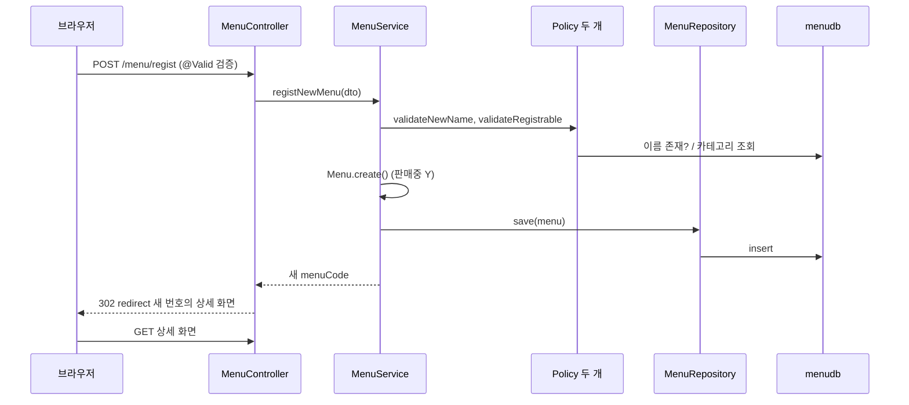
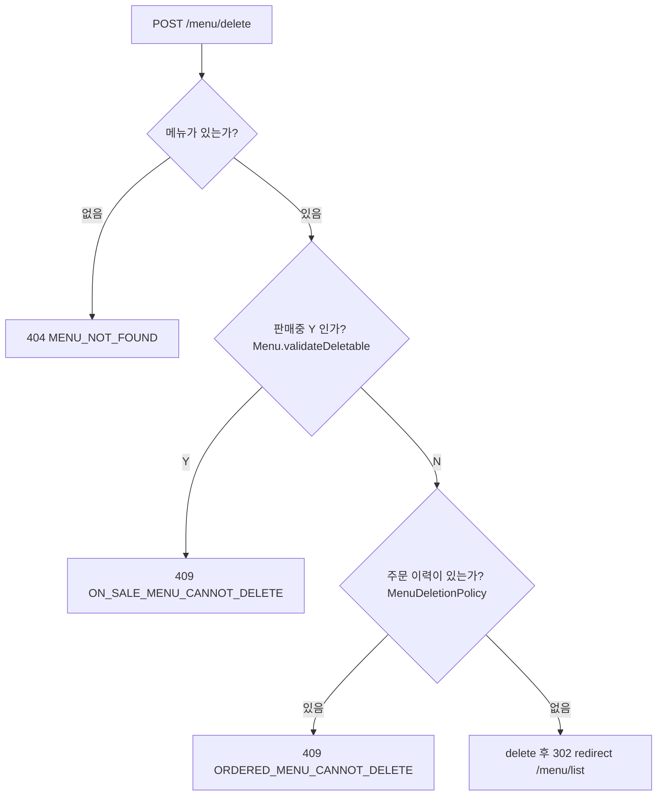

# 오늘 배운 것: 등록·수정·삭제 구현: 규칙은 Entity와 Policy가 나눠 갖는다

## 들어가며 (Situation)

모듈 2 26일차. 어제 시작한 `module07-jpa-mini-project`에 이어서, 오늘은 **쓰기 기능**인 메뉴 등록(F-04), 이름 수정(F-05), 삭제(F-07)를 채웠다. 어제까지는 읽기만 하는 기능(조회)이어서 서버를 띄워 마음껏 호출해도 DB가 바뀌지 않았는데, 오늘부터는 호출할 때마다 데이터가 바뀐다. 전체 메뉴 조회(F-02)는 어제 숙제로 남았던 것이라 25일차 글에서 다뤘다.

| 영역 | 오늘 채운 것 | 파일 |
|------|--------------|------|
| 입력 검증 | `@NotBlank`, `@Size`, `@Min`, `@Positive`와 `@Valid` | `MenuDTO`, `MenuController` |
| Entity 규칙 | `create()`, `changeMenuName()`, `validateDeletable()`, `Category.isSubCategory()` | `Menu`, `Category` |
| Policy | 이름 중복(`existsByMenuName`), 하위 카테고리, 주문 이력 | `MenuNamePolicy`, `MenuCategoryPolicy`, `MenuDeletionPolicy` |
| Service | 등록·수정·삭제 (`@Transactional`) | `MenuService` |
| 예외 처리 | `@Valid` 실패를 400으로 바꾸는 핸들러 | `GlobalExceptionHandler` |
| 아직 TODO | 판매중지·재개, 이름 수정 시 중복 검사, 나머지 예외 핸들러 | 각 파일의 `TODO` |



코드 팝업에서 `Module07JpaMiniProjectApplication`을 열면 **코드 | 실행 결과** 탭이 있다. 이 프로젝트는 입력 없이 서버가 뜨는 프로그램이라서, 실행 결과 탭에는 서버를 띄우고 보낸 요청과 응답, 서버 콘솔의 SQL을 모아 두었다. 포트만 18088로 바꿔서 실행했다.

참고한 자료는 다음과 같다.

- 오늘 수업의 코드와 수업 주석. 특히 `MenuService`에는 "Before / After" 주석 블록이 있어서, 규칙을 Service에 몰아 넣었을 때의 문제를 설명한다.
- 수업 중 그린 필기 그림 한 장(`@Controller`와 `@RestController` 비교)
- 글 끝의 공식 문서

막혔던 부분은 없었다. 대신 쓰기 기능은 **DB를 바꾸기 때문에** 확인 방법을 바꿨다. `menudb`의 `tbl_menu`를 그대로 쓰지 않고, 같은 내용으로 복사한 **임시 테이블**을 가리키게 한 복사본으로 서버를 띄워서 요청을 보냈다. 확인이 끝난 뒤 임시 테이블은 지웠고, 원본 `tbl_menu`는 건드리지 않았다.

## 문제 상황 (Task)

PRD 6장은 정책마다 **어디서 판단할지**까지 정해 두었다. 같은 "규칙"이어도 위치가 셋으로 나뉜다.

- 입력값만 보면 판단할 수 있는 규칙(이름 필수, 30자 이하, 가격 0원 이상)은 DTO에 둔다.
- 저장된 현재 상태가 필요한 규칙(판매중인 메뉴는 삭제 불가)은 Entity에 둔다.
- DB 조회나 다른 도메인 정보가 필요한 규칙(이름 중복, 하위 카테고리, 주문 이력)은 Policy에 둔다.

그래서 오늘의 과제는 기능을 만드는 것보다, **규칙 하나하나를 알맞은 자리에 두고 Service는 순서만 조립하게** 하는 것이었다. 제약 조건도 있었다.

- Entity에는 setter를 열지 않는다. 값은 이름 있는 메서드로만 바꾼다.
- 다른 팀(Order)의 데이터가 필요한 주문 이력은 인터페이스(`MenuOrderHistoryChecker`)로만 묻는다.
- Controller는 `try-catch`를 쓰지 않는다. 실패는 전부 `GlobalExceptionHandler`가 에러 화면으로 바꾼다.

## 해결 과정 (Action)

### 1. 필기: `@Controller`와 `@RestController`

오늘 수업 필기를 하나 옮긴다. 어제 `/menu/category`에서 `@ResponseBody`를 썼는데, 그 개념을 클래스 단위로 올린 것이 `@RestController`다.


| 항목 | `@Controller` | `@RestController` |
|------|---------------|-------------------|
| 역할 | 사용자의 요청을 핸들링한다 | 같다 |
| 책임 | 요청을 받고, 간단한 유효성 검사를 하고, 비즈니스 로직을 호출하고, **View를 응답한다** | 요청을 받고 **데이터를 응답한다** |
| 구성 | - | `@Controller` + `@ResponseBody` |

필기대로라면 이 프로젝트의 `MenuController`는 화면을 돌려주는 `@Controller`이고, 카테고리 JSON만 `@ResponseBody`를 메서드에 붙여 데이터를 준다.

### 2. 입력 정책: DTO에 선언하고 Controller에서 `@Valid`로 켠다

`MenuDTO`의 필드에 검증 어노테이션을 붙이고, `registMenu()` 파라미터에 `@Valid`를 붙인다. 어노테이션만 붙여서는 검증이 실행되지 않고, `@Valid`가 있어야 검사한다는 것이 수업 주석의 핵심이다.

```java
@NotBlank(message = "메뉴 이름은 필수입니다!")
@Size(max = 30, message = "메뉴 이름은 30자 이하입니다!!")
private String menuName;

@Min(value = 0, message = "메뉴 가격은 0원 이상 입력!")
private int menuPrice;

@Positive(message = "카테고리를 선택해주세요!")
private int categoryCode;
```

실패는 `GlobalExceptionHandler.handleBindException()`이 받는다. 첫 번째 필드 에러를 꺼내서, **형식 자체가 틀린 경우**(숫자 칸에 문자)와 **검증 규칙 위반**을 나누어 메시지를 만든다.

```java
FieldError fieldError = e.getFieldError();
String message = fieldError.isBindingFailure()
        ? fieldError.getField() + "의 형식이 올바르지 않습니다."
        : fieldError.getDefaultMessage();
return errorPage(HttpStatus.BAD_REQUEST, message);
```

실제로 요청을 보내 확인한 결과다. 7개 요청 모두 400이었고 **SQL이 하나도 나가지 않았다**. 즉 검증은 Service에 들어가기 전에 Controller 앞단에서 끝난다.

| 입력 | 응답 메시지 | 어디서 걸렸나 |
|------|-------------|---------------|
| `menuName=''` | 메뉴 이름은 필수입니다! | `@NotBlank` |
| 이름 31자 | 메뉴 이름은 30자 이하입니다!! | `@Size` |
| `menuPrice=-1` | 메뉴 가격은 0원 이상 입력! | `@Min` |
| `categoryCode=0` | 카테고리를 선택해주세요! | `@Positive` |
| `menuPrice=abc` | menuPrice의 형식이 올바르지 않습니다. | 바인딩 실패 (`isBindingFailure()`) |
| `menuPrice=''` | menuPrice의 형식이 올바르지 않습니다. | 바인딩 실패 (`int`는 빈 문자열을 받을 수 없다) |
| 이름·가격·카테고리 모두 틀림 | 메뉴 이름은 필수입니다! | `getFieldError()`는 **첫 번째 하나만** 준다 |

⚠️ 세 칸이 모두 틀려도 화면에는 첫 번째 에러 하나만 보인다. PRD 7장이 "첫 번째 필드 에러의 message"라고 정한 대로 동작하는 것이고, 모든 에러를 한 번에 보여 주려면 핸들러를 바꿔야 한다. 어제 `@RequestParam`에서 `Validation failure`만 나왔던 것과 달리, 이 핸들러는 `e.getFieldError()`에서 메시지를 꺼내므로 `@Min`에 적은 문구가 그대로 나온다.

- **`@Valid`**
  - 객체에 선언된 검증 어노테이션을 실제로 실행하라고 요청하는 어노테이션이다.
  - 검증에 실패하면 `MethodArgumentNotValidException`(`BindException`의 자식)이 던져지고, 핸들러가 이 예외를 받는다.

### 3. 도메인 규칙은 Entity가 스스로 판단한다

`Menu`에는 setter가 없어서, 만들기와 바꾸기와 검사가 모두 이름 있는 메서드다.

```java
private static final String ON_SALE = "Y";
private static final String STOPPED = "N";

public static Menu create(String menuName, int menuPrice, int categoryCode) {
    return new Menu(0, menuName, menuPrice, categoryCode, ON_SALE);
}

public void changeMenuName(String newMenuName) {
    this.menuName = newMenuName;
}

public void validateDeletable() {
    if (this.orderableStatus.equals(ON_SALE)) {
        throw new BusinessException(ErrorCode.ON_SALE_MENU_CANNOT_DELETE);
    }
}
```

- `"Y"`, `"N"`은 값만 봐서는 뜻을 알기 어려워서 `ON_SALE`, `STOPPED` 상수로 의미를 붙였다. Entity가 상태 값을 상수로 들고 있어서, Java 코드 쪽에서는 Service나 Policy가 `"Y"`라는 표현을 알 필요가 없다. (화면 템플릿은 별개로 `'Y'`와 비교한다.)
- `create()`는 판매 상태를 항상 `"Y"`로 시작시킨다(PRD POL-04). 등록한 메뉴의 상세 화면에 "판매중"이 떴다.
- `Category.isSubCategory()`는 `refCategoryCode != null`로 답한다. 어제 `Integer`로 둔 `refCategoryCode`의 `null` 여부가 곧 상위·하위의 구분이다. 이 해석을 Category 안에 가두어서, 다른 클래스가 내부 필드를 직접 들여다보지 않게 한다.

### 4. 비즈니스 규칙은 Policy로, Service는 흐름만

`MenuService`에 달려 있는 "Before / After" 주석은 규칙을 Service에 직접 쓰면 생기는 문제를 네 가지로 말한다. 내 말로 정리하면 이렇다.

| 문제 | Policy로 나누면 |
|------|-----------------|
| 이름 중복 검사가 등록과 수정에 복사된다 | 한 곳(`MenuNamePolicy`)만 고치면 된다 |
| Service가 `refCategoryCode`가 `null`이면 상위라는 Category의 내부 사정을 안다 | `Category.isSubCategory()`에게 묻는다 |
| `if`가 쌓여서 "흐름"이 묻힌다 | Service에는 "검사 → 생성 → 저장"만 남는다 |
| 규칙 하나만 테스트하려 해도 Service 전체를 준비해야 한다 | Policy만 따로 테스트할 수 있다 |

세 Policy는 모두 같은 모양이다. "된다 / 안 된다"만 판단하고, 안 되면 `BusinessException`을 던지고, 통과하면 아무것도 하지 않는다.

```java
// MenuNamePolicy
public void validateNewName(String menuName) {
    if (menuRepository.existsByMenuName(menuName)) {
        throw new BusinessException(ErrorCode.DUPLICATE_MENU_NAME);
    }
}

// MenuCategoryPolicy
Category category = categoryRepository.findById(categoryCode)
        .orElseThrow(() -> new BusinessException(ErrorCode.CATEGORY_NOT_FOUND));
if (!category.isSubCategory()) {
    throw new BusinessException(ErrorCode.NOT_SUB_CATEGORY);
}
```

`existsByMenuName()`은 `MenuRepository`에 인터페이스 선언 한 줄을 추가한 쿼리 메서드다(어제 가격 검색 때 본 `findBy…`와 같은 원리로 `existsBy…`가 쿼리를 만든다). 콘솔에는 이렇게 나갔다.

```sql
select m1_0.menu_code from tbl_menu m1_0 where m1_0.menu_name=? limit ?
```

존재 여부만 알면 되어서 행 전체가 아니라 `menu_code` 하나만 가져오고 `limit`을 건다.

⚠️ `MenuNamePolicy` 주석은 한계도 적어 두었다. 두 사람이 **동시에** 같은 이름으로 등록하면 둘 다 중복 검사를 통과할 수 있다(조회와 저장 사이의 간격). 운영에서는 `menu_name`에 unique 제약까지 붙여야 한다는 설명이다. 이 상황은 오늘 재현하지 않았고 주석의 설명만 옮겼다.

### 5. 등록 흐름: 검사 → 생성 → 저장 → redirect



성공한 등록의 로그는 SQL 3개였다. 이름 존재 확인, 카테고리 조회, `insert`. 응답은 `302`이고 `Location`이 `/menu/39`였다. 새로고침해도 요청이 반복되지 않게 등록 뒤에 상세 조회로 redirect하는 방식이다(PRD가 PRG 패턴이라고 부른다). `menuCode`가 `IDENTITY`라서, 24일차에 본 대로 `save()` 시점에 `insert`가 나가고 DB가 번호를 만든다.

규칙 검사의 **순서**도 확인했다.

| 요청 | 결과 | 나간 SQL |
|------|------|----------|
| 이미 있는 이름 | 409 이미 존재하는 메뉴 이름입니다. | 이름 확인 1개 |
| 상위 카테고리(1번) | 400 메뉴는 하위 카테고리에만 등록할 수 있습니다. | 이름 확인 + 카테고리 조회 |
| 없는 카테고리(99번) | 404 카테고리를 찾을 수 없습니다. | 이름 확인 + 카테고리 조회 |
| 이미 있는 이름 + 상위 카테고리 | 409 이미 존재하는 메뉴 이름입니다. | 이름 확인 1개 (**이름에서 먼저 끝난다**) |

둘 다 틀린 요청은 먼저 검사하는 쪽의 에러만 돌려준다. Service가 이름 Policy를 카테고리 Policy보다 먼저 부르기 때문이다. 에러 코드와 상태 코드(409, 400, 404)도 PRD 7장 표와 같았다.

### 6. 수정: `save()`를 부르지 않는데 UPDATE가 나간다

`modifyMenuName()`은 `@Transactional` 안에서 엔티티를 조회하고 이름만 바꾼다. `save()`는 호출하지 않는다.

```java
Menu foundMenu = menuRepository.findById(menuCode)
        .orElseThrow(() -> new BusinessException(ErrorCode.MENU_NOT_FOUND));
foundMenu.changeMenuName(menuName);
```

수업 주석이 변경 감지(Dirty Checking)를 네 단계로 설명한다. `findById`로 조회하는 순간 영속성 컨텍스트가 스냅샷을 찍고, `changeMenuName()`으로 값이 바뀌고, 메서드가 끝나 commit이 일어나기 직전에 스냅샷과 비교해서, 다르면 `UPDATE`를 만든다. 23일차에 `EntityManager`로 본 것과 같은 원리다. 이번에는 직접 `save()`를 부르지 않고도 일어난다는 것을 로그로 확인했다.

- **변경 감지 (Dirty Checking)**
  - 조회한 엔티티의 값이 바뀌었는지 영속성 컨텍스트가 commit 직전에 스스로 비교해서 `UPDATE`를 만들어 주는 기능이다.
  - 그래서 수정 메서드에는 `save()`가 필요 없고, 반드시 **트랜잭션 안에서** 조회해야 한다.

| 요청 | 결과 | 나간 SQL |
|------|------|----------|
| 다른 이름으로 수정 | 302 `/menu/39` | `select` + `update` |
| **같은 이름**으로 한 번 더 | 302 `/menu/39` | `select`만 (**`update` 없음**) |
| 없는 메뉴 | 404 메뉴를 찾을 수 없습니다. | `select`만 |

같은 이름으로 다시 수정하면 스냅샷과 같아서 `UPDATE`가 나가지 않았다. 변경 감지가 값을 비교한다는 증거다. 한편 나간 `UPDATE`는 바뀐 컬럼만이 아니라 네 컬럼을 모두 다시 쓴다.

```sql
update tbl_menu set category_code=?, menu_name=?, menu_price=?, orderable_status=? where menu_code=?
```

🔴 수정에는 아직 검사가 빠져 있다. 코드를 보면 `MenuNamePolicy.validateRename()`이 `TODO`로 남아 있고, Controller의 `menuName` 파라미터에는 검증 어노테이션이 없다. 요청을 보내 확인했다.

| 요청 | 결과 | 설명 |
|------|------|------|
| 13번 메뉴와 **같은 이름**으로 수정 | 302, `update`까지 나감 | 중복 이름 허용 (PRD POL-08 위반) |
| **빈 이름**으로 수정 | 302, `update`까지 나감 | 빈 이름 저장 (POL-01 위반) |
| **31자** 이름으로 수정 | **200**, 본문 0바이트 | DB가 `Data too long for column 'menu_name'`으로 거절, 예외를 받는 핸들러가 아직 `TODO` |
| `menuName` 누락 | **200**, 본문 0바이트 | `MissingServletRequestParameterException`, 핸들러가 아직 `TODO` |

수정(F-05)은 "이름이 바뀐다"까지만 완성이고, 정책은 아직 이어 붙이지 않았다. 어제 본 `return null`이 조용히 200을 돌려주는 구멍이 여기서도 그대로 보였다.

### 7. 삭제: 도메인 규칙 → 비즈니스 규칙 → 삭제



`MenuDeletionPolicy`는 `MenuOrderHistoryChecker` **인터페이스**를 주입받아 `hasOrdered(menuCode)`로 묻는다. 어제는 코드를 읽고 이해하기만 했던 7절의 설계가, 오늘 본문이 채워져서 실제로 돈다. 구현체는 `FakeMenuOrderHistoryChecker`이고 1, 2, 3번만 "주문된 적 있음"으로 답한다. `MenuDeletionPolicy`는 그것이 Fake인지 진짜인지 모른다.

확인할 때 한 가지 어려움이 있었다. 1, 2, 3번 메뉴는 데이터에서 모두 판매중(Y)이라서, 판매 상태 검사에서 먼저 막혀 **주문 이력 정책까지 도달하지 못한다.** 그래서 임시 테이블에서만 2번 메뉴를 판매중지(N)로 바꿔 두고 시험했다.

| 요청 | 결과 | 나간 SQL |
|------|------|----------|
| 13번 (판매중 Y) | 409 판매중인 메뉴는 삭제할 수 없습니다. 먼저 판매중지해주세요. | `select`만 |
| 방금 등록한 39번 (신규는 Y) | 409, 같은 메시지 | `select`만 |
| 없는 9999번 | 404 메뉴를 찾을 수 없습니다. | `select`만 |
| **2번** (N, 주문 이력 있음) | 409 주문 이력이 있는 메뉴는 삭제할 수 없습니다. | `select`만 (판매 상태는 통과) |
| **5번** (N, 주문 이력 없음) | 302 `/menu/list` | `select` + `delete` |
| 5번 다시 삭제 | 404 | `select`만 |

삭제 뒤 목록 표의 행은 38개에서 37개가 됐다. 상태 검사가 먼저고 주문 이력이 나중이라는 PRD의 순서(6장 보충)도 로그로 맞게 나왔다. 2번은 판매 상태 검사를 지난 뒤에야 Policy에서 막혔다.

🟢 Service는 `"Y"`가 무엇인지 몰라도 되고 `validateDeletable()`만 호출한다. 판매 상태의 표현이 바뀌어도 Java 쪽에서 고칠 곳이 `Menu`로 좁혀진다.

### 8. 아직 TODO로 남은 것

| 항목 | 상태 | 호출하면 |
|------|------|----------|
| 판매중지·재개 (F-06) | `Menu.stopSelling()`, `resumeSelling()`, Service, Controller 모두 TODO | `POST /menu/stop`, `/menu/resume` 모두 200, 빈 본문 |
| 이름 수정 시 중복 검사 | `validateRename()` TODO | 중복 이름으로 수정 가능 |
| 나머지 예외 핸들러 | 필수 값 누락, DB 제약 위반, 없는 URL, 그 외 예외가 `null` 반환 | 앞의 세 가지는 200, 빈 본문으로 확인(없는 URL은 25일차). 그 외 예외는 호출하지 않았다 |

## 결과 (Result)

오늘 구현한 기능을 요청을 보내 확인한 결과다.

| 기능 | 확인한 내용 |
|------|-------------|
| 등록 (F-04) | 입력 검증 7건 모두 400이고 SQL 0개. 정책 3종은 409·400·404. 성공 시 SQL 3개(`exists`, 카테고리 `select`, `insert`)와 302 redirect |
| 수정 (F-05) | 변경 감지로 `select` 1개 + `update` 1개. 같은 이름이면 `update` 없음. 단, 중복 이름·빈 이름·31자는 통과하거나 빈 200 |
| 삭제 (F-07) | 판매중 409, 주문 이력 409, 없는 메뉴 404, 통과하면 `select` + `delete` 후 302 |
| 판매중지·재개 (F-06) | 아직 TODO (200, 빈 본문) |

- PRD 기능 7개 중 오늘까지 동작하는 것은 6개다. 조회 계열 F-01~F-03(25일차), 등록 F-04, 삭제 F-07이고, 수정 F-05는 이름 변경까지다.
- 쓰기 기능마다 나간 SQL은 등록 3개, 수정 2개(값이 같으면 1개), 삭제 2개로, 반복 쿼리 없이 한 번의 요청에 한 번씩이었다.

배운 점은 이렇다.

- 규칙의 위치를 정한 뒤에는 Service가 정말 얇아진다. 등록 메서드에는 "이름 검사, 카테고리 검사, 생성, 저장"만 남았다.
- 검사의 **순서**는 코드의 호출 순서가 곧 응답의 순서다. 틀린 곳이 둘이면 먼저 호출한 쪽만 보인다.
- 변경 감지는 `save()`가 필요 없다는 편리함과 함께, 네 컬럼을 모두 다시 쓴다는 점도 알아 둬야 한다.
- 정책이 비어 있는 곳은 200으로 조용히 성공하거나, 빈 화면으로 끝난다. 구현했다고 끝이 아니라, 틀린 입력도 보내서 막히는지 봐야 한다.
- 쓰기 기능을 확인할 때는 원본 테이블을 건드리지 않는 임시 사본을 쓰는 편이 안전하다.

## 더 학습하면 좋은 개념

- **`@DynamicUpdate`** — 오늘 본 `UPDATE`는 바뀌지 않은 컬럼까지 모두 SET에 넣는다. 바뀐 컬럼만 쓰게 하는 Hibernate 옵션이고, 컬럼이 많거나 동시 수정이 잦을 때 판단 기준이 된다.
- **unique 제약과 `DataIntegrityViolationException`** — 31자 이름이 DB 제약에 걸려 이 예외로 올라오는 것을 봤다. 동시 등록처럼 Policy가 막지 못하는 경우의 마지막 방어선이라서, 제약과 예외 처리를 함께 이해해야 한다.
- **Bean Validation의 그룹과 커스텀 검증** — 오늘은 등록 DTO에만 검증을 달았다. 등록과 수정에서 규칙이 다를 때 같은 DTO를 어떻게 나눠 쓰는지가 다음 단계의 질문이다.
- **`@RestController`와 REST API** — 필기에서 `@Controller + @ResponseBody`로 정리한 개념이다. 화면 대신 JSON을 주고받는 방식으로 넘어갈 때 기준이 된다.
- **빈약한 도메인 모델(Anemic Domain Model)** — Entity에 규칙을 두느냐 Service에 두느냐의 논쟁이다. 오늘 `Menu`에 규칙을 모은 선택을 일반 설계 용어로 설명할 수 있다.

## 참고 자료

- [Spring Data JPA 공식 문서 - Query Methods](https://docs.spring.io/spring-data/jpa/reference/jpa/query-methods.html)
- [Spring Data JPA 공식 문서 - Transactionality](https://docs.spring.io/spring-data/jpa/reference/jpa/transactions.html)
- [Spring Framework 공식 문서 - @Transactional](https://docs.spring.io/spring-framework/reference/data-access/transaction/declarative/annotations.html)
- [Spring Framework 공식 문서 - Bean Validation](https://docs.spring.io/spring-framework/reference/core/validation/beanvalidation.html)
- [Spring Framework 공식 문서 - @ExceptionHandler](https://docs.spring.io/spring-framework/reference/web/webmvc/mvc-controller/ann-exceptionhandler.html)
- [Spring Framework 공식 문서 - @ResponseBody와 @RestController](https://docs.spring.io/spring-framework/reference/web/webmvc/mvc-controller/ann-methods/responsebody.html)
- [Hibernate ORM 6.6 User Guide](https://docs.jboss.org/hibernate/orm/6.6/userguide/html_single/Hibernate_User_Guide.html)
