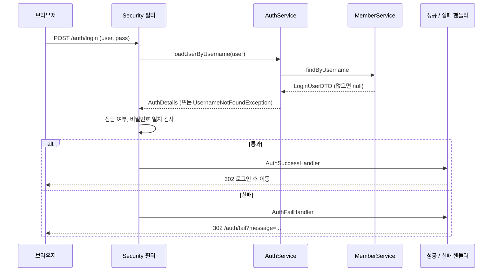

# 오늘 배운 것: Spring Security 세션 로그인: 검사는 Security가, 기록은 핸들러가

## 들어가며 (Situation)

모듈 2 27일차. 어제까지 JPA 미니 프로젝트로 계층 구조와 규칙의 위치를 다뤘고, 오늘부터는 새 과정 폴더 `10_Spring-Security`의 첫 프로젝트 `module01-security-session`을 시작했다. 주제는 **세션 기반 인증/인가**다. 로그인 화면, 회원가입, 권한별 접근 제한, 로그인 실패 횟수 관리를 Spring Security 위에 얹는다.

프로젝트는 지난번처럼 설명 주석과 `TODO`가 붙은 코드로 주어지고, 오늘은 로그인과 관련된 핵심 클래스를 채웠다.

| 영역 | 파일 | 하는 일 |
|------|------|---------|
| 보안 설정 | `SecurityConfig` | 접근 권한, 로그인, Remember Me, 로그아웃, 세션, CSRF 설정 |
| 회원 조회 | `AuthService`, `AuthDetails` | 로그인 때 Security가 부르는 `UserDetailsService`와 `UserDetails` 구현 |
| 로그인 결과 | `AuthSuccessHandler`, `AuthFailHandler` | 성공 시 횟수 초기화와 로그, 실패 시 횟수 증가와 로그 |
| 회원 | `MemberService`, `User`, `LoginLog` | 회원가입(암호화), 실패 횟수와 잠금 규칙, 로그인 로그 |
| 화면 이동 | `AuthController`, `UserController`, `AdminController`, `IndexController` | 로그인 화면, 회원가입, 관리자 로그 페이지 |
| 아직 TODO | `AuthDetails.equals/hashCode`, `@EnableMethodSecurity`, `@PreAuthorize` | 본문 7~9절에서 다룬다 |



코드 팝업의 `SecurityConfig` 같은 파일에는 이미 채운 곳에도 `// TODO` 주석이 그대로 남아 있다. 채우지 않은 것은 아래 표의 마지막 줄 세 가지뿐이다.

코드 팝업에서 `Module01SecuritySessionApplication`을 열면 **코드 | 실행 결과** 탭이 있다. 이 프로젝트는 입력 없이 서버가 뜨는 프로그램이라서, 실행 결과 탭에는 서버를 띄우고 보낸 요청과 응답을 모아 두었다. 실행 결과 탭의 I, J 절은 수업 원본이 아니라 **복사본에서 TODO를 채워 본 실험**이고, 탭 안에도 그렇게 표시했다.

참고한 자료는 다음과 같다.

- 오늘 수업의 코드와 수업 주석. `SecurityConfig` 맨 위의 "전체 흐름 지도"가 큰 도움이 됐다.
- 수업 중 그린 필기 그림 한 장(인증/인가, Session과 Token, SSR과 CSR)
- 글 끝의 공식 문서

막혔던 과정은 따로 지어내지 않았다. 대신 쓰기 기능(회원가입, 로그인 로그, 실패 횟수)이 `login` DB를 바꾸기 때문에, `login` DB는 건드리지 않고 `menudb`에 같은 모양의 **임시 테이블**을 만들어 복사본이 거기에 연결되게 한 뒤, 서버를 띄워 요청을 보내 확인했다. 확인 뒤 임시 테이블은 지웠고, `login` DB의 회원과 로그 수는 그대로다.

## 문제 상황 (Task)

먼저 오늘 수업 필기를 하나 옮긴다. 인증/인가를 구현하는 방식은 크게 둘이고, 서버가 화면을 만드는 방식(SSR)과 클라이언트가 화면을 만드는 방식(CSR)에 따라 어울리는 쪽이 달라진다.


| 구분 | 필기 내용 | 오늘 프로젝트 |
|------|-----------|---------------|
| 방식 | 1. Session, 2. Token | **Session** |
| SSR | Server Side Rendering. Spring 서버 한 곳 안에 IoC 컨테이너가 있고, 그 서버가 화면까지 만들어 응답한다 | **Thymeleaf로 서버가 화면을 만든다** |
| CSR | Client Side Rendering. 프론트 서버(Next.js)와 백엔드 서버(Spring)가 나뉜다 | 해당 없음 |
| 주의 | 분산 서버 환경에서 Session 방식의 인증/인가를 구현하면 **구멍이 발생한다** | 서버 한 대라서 확인하지 않았다 |

필기에서 말한 "구멍"이 구체적으로 무엇인지는 오늘 실행으로 확인하지 못했다. 세션 정보가 서버 안에 있다는 점과 관련이 있다고 이해하고, 다음에 Token 방식을 배울 때 비교하려고 남겨 둔다.

오늘의 과제와 제약은 이렇다.

- 회원가입, 로그인, 로그아웃과 `ADMIN`/`USER` 권한별 접근 제한을 만든다.
- **`POST /auth/login`을 처리하는 컨트롤러는 만들지 않는다.** Security 필터가 가로채서 처리한다.
- 로그인 실패 5회에 계정을 잠그고, 성공과 실패를 모두 로그로 남긴다.
- Remember Me와 "한 계정 한 세션"을 지원한다.

## 해결 과정 (Action)

### 1. 로그인 한 번의 흐름

`SecurityConfig`의 주석이 지도를 그려 준다. 직접 컨트롤러를 만드는 곳은 로그인 화면(GET)뿐이고, 나머지는 Security 필터가 이어 간다.



- **인증과 인가**
  - 인증은 "누구인지 확인하는 것"(로그인), 인가는 "그 사람이 이 자원에 접근해도 되는지 확인하는 것"(권한 검사)이다.
  - 오늘 프로젝트에서는 로그인이 인증이고, `ADMIN`/`USER` 구분이 인가다.
- **SecurityFilterChain**
  - 요청이 컨트롤러에 도착하기 전에 거치는 보안 규칙의 묶음이다.
  - `SecurityConfig`의 `configure()` 한 곳에서 접근 권한, 로그인, 로그아웃, 세션 규칙을 모두 선언한다.

### 2. `SecurityConfig`: 규칙은 위에서부터 순서대로

```java
http.authorizeHttpRequests(auth -> {
    auth.requestMatchers("/auth/login", "/user/signup", "/auth/fail", "/").permitAll();
    auth.requestMatchers("/admin/*").hasAnyAuthority("ADMIN");
    auth.requestMatchers("/user/*").hasAnyAuthority("USER", "ADMIN");
    auth.anyRequest().authenticated();
})
.formLogin(login -> {
    login.loginPage("/auth/login");
    login.usernameParameter("user");   // login.html 의 input name
    login.passwordParameter("pass");
    login.successHandler(authSuccessHandler);
    login.failureHandler(authFailHandler);
})
```

규칙은 위에서부터 검사하므로 가장 좁은 규칙(`permitAll`)을 앞에 두고, 나머지 전부를 `authenticated()`로 닫는다. 폼의 `name` 속성(`user`, `pass`)과 `usernameParameter`, `passwordParameter`가 일치해야 한다.

로그인하지 않은 상태와 `USER`로 로그인한 상태에서 호출한 결과다.

| 요청 | 결과 |
|------|------|
| 익명 `GET /`, `GET /auth/login` | 200 |
| 익명 `GET /user/page`, `/admin/logs`, `/method/admin` | 302, `/auth/login`으로 이동 |
| `USER` 로그인 후 `GET /user/page` | 200 |
| `USER` 로그인 후 `GET /admin/logs`, `/admin/page` | **403** |

로그인하지 않은 사람은 "로그인 화면으로", 로그인했지만 권한이 없는 사람은 "403"으로 응답이 갈린다.

⚠️ CSRF 보호는 수업 목적으로 `csrf.disable()`로 꺼 두었다. 주석도 "프로덕션에서는 반드시 활성화"라고 적었다. 꺼 둔 효과를 6절 로그아웃에서 직접 봤다.

### 3. 회원가입과 BCrypt

`MemberService.regist()`는 중복 아이디를 먼저 확인하고, 비밀번호를 `encoder.encode()`로 암호화한 뒤 `User.create()`로 Entity를 만들어 저장한다. 암호화기는 `SecurityConfig`에 `BCryptPasswordEncoder` Bean으로 등록해 두고 주입받는다.

가입한 뒤 DB에는 이렇게 저장됐다.

| 확인 항목 | 결과 |
|-----------|------|
| 비밀번호 컬럼 | 길이 60, 앞 7글자 `$2a$10$` |
| 같은 비밀번호로 두 계정을 가입 | 해시가 **서로 다르다** (서로 다른 값이 2개) |
| 같은 아이디로 다시 가입 | 화면 메시지 "중복회원이 존재합니다." (`insert` 없음) |

같은 비밀번호인데 해시가 다른 것은 BCrypt가 무작위 솔트를 섞기 때문이다(수업 주석이 이유로 든 첫 번째 항목이다). 그래서 로그인에서 입력값을 다시 암호화해 `=`로 비교하는 것이 아니라, Security가 `PasswordEncoder.matches()`로 비교한다.

🔴 가입 폼에는 권한 선택(`USER`/`ADMIN`)이 있고, 서버는 그 값을 그대로 저장한다. 실제로 `role=ADMIN`으로 가입한 계정이 관리자 로그 페이지(`/admin/logs`)에 들어갔다. 화면에도 "테스트 목적에 맞게 선택할 수 있다"는 안내가 있어서 수업용 설계이지만, 실제 서비스에서는 가입 때 받은 값으로 권한을 정하면 안 된다.

### 4. `UserDetailsService`와 `UserDetails`: Security에게 회원을 알려 주는 법

`AuthService`는 `UserDetailsService`를 구현하고, `loadUserByUsername()`에서 회원을 **조회만** 한다. 없으면 `null` 대신 `UsernameNotFoundException`을 던지고, 있으면 `AuthDetails`로 감싸서 반환한다. 비밀번호 비교는 하지 않는다.

`AuthDetails`는 `UserDetails`의 구현체로, Security가 아래 메서드를 호출해서 로그인 가능 여부를 직접 판단한다.

| 메서드 | Security가 쓰는 곳 |
|--------|--------------------|
| `getPassword()` | 입력한 비밀번호와 비교할 DB의 암호화된 비밀번호 |
| `isAccountNonLocked()` | `!loginUserDTO.isAccountLocked()`, 잠긴 계정이면 로그인 거부 |
| `getAuthorities()` | `hasAnyAuthority(...)` 검사에 쓸 권한 목록 |

권한은 DB에 `"USER,ADMIN"`처럼 한 문자열로 있어서, `LoginUserDTO.getRole()`이 쉼표로 쪼개 리스트로 만들고 `getAuthorities()`가 `GrantedAuthority`로 바꾼다. 반환 타입이 `Collection`인 것은 한 사람이 여러 권한을 가질 수 있어서다. 주석은 여기서 반환한 객체가 **곧 세션에 저장되는 객체**라고 강조한다.

### 5. 로그인 실패: 핸들러가 횟수를 올리고 로그를 남긴다

`AuthFailHandler`는 예외 타입(`instanceof`)으로 메시지를 나누고, `BadCredentialsException`이면 실패 횟수를 올린다. 횟수와 잠금 규칙은 `User` Entity가 가진다.

```java
public void increaseLoginFailCount() {
    this.loginFailCount++;
    if (this.loginFailCount >= 5) {
        this.isAccountLocked = true;
    }
}
```

`save()`를 따로 부르지 않아도 `@Transactional` 안에서 값이 바뀌므로 변경 감지가 `UPDATE`를 만든다(26일차에 본 원리 그대로다). `user2`로 틀린 비밀번호를 반복해 보냈다.

| 시도 | DB의 실패 횟수 / 잠금 | 응답 |
|------|----------------------|------|
| 틀린 비밀번호 1~4회째 | 1, 2, 3, 4 / 0 | 302, `/auth/fail` |
| 5회째 | 5 / **1** | 302 |
| 6회째 (틀린 비밀번호) | 5 / 1 | "계정이 잠겨있습니다. 관리자에게 문의하세요." |
| 그다음 **맞는 비밀번호** | 5 / 1 | 같은 "계정이 잠겨있습니다." |

- 잠긴 뒤에는 횟수가 늘지 않는다. `LockedException`은 `BadCredentialsException`이 아니라서 증가 분기를 타지 않는다.
- 맞는 비밀번호로도 잠금은 풀리지 않는다. Security가 **잠금 검사를 비밀번호 비교보다 먼저** 한다는 뜻이다.
- 실패 로그(`success=0`)는 틀린 5건과 잠긴 뒤 2건, 모두 7건이 쌓였다. IP는 `0:0:0:0:0:0:0:1`이었다(로컬 호스트의 IPv6 주소).

이어서 틀리는 경우를 하나 더 확인했다. 실패 3번 뒤에 맞는 비밀번호로 로그인하면 `AuthSuccessHandler`가 횟수를 3에서 0으로 되돌렸다(`select` 두 번, `update`, 로그 `insert`).

🔴 `AuthFailHandler`에는 `UsernameNotFoundException`일 때 "존재하지 않는 아이디입니다."를 보여 주는 분기가 있다. 그런데 **없는 아이디(`nouser`)로 로그인하면 그 메시지가 나오지 않았다.** 나온 것은 "아이디가 존재하지 않거나 비밀번호가 일치하지 않습니다."였고, 이는 `BadCredentialsException` 분기의 문구다. Spring Security는 기본적으로 존재하지 않는 아이디를 `BadCredentialsException`으로 바꿔서 던지기 때문이다(공식 문서: `hideUserNotFoundExceptions`). 아이디가 없는지 비밀번호가 틀린 것인지 구분해서 알려 주지 않으려는 설계이고, 그래서 이 분기는 사실상 도달하지 않는다. 같은 분기의 문구 끝 "(실패 횟수: 누적)"도 실제 횟수가 아니라 고정된 글자라서, 화면에서는 몇 번 틀렸는지 알 수 없다.

### 6. 로그인 성공 뒤: 이동, Remember Me, 로그아웃

성공 핸들러는 `SimpleUrlAuthenticationSuccessHandler`를 상속하고, 부모의 `onAuthenticationSuccess()`를 불러 페이지를 이동시킨다. 주석은 "로그인 전에 가려던 페이지가 있으면 그 페이지로, 없으면 `/`로"라고 설명한다.

🔴 직접 확인해 보니 주석과 달랐다. 로그인하지 않고 `/user/page`를 요청해서 로그인 화면으로 보내진 뒤 로그인하자, 이동한 곳은 가려던 `/user/page`가 아니라 **`/`**였다. 이 부모 클래스는 저장된 요청을 사용하지 않는 것으로 보인다. 저장된 요청까지 되돌려 주는 별도의 핸들러가 있는 것으로 알고 있는데, 오늘은 시험하지 않아 학습 목록에 넣어 두었다.

Remember Me와 로그아웃 결과다.

| 확인 | 결과 |
|------|------|
| `remember-me=on`으로 로그인 | `remember-me` 쿠키 `Max-Age=86400`(24시간), `HttpOnly` |
| `JSESSIONID` 없이 `remember-me` 쿠키만 보내 `GET /user/page` | 200, 새 `JSESSIONID`가 내려온다 |
| 위 자동 로그인 | 성공 로그는 새로 쌓이지 않았다 (DB 확인) |
| `POST /auth/logout` | 302 `/`, `JSESSIONID`와 `remember-me` 쿠키 삭제 |
| 로그아웃 뒤 `GET /user/page` | 302 `/auth/login` |
| **`GET /auth/logout`** | 이것도 로그아웃된다 (302 `/`) |

⚠️ 로그아웃이 `GET`으로도 동작한 것은 CSRF 보호를 꺼 둔 효과다. 다른 사이트의 이미지 태그 하나로 사용자를 로그아웃시킬 수 있다는 뜻이라서, 운영에서는 CSRF 보호를 켜고 `POST`만 받아야 한다. 공식 문서도 CSRF 보호를 끄면 로그아웃 확인 화면 없이 로그아웃이 바로 수행된다고 적는다.

### 7. 동시 접속 제한: 설정만으로는 걸리지 않는다

`sessionManagement`에 `maximumSessions(1)`과 `sessionRegistry`를 연결해서 "한 계정에 세션 하나"로 제한했다. 이것을 서버를 새로 띄운 뒤 **같은 계정으로 브라우저 두 개(A, B)에서 로그인**해서 확인했다.

| 상황 | 수업 코드 그대로 (`equals/hashCode` TODO) | 복사본에서 `equals/hashCode`를 채운 뒤 |
|------|---------------------------------------------|----------------------------------------|
| B가 같은 계정으로 로그인한 뒤 A의 `GET /user/page` | **200, 그대로 살아 있다** | 200, 본문 `This session has been expired (possibly due to multiple concurrent logins being attempted as the same user).` 와 쿠키 삭제 |
| 관리자 페이지의 활성 사용자 수 (admin1 1명 + user1 1명) | **3** | **2** |

🔴 수업 코드에는 `AuthDetails.equals()`와 `hashCode()`가 `TODO`로 비어 있고, 이 상태에서는 `maximumSessions(1)`이 **아무 효과가 없었다.** 주석의 설명대로 `SessionRegistry`가 사용자를 `Map`으로 관리하는데, 로그인할 때마다 새 `AuthDetails` 객체가 만들어지므로 기본 `Object.equals()`(주소 비교)로는 같은 사용자가 서로 다른 사용자로 보이기 때문이다. 공식 문서도 `UserDetails`를 직접 구현했다면 `equals()`와 `hashCode()`를 오버라이드하라고 적고 있다.

복사본에서 채운 예시 코드는 `getUsername()` 기준이다.

```java
// 예시 코드: 복사본에서만 시험했고, 수업 원본에는 적용하지 않았다
@Override
public boolean equals(Object o) {
    if (this == o) return true;
    if (o == null || getClass() != o.getClass()) return false;
    return Objects.equals(getUsername(), ((AuthDetails) o).getUsername());
}

@Override
public int hashCode() {
    return Objects.hash(getUsername());
}
```

채운 뒤에는 B가 로그인하는 순간 A의 세션이 만료됐고, 활성 사용자 수도 2로 맞았다. 설정 한 줄(`maximumSessions(1)`)만 믿으면 안 되고, 그 동작이 기대는 **객체의 동등성**까지 맞아야 한다는 것을 알았다.

### 8. 메서드 단위 권한: TODO를 채우면 달라진다

`IndexController`는 두 가지 방식을 비교하는 예시다. `/admin/*`처럼 URL 단위로 `SecurityConfig`에서 막는 방식과, 핸들러 메서드에 `@PreAuthorize`를 붙여 메서드 실행 직전에 막는 방식이다. 후자는 `SecurityConfig`에 `@EnableMethodSecurity`가 있어야 동작하는데, 둘 다 `TODO`다.

| 요청 | 수업 코드 그대로 | 복사본에서 `@EnableMethodSecurity`와 `@PreAuthorize`를 채운 뒤 |
|------|------------------|----------------------------------------------------------------|
| `USER`가 `GET /method/admin` | **200** (막히지 않는다) | **403** |
| `USER`가 `GET /method/user` | 200 | 200 |
| `ADMIN`이 `GET /method/admin` | 200 | 200 |

`/method/*`는 `SecurityConfig`에 규칙이 없어서 `anyRequest().authenticated()`만 적용된다. 그래서 TODO가 비어 있는 동안에는 로그인만 하면 `USER`도 관리자용 주소를 호출할 수 있었다. URL 방식은 경로 단위로 한 곳에서, 메서드 방식은 같은 컨트롤러 안에서 메서드마다 권한을 다르게 줄 때 편하다고 주석이 정리한다.

### 9. 확인 중 발견한 것과 아직 TODO

- `ADMIN`으로 로그인해서 `GET /admin/page`를 호출하면 **500**이 난다. `IndexController.admin()`이 모델(`logs`, `activeUsers`) 없이 `admin/admin`을 반환하는데, 템플릿이 `#lists.size(logs)`를 평가하다 실패한다(서버 로그 확인). 관리자 로그 화면은 `GET /admin/logs`가 정상이다.
- 아직 `TODO`인 것은 `AuthDetails.equals/hashCode`, `@EnableMethodSecurity`, `@PreAuthorize` 세 가지다.

## 결과 (Result)

오늘 구현한 기능을 요청을 보내 확인한 결과다.

| 기능 | 확인한 내용 |
|------|-------------|
| URL 권한 | 익명은 302(로그인 화면), `USER`가 관리자 주소는 403 |
| 회원가입 | BCrypt 해시 60자, 같은 비밀번호도 해시가 다름, 중복 아이디 차단 |
| 로그인 실패 | 5회째에 잠금, 잠긴 뒤에는 횟수 증가 없음, 맞는 비밀번호도 거부 |
| 로그 | 성공과 실패가 모두 `TBL_LOGIN_LOG`에 쌓임 (잠긴 뒤 시도 포함) |
| Remember Me, 로그아웃 | 24시간 쿠키로 자동 로그인, 로그아웃이 쿠키 두 개를 삭제 |
| 동시 접속 제한 | 수업 코드 그대로는 **걸리지 않음**, `equals/hashCode`를 채우면 걸림 |
| 메서드 권한 | 수업 코드 그대로는 `USER`도 통과, TODO를 채우면 403 |

- 로그인 실패 5회째에 잠겼고, 잠금 검사는 비밀번호 검사보다 앞이었다.
- 동시 접속 제한은 활성 사용자 수가 3에서 2로 맞아졌다.
- 수업 주석과 실제 동작이 다른 곳이 두 군데 있었다. "존재하지 않는 아이디" 메시지 분기와 "가려던 페이지로 이동"이다.

배운 점은 이렇다.

- 로그인 처리는 컨트롤러가 아니라 **필터와 확장 지점**(`UserDetailsService`, 핸들러)에 맞춰 끼워 넣는 구조다. 내가 만드는 것은 "회원을 알려 주는 일"과 "결과를 기록하는 일"이고, 검사는 Security가 한다.
- 설정을 해 놓았다고 동작하는 것이 아니다. `maximumSessions(1)`은 `equals/hashCode`가, `@PreAuthorize`는 `@EnableMethodSecurity`가 있어야 의미가 있다. 틀린 입력을 보내거나 두 번째 사용자를 만들어 봐야 알 수 있었다.
- 보안 코드는 "일부러 알려 주지 않는" 동작이 있다(없는 아이디와 틀린 비밀번호를 같은 메시지로). 코드의 분기와 실제 응답이 다를 수 있으니, 분기를 믿지 말고 호출해 본다.
- 주석의 설명과 실제 동작이 다를 때는 실행한 쪽이 기준이다.

## 더 학습하면 좋은 개념

- **JWT와 Token 기반 인증** — 오늘 필기의 두 번째 방식이다. 분산 서버나 CSR 구조에서 Session의 한계를 넘는 방법이라서, Session과 무엇이 다른지 비교하며 배워야 필기의 "구멍"이 이해된다.
- **분산 환경의 세션 공유(Spring Session, Redis)** — 서버가 여러 대일 때 세션을 어디에 두는지를 다룬다. 오늘은 서버가 한 대여서 확인하지 못한 부분이다.
- **CSRF와 `SameSite` 쿠키** — 오늘은 CSRF를 꺼서 `GET`으로도 로그아웃되는 것을 봤다. 켰을 때 토큰이 어떻게 요청에 실리는지 알아야 운영 설정을 할 수 있다.
- **`SavedRequestAwareAuthenticationSuccessHandler`와 `RequestCache`** — 로그인 전에 가려던 주소를 기억해 되돌려 주는 구성요소다. 오늘 `/`로 이동한 문제를 풀 때 필요하다.
- **`AuthenticationProvider`와 사용자 열거 공격** — 없는 아이디와 틀린 비밀번호를 같은 응답으로 숨기는 이유(`hideUserNotFoundExceptions`)를 이해하면, 오늘 본 에러 메시지 설계의 의도를 설명할 수 있다.

## 참고 자료

- [Spring Security 공식 문서 - Servlet Authentication Architecture](https://docs.spring.io/spring-security/reference/servlet/authentication/architecture.html)
- [Spring Security 공식 문서 - Form Login](https://docs.spring.io/spring-security/reference/servlet/authentication/passwords/form.html)
- [Spring Security 공식 문서 - Password Storage](https://docs.spring.io/spring-security/reference/servlet/authentication/passwords/password-encoder.html)
- [Spring Security 공식 문서 - DaoAuthenticationProvider](https://docs.spring.io/spring-security/reference/servlet/authentication/passwords/dao-authentication-provider.html)
- [Spring Security 공식 문서 - Authorize HttpServletRequests](https://docs.spring.io/spring-security/reference/servlet/authorization/authorize-http-requests.html)
- [Spring Security 공식 문서 - Method Security](https://docs.spring.io/spring-security/reference/servlet/authorization/method-security.html)
- [Spring Security 공식 문서 - Session Management](https://docs.spring.io/spring-security/reference/servlet/authentication/session-management.html)
- [Spring Security 공식 문서 - Remember-Me](https://docs.spring.io/spring-security/reference/servlet/authentication/rememberme.html)
- [Spring Security 공식 문서 - Logout](https://docs.spring.io/spring-security/reference/servlet/authentication/logout.html)
- [Spring Security 공식 문서 - CSRF](https://docs.spring.io/spring-security/reference/servlet/exploits/csrf.html)
- [Spring Security API 문서 - AbstractUserDetailsAuthenticationProvider](https://docs.spring.io/spring-security/site/docs/current/api/org/springframework/security/authentication/dao/AbstractUserDetailsAuthenticationProvider.html)
