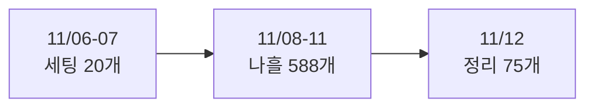

# 오늘 배운 것: git 로그로 본 프로젝트 7일: fix가 feat의 두 배

## 들어가며 (Situation)

11/06부터 11/12까지 7일 동안 팀 프로젝트(MoneyBeetle)를 만들고 오늘 발표했다. 발표 자료는 "명세한 API 153개를 모두 구현했다"처럼 **결과**를 보여 준다. 그런데 그 결과에 이르는 **과정**은 발표에 거의 들어가지 않는다. 과정이 남아 있는 곳은 git 로그다.

그래서 오늘은 새 기술을 배우는 대신, 이미 쌓인 git 로그를 데이터로 읽는 연습을 했다. 질문은 세 가지였다.

- 내 시간은 어디에 가장 많이 들어갔나
- 커밋 유형(feat, fix, test)의 비율은 어떤가
- 같은 곳을 반복해서 고친 자리가 있다면 거기엔 무슨 공통점이 있나

## 문제 상황 (Task)

- **로그에는 "무엇을 했다"만 있고 "왜 오래 걸렸다"는 없다.** 숫자로 먼저 좁힌 다음 커밋 메시지를 읽어야 한다.
- **작성자 이름이 둘로 찍혀 있다.** 같은 사람의 커밋이 계정 이름 두 개로 나뉘어 있어서, `--author`를 둘 다 줘야 내 커밋이 전부 잡힌다.
- **병합 커밋이 섞여 있다.** 병합 커밋까지 세면 PR 병합 횟수가 커밋 수에 섞인다. 사람이 쓴 변경만 보려면 `--no-merges`가 필요하다.
- **범위가 어긋나지 않게** `origin/dev` 한 기준에서만 센다.

## 해결 과정 (Action)

### 1. 먼저 무엇을 셀지 정하고 명령으로 만들었다

| 알고 싶은 것 | 명령의 핵심 |
|---|---|
| 작성자별 커밋 수 | `git log origin/dev --no-merges --format='%an' \| sort \| uniq -c` |
| 하루별 커밋 수 | `--format='%ad' --date=format:'%m-%d'` 를 `sort \| uniq -c` |
| 시간대별 커밋 수 | `--date=format:'%H'` |
| 유형(feat·fix 등) | 커밋 제목을 `sed`로 `유형 범위`만 남겨 센다 |
| 추가·삭제 줄 수 | `--numstat --format=` 를 `awk`로 합산 |
| 자주 고친 파일 | `--name-only --format=` 에서 `.java`만 골라 센다 |
| 이슈별 커밋 | `--grep="#69)"` |

```bash
# 예시 코드: 내 커밋(두 이름)만, 병합 제외, 유형별 개수
git log origin/dev --no-merges --author=이름A --author=이름B --format=%s \
  | sed -E 's/^([a-z]+)(\(([a-z]+)\))?:.*/\1 \3/' | sort | uniq -c | sort -rn
```

💡 `--format`에 마커를 넣어 커밋을 구분하려다 `invalid --pretty format` 오류를 만났다. 구분자가 필요하면 `tformat:%x01`처럼 제어 문자를 쓰면 된다. 이 오류로 `--format`이 값 자체를 해석한다는 걸 알았다.

### 2. 7일의 모양: 가운데 나흘에 몰렸다

병합 커밋을 뺀 `origin/dev` 기준으로 팀은 683개, 내 커밋은 265개(약 39%)였다.

| 날짜 | 팀 커밋 | 내 커밋 |
|---|---|---|
| 11/06 | 6 | 0 |
| 11/07 | 14 | 9 |
| 11/08 | 97 | 64 |
| 11/09 | 171 | 71 |
| 11/10 | 153 | 47 |
| 11/11 | 167 | 61 |
| 11/12 | 75 | 13 |



11/08부터 11/11까지 4일 동안 팀 커밋의 대부분이 나왔다. 시간대로 보면 내 커밋은 오전 11~12시와 오후 3~4시에 높았고, 밤 10시부터 새벽 5시 사이가 24개(약 9%)였다. 발표 전날까지 밤샘으로 몰아쳤다기보다 낮에 꾸준히 쌓인 모양이었다.

### 3. 유형별 비율: 고치는 커밋이 만드는 커밋의 두 배

| 유형 | 내 커밋 | 팀 커밋 |
|---|---|---|
| fix (be+fe) | 110 (41.5%) | 289 (42.3%) |
| feat (be+fe) | 55 (20.8%) | 148 (21.7%) |
| test | 24 | 55 |
| docs | 40 | 67 |
| refactor | 11 | 31 |

⚠️ 팀 전체와 내 비율이 거의 같았다. fix가 feat의 약 두 배라는 말은, 기능을 한 번 만들면 두 번 가까이 고쳤다는 뜻이다. 다만 이 숫자는 "나쁜 코드를 많이 썼다"가 아니라 **리뷰와 테스트가 문제를 찾아낸 횟수**로도 읽힌다. 팀은 PR마다 AI 리뷰를 붙였으니, 리뷰 지적을 반영한 커밋이 fix에 많이 섞였을 것으로 짐작한다(커밋별로 확인하지는 않았다).

내가 쓴 줄 수는 추가 36,411줄, 삭제 6,273줄이었다. 그중 `src/main`에 19,648줄, `src/test`에 15,506줄을 더해서 테스트 줄이 본 코드의 약 0.79배였다.

### 4. 도메인별: 회원과 인증에 몰렸다

내 커밋이 건드린 도메인(한 커밋이 여러 도메인을 건드리면 각각 센다)은 이렇다.

| 도메인 | 내 커밋 | 팀 커밋 |
|---|---|---|
| member | 74 | 100 |
| auth | 53 | 66 |
| growth | 36 | 39 |
| home | 21 | 31 |
| trading | 3 | 88 |
| course | 상위 9개 밖 | 70 |

가장 자주 고친 파일도 `MemberService`(30번), `RewardService`(20번), `Member` 엔티티(18번) 순이었다. 여러 도메인이 공유하는 곳이라 건드릴 일이 많았고, 그만큼 한 번 바꾸면 다른 곳이 깨질 위험도 컸다.

### 5. 이슈 하나가 하루 동안 얼마나 쪼개졌나

`--grep`으로 이슈 번호별 커밋을 세어 보니 오래 붙잡은 자리가 드러났다.

| 이슈 | 내용 | 내 커밋 | 걸린 시간 |
|---|---|---|---|
| #69 | 마이페이지 화면 | 20 | 11/11 09:16 ~ 16:19 |
| #9 | 가입 중 본인인증 | 13 | 11/10 10:23 ~ 16:41 |
| #279 | 탈퇴 인증 취소 | 4 | 11/11 15:52 ~ 16:29 |

#69의 커밋 20개 중 16개가 `fix(fe)`였다. 제목을 읽어 보니 "인증 응답이 닫힌 창에서 탈퇴를 진행하지 않게", "거절 응답이 새로 연 창의 상태를 바꾸지 않게"처럼 **늦게 도착한 응답이 이미 바뀐 화면을 건드리는 문제**가 여러 번 나왔다. 레벨 표가 좁은 화면에서 넘치는 문제 같은 다른 종류의 수정도 섞여 있다.

🔴 서버의 탈퇴 인증 취소 경쟁 상태([프로젝트 회고]({{ site.baseurl }}/projects/moneybeetle/))와 화면의 낡은 응답 문제는 같은 뿌리였다. 둘 다 "요청을 보낸 뒤 상태가 바뀌었는데, 응답이 그 사실을 모르고 결과를 쓴다"는 구조다.

### 6. 숫자를 그대로 믿으면 안 되는 곳

- **발표 자료의 숫자와 다르다.** 발표 자료에는 dev 커밋 1,036개와 Claude Code와 쓴 커밋 615개가 나왔다. 오늘 센 값은 병합 커밋을 뺀 683개이고, `Co-Authored-By: Claude`가 붙은 커밋은 내 265개 중 246개, 팀 683개 중 595개였다. 기준 시점과 병합 커밋 포함 여부가 달라서 생긴 차이다.
- **트레일러는 AI가 썼다는 뜻이 아니다.** `Co-Authored-By`는 그 커밋에서 AI와 함께 작업했다는 표기이지, 줄 단위 기여도가 아니다.
- **커밋 수는 기여도가 아니다.** 한 줄 수정도, 이슈 하나를 닫는 설계 결정도 똑같이 커밋 1개다.

## 결과 (Result)

| 질문 | 로그에서 얻은 답 |
|---|---|
| 내 시간은 어디에 | member·auth 두 도메인에 가장 많이(74·53 커밋) |
| 유형 비율 | fix 41.5%, feat 20.8% (팀과 거의 같음) |
| 반복해서 고친 자리 | 마이페이지 화면(#69, 20 커밋), 가입 본인인증(#9, 13 커밋) |
| 테스트 비중 | 추가 줄 기준 본 코드 대비 약 0.79배 |

배운 점은 세 가지다.

- **로그는 회고의 1차 자료다.** 기억으로는 "인증이 어려웠다"였는데, 로그는 어디가 얼마나 어려웠는지 숫자로 보여 줬다.
- **세고 나서 읽어야 한다.** 20개짜리 이슈는 숫자로 찾고, 원인은 제목을 읽어서 찾았다. 둘 중 하나만으로는 "낡은 응답" 패턴이 보이지 않았다.
- **커밋 메시지가 곧 데이터다.** `feat(be): ... (#이슈번호)` 규칙을 지킨 덕분에 유형과 이슈를 명령 한 줄로 셀 수 있었다. 팀 규칙이 분석 도구가 됐다.

## 더 학습하면 좋은 개념

- **`git shortlog`와 `git log --stat`** — 이번에는 `awk`로 직접 합산했지만, 작성자별 요약과 변경량 요약이 기본 명령으로 있다. 먼저 쓸 수 있는 도구를 알면 분석이 빨라진다.
- **Conventional Commits** — `feat(be): ...` 형식이 사실상 표준으로 정리된 규약이다. 규약을 지키면 변경 이력 자동 생성과 이번 같은 통계가 가능해진다.
- **코드 핫스팟 분석 (Code Churn)** — 자주 바뀌는 파일은 결함이 몰리는 곳이라는 소프트웨어 공학의 관찰이다. `MemberService`가 왜 가장 많이 바뀌었는지 설계 관점에서 볼 수 있다.
- **`.mailmap`** — 한 사람이 이름 두 개로 찍힌 문제를 저장소 설정으로 해결하는 방법이다.
- **경쟁 상태와 낡은 응답 (Stale Response)** — 서버의 세대값과 화면의 요청 번호 비교가 같은 아이디어라는 점을 알면, 두 버그를 한 가지 패턴으로 기억할 수 있다.

## 참고 자료

- [Git 공식 문서 - git log](https://git-scm.com/docs/git-log)
- [Git 공식 문서 - git shortlog](https://git-scm.com/docs/git-shortlog)
- [Git 공식 문서 - gitmailmap](https://git-scm.com/docs/gitmailmap)
- [Conventional Commits 1.0.0](https://www.conventionalcommits.org/ko/v1.0.0/)
