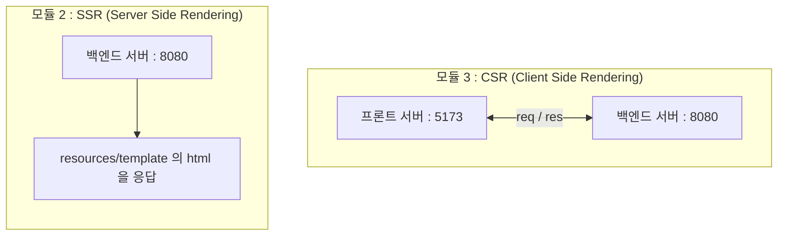
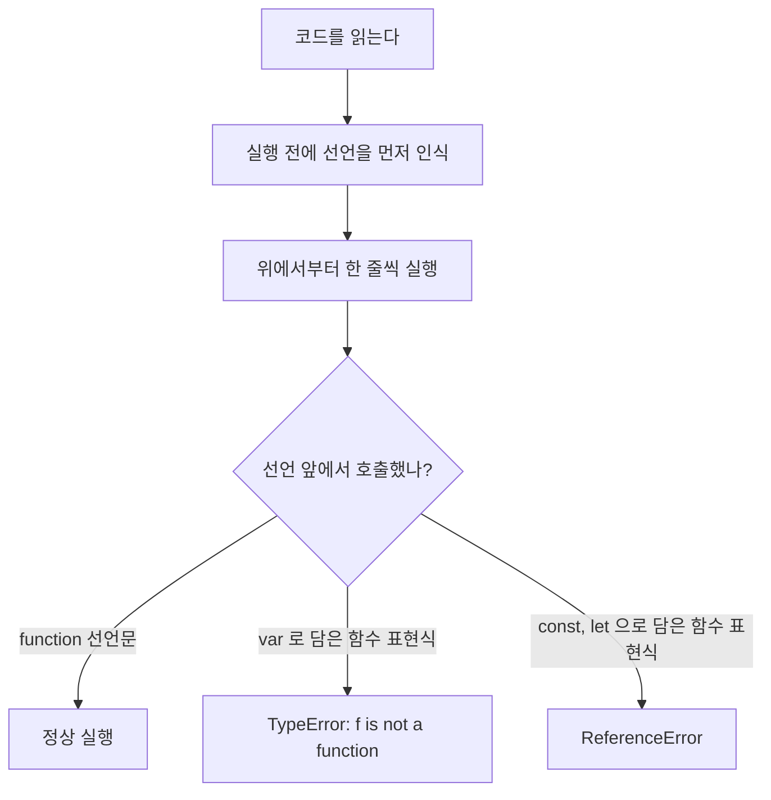
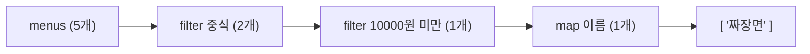

# 오늘 배운 것: JavaScript 핵심 문법: 타입은 값이 정하고, 함수가 중심이다

## 들어가며 (Situation)

모듈 3(프론트엔드) 2일차. 지금까지 Java와 Spring으로 만든 백엔드는 화면까지 서버가 만들어 보내는 구조였다. 오늘 수업에서 모듈 2와 모듈 3의 차이를 설명한 그림을 내 다이어그램으로 다시 그리면 이렇다.



| 구분 | 모듈 2 | 모듈 3 |
|------|--------|--------|
| 방식 | SSR (Server Side Rendering) | CSR (Client Side Rendering) |
| 서버 | 백엔드 8080 서버 하나 | 프론트 서버(5173)와 백엔드 서버(8080) |
| 화면 | 서버가 `resources/template`의 html을 만들어 응답 | 프론트 서버가 화면을 맡고, 백엔드와 req / res로 데이터를 주고받음 |

화면을 만드는 쪽이 프론트 서버로 옮겨 가므로, 그쪽에서 돌아가는 언어인 **JavaScript**를 먼저 익힌다. 오늘은 `11_JavaScript/01_Core`의 파일 여섯 개를 진행했다.

| 파일 | 다룬 내용 |
|------|-----------|
| `01_variable.js` | `let`, `const`, 동적 타입, `typeof` |
| `02_object.js` | 객체 리터럴, 프로퍼티 추가와 수정, `this` |
| `03_function.js` | 함수 선언문과 표현식, 호이스팅 |
| `04_arrow-function.js` | 화살표 함수 |
| `05_array.js` | 배열 |
| `06_higher-order-method.js` | 고차 함수 `forEach`, `map`, `filter`, `==`와 `===` |



코드 팝업의 `01_Core` 폴더에는 여섯 파일과 `run-results.txt`가 있다. 자바스크립트 파일에는 **코드 | 실행 결과** 탭이 붙지 않아서, 실행 결과는 일반 파일인 `run-results.txt`에 모았다. 이 파일의 앞부분은 각 파일을 새 폴더에서 `node`로 한 번씩 실행한 결과이고, 뒷부분(`수업 코드가 아니라 ...` 표시 아래)은 본문 설명을 확인하려고 만든 **짧은 예시 코드**와 그 결과다. 에디터로 여러 번 실행한 출력이 쌓여 있는 `result.txt`와는 다른 파일이다.

참고한 자료는 다음과 같다.

- 오늘 수업의 코드와 코드에 적힌 수업 주석
- 수업에서 설명한 SSR과 CSR 그림(내 다이어그램으로 다시 그림)
- 수업 Notion 자료 "6-3-1. JavaScript - Core (1)" 중 오늘 코드와 겹치는 차시(변수, 객체, 함수, 스코프, 배열). 내 문장으로 다시 정리했다.
- 글 끝의 MDN 공식 문서

막혔던 과정은 따로 지어내지 않았다. 대신 수업 주석이 말하는 동작(호이스팅, `typeof`, 화살표 함수 규칙)이 실제로 그렇게 나오는지 Node.js v24.20.0으로 직접 실행해서 확인했다.

## 문제 상황 (Task)

Java에 익숙한 상태로 JavaScript를 처음 만나면 같은 모양인데 다르게 동작하는 곳에서 헷갈린다. 오늘 쓴 코드에서 확인되는 차이는 크게 세 가지다.

- **타입**: Java는 변수를 선언할 때 자료형을 적지만, JavaScript는 값이 타입을 정한다.
- **함수**: Java는 클래스 안의 메서드로만 로직을 만들지만, JavaScript는 함수가 값처럼 쓰인다.
- **실행 순서**: 코드를 위에서 아래로 읽는 것 같지만 선언은 실행 전에 먼저 인식된다.

## 해결 과정 (Action)

### 1. 변수와 타입: 선언할 때가 아니라 값을 넣을 때 정해진다

```javascript
// Java : 자료형 변수명 = 리터럴;
// JavaScript : 변수표현식 변수명 = 리터럴;
let test = 1;
test = "문자열"   // 같은 변수에 다른 타입을 넣어도 된다
```

수업 주석이 `const`는 상수이고 Java의 `final`과 같다고 정리한다. 직접 확인한 결과다.

| 확인 | 결과 |
|------|------|
| `const shop = '원티드 식당'; shop = 1;` | `TypeError: Assignment to constant variable.` |
| `let test = 1; test = "문자열"` | 문제없이 동작 |

- **동적 타입 (Dynamic Typing)**
  - 변수의 타입이 선언 시점이 아니라 값을 할당하는 시점에 결정되는 방식이다.
  - 자료형을 신경 쓰지 않고 선언할 수 있는 대신, 값을 확인하기 전에는 타입을 확신할 수 없다(수업 주석의 장단점).

`typeof`로 값마다 타입을 찍어 본 결과는 이렇다.

| 대입한 값 | `typeof` 결과 |
|-----------|---------------|
| (값 없이 선언) | `undefined` |
| `1` | `number` |
| `"java"` | `string` |
| `true` | `boolean` |
| `null` | `object` |
| `{}` | `object` |
| `[]` | `object` |
| `function() {}` | `function` |

🔴 `null`도 객체도 배열도 모두 `object`로 나온다. `typeof`만으로는 이 셋을 구분할 수 없다. 배열인지는 `Array.isArray()`로 확인해야 하고, 실제로 `Array.isArray([])`는 `true`, `Array.isArray({})`는 `false`였다. 이 때문에 "값을 확인하기 전에는 타입을 확신할 수 없다"는 주석의 단점이 와닿았다.

⚠️ `01_variable.js`에는 `let`이나 `const` 없이 `str = 1;`을 쓴 줄이 있다. 그런데도 에러 없이 실행됐다. 선언 없이 값을 넣으면 전역 변수가 만들어진다(`typeof globalThis.str`가 `number`). 파일 맨 위에 `'use strict';`를 쓴 파일에서는 같은 줄이 `ReferenceError: str is not defined`가 됐다. 오타로 만든 변수가 조용히 전역이 될 수 있다는 뜻이라서, 변수는 항상 `let`이나 `const`로 선언하는 편이 안전하다.

### 2. 객체: 클래스 없이 중괄호로 만든다

중괄호 `{}`가 객체이고, 키와 값(프로퍼티)으로 이루어진다. 수업 주석은 Java의 `Store` 클래스에 빗댄다. `name`, `category`는 필드, `getInfo`는 메서드다.

```javascript
const store = {
    name : '원티드 식당',
    category : '분식',
    getInfo : function() {
        return `${this.name} 은 ${this.category} 전문점입니다!`
    }
};
```

- `${}`를 쓰는 백틱 문자열(템플릿 리터럴)로 값을 문자열에 끼워 넣는다.
- 메서드 안의 `this`는 그 객체(`store`)를 가리켜서 `원티드 식당 은 분식 전문점입니다!`가 출력됐다.

Java와 가장 다른 점은 만든 뒤에도 프로퍼티를 바꾸고 더할 수 있다는 것이다.

| 코드 | 객체의 상태 |
|------|-------------|
| `const order = {menuName : '치킨'}` | `{ menuName: '치킨' }` |
| `order.sauce = "뿌링클 시즈닝"` (추가) | `{ menuName: '치킨', sauce: '뿌링클 시즈닝' }` |
| `order.sauce = "맛초킹 시즈닝"` (수정) | `{ menuName: '치킨', sauce: '맛초킹 시즈닝' }` |

`order`는 `const`인데도 프로퍼티가 바뀐다. `const`가 막는 것은 변수에 **다른 값을 다시 대입하는 것**이고, 객체 안쪽의 변경은 아니기 때문이다.

### 3. 함수: 선언문과 표현식, 그리고 호이스팅

수업 주석은 JavaScript를 "function 기반의 객체지향 언어"라고 소개한다. 함수를 만드는 방법은 두 가지다.

```javascript
// 함수 선언문
function welcome(name) { return `${name} 님, 반갑습니다~~!!`; }

// 함수 표현식 (함수를 변수에 담는다)
const welcome2 = function (name) { return `${name} 님, 반갑습니다~~!!`; }
const welcome3 = function hello(name) { return `${name} 님, 반갑습니다~~!!`; }
```

`welcome3`처럼 함수에 이름(`hello`)을 붙여 변수에 담은 경우, 변수 이름으로는 부를 수 있지만 `hello(...)`를 직접 부르면 에러가 났다. 수업 코드에서 그 줄이 주석 처리된 채 남아 있는 것도 이 때문으로 보인다. 확인한 결과 `welcome3.name`은 `hello`이지만, 바깥에서 `hello('x')`를 부르면 `ReferenceError: hello is not defined`였다. 함수 표현식의 이름은 함수 안에서만 의미가 있다.

수업의 핵심은 **호이스팅**이다. 주석의 설명은 "함수 선언문은 런타임 이전에 JS 엔진에 의해 먼저 실행된다(인식)"이다.

- **호이스팅 (Hoisting)**
  - 선언이 코드 실행 전에 먼저 인식되어서, 선언문보다 위에서 그 이름을 쓸 수 있게 되는 동작이다.
  - 함수 선언문은 위에서 불러도 동작하지만, 함수 표현식은 어떤 키워드로 담았느냐에 따라 결과가 갈린다.



수업 코드의 마지막 부분이 이 실험이다. 선언문 `cook`은 위에서 불러도 되고, 표현식 `test1`은 위에서 부르면 에러가 난다.

```javascript
console.log(cook('떡볶이'));    // 선언문 : 아래에 있어도 호출된다
function cook(menuName) { return `${menuName} 조리 시~~작~~!!` }

console.log(test1("떡볶이"));   // 표현식 : 아직 값이 없다
const test1 = function cook(menuName) { return `${menuName} 조리 시~~작~~!!` }
```

실행하면 `cook` 호출 줄은 `떡볶이 조리 시~~작~~!!`을 출력하고, 이어서 `test1` 호출에서 `ReferenceError: Cannot access 'test1' before initialization`로 끝난다(종료 코드 1). 에러로 끝나는 것이 이 파일의 의도다. `const`로 만든 표현식은 선언 줄에 닿기 전까지 접근이 막혀 있다. 이 구간을 흔히 TDZ(Temporal Dead Zone)라고 부르고, 이 용어는 MDN의 `let` 문서에서 확인했다.

수업에서 다루지 않은 `var`와 비교하려고 따로 확인한 결과다.

| 선언 앞에서 사용할 때 | 결과 |
|-----------------------|------|
| `function f() {}` (선언문) | 정상 실행 |
| `var a = 1;` 위에서 `console.log(a)` | `undefined` (에러 없음) |
| `var f = function() {}` 위에서 `f()` | `TypeError: f is not a function` |
| `let b = 1;` 위에서 `console.log(b)` | `ReferenceError: Cannot access 'b' before initialization` |

`var`는 선언만 먼저 인식되고 값은 `undefined`로 시작해서 에러 없이 `undefined`가 나온다. `let`과 `const`는 에러로 알려 주므로 실수를 일찍 잡을 수 있다.

### 4. 화살표 함수: 줄이는 규칙과 함정

화살표 함수는 `function` 키워드, 중괄호, `return`을 줄인 문법이다. 수업 코드는 같은 함수를 단계별로 줄여 간다.

| 형태 | 코드 |
|------|------|
| 함수 표현식 | `message = function() { return '주문 접수 OK! 👌' }` |
| 화살표 + 중괄호 + return | `message = () => { return '주문 접수 OK! 👌' }` |
| 본문이 한 줄이면 중괄호와 return 생략 | `message = () => '주문 접수 OK! 👌'` |
| 매개변수가 있을 때 | `` message = (menuName, menuPrice) => `${menuName} 의 가격 : ${menuPrice}` `` |
| 매개변수가 1개면 소괄호도 생략 | `` message = menuName => `${menuName} !!` `` |

가장 많이 쓰이는 곳은 뒤에 나오는 고차 함수다. `[4000, 5000, 140000]`을 10% 할인하는 두 코드의 결과는 같았다.

```javascript
menuPriceList.map( function(price) {return price * 0.9} )   // [ 3600, 4500, 126000 ]
menuPriceList.map( price => price * 0.9 )                   // [ 3600, 4500, 126000 ]
```

수업 주석은 Java의 람다 표현식이 이 화살표 함수를 본떠 나왔다고 말한다. 줄이기만 하는 것이 아니라서, 직접 만들어 본 함정 두 가지를 정리한다.

🔴 객체를 바로 반환하려고 중괄호를 쓰면 객체가 아니라 **블록**으로 읽힌다.

```javascript
const a = () => { name: 'x' };      // a()  -> undefined
const b = () => ({ name: 'x' });    // b()  -> { name: 'x' }
```

중괄호 `{}`가 블록으로 먼저 읽힌다는 점에서, 수업 주석이 경고한 "중괄호 블럭 내에 코드가 많으면 생략할 수 없다"와 관련이 있다. 객체를 반환할 때는 괄호로 감싼다.

⚠️ 화살표 함수는 `02_object.js`의 `getInfo`처럼 객체의 메서드를 만드는 데 쓰면 `this`가 달라진다. 같은 객체에 `function`으로 만든 메서드와 화살표 함수로 만든 메서드를 두고 `this.name`을 읽었더니, 앞의 것은 `원티드 식당`, 뒤의 것은 `undefined`였다. 화살표 함수는 자기만의 `this`를 갖지 않고 바깥의 `this`를 쓴다는 MDN의 설명과 같은 결과다. 그래서 메서드는 `function`(또는 메서드 축약 문법)으로, 짧은 콜백은 화살표 함수로 쓰는 것이 안전하다.

### 5. 배열: 어떤 값이든 담긴다

수업 주석은 Java 배열은 같은 자료형만 담을 수 있지만 JavaScript 배열은 무엇이든 담을 수 있다고 설명한다.

```javascript
const menus = ['제육', '떡볶이', '순대', 1, {name : 'hi'}, function(){}];
for(let i = 0; i < menus.length; i++) { console.log(menus[i]); }
```

문자열, 숫자, 객체, 함수가 한 배열에 들어갔고 출력은 `제육`, `떡볶이`, `순대`, `1`, `{ name: 'hi' }`, `[Function (anonymous)]`였다. 반복문으로 순회하는 방식은 Java와 같다. 이 방식은 다음 파일에서 고차 함수로 바뀐다.

### 6. 고차 함수: 반복문 대신 함수를 넘긴다

- **고차 함수 (Higher-Order Function)**
  - 함수를 인자로 받거나, 함수를 반환하는 함수다.
  - 배열의 고차 함수는 **콜백 함수**를 받아서 요소를 하나씩 처리한다.

다섯 개의 메뉴 객체로 세 가지를 비교했다.

| 메서드 | 하는 일 | 반환값 | 확인 |
|--------|---------|--------|------|
| `forEach` | 요소마다 콜백 실행 | 없음 (`undefined`) | 콘솔에 메뉴 5개를 출력 |
| `map` | 콜백의 반환값으로 새 배열을 만든다 | 새 배열 | `[ '치즈떡볶이', '짜장면', '김치찌개', '마라탕', '라멘' ]` |
| `filter` | 콜백이 `true`인 요소만 모은다 | 새 배열 | 중식 2개, 만원 미만 1개 |

세 메서드 모두 원본 `menus`는 바꾸지 않았다(원본 길이 그대로). 이 방식은 Java의 `stream`에서 쓴 `map`, `filter`와 같은 생각이다. 25일차에 `menuList.stream().map(MenuDTO::from).toList()`로 Entity 목록을 DTO 목록으로 바꾼 것이 JavaScript의 `map`과 같다.

`filter`에서 쓴 `===`와 `==`도 정리한다.

| 비교 | 결과 | 설명 |
|------|------|------|
| `1 == '1'` | `true` | 동등 비교, 암묵적으로 타입을 바꿔서 비교한다 |
| `1 === '1'` | `false` | 일치 비교, 타입과 값이 모두 같아야 한다 |
| `null == undefined` / `null === undefined` | `true` / `false` | |
| `0 == false` / `0 === false` | `true` / `false` | |
| `'' == 0` / `'' === 0` | `true` / `false` | |

`==`는 타입이 다른 값도 같다고 판단할 때가 있어서 의도하지 않은 `true`가 나올 수 있다. 그래서 수업 코드도 `category === '중식'`처럼 `===`를 썼다.

`filter`와 `map`을 이어 붙이면 "조건에 맞는 메뉴의 이름 목록"이 한 번에 만들어진다.

```javascript
const result = menus
    .filter(menu => menu.category === '중식')   // 5개 -> 2개
    .filter(menu => menu.price < 10000)         // 2개 -> 1개
    .map(menu => menu.name)                     // 객체 -> 이름
// [ '짜장면' ]
```



🔴 이 부분의 주석은 "분식 중에서 가격이 1만원 미만인 메뉴의 이름 목록"인데, 코드는 `'중식'`으로 필터한다. 실행 결과는 코드를 따라서 `[ '짜장면' ]`이다. 주석대로 `'분식'`으로 바꿔서 확인하니 결과는 `[]`였다. 분식인 치즈떡볶이가 14000원이라 1만원 미만이 없기 때문이다. 주석과 코드가 어긋날 때는 실행 결과가 기준이라는 것을 다시 확인했다.

### 7. Java와 JavaScript 비교 정리

오늘 코드에서 확인한 차이를 한 표에 모았다.

| 항목 | Java | JavaScript |
|------|------|------------|
| 타입 | 선언할 때 자료형을 적는다 | 값을 넣을 때 정해진다 (동적 타입) |
| 변수 | `자료형 변수명 = 값;` | `let`, `const`, (`var`) |
| 상수 | `final` | `const` |
| 객체 만들기 | 클래스를 정의하고 `new` | 중괄호 `{}`로 바로 만든다. 만든 뒤 프로퍼티 추가와 수정도 된다 |
| 함수 | 클래스 안의 메서드 | 값처럼 쓰는 함수. 객체지향도 함수 기반이라고 소개됨 |
| 람다 | 람다 표현식 | 화살표 함수(람다가 본떠 나온 쪽) |
| 배열 | 같은 자료형만 | 어떤 값이든 |
| 컬렉션 처리 | `stream().map().filter()` | `map()`, `filter()`, `forEach()` |
| 지역 변수를 선언 앞에서 사용 | 컴파일 에러 | `let`/`const`는 `ReferenceError`, `var`는 `undefined`, 함수 선언문은 호출 가능 |

### 8. 수업 Notion 자료에서 보충한 것

Notion의 "6-3-1. JavaScript - Core (1)" 자료에서 오늘 코드와 겹치는 차시(`02_variable`, `04_object-literal`, `05_function`, `06_scope`, `08_array`)를 읽었다. 오늘 코드에는 없지만 이해에 도움이 된 내용만 내 문장으로 정리했고, 동작은 예시 코드로 직접 실행해서 확인했다(`run-results.txt` 뒷부분).

**타입을 보는 두 가지 축**

- **정적·동적 타입과 강한·약한 타입**
  - 언어를 나누는 두 기준으로, 타입을 언제 검사하느냐(정적·동적)와 타입이 다른 값을 얼마나 엄격하게 막느냐(강한·약한)다.
  - 두 축은 서로 따로라서, 같은 동적 타입 언어라도 성격이 다를 수 있다.

| 언어 | 검사 시점 | 타입이 다른 값을 만나면 |
|------|-----------|--------------------------|
| Java | 정적 (컴파일) | 강함. `int a = 1; a = "문자열";`은 `incompatible types: String cannot be converted to int` 컴파일 에러 |
| Python | 동적 (실행) | 강함. `1 + '1'`은 `TypeError: unsupported operand type(s) for +: 'int' and 'str'` |
| JavaScript | 동적 (실행) | 약함. `1 + '1'`은 에러 없이 `'11'`, `'10' - 5`는 `5` |

같은 문자열인데 `+`에서는 이어 붙이고 `-`에서는 숫자로 바꿔서 계산한다. 에러가 나지 않으니 결과가 틀려도 모르고 지나가기 쉽다.

**숫자는 `number` 하나다**

- 정수와 실수를 구분하지 않아서 `10 === 10.0`이 `true`이고 `10 / 4`는 `2.5`다. Java에서 `10 / 4`는 `2`였다.
- 0으로 나눠도 에러가 아니라 `Infinity`(음수면 `-Infinity`)가 나오고(Java에서 정수를 0으로 나누면 `ArithmeticException: / by zero`였다), 숫자가 아닌 값을 곱하면 `NaN`이 나온다. `typeof NaN`은 `'number'`다.
- 안전하게 다룰 수 있는 정수의 범위(`Number.MAX_SAFE_INTEGER`, 9007199254740991)를 넘으면 에러 없이 부정확한 값이 된다. `MAX_SAFE_INTEGER + 1`과 `+ 2`가 둘 다 `9007199254740992`였다. 숫자 뒤에 `n`을 붙이는 `bigint`는 `9007199254740993n`을 그대로 표현했다.
- 이 한계는 서버와 만나는 곳에서 드러난다. 서버가 `Long` ID를 JSON 숫자로 내려 주면 `JSON.parse('{"id":9007199254740993}').id`가 `9007199254740992`로 읽혔다. 자료는 서버가 그런 ID를 문자열로 내려 주는 방식으로 푼다고 소개한다.

**암묵적 형변환과 비교**

- 단항 `+`는 값을 숫자로 바꾼다. `+'1'`은 `1`, `+''`는 `0`, `+true`는 `1`, `+null`은 `0`, `+undefined`는 `NaN`이었다.
- 거짓으로 취급되는 값은 `false`, `0`, `''`, `null`, `undefined`, `NaN` 여섯 개뿐이고 나머지는 전부 참이다. 빈 배열과 빈 객체도 참이라서 `if (list)`는 빈 배열에서도 실행됐다. 배열이 비었는지는 `list.length > 0`으로 확인한다.
- `==`는 타입을 바꾼 뒤 값을 비교하고 `===`는 바꾸지 않고 타입까지 비교한다. Java의 `==`는 기본형이면 값을, 참조형이면 주소를 비교한다. `new String("a") == new String("a")`는 `false`였고 `equals()`는 `true`였다. JavaScript의 `==`는 주소가 아니라 타입을 바꿔서 비교하는 것이라 이름만 같고 다른 이야기다.
- `NaN === NaN`은 `false`라서 `Number.isNaN()`으로 확인한다. 문자열을 숫자로 바꿀 때 `Number('10px')`는 `NaN`이고 `parseInt('10px')`는 앞에서부터 읽을 수 있는 만큼만 읽어 `10`이었다. 입력값 검증에는 `Number()`가 안전하다.

🔴 Java에서는 `Integer.parseInt("스물")`이 `NumberFormatException: For input string: "스물"`로 멈추는 자리를, JavaScript는 `NaN`을 돌려주고 계속 간다. 그 `NaN`이 계산에 섞이면 결과도 `NaN`이 되어 화면까지 흘러간다. 변환한 뒤에는 `Number.isNaN()`으로 확인하는 습관이 필요하다.

**`undefined`와 `null`**

`undefined`는 값이 아직 담긴 적 없다는 뜻으로 엔진이 넣는 값이고, `null`은 값이 없다고 개발자가 의도적으로 표시하는 값이다. `null == undefined`는 `true`이고 `null === undefined`는 `false`였다. 값이 없는지를 한 번에 확인할 때만 `==`를 쓰는 것이 거의 유일한 예외라고 자료는 설명한다.

**객체: 없는 프로퍼티와 오타**

- 없는 프로퍼티를 읽으면 에러 없이 `undefined`이고, 오타로 대입하면 새 프로퍼티가 만들어진다. `dog.nmae = '초코'`가 `{ name: '뽀삐', nmae: '초코' }`가 됐다.
- 한 단계 더 들어가 `dog.owner.name`을 읽으면 `TypeError: Cannot read properties of undefined (reading 'name')`이 난다. 옵셔널 체이닝 `dog.owner?.name`은 에러 없이 `undefined`였다.

**선언 키워드 정리**

수업 자료가 정리한 원칙은, 기본은 `const`로 쓰고 값을 바꿔야 할 때만 `let`을 쓰며 `var`는 쓰지 않는 것이다. `var`에는 세 가지 문제가 있다. 같은 이름을 다시 선언해도 막지 않고, 블록이 아니라 함수 단위로 범위가 정해지며, 선언 앞에서 에러 없이 쓸 수 있다.

| 확인 | 결과 |
|------|------|
| `for (var i = 0; ...)` 뒤에서 `console.log(i)` | `3` (블록 밖에서도 보인다) |
| `var a = 1; var a = 2;` | 에러 없이 `a`는 `2`. `let b`를 두 번 선언하면 `SyntaxError: Identifier 'b' has already been declared` |
| 함수 안 `if` 블록에서 `var inner`를 선언하고 블록 밖에서 읽기 | 함수 안에서는 읽힌다(함수 단위 범위). 함수 밖에서 `typeof inner`는 `'undefined'` |
| `for (let j = 0; ...)` 뒤에서 `typeof j` | `'undefined'` (블록 밖에서는 없다) |
| 함수 안에서 선언 없이 `leaked = '...'` 대입 후 함수 밖에서 읽기 | 읽힌다 (암묵적 전역) |
| `for (const n = 0; n < 3; n++)` | `TypeError: Assignment to constant variable.` |
| `for (const fruit of [...])` | 정상 (`사과`, `바나나`) |

`const`로 카운터를 올릴 수는 없지만, 반복할 때마다 변수를 새로 만드는 `for...of`에서는 쓸 수 있다.

**콜백과 배열 메서드**

- 콜백 함수는 다른 함수의 인자로 넘기는 함수다. 넘길 때 괄호를 붙이면 함수가 아니라 실행한 결과를 넘기게 된다. `apply(inc, 5)`는 `6`이었고, `apply(inc(5), 5)`는 `TypeError: func is not a function`이었다.
- 화살표 함수는 중괄호를 쓰면 `return`을 직접 적어야 한다. `n => { n * 2; }`는 `undefined`를 돌려주고, 이것을 `map`에 쓰면 `[ undefined, undefined, undefined ]`가 나온다. 에러가 없어서 화면이 비어 보이는 증상으로만 드러난다.
- 배열 메서드는 두 부류로 나뉜다. `push`, `pop`, `shift`, `unshift`, `splice`, `sort`, `reverse`는 **원본을 바꾸고**, `map`, `filter`, `concat`, `slice`와 스프레드(`...`)는 **새 배열을 만든다**.

| 확인 | 결과 |
|------|------|
| `scores = [30, 10, 20]`을 `scores.sort(...)` | 원본이 `[ 10, 20, 30 ]`으로 바뀐다 |
| `[...scores].sort(...)` | 복사본만 정렬되고 원본은 그대로 |
| `b = [1, 2, 3]`에 `b.map(x => x * 2)` | `b`는 `[ 1, 2, 3 ]` 그대로 |
| `b.push(4)` | `b`가 `[ 1, 2, 3, 4 ]`로 바뀐다 |
| `push`, `pop`, `unshift`, `shift`, `splice(1, 1)`, `reverse`를 차례로 호출 | 호출할 때마다 같은 배열이 바뀌어 마지막에 `[ 3, 1 ]`이 된다 |
| `a.concat([4])`, `a.slice(0, 2)` | 새 배열이 나오고(`a === c`, `a === s`가 `false`) `a`는 `[ 1, 2, 3 ]` 그대로 |
| `[1, 2].forEach(x => x).map(x => x)` | `TypeError: Cannot read properties of undefined (reading 'map')` |

`forEach`는 `undefined`를 돌려주므로 뒤에 `map`을 이어 붙일 수 없다.

프론트엔드 수업 자료는 이 문법들이 React 코드에서 어떻게 나타나는지도 함께 짚는다(입력창의 값은 언제나 문자열이라 계산 전에 `Number()`로 바꿔야 하고, 목록 화면은 `map`으로 그린다는 식이다). React는 아직 다루지 않았으므로 이 글에서는 제외했다.

## 결과 (Result)

수업 파일 여섯 개를 각각 실행하고, 설명에 필요한 동작을 짧은 예시 코드로 확인했다.

| 확인한 것 | 결과 |
|-----------|------|
| 수업 파일 6개 실행 | 5개는 정상 종료(종료 코드 0), `03_function.js`만 의도한 TDZ 에러로 종료 코드 1 |
| `typeof` 8가지 값 | `null`, `{}`, `[]`가 모두 `object` (구분은 `Array.isArray`) |
| 호이스팅 | 선언문 `cook`은 위에서 호출 가능, `const`로 만든 표현식은 `ReferenceError` |
| `var` 비교 (예시) | `undefined`로 시작, 함수 표현식은 `TypeError` |
| 화살표 함수 (예시) | 객체 반환은 괄호 필요, 메서드에서는 `this`가 달라짐 |
| 고차 함수 체인 | 5개 → 2개 → 1개 → `[ '짜장면' ]` (분식으로 바꾸면 `[]`) |
| 형변환·falsy·큰 정수 (예시) | `1 + '1'`은 `'11'`, 거짓 값은 6개, `MAX_SAFE_INTEGER + 1`과 `+ 2`가 같은 값 |
| Java 비교 (예시) | `int`에 문자열은 컴파일 에러, `10 / 4`는 `2`, `10 / 0`과 `parseInt("스물")`은 예외 |

- 같은 5개 메뉴에서 "중식, 1만원 미만, 이름만"을 반복문 없이 `filter`, `filter`, `map` 세 단계 체인으로 뽑았다.
- 수업 주석과 코드가 다른 곳(분식과 중식)이 있었고, 실행해서 확인하는 것으로 해결했다.

배운 점은 이렇다.

- JavaScript는 타입을 값이 정하므로, 타입을 믿고 쓰기보다 `typeof`와 `Array.isArray`로 확인하는 습관이 필요하다.
- 함수를 어떤 방식(선언문, `var`, `let`/`const`)으로 만들었느냐에 따라 선언 앞에서 부른 결과가 달라진다. `let`과 `const`는 에러로 알려 주므로 더 안전하다.
- 화살표 함수는 줄이기만 하는 문법이 아니다. 객체를 반환할 때의 괄호와 `this` 차이를 알아야 한다.
- `map`, `filter` 체인은 Java의 stream과 같은 생각이라서, 이미 쓴 `stream` 코드와 연결해 읽으면 빠르다.
- `NaN`, 빈 배열, 큰 정수, 오타 프로퍼티처럼 JavaScript는 에러 없이 틀린 값이 흘러가는 경우가 많다. 에러가 안 난다고 맞는 것이 아니라서, 값을 직접 찍어 확인하는 습관이 필요하다.
- 주석보다 실행 결과를 믿고, 헷갈리면 작은 코드로 확인한다.

## 더 학습하면 좋은 개념

- **스코프와 클로저** — 오늘은 `var`가 선언 앞에서 `undefined`가 되는 것만 봤다. 변수가 어디까지 보이는지(함수 스코프와 블록 스코프)와 함수가 바깥 변수를 기억하는 클로저를 알아야 콜백 안의 변수를 안전하게 다룬다.
- **`this` 바인딩 규칙** — 화살표 함수로 만든 메서드에서 `this.name`이 `undefined`가 되는 것을 봤다. 함수를 어떻게 호출하느냐에 따라 `this`가 달라지는 규칙을 알아야 이벤트 핸들러와 클래스를 쓸 때 실수하지 않는다.
- **Promise와 `async/await`, `fetch`** — 위 다이어그램의 CSR은 프론트 서버가 백엔드와 req/res로 데이터를 주고받는 구조다. 그 통신을 자바스크립트에서 하는 방법이 비동기 처리라서, CSR을 직접 다루려면 필요해진다.
- **`reduce`, `find`, `some` 같은 배열 고차 함수** — 오늘은 `forEach`, `map`, `filter` 세 가지만 다뤘다. 합계를 구하거나 하나만 찾는 일은 나머지 메서드로 처리하므로, 같은 콜백 방식으로 확장해 읽을 수 있다.
- **클래스 문법과 프로토타입** — Java의 클래스와 비교하며 객체를 만드는 다른 방법이다. 오늘은 객체 리터럴로만 만들었는데, 같은 모양의 객체를 여러 개 만들어야 할 때 필요한 개념이다.

## 참고 자료

- [MDN - 문법과 자료형 (Grammar and types)](https://developer.mozilla.org/en-US/docs/Web/JavaScript/Guide/Grammar_and_types)
- [MDN - typeof 연산자](https://developer.mozilla.org/en-US/docs/Web/JavaScript/Reference/Operators/typeof)
- [MDN - const](https://developer.mozilla.org/en-US/docs/Web/JavaScript/Reference/Statements/const)
- [MDN - let (Temporal Dead Zone)](https://developer.mozilla.org/en-US/docs/Web/JavaScript/Reference/Statements/let)
- [MDN - 호이스팅 (Hoisting)](https://developer.mozilla.org/en-US/docs/Glossary/Hoisting)
- [MDN - 함수 (Functions)](https://developer.mozilla.org/en-US/docs/Web/JavaScript/Guide/Functions)
- [MDN - 화살표 함수 (Arrow functions)](https://developer.mozilla.org/en-US/docs/Web/JavaScript/Reference/Functions/Arrow_functions)
- [MDN - 동등 비교와 동일성 (Equality comparisons)](https://developer.mozilla.org/en-US/docs/Web/JavaScript/Guide/Equality_comparisons_and_sameness)
- [MDN - Array.prototype.forEach](https://developer.mozilla.org/en-US/docs/Web/JavaScript/Reference/Global_Objects/Array/forEach)
- [MDN - Array.prototype.map](https://developer.mozilla.org/en-US/docs/Web/JavaScript/Reference/Global_Objects/Array/map)
- [MDN - Array.prototype.filter](https://developer.mozilla.org/en-US/docs/Web/JavaScript/Reference/Global_Objects/Array/filter)

## 숙제: Java와 JavaScript 동작 원리 비교

`03_function.js`의 수업 주석이 낸 오늘의 미션은 Java와 JavaScript의 동작 원리를 비교해서 서로에게 이해시킬 수 있는 자료를 만드는 것이었다. 아래 그림 네 장은 Claude의 도움으로 만들었고, 오늘 직접 실행해서 확인한 결과만 담았다.

### 1. 코드가 실행되기까지


- Java는 `javac`가 먼저 문법과 타입을 검사하고 바이트코드(`.class`)로 바꾼 뒤 JVM이 실행한다. 컴파일 에러가 있으면 프로그램이 시작조차 되지 않는다.
- JavaScript는 개발자가 따로 컴파일하지 않고 엔진(Node.js, 브라우저)이 읽어서 실행한다. 실행 전에 선언을 먼저 인식하고(호이스팅), 이어서 위에서부터 한 줄씩 실행한다.
- 그래서 에러를 알게 되는 시점이 다르다. `03_function.js`는 앞의 출력들이 먼저 나온 뒤 50번째 줄에서 `ReferenceError`로 멈췄다.

### 2. 타입은 변수가 아니라 값이 가진다


- Java의 변수는 `int`처럼 타입이 붙은 상자라서 다른 타입을 넣으면 컴파일 에러다. JavaScript는 값이 타입을 가지므로 같은 변수에 숫자를 넣었다가 문자열을 넣어도 된다.
- `typeof`는 `null`, `{}`, `[]`를 모두 `'object'`로 돌려준다. 배열인지 확인하려면 `Array.isArray()`를 쓴다.
- `const`는 Java의 `final`처럼 재대입을 막는다. 다만 객체 안쪽 프로퍼티를 바꾸는 것은 막지 않는다.

### 3. 선언보다 위에서 불러 보면


- JS 엔진은 실행 전에 선언을 먼저 인식한다. 그런데 무엇으로 만들었는지에 따라 선언 앞에서 부른 결과가 갈린다.
- `function` 선언문은 통째로 먼저 인식되어서 위에서 불러도 정상 실행된다.
- `var`로 만든 함수 표현식은 이름만 먼저 인식되고 값은 `undefined`라서 `TypeError: f is not a function`이 난다.
- `const`와 `let`으로 만든 표현식은 선언 줄에 닿기 전까지 접근할 수 없어서 `ReferenceError`(TDZ)가 난다.

### 4. 화살표 함수와 filter · map 체인


- 화살표 함수는 `function`과 중괄호, `return`을 줄인 문법이다. 본문이 한 줄이면 중괄호와 `return`을, 매개변수가 하나면 소괄호까지 생략할 수 있다.
- `filter`와 `map`은 원본 배열을 바꾸지 않고 새 배열을 만든다. 5개 메뉴가 `filter`(중식)로 2개, `filter`(1만원 미만)로 1개, `map`(이름)으로 `[ '짜장면' ]`이 된다.
- 객체를 바로 반환할 때는 `({ ... })`처럼 괄호로 감싸야 하고, 객체의 메서드를 화살표 함수로 만들면 `this`가 달라진다.
