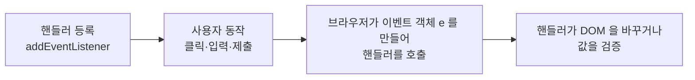

# 오늘 배운 것: 스프레드·구조 분해와 DOM 이벤트로 화면을 움직이다

## 들어가며 (Situation)

모듈 3(프론트엔드) 3일차. 2일차에 JavaScript 핵심 문법(변수, 객체, 함수, 화살표 함수, 고차 함수)을 익혔고, 오늘은 두 갈래로 나아갔다.

- `01_Core`의 마지막 두 파일: 값을 **복사하고 분해하는** 문법(스프레드, 구조 분해 할당)
- `02_Web`: 지금까지 `node`로만 돌리던 JavaScript를 처음으로 **브라우저의 HTML 안에서** 돌리며 화면(DOM)을 다루는 것

| 파일 | 다룬 내용 |
|------|-----------|
| `01_Core/07_spread-syntax.js` | 배열·객체 복사, 대입과 스프레드의 차이 |
| `01_Core/08_destructuring.js` | 배열·객체 구조 분해 할당, 나머지(rest) 모으기 |
| `02_Web/01_DOM/01_get-element.html` | 요소 노드 취득(id, 태그, class, CSS 선택자) |
| `02_Web/02_EVENT/01_event-handler.html` | 이벤트 핸들러 등록 방법 세 가지와 제거 |
| `02_Web/02_EVENT/02_event-object.html` | 이벤트 객체, 핸들러 안의 `this` |
| `02_Web/02_EVENT/03_form-event.html` | 폼 요소 값 다루기, focus·change·input·submit 이벤트 |



코드 팝업에는 위 여섯 파일과 `run-results.txt`가 있다. `run-results.txt`의 앞부분은 수업 파일을 `node`(js)와 헤드리스 Chrome(html)에서 실행한 결과이고, 뒷부분(`수업 코드가 아니라 ...` 표시 아래)은 본문 설명을 확인하려고 만든 **짧은 예시 코드**와 그 결과다. 에디터에서 여러 번 실행해 쌓인 `result.txt`와는 다른 파일이다.

참고한 자료는 다음과 같다.

- 오늘 수업의 코드와 코드에 적힌 수업 주석
- 수업 Notion 자료의 해당 차시(`4_spread-syntax`, `5_destructuring-assignment`, `1-1`, `1-2`, `1-5`). 아래 8절에서 내 문장으로 정리했다.

## 문제 상황 (Task)

오늘 코드를 읽으며 막힌 곳은 세 군데였다.

- **복사**: `const cartRef = cart`와 `const cartCopy = [...cart]`가 둘 다 "복사"처럼 보이는데, 한쪽만 원본이 바뀐다. 수업 주석의 용어(깊은 복사, 얕은 복사)와 실제 동작이 맞는지 확인이 필요했다.
- **DOM**: 같은 `id`가 두 번 나오면 어떻게 되는지, `getElementsByTagName`이 돌려준 값에 왜 `forEach`가 안 되는지.
- **이벤트**: 핸들러를 등록하고 바로 제거하는 코드가 수업 파일에 있는데 그 결과가 무엇인지, 이벤트 객체와 `this`가 등록 방식마다 어떻게 다른지.

그래서 수업 코드를 그대로 실행해 보고, 의문이 생기는 곳마다 짧은 예시 코드를 만들어 결과를 확인했다. 브라우저 동작은 헤드리스 Chrome에서 콘솔 출력과 이벤트 결과를 기록했다.

## 해결 과정 (Action)

### 1. 스프레드 문법: 대입은 복사가 아니다

`07_spread-syntax.js`의 첫 부분을 실행한 결과는 이렇다.

```text
[ '치킨', '피자', '파스타' ] [ '치킨', '피자', '파스타' ]
[ '치킨', '피자', '파스타' ] [ '치킨', '피자', '빠네파스타' ]
true
false
```

`cartRef.push('파스타')`를 했는데 `cart`도 같이 바뀌었고, `cartCopy.push('빠네파스타')`는 `cart`를 건드리지 않았다. 객체도 같다. `order === orderRef`는 `true`, `order === orderCopy`는 `false`였다.

| 코드 | 새 객체가 만들어지나 | `===`로 비교하면 | 한쪽을 바꾸면 |
|------|----------------------|------------------|----------------|
| `const cartRef = cart` | 아니오. 같은 배열을 가리킨다 | `true` | 원본도 바뀐다 |
| `const cartCopy = [...cart]` | 예. 한 겹을 새로 만든다 | `false` | 원본은 그대로 |

🔴 수업 파일 주석은 `cartRef = cart` 줄에 "깊은 복사 (주소값을 복사)"라고 적혀 있다. 이 용어는 틀리다. 깊은 복사는 **안쪽까지 모두 새로 만드는** 복사이고, 대입은 새로 만드는 것이 아니라 **같은 것을 가리키는 것**이다. 같은 줄의 스프레드 쪽 주석 "얕은 복사"는 맞다. 이후 설명은 "대입 = 같은 것을 가리킴, 스프레드 = 얕은 복사, `structuredClone` = 깊은 복사"로 정리했다.

스프레드가 한 겹만 복사한다는 것은 중첩 객체로 확인했다(예시 코드).

```js
const origin = { name: '홍길동', address: { city: '서울' } };
const shallow = { ...origin };
shallow.name = '유관순';
shallow.address.city = '부산';
console.log(origin.name, origin.address.city, origin.address === shallow.address);
// 홍길동 부산 true
```

바깥 프로퍼티는 원본을 지키는데, 안쪽 객체(`address`)는 원본과 복사본이 같은 것을 가리켜서 `부산`으로 바뀌었다. 안쪽도 `{ ...origin.address }`로 한 번 더 펼치거나 `structuredClone(origin)`을 쓰면 원본이 그대로였다(`부산 광주`).

- **얕은 복사 (Shallow Copy)**
  - 객체의 바깥 한 겹만 새로 만들고, 안쪽 객체는 원본과 같은 것을 가리키게 두는 복사다.
  - 스프레드(`...`), `Object.assign`, `slice()`가 모두 여기에 해당한다. 결과는 같다(`[ 10, 30, 20 ]`).
  - 안쪽까지 분리하려면 안쪽도 따로 펼치거나 `structuredClone`을 쓴다.
- **깊은 복사 (Deep Copy)**
  - 안쪽 객체까지 모두 새로 만들어서 원본과 아무것도 공유하지 않는 복사다.

수업 주석의 "메뉴 데이터를 이곳저곳에서 쓰는데 한 군데서 고치면 다른 곳 값이 영문도 모른 채 바뀐다"는 경고는 위 첫 번째 표(대입) 이야기다.

### 2. 구조 분해 할당

`08_destructuring.js`는 `const [chi1, piz1] = menuArr`처럼 배열을 순서대로, `const { name, price, category } = menu`처럼 객체를 이름으로 분해한다. 실행 결과는 다음과 같았다.

```text
치킨
피자
치킨
피자
{ name: '치즈알밥', price: 7500, category: '퓨전한식' }
치즈알밥 7500 퓨전한식
```

수업 주석처럼 객체 구조 분해에서는 **프로퍼티 이름이 변수 이름이 된다.** 파일 맨 끝에 주석 처리된 `console.log(name1, price1, category1)`을 풀면 어떻게 될까. 변수를 만든 적이 없으니 `ReferenceError: name1 is not defined`가 났다. 반대로 `const { name1, price1 } = menu`처럼 **분해 대상이 없는 이름으로 분해하면** 에러 없이 `undefined undefined`가 된다.

🟢 `const { ...rest } = menu`는 나머지 프로퍼티를 전부 새 객체로 모으는데, 결과적으로 `{ ...menu }`와 같은 얕은 복사다. 수업 파일이 스프레드와 구조 분해를 결합하는 부분이 이것이다.

### 3. DOM 요소 취득

`01_get-element.html`은 같은 문서에서 네 가지 방법으로 요소를 가져온다. 페이지를 열었을 때 콘솔은 다음과 같았다.

```text
div#store.area
HTMLCollection(16)
ul#snack
HTMLCollection(3)
HTMLCollection(6)
div.box
```

| 메서드 | 돌려주는 것 | 비고 |
|--------|--------------|------|
| `getElementById('store')` | 요소 하나 | 없으면 `null` |
| `getElementsByTagName('li')` | `HTMLCollection`(16개) | 문서 전체의 `li` |
| `getElementsByClassName('menu')` | `HTMLCollection`(6개) | |
| `querySelector('.box')` | 첫 번째 요소 하나 | 없으면 `null` |
| `querySelectorAll('.menu')` | `NodeList`(6개) | 없으면 길이 0인 `NodeList` |

⚠️ 수업 파일에는 `id="store"`가 두 번 있다(`id 중복!`이라고 주석도 달려 있다). 실행해 보니 `getElementById('store')`는 **첫 번째 요소만** 돌려줬다. 노란 배경은 첫 번째 `#store`에만 칠해졌고(`rgb(255, 255, 0)`), 두 번째는 칠해지지 않았다(`rgba(0, 0, 0, 0)`). 에러도 경고도 없어서 알아차리기 어렵다. `id`는 문서 안에서 하나만 쓰는 것으로 약속된 값이다.

수업에서 `Array.from($snackLiList)`로 바꾼 이유도 확인했다.

| 확인 | 결과 |
|------|------|
| `getElementsByTagName('li')`의 타입 | `[object HTMLCollection]` |
| `HTMLCollection.forEach`, `.map` | 둘 다 `undefined` (함수가 아니다) |
| `Array.from(HTMLCollection).map` | `function` |
| `querySelectorAll('li')`의 타입 | `[object NodeList]` |
| `NodeList.forEach`, `.map` | `function`, `undefined` |

`HTMLCollection`은 배열이 아니라서 배열 메서드가 없다. `NodeList`는 `forEach`는 되지만 `map`은 안 된다. 그래서 `map`이나 `filter`를 쓰려면 `Array.from`이나 `[...]`로 배열로 바꿔야 한다.

💡 `getElementsBy...`가 돌려주는 컬렉션은 **살아 있다.** 컬렉션을 만든 뒤 `li` 하나를 추가하면 `HTMLCollection`은 `16 → 17`로 늘었고, `querySelectorAll`이 돌려준 `NodeList`는 `16`에 머물렀다. 반복문을 도는 중에 요소를 추가·삭제하면 `HTMLCollection`에서는 길이가 바뀌어 헷갈리기 쉽다.

- **요소 노드 (Element Node)**
  - HTML 태그 하나가 DOM 트리에서 가지는 객체로, `style`, `textContent` 같은 프로퍼티로 화면을 바꿀 수 있다.
  - 수업에서는 이 객체를 담은 변수 앞에 `$`를 붙여 DOM 요소임을 표시한다(`$store`, `$li`).

### 4. 이벤트 핸들러 등록과 제거

이벤트 핸들러는 "이 일이 일어나면 이 함수를 불러 달라"고 **브라우저에 호출을 맡겨 두는** 함수다. 내가 직접 호출하지 않는다는 점에서 Spring 컨트롤러 메서드와 닮았다고 Notion 자료가 비유한다.



`01_event-handler.html`의 등록 방식 세 가지를 버튼으로 눌러 본 결과다.

| 방식 | 수업 파일의 코드 | 눌러 본 결과 |
|------|------------------|---------------|
| 어트리뷰트 | `onclick="alert('주문 완료!'); console.log('주문 완료!');"` | `주문 완료!`(alert) + 콘솔 `주문 완료!` |
| 프로퍼티 | `onclick`을 **두 번** 대입 | `두번째 이벤트 핸들러 등록!!`만 나온다. 앞의 것은 덮어써졌다 |
| `addEventListener` | 같은 요소에 두 번 등록 | `결제 완료!`, `2번째 addEvent 동작!`이 순서대로 둘 다 나온다 |

그래서 수업에서는 `addEventListener`를 권장한다. 프로퍼티 방식은 이벤트당 핸들러가 하나뿐이다. 어트리뷰트 방식은 문자열(함수 **호출문**)을 적는 방식이라 `onclick="recommend('김자바')"`처럼 호출문을 써야 한다.

🔴 수업 파일의 "이벤트 핸들러 제거" 부분은 이렇게 되어 있다.

```js
$btnRemove.addEventListener('mouseover', handleMouseOver);
$btnRemove.removeEventListener('mouseover', handleMouseOver);
```

바로 등록하고 바로 제거했으므로, 쿠폰 버튼에 마우스를 올려도 아무것도 나오지 않았다(실행 결과 `[]`). 수업 주석대로 `if`와 함께 조건에 따라 제거하는 자리에서 쓰이는 코드이고, 이 파일은 제거 문법을 보여 주기 위한 예제다.

`removeEventListener`가 **같은 함수**를 받아야 한다는 것도 예시 코드로 확인했다.

| 확인 | 호출된 횟수 |
|------|--------------|
| 함수를 변수에 담아 `add` 후 호출 | `1` |
| 같은 변수로 `add` 후 `remove` | `0` |
| 익명 함수를 `add`하고, 모양이 같은 **다른** 익명 함수로 `remove` | `1` (제거되지 않음) |
| 같은 함수를 `addEventListener`로 두 번 등록 | `1` (한 번만 등록) |

⚠️ 모양이 같은 화살표 함수 두 개는 서로 다른 함수다. 익명 함수로 등록하면 오류도 경고도 없이 제거가 실패하므로, 제거할 핸들러는 변수에 담아 둔다.

- **이벤트 핸들러 (Event Handler)**
  - 이벤트가 발생했을 때 브라우저가 대신 호출해 주는 함수다.
  - 등록 방식은 어트리뷰트, 프로퍼티, `addEventListener` 세 가지이고, 여러 개를 등록할 수 있는 것은 `addEventListener`뿐이다.

### 5. 이벤트 객체와 this

`02_event-object.html`은 이벤트가 발생하면 브라우저가 이벤트 객체를 만들어 핸들러의 첫 번째 인수로 넘긴다는 것을 보여 준다.

`.map` 영역에 `mouseover`를 일으키니(좌표 120, 80) 영역의 글이 `지도 : 120 , 80`으로 바뀌었다. 문서에 `click`을 일으키니(33, 44) 안내 문구가 `배달 위치 : 33 , 44`가 됐다. `clientX`, `clientY`는 브라우저 화면(뷰포트) 기준 좌표다.

⚠️ 수업 파일에는 어긋난 곳이 둘 있다. 지도 영역 안내 문구는 "클릭해 보세요"인데 코드는 `onmouseover`다. 그리고 `<h3>이벤트 핸들러 프로퍼티, addEventListener</h3>`와 `<h3>화살표 함수</h3>` 아래의 버튼(`btn1`~`btn4`)에는 저장된 파일 기준으로 **붙은 핸들러가 없다**(`onclick`이 모두 `null`). 수업에서 이어서 쓸 자리인 것으로 보인다.

`this`는 등록 방식에 따라 달랐다. 아래 표의 앞 두 행은 수업 파일의 버튼을 눌러 본 결과이고, 뒤 두 행(`addEventListener`)은 수업 파일에 해당 코드가 없어서 **내가 만든 예시 코드**로 확인한 결과다.

| 등록 방식 | 확인 결과 | `this`가 가리키는 것 |
|-----------|-----------|----------------------|
| 어트리뷰트 `onclick="handleClick1()"` | 콘솔 `click1 Window` | 전역 객체 `window` (일반 함수로 호출되기 때문) |
| 어트리뷰트 `onclick="handleClick2(this)"` | 콘솔 `click2 button` | 인수로 직접 넘긴 요소 |
| `addEventListener`의 일반 함수 | `this === b` → `true` | 핸들러를 등록한 요소 |
| `addEventListener`의 화살표 함수 | `this === b` → `false`, `window` | 바깥 스코프의 `this`(여기서는 `window`) |

2일차에 배운 "화살표 함수는 자기 `this`를 만들지 않는다"가 이벤트에서도 그대로 나타났다. 요소가 필요할 때 `this` 대신 `e.currentTarget`을 쓰면 일반 함수로 등록하든 화살표 함수로 등록하든 등록한 요소를 가리켰다(예시 코드에서 둘 다 `true`).

수업 파일의 `e.pointerType = 'pen'`(지도 영역 핸들러 안)도 확인했다.

| 확인 | 결과 |
|------|------|
| `MouseEvent`(`mouseover`)에 `pointerType`을 대입 | 원래 없던 속성이라 새로 만들어져 `'pen'`이 됨 |
| `PointerEvent`(`click`)의 `pointerType`에 대입, 일반 모드 | 값이 `mouse`로 그대로, 에러 없이 무시 |
| 같은 대입, strict 모드 | `TypeError: Cannot set property pointerType of #<PointerEvent> which has only a getter` |
| 실제 버튼 `click()`이 만드는 이벤트 | `PointerEvent` |

수업 주석은 이벤트 객체를 "참조하거나 변경하거나 제거할 수 있다"고 하지만, `pointerType`처럼 getter만 있는 프로퍼티는 일반 모드에서 대입이 에러 없이 무시된다. 그래서 "바꿨는데 안 바뀌는" 문제가 될 수 있다. 다른 프로퍼티까지 같은지는 이번에 확인하지 않았다.

- **이벤트 객체 (Event Object)**
  - 이벤트가 발생했을 때 브라우저가 만들어 핸들러의 첫 번째 인수로 넘겨 주는, 그 이벤트에 관한 정보를 담은 객체다.
  - `clientX`·`clientY`(좌표), `target`(이벤트가 시작된 요소), `currentTarget`(핸들러를 등록한 요소), `type` 등이 들어 있다.

### 6. 폼 이벤트

`03_form-event.html`은 값을 읽고 쓰는 부분과 이벤트 부분으로 나뉜다. 페이지를 열면 스크립트가 값을 먼저 읽어서 콘솔에 찍고, 그 뒤 값을 바꾼다.

```text
$form.username.value : 김자바
$form.payment[1].checked : false
```

값을 읽은 뒤에 바꾸므로 화면에는 바뀐 값이 보인다. 열린 뒤 상태는 `username` `김코틀린`, `payment` `cash`, `request` `단무지 많이 주세요!`였고, 글자 수 칸(`span`)은 `0`이었다. 요청사항에 글자가 이미 들어 있는데도 `0`인 것은 코드로 값을 바꿨기 때문이다(아래 `input` 이벤트 설명 참고).

메뉴 선택은 코드가 세 줄로 값을 연달아 바꾼다.

```js
$menu.options[2].selected = true;
$menu.selectedIndex = 3;
$menu.value = 'ramen';
```

마지막 대입이 이겨서 `menu.value`는 `ramen`, `selectedIndex`는 `4`(여섯 개 중 다섯 번째)였다.

이벤트는 다음과 같이 확인했다.

| 이벤트 | 확인 결과 |
|--------|-----------|
| `focus`/`blur` (`onfocus`, `onblur`) | 실제 `focus()` 뒤 `username`의 클래스가 `lightgray focused`, `blur()` 뒤 빈 값 |
| `focusin`/`focusout` (form에 등록) | 안쪽 입력 칸에 `focus()`를 하면 form에 등록한 `focus` 핸들러는 `0`번, `focusin` 핸들러는 `1`번 호출됨 |
| `change` | 코드로 `dispatchEvent`하면 `메뉴 변경!`, `요청사항 변경!` alert이 나옴 |
| `input` | 글자 수를 센다. `'  abc  '`를 넣고 `input`을 일으키니 `3`(`trim` 때문) |

💡 `focus`는 버블링되지 않고, `focusin`은 버블링된다. form 하나에만 `focusin`을 등록해도 안쪽 입력 칸 전부에 반응하는 이유다. 요소마다 핸들러를 붙이지 않고 부모에 붙이는 방식(이벤트 위임)은 다음 차시 주제로 보인다.

⚠️ 값을 **코드로** 바꾸면 `change` 이벤트는 일어나지 않는다. 예시 코드에서 `select.value = 'sundae'`로 바꿨을 때 `change` 핸들러 호출 횟수는 `0`이었다. 사용자가 화면에서 직접 바꿀 때만 이벤트가 발생한다.

폼 제출은 검색어를 비우고 `requestSubmit()`을 호출해 확인했다. `alert('검색할 메뉴를 입력하지 않았습니다!')`가 나왔고 주소는 바뀌지 않았다(전송 취소).

수업 파일은 `onsubmit` 프로퍼티에서 `return false`로 전송을 취소한다. 주석에 "addEventListener 방식에서는 `e.preventDefault()`를 사용"이라고 적혀 있는데, 예시 코드로 비교했다.

| 취소하는 방법 | 기본 동작이 취소되나 |
|----------------|----------------------|
| `onsubmit` 프로퍼티에서 `return false` | 예 |
| `addEventListener`에서 `return false` | **아니오** |
| `addEventListener`에서 `e.preventDefault()` | 예 |

🔴 `addEventListener`의 핸들러에서 `return false`는 제출을 막지 못한다. 막으려면 `e.preventDefault()`를 써야 한다.

- **폼 제출 이벤트 (submit)**
  - 폼을 서버로 보내기 전에 일어나는 이벤트로, 값을 검증하고 문제가 있으면 전송을 취소하는 자리다.
  - 제출은 제출 버튼 클릭과 입력 칸에서 Enter 두 경로가 있으므로, 버튼의 `click`이 아니라 form의 `submit`에 핸들러를 건다.

### 7. 오늘 실행하면서 막혔던 것

| 상황 | 원인 | 해결 |
|------|------|------|
| `getElementById('store')`가 첫 요소만 돌려줌 | 같은 `id`가 문서에 두 개 있음 | `id`는 하나만 쓰고, 여러 개는 `class`로 가져온다 |
| `$snackLiList.map`이 `undefined` | `HTMLCollection`은 배열이 아님 | `Array.from(...)`으로 바꾼다 |
| 쿠폰 버튼에 마우스를 올려도 반응 없음 | 등록 직후 `removeEventListener`로 제거 | 조건문 안에서 제거하는 코드로 쓴다 |
| `onclick`을 두 번 대입했더니 앞의 것이 안 나옴 | 프로퍼티는 핸들러가 하나뿐 | `addEventListener`로 바꾼다 |
| `e.pointerType = 'pen'`이 안 먹음 | 이벤트 객체의 읽기 전용 프로퍼티 | 값을 바꾸려 하지 않고 읽기만 한다 |
| `addEventListener`에서 `return false`가 안 먹음 | `return false`는 프로퍼티 방식에서만 취소 | `e.preventDefault()`를 쓴다 |

⚠️ 헤드리스 Chrome에서 처음 `focus()`를 호출했을 때는 `focus` 이벤트가 하나도 나지 않았다. 페이지가 포커스를 받은 상태가 아니었기 때문이다. 페이지에 포커스가 있는 것처럼 설정한 뒤에야 `lightgray focused`가 나왔다. 이벤트 실험은 "창이 활성 상태인가"까지 영향을 준다는 것을 알게 됐다.

### 8. 수업 Notion 자료에서 보충한 것

Notion의 `4_spread-syntax`, `5_destructuring-assignment`, `1-1_Event(이벤트 핸들러)`, `1-2_Event(이벤트 객체와 this)`, `1-5_Event(이벤트 종류별 예제)`를 읽었다. 오늘 코드에는 없지만 이해에 도움이 된 것만 내 문장으로 정리했고, 동작은 예시 코드로 직접 실행해 확인했다(`run-results.txt` 뒷부분). DOM 요소 취득(`01_get-element`)에 해당하는 차시는 Web 목차에서 찾지 못했다(Event와 Timer만 있었다).

**rest 파라미터와 스프레드의 방향**

- 점 세 개가 **매개변수 자리**에 있으면 흩어진 인수를 배열로 모으고(rest), **호출·배열·객체 안**에 있으면 펼친다(spread). 기호는 같고 방향이 반대다.
- 매개변수 개수를 맞추지 않아도 에러가 나지 않았다. `merge('안녕')`은 `안녕undefined`, 초과 인수는 말없이 버려졌다. rest 파라미터는 진짜 배열이라 `Array.isArray(args)`가 `true`였고, `sum()`은 `0`이었다.
- rest는 **마지막에만** 올 수 있다. `function f(a, ...b, c) {}`는 `SyntaxError: Rest parameter must be last formal parameter`였다. 함수의 `length`에도 들어가지 않아 `introduce(name, ...hobbies).length`가 `1`이었다.
- Notion 자료는 Java에서는 가변 인자에 배열을 그대로 넘기면 펼쳐진다고 설명한다. JavaScript에서는 직접 확인한 대로 `Math.max([10, 30, 20])`가 `NaN`이고 `Math.max(...arr)`가 `30`이었다(Java 쪽은 이번에 실행하지 않았다).

**스프레드의 대상**

- 배열을 펼칠 수 있는 것은 이터러블이다. 문자열은 `[...'React']`가 `[ 'R', 'e', 'a', 'c', 't' ]`였고, 일반 객체는 `TypeError: {(intermediate value)} is not iterable`이었다. 이터러블이 아닌 유사 배열(`{ 0: 'a', 1: 'b', length: 2 }`)은 `[...arrayLike]`가 `TypeError: arrayLike is not iterable`이었지만 `Array.from`은 `[ 'a', 'b' ]`로 바꿨다.
- 객체 리터럴 안에서는 이터러블이 아니어도 펼칠 수 있다. 같은 키는 **뒤에 적은 값이 남는다.** `{ ...user, age: 21 }`은 `age`가 `21`, `{ age: 21, ...user }`는 `20`이었다. 기본값을 먼저 깔고 받은 값을 덮는 형태로 쓴다.

**구조 분해 할당의 다양한 쓰임**

| 쓰임 | 결과 |
|------|------|
| 건너뛰기 `const [first, , third] = [...]` | 쉼표 자리는 버려진다 |
| 개수가 안 맞을 때 `const [a, b, c] = [1, 2]` | `1 2 undefined`. 에러 없음 |
| 변수 교환 `[student, teacher] = [teacher, student]` | 임시 변수 없이 맞바꿈 |
| 나머지 모으기 `const [s1, s2, ...rest]` | `rest`는 진짜 배열. 남은 게 없으면 `[]` |
| 이름 바꾸기 `const { price: p1 }` | 콜론 왼쪽이 프로퍼티, 오른쪽이 새 변수 이름 |
| 필요한 것 빼고 나머지 `const { password, ...safeUser } = user` | 원본은 그대로, `safeUser`에서만 빠진다 |
| 선언 없이 대입 `({ a, b } = o)` | 소괄호가 없으면 `SyntaxError: Unexpected token '='` |

🔴 **기본값은 `undefined`일 때만 쓰인다.** `const [v1 = '기본', v2 = '기본', v3 = '기본'] = [undefined, null, 0]`은 `기본 null 0`이었다. 서버가 빈 값을 `null`로 주면 기본값이 안 쓰이므로, `null`까지 막으려면 `nickname ?? '이름없음'`을 함께 쓴다.

⚠️ 중첩 구조 분해는 중간 단계가 없으면 에러가 난다. `const { size: { width } } = {}`는 `TypeError: Cannot read properties of undefined (reading 'width')`였다. 중간 단계에 기본값 `= {}`를 주면 `undefined`로 넘어갔다. 함수 매개변수도 마찬가지다. `displayProduct()`처럼 인수를 안 넘기면 분해하다가 `TypeError`가 나고, 매개변수 전체에 `= {}`를 주면 막을 수 있다. 이 에러 메시지의 문구는 엔진 버전에 따라 조금 다를 수 있다(이 실행에서는 `Cannot read properties of undefined (reading 'producer')`).

**이벤트: 오늘 수업에 없던 것**

| 개념 | 확인한 결과 |
|------|-------------|
| `target`과 `currentTarget` | 안쪽 버튼을 눌렀을 때 `BUTTON / DIV`, 바깥 `div`를 눌렀을 때 `DIV / DIV` |
| `{ once: true }` 옵션 | 두 번 눌러도 핸들러가 `1`번만 실행됨 |
| 프로퍼티 방식의 제거 | 등록 뒤 클릭하면 누적 실행 `1`번, `removeEventListener`를 부른 뒤 클릭하면 `2`번(지워지지 않음), `onclick = null`을 넣은 뒤 클릭하면 `2` 그대로(지워짐) |
| 프로퍼티와 `addEventListener` 혼용 | 둘 다 실행됨(`listener 1`, `property`, `listener 2` 순서) |
| 체크박스의 `value`와 `checked` | `value`는 체크 여부와 상관없이 `"on"`, `checked`는 `false → true` |
| form 안 버튼의 `type` 기본값 | `submit`. 한 번 눌렀을 때 `submit` 이벤트가 `1`번 발생, `type="button"` 버튼은 `0`번 |
| 키보드 `key`와 `code` | `Shift + A`는 `key: 'A'`, `code: 'KeyA'`. 보통은 `key`를 쓰고 자판 위치가 중요할 때만 `code` |

🔴 체크박스는 `value`로 읽으면 안 되고 `checked`로 읽어야 한다. `value`는 체크 여부와 상관없이 항상 문자열 `"on"`이다.

⚠️ form 안의 버튼은 `type`을 안 쓰면 `submit`이다. 제출이 목적이 아닌 "지우기" 버튼에는 `type="button"`을 반드시 붙여야 한다.

수업 자료는 이 문법들이 React에서 어떻게 쓰이는지도 짚는다(`setItems([...items, newItem])`, 컴포넌트가 props를 구조 분해해 받는 형태, `e.target.value`로 입력 읽기). React는 아직 다루지 않았으므로 이 글에서는 제외했다.

## 결과 (Result)

오늘 얻은 것은 수치가 아니라 **내가 이전에 헷갈렸던 동작을 직접 실행으로 확인한 것**이다.

| 항목 | Before | After |
|------|--------|-------|
| 복사의 종류 | 대입도 복사라고 생각 | 대입은 같은 것을 가리킴, 스프레드는 얕은 복사, `structuredClone`은 깊은 복사 |
| 구조 분해의 기본값 | 값이 없으면 기본값이 쓰인다고 이해 | `undefined`일 때만. `null`·`0`·`''`는 그대로 |
| 요소 취득 | `id` 중복도 알아서 된다고 생각 | 첫 요소만 돌려줌, 컬렉션은 타입에 따라 쓸 수 있는 메서드가 다름 |
| 핸들러 제거 | 모양이 같으면 지워진다고 생각 | 같은 함수(참조)여야 지워짐 |
| 제출 취소 | `return false`면 된다고 생각 | 방식에 따라 다름. `addEventListener`는 `e.preventDefault()` |

배운 점은 세 가지다.

1. JavaScript는 **오류가 나지 않는** 쪽이 더 위험하다. 같은 `id` 두 개, 제거 실패한 핸들러, 읽기 전용 프로퍼티 대입은 모두 에러 없이 지나갔다.
2. 수업 주석과 설명이 항상 정확하지는 않다. "깊은 복사" 용어처럼 실행으로 확인하면 바로잡을 수 있었다.
3. 브라우저 동작은 `node`와 다르게 **환경(포커스, 이벤트 종류)**까지 영향을 준다.

## 더 학습하면 좋은 개념

- **이벤트 전파(버블링·캡처링)와 이벤트 위임** — `focus`는 버블링되지 않고 `focusin`은 된다는 오늘 차이의 바탕이다. 부모 하나에 핸들러를 걸어 안쪽 요소 전부를 처리하는 방식으로 이어진다.
- **이터러블과 이터레이터 프로토콜** — 스프레드와 구조 분해가 "이터러블이면 된다"는 이유다. 일반 객체를 `[...obj]`로 펼치면 `TypeError`가 나는 까닭을 설명해 준다.
- **불변성과 구조적 공유** — 얕은 복사로는 중첩 객체의 원본이 오염된다. 상태를 바꿀 때 "바뀌는 경로만 새로 만든다"는 방식이 이 개념에서 나온다.
- **제어 컴포넌트(React)와 `input`/`change` 이벤트** — HTML의 `change`와 React의 `onChange`는 이름은 같고 시점이 다르다. 오늘 `input`과 `change`의 차이를 알면 구분이 쉽다.
- **`structuredClone`과 깊은 복사의 한계** — 함수나 DOM 요소처럼 복사되지 않는 값이 있다. 어떤 값을 깊게 복사할 수 있는지 알아 두면 좋다.

## 참고 자료

- [MDN - 전개 구문(Spread syntax)](https://developer.mozilla.org/en-US/docs/Web/JavaScript/Reference/Operators/Spread_syntax)
- [MDN - 나머지 매개변수(Rest parameters)](https://developer.mozilla.org/en-US/docs/Web/JavaScript/Reference/Functions/rest_parameters)
- [MDN - 구조 분해 할당(Destructuring)](https://developer.mozilla.org/en-US/docs/Web/JavaScript/Reference/Operators/Destructuring)
- [MDN - structuredClone()](https://developer.mozilla.org/en-US/docs/Web/API/Window/structuredClone)
- [MDN - Document.querySelector()](https://developer.mozilla.org/en-US/docs/Web/API/Document/querySelector)
- [MDN - EventTarget.addEventListener()](https://developer.mozilla.org/en-US/docs/Web/API/EventTarget/addEventListener)
- [MDN - Event.currentTarget](https://developer.mozilla.org/en-US/docs/Web/API/Event/currentTarget)
- [MDN - HTMLFormElement: submit 이벤트](https://developer.mozilla.org/en-US/docs/Web/API/HTMLFormElement/submit_event)
