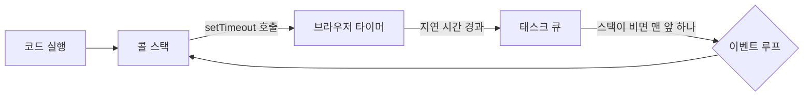
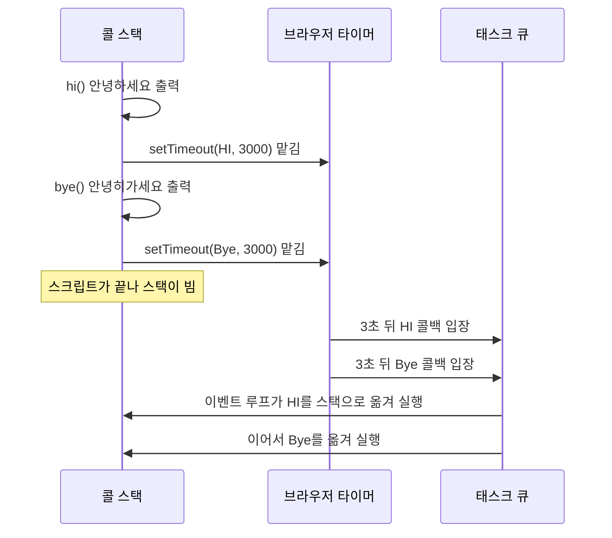

# 오늘 배운 것: 동기·비동기와 이벤트 루프로 코드 실행 순서를 이해하다

## 들어가며 (Situation)

모듈 3(프론트엔드) 4일차. 3일차까지는 코드가 **위에서 아래로** 실행된다고 보고 읽었다. 오늘은 그 가정이 깨지는 곳, 즉 **적힌 순서와 실행 순서가 다른 코드**를 다뤘다. 오늘의 키워드는 둘이다.

- 동기와 비동기
- 태스크 큐와 이벤트 루프

수업 파일은 `03_Async` 폴더의 네 개다.

| 파일 | 다룬 내용 |
|------|-----------|
| `01_timer.html` | `setTimeout`, `setInterval`, `clearInterval` |
| `02_asynchronous.html` | 동기와 비동기의 차이, 태스크 큐와 이벤트 루프 설명 |
| `03_promise-async-await.html` | 콜백 지옥 → Promise → async/await (포인트 적립 예제) |
| `04_fetch.html` | `fetch`로 외부 API 호출 |



코드 팝업에는 위 네 파일과 `run-results.txt`가 있다. `run-results.txt`의 앞부분은 수업 파일을 헤드리스 Chrome에서 열어 콘솔을 기록한 것이고, 뒷부분(`수업 코드가 아니라 ...` 표시)은 본문 설명을 확인하려고 만든 **짧은 예시 코드**와 그 결과다. 본문의 실행 결과와 수치는 그 파일에 같은 내용이 있다(큐 이름 같은 해석은 내가 덧붙인 것이다).

수업 때 강사님이 그린 스택·큐 그림과 코드 화면 캡처는 그대로 싣지 않고, 같은 내용을 아래에서 **다이어그램으로 다시 그렸다.** 참고한 자료는 오늘 수업 코드의 주석과 수업 Notion 자료의 `2-2_Timer(비동기와 이벤트 루프)`, `2-3_Timer(Promise와 async/await)`다. 문장은 내 말로 다시 썼다.

## 문제 상황 (Task)

오늘 코드를 읽으며 풀어야 했던 질문은 네 가지였다.

- `01_timer.html`의 주석은 "5초 경과 메시지 뒤에 주문 메시지가 나와야 한다"고 하는데, 실제 출력 순서는 무엇인가?
- 동기와 비동기는 **실제로** 얼마나 다르게 동작하는가? 수업의 `sleep()` 예제를 그대로 켜면 무슨 일이 생기는가?
- 그 차이를 만드는 콜 스택, 태스크 큐, 이벤트 루프는 어떤 순서로 움직이는가?
- 비동기의 "언제 끝날지 모른다"는 단점을 Promise와 async/await는 어떻게 다루는가?

수업 코드를 그대로 실행하고, 의문이 남는 곳마다 짧은 예시 코드를 따로 만들어 결과를 기록했다.

## 해결 과정 (Action)

### 1. 타이머: 비동기의 입구

`01_timer.html`은 피자(5초), 치킨(3초), 배달 카운트다운(`setInterval`, 1초 간격)을 한 파일에 둔다. 코드를 읽을 때는 위에서 아래로 "피자 → 주문 → 치킨" 순으로 보이지만, 페이지를 열고 6초 기다린 콘솔은 이렇다.

```text
[ 0.0초] 주문 하실 사람~~!
[ 1.0초] 배달 도착까지 4초
[ 2.0초] 배달 도착까지 3초
[ 3.0초] 3초 경과! 치킨 조리 완료~~🍗
[ 3.0초] 배달 도착까지 2초
[ 4.0초] 배달 도착까지 1초
[ 4.0초] 배달 완료!🛒
[ 5.0초] 5초 경과! 피자 조리 완료~~🍕
```

- **setTimeout(함수, 지연 시간 [, 인자])**
  - 지연 시간이 지난 뒤 함수를 **한 번** 실행하도록 맡겨 두고, 코드는 바로 다음 줄로 넘어간다.
  - 세 번째 인자부터는 함수에 전달할 값이다. 코드의 `setTimeout((menuName) => ..., 3000, "치킨")`이 그 예다.
- **setInterval(함수, 간격)**
  - 간격마다 함수를 **계속** 실행한다. 멈추려면 반환값을 `clearInterval`에 넘겨야 한다.

💡 파일 안 주석은 "프로그래밍 개념으로는 5초 경과 메시지 뒤에 주문 메시지가 나와야 한다(위→아래)"고 적고, 바로 아래에서 비동기는 그렇게 동작하지 않는다고 설명한다. 실제 실행이 그 설명대로다. 첫 줄은 `주문 하실 사람~~!`(0초)이고, 피자는 코드상 가장 위에 있는데도 맨 마지막(5초)에 나온다. 줄 순서가 아니라 **지연 시간 순서**로 나온다.

⚠️ `setInterval`에 종료 조건이 없으면 영원히 돈다. 수업 코드는 `count == 5`일 때 `clearInterval(interval)`을 부른다. 그래서 카운트다운은 `4초 → 1초`까지 네 번 찍히고, 같은 시각(4.0초)에 `배달 완료`가 나온다.

### 2. 동기와 비동기

수업은 식당 비유로 시작한다. 떡볶이 조리에 3초가 걸린다고 하자.

| 구분 | 동기(synchronous) | 비동기(asynchronous) |
|------|--------------------|-----------------------|
| 흐름 | 앞의 일이 끝나야 다음 일을 시작 | 앞의 일이 끝나지 않아도 다음 일을 시작 |
| 식당 비유 | 조리 3초 동안 다음 손님 주문을 못 받음 | 조리를 맡겨 두고 다음 손님 주문부터 받음 |
| 장점 | 실행 순서가 코드와 같다 | 기다리는 동안 막히지 않는다 |
| 단점 | 앞이 느리면 뒤가 전부 막힌다 | 실행 순서가 코드 순서와 달라진다 |
| 오늘 코드 | `sleep(cook, 3000)` | `setTimeout(cook, 3000)` |

수업 파일 `02_asynchronous.html`은 비동기 쪽(`setTimeout(cook, 3000)` 뒤에 `takeOrder()` 여덟 번)이 켜져 있고, 동기 쪽은 주석 처리돼 있다. 켜져 있는 그대로 열고 4초 기다린 결과다.

```text
[ 0.0초] 다음 손님 주문 하세요~
[ 0.0초] 다음 손님 주문 하세요~
[ 0.0초] 다음 손님 주문 하세요~
[ 0.0초] 다음 손님 주문 하세요~
[ 0.0초] 다음 손님 주문 하세요~
[ 0.0초] 다음 손님 주문 하세요~
[ 0.0초] 다음 손님 주문 하세요~
[ 0.0초] 다음 손님 주문 하세요~
[ 3.0초] 떡볶이 조리 완료!!(3초)
```

주문 여덟 줄이 먼저 한꺼번에 나오고, 조리 완료는 3초 뒤에 나온다.

#### 동기 쪽도 직접 켜 봤다

주석 처리된 동기 쪽이 실제로 어떻게 동작하는지 보려고 `sleep(cook, 3000); takeOrder();`만 켠 임시 파일을 만들어 실행했다(예시 코드, 수업 파일은 수정하지 않았다).

| 항목 | 비동기(수업 파일 그대로) | 동기(주석을 푼 변형) |
|------|--------------------------|----------------------|
| 첫 `takeOrder` 로그 시각 | 0.0초 | 약 3.0초(2999ms) |
| `cook` 로그 횟수 | 1번 | 약 998만 번(9,979,467번, 실행마다 다름) |
| `cook` 로그가 찍힌 구간 | 3.0초에 1번 | 0ms ~ 2999ms 내내 |
| `takeOrder` 로그 | 8줄(0.0초) | 9줄(변형에서 동기로 부른 1번 + 원래 파일에 남은 8번), 모두 2999ms 이후 |

🔴 동기 쪽에서 `cook`이 **약 998만 번** 불렸다(실행마다 달라진다). `sleep(func, delay)`가 `while` 안에서 매번 `func()`를 호출하는 구조라서, 3초 동안 `떡볶이 조리 완료!!(3초)`가 계속 찍힌다. 파일 안 주석은 "3초 동안 시간을 점유한다"고만 설명하는데, 그 3초 동안 콘솔이 이 로그로 가득 찬다. 로그가 수만 줄이라 동기 변형은 로그를 찍지 않고 횟수만 세도록 바꿔서 실행했다.

💡 `sleep`은 "기다리는" 함수가 아니라 **CPU를 붙잡고 도는** 함수다. 브라우저에는 JavaScript를 돌리는 스레드가 하나뿐이라, 이 3초 동안 클릭도 화면 갱신도 처리되지 못한다. 실제 코드에서는 이렇게 쓰지 않는다.

### 3. 태스크 큐와 이벤트 루프

비동기 코드가 "기다리는 동안 막히지 않는" 이유가 오늘의 두 번째 키워드다.

- **콜 스택(Call Stack)**
  - 지금 실행 중인 함수가 쌓이는 곳이다. 자바의 스택과 같다.
  - 한 번에 하나의 일만 실행한다. JavaScript 엔진이 싱글 스레드라는 말이 이 뜻이다.
- **태스크 큐(Task Queue)**
  - 타이머가 끝난 콜백, 이벤트 핸들러처럼 "실행 차례를 기다리는 함수"가 보관되는 줄이다.
  - 먼저 들어온 것이 먼저 나간다(FIFO).
- **이벤트 루프(Event Loop)**
  - 콜 스택이 비었는지, 태스크 큐에 기다리는 함수가 있는지를 계속 확인한다.
  - 스택이 비어 있고 큐에 함수가 있으면 맨 앞의 하나를 스택으로 옮긴다.



수업 시간에 그린 `hi / setTimeout(HI) / bye / setTimeout(Bye)` 그림을 시간 순서로 다시 그리면 아래와 같다. 두 `setTimeout` 모두 3000ms다.



이 코드를 실제로 실행해 순서를 기록했다(예시 코드).

```text
["안녕하세요","안녕히가세요","(스크립트 끝)","HI","Bye"]
```

수업 화면 캡처에는 "`setTimeout`을 만나는 순간 스택이 아니라 태스크 큐에 올라간다"는 설명이 있었다. 이 말을 그대로 외우면 한 가지가 헷갈린다. 내가 이해한 정확한 순서는 이렇다.

1. `setTimeout(...)` **호출 자체**는 콜 스택에서 실행되고, 곧바로 끝난다. 하는 일은 "이 콜백을 이만큼 뒤에 실행해 달라"고 브라우저에 맡기는 것이다.
2. 지연 시간이 지나면 **콜백**이 태스크 큐에 들어간다.
3. 지금 하던 코드가 전부 끝나 스택이 비면 이벤트 루프가 큐에서 하나씩 꺼내 스택으로 올린다.

그래서 "콜백이 태스크 큐에서 기다린다"는 수업 설명과 같은 이야기다. 다만 "만나는 순간 큐에 올라간다"는 표현은 타이머가 끝난 뒤에야 큐에 들어간다는 점을 건너뛴 줄임말로 이해했다(정확한 규칙은 아래 참고 자료의 MDN 이벤트 루프 문서에서 더 확인해야 한다).

#### 이벤트 루프가 만드는 규칙 세 가지

스택이 비어야 큐에서 꺼낸다는 규칙에서 세 가지 동작이 따라 나온다. 아래는 예시 코드로 확인한 결과다.

| 확인한 것 | 실행 결과 | 의미 |
|-----------|-----------|------|
| `setTimeout(..., 0)` 뒤에 200ms 걸리는 동기 코드 | `["동기 코드 A","동기 코드 B (200ms 점유한 뒤)","timeout 0"]` | 0ms여도 "지금 하던 일을 다 끝낸 직후"에 실행된다 |
| `setTimeout(..., 0)`과 `Promise.then` | `["동기 코드","Promise.then (마이크로태스크)","setTimeout 0 (태스크)"]` | `Promise.then`이 먼저 실행된다 |
| 지연 시간이 같은 두 타이머 | `HI` → `Bye` (등록한 순서) | 큐는 FIFO다 |

⚠️ `Promise.then`이 `setTimeout(0)`보다 먼저 나온 것은 수업에서 다룬 내용이 아니다. 실행해 보니 순서는 그렇게 나왔고, Promise 콜백은 일반 태스크 큐와는 다른, 우선순위가 높은 줄(마이크로태스크 큐)에서 처리되는 것으로 보인다. 오늘은 "큐가 하나가 아닐 수 있다" 정도로만 받아들이고, 아래 "더 학습하면 좋은 개념"에 남겼다.

### 4. 비동기 결과를 순서대로 다루기: 콜백 → Promise → async/await

`03_promise-async-await.html`의 요구사항은 "주문할 때마다 1초 뒤 포인트가 10P씩 적립되고, 한도는 50P"다. 같은 요구사항을 세 가지 방식으로 구현했고, 버튼 세 개로 각각 실행한다. 순서가 중요하다는 점이 핵심이다. 앞 적립이 끝나야 그 결과로 다음 적립을 해야 한다.

#### 4-1. 콜백 지옥

비동기 함수가 끝난 뒤 할 일을 함수로 넘기는 방식(콜백)이다. 순서를 지키려면 함수 안에 함수를 계속 넣어야 한다.

```js
pointCallback(0, point => {
    console.log(`${point}P`);   // 10P
    pointCallback(point, point => {
        console.log(`${point}P`);   // 20P
        pointCallback(point, point => {
            // ... 두 단계가 더 중첩된다
        });
    });
});
```

`콜백 지옥` 버튼을 누르고 6초 기다린 콘솔이다.

```text
[ 1.0초] 10P
[ 2.0초] 20P
[ 3.0초] 30P
[ 4.0초] 40P
[ 5.0초] 50P
```

🔴 5단계라서 들여쓰기가 다섯 번 밀려난다. 단계가 늘수록 읽기 어렵고, 오류 처리도 단계마다 따로 해야 한다.

#### 4-2. Promise

- **Promise**
  - "지금은 결과가 없지만 나중에 주겠다"는 약속을 담은 객체다.
  - 상태는 대기(pending), 이행(fulfilled), 거부(rejected) 세 가지다.
  - 성공은 `resolve`, 실패는 `reject`를 불러 알린다. 결과는 `then`, 오류는 `catch`, 마무리는 `finally`로 받는다.

`earnPoint(point)`가 `new Promise`로 타이머를 감싸 돌려주고, `.then`이 줄줄이 이어진다(체인). `Promise` 버튼을 누르고 7초 기다린 결과다.

```text
[ 1.0초] 10P
[ 2.0초] 20P
[ 3.0초] 30P
[ 4.0초] 40P
[ 5.1초] 50P
[ 5.1초] 포인트 적립 종료
```

중첩은 사라졌지만 여전히 `.then(...)` 콜백이 줄줄이 붙는다.

💡 `then` 안에서 `earnPoint(point)`를 **return**해야 다음 `then`이 그 Promise를 기다린다. 이 코드에서 `return earnPoint(point);`가 빠지면 다음 `then`이 기다리지 않아 순서가 깨진다(설명이며 실행으로 확인한 것은 아니다).

#### 4-3. async/await

- **async / await**
  - 새 기능이 아니라 Promise를 동기 코드처럼 읽히게 쓰는 문법이다.
  - `await`는 `async` 함수 안에서만 쓸 수 있고, Promise가 끝날 때까지 **그 함수 안에서** 기다렸다가 결과값을 꺼내 준다.
  - 오류는 체인의 `.catch()` 대신 `try / catch / finally`로 잡는다.

`runAsync`는 같은 적립을 여섯 번 `await`한다. 마지막(6번째)은 60P가 되어 한도를 넘는다. `async/await` 버튼을 누르고 8초 기다린 결과다.

```text
[ 1.0초] 10P
[ 2.0초] 20P
[ 3.0초] 30P
[ 4.0초] 40P
[ 5.0초] 50P
[ 6.0초] Error: 적립 한도 초과 발생~!!!!!!!!
[ 6.0초] 포인트 적립 종료
```

⚠️ Promise 버튼은 다섯 번만 적립하므로 50P에서 끝나고 `catch`가 한 번도 실행되지 않았다. 오류가 나는 쪽은 여섯 번 호출하는 async/await 버튼이다. 두 버튼의 마지막 줄이 다른 이유다. `catch`와 `finally`가 어떻게 동작하는지 보려면 이쪽을 눌러야 한다.

💡 `await`는 스레드를 막지 않는다. 기다리는 동안 이벤트 루프는 다른 일(클릭 등)을 계속 처리한다. 이 구분이 2절의 `sleep`과 다르다.

세 방식을 한눈에 비교하면 다음과 같다.

| 항목 | 콜백 | Promise `.then` | async/await |
|------|------|-----------------|-------------|
| 코드 모양 | 오른쪽으로 계속 중첩 | 위에서 아래로 체인 | 동기 코드처럼 위에서 아래로 |
| 오류 처리 | 단계마다 따로 | `.catch()` 한 곳 | `try / catch` 한 곳 |
| 오늘 코드 | `runCallback` | `runPromise` | `runAsync` |

#### 4-4. 직접 확인한 Promise 동작 (예시 코드)

수업에 없지만 본문 설명을 뒷받침하려고 확인한 것들이다.

| 확인한 것 | 결과 |
|-----------|------|
| 300ms 작업 세 개를 `await` 하나씩 | 약 900ms |
| 같은 작업 세 개를 `Promise.all` | 약 300ms (가장 느린 것 기준) |
| `Promise.all`에 실패하는 Promise가 하나 섞이면 | 전체 실패(`전체 실패: x`) |
| 같은 경우를 `Promise.allSettled`로 | 상태 목록 `["fulfilled","rejected"]` |

⚠️ 서로 의존하지 않는 작업을 `await`로 하나씩 기다리면 시간이 더해진다. 순서가 필요 없으면 `Promise.all`로 묶는 것이 맞다.

### 5. fetch: 비동기가 가장 많이 쓰이는 곳

수업은 "프론트 서버는 화면을 구성하고, 데이터는 백엔드 서버에서 받아 온다. 응답이 느릴 때 화면이 멈추지 않도록 API 호출은 비동기로 한다"고 설명한다. `04_fetch.html`은 `jsonplaceholder`의 글 5개를 불러온다. 버튼을 누르고 3초 기다린 콘솔이다(응답 객체는 한 줄 글자로 바꿔 기록했고 내용이 길어 앞부분만 적었다).

```text
[ 0.0초] Promise {<pending>}
[ 0.2초] [{"userId":1,"id":1,"title":"sunt aut facere repellat provident occaecati excepturi optio reprehenderit","body":"quia et suscipit\nsuscipit recusandae ... (이하 생략)
[ 0.2초] sunt aut facere repellat provident occaecati excepturi optio reprehenderit
```

수업 코드의 `console.log` 세 개가 이 순서로 찍혔다.

1. `console.log(data)` → `Promise {<pending>}`: `fetch`는 데이터가 아니라 **Promise**를 돌려준다. 요청을 보낸 직후(0.0초)라 아직 대기 상태다.
2. `console.log(reviews)` → 5개의 글 배열(0.2초): 응답이 도착한 뒤 `await res.json()`으로 JavaScript 객체로 바꾼 값이다.
3. `console.log(reviews[0].title)` → 첫 번째 글의 제목.

응답 5개의 `title`은 다음과 같았다(같은 요청을 따로 보내 `userId`, `id`, `title`만 추린 것).

```text
1  sunt aut facere repellat provident occaecati excepturi optio reprehenderit
2  qui est esse
3  ea molestias quasi exercitationem repellat qui ipsa sit aut
4  eum et est occaecati
5  nesciunt quas odio
```

이 파일은 수업 중에 `reviews[0].title` 줄이 추가됐고, 위 결과는 그 최종본으로 실행한 것이다.

`fetch`의 `await`가 **두 번** 필요한 이유도 코드에서 보인다.

```js
const res = await data;            // 1번째: 응답(Response)이 도착하기를 기다림
const reviews = await res.json();  // 2번째: 본문을 JSON으로 읽는 일도 Promise를 돌려줌
```

🔴 `await`를 빠뜨리면 `Promise {<pending>}`이 그대로 변수에 들어간다. 오늘 확인한 예시(`res.json()`을 `await` 없이 받으면 `[object Promise]`)와 같은 증상이다.

🟢 수업 주석처럼 같은 일을 `.then(res => res.json()).then(json => ...)` 체인으로도 쓸 수 있다. 4절의 Promise 체인과 똑같은 모양이다. 

### 6. 오늘 헷갈렸던 것 정리

| 헷갈린 점 | 확인한 사실 | 근거 |
|-----------|-------------|------|
| 파일 위쪽 `setTimeout`이 먼저 실행될 줄 알았다 | 줄 순서가 아니라 지연 시간 순서 | 01_timer: 주문(0초) → 치킨(3초) → 피자(5초) |
| `setTimeout(..., 0)`은 즉시 실행인가 | 하던 일이 끝난 직후 | 200ms 동기 코드 뒤에 실행 |
| 동기 `sleep`은 그냥 기다리는 것인가 | 스레드를 붙잡고 `func()`를 계속 호출 | `cook` 9,979,467번 |
| Promise 버튼에서 `catch`가 안 나왔다 | 5번만 적립해서 한도에 안 걸림 | 50P에서 종료 |
| `fetch` 결과가 `Promise`로만 나온다 | `await`(또는 `then`)로 꺼내야 함 | `Promise {<pending>}` |

## 결과 (Result)

오늘은 수치가 크게 변하는 작업이 아니라서, 실행으로 직접 확인한 값을 Before/After 형식으로 정리한다.

| 항목 | 이해하기 전 | 확인한 사실 |
|------|-------------|-------------|
| 실행 순서 | 위에서 아래로 | 줄 순서가 아니라 지연 시간·큐 순서(`안녕하세요, 안녕히가세요, (끝), HI, Bye`) |
| 동기 vs 비동기 첫 주문 시각 | 같을 거라 생각 | 비동기 0.0초, 동기 약 3.0초(2999ms) |
| 세 작업 총 시간(각 300ms) | 차이 없을 거라 생각 | 하나씩 `await` 약 900ms, `Promise.all` 약 300ms |
| 5단계 적립 코드 | 콜백 중첩 5단계 | Promise 체인, async/await 순으로 평탄해짐(결과는 모두 `10P`~`50P`, 약 5초) |

배운 점은 세 가지다.

- 💡 JavaScript는 한 번에 하나만 실행하지만, 타이머·네트워크는 브라우저가 따로 처리하고 **끝난 결과만 태스크 큐로 넣어 준다.** 그래서 싱글 스레드인데도 막히지 않는다.
- 💡 비동기 코드를 읽을 때는 "이 콜백이 언제 큐에 들어가고, 스택이 언제 비는가"를 먼저 물어야 순서가 보인다.
- 🟢 순서가 필요하면 `await`(또는 `then` 체인), 필요 없으면 `Promise.all`로 묶는다.

한계도 있다. 이 글의 모든 실행은 헤드리스 Chrome에서 버튼을 `click()`으로 누른 것이고, 실제 사용자의 클릭과 체감 속도는 확인하지 못했다. 마이크로태스크 큐는 실행 결과로 존재를 확인했을 뿐, 동작 규칙은 공식 문서로 더 확인해야 한다.

## 더 학습하면 좋은 개념

- **마이크로태스크 큐 (Microtask Queue)** — `Promise.then`이 `setTimeout(0)`보다 먼저 실행된 이유를 설명한다. 오늘 실행 결과에서 순서가 갈린 지점이라 가장 먼저 풀어야 할 숙제다.
- **브라우저 렌더링과 이벤트 루프** — 화면 그리기도 같은 스레드에서 돌아간다. `sleep`처럼 오래 붙잡으면 클릭뿐 아니라 화면 갱신도 멈추는 이유를 알 수 있다.
- **Promise 조합 (`Promise.all`, `allSettled`, `race`)** — 오늘은 `all`과 `allSettled`의 차이만 확인했다. 여러 API를 동시에 부르는 화면에서 바로 쓰인다.
- **HTTP 요청과 오류 처리 (`res.ok`, 상태 코드)** — `fetch`는 서버가 404나 500을 돌려줘도 reject하지 않는다. 오늘 코드에는 응답 상태 검사가 없어서 다음 단계로 필요하다.
- **자바의 비동기 (`CompletableFuture`, 스레드 풀)** — 자바 서버는 요청마다 스레드를 쓰고, JavaScript는 하나의 스레드로 큐를 돌린다. 두 모델을 비교하면 이벤트 루프의 장단점이 선명해진다.

## 참고 자료

- [MDN - 동시성 모델과 이벤트 루프](https://developer.mozilla.org/ko/docs/Web/JavaScript/Event_loop)
- [MDN - setTimeout()](https://developer.mozilla.org/ko/docs/Web/API/Window/setTimeout)
- [MDN - setInterval()](https://developer.mozilla.org/ko/docs/Web/API/Window/setInterval)
- [MDN - Promise](https://developer.mozilla.org/ko/docs/Web/JavaScript/Reference/Global_Objects/Promise)
- [MDN - async function](https://developer.mozilla.org/ko/docs/Web/JavaScript/Reference/Statements/async_function)
- [MDN - await](https://developer.mozilla.org/ko/docs/Web/JavaScript/Reference/Operators/await)
- [MDN - fetch()](https://developer.mozilla.org/ko/docs/Web/API/Window/fetch)
- [MDN - 마이크로태스크 사용 가이드](https://developer.mozilla.org/ko/docs/Web/API/HTML_DOM_API/Microtask_guide)
