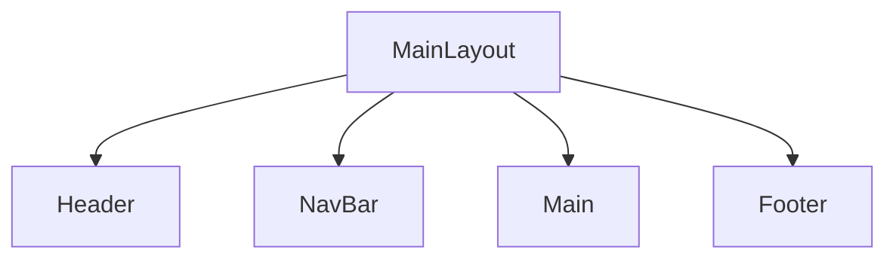

# 오늘 배운 것: React 엘리먼트와 컴포넌트, JSX로 화면을 조립하다

## 들어가며 (Situation)

모듈 3(프론트엔드) 5일차. 지난 금요일(4일차)까지 JavaScript의 문법과 비동기를 다뤘고, 오늘부터 **React**를 시작했다. 11-19 휴강과 주말을 빼면 이 모듈의 다섯 번째 수업일이다.

오늘의 흐름은 "왜 React인가 → React의 가장 작은 단위 → 그 단위를 쉽게 쓰는 문법 → 조립"이다.

| 파일 | 다룬 내용 |
|------|-----------|
| `01_intro/01_createElement.html` | `React.createElement`로 엘리먼트를 만들고 화면에 그리기 |
| `01_intro/02_component.html` | 엘리먼트와 컴포넌트의 차이, 함수형 컴포넌트 |
| `02_component/01_JSX/01_jsx-intro.html` | JSX 문법, Babel, `{ }` 안에 JS 표현식 |
| `02_component/01_JSX/02_fragment.html` | 최상위 요소는 하나여야 한다는 규칙, Fragment(`<></>`) |
| `02_component/02_component/01_function-component.html` | 함수형 컴포넌트를 `<Header/>`로 쓰기 |
| `02_component/02_component/02_composition.html` | 작은 컴포넌트를 조립해 한 화면 만들기 |



코드 팝업에는 위 여섯 파일과 `run-results.txt`가 있다. `run-results.txt`의 앞부분은 수업 파일을 헤드리스 Chrome에서 열어 화면 결과와 콘솔을 기록한 것이고, 뒷부분(`예시 코드(수업 코드 아님)`)은 본문 설명을 확인하려고 만든 **짧은 예시 코드**의 결과다.

참고한 자료는 오늘 수업 코드의 주석, 수업 Notion의 `React.js` 페이지(`Front Library 등장 배경`, `1-1-1. React의 동작 원리`), 수업 화면에 그려진 그림 세 장이다. 그림은 그대로 싣지 않고 내용을 옮겨 **직접 다시 그려** 아래에 넣었다. Notion에는 "React를 쓰는 이유" 아티팩트 링크도 있었고, 제목과 구성만 확인했다.

## 문제 상황 (Task)

오늘 막힌 질문은 다섯 가지였다.

- 순수 HTML·CSS·JS로도 화면을 만들 수 있는데, 왜 React 같은 라이브러리가 필요한가?
- "엘리먼트"와 "컴포넌트"는 무엇이 다른가?
- JSX는 JavaScript인가, HTML인가? 브라우저는 이것을 어떻게 읽는가?
- 수업 코드의 `class="test"`와 컴포넌트 이름의 **대문자** 규칙은 실제로 어떤 결과를 만드는가?
- 최상위 요소가 둘이면 왜 오류가 나는가?

그래서 수업 파일 여섯 개를 그대로 실행하고, 의문이 남는 곳마다 짧은 예시 코드로 결과를 확인했다. React는 수업 방식대로 npm 프로젝트가 아니라 **CDN `<script>` 태그**로 붙여서 실행했다.

## 해결 과정 (Action)

### 1. 왜 React인가: 브라우저가 화면을 그리는 순서

수업은 브라우저의 렌더링 과정에서 시작한다. HTML과 CSS는 각각 트리가 되고, 둘을 합쳐 화면을 그린다.


- **Render Tree**
  - DOM Tree와 CSSOM Tree를 합친 트리다. 화면에 실제로 그려질 노드와 스타일이 들어 있다.
- **Layout**
  - Render Tree의 각 노드가 화면에서 차지할 위치와 크기를 계산하는 단계다.
- **Paint**
  - 계산된 결과를 실제 화면의 픽셀로 그리는 단계다.

수업 화면의 요지는 이렇다. 순수 HTML·CSS·JS로 화면을 만들 때 **바뀌는 부분이 자주 생기고 요청이 많아지면**, 화면을 다시 구성하는 일이 잦아지고 트리를 만드는 과정에서 지연이 생긴다. 그 지연을 줄이려고 나온 것이 React의 가상 DOM이다.

Notion의 설명을 내 말로 정리하면 React의 동작은 다음과 같다.

1. React는 화면을 가상 DOM(메모리 상의 DOM)으로 먼저 만든다.
2. 상태(state)가 바뀌면 다시 렌더링해서 **새 가상 DOM**을 만든다.
3. 이전 가상 DOM과 새 가상 DOM을 비교해(Diffing) 달라진 부분만 찾는다.
4. 달라진 부분만 실제 DOM에 반영한다. 이 일련의 과정을 재조정(Reconciliation)이라고 한다.

수업이 드는 이점은 두 가지다. 바뀐 부분만 고치므로 빠르고, 여러 변경을 한 번에 반영하므로 Layout과 Paint가 한 번만 일어난다.

⚠️ 이 이점을 "가상 DOM을 쓰면 무조건 빠르다"로 읽으면 곤란하다. 이 글에서는 가상 DOM의 성능을 직접 측정하지 않았고, 위 내용은 수업 설명을 정리한 것이다. 조건에 따라 달라지는지는 아래 "더 학습하면 좋은 개념"의 공식 문서로 확인해야 한다.

### 2. 엘리먼트: `React.createElement`

`01_createElement.html`은 head에서 두 개의 라이브러리를 CDN으로 불러온다. 수업 주석대로 React를 쓰는 방법은 크게 둘이다. 하나는 React 앱을 만드는 것이고(대부분 이것을 쓴다), 다른 하나는 이렇게 `<script>`로 불러오는 것이다. 오늘은 후자다.

```html
<script crossorigin src="https://unpkg.com/react@18.3.1/umd/react.development.js"></script>
<script crossorigin src="https://unpkg.com/react-dom@18.3.1/umd/react-dom.development.js"></script>
```

- **react** — 엘리먼트와 컴포넌트를 정의하는 라이브러리
- **react-dom** — 만든 엘리먼트를 실제 브라우저 DOM에 그리는 라이브러리

핵심 코드는 두 줄이다.

```js
const hiElement = React.createElement('h1', {className: 'hi'}, 'helloworld!!');
ReactDOM.createRoot(document.getElementById('root')).render(hiElement);
```

`createElement`의 인자는 순서대로 요소의 타입(`'h1'`), 프로퍼티(`{className: 'hi'}`), 자식(`'helloworld!!'`)이다. 열었을 때의 결과다.

```text
#root 의 HTML: <h1 class="hi">helloworld!!</h1>
#root 의 자식 요소 수: 1
화면에 보이는 글자: "helloworld!!"
콘솔 출력:
  [info] Download the React DevTools for a better development experience: ...
```

`createElement`가 돌려주는 값이 무엇인지 예시 코드로 열어 봤다.

```text
React.createElement 가 돌려주는 값(엘리먼트):
{"typeof":"object","type":"h1","props":{"className":"hi","children":"helloworld!!"},"$$typeof":"Symbol(react.element)"}
```

💡 React의 **엘리먼트는 DOM 요소가 아니라 "이런 요소를 만들어 달라"고 적은 평범한 객체**다. `type`, `props`(자식 포함)가 들어 있고, 이것을 `render()`가 받아 실제 DOM으로 만든다. 수업 주석이 말한 "메모리 상에 존재하는 DOM"이 이 객체들의 트리다. HTML의 속성 이름이 `class`가 아니라 `className`인 것도 여기서 보인다. 프로퍼티 객체의 키이기 때문이다.

### 3. 컴포넌트: 엘리먼트를 돌려주는 함수

`02_component.html`의 주석은 두 용어를 나눈다.

- **엘리먼트(Element)**
  - 요소 노드, 어트리뷰트 노드, 텍스트 노드로 이루어진 화면의 한 조각. 예: `<h1 class='test'>안녕!!</h1>`
- **컴포넌트(Component)**
  - 엘리먼트를 반환하는 화면 구성의 **조각 단위**. 오늘은 함수로 만든다(함수형 컴포넌트).

```js
function Helloworld() {
    return React.createElement('h1', {className: 'hi'}, 'helloworld!!');
}

ReactDOM.createRoot(document.getElementById('root'))
        .render(React.createElement(Helloworld));   // 컴포넌트를 엘리먼트로 바꿔서 넘긴다
```

열었을 때의 결과는 앞의 파일과 같다.

```text
#root 의 HTML: <h1 class="hi">helloworld!!</h1>
#root 의 자식 요소 수: 1
화면에 보이는 글자: "helloworld!!"
```

주석에 `render(엘리먼트); Helloworld 는 컴포넌트라 결과 ㄴㄴ.`이 있다. 함수 자체를 `render`에 넘기지 말고 `createElement(Helloworld)`로 감싸라는 뜻이다. 두 방식이 어떻게 다른지 확인한 결과다(예시 코드).

```text
컴포넌트 함수를 그냥 부르면 vs createElement 로 감싸면:
{"함수호출":{"type":"h1"},"createElement":{"type":"function","이름":"Hello"}}
```

함수를 그냥 부르면 곧바로 `h1` 엘리먼트가 나온다. `createElement(Hello)`로 감싸면 `type`이 `h1`이 아니라 **함수 `Hello` 자체**인 엘리먼트가 만들어진다. 어떤 함수를 불러서 화면을 그릴지는 React가 정한다는 뜻이다.

⚠️ 함수 이름의 첫 글자를 대문자로 쓰는 것은 수업 주석대로 "암묵적 규칙"이라고 했는데, 아래 4절에서 보듯 JSX에서는 **규칙을 넘어 동작이 달라지는 경계**다.

### 4. JSX와 Babel

`createElement`를 요소마다 부르는 것은 복잡하다. 그래서 나온 문법이 **JSX(JavaScript XML)**다. JavaScript 안에서 XML(HTML처럼 생긴) 문법으로 엘리먼트를 쓰게 해 준다. 브라우저는 JSX를 읽지 못하므로 **Babel**이 JavaScript로 바꿔 준다(트랜스파일링).

수업 주석이 정리한 사용법은 두 가지다.

1. head에 Babel 스크립트(`@babel/standalone`)를 추가한다.
2. JSX를 쓰는 `<script>`의 `type`에 `text/babel`을 준다.

```js
const element = <h1 class="test">안녕!! {formatName(user)}</h1>
```

`01_jsx-intro.html`을 열었을 때다.

```text
#root 의 HTML: <h1 class="test">안녕!! 김 예린</h1>
#root 의 자식 요소 수: 1
화면에 보이는 글자: "안녕!! 김 예린"
콘솔 출력:
  [info] Download the React DevTools for a better development experience: ...
  [warning] You are using the in-browser Babel transformer. Be sure to precompile your scripts for production - https://babeljs.io/docs/setup/
  [error] Warning: Invalid DOM property `class`. Did you mean `className`? (at h1)
```

- `{formatName(user)}`처럼 **중괄호 안에는 어떤 JS 표현식이든** 쓸 수 있다. 결과가 `김 예린`으로 들어갔다.
- 콘솔의 `[warning]`은 브라우저 안에서 Babel이 변환하고 있다는 안내다. 이 방식은 연습용이고, 실제로는 미리 컴파일한다고 적혀 있다.

🔴 수업 코드는 JSX에 `class="test"`를 썼고, 화면은 정상으로 나왔지만 콘솔에 `[error]`가 떴다. `class`는 JSX에서 올바른 이름이 아니라서 React가 `className`을 쓰라고 경고한다. 같은 코드를 예시 코드로 다시 실행해도 결과는 같았다. HTML 속성 `class`가 그대로 들어갔을 뿐, 오류로 멈추지는 않는다.

```text
JSX 에 class="test" 를 쓰면 — 렌더된 HTML: <h1 class="test">안녕</h1>
이때 콘솔: [error] Warning: Invalid DOM property `class`. Did you mean `className`? (at h1)
```

🟢 JSX에서는 `className`을 쓴다. 수업 파일의 주석 처리된 `createElement("h1", {class : "test"}, ...)`와 2절의 `{className: 'hi'}`를 나란히 보면 이유가 보인다. JSX도 결국 같은 프로퍼티 객체가 되기 때문이다.

JSX가 실제로 무엇으로 바뀌는지는 Babel의 변환 결과로 확인했다(예시 코드, 변환 방식을 `classic`으로 지정해서 `createElement`로 보이게 했다).

```text
JSX 를 Babel 로 바꾼 결과(<h1 className="test">안녕</h1>):
const e = /*#__PURE__*/React.createElement("h1", {
  className: "test"
}, "안녕");
```

💡 **JSX는 `React.createElement` 호출을 보기 좋게 쓰는 문법**이다. 2절의 객체가 그대로 나온다. 그래서 JSX는 HTML이 아니라 JavaScript이고, 오늘 실행한 `{ }`도 JS 표현식 자리라는 것이 한 번에 이해된다.

### 5. Fragment: 최상위 요소는 하나

`02_fragment.html`의 규칙은 "같은 레벨의 요소가 연달아 정의되면 문법 에러"다. 수업 코드는 이를 세 가지로 보여 준다(1번과 2번은 주석 처리돼 있다).

| 방식 | 코드 | 결과 |
|------|------|------|
| 1. 최상위가 둘 | `<h1/>` 다음에 `<h3/>` | 문법 에러 |
| 2. `div`로 감싸기 | `<div><h1/><h3/></div>` | 동작하지만 불필요한 `div`가 생긴다 |
| 3. Fragment | `<>...</>` | 동작하고 불필요한 요소가 없다 |

수업 파일(3번 방식)을 열었을 때의 결과다.

```text
#root 의 HTML: <h1>예린</h1><h3>010-1234-5678</h3>
#root 의 자식 요소 수: 2
화면에 보이는 글자: "예린\n010-1234-5678"
콘솔 출력:
  [info] Download the React DevTools for a better development experience: ...
  [warning] You are using the in-browser Babel transformer. Be sure to precompile your scripts for production - https://babeljs.io/docs/setup/
```

`#root`의 자식이 `h1`과 `h3` 둘이다. 1번과 2번이 실제로 어떤 결과를 내는지도 예시 코드로 확인했다.

```text
최상위 엘리먼트가 2개일 때 Babel 의 오류:
unknown: Adjacent JSX elements must be wrapped in an enclosing tag. Did you want a JSX fragment <>...</>? (1:21)

Fragment 를 쓸 때와 div 로 감쌀 때 #root 의 자식:
{"Fragment":"<h1>a</h1><h3>b</h3>","div로감쌈":"<div><h1>a</h1><h3>b</h3></div>"}

Fragment 변환 결과:
const e = /*#__PURE__*/React.createElement(React.Fragment, null, ...)
```

- 오류 메시지가 해결 방법(`JSX fragment <>...</>`)까지 알려 준다.
- 이유는 2절과 같다. `render()`가 받는 엘리먼트는 **객체 하나**인데, 최상위 요소가 둘이면 객체가 둘이 된다.
- `<>...</>`는 `React.Fragment`의 줄임 표기다. 실제 DOM에는 감싸는 `div` 없이 자식만 들어간다.

### 6. 함수형 컴포넌트를 `<Header/>`로 쓰기

`01_function-component.html`은 3절의 `createElement(Header)`를 JSX로 바꾼다.

```jsx
function Header() {
    return (
        <>
            <h1>헤더입니다!</h1>
            <h3>사이트 이름은? ~~~~</h3>
        </>
    )
}

ReactDOM.createRoot(document.getElementById('root')).render(<Header/>);
```

```text
#root 의 HTML: <h1>헤더입니다!</h1><h3>사이트 이름은? ~~~~</h3>
#root 의 자식 요소 수: 2
화면에 보이는 글자: "헤더입니다!\n사이트 이름은? ~~~~"
콘솔 출력:
  [info] Download the React DevTools for a better development experience: ...
  [warning] You are using the in-browser Babel transformer. Be sure to precompile your scripts for production - https://babeljs.io/docs/setup/
```

수업 주석은 "컴포넌트의 앞글자가 소문자면 컴포넌트로 인식하는 것이 아닌 단순 html 요소로 인식한다"고 했다. 변환 결과로 확인했다(예시 코드).

```text
JSX 에서 <Header/> 와 <header/> 의 변환 결과:
/*#__PURE__*/React.createElement(Header, null);
/*#__PURE__*/React.createElement("header", null);

소문자 컴포넌트 <header/> 는 html 요소로 만들어진다: {"innerHTML":"<header></header>"}
```

🔴 대문자 `Header`는 **변수(함수)**를 가리키지만, 소문자 `header`는 **문자열 `"header"`**, 즉 HTML 요소 이름이 된다. `<header/>`는 내 컴포넌트가 아니라 HTML 요소 `header`로 변환되어 빈 `<header>`가 그려졌다. 같은 이름의 함수를 만들어 두고 비교한 실험은 하지 않았다. 대문자 규칙은 습관이 아니라 JSX가 두 경우를 구분하는 기준이다.

### 7. 컴포지션: 작은 컴포넌트를 조립하기

`02_composition.html`은 `Header`, `NavBar`, `Main`, `Footer` 네 개를 만들어 `MainLayout`에서 조립한다.

```jsx
function MainLayout() {
    return(
        <div style={{border : '1px solid black', backgroundColor : 'red'}}>
            <Header/>
            <NavBar/>
            <Main/>
            <Footer/>
        </div>
    );
}
```

수업 화면의 그림은 이 구조를 말한다. 헤더, 네비게이션 바, 메뉴 전체 조회, 카테고리 전체 조회, 단일 카테고리, 단일 메뉴, footer처럼 **작은 조각을 따로 만들어 두고**, 그림에서는 이 가운데 헤더, 네비게이션 바, 메뉴 전체 조회, footer가 화살표로 `메뉴 전체 조회 페이지`에 꽂힌다. 옆의 `메뉴 상세조회 페이지`는 비어 있다. 같은 조각을 다른 페이지에서 다시 쓸 수 있다는 뜻으로 이해했다(이 해석은 내 것이고, 그림에는 상세조회 페이지에 어떤 조각이 들어가는지 그려져 있지 않다).


컴포넌트 트리로 보면 이렇다.



열었을 때의 결과다.

```text
#root 의 HTML: <div style="border: 1px solid black; background-color: red;"><h1>헤더입니다!</h1><h3>사이트 이름은? ~~~~</h3><h3>네비게이션 바 입니다!!!</h3><h3>이름: 김예린</h3><h3>전화번호: 010-1234-5467</h3><h3>나이: 23</h3><h3>성별: 여</h3><h3>푸터 입니다!!!</h3></div>
#root 의 자식 요소 수: 1
화면에 보이는 글자: "헤더입니다!\n사이트 이름은? ~~~~\n네비게이션 바 입니다!!!\n이름: 김예린\n전화번호: 010-1234-5467\n나이: 23\n성별: 여\n푸터 입니다!!!"
최상위 div 의 border / 배경색: 1px solid rgb(0, 0, 0) / rgb(255, 0, 0)
콘솔 출력:
  [info] Download the React DevTools for a better development experience: ...
  [warning] You are using the in-browser Babel transformer. Be sure to precompile your scripts for production - https://babeljs.io/docs/setup/
```

- `style={{border : ..., backgroundColor : ...}}`에서 **바깥 `{ }`는 JS 표현식**, 안쪽 `{ }`는 **스타일을 담은 객체**다. 변환 결과의 `style: { border: "1px solid black", backgroundColor: "red" }`로 확인했다. CSS의 `background-color`가 `backgroundColor`(카멜 케이스)로 바뀌어 있다.
- `MainLayout`이 `div`로 감싸므로 `#root`의 자식이 1개다. 5절의 Fragment 규칙과 같은 이야기다.
- 각 컴포넌트가 만든 요소가 `MainLayout` 안에서 순서대로 이어졌다. `Main`의 `user` 값은 모두 `{ }`로 들어갔다.

### 8. 오늘 헷갈렸던 것 정리

| 헷갈린 점 | 확인한 사실 | 근거 |
|-----------|-------------|------|
| 엘리먼트는 DOM 요소인가 | `type`, `props`를 가진 객체 | `createElement` 반환값 |
| JSX는 HTML인가 | `createElement` 호출로 바뀌는 JavaScript | Babel 변환 결과 |
| `class="test"`를 쓰면 오류인가 | 화면은 나오지만 콘솔에 경고 | 열었을 때 콘솔 `[error]` |
| 컴포넌트 이름은 왜 대문자인가 | 대문자는 함수, 소문자는 HTML 요소 | `<Header/>` vs `<header/>` |
| 최상위가 둘이면 | 오류, 해결책은 Fragment 또는 감싸기 | Adjacent JSX elements ... 메시지 |

## 결과 (Result)

오늘은 수치를 비교하는 작업이 아니라서, 실행으로 직접 확인한 것을 Before/After로 정리한다.

| 항목 | 이해하기 전 | 확인한 사실 |
|------|-------------|-------------|
| 수업 파일 6개 | 읽기만 한 상태 | 모두 CDN에서 React 18.3.1과 Babel을 받아 정상 렌더링됨 |
| `#root`의 자식 수 | 감이 없음 | 단일 요소 1개, Fragment 2개, `MainLayout`의 `div`로 감싸면 1개 |
| JSX | 문법이라는 정도 | `createElement` 호출로 바뀌는 JavaScript |
| 콘솔 경고 | 있는지도 몰랐음 | `class` 경고 1건(`className` 권장), Babel 연습용 안내 4건 |

배운 점은 세 가지다.

- 💡 React의 엘리먼트는 **객체**, 컴포넌트는 **엘리먼트를 돌려주는 함수**다. 화면은 이 객체의 트리로 먼저 만들어진다.
- 💡 JSX는 새 언어가 아니라 `createElement`의 줄임 표기다. 그래서 `className`, 대문자 컴포넌트 이름, 최상위 요소 하나 같은 규칙이 모두 같은 원리로 설명된다.
- 🟢 화면을 작은 컴포넌트로 나누고 `MainLayout`처럼 조립하면 같은 조각을 여러 페이지에서 재사용할 수 있다.

한계도 있다. 이 글의 실행은 **CDN `<script>` 방식**이고, 실제 프로젝트에서 쓰는 npm 기반 React 앱과 `import` 구문은 아직 다루지 않았다. 가상 DOM이 빠른지는 측정하지 못했고 수업 설명을 정리하는 데 그쳤다.

## 더 학습하면 좋은 개념

- **재조정(Reconciliation)과 가상 DOM의 실제 효과** — 오늘은 수업 설명을 정리했을 뿐 직접 측정하지 못했다. React 공식 문서의 렌더링 과정(Render and Commit)을 읽어 "달라진 부분만 DOM에 반영한다"가 정확히 무엇을 뜻하는지 확인해야 한다.
- **props와 state** — 오늘 `MainLayout`의 `Main`은 바깥의 `user` 객체를 그대로 읽었다. 컴포넌트에 값을 넘기는 props와, 값이 바뀔 때 화면을 다시 그리게 만드는 state를 알아야 가상 DOM이 왜 필요한지 느껴진다.
- **JSX 규칙 (`className`, 닫는 태그, `{ }` 표현식)** — `class` 경고처럼 HTML과 다른 규칙이 더 있다. 공식 문서의 JSX 규칙을 한 번 읽어 두면 같은 경고를 반복하지 않는다.
- **번들러와 npm 기반 React 앱 (Vite 등)** — 오늘은 브라우저가 Babel로 변환했지만, 콘솔 안내처럼 실제로는 미리 컴파일한다. 이 변환 단계가 어디에서 일어나는지 알아야 다음 단계의 프로젝트 구조가 읽힌다.
- **컴포넌트 분리와 재사용 설계** — 그림의 헤더·네비게이션 바처럼 조각을 어디까지 쪼갤지는 설계의 문제다. 그림에는 단일 메뉴, 단일 카테고리 같은 작은 조각도 있었는데, 이런 조각을 어디까지 나눌지는 앞으로 더 보며 정리할 문제다.

## 참고 자료

- [React 공식 문서 - Render and Commit](https://react.dev/learn/render-and-commit)
- [React 공식 문서 - Writing Markup with JSX](https://react.dev/learn/writing-markup-with-jsx)
- [React 공식 문서 - Your First Component](https://react.dev/learn/your-first-component)
- [React 공식 문서 - Fragment](https://react.dev/reference/react/Fragment)
- [React 공식 문서 - createElement](https://react.dev/reference/react/createElement)
- [Babel - @babel/standalone](https://babeljs.io/docs/babel-standalone)
- [MDN - 브라우저는 어떻게 동작하는가](https://developer.mozilla.org/ko/docs/Web/Performance/Guides/How_browsers_work)
