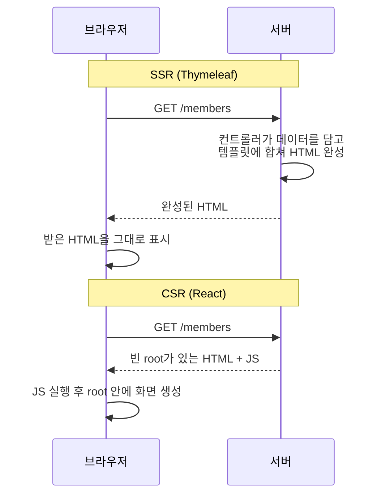
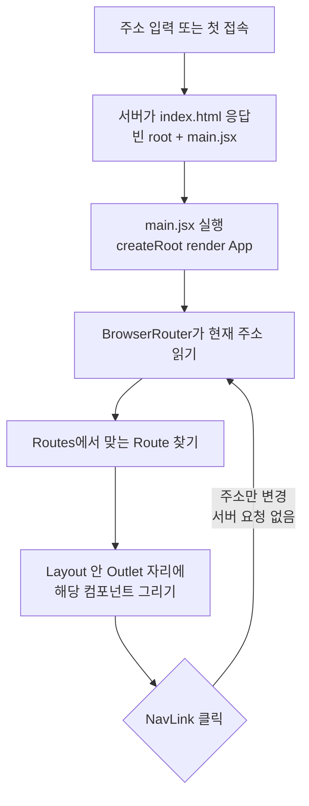
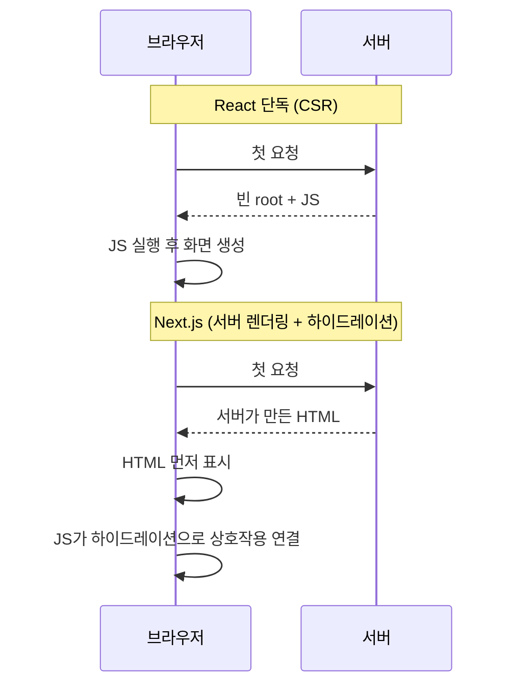

# 오늘 배운 것: CSR과 SPA, 주소만 바꿔 화면을 교체한다

## 들어가며 (Situation)

모듈 3(프론트엔드) 6일차. 어제까지는 CDN으로 React를 붙여서 `createElement`, JSX, 컴포넌트를 익혔고, 오늘은 **진짜 프로젝트 형태**로 넘어왔다. `npm`으로 프로젝트를 만들고, 개발 서버(프론트 서버)를 띄우고, 컴포넌트를 파일로 나눠서 주소별로 보여 주는 데까지 진행했다.

오늘 쓴 프로젝트는 `12_React/02_component/component-app`이다. 이 글에서 다루는 코드는 아래 팝업에서 폴더째로 볼 수 있고, 실행 결과는 `run-results.txt`에 남겼다.



| 구분 | 다룬 내용 |
|------|-----------|
| 프로젝트 만들기 | `npm create vite@latest`, `npm install react-router-dom`, `package.json` |
| 파일 구조 | `index.html` → `main.jsx` → `App.jsx`, import/export |
| 컴포넌트 나누기 | `01_intro`, `02_module`(NameCard·AgeCard·EmailCard·UserInfo) |
| 페이지 나누기 | `BrowserRouter`·`Routes`·`Route`, `Layout`·`Outlet`, `NavLink`, CSS Module |
| 오늘의 키워드 | SSR/CSR 렌더링 차이, SPA 동작 방식, React/Next 렌더링 차이(심화) |

## 문제 상황 (Task)

어제 만든 화면은 HTML 파일 하나에 컴포넌트를 전부 넣은 형태였다. 실제 프로젝트는 그렇게 만들 수 없다.

- 컴포넌트가 늘어나면 **파일로 나눠서 import/export**로 연결해야 한다.
- 화면(페이지)이 여러 개면 **주소에 따라 보여 줄 컴포넌트**를 정해야 한다.
- Spring MVC + Thymeleaf로 만들 때는 서버가 HTML을 완성해서 보냈는데, React는 **같은 "화면 만들기"를 어디서 하는지**가 다르다. 이 차이를 말로 설명할 수 있어야 한다.

그래서 오늘의 질문은 세 가지로 잡았다.

1. 프로젝트는 어떤 파일들이 어떤 순서로 연결되어 화면을 만드는가?
2. 메뉴를 눌렀을 때 화면은 **서버에서 새로 받아오는가, 브라우저에서 바꾸는가?**
3. 이것이 Thymeleaf(SSR), React(CSR), Next와 어떻게 다른가?

## 해결 과정 (Action)

### 1. 프로젝트 만들기: `npm create vite@latest`

수업에서는 이 명령을 부분으로 나눠서 설명했다.


```bash
npm create vite@latest component-app
# Select a framework: React
# Select a variant:   JavaScript
# Which linter to use?: Oxlint
# Install with npm and start now?: Yes
```

- **프로젝트 생성**(`create`)과 **프론트 서버 빌드 도구**(`vite`)와 **프로젝트 이름**(`component-app`)으로 읽는다.
- 수업에서는 vite를 "스프링으로 치면 Gradle의 역할"이라고 설명했다. 빌드 도구와 개발 서버를 한꺼번에 맡는다는 뜻으로 이해했다.
- 설치가 끝나면 개발 서버가 `http://localhost:5173/`으로 뜬다. (수업 로그에서는 `VITE v8.3.8 ready in 416 ms`가 찍혔다.)

의존성을 더할 때는 `npm install`을 쓴다.

```bash
npm install react-router-dom
```

🟢 Spring에서 `web`, `thymeleaf` 의존성을 추가하고 코끼리 버튼(Gradle 새로고침)을 누르는 일과 같은 역할이다. 결과는 `package.json`의 `dependencies`에 적힌다. Spring 프로젝트의 `build.gradle`이 `package.json`에 해당한다.

| 항목 | Spring 프로젝트 | Vite + React 프로젝트 |
|------|-----------------|------------------------|
| 프로젝트 만들기 | Spring Initializr | `npm create vite@latest` |
| 빌드·실행 도구 | Gradle | Vite (`npm run dev`) |
| 의존성 목록 | `build.gradle` | `package.json` |
| 의존성 추가 | Gradle에 추가 후 새로고침 | `npm install 이름` |

### 2. 화면이 뜨기까지: `index.html` → `main.jsx` → `App.jsx`


```html
<!-- index.html -->
<body>
  <div id="root"></div>
  <script type="module" src="/src/main.jsx"></script>
</body>
```

```jsx
// main.jsx
import { createRoot } from 'react-dom/client'
import App from './App.jsx'

createRoot(document.getElementById('root')).render(
    <App />
)
```

- `index.html`에는 **비어 있는 `#root`** 와 `main.jsx`를 불러오는 `<script>`만 있다.
- `main.jsx`가 `#root`에 `App` 컴포넌트의 결과를 그린다.
- `App.jsx`는 컴포넌트를 조립하고 주소별로 나누는 곳이다.

이 구조가 오늘 키워드 1번의 핵심이라서 뒤에서 실제로 확인했다.

### 3. import/export와 컴포넌트 나누기

수업 코드(`App.jsx`) 주석에서 강조한 내용은 두 가지였다.

- 함수 이름의 앞글자가 **대문자**면 컴포넌트이고, 컴포넌트는 엘리먼트(html 태그)를 리턴하는 함수이다.
- React에서는 import/export가 굉장히 중요하다. import를 하고 실제로 쓰지 않으면 오류가 날 수 있어서, **오류가 나면 import 구문부터 확인**한다.

`02_module` 폴더에서는 사용자 정보를 쪼갠 컴포넌트 3개를 `UserInfo`가 묶는다.

```jsx
// user.js  (데이터)
export const user = {
    name : '홍길동',
    age : 23,
    email : 'hong@example.com'
};

// NameCard.jsx
import { user } from "./user";
export default function NameCard() {
    return <h1 style={{color : 'red'}}>{user.name}</h1>
}

// UserInfo.jsx
import NameCard from "./NameCard";
import AgeCard from "./AgeCard";
import EmailCard from "./EmailCard";

function UserInfo() {
    return (
        <div style={ {width : 300, border : '1px solid black'} }>
            <NameCard/>
            <AgeCard/>
            <EmailCard/>
        </div>
    );
}
export default UserInfo;
```

- **export default**
  - 파일 하나에 하나만 내보낼 수 있고, import할 때 `{}` 없이 아무 이름으로 받을 수 있다. (`import NameCard from "./NameCard"`)
- **export (이름 있는 내보내기)**
  - 한 파일에서 여러 개를 내보낼 수 있고, import할 때 `{}`로 받는다. (`import { user } from "./user"`)
- **`.jsx` 확장자**
  - JSX 문법을 쓰는 컴포넌트 파일이라는 표시다. 수업 주석에서는 "js xml의 약자로, 단순 js 파일이 아니라 jsx 문법을 쓰는 파일임을 확실하게 나타낸다"고 설명했다.

> 개인정보 때문에 `user.js`의 이름과 메일은 공개용 예시 값으로 바꿔서 올렸다. 구조는 수업 코드와 같다.

### 4. 주소별로 화면 나누기: React Router

`02_module`까지 만들면 App에 컴포넌트를 직접 넣어야 화면에 보인다. 그런데 실제 프로젝트는 페이지가 여러 개이고, 페이지마다 보여야 하는 컴포넌트가 다르다. 그래서 **라우팅**을 쓴다. 수업에서는 라우팅을 "요청한 URL 주소에 따라 보여 줄 컴포넌트를 정의하는 것"이라고 정의했다.

| 요소 | 역할 |
|------|------|
| `BrowserRouter` | 라우팅을 쓰는 영역을 감싸는 최상위 요소 |
| `Routes` | `Route`들을 묶는 부모 |
| `Route` | `path`(주소)와 `element`(컴포넌트)를 연결 |
| `Outlet` | 부모 `Route`의 컴포넌트 안에서 **자식 Route의 컴포넌트가 들어올 자리** |
| `Link` / `NavLink` | 새로고침 없이 주소를 바꾸는 링크. `NavLink`는 현재 주소와 맞으면 `isActive`가 `true` |

```jsx
// App.jsx
import { BrowserRouter, Routes, Route } from 'react-router-dom';
import Layout from "./layouts/Layout";
import Main from "./pages/Main";
import Hello from "./module/01_intro/01_intro"
import UserInfo from "./module/02_module/UserInfo"

function App() {
  return (
    <BrowserRouter>
      <Routes>
        <Route path="/" element={<Layout/>}>
          <Route index element={<Main/>}/>
          <Route path="vite/intro" element={<Hello/>}/>
          <Route path="vite/module" element={<UserInfo/>}/>
        </Route>
      </Routes>
    </BrowserRouter>
  )
}
export default App
```

- `path="/"`의 `Layout`이 **공통 틀**이고, 그 안의 자식 Route 3개가 `Outlet` 자리에 번갈아 들어간다.
- `index`는 부모 주소(`/`) 그대로일 때 보여 줄 기본 화면이다.

그림의 `/members`, `/menus`는 수업에서 든 예시 주소이고, 오늘 실습의 주소는 `/`, `/vite/intro`, `/vite/module`이다.


```jsx
// layouts/Layout.jsx
import { Outlet } from 'react-router-dom';
import Navbar from '../components/Navbar';
import styles from './Layout.module.css';

function Layout() {
    return (
        <div className={styles.layout}>
            <Navbar/>
            <main className={styles.content}>
                <Outlet/>
            </main>
        </div>
    );
}
export default Layout;
```

🟢 메뉴를 눌러도 `Navbar`는 그대로 있고 `Outlet` 자리만 바뀐다. 헤더·메뉴처럼 공통인 부분을 한 번만 만들 수 있다는 점이 Layout의 장점이다.

### 5. NavLink와 CSS Module

```jsx
// components/Navbar.jsx (발췌)
import { NavLink } from 'react-router-dom';
import styles from './Navbar.module.css';

const activeStyle = ({isActive}) =>
    isActive ? {backgroundColor: 'orangered', color: 'white'} : undefined;

<NavLink to="/vite/intro" style={activeStyle}>프로젝트 생성</NavLink>
<NavLink to="/vite/module" style={activeStyle}>모듈</NavLink>
```

- **CSS Module**
  - 파일 이름을 `이름.module.css`로 짓고 객체로 import해서 `className`에 넣는 방식이다. 클래스 이름이 고유하게 바뀌어서 컴포넌트끼리 충돌하지 않는다.
  - 일반 CSS는 `import './style.css'`로 가져오며 페이지 전체에 적용된다.

실제로 렌더링된 DOM에서 클래스 이름이 바뀌어 있는 것을 확인했다. (아래 6장의 확인 결과)

| 코드에서 쓴 이름 | 렌더링된 `class` |
|-------------------|-------------------|
| `styles.nav` (Navbar.module.css) | `_nav_masue_1` |
| `styles.layout` (Layout.module.css) | `_layout_1tt32_1` |
| `styles.content` (Layout.module.css) | `_content_1tt32_11` |

### 6. 직접 확인: 서버는 무엇을 보내고, 메뉴를 누르면 무슨 일이 생기나

키워드 1·2번을 말로만 외우지 않으려고, `component-app`을 Vite 개발 서버(포트만 5199로 바꿔서 실행)로 띄우고 헤드리스 Chrome으로 확인했다. 확인한 결과 전체는 `run-results.txt`에 있다.

**① 서버가 보내는 HTML**

`/vite/module` 주소를 서버에 요청(`curl`)했을 때 응답 본문은 이렇다. (Vite가 개발용으로 끼워 넣는 스크립트 줄은 뺐다.)

```html
<body>
    <div id="root"></div>
    <script type="module" src="/src/main.jsx"></script>
</body>
```

서버가 보낸 HTML에는 메뉴도, 이름도, 이메일도 없다. **빈 `#root`뿐이다.**

**② 브라우저가 JavaScript를 실행한 뒤의 `#root`**

```text
<div class="_layout_1tt32_1"><nav class="_nav_masue_1"> ... 
<a ... href="/vite/intro">프로젝트 생성</a><a ... href="/vite/module">모듈</a></nav>
<main class="_content_1tt32_11"><h1>React!!</h1><p>왼쪽 메뉴바에서 챕터를 선택해주세요</p></main></div>
```

(수업 코드를 헤드리스 Chrome으로 실행해서 확인한 결과다.) 같은 주소인데 **서버 응답(빈 `#root`)과 화면(메뉴·본문이 가득)이 다르다.** 차이를 만든 쪽은 브라우저에서 실행된 `main.jsx`다.

**③ 메뉴를 눌렀을 때: 새로고침이 있는가?**

처음에 `window.__marker = 'alive'`를 심어 두고, `nav` 요소를 변수에 저장해 둔 뒤, 메뉴를 차례로 눌렀다. 새로고침(페이지 전체 로드)이 일어나면 `window`가 새로 만들어져서 표시가 사라지고, `nav`도 새 요소가 된다.

| 동작 | 주소(`location.pathname`) | `main` 영역 글자 | `__marker` | `nav` 같은 요소? | 새 document 요청 |
|------|--------------------------|-------------------|------------|-------------------|-------------------|
| "프로젝트 생성" 클릭 | `/vite/intro` | `Hello World !!!!!!` | `alive` | 예 | 0 |
| "모듈" 클릭 | `/vite/module` | 이름·나이·이메일 3줄 | `alive` | 예 | 0 |
| "React 챕터" 클릭 | `/` | `React!!` + 안내 문구 | `alive` | 예 | 0 |
| 뒤로 가기 | `/vite/module` | 이름·나이·이메일 3줄 | `alive` | 예 | 0 |

- 활성 링크 `프로젝트 생성`의 배경색은 `rgb(255, 69, 0)`(orangered)이고, 비활성 링크는 `rgba(0, 0, 0, 0)`(투명)이었다. `isActive`가 의도대로 동작했다.
- `/vite/module`의 글자 색은 이름 `h1` 빨강(`rgb(255, 0, 0)`), 나이 `h2` 주황(`rgb(255, 165, 0)`), 이메일 `h3` 파랑(`rgb(0, 0, 255)`)이었다. 컴포넌트에 준 `style`이 그대로 적용됐다.

**④ 비교: 일반 `<a href>`는 어떻게 다른가**

예시로 일반 `<a href="/vite/intro">`를 만들어 눌러 봤다. (수업 코드가 아니라 비교용으로 직접 만든 확인 코드다.)

| | `NavLink` | 일반 `<a href>` |
|---|-----------|-------------------|
| 주소 | 바뀜 | 바뀜 |
| `window.__marker` | 유지됨(`alive`) | `undefined`(사라짐) |
| 새 document 요청 | 없음 | `/vite/intro` 요청 1번 |

🔴 일반 `<a href>`를 쓰면 SPA의 이점을 못 얻는다. 클릭할 때마다 브라우저가 서버에 HTML을 다시 요청하고, 그 순간 `main.jsx`부터 다시 실행해서 화면이 새로 만들어진다. React 프로젝트의 메뉴 이동은 `Link`/`NavLink`를 쓴다.

**⑤ 주소를 직접 입력해서 들어가면?**

주소창에 `/vite/module`을 직접 입력해서 들어가자 서버에 `/vite/module`로 document 요청이 한 번 나갔고, 응답은 위의 **같은 빈 `#root` HTML**이었다. 그다음에 브라우저가 라우터를 실행해서 UserInfo 화면(이름·나이·이메일)을 그렸다. 즉 서버는 주소별 HTML을 따로 갖고 있지 않아도 됐다.

⚠️ 이것은 **Vite 개발 서버**에서 확인한 동작이다. 배포 서버에서 이 주소들을 똑같이 `index.html`로 응답하게 하려면 서버 설정이 필요한지는 아직 확인하지 않았다. (아래 "더 학습하면 좋은 개념"에 적어 둔다.)

⚠️ 없는 주소 `/nothing`으로 들어가 보니 화면이 빈 채로 나왔다. 이 프로젝트에서는 `Route`에 없는 주소일 때 본문이 비어 있었다. (수업에서 다루지 않은 부분이라 콘솔 경고까지는 확인하지 않았다.)

### 7. 키워드 정리 1: SSR과 CSR 렌더링 차이

**렌더링**은 "데이터와 템플릿(컴포넌트)을 합쳐서 화면용 HTML을 만드는 일"이다. 이 일을 **어디서 하느냐**가 SSR과 CSR의 차이다.

- **SSR (Server-Side Rendering)**
  - 서버가 HTML을 **완성해서** 보내고, 브라우저는 받은 HTML을 보여 준다. MDN은 "서버에서 페이지의 HTML을 만들어 클라이언트로 보내는 방식"으로 설명한다.
  - 예: Spring MVC + **Thymeleaf**. Thymeleaf는 서버 쪽 Java 템플릿 엔진이고, 컨트롤러가 담아 준 값을 템플릿에 합쳐서 완성된 HTML을 응답으로 쓴다.
- **CSR (Client-Side Rendering)**
  - 서버는 **거의 빈 HTML과 JavaScript**를 보내고, 브라우저가 JavaScript를 실행해서 HTML(화면)을 만든다.
  - 예: 오늘 만든 **React + Vite**. 6장 ①②에서 본 대로 서버 응답은 빈 `#root`였다.



SSR 쪽은 이런 형태다. (**예시 코드**이고 오늘 실습한 코드가 아니다.)

```java
@GetMapping("/members")
public String members(Model model) {
    model.addAttribute("name", "홍길동");
    return "members";   // templates/members.html 에 값을 합쳐서 HTML을 완성한다
}
```

```html
<h1 th:text="${name}">이름</h1>  <!-- 서버가 처리한 뒤에는 <h1>홍길동</h1> 이 된다 -->
```

| 비교 | SSR (Thymeleaf) | CSR (React + Vite) |
|------|------------------|----------------------|
| HTML을 완성하는 곳 | 서버 | 브라우저 |
| 서버 응답 본문 | 내용이 채워진 HTML | 빈 `#root` + JS 참조 |
| 화면 전환 | 링크를 누르면 서버가 새 HTML 응답 | 브라우저가 컴포넌트를 교체 |
| 확인 방법 | (오늘 실습하지 않음, 개념 정리) | `curl` 응답과 렌더링된 DOM 비교 |

⚠️ React 공식 문서도 같은 점을 짚는다. `createRoot`의 예시 HTML은 빈 `<div id="root">`이고, 비어 있는 HTML 껍데기만 쓰면 **JavaScript가 로드되기 전에는 빈 화면**이 보인다.

### 8. 키워드 정리 2: SPA (Single Page Application)

SPA는 MDN 정의대로 **문서(HTML)를 한 번만 불러온 뒤, JavaScript로 화면을 갱신하는 앱**이다. 새 페이지를 통째로 받지 않는다.

**동작 방식** (오늘 6장 ③의 결과를 흐름으로 그리면 이렇다)



- 첫 접속 때만 서버에서 HTML을 받는다(위 그림의 A→B).
- 이후 `NavLink` 클릭은 **주소만 바꾸고**(`history`) 라우터가 다시 매칭해서 `Outlet` 자리만 교체한다(G→D). 6장 ③에서 새 document 요청이 0이었던 이유다.
- 틀(`Navbar`)은 그대로이고 바뀐 부분만 교체되니, `nav`가 같은 요소로 남았다.

| 구분 | 전통적인 여러 페이지(MPA) | SPA |
|------|---------------------------|-----|
| 메뉴 이동 | 서버에 새 HTML 요청 → 페이지 전체 교체 | 주소만 바꾸고 일부 컴포넌트 교체 |
| 공통 틀(Header·Nav) | 페이지마다 다시 받음 | 한 번 만들면 유지 |
| 서버 요청 | 이동할 때마다 HTML | 첫 접속 때 HTML, 이후는 필요한 데이터만 |
| 오늘 확인 | 일반 `<a href>`: `__marker` 사라짐 | `NavLink`: `__marker` 유지 |

### 9. 키워드 정리 3 (심화): React와 Next의 렌더링 방식 차이

⚠️ 이 장은 **수업에서 실습하지 않은 심화 내용**이라 코드를 돌려 보지 않았다. 아래 내용은 Next.js·React 공식 문서를 읽고 정리한 것이다.

- **React (오늘의 Vite 프로젝트)**
  - 화면을 만드는 일을 **브라우저에서** 한다. 서버는 빈 `#root`가 있는 HTML을 준다. (CSR)
- **Next.js (App Router)**
  - 라우트를 **기본적으로 서버에서 렌더링**한다. 레이아웃과 페이지는 기본이 서버 컴포넌트이고, 상호작용(상태·이벤트)이 필요한 곳만 파일 맨 위에 `'use client'`를 써서 클라이언트 컴포넌트로 만든다.
  - 첫 접속 때 서버가 만든 **HTML을 먼저 보여 주고**(빠르지만 아직 상호작용은 안 되는 미리보기), 브라우저에서 JavaScript가 **하이드레이션(hydration)** 으로 이벤트 핸들러를 연결해 상호작용이 되게 만든다.
  - 이후 페이지 이동은 `<Link>`로 전체 새로고침 없이 이루어지고, 공식 문서에 따르면 미리 가져오기(prefetch)와 스트리밍도 지원한다.



| 비교 | React (Vite, 오늘) | Next.js (App Router) |
|------|---------------------|-----------------------|
| 첫 응답 HTML | 빈 `#root` | 서버가 렌더링한 내용 |
| 렌더링 방식 | CSR | 기본은 서버 렌더링 + 하이드레이션 |
| 브라우저 쪽 시작 | `createRoot(...).render(<App/>)`로 빈 곳에 새로 그림 | 서버가 만든 HTML에 하이드레이션으로 연결 |
| 페이지 이동 | React Router의 `Link` | Next의 `<Link>` (전체 새로고침 없음, prefetch 지원) |
| 이번에 확인한 정도 | 직접 실행·확인 | 공식 문서로 개념 정리 |

💡 React 공식 문서는 서버 렌더링(또는 정적 생성)으로 만든 HTML을 쓰는 앱에서는 `createRoot` 대신 `hydrateRoot`를 써야 한다고 설명한다. 오늘 쓴 `createRoot`는 "브라우저가 비어 있는 곳에 새로 그린다"는 뜻이라, CSR 구조의 코드임을 코드에서도 읽을 수 있다.

### 10. 헷갈리기 쉬운 점 정리

- "SPA는 서버와 통신을 아예 안 한다"는 오해: 확인해 보니 **첫 접속 때 HTML과 JS는 서버에서 받는다.** 안 하는 것은 "메뉴를 누를 때마다 HTML 전체를 새로 받는 일"이다.
- `Outlet`의 위치: 수업 설명대로 **부모 Route의 컴포넌트 안에서** 자식이 들어올 자리를 표시하는 것이다. 그래서 `Layout`이 `Route path="/"`의 `element`이고, 자식 Route가 그 `Outlet`에 들어간다.
- 일반 `<a href>`와 `Link`/`NavLink`: 둘 다 주소는 바뀌지만, 6장 ④의 비교처럼 일반 `<a href>`는 페이지 전체를 새로 받는다.
- CSR과 SSR을 나누는 기준은 "**누가 HTML을 완성하느냐**"로 잡으면 Thymeleaf·React·Next가 한 줄에 놓인다.

## 결과 (Result)

| 항목 | 확인 결과 |
|------|-----------|
| 서버 응답 본문(`/vite/module`) | 내용 없는 `<div id="root"></div>` (CSR 확인) |
| 메뉴 클릭 4번(클릭 3회 + 뒤로 가기) 동안 새 document 요청 | 0번 |
| 같은 4번 동안 `window.__marker`·`nav` 요소 | 모두 유지됨 |
| 일반 `<a href>` 클릭 | document 요청 1번, `__marker` 사라짐 |
| 주소 직접 입력(`/vite/module`) | 서버는 같은 빈 `#root` HTML을 응답, 브라우저가 화면 생성 |
| `NavLink` 활성 스타일 | 활성 `rgb(255, 69, 0)`, 비활성 투명 |
| CSS Module 클래스명 | `nav` → `_nav_masue_1` 등으로 고유하게 변환됨 |

- 오늘 만든 프로젝트는 컴포넌트 9개(`App`, `Layout`, `Navbar`, `Main`, `Hello`, `NameCard`, `AgeCard`, `EmailCard`, `UserInfo`)와 시작 파일 `main.jsx`, 데이터 `user.js`로 3개 주소를 구성했다.
- 배운 점: SSR/CSR/SPA를 용어로 외우면 헷갈리지만, **"서버가 보낸 HTML에 내용이 있는가"** 와 **"메뉴를 눌렀을 때 새 document 요청이 가는가"** 두 질문으로 확인하면 구분이 된다.
- 아직 못 한 것: Next 실습(오늘은 공식 문서로 개념만 정리), 배포 환경에서의 주소 직접 접근 설정.

## 더 학습하면 좋은 개념

- **하이드레이션(Hydration)** — 서버가 만든 HTML에 브라우저의 JavaScript가 이벤트를 붙여 상호작용을 가능하게 하는 과정. Next를 이해하려면 가장 먼저 알아야 하고, `createRoot`와 `hydrateRoot`가 왜 나뉘는지도 여기서 풀린다.
- **History API (`pushState`, `popstate`)** — 새로고침 없이 주소창의 주소만 바꾸는 브라우저 기능. 오늘 본 "서버 요청 없이 주소가 바뀌는 현상"이 브라우저의 어떤 기능과 이어지는지 찾아볼 수 있다.
- **SPA 배포와 서버 설정(fallback)** — 주소를 직접 입력해서 들어올 때 서버가 어떤 응답을 줘야 하는지. 오늘은 개발 서버에서만 확인했기 때문에, 배포할 때 어떻게 설정하는지 이어서 확인해야 한다.
- **서버 컴포넌트와 클라이언트 컴포넌트(`'use client'`)** — Next에서 "무엇을 서버에서 그리고 무엇을 브라우저에서 그리는가"를 정하는 경계. 오늘 정리한 CSR/SSR 차이가 컴포넌트 단위로 내려온 개념이다.
- **스트리밍 SSR과 prefetch** — 서버 렌더링의 느린 부분을 나눠 보내고 다음 화면을 미리 가져오는 기법. 서버 렌더링의 단점을 보완하는 방법이라서 Next 심화를 볼 때 이어진다.

## 참고 자료

- [MDN - SSR (Server-side rendering)](https://developer.mozilla.org/en-US/docs/Glossary/SSR)
- [MDN - CSR (Client-side rendering)](https://developer.mozilla.org/en-US/docs/Glossary/CSR)
- [MDN - SPA (Single-page application)](https://developer.mozilla.org/en-US/docs/Glossary/SPA)
- [React 공식 문서 - createRoot](https://react.dev/reference/react-dom/client/createRoot)
- [React Router 공식 문서 - Routing (Declarative)](https://reactrouter.com/start/declarative/routing)
- [Next.js 공식 문서 - Server and Client Components](https://nextjs.org/docs/app/getting-started/server-and-client-components)
- [Next.js 공식 문서 - Linking and Navigating](https://nextjs.org/docs/app/getting-started/linking-and-navigating)
- [Thymeleaf 공식 문서 - Using Thymeleaf](https://www.thymeleaf.org/doc/tutorials/3.1/usingthymeleaf.html)
