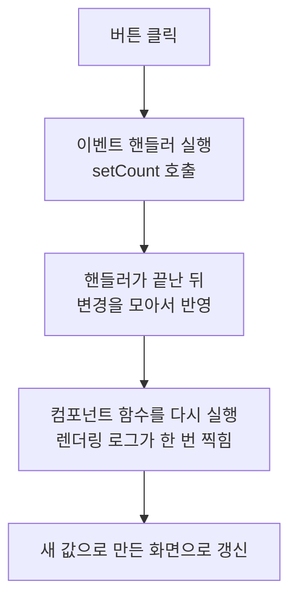

# 오늘 배운 것: props로 전달하고 state로 바꾸고 map으로 그린다

## 들어가며 (Situation)

모듈 3(프론트엔드) 7일차. 어제까지는 프로젝트를 만들고 주소별로 화면을 나누는 틀(Vite, React Router, Layout)을 익혔고, 오늘부터는 그 틀 안에 들어가는 **컴포넌트의 내용**을 채웠다.

오늘 쓴 프로젝트는 `12_React/data-fetch-app-skeleton`이다. 라우터와 메뉴는 미리 만들어져 있고, 수업에서는 `src/chap` 폴더의 파일만 작성한다. 메뉴는 7개(`01_props` ~ `07_pokemon`)인데, 오늘은 **01~04까지** 작성했다. 05~07(`useEffect`, 데이터 요청, 포켓몬 도감)은 뼈대만 있는 상태라 이 글에서는 다루지 않는다. (`App.jsx`는 05~07도 import하지만, 코드 팝업에는 오늘 작성한 01~04만 넣었다.)



| 챕터 | 다룬 내용 | 확인 방법 |
|------|-----------|-----------|
| `01_props` | props, 구조 분해 할당, children | 화면 글자, `console.log(props)` |
| `02_state` | `useState`, 리렌더링, 이전 state를 쓴 변경 | 버튼 클릭 뒤 화면과 콘솔 |
| `03_event` | 이벤트 속성, 제어 컴포넌트, 객체 state | 입력창에 글자를 넣고 초기화 |
| `04_iteration` | `map`, `key`, 배열 state 추가·삭제 | 추가, 더블클릭 삭제 |
| 개념 정리 | 프론트 핵심 포인트, 프론트·백엔드 역할 분리, `node_modules`, 최상위 컴포넌트 | 수업 그림과 직접 측정 |

## 문제 상황 (Task)

어제까지 만든 컴포넌트는 **고정된 화면**이었다. 이름도 숫자도 코드 안에 박혀 있었다. 실제 화면은 다르다.

- 같은 컴포넌트를 쓰면서 **이름만 바꿔** 보여 주고 싶다. (값을 어떻게 전달할까?)
- 버튼을 누르면 숫자가 바뀌어야 한다. 그런데 일반 변수를 바꾸면 화면이 안 바뀐다고 한다. (왜일까?)
- 입력창, 목록 추가·삭제처럼 값이 바뀌면 화면도 따라 바뀌어야 한다. (어떻게 연결할까?)

그래서 오늘의 질문은 이렇게 잡았다.

1. 부모가 자식에게 값을 넘기는 방법(props)은 무엇이고 무엇을 지켜야 하는가?
2. 화면이 바뀌려면 값을 어떻게 바꿔야 하는가? (state)
3. 입력과 목록처럼 여러 값이 있을 때 state를 어떻게 바꿔야 안전한가?

## 해결 과정 (Action)

### 1. 프론트엔드에서 중요한 세 가지

수업에서는 프론트엔드의 핵심 포인트를 먼저 짚었다.


- **컴포넌트**
  - 화면을 조각으로 나눈 단위다. 오늘 `01_props`에서 부모와 자식 컴포넌트가 값을 주고받는 방법을 다뤘다.
- **상태관리**
  - 바뀌는 값을 어디에 두고 어떻게 바꿀지에 대한 문제다. 오늘 `02_state`~`04_iteration`이 여기에 해당한다.
- **렌더링 방식, 렌더링 최적화**
  - 화면이 어디서(CSR/SSR) 어떻게 다시 그려지는지에 대한 문제다. 어제 CSR/SPA를 다뤘고, 오늘은 state가 바뀔 때 일어나는 **리렌더링**을 콘솔로 확인했다.

### 2. 모듈 2와 달라진 점: 화면은 프론트 서버가 정한다

모듈 2에서는 Spring 컨트롤러가 `return "페이지.html"`로 **페이지를 돌려주었다.** 프론트 서버가 따로 생기면 Spring의 역할이 바뀐다.


| 항목 | 모듈 2 (Thymeleaf) | 프론트 서버가 있을 때 |
|------|---------------------|--------------------------|
| 컨트롤러 | `@Controller` | `@RestController` (`@Controller` + `@ResponseBody`) |
| 응답 | 페이지(html) | 데이터(JSON) |
| 페이지를 결정하는 곳 | Spring | **프론트 서버** |
| 화면에 데이터 채우기 | 서버가 html에 합쳐서 보냄 | 브라우저가 JSON을 받아 컴포넌트로 그림 |

💡 이 분리가 있어야 "백엔드는 데이터만, 화면은 프론트가"라는 역할 분담이 된다. 이 구조에서 프론트가 서버에 데이터를 요청하는 방법(`fetch`)은 `06_fetch`에서 다룬다.

### 3. `npm install`과 `node_modules`

오늘 프로젝트를 받자마자 한 일은 `npm install`이다. 그러면 `node_modules` 폴더가 생긴다.


- **node_modules**
  - `package.json`에 적힌 의존성 패키지가 내려받아져 있는 폴더다. 수업에서는 "Java의 JDK 같이 개발 시 필요한 kit들의 모음"이라고 설명했다.
  - 용량이 커서 기본적으로 `.gitignore`에 들어 있고, git에서 `clone`을 받으면 **가장 먼저 `npm install`로 만들어야** 한다.

직접 세어 보니 이 프로젝트의 `node_modules`는 **71MB, 파일 621개, 최상위 폴더 26개**였다. (`react`, `react-dom`, `react-router-dom`, `vite` 등) `.gitignore`에는 `node_modules`가 한 줄로 들어 있었다.

⚠️ JDK 비유는 "개발에 필요한 도구 묶음"이라는 느낌을 잡는 데는 좋지만, 엄밀히는 **의존성 라이브러리가 내려받아진 폴더**라서 Gradle이 받아 오는 라이브러리 쪽에 더 가깝다고 정리했다. `package.json`은 목록이고 `node_modules`는 실물이다.

### 4. 최상위 컴포넌트 `App`


수업 그림은 `App`이 `Header`, `NavBar`, `Content`를 Fragment로 감싸 조립하는 모양이다. 오늘 실습 앱의 `App.jsx`는 그 자리에 라우터가 들어 있다.

```jsx
function App() {
    return (
        <BrowserRouter>
            <Routes>
                <Route path="/" element={<Layout/>}>
                    <Route index element={<Main/>}/>
                    <Route path="props" element={<Props/>}/>
                    <Route path="state" element={<State/>}/>
                    <Route path="event" element={<Event/>}/>
                    <Route path="iteration" element={<Iteration/>}/>
                    {/* effect, fetch, pokemon 도 같은 방식으로 연결되어 있다 */}
                </Route>
                <Route path="*" element={<Error404/>}/>
            </Routes>
        </BrowserRouter>
    );
}
```

- `path="*"`는 위의 어떤 Route와도 맞지 않는 주소일 때 쓰는 Route다. 어제 `/nothing`에서 빈 화면이 나왔던 것과 달리, 오늘 프로젝트는 `Error404` 컴포넌트를 보여 주도록 이미 만들어져 있다.
- `Error404`는 `Layout` **바깥**에 있어서, 404 화면에는 메뉴(`Navbar`)가 없다.

### 5. `01_props`: 부모가 자식에게 값을 전달한다

수업 주석에서 정리한 규칙은 이렇다.

- 전달한 속성들은 **하나의 객체(`props`)** 로 묶여 함수의 매개변수로 들어온다.
- props는 **읽기 전용**이다. 자식에서 수정하지 않는다.
- 문자열이 아닌 값(숫자, 배열, 함수)은 `{}`로 전달한다. `age={20}`
- 태그 사이에 쓴 내용은 `props.children`으로 들어온다.

```jsx
/* 1. props 기본 */
function Title(props) {
    console.log(props);
    return <h1>안녕하세요 {props.name}님 반갑습니다.</h1>;
}

/* 2. 매개변수에서 구조 분해 할당 (가장 많이 쓰는 형태) */
function Profile({name, age}) {
    return <h3>{name}님은 {age}살입니다.</h3>;
}

/* 3. children */
function Box({children}) {
    return <div style={{border: '1px solid orangered', padding: 10, margin: 5}}>{children}</div>;
}

export default function Props() {
    return (
        <>
            <Title name="김예린"/>
            <Title name="paraea"/>
            <Profile name="김예린" age={23}/>
            <Box>텍스트 노드</Box>
            <Box><Profile name="강감찬" age={30}/></Box>
        </>
    );
}
```

`/props`를 열었을 때 화면 글자와 콘솔 출력이다.

```text
안녕하세요 김예린님 반갑습니다. / 안녕하세요 paraea님 반갑습니다. / 김예린님은 23살입니다. / 텍스트 노드 / 강감찬님은 30살입니다.

콘솔: {"name":"김예린"}
      {"name":"paraea"}
```

- **props 객체**
  - 부모가 준 속성들이 하나의 객체로 묶여 함수의 매개변수로 들어온 것이다. 콘솔에 `{"name":"김예린"}`처럼 찍혔다. `<Title name="…"/>`의 `name` 속성이 객체의 `name` 키가 됐다.
- **구조 분해 할당**
  - 객체의 키 이름으로 값을 바로 변수처럼 꺼내 쓰는 JavaScript 문법이다. `function Profile({name, age})`처럼 매개변수 자리에서 하면 `props.name` 대신 `name`을 쓸 수 있다.
- **children**
  - 컴포넌트 태그 사이에 쓴 내용이 담기는 props다. `<Box>텍스트 노드</Box>`의 "텍스트 노드"가 `children`이고, `Box` 안에서 `{children}` 자리에 그려진다. 두 번째 `Box`처럼 **다른 컴포넌트를 넣을 수도** 있다.

🟢 `Box`처럼 **감싸는 틀만 만들고 안쪽 내용은 사용하는 쪽이 정하게** 하려면 `children`을 쓴다. Layout의 `Outlet`과 같은 발상이라서 어제 배운 것과 연결됐다.

⚠️ 수업에서 알려 준 `props`는 읽기 전용이라는 점이 중요하다. 값을 바꿔야 하면 props가 아니라 **state**가 필요하고, 그것이 다음 챕터다.

### 6. `02_state`: 화면이 바뀌려면 state를 바꿔야 한다

수업 주석의 핵심 문장은 두 개였다.

- setter로 state를 바꾸면 **컴포넌트 함수가 다시 실행**되어(리렌더링) 화면이 갱신된다.
- 일반 변수(`let`)를 바꾸면 리렌더링이 일어나지 않아 화면이 바뀌지 않는다.

```jsx
function Counter() {
    console.log('렌더링!');      // state가 바뀔 때마다 출력된다.

    const [count, setCount] = useState(0);

    const onClickPlusOne = () => {
        setCount(count + 1);
        console.log(`count: ${count}`);
    };

    const onClickPlusThree = () => {
        // 이전 state 를 전달 받아 +1 씩 더해주는 함수
        setCount(prev => prev + 1);
        setCount(prev => prev + 1);
        setCount(prev => prev + 1);
        console.log(`count: ${count}`);
    };

    return (
        <>
            <h1>count : {count}</h1>
            <button onClick={onClickPlusOne}>+ 1</button>
            <button onClick={onClickPlusThree}>+ 3</button>
            <button onClick={() => setCount(0)}>초기화</button>
        </>
    );
}
```

`/state`에서 버튼을 차례로 눌렀을 때의 화면과 콘솔이다.

| 동작 | 화면 | 콘솔 |
|------|------|------|
| 처음 열기 | `count : 0` | `렌더링!` |
| `+ 1` 클릭 | `count : 1` | `count: 0`, `렌더링!` |
| `+ 3` 클릭 (`+ 1` 뒤에 이어서) | `count : 4` | `count: 1`, `렌더링!` |
| 초기화 클릭 | `count : 0` | `렌더링!` |

두 가지가 눈에 띄었다.

1. `+ 1`을 눌렀는데 콘솔에는 **`count: 0`** 이 찍혔다. 화면은 1인데 같은 핸들러 안의 `console.log`는 0을 보여 줬다. 수업 주석 그대로 "setter를 호출해도 state는 즉시 바뀌지 않고, 이벤트 핸들러가 끝난 뒤 한 번에 반영"되기 때문이다. 핸들러가 실행되는 동안 `count`는 **그 렌더링 시점의 값(0)** 으로 고정되어 있다.
2. `+ 3`은 `setCount`를 세 번 불렀는데 **`렌더링!`은 한 번**만 찍혔다. 세 번의 변경이 모여서 한 번에 반영되고, 컴포넌트 함수도 한 번만 다시 실행된다는 뜻이다.

수업의 TODO 2 질문("`setCount(count + 1)`을 세 번 부르면 몇이 늘까?")은 수업 코드에서는 이미 함수형으로 바뀐 상태라서, 비교용 예시 코드를 따로 만들어 확인했다. (수업 코드가 아닌 확인용 코드이고, 소스는 코드 팝업의 `example/exp.jsx`에 있다.)

| 예시 코드 | 한 번 클릭 후 화면 |
|-----------|---------------------|
| `setA(a + 1)` 세 번 | `값 방식: 1` |
| `setB(p => p + 1)` 세 번 | `함수 방식: 3` |
| `let count`를 바꾸는 버튼 두 번 클릭 | 화면 `let: 0` 그대로, 콘솔에는 `let count: 1`, `let count: 2` |

🔴 값 방식으로 세 번 불러도 **1만** 늘었다. 세 번 모두 같은 렌더링 시점의 `a`(0)에 1을 더한 값(1)을 요청하기 때문이다. 이전 값을 기준으로 누적하려면 `setCount(prev => prev + 1)`처럼 **함수를 전달**한다.

🔴 `let` 변수는 값은 바뀌는데 **화면은 그대로**였다. 수업 설명대로 리렌더링은 setter를 호출했을 때 일어난다. 화면이 따라 바뀌어야 하는 값은 state로 둔다.



### 7. `03_event`: 이벤트와 입력값 관리

수업 주석의 규칙 세 가지다.

1. 이벤트 속성명은 **카멜 표기법**이다. `onclick` → `onClick`, `onchange` → `onChange`
2. 실행할 코드 문자열이 아니라 **함수를 전달**한다. `<button onClick={() => ...}>`
3. 이벤트는 **DOM 요소**(button, input 등)에만 연결된다. 컴포넌트에 `onClick`을 주면 props로 전달될 뿐이라서, 내부의 DOM 요소에 다시 연결해야 한다.

입력값은 **제어 컴포넌트**로 관리한다. input의 `value`를 state로 두고, `onChange`에서 state를 바꾼다. 입력값이 여러 개면 객체 state 하나와 핸들러 하나로 묶는다.

```jsx
function SignupForm() {

    const [form, setForm] = useState({
        username: '',
        email: ''
    });

    const onChangeHandler = e => {
        // 프로퍼티 키에 [] 를 씌우게 되면 값이 곧 key 가 된다.
        setForm({
            ...form,    // 기존 값을 복사하지 않으면 다른 입력값이 초기화된다.
            [e.target.name] : e.target.value
        });
    };

    const onResetHandler = () => {
        setForm({username : '', email : ''})
    };

    return (
        <>
            <h1>회원가입</h1>
            <input name="username" placeholder="이름" value={form.username} onChange={onChangeHandler}/>
            <br/>
            <input name="email" placeholder="이메일" value={form.email} onChange={onChangeHandler}/>
            <br/>
            <button onClick={onResetHandler}>초기화</button>

            <p>입력한 이름: {form.username} / 이메일: {form.email}</p>
        </>
    );
}
```

- **제어 컴포넌트 (Controlled Component)**
  - input의 `value`를 state가 쥐고, `onChange`로 state를 바꾸는 방식이다. 입력창에 보이는 값이 항상 state와 같아서, 초기화 버튼이 state만 비워도 입력창이 비워진다.
- **계산된 속성 이름 (`[e.target.name]`)**
  - 객체의 키를 `[]`로 감싸면 그 안의 **값이 키 이름**이 된다. 입력창마다 `name`이 다르므로(`username`, `email`) 핸들러 하나로 두 입력을 모두 처리할 수 있다.
- **스프레드 문법 (`...form`)**
  - 기존 객체의 값을 새 객체에 복사하는 문법이다. 수업 주석 설명대로 복사하지 않으면 `form`에 묶인 다른 값이 초기화된다. setter는 객체를 **통째로 바꾸기** 때문이다.

실제로 입력해서 확인했다.

| 동작 | 결과 |
|------|------|
| 이름 칸에 `abc`, 이메일 칸에 `a@b.c` 입력 | 아래 문장이 `입력한 이름: abc / 이메일: a@b.c` |
| 이름 칸에 `X` 추가 입력 | 이름 `abcX`, 이메일은 `a@b.c` **그대로** |
| 초기화 클릭 | 두 칸 모두 `""`, 문장도 비워짐 |

이름만 바꿨는데 이메일이 유지된 것이 `...form`이 하는 일이다.

### 8. `04_iteration`: 배열을 화면으로 바꾸기

수업 주석의 핵심은 세 가지다.

- `배열.map()`으로 데이터 배열을 **엘리먼트 배열**로 바꿔 렌더링한다.
- **key**는 목록에서 어떤 항목이 추가·삭제되었는지 구분하는 식별자다. 형제 요소 사이에서 고유해야 한다. DB 데이터라면 pk 값을 쓰고, **index는 쓰지 않는 것이 좋다**(추가·삭제되면 바뀌므로).
- state 배열은 원본을 수정(`push`, `splice`)하지 않고 **새 배열**을 만들어 setter에 전달한다. 추가는 `[...배열, 새값]`, 삭제는 `filter`다.

```jsx
function NameList() {

    const [names, setNames] = useState([
        {id: 1, name: '홍길동'},
        {id: 2, name: '유관순'},
        {id: 3, name: '이순신'}
    ]);
    const [inputText, setInputText] = useState('');
    const [nextId, setNextId] = useState(4);

    const onClickHandler = () => {
        // 기존 배열을 복사하고 새 객체를 뒤에 붙인 새 배열을 만든다
        setNames([...names, {id : nextId, name : inputText}])
        // 다음 추가 때 id 가 겹치면 안 되므로 +1
        setNextId(nextId + 1);
        // 추가 후 입력창을 비운다
        setInputText('');
    };

    const onRemove = id => {
        // 전달받은 id 를 가지지 않은 객체들로만 새 배열을 구성
        setNames(names.filter(name => name.id !== id));
    };

    return (
        <>
            <input value={inputText} onChange={e => setInputText(e.target.value)}/>
            <button onClick={onClickHandler}>추가</button>
            <ul>
                {names.map( name =>
                    <li key={name.id} onDoubleClick={() => onRemove(name.id)}>{name.id}번 {name.name}</li>
                )}
            </ul>
            <p>더블 클릭하면 삭제된다.</p>
        </>
    );
}
```

차례로 눌러 본 결과다.

| 동작 | 목록 |
|------|------|
| 처음 | 1번 홍길동, 2번 유관순, 3번 이순신 |
| `김예린` 입력 후 추가 | 1번~3번 그대로, 4번 김예린이 뒤에 붙음 (입력창은 `""`로 비워짐) |
| `세종` 추가 | 1번~4번 그대로, 5번 세종이 뒤에 붙음 |
| `2번 유관순` 더블클릭 | 1번 홍길동, 3번 이순신, 4번 김예린, 5번 세종 |
| `1번 홍길동` 더블클릭 | 3번 이순신, 4번 김예린, 5번 세종 |
| `다시` 추가 | 3번 이순신, 4번 김예린, 5번 세종, **6번 다시** |

- 삭제를 해도 다음 추가의 번호는 **6번**으로 이어졌다. `nextId`를 목록 길이가 아니라 **별도 state**로 둔 덕분이다. 목록 길이로 번호를 매겼다면 3번이 겹쳤을 것이다.
- 수업 코드에서는 `key={name.id}`가 있어서 콘솔에 경고가 없었다. key가 없을 때를 보려고 예시 코드를 따로 만들어 열어 보니 아래 오류가 출력됐다. (수업 코드가 아닌 확인용 코드다.)

```text
[error] Each child in a list should have a unique "key" prop. ...
Check the render method of `NoKey`.
```

🟢 목록 항목에는 **데이터가 가진 고유한 값(`id`)** 을 key로 준다. 그러면 삭제나 추가가 일어나도 React가 어떤 항목이 바뀌었는지 구분할 수 있다.

🔴 배열 state를 `push`로 바꾸고 `setNames(names)`를 부르면 같은 배열을 다시 넘기는 것이라 화면이 안 바뀔 수 있다. 수업 주석처럼 새 배열을 만들어 넘긴다. (이 부분은 수업 설명을 정리한 것이고, 직접 실행해 보지는 않았다.)

### 9. 헷갈리기 쉬운 점 정리

- 핸들러 안의 `console.log(count)`는 **방금 바꾼 값이 아니라 이번 렌더링의 값**을 찍는다. `+ 1`을 눌렀을 때 화면은 1, 콘솔은 0이었다.
- "setter를 여러 번 부르면 렌더링도 여러 번"은 아니다. 오늘 `+ 3`에서 `렌더링!`은 한 번이었다.
- `nextId`와 `names`는 서로 다른 state다. 값이 따로 필요하면 state를 분리한다.
- `onClick`을 컴포넌트에 주면 그 컴포넌트가 이벤트를 받는 것이 아니라 **props로 전달될 뿐**이다. 안쪽 DOM 요소에 다시 연결해야 한다.
- 객체·배열 state는 **새 객체·새 배열**을 만들어 넘긴다. 객체는 `...form`, 배열은 `[...names, 새값]`과 `filter`.

## 결과 (Result)

| 항목 | 확인 결과 |
|------|-----------|
| `Title`이 받은 props | `{"name":"김예린"}`, `{"name":"paraea"}` (객체 하나로 들어옴) |
| `+ 1` 클릭 | 화면 `count : 1`, 핸들러 안 콘솔 `count: 0`, `렌더링!` 1번 |
| `+ 3` 클릭(setter 3번) | 화면 `count : 4`, `렌더링!` **1번** |
| 값 방식 `setA(a + 1)` ×3 / 함수 방식 `setB(p => p + 1)` ×3 | 1 / **3** (예시 코드) |
| `let` 변수 버튼 2번 클릭 | 화면 `let: 0` 그대로 (예시 코드) |
| 입력 후 한쪽만 수정 | 다른 입력값 유지, 초기화 시 둘 다 `""` |
| 목록 추가 3번·삭제 2번 | 번호가 6번으로 이어짐 |
| key 없는 `map` | 콘솔 오류 1건 (예시 코드), 수업 코드는 콘솔 경고 없음 |
| `node_modules` | 71MB, 파일 621개, 최상위 폴더 26개 |

- 배운 점: 오늘 챕터를 한 문장으로 줄이면 **"props는 위에서 아래로 읽기만, 바뀌는 값은 state, 그리고 state는 새 값으로 통째로 바꾼다"** 이다. 객체도 배열도 같은 규칙이었다.
- 아직 못 한 것: 05~07(`useEffect`, 데이터 요청, 포켓몬 도감)은 뼈대만 확인했고 오늘 작성하지 않았다. 불필요한 리렌더링을 줄이는 방법(렌더링 최적화)은 개념만 소개받았고 실습하지 않았다.

## 더 학습하면 좋은 개념

- **state 업데이트 큐와 배칭** — 여러 번의 `setState`를 모아 한 번에 렌더링하는 동작. 오늘 `+ 3`의 렌더링이 한 번이었던 이유를 정확히 설명해 주고, `prev =>` 형태가 왜 필요한지도 여기서 풀린다.
- **불변성(Immutability)** — 객체와 배열을 직접 고치지 않고 새로 만들어 교체하는 원칙. `...form`, `[...names, 새값]`, `filter`가 모두 이 원칙이라서, 오늘 코드를 원리로 이해하는 데 가장 중요하다.
- **key와 재조정(Reconciliation)** — React가 이전 화면과 새 화면을 비교해서 무엇을 바꿀지 정하는 과정. key가 왜 필요한지, index를 key로 쓰면 왜 위험한지를 이해할 수 있다.
- **제어 컴포넌트와 비제어 컴포넌트** — 입력값을 state가 쥘지 DOM이 쥘지에 대한 선택. 입력이 많은 폼이 나왔을 때 어떤 방식이 맞는지 판단하는 기준이 된다.
- **상태 끌어올리기(Lifting State Up)** — 형제 컴포넌트가 같은 state를 써야 할 때 부모로 올리는 패턴. 오늘 배운 props와 state를 합치는 다음 단계다.

## 참고 자료

- [React 공식 문서 - Passing Props to a Component](https://react.dev/learn/passing-props-to-a-component)
- [React 공식 문서 - useState](https://react.dev/reference/react/useState)
- [React 공식 문서 - Queueing a Series of State Updates](https://react.dev/learn/queueing-a-series-of-state-updates)
- [React 공식 문서 - Responding to Events](https://react.dev/learn/responding-to-events)
- [React 공식 문서 - Updating Objects in State](https://react.dev/learn/updating-objects-in-state)
- [React 공식 문서 - Updating Arrays in State](https://react.dev/learn/updating-arrays-in-state)
- [React 공식 문서 - Rendering Lists](https://react.dev/learn/rendering-lists)
- [npm 공식 문서 - npm install](https://docs.npmjs.com/cli/v10/commands/npm-install)
