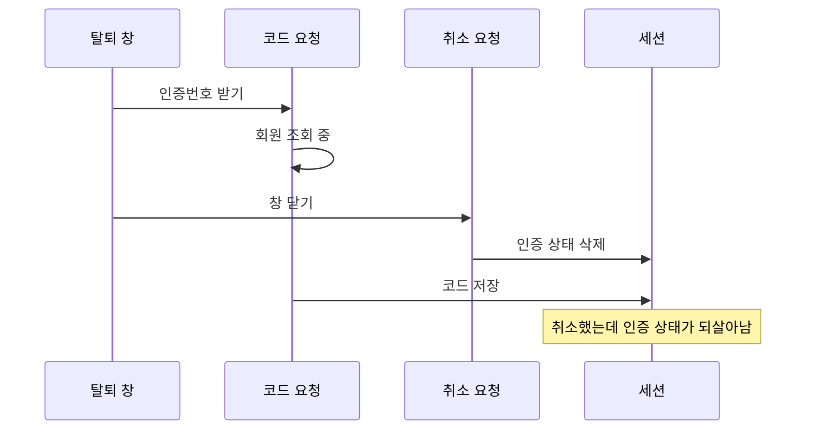
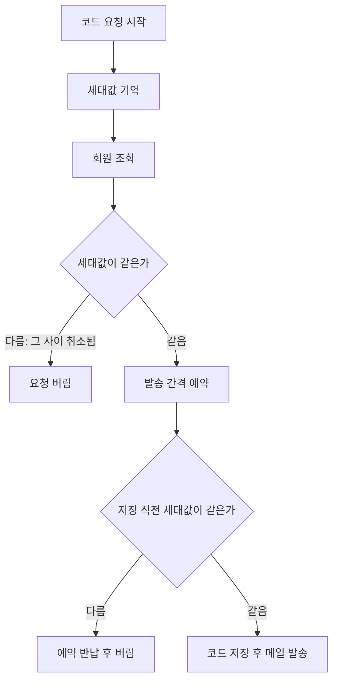

<div class="project-hero">
  <div class="project-hero__icon">🪲</div>
  <div class="project-hero__body">
    <p class="project-hero__title">MoneyBeetle — 공부할수록 내 집에 가까워지는 금융 학습 플랫폼</p>
    <p class="project-hero__desc">내 집 마련을 시작하는 2030 사회초년생이 강의와 퀴즈로 배우고, 모은 가상 캐시로 모의투자와 모의 청약을 연습하는 서비스. 4인 팀 "부끄뿌끄"가 Spring Boot와 MySQL로 만들었다.</p>
    <p class="project-hero__meta">
      <span>👥 이재성·서수영·신아림·김예린</span>
      <span>📅 2026.11.06 ~ 11.12</span>
      <span>🗂️ 도메인 12개 · 테이블 47개</span>
    </p>
    <div class="project-hero__links">
      <a class="project-hero__link project-hero__link--ghost" href="https://github.com/bukkeu/my-home-finish" target="_blank" rel="noopener">GitHub</a>
    </div>
  </div>
</div>

## 들어가며 (Situation)

모듈 2(백엔드)의 마지막은 4인 팀 "부끄뿌끄"의 프로젝트였다. 서비스 이름은 MoneyBeetle. 내 집 마련을 시작하려는 사회초년생이 부딪히는 벽을 세 가지로 보았다.

| 벽 | 우리가 잡은 방향 |
|---|---|
| 지식이 흩어져 있다 | 카테고리 → 소주제 → OX 퀴즈 → 강의로 한 흐름에서 배운다 |
| 연습할 곳이 없다 | 모은 가상 캐시로 시즌제 모의투자와 모의 청약을 해 본다 |
| 꾸준히 하기 어렵다 | 출석·학습 완료로 경험치가 쌓이고 칭호가 고시원에서 내 집까지 바뀐다 |

기간은 11/06부터 11/12까지 7일이었다. 그 안에 요구사항 120개, API 153개, 테이블 47개를 명세한 대로 만들어야 했다. 발표는 11/13에 로컬에서 했다. 배포는 하지 않기로 11/08에 팀이 정했다.

💡 이 글은 서비스 소개보다 **내가 맡은 회원·인증 도메인에서 가장 오래 붙잡은 버그 하나**를 따라가는 글이다. 세션 잠금이 있는데도 새던 경쟁 상태를, 잠금을 하나 더 거는 대신 다른 방식으로 막은 이야기다.

## 문제 상황 (Task)

내 몫은 DBA ②였다. 회원·인증, 성장·알림, 홈·경제 용어, 관리자 화면 일부, 공통 레이아웃을 맡았고 성장·청약·모의투자 테이블 24개를 설계했다.

그중 이번 글의 무대는 **간편 로그인 회원의 탈퇴 본인 확인**이다.

- 구글로 가입한 회원은 비밀번호가 없다. 탈퇴 때 "정말 본인인지"를 가입 이메일로 보낸 6자리 코드로 확인한다.
- 코드는 5분 동안 유효하고, 5번 틀리면 폐기한다. 같은 회원은 60초에 한 번만 받을 수 있다.
- 탈퇴 창을 닫으면 서버에 남은 인증 상태를 지워야 한다. (이슈 #279, API 17-3)
- 확인을 마치면 5분 안에 탈퇴가 **한 번만** 쓸 수 있다.

문제는 이 사이의 시간차였다. 코드 요청은 회원 조회, 발송 간격 확인, 코드 저장, 메일 발송으로 이어진다. 그 중간에 사용자가 창을 닫으면 취소 요청이 먼저 끝나고, 이미 출발한 코드 요청이 뒤늦게 인증 상태를 저장할 수 있다.



🔴 취소한 인증이 되살아나면, 닫은 줄 알았던 탈퇴 창의 확인이 5분 동안 유효한 채로 남는다.

## 해결 과정 (Action)

### 1. 먼저 세션 단위로 직렬화했다 (#232)

처음 만든 것은 가입 이메일 코드 방식의 본인 확인이었다. 진행 상태(코드 해시, 만료, 틀린 횟수, 인증 완료 표시)는 DB 테이블을 새로 만들지 않고 HTTP 세션에 담았다.

만들고 나서 바로 두 번 고쳤다. 같은 세션으로 동시에 요청이 오면 틀린 횟수 증가와 "한 번만 쓰기"가 깨질 수 있었다. 그래서 요청·확인·사용을 모두 같은 세션 잠금으로 묶었다.

| 커밋 시각(11/10) | 바꾼 것 |
|---|---|
| 21:31 | 가입 이메일 코드로 본인 확인 구현 |
| 21:44 | 같은 세션의 동시 요청에서도 확인이 한 번만 쓰이게 함 |
| 21:55 | 코드 요청·확인·사용을 같은 세션 잠금으로 묶음 |

- **세션 잠금 (`WebUtils.getSessionMutex`)**
  - 같은 세션의 요청이 동시에 와도 비교, 횟수 증가, 확인 완료를 한 번에 하나씩만 처리한다.
  - 시도 횟수 제한이 동시 요청 때문에 무의미해지는 것을 막는다.

### 2. 취소 API를 붙이자 잠금만으로는 부족했다 (#279)

다음 날 탈퇴 창을 닫을 때 서버의 인증을 지우는 API 17-3을 붙였다. `cancel`도 같은 세션 잠금 안에서 상태를 지운다. 그래서 **늦게 도착한 코드 확인**은 취소를 되돌리지 못한다. 확인은 저장된 상태가 있어야만 성공하는데, 취소가 그 상태를 지웠기 때문이다.

그런데 **코드 요청**은 달랐다. 요청은 잠금을 얻기 전에 회원을 조회하는 단계가 있다. 이 단계에서 취소가 끝나 버리면, 요청은 아무것도 모른 채 잠금을 얻어 새 상태를 저장한다. 잠금은 "한 번에 하나씩"만 보장할 뿐 "누가 먼저였는지"는 알려 주지 않는다.

🔴 잠금을 넓게 거는 것으로는 이 문제를 풀 수 없다. 회원 조회까지 잠금에 넣어도, 잠금을 얻은 요청은 자기가 시작된 뒤에 취소가 있었는지 알 방법이 없다. 문제는 잠금의 폭이 아니라, 요청이 **시작한 시점의 상태**를 기억하지 못한다는 데 있었다.

### 3. 취소 세대값으로 "내가 시작한 뒤 취소가 있었는지" 비교한다

취소가 일어날 때마다 세션에 숫자를 하나 올리고, 코드 요청은 시작할 때 그 숫자를 기억해 두었다가 저장 직전에 다시 비교한다. 다르면 이 요청은 그 사이 취소된 것이므로 스스로 그만둔다.

```java
// WithdrawVerificationService 발췌 (cancel)
synchronized (WebUtils.getSessionMutex(session)) {
    // 이미 시작했지만 아직 코드를 저장하지 않은 요청은 이 값이 달라진 것을 보고 스스로 그만둔다
    session.setAttribute(CANCEL_GENERATION_KEY, cancelGenerationOf(session) + 1);
    ...
}
```



세대값은 늘기만 하므로 읽을 때 잠그지 않아도 안전하다. 값을 바꾸는 쪽(`cancel`)은 세션 잠금 안에서 바꾼다. 이 커밋(11/11 16:09)에는 재현 테스트도 함께 넣었다.

### 4. 재현 테스트: 취소를 요청 한가운데 끼워 넣기

동시성 버그는 "가끔 재현"되면 고쳤는지 알 수 없다. 그래서 스레드를 돌리지 않고 **끼어드는 시점을 코드로 고정**했다. 요청이 회원을 조회하는 순간에 취소를 실행하도록 Mockito 응답에 심었다.

```java
// 예시 코드: WithdrawVerificationServiceTest 발췌
when(memberService.findLoginMemberById(7L)).thenAnswer(invocation -> {
    if (cancelled.compareAndSet(false, true)) {
        service.cancel(7L, session);   // 요청 중간에 취소가 끝난다
    }
    return Optional.of(socialMember(7L));
});

assertCode(() -> service.requestCode(7L, session), MemberErrorCode.IDENTITY_CODE_EXPIRED);
verifyNoInteractions(mailer);   // 메일을 보내지 않았다
```

테스트는 세 가지를 확인한다. 취소된 요청은 메일을 보내지 않고, 인증 완료 상태가 남지 않으며, 취소 뒤 새로 시작한 요청은 정상으로 끝난다.

🟢 수정 전에는 이 테스트가 1건 실패했고, 수정 후에는 0건 실패했다.

### 5. 리뷰가 짚은 구멍: 취소된 요청이 발송 간격을 차지한다 (PR #284)

PR 리뷰에서 필수로 지적받은 것이 있었다. 취소된 요청이 이미 **60초 발송 간격을 예약**해 버리는 순서였다. 사용자는 창을 닫았다가 바로 다시 열었을 뿐인데 "너무 빨리 요청했다"는 응답을 받게 된다.

수정은 두 곳이었다(11/11 16:17).

- 간격을 예약하기 **전에** 세대값을 먼저 비교한다. 이미 취소된 요청은 간격을 건드리지 않는다.
- 예약한 뒤에 취소를 발견하면 `lastSentAt.remove(memberId, now)`로 예약을 돌려준다.

세대값 커밋 8분 뒤의 일이다. 직렬화(#232)에서 세대값(#279), 순서 조정까지 서로 다른 세 단계를 거쳐 같은 한 가지 보장에 도달했다. "취소 이후에는 아무것도 저장하지 않는다."

### 6. 같은 원칙을 홈 검색에 연결했다 (#339, PR #342)

같은 주에 PM이 맡은 홈 통합 검색(API 28)에 경제 용어 검색을 연결했다. 관리자용 검색을 재사용하면 비활성 용어까지 사용자에게 보일 수 있어서, `TermService`에 활성 용어만 조회하는 `searchActive()`를 따로 만들었다. 홈 도메인은 `TermService`만 부르고 Repository를 직접 부르지 않는다.

- **도메인 경계**
  - 다른 도메인의 Repository를 직접 호출하지 않고 Service로만 부른다.
  - 사용자용 검색 규칙(활성 용어, 용어·뜻 검색, 최대 50개, LIKE 특수문자 이스케이프)이 한곳에 있다.
  - 응답 필드(`economicTermId`, `term`, `description`)는 그대로 둬서 화면이 바뀌지 않는다.

## 결과 (Result)

| 항목 | 수정 전 | 수정 후 |
|---|---|---|
| 취소 경쟁 재현 테스트 | 1건 실패 | 0건 실패 |
| 전체 Gradle 테스트 (PR #284 기록 시점) | - | 1,100개 통과 |
| 팀 API 구현 | 명세 153개 | 153개 모두 구현 |
| 팀 요구사항 연결 | 120개 | 120개 모두 API 연결 |
| 팀 테스트 메서드 (11/12) | - | 1,364개 |

수치는 11/12 dev 기준 발표 자료에서 가져왔다. 팀은 7일 동안 병합 PR 212개, 닫힌 이슈 171개를 만들었다.

### git 로그로 본 7일

프로젝트가 끝난 뒤 `origin/dev`의 git 로그를 병합 커밋을 빼고 다시 세어 보았다. 자세한 분석은 [32일차 학습노트]({{ site.baseurl }}/cloud/m2-day32/)에 있다.

| 항목 | 내 커밋 | 팀 전체 |
|---|---|---|
| 커밋 수 | 265 | 683 |
| fix 비율 | 41.5% | 42.3% |
| feat 비율 | 20.8% | 21.7% |
| 가장 많이 건드린 도메인 | member 74, auth 53 | member 100, trading 88 |

- 커밋이 몰린 날은 11/08부터 11/11까지 나흘이었다. 팀 커밋의 대부분이 이 기간에 나왔다.
- 내 커밋 중 fix는 feat의 두 배였다. 팀 전체도 같았다.
- 마이페이지 이슈(#69)는 하루 동안 커밋 20개로 쪼개졌고, 그중 16개가 `fix(fe)`였다. 제목에는 늦게 온 응답이 이미 바뀐 화면을 건드리는 문제가 여러 번 나온다. 서버의 취소 경쟁 상태와 같은 뿌리다.

### 배운 점

- **잠금과 순서는 다른 문제다.** 잠금은 동시에 하나만 들어오게 해 주지만, 들어오는 요청이 이미 낡았는지는 모른다. "내가 시작한 뒤 상태가 바뀌었는가"를 확인하는 장치가 따로 필요했다.
- **재현 테스트는 끼어드는 시점을 고정한다.** 스레드를 겹쳐 돌리는 테스트는 운에 맡기게 된다. 모의 객체의 응답 안에서 취소를 실행하니 매번 같은 순서로 재현됐다.
- **리뷰는 늦게 떠오르는 부작용을 찾아 준다.** 코드 저장만 막으면 끝이라고 생각했는데, 발송 간격 예약이라는 부수 효과가 남아 있었다.

### 남은 한계

⚠️ 이 해법은 **서버가 한 대**라는 전제에 기대고 있다. `synchronized`는 한 JVM 안의 잠금이고, 60초 간격을 기록하는 `lastSentAt`도 메모리 `Map`이라 서버를 다시 켜면 지워진다. 서버를 여러 대로 늘리면 세션 저장소와 간격 기록을 함께 옮겨야 한다.

발표 뒤에 받은 코드 검증 리포트도 같은 방향을 가리켰다. 인증 쪽에서는 계정 복구 조회에 시도 횟수 제한이 없다는 점(높음), 비밀번호를 바꿔도 이미 열린 다른 세션이 끝나지 않는다는 점 등이 있었다. 리포트는 전체 62건(높음 6, 중간 33, 낮음 23)을 짚었고, 권한 검사와 돈 흐름은 서버에서 지켜졌다고 평가했다.

## 더 학습하면 좋은 개념

- **낙관적 락과 버전 필드 (Optimistic Locking)** — 이번 해법의 세대값은 "읽은 뒤 바뀌었는가"를 비교하는 아이디어로, 낙관적 락의 `@Version`과 같은 계열이다. 세션이 아닌 DB 행에서 같은 보장을 얻는 방법을 알게 된다.
- **분산 락과 세션 클러스터링 (Redis, Spring Session)** — `synchronized`가 서버 한 대에서만 유효한 이유를 이해하면, 서버를 늘릴 때 무엇을 옮겨야 하는지 보인다.
- **멱등성 키 (Idempotency-Key)** — 팀이 퀴즈 제출·매수·매도·청약 납입에 쓴 방식이다. 재전송과 연타를 같은 결과로 만드는 별개의 해법이라 비교해 볼 가치가 있다.
- **MySQL 격리 수준과 반복 읽기 (REPEATABLE READ)** — 팀의 PR #116 리뷰에서는 행을 잠근 뒤에도 예전 스냅샷을 읽는 문제가 나왔다. 잠금과 스냅샷이 어떻게 만나는지 알아야 동시성 버그의 원인이 보인다.
- **재현 가능한 동시성 테스트** — 스레드 대신 끼어드는 시점을 코드로 고정하는 기법. 간헐적 버그를 회귀 테스트로 바꿔 준다.

## 참고 자료

- [Spring 공식 문서 - WebUtils.getSessionMutex](https://docs.spring.io/spring-framework/docs/current/javadoc-api/org/springframework/web/util/WebUtils.html)
- [Jakarta Servlet - HttpSession](https://jakarta.ee/specifications/servlet/6.0/apidocs/jakarta.servlet/jakarta/servlet/http/httpsession)
- [MySQL 공식 문서 - InnoDB 잠금 읽기](https://dev.mysql.com/doc/refman/8.0/en/innodb-locking-reads.html)
- [MoneyBeetle 저장소](https://github.com/bukkeu/my-home-finish)
