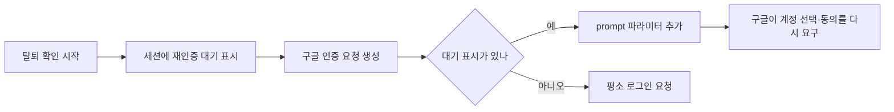

## 어떤 연동이었나

MoneyBeetle은 이메일·비밀번호 가입과 구글 간편 로그인을 함께 지원한다(USR-07, 이슈 #9). 문제는 **탈퇴**였다. 비밀번호 회원은 현재 비밀번호로 본인을 확인한다. 구글로만 가입한 회원은 비밀번호가 없다.

처음 택한 방법(11/10 15:11)은 **제공자 재로그인**이었다. 탈퇴할 때 구글로 한 번 더 로그인하게 하고(`purpose=reauth`), 같은 계정으로 돌아오면 본인으로 본다. 이 방식은 여섯 시간 뒤에 가입 이메일 코드 방식으로 통째로 바뀌었다(21:31, #232). 재로그인을 위해 만든 `ReauthAuthorizationRequestResolver`와 `SocialReauthVerifier`는 그 커밋에서 지워졌고, 커밋 메시지에는 "강화"라고만 적혀 있다. 그 뒤 이야기는 [3편]({{ site.baseurl }}/projects/moneybeetle-withdraw-cancel-race/)에서 이어진다. 이 글은 그 사이 몇 시간 동안 재로그인 방식에서 만난 두 개의 구멍과, 그 구멍을 막은 방법을 기록한다. 지금 저장소에는 이 코드가 남아 있지 않다.

⚠️ 아래 "처음 만든 방식"은 커밋 기록과 코드 주석으로 다시 맞춘 것이다. 당시 생각을 그대로 옮긴 것은 아니다.

## 구멍 1: 제공자에 이미 로그인돼 있으면 비밀번호를 안 묻는다

### 증상

구글 계정이 브라우저에 로그인돼 있으면, 구글로 가는 요청은 **아무것도 묻지 않고 바로 돌아온다**. 재로그인을 시켰는데 사용자는 클릭 한 번 하지 않아도 되는 것이다.

🔴 자리를 비운 사람의 브라우저에서 탈퇴 버튼을 눌러도, 구글 로그인 세션이 살아 있으면 "본인 확인"이 그대로 통과한다. 회원 탈퇴는 되돌릴 수 없는 작업이라 이 구멍이 가장 위험했다.

### 처음 만든 방식

`ae236432`에서 `purpose=reauth`로 제공자 로그인을 다시 거치게 만들었다. 이 커밋에는 서비스와 컨트롤러, 테스트가 함께 들어갔다. 하지만 이 구조에는 "제공자가 정말로 다시 인증시켰는가"를 확인하는 장치가 없었다.

### 고친 방법: 본인 확인 중에만 `prompt` 파라미터를 붙인다

OAuth 인증 요청에는 제공자에게 "로그인 화면을 다시 보여 달라"고 요청하는 `prompt` 파라미터가 있다. 일반 로그인에는 영향이 없어야 하므로, **본인 확인 중인 요청에만** 붙이도록 `OAuth2AuthorizationRequestResolver`를 감쌌다(15:38, `ReauthAuthorizationRequestResolver`).

```java
// ReauthAuthorizationRequestResolver 발췌
private OAuth2AuthorizationRequest customize(OAuth2AuthorizationRequest req, HttpServletRequest request) {
    if (req == null || !SocialLoginService.hasPendingReauth(request.getSession(false))) {
        return req;   // 일반 간편 로그인은 그대로
    }
    String prompt = promptFor(req.getAttribute(OAuth2ParameterNames.REGISTRATION_ID));
    if (prompt == null) {
        return req;
    }
    return OAuth2AuthorizationRequest.from(req)
            .additionalParameters(p -> p.put("prompt", prompt))
            .build();
}
```



### 구글에는 `login`이 없었다

카카오는 `prompt=login`으로 카카오계정 로그인을 다시 요구한다. 구글은 달랐다. 코드 주석에 적었듯이 구글이 문서화한 값은 `select_account`와 `consent`이고 `login`이 없다.

| 제공자 | 쓴 값 | 사용자에게 일어나는 일 |
|---|---|---|
| 카카오 | `prompt=login` | 카카오계정 로그인을 다시 요구 |
| 구글 | `prompt=select_account consent` | 계정 선택과 동의 화면을 다시 거침 |

⚠️ 구글은 **비밀번호 입력까지 강제하지 못한다.** 대신 사용자가 계정 선택과 동의 화면에서 직접 한 번 더 눌러야 하게 했다. 자리를 비운 사이에 누군가 클릭 하나로 지나가는 것을 막지는 못하지만, "아무 일도 없이 통과"하는 상태는 없앴다. 코드 주석에도 이 한계를 그대로 적어 두었다.

이 구분은 다음 날 의미가 없어졌다. 11/11에 카카오를 제거하고 구글만 남겼다(#260).

## 구멍 2: 시간이 지난 재인증이 일반 로그인으로 처리된다

### 증상

구글에서 돌아온 요청을 처리하는 곳은 "이 세션이 본인 확인을 하러 간 상태인가"를 먼저 본다. 그렇다면 재인증으로, 아니라면 일반 로그인으로 처리한다.

처음에는 이 질문(`hasPendingReauth`)이 **시간 제한 안인지**까지 함께 봤다.

```java
// 처음 (발췌)
return session != null && session.getAttribute(REAUTH_PENDING_KEY) instanceof Reauth pending
        && clock.instant().isBefore(pending.expiresAt());
```

🔴 사용자가 구글 화면에서 오래 머물러 제한 시간을 넘기고 돌아오면 이 함수가 `false`를 돌려주고, 돌아온 로그인은 **일반 로그인으로 처리된다.** 탈퇴 확인 중이던 사용자가 본인 확인 대신 그냥 로그인된다.

### 고친 방법: "시작했는가"와 "아직 유효한가"를 나눈다

16:41에 `hasPendingReauth`를 시간과 상관없이 "시작한 상태가 남아 있으면 `true`"로 바꿨다. 만료 판단은 재인증을 마무리하는 `completeReauth`가 하고, 만료됐으면 `OAUTH_SESSION_EXPIRED`로 막는다.

```java
// 고친 뒤 설명 주석 (발췌)
// 시간이 지났어도 시작한 상태가 남아 있으면 true 다. 그래야 만료된 확인이
// 일반 로그인으로 처리되지 않고 completeReauth 가 OAUTH_SESSION_EXPIRED 로 막는다.
```

💡 "이 요청은 어느 길로 처리할까"를 정하는 질문에 시간 조건이 섞여 있었다. **갈래를 고르는 질문**과 **통과시킬지 정하는 질문**을 분리했더니, 만료가 엉뚱한 갈래로 새는 길이 닫혔다.

## 같이 정리한 것

- **키가 없는 제공자는 등록하지 않는다.** `OAuthClientConfig`는 클라이언트 ID와 시크릿이 **둘 다** 있을 때만 제공자를 등록한다. 값이 비어 있는 채로 등록하면 서버가 뜨지 않는다고 코드 주석에 적었다. 환경변수는 `GOOGLE_CLIENT_ID`, `GOOGLE_CLIENT_SECRET`으로만 받고 값은 코드나 설정 파일에 두지 않는다(12:51, `4ce498d9`).
- **같은 이메일이어도 자동으로 연결하지 않는다.** 이메일·비밀번호로 이미 가입한 사람이 같은 이메일로 구글 로그인을 하면 `EMAIL_DUPLICATED`로 막는다. 제공자 계정을 몰래 붙이면 계정 탈취 통로가 될 수 있어서, 이메일로 로그인한 뒤 연결하는 기능이 생기기 전에는 이메일 로그인으로 안내한다.
- **테스트가 환경변수에 흔들리지 않게 했다.** 16:41 커밋에서 테스트가 내 컴퓨터의 OAuth 환경변수에 영향을 받던 부분을 없앴다. 키가 설정된 컴퓨터에서만 통과하는 테스트는 팀 CI에서 다르게 보이기 때문이다.

## 확인 방법

- 재인증 요청에만 `prompt`가 붙는지 확인하는 테스트(82줄)를 15:38 커밋에서 함께 넣었다.
- 만료된 재인증은 16:41 커밋에서 `AccountServiceTest` 등을 보강해 확인했다.
- 재로그인 코드와 그 테스트는 21:31 커밋에서 함께 지워졌다. 남은 간편 로그인 테스트 8개는 연결된 정상 회원 로그인, 탈퇴·정지 회원 거절, 처음 온 사람의 가입 안내, 같은 이메일 자동 연결 금지 등을 확인한다.

## 배운 점

- 💡 **"다시 인증"은 제공자가 다시 물었다는 증거가 있어야 한다.** 다시 보냈다는 사실만으로는 부족하다. 제공자가 무엇을 지원하는지가 설계의 한계가 된다.
- 💡 **제공자마다 지원하는 값이 다르다.** 같은 `prompt` 파라미터라도 카카오와 구글이 다르게 응답했고, 한 제공자에서 되는 방식을 다른 제공자에 그대로 쓸 수 없었다.
- ⚠️ 구글 방식은 비밀번호를 강제하지 못한다. 이 방식은 몇 시간 만에 **가입 이메일 코드 확인**으로 대체됐다(#232). 막은 구멍이 남아 있는지보다, 제공자에게 맡긴 확인은 제공자가 지원하는 만큼만 믿을 수 있다는 점이 설계를 바꾼 계기였다고 본다.

## 더 학습하면 좋은 개념

- **OpenID Connect의 `prompt`·`max_age`·`auth_time`** — 제공자에게 "최근에 인증했는가"를 표준 방식으로 묻는 값들이다. 제공자마다 지원이 달라 이번에 막혔고, 표준이 무엇을 약속하는지 알면 설계 선택지가 보인다.
- **스텝업 인증 (Step-up Authentication)** — 탈퇴처럼 되돌릴 수 없는 작업에서만 인증을 한 번 더 요구하는 설계 패턴이다. 이번 재인증이 바로 이 패턴이다.
- **이메일 기반 계정 자동 연결의 위험** — 같은 이메일이라고 제공자 계정을 붙이면 계정 탈취 통로가 될 수 있다. 소셜 로그인을 붙일 때 가장 흔한 보안 실수다.

## 참고 자료

- [Google 공식 문서 - OAuth 2.0 for Web Server Applications](https://developers.google.com/identity/protocols/oauth2/web-server)
- [Spring Security 공식 문서 - OAuth2 Login 고급 설정](https://docs.spring.io/spring-security/reference/servlet/oauth2/login/advanced.html)
