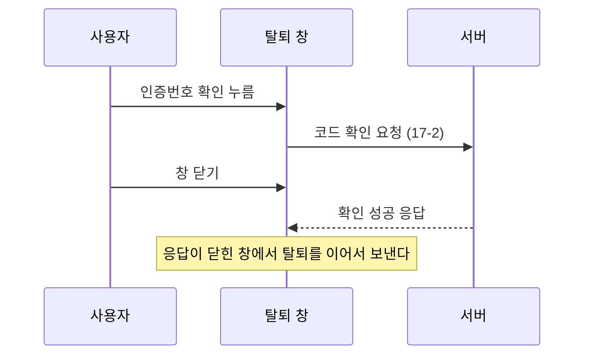

## 어떤 연동이었나

마이페이지(이슈 #69)는 Thymeleaf가 틀을 그리고, 탭 안의 내용은 JavaScript가 `/api/v1`을 `fetch`로 불러와 채운다. 내가 맡은 몫은 프로필 요약, 캐시 내역, 레벨 표, 수상 내역, 설정 탭(닉네임·비밀번호·탈퇴)이다.

이 화면은 11/11 하루 동안 커밋이 20개로 쪼개졌다(09:16~16:19). 제목을 읽어 보니 16개가 `fix(fe)`였고, 그 안에서 같은 모양의 문제가 반복해서 나왔다.

> 요청을 보낸 뒤에 화면의 상태가 바뀌었는데, 응답은 그 사실을 모르고 결과를 쓴다.

[3편]({{ site.baseurl }}/projects/moneybeetle-withdraw-cancel-race/)에서 서버가 겪은 것과 같은 뿌리다. 서버에서는 "취소한 뒤에 도착한 코드 요청"이었고, 화면에서는 "닫은 창에 도착한 응답"이었다.

⚠️ 아래 "처음 만든 방식"은 커밋 기록과 코드 주석으로 다시 맞춘 것이다. 당시 생각을 그대로 옮긴 것은 아니다.

## 증상 1: 닫은 창에서 탈퇴가 진행될 수 있다

탈퇴 창에는 단계가 있다. 인증번호를 받고, 코드를 입력하고, 확인되면 탈퇴를 보낸다. 모든 단계가 비동기 요청이다.



🔴 인증 성공 응답이 오면 화면은 곧바로 탈퇴 요청을 이어서 보낸다. 사이에 창을 닫아도, 늦게 도착한 성공 응답이 그 흐름을 계속 진행시킬 수 있다. 되돌릴 수 없는 작업이 닫은 창에서 진행되는 것이다.

### 처음 만든 방식

처음 코드는 요청의 `then`을 이어 붙인 형태였고, 응답이 올 때 "지금 어떤 창인가"를 확인하는 부분이 없었다(10:57 커밋의 수정 전).

```js
// 수정 전 (발췌)
.then(function () { return withdraw(''); })
.then(done, function (error) { say('mg-wd-msg', errorText(error), false); });
```

### 고친 방법: 창이 열리고 닫힐 때마다 번호를 올린다

10:27에 번호 변수 `dialogSession`을 만들었다. 창을 열고 닫을 때마다 올리고, 요청을 보낼 때 현재 번호를 변수에 담아 둔다. 응답이 왔을 때 번호가 달라졌으면 그 응답은 버린다.

```js
var dialogSession = 0;   // 창을 열고 닫을 때마다 바뀐다. 이전 창에서 보낸 요청의 응답을 가려내는 데 쓴다
...
var session = dialogSession;
request().then(function (data) {
  if (session !== dialogSession) return;   // 요청 중에 창을 닫았다 다시 열었으면 이 응답은 무시한다
  ...
});
```

10:57에는 탈퇴를 이어서 보내는 곳에도 같은 확인을 넣었다.

```js
// 수정 후 (발췌)
var session = dialogSession;   // 인증을 보낸 창
...
.then(function () {
  if (session !== dialogSession) return null;   // 닫혔거나 다시 열렸으면 탈퇴를 진행하지 않는다
  return withdraw('').then(done);
})
.then(null, function (error) {
  if (session !== dialogSession) return;
  say('mg-wd-msg', errorText(error), false);
});
```

오류 응답도 마찬가지다. 12:52에는 비밀번호 확인의 **거절** 응답이 새로 연 창의 상태를 바꾸지 않게 같은 번호 비교(`passwordSession`)를 넣었다.

💡 이 번호는 3편의 서버 쪽 **취소 세대값**과 같은 아이디어다. 요청이 시작할 때 번호를 기억했다가 응답이 오면 비교한다. 서버는 세션의 숫자, 화면은 클로저 변수라는 차이만 있다.

🟢 서버도 이 창이 닫힐 때 남은 인증을 지운다. 창을 닫는 화면 코드가 API 17-3(취소)을 호출한다. 화면의 번호 비교는 "응답이 늦게 와서 화면을 건드리는 것"을, 서버의 취소는 "서버에 남은 인증 상태"를 각각 막는다.

## 증상 2: 실패한 것과 내역이 없는 것이 구분되지 않는다

캐시 내역 탭에서 조회가 실패하면 목록에 "캐시 내역을 불러오지 못했어요"를 보여 준다. 그런데 사용자가 적립·사용 **필터**를 누르면 화면 코드가 목록을 다시 그리면서 이 안내를 지우고 "내역이 없어요"를 보여 줬다.

🔴 조회가 실패한 것인데, 필터 한 번에 "내역이 없다"로 바뀐다. 사용자는 실제로 내역이 없다고 믿는다.

10:27에는 실패 안내를 목록에도 보여 주게 했고, 10:57에는 실패했을 때 **필터 버튼을 비활성화**했다.

```js
root.querySelectorAll('.mg-filter').forEach(function (button) { button.disabled = true; });
```

고치는 방향은 같다. 상태가 바뀔 수 있는 입력은 상태가 확실할 때만 열어 둔다.

## 증상 3: 더 보기를 두 번 누르면 같은 쪽이 두 번 온다

11:41에 고친 것이다. 캐시 내역은 쪽 단위로 받아 오는데, 처음 조회가 이어지는 동안 **더 보기**가 보이면 같은 쪽을 또 요청할 수 있었다. `loading` 플래그를 만들어 받아 오는 중에는 더 보기를 숨기고, 이미 받아 오는 중이면 요청을 또 보내지 않게 했다.

```js
var cash = { items: [], page: 0, totalPages: 1, filter: 'all', loading: false };
...
byId('mg-cash-more').hidden = cash.loading || cash.page + 1 >= cash.totalPages;
...
if (cash.loading) return;   // 이미 쪽을 받아 오는 중이면 같은 요청을 또 보내지 않는다
cash.loading = true;
```

⚠️ 성공 쪽만 `loading = false`로 되돌리면 실패 후 버튼이 영영 막힌다. 그래서 성공과 실패 양쪽에서 `loading`을 풀고, 실패하면 이미 받은 쪽 기준으로 더 보기를 다시 보이게 했다.

## 같은 날 같이 고친 것들

한 이슈에서 나온 `fix(fe)` 16개가 모두 낡은 응답 문제는 아니다.

| 유형 | 예 |
|---|---|
| 낡은 응답·중복 요청 | 탈퇴 인증 응답 경합, 거절 응답이 새 창을 바꿈, 더 보기 중복 요청 |
| 표시 | 설정 카드가 320px 화면에서 넘침, 레벨 표가 좁은 화면에서 페이지를 가로로 넘침 |
| 의존 순서 | 레벨 표가 내 정보 응답을 기다리느라 늦게 그려짐 (16:03, 먼저 그리고 내 정보가 오면 내 레벨 표시) |
| 안내 문구 | 탈퇴 안내 문구를 실제 흐름에 맞게, 설정 탭의 카카오 문구 제거 |

## 확인 방법

화면 코드는 서버 테스트처럼 쉽게 실행해 볼 수 없다. 그래서 `MypageFragmentsRenderTest`로 **코드 모양**을 검사했다(14:45에 보강).

```java
// 발췌: 주석 줄을 뺀 코드에서 창 번호 비교가 5번 이상 있는지
String settingsCode = settings.replaceAll("(?m)^\\s*//.*$", "");
assertThat(settingsCode.split("ession !== dialogSession", -1).length - 1).isGreaterThanOrEqualTo(5);
```

창 번호를 비교하는 요청은 안내 요청, 인증 성공, 인증 오류, 비밀번호 확인 거절의 네 종류이고, 한 요청 안에 비교가 둘 이상 있는 곳도 있어 코드 전체로는 5개 이상을 기대한다. 비밀번호 확인 거절은 `passwordSession`이라는 다른 변수를 쓰지만, 이름이 `Session`으로 끝나서 같은 패턴(`ession !== dialogSession`)에 함께 잡힌다. 탈퇴 이어 보내기는 `if (session !== dialogSession) return null;`로 시작하는지 정규식으로 확인한다.

⚠️ 이 테스트는 JavaScript를 **실행하지 않는** 정적 패턴 검사다. 비교가 코드에 있는지는 알려 주지만, 실제로 응답이 늦게 왔을 때 화면이 어떻게 되는지는 보여 주지 않는다. 테스트 주석에도 "보조 수단"이라고 적었다. 늦은 응답을 시뮬레이션하는 실행 테스트는 만들지 못했다.

## 배운 점

- 💡 **비동기 응답은 "지금도 유효한가"를 스스로 확인해야 한다.** `fetch`는 요청이 간 뒤의 화면 상태를 모른다. 요청을 보낼 때의 번호를 기억해 두면 응답이 올 때 비교할 수 있다.
- 💡 **되돌릴 수 없는 작업이 응답에 이어 붙어 있으면 가장 먼저 확인한다.** 탈퇴를 보내는 `then`에는 다른 응답보다 먼저 번호 비교를 넣었다.
- 💡 **서버와 화면의 같은 문제는 같은 해법이 통한다.** 취소 세대값과 창 번호를 따로 배운 것이 아니라 한 패턴으로 이해하니, 두 번째 구현이 훨씬 빨랐다.
- ⚠️ 마이페이지 하루 20커밋 중 낡은 응답 처리는 일부이고, 나머지는 좁은 화면 레이아웃과 문구였다. 숫자만 보고 "동시성 때문에 어려웠다"고 단정하면 틀린다. 커밋 제목을 읽어 본 뒤에야 비율이 보였다.

## 더 학습하면 좋은 개념

- **`AbortController`로 요청 취소하기** — 이번에는 응답을 받은 뒤 버렸지만, 요청 자체를 취소하는 방법도 있다. 낡은 응답이 화면을 건드리기 전에 막는 다른 접근이다.
- **TOCTOU (Time-of-check to time-of-use)** — 요청을 보낸 시점과 응답이 쓰이는 시점 사이에 상태가 바뀌는 문제의 이름이다. 서버와 화면의 같은 버그를 한 개념으로 묶어 준다.
- **진행 중 요청 중복 제거 (In-flight Deduplication)** — 더 보기의 `loading` 플래그는 가장 단순한 형태다. 같은 요청을 한 번만 보내고 결과를 나눠 쓰는 방식까지 알면 목록 화면이 단단해진다.

## 참고 자료

- [MDN - Using the Fetch API](https://developer.mozilla.org/en-US/docs/Web/API/Fetch_API/Using_Fetch)
- [MDN - AbortController](https://developer.mozilla.org/en-US/docs/Web/API/AbortController)
