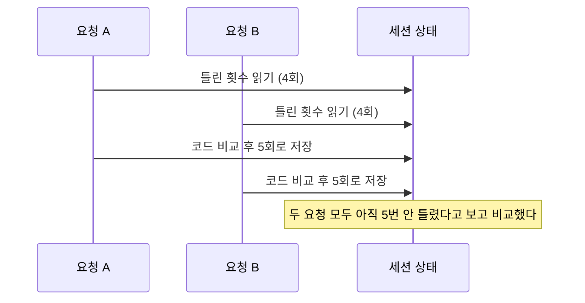

## 어떤 연동이었나

MoneyBeetle 가입 화면에는 이메일로 6자리 코드를 보내고 맞는지 확인하는 본인인증이 있다(요구사항 USR-05, API 5·5-1, 이슈 #9). 내가 맡은 회원·인증 도메인이다.

규칙은 단순했다.

| 규칙 | 값 |
|---|---|
| 코드 | `SecureRandom` 6자리, 5분 안에 사용 |
| 틀린 횟수 | 5번 틀리면 그 코드는 폐기하고 다시 받게 함 |
| 같은 이메일 | 60초에 한 번만 발송 |
| 같은 접속 주소(IP) | 1분에 10번까지만 코드 요청 |
| 인증 완료 표시 | 30분 동안 가입에 사용 가능 |

진행 상태(코드 해시, 만료 시각, 틀린 횟수, 인증 완료 표시)는 DB 테이블을 만들지 않고 HTTP 세션에 담았다. 세션에는 코드 원문 대신 `이메일:코드`를 SHA-256으로 해시한 값만 둔다.

📌 번호 표기: `#9`, `#232`처럼 이슈를 가리키는 번호는 GitHub 이슈 번호이고, 병합된 PR은 3편의 PR #284처럼 "PR"을 붙여 구분한다.

⚠️ 이 글에서 **처음 만든 방식**이라고 쓴 부분은 커밋 기록과 코드 주석으로 다시 맞춘 것이다. 당시 머릿속 생각을 그대로 옮긴 것은 아니다.

## 증상: 규칙은 맞는데 동시에 보내면 깨진다

처음 구현(11/10 10:23)의 `verify`는 상태를 읽고, 틀린 횟수를 올리고, 세션에 다시 저장하는 코드를 잠금 없이 이어 붙인 것이었다. 이 규칙들은 전부 "읽고, 판단하고, 쓴다"의 세 단계다. 요청이 동시에 오면 세 단계 사이에 다른 요청이 끼어든다.



🔴 요청을 수십 개 한꺼번에 보내면, 모두가 "아직 5번 안 틀렸다"고 보고 코드를 대 볼 수 있다. 6자리 코드는 100만 가지뿐이라 시도 횟수 제한이 무의미해진다.

## 문제 1: 틀린 횟수 제한을 어떻게 한 번에 하나씩 지킬까

11:14에 `verify`를 고쳤다. 같은 세션의 요청이 동시에 와도 **비교, 횟수 증가, 인증 완료**를 한 번에 하나씩만 하게 했다.

```java
// IdentityVerificationService.verify 발췌
synchronized (state) {
    Instant now = clock.instant();
    if (!state.getEmail().equals(email) || !state.isCodeActive(now)
            || state.getFailures() >= MAX_FAILURES) {
        throw new BusinessException(MemberErrorCode.IDENTITY_CODE_EXPIRED);
    }
    if (!matches(state, email, code)) {
        if (state.recordFailure() >= MAX_FAILURES) {
            session.removeAttribute(SESSION_KEY);
            throw new BusinessException(MemberErrorCode.IDENTITY_CODE_EXPIRED);
        }
        session.setAttribute(SESSION_KEY, state);
        throw new BusinessException(MemberErrorCode.IDENTITY_CODE_INVALID);
    }
    state.completeVerification(now.plus(VERIFIED_TTL));
    session.setAttribute(SESSION_KEY, state);
}
```

고친 지점은 세 가지였다.

- **잠금 대상:** 같은 세션이면 상태 객체가 하나라서 그 객체(`state`)로 잠갔다.
- **제한 확인 위치:** 이미 5번 틀린 상태를 읽고 들어온 늦은 요청은, 맞는 코드여도 비교하지 않고 만료로 처리한다. 제한 확인을 비교 **앞**으로 옮겼다.
- **`volatile`:** 가입 전 확인(`requireVerified`)은 잠금 없이 상태를 읽는다. 바뀐 값이 바로 보이게 상태 필드를 `volatile`로 바꿨다.

🟢 확인은 테스트 두 개로 했다. "같은 세션에서 틀린 코드가 동시에 몰려도 5번까지만 비교한다"와 "이미 5번 틀린 상태를 먼저 읽고 들어온 늦은 요청은 맞는 코드여도 비교하지 않는다"이다.

## 문제 2: 접속 주소별 제한은 DB보다 먼저

이메일을 바꿔 가며 요청하면 같은 이메일 60초 제한을 피해서 남의 주소 여러 곳으로 메일을 보낼 수 있다. 그래서 접속 주소(IP)별로 1분에 10번까지만 요청을 받는다(12:16).

- **DB 조회보다 먼저 센다.** 이메일 형식 확인과 중복 조회 전에 접속 주소부터 센다. 거절당한 요청이 DB와 메일에 아무 비용도 쓰지 않게 하려는 것이다.
- **`getRemoteAddr`만 쓴다.** `X-Forwarded-For` 같은 헤더는 보내는 사람이 값을 마음대로 적을 수 있어서 쓰지 않았다. 프록시 뒤에서는 모든 요청이 프록시 주소로 보이므로, 배포할 때 프록시를 믿는 설정과 함께 다시 정해야 한다.

그런데 이 기록 자체가 새 동시성 문제를 만들었다. 주소마다 최근 요청 시각을 `Deque`에 담는데, `Deque`는 스레드 안전하지 않다.

| 시각 | 고친 것 | 이유 |
|---|---|---|
| 12:47 | 오래된 기록 정리를 `values().removeIf`에서 키마다 `computeIfPresent`로 | 값을 직접 훑으면 `compute`가 쓰는 잠금 밖에서 `Deque`를 읽는다 |
| 15:01 | 요청 시각을 `compute` 안에서 읽도록 | 밖에서 읽은 시각을 쓰면, 같은 주소의 동시 요청이 읽은 순서와 반대로 들어와 기록이 시간 순서를 잃는다 |

```java
// 발췌: 시각을 compute 잠금 안에서 읽는다
requestsByIp.compute(key, (ip, times) -> {
    Instant at = clock.instant();
    Deque<Instant> recent = times == null ? new ArrayDeque<>() : times;
    while (!recent.isEmpty() && !at.isBefore(recent.peekFirst().plus(IP_WINDOW))) {
        recent.pollFirst();
    }
    if (recent.size() < IP_LIMIT) {
        recent.addLast(at);
        reserved[0] = true;
    }
    return recent;
});
```

💡 `ConcurrentHashMap`을 쓰면 안전하다고 생각하기 쉽다. 안전한 것은 **맵의 연산**뿐이고, 값으로 들어 있는 `Deque`는 별개다. 값을 바꾸는 모든 코드가 같은 `compute` 안에 있어야 한다.

## 문제 3: 재발송이 거절됐더니 완료한 인증이 사라졌다

메일은 비동기로 보내고, 발송 대기열이 가득 차면 `TaskRejectedException`이 난다. 처음에는 이때 세션의 인증 상태를 지웠다. "보낸 적 없는 코드는 버리고 바로 다시 시도하게" 하려는 의도였다.

🔴 이미 인증을 **마친** 사용자가 재발송을 눌렀다가 대기열 가득 참으로 거절되면, 마친 인증까지 사라진다. 가입 직전에 인증을 다시 하라는 말을 듣게 된다.

15:01에 요청이 시작될 때의 이전 상태를 기억해 두고, 거절되면 그 상태로 되돌리게 했다.

```java
// 발췌
Object previousState = session.getAttribute(SESSION_KEY);
session.setAttribute(SESSION_KEY, IdentityVerificationState.issued(...));
try {
    mailer.send(email, code);
} catch (TaskRejectedException e) {
    if (previousState != null) {
        session.setAttribute(SESSION_KEY, previousState);
    } else {
        session.removeAttribute(SESSION_KEY);
    }
    lastSentAt.remove(email, now);
    throw new BusinessException(MemberErrorCode.IDENTITY_MAIL_UNAVAILABLE);
}
```

바로 아래 줄의 `lastSentAt.remove(email, now)`는 16:41에 고친 것이다. 처음에는 `remove(email)`이었다. 두 인자 `remove`는 **이 요청이 기록한 값일 때만** 지운다. 같은 이메일의 다른 동시 요청이 새로 남긴 기록을 지우지 않으려는 것이다.

## 확인 방법

가입 본인인증 테스트는 20개다. 이 편에서 고친 것과 짝이 되는 테스트는 다음과 같다.

| 고친 것 | 테스트 |
|---|---|
| 동시 틀린 코드 | 같은 세션에서 틀린 코드가 동시에 몰려도 5번까지만 비교한다 |
| 늦게 온 요청 | 이미 5번 틀린 상태를 먼저 읽은 늦은 요청은 비교하지 않는다 |
| 접속 주소 제한 | 이메일을 바꿔 가며 1분에 10번을 넘기면 `IDENTITY_REQUEST_LIMITED`, 메일도 DB 조회도 하지 않는다 |
| 재발송 거절 | 인증을 마친 뒤 재발송이 대기열 가득 참으로 거절돼도 완료한 인증은 남는다 |

🟢 같은 날 오후에는 도메인 경계도 정리했다(14:24). 가입 서비스가 `auth` 쪽 서비스를 직접 부르던 것을 `member` 쪽 인터페이스(`SignupIdentityVerifier`)로 바꿔서 `member → auth` 직접 참조를 없앴다.

## 배운 점

- 💡 **규칙 하나마다 "읽고, 판단하고, 쓰는" 세 단계가 있다.** 단일 요청 테스트는 세 단계가 붙어 있다고 가정한다. 동시 요청은 그 사이를 노린다.
- 💡 **제한은 비교 앞에서 확인한다.** 이미 제한에 걸린 뒤에 들어온 요청이 비교를 또 하면 제한이 뚫린다.
- 💡 **"실패하면 되돌린다"의 되돌릴 대상은 요청 이전 상태다.** 지우는 것이 아니라 복원해야, 이미 끝난 작업을 지우지 않는다.
- ⚠️ 이 해법은 **서버가 한 대**라는 전제에 기대고 있다. 이메일별·주소별 기록은 서버 메모리라 서버를 다시 켜면 지워진다. 서버를 늘리면 세션 저장소와 이 기록을 함께 옮겨야 한다.

다음 편은 같은 날 오후 같은 이슈(#9)에서 이어진 구글 로그인 재인증이다.

## 더 학습하면 좋은 개념

- **속도 제한 알고리즘 (Sliding Window, Token Bucket)** — 접속 주소별 1분 10번은 슬라이딩 윈도 방식이다. 방식마다 한꺼번에 몰리는 요청을 다루는 방법이 달라서, 제한을 설계할 때 무엇을 고를지 알려 준다.
- **`ConcurrentHashMap.compute`의 원자성** — 맵의 연산은 안전하지만 값 객체는 별개라는 점이 이번 버그의 뿌리였다. 어디까지가 원자적인지 정확히 알면 잠금 범위를 좁힐 수 있다.
- **세션 저장소 (Spring Session)** — 세션을 메모리가 아닌 외부 저장소에 두면 서버를 여러 대로 늘릴 수 있다. 이번 해법의 "서버 한 대" 한계를 풀 때 가장 먼저 만나는 개념이다.

## 참고 자료

- [Java 공식 문서 - ConcurrentHashMap](https://docs.oracle.com/en/java/javase/21/docs/api/java.base/java/util/concurrent/ConcurrentHashMap.html)
- [Jakarta Servlet - HttpSession](https://jakarta.ee/specifications/servlet/6.0/apidocs/jakarta.servlet/jakarta/servlet/http/httpsession)
