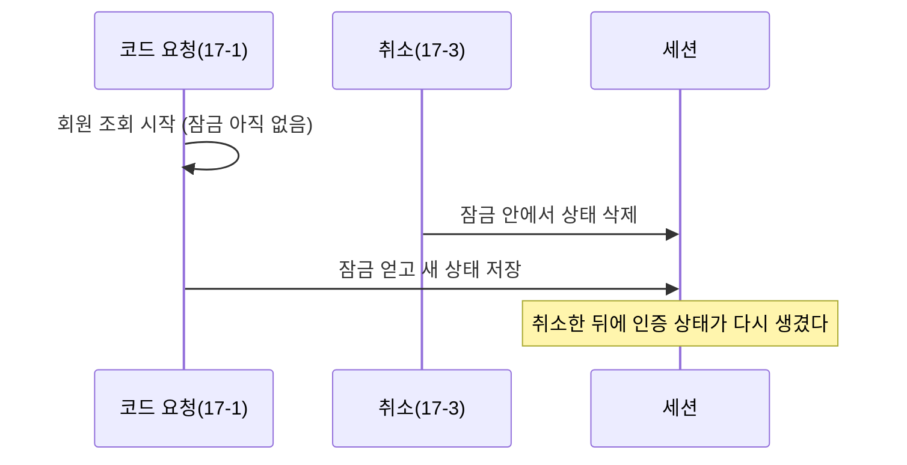

## 어떤 연동이었나

[2편]({{ site.baseurl }}/projects/moneybeetle-google-reauth/)의 재로그인 방식을 걷어낸 뒤(11/10 21:31, #232), 비밀번호가 없는 구글 가입 회원의 탈퇴 본인 확인은 **가입 이메일로 보낸 6자리 코드**가 됐다. 흐름은 세 단계다.

| 단계 | API | 하는 일 |
|---|---|---|
| 코드 요청 | 17-1 | 가입 이메일로 코드 발송 (같은 회원은 60초에 한 번) |
| 코드 확인 | 17-2 | 맞으면 5분 동안 탈퇴가 **한 번만** 쓸 수 있는 확인 상태로 표시 |
| 취소 | 17-3 | 탈퇴 창을 닫을 때 세션에 남은 확인 상태를 지움 (#279) |

이 이야기의 요약은 [결과물 회고]({{ site.baseurl }}/projects/moneybeetle/)에 있다. 이 글은 같은 버그를 **어떤 순서로 만났고 왜 한 번에 못 막았는지**를 코드와 커밋 시각으로 다시 따라간다.

⚠️ "처음 만든 방식"이라고 쓴 부분은 커밋 기록과 코드 주석으로 다시 맞춘 것이다. 당시 생각을 그대로 옮긴 것은 아니다.

## 1단계: 같은 세션의 요청은 하나씩 (#232, 11/10 밤)

코드를 만든 직후 두 번 고쳤다. 21:44에는 같은 세션의 동시 요청에서도 확인이 한 번만 쓰이게 했고, 21:55에는 코드 요청, 확인, 사용을 모두 같은 세션 잠금으로 묶었다.

```java
// consumeVerified 발췌: 읽기부터 지우기까지 한 잠금 안에서
synchronized (WebUtils.getSessionMutex(session)) {
    IdentityVerificationState state = stateOf(session);
    if (state == null || email == null || !state.isVerifiedFor(email, clock.instant())) {
        return false;
    }
    session.removeAttribute(SESSION_KEY);
    return true;
}
```

이 잠금 덕분에 두 가지가 지켜진다. 같은 세션의 동시 요청 중 성공은 정확히 한 번이고, 그 사이 새 코드를 받는 요청이 새 상태를 저장했다면 그 새 상태를 지우지 않는다. 둘 다 테스트 이름으로 남아 있다.

💡 1편의 가입 본인인증은 `synchronized (state)`, 여기서는 `synchronized (WebUtils.getSessionMutex(session))`다. 두 코드 주석을 나란히 보면 이유가 보인다. 가입 쪽은 "같은 세션이면 상태 객체가 하나"라고 적었다. 탈퇴 쪽은 코드 요청이 상태 객체를 **새로 저장**하고 취소가 **지운다**. 잠글 대상이 바뀌는 것이다. 그래서 바뀌지 않는 세션 단위로 잠갔다고 해석했다. 이 부분은 주석에서 읽은 내 해석이다.

## 2단계: 취소 API를 붙이자 새 틈이 보였다 (#279, 11/11 오후)

창을 닫을 때 서버의 확인 상태를 지우는 API 17-3을 붙였다(15:52). 화면은 닫을 때 이 API를 호출한다. `cancel`도 같은 세션 잠금 안에서 상태를 지운다.

늦게 도착한 **코드 확인(17-2)**은 괜찮았다. 확인은 저장된 상태가 있어야만 성공하는데, 취소가 그 상태를 지웠으니 `IDENTITY_CODE_EXPIRED`로 끝난다. 문제는 **코드 요청(17-1)**이었다.



🔴 코드 요청은 잠금을 얻기 **전에** 회원을 DB에서 조회한다. 그 사이에 취소가 먼저 끝나면, 요청은 아무것도 모른 채 잠금을 얻어 새 코드 상태를 저장하고 메일까지 보낸다. 닫은 창의 인증이 5분 동안 살아난다.

🔴 세션 잠금을 더 넓게 거는 것으로는 이 틈을 못 막는다. 잠금은 "한 번에 하나씩"을 보장할 뿐이고, 잠금을 얻은 요청이 자기가 시작한 뒤에 취소가 있었는지는 알려 주지 않는다.

## 3단계: 취소 세대값 (16:09)

취소가 일어날 때마다 세션의 숫자를 하나 올리고, 코드 요청은 시작할 때 그 숫자를 기억했다가 저장 직전에 다시 비교한다. 다르면 이 요청은 그 사이 취소된 것이므로 스스로 그만둔다.

```java
// requestCode 발췌
long generation = cancelGenerationOf(session);          // 시작할 때 기억
String email = requireSocialMemberEmail(memberId);      // 이 사이에 취소가 끼어들 수 있다
...
synchronized (WebUtils.getSessionMutex(session)) {
    if (generation != cancelGenerationOf(session)) {    // 저장 직전에 다시 비교
        throw new BusinessException(MemberErrorCode.IDENTITY_CODE_EXPIRED);
    }
    ...
    session.setAttribute(SESSION_KEY, IdentityVerificationState.issued(...));
}
```

값을 올리는 쪽(`cancel`)은 세션 잠금 안에서만 올린다. 읽는 쪽은 잠그지 않는다. 값은 늘기만 하므로 낡은 값을 읽어도 "내가 시작한 뒤 바뀌었다"는 판단이 뒤집히지 않는다는 점이 코드 주석의 근거다.

## 재현 테스트: 끼어드는 시점을 코드로 고정하기

동시성 버그를 스레드로 재현하면 가끔만 나온다. 그래서 끼어드는 시점을 코드로 정했다. 요청이 회원을 조회하는 순간에 취소를 실행하도록 `Mockito` 응답 안에 심었다.

```java
// WithdrawVerificationServiceTest 발췌
when(memberService.findLoginMemberById(7L)).thenAnswer(invocation -> {
    if (cancelled.compareAndSet(false, true)) {
        service.cancel(7L, session);   // 요청 중간에 취소가 끝난다
    }
    return Optional.of(socialMember(7L));
});

assertCode(() -> service.requestCode(7L, session), MemberErrorCode.IDENTITY_CODE_EXPIRED);
verifyNoInteractions(mailer);                       // 메일을 보내지 않았다
assertThat(service.consumeVerified(7L, session)).isFalse();
```

그다음 같은 테스트가 이어서 확인한다. 60초 간격이 풀려서 바로 새로 요청할 수 있고, 취소 뒤 새로 시작한 요청은 정상으로 끝난다. 수정 전에는 이 테스트가 1건 실패했고, 수정 후에는 0건 실패했다(발표 자료 기준).

## 4단계: 리뷰가 짚은 구멍, 발송 간격 (16:17)

PR #284 리뷰에서 필수로 지적받은 것이 있었다. 세대값만 비교하면 코드는 저장하지 않지만, 그 요청이 이미 **60초 발송 간격을 예약**해 버린다. 사용자는 창을 닫았다가 바로 다시 열었을 뿐인데 `IDENTITY_CODE_TOO_SOON`을 받게 된다.

| 지점 | 추가한 비교 | 이유 |
|---|---|---|
| 간격 예약 **전** | 잠금 안에서 세대값 확인 | 이미 취소된 요청이 간격을 차지하지 않게 |
| 저장 **직전** | 한 번 더 확인하고, 다르면 `lastSentAt.remove(memberId, now)`로 예약 반납 | 예약한 뒤에 취소가 끼어든 경우 |

⚠️ 비교가 두 번 있는 이유는 서로 다른 틈을 막기 때문이다. 앞의 것은 회원 조회 중에 끼어든 취소를, 뒤의 것은 간격을 예약한 뒤에 끼어든 취소를 잡는다. 그런데 재현 테스트는 앞의 틈(회원 조회 중)만 깨뜨린다. 두 번째 비교만 따로 깨뜨리는 테스트는 만들지 못했다.

세대값 커밋 8분 뒤의 일이다. 세션 잠금(11/10), 취소 세대값(16:09), 간격 예약 순서 조정(16:17)이 차례로 같은 한 가지 보장에 가까워지는 단계였다. "취소 이후에는 아무것도 저장하지 않는다."

## 확인 방법

| 확인 | 방법 |
|---|---|
| 취소 뒤 저장·발송 없음 | 회원 조회 중 취소를 끼워 넣는 재현 테스트 |
| 간격 반납 | 같은 테스트에서 바로 다시 요청이 성공하는지 |
| 정상 취소 뒤 재시도 | 확인 상태를 취소한 뒤 60초 간격이 지나면(테스트는 61초) 새 코드로 처음부터 다시 확인 |
| 동시 사용 | 같은 세션으로 동시에 쓰려 해도 성공은 정확히 한 번 |
| 전체 | 전체 Gradle 테스트 1,100개 통과(PR 작성 시점 기록) |

탈퇴 본인 확인 테스트는 모두 17개다.

## 배운 점

- 💡 **잠금은 "동시에 하나만"이고, 순서는 아니다.** 요청이 시작한 시점의 상태를 기억했다가 저장 직전에 비교해야 "낡은 요청"을 거를 수 있다.
- 💡 **한 가지 규칙에서 막을 곳이 여러 곳이다.** 세대값 비교 하나로 끝난 줄 알았지만, 같은 사실에 기대는 부수 효과(발송 간격 예약)가 따로 있었다.
- 💡 **끼어드는 시점을 코드로 고정하면 재현 가능해진다.** 스레드를 겹쳐 돌리는 테스트는 운에 기댄다.
- ⚠️ 이 해법은 **서버가 한 대**라는 전제에 기대고 있다. `synchronized`는 한 JVM 안의 잠금이고, 회원별 발송 기록(`lastSentAt`)은 메모리라 서버를 다시 켜면 지워진다.

다음 편은 같은 모양의 문제를 서버가 아니라 **화면**에서 만난 이야기다.

## 더 학습하면 좋은 개념

- **TOCTOU (Time-of-check to time-of-use)** — 확인한 시점과 사용하는 시점 사이에 상태가 바뀌는 문제의 이름이다. 이번 경쟁 상태가 정확히 이 유형이라 다른 사례를 알아보는 눈이 생긴다.
- **낙관적 락 (Optimistic Locking)** — 취소 세대값은 "읽은 뒤 바뀌었는가"를 비교한다는 점에서 `@Version`과 같은 계열이다. 세션이 아닌 DB 행에서 같은 보장을 얻는 방법이다.
- **분산 락과 외부 세션 저장소** — `synchronized`는 한 JVM 안에서만 유효하다. 서버를 늘릴 때 잠금과 세션을 어디로 옮겨야 하는지 알려 준다.
- **재현 가능한 동시성 테스트** — 스레드를 겹치는 대신 끼어드는 시점을 코드로 고정하는 기법이다. 간헐적 버그를 회귀 테스트로 바꿔 준다.

## 참고 자료

- [Spring 공식 문서 - WebUtils.getSessionMutex](https://docs.spring.io/spring-framework/docs/current/javadoc-api/org/springframework/web/util/WebUtils.html)
- [Jakarta Servlet - HttpSession](https://jakarta.ee/specifications/servlet/6.0/apidocs/jakarta.servlet/jakarta/servlet/http/httpsession)
