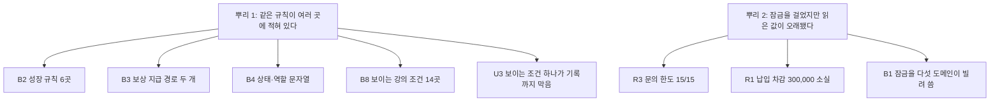

## 들어가며 (Situation)

MoneyBeetle 결과물을 낸 뒤 팀 코드를 점검한 [MoneyBeetle 코드 검증 리포트](https://claude.ai/artifact/Acka2q6jE1scprzP8ZQh8Y)를 받았다. 검증은 2026-11-12~13에 했고, 코드를 읽은 정적 분석과 로컬에서 실제로 요청을 보낸 실행 검증을 함께 했다. 이 글의 항목 번호(B1, A1, P3 등)는 모두 그 리포트의 번호다.

리포트는 이렇게 시작한다. 역할·레벨을 바꿔 보낸 요청 1,043건이 정책과 모두 일치했고, 남의 것을 읽거나 바꾸려는 요청 138건은 모두 막혔다. 그리고 생각해 볼 지점을 62건으로 정리했다.

| 구분 | 건수 |
|------|------|
| 높음 | 6 |
| 중간 | 33 |
| 낮음 | 23 |

강사님 피드백은 이 중 12개 항목(B1~B8, P3~P5, U3)에 짧게 적은 필기로 받았다. 필기만 보면 12개의 할 일이지만, 리포트는 그 바깥에도 많은 항목이 있고 그중에는 높음이 둘(A1, R1) 더 있다. 그래서 이 글은 필기 12개를 **리포트 전체 지도 위에 올려서** 읽었다.

💡 이 글은 **고치기 전의 설계 회고**다. 개선안의 코드는 모두 "예시 코드"이고 실행해 보지 않았다. 수치와 원인 진단은 모두 리포트의 것이고, 내가 직접 재현하거나 측정한 값이 아니다.

## 문제 상황 (Task)

- 62건을 하나씩 읽으면 서로 상관없는 일로 보인다. 같은 뿌리의 문제를 여러 번 고치게 될 수 있다.
- 강사님 필기는 항목당 한 줄이라, 리포트 본문과 겹쳐 읽어야 뜻이 풀린다.
- 발표 직후라서 전부 고칠 수는 없다. 무엇부터 할지 기준이 필요하다.

풀어야 할 것은 세 가지였다. 리포트를 읽는 법을 정하고, 뿌리별로 묶고, 고칠 순서를 정하는 것이다.

## 해결 과정 (Action)

### 1. 리포트를 읽는 법부터 정하기

- **심각도 기준**
  - 높음은 "돈·기록이 사라지거나 보안 구멍"(실행), 또는 "한 도메인의 변경이 여러 도메인을 고치게 하는데 컴파일러가 빠진 곳을 알려 주지 않는 결합"(구조)이다.
  - 구조 문제는 동작이 틀렸다는 뜻이 아니라 **바꾸는 비용이 크다**는 뜻이다. 그래서 구조 항목은 "지금 고장났나"가 아니라 "다음 변경에서 무엇이 새나"로 읽었다.
- **항목의 형식**
  - 각 항목이 "통하는 조건(지금 선택이 맞는 상황) → 깨지는 상황 → 다음 단계 → 선택지 비교" 순서로 적혀 있다.
  - 지적이 아니라 판단 근거를 보여 주는 형식이어서, 우리 팀의 선택이 어떤 조건에서 맞는지도 함께 읽을 수 있다.

### 2. 먼저 잘한 선택 확인

고칠 것만 보면 사기가 꺾이고 지켜야 할 것을 잊는다. 리포트가 실행이나 코드로 근거를 확인해 적은 "잘한 선택"을 먼저 표로 정리했다.

| 잘한 선택 | 근거(리포트) |
|-----------|--------------|
| 해금과 소유를 서버가 다시 확인 | 역할·레벨별 요청 1,043/1,043 일치, 남의 강의·비공개 강의 138/138 차단 |
| 돈이 오가는 곳은 동시에 와도 맞음 | 매수·매도·청약 납입·퀴즈 보상을 10개씩 동시에 보내도 잔고·수량·지급 횟수가 정확 |
| Controller에서 예외를 잡지 않음 | Controller 46개의 `catch` 0, 오류는 전역 처리기 한 곳 |
| 다른 도메인의 Repository를 쓰지 않음 | 주입 0, JPA 연관 매핑 0 (ID로 참조) |
| 문서와 코드가 맞음 | 기능 요구사항 120개 중 116개 구현, API 명세 165행 일치 |
| 입력과 파일을 서버가 거름 | `th:utext` 0, 파일 머리(매직 넘버)로 형식 확인 |

이 표가 뒤의 개선안에서 "무엇은 건드리지 말아야 하는가"의 기준이 됐다. 예를 들어 회원 행을 잠그고 계산하는 방식은 돈 흐름에서는 **제대로 작동**한다. 문제는 그 잠금을 다른 도메인이 빌려 쓰는 쪽이다.

### 3. 62건 지도

| 영역(번호) | 건수 | 한 줄 | 대표 항목 |
|------------|------|-------|-----------|
| 도메인 경계 (B) | 9 | 같은 규칙이 여러 도메인에 흩어지고 서로의 내부를 앎 | B1 회원 행 잠금, B2 성장 규칙, B3 랭킹 보상 |
| 계층과 객체 (L) | 9 | 큰 Service, 엔티티가 규칙을 안 지킴, 시각의 출처가 둘 | L1 모르는 예외는 모두 500, L2 한 메서드가 8가지 일 |
| 권한과 계정 (A) | 9 | 로그인 입구와 바뀐 자격 뒤의 세션 | A1 아이디 찾기, A2 계정 잠금, A5 세션 |
| 동시 요청 (R) | 5 | 잠금은 걸었는데 오래된 값을 읽음 | R1 납입 차감 소실, R3 문의 한도 |
| 성능 (P) | 13 | 쪽 나누기·인덱스·집계·금칙어 | P1 목록 전체 읽기, P3~P5 |
| 입력과 운영 (E) | 9 | 정책이 겹칠 때와 화면이 안 보내는 값 | E1 정답 공개, E3 출석 누락 |
| 사용 시나리오 (U) | 7 | 화면에서 사용자가 부딪히는 곳 | U1 2배속, U3 재검수 |
| 문서 대 코드 (D) | 1 | 문서와 실제가 다른 14곳 | D1 |

처음에는 영역별로 고치려 했다. 그런데 표를 보니 영역(행)보다 **뿌리(열)**가 기준이어야 했다. 뿌리는 두 개였다.



### 4. 높음 6건: 구조 4개(B1~B4)와 보안·기록 2개(A1, R1)

**A1. 아이디 찾기가 정답 확인기가 됨 (보안, 실행)**

- **무슨 일**
  - 닉네임은 공개 값이고 생년월일은 본인·관리자만 보는 값이다. 그런데 "닉네임 + 생년월일"로 아이디를 찾는 API는 맞으면 200과 가린 이메일, 틀리면 404를 준다.
  - 닉네임은 그대로 두고 생년월일만 바꿔 201번, 3.7초 만에 맞혔다. 429도 지연도 잠금도 없다.
  - 로그인 없이 부를 수 있는 API 15개 중 시도 횟수를 막는 것은 2개뿐이다.
- **내가 맡은 영역과의 연결**: 나는 회원·인증을 맡았다. 같은 팀이 가입 본인인증 코드에는 이미 "이메일당 60초 · 접속 주소당 1분 10회" 제한을 넣었다. 그 제한을 공용 클래스로 꺼내 아이디 찾기와 재설정 요청(A3)에도 거는 것이 가장 작은 수정이다.

```java
// 예시 코드: 본인인증의 시도 제한을 공용으로 꺼내 아이디 찾기에도 건다
if (!attemptLimiter.tryAcquire("find-email:ip:" + clientIp, 10, Duration.ofMinutes(1))
        || !attemptLimiter.tryAcquire("find-email:nick:" + nickname, 5, Duration.ofHours(1))) {
    throw new BusinessException(MemberErrorCode.FIND_EMAIL_LIMITED);   // 429
}
```

⚠️ 접속 주소 한 축만 세면 주소를 바꿔 가며 보내는 시도를 못 막는다. 닉네임 축을 함께 둔다. 근본 해결은 가입 여부와 상관없이 늘 같은 응답을 주고 결과를 메일로 보내는 것인데, 화면 흐름이 바뀌는 비용이 있다.

**R1. 랭킹 공개와 납입이 겹치면 납입 차감 300,000이 사라짐 (기록, 실행)**

- **무슨 일**
  - 같은 회원의 청약 납입과 랭킹 보상이 겹치면 캐시가 1,300,000이 되었다(기대 1,000,000). 원장에는 납입 −300,000이 남았는데 잔액에서는 사라졌다.
  - 회원 잔액을 바꾸는 다른 경로는 모두 잠금 조회를 **맨 처음에** 한다. 랭킹 공개만 순서가 반대다.
- **원인(1차 캐시)**
  1. 보상 전에 "활동 중인 회원인가"를 일반 조회(`findById`)로 확인한다. 회원 엔티티가 영속성 컨텍스트에 올라온다.
  2. 그 뒤 보상 지급이 같은 회원을 `FOR UPDATE`로 다시 읽는다. DB 잠금은 잡히지만, Hibernate는 이미 올라와 있는 엔티티를 그대로 돌려준다.
  3. 그 사이 커밋된 납입은 읽은 값에 반영되지 않는다. 오래된 잔액에 보상을 더해 덮어쓴다.

🔴 "잠금을 걸었다"와 "잠근 뒤의 최신 값을 읽었다"는 같은 말이 아니다. 같은 트랜잭션에서 먼저 일반 조회를 하면, 뒤의 잠금 조회는 최신 값을 주지 않는다.

🟢 이 트랜잭션에서 회원을 **처음 읽는 곳**을 잠금 조회로 한다. 활동 여부도 잠근 뒤의 값으로 판단한다. 장기적으로는 `Member`에 `@Version`(낙관적 잠금)을 두거나 `UPDATE … SET cash = cash + ?` 한 문장으로 바꾸는 선택지가 있다.

**B1~B4. 구조 4개**는 5절에서 강사님 필기와 함께 풀었다.

### 5. 강사님 필기 12개를 뿌리로 풀기

필기가 가리키는 항목을 리포트 본문과 맞춰 읽은 결과다.

| 필기 | 리포트 항목 | 뿌리 | 한 줄 해석 |
|------|-------------|------|------------|
| B1 | 회원 행 잠금이 다섯 도메인의 약속 | 2 | 리워드·출석을 따로 나누고 이벤트로 연결 |
| B2 | 성장이 6개 패키지에 흩어짐 | 1 | 처음부터 한 모듈로 설계 |
| B3 | 랭킹 보상 두 경로 | 1 | 지급 경로를 하나로 |
| B4 | 상태·역할이 문자열 | 1 | 권한은 해당 도메인(course)에 묻기 |
| B5 | 퀴즈 제출이 6도메인을 동기 호출 | - | 무조건 끊지 말고 기준을 정하기 |
| B6 | global이 업무를 앎 | 1 | global은 공용만 |
| B7 | 남의 DTO가 내 API를 정함 | 1 | 응답의 주체를 분명히 |
| B8 | 보이는 강의 규칙 14곳 | 1 | 한 곳에 모으기, 서비스 분리 |
| P3 | 금칙어 전체 읽기 | - | DB 대신 파일에서 바로 |
| P4 | 인덱스 없음 | - | 조건·정렬에 맞는 인덱스 |
| P5 | 요청마다 다시 셈 | - | 캐시 |
| U3 | 퀴즈 수정이 학습 기록을 가림 | 1 | 재심사 요청 페이지 |

⚠️ B4, B7, U3는 필기와 리포트 제목이 달라서 **내 해석**으로 합쳤다. 강사님 의도와 다를 수 있다.

**보상·성장 (B1, B2, B3)**

- **B1**: `lockBalance`는 growth 보상용인데 auth, course, quiz, inquiry도 빌려 쓴다. 리포트에 따르면 문의 작성이 잠금보다 먼저 금칙어를 읽어서, 같은 회원이 동시에 보낸 15건이 하루 한도 10건을 넘어 모두 저장됐다(R3). 리포트의 진단은 MySQL 기본 격리 수준의 스냅샷이 오래된 개수를 보여 줬다는 것이다. 또 서비스를 mock으로 바꾼 테스트라 잠금을 실제로 검증하지 않는다고 짚었다. 각 도메인이 자기 행을 잠그게 한다. 문의는 (회원, 날짜) 카운터 행에 `UPDATE … SET n = n + 1 WHERE n < 한도`를 쓴다. 행이 없는 첫 요청을 위해 `INSERT … ON DUPLICATE KEY UPDATE` 같은 upsert가 먼저 필요하다.
- **B2**: "레벨 ≥ 해금 레벨" 비교가 6곳이다. `UnlockPolicy.isUnlocked(level, feature)` 하나를 두고, 기능 목록은 enum을 순회해 만든다.
- **B3**: 관리자가 고친 규칙을 읽는 `grantRankingReward`를 부르는 곳이 없다. 1위 규칙을 77,000으로 바꿔도 상수 기준으로 지급됐다. 정산이 이 창구를 호출하게 하고 상수를 지운다. 이때 R1의 "잠금 먼저" 순서도 함께 정리하면 한 번에 끝난다.

**B5. 동기 호출을 어디까지 끊을까**

필기는 "하나가 처리될 때까지 기다리는 상황이다. 그런데 무조건 떨어뜨리는 게 정답은 아니다"였다. 이 필기가 가장 중요했다. B1~B3를 읽다 보면 모든 호출을 이벤트로 바꾸고 싶어지기 때문이다.

| 작업 | 처리 | 이유 |
|------|------|------|
| 채점, 학습 완료, 보상 | 같은 트랜잭션 | 함께 성공하거나 함께 실패해야 한다 |
| 해금 알림 | 커밋 후 이벤트 | 나중에 맞아도 되고, 실패가 채점을 되돌리면 안 된다 |

```java
// 예시 코드: 알림만 커밋 뒤에 보낸다
@TransactionalEventListener(phase = TransactionPhase.AFTER_COMMIT)
public void onUnlocked(FeatureUnlockedEvent e) {
    notificationService.notifyUnlock(e.memberId(), e.feature());
}
```

⚠️ `AFTER_COMMIT` 시점에는 원래 트랜잭션이 끝났다. 리스너에서 DB에 쓰려면 `REQUIRES_NEW`가 필요하고, 리스너가 실패해도 채점은 이미 커밋됐으므로 실패 기록과 재시도 방침을 정해야 한다.

**도메인 경계 (B4, B6, B7, B8)**

- **B4**: 상태·역할 칼럼 23개 중 19개가 문자열이다. Controller가 계산한 `boolean admin`을 Service가 그대로 믿고, 강사 퀴즈 저장은 강의 ID만 받아 소유 확인을 호출자에게 맡긴다. `Role`, `SeasonStatus` 같은 enum으로 옮기고, quiz는 강의 소유자를 직접 조회하지 않고 `courseService`에 묻는다.
- **B6**: global이 업무 도메인을 import하고 보호 대상을 URL 문자열로 안다. 주소를 바꾸면 보호가 조용히 꺼진다. global에는 `@RequireLevel`, `@Idempotent` 같은 애노테이션과 인터페이스만 두고, 대상은 도메인이 선언한다.
- **B7**: 남의 DTO를 품은 응답 DTO가 5개, 남의 DTO를 요청 본문으로 받는 API가 4개다. 받는 쪽이 자기 `record`로 옮겨 담는다.
- **B8**: "학습자에게 보이는 강의" 조건이 14곳이다. `CourseJpql.VISIBLE_COURSE` 상수 하나로 모으고, 호출부가 `APPROVED`를 넘기지 않게 한다.

**성능 (P3, P4, P5)**

- **P3 금칙어**: 리포트에 따르면 금칙어 4개일 때 64ms이던 문의 작성이 1만 개에서 225ms가 된다. SQL은 1.5ms이고, 나머지는 엔티티 1만 개 생성과 단어별 정규식으로 보인다고 한다(코드로 추정한 값). 필기의 "파일에서 바로 읽기"는 시작할 때 한 번 읽어 정규화한 목록을 메모리에 두는 방식이다. 대가는 팀 정책정의서의 DP-23("금칙어는 DB에서 고치면 바로 반영")이 "재시작 또는 1분 안"으로 바뀐다는 것이다.
- **P4 인덱스**: 관리자 강의 "전체" 탭은 조건 `(:status is null or c.status = :status)` 때문에 상태를 비우면 인덱스를 못 쓰고 10,019행을 읽어 정렬한다. `EXPLAIN`을 "값을 고른 경우"와 "비운 경우" 두 번 보고 인덱스를 더한다.

```sql
-- 예시: 리포트가 제안한 인덱스 (추가 뒤 EXPLAIN으로 실제로 쓰이는지 확인)
KEY `idx_inquiry_3` (`created_at`),
KEY `idx_inquiry_4` (`status`, `is_hidden`, `deleted_at`),
KEY `idx_course_3` (`deleted_at`, `submitted_at`),
```

- **P5 캐시**: 시세 "인기순"이 요청마다 주문 1만 건을 조인해 센다. 리포트에 따르면 가격은 턴이 바뀔 때만 바뀌므로 키를 `시즌ID:턴`으로 잡은 턴 캐시로 충분한지 먼저 정한다. 방금 주문까지 반영해야 하면 종목별 카운터 표를 쓴다.

**정책 (U3)**

허가된 강의를 고치면 `REVIEW`로 내려간다(정책정의서 SP-31, "허가된 강의를 고치면 관리자가 다시 검수한다"). 이미 완료한 회원은 학습 기록에 "아직 본 강의가 없어요"가 뜨고 강의 상세가 404다. DB의 완료 기록은 그대로다. 필기대로 "강사가 재심사를 요청했습니다" 흐름을 둔다.

1. 허가된 강의를 수정해도 공개 상태는 유지하고, 수정본은 "재심사 요청" 한 건으로 쌓는다.
2. 관리자 페이지에서 승인·반려한다. 승인하면 수정본이 공개된다.
3. 짧게는 진행 기록이 있는 회원에게 검수 중 강의를 읽기 전용으로 보여 주고 "강사가 내용을 고치는 중이에요"를 안내한다.

### 6. 필기에 없던 영역에서 눈에 띈 것

필기는 B·P·U에 몰려 있었다. 권한·계정, 동시 요청, 입력·운영에도 같은 무게의 지적이 있다.

- **권한과 계정 (A)**
  - A2: 남이 비밀번호를 5번 틀리면 주인도 잠기고(423) 관리자도 같다. 정지·탈퇴는 틀린 비밀번호에도 403으로 드러난다.
  - A5: 비밀번호를 바꿔도 다른 세션이 살아 있다. 요청마다 읽는 회원 행에 "비밀번호를 바꾼 시각" 하나를 더해 그보다 먼저 로그인한 세션을 끊는 것이 가장 작은 변경이다. 로그아웃한 로그인 유지 쿠키도 14일간 통한다.
  - A6: 비공개·검수 중 강의의 영상 파일이 로그인 없이 열린다(`/uploads/**`).
- **동시 요청 (R)**: R1(납입 소실)과 R3(문의 한도)는 4절·5절에서 다뤘다. R4는 접수번호 충돌 409, 스크랩 취소 500이다.
- **입력과 운영 (E)**
  - E1: 통과하지 못한 퀴즈에도 정답이 모두 오고, 그대로 다시 내면 학습 완료와 만점 보상이 나간다(경험치 180, 캐시 30,000). 정책 세 개(정답 공개, 재응시 무제한, 최초 통과만 보상)가 겹쳐서 생겼다.
  - E3: 로그인 유지 쿠키로 들어온 날은 출석이 기록되지 않는다. 출석을 "로그인 사건"이 아니라 "그날의 첫 인증된 요청"에 묶는 것이 제안이다.
- **사용 시나리오 (U)**: U1은 30초 영상을 2배속으로 끝까지 봐도 "시청 완료"가 안 되어 퀴즈가 잠긴다. 발표 시연에서 바로 부딪힐 수 있는 것이다.

💡 영역은 달라도 E1·E2·U3·A2는 모두 **정책 두 개가 겹치는 자리**에서 나왔다. 각 정책은 코드대로 맞는데, 합치면 의도와 다르게 동작한다.

### 7. 시행착오

- **처음 읽은 요약이 잘려 있었다**: P3~U3 상세가 빠진 요약만 보고 개선안을 쓰려 했다. 원문 HTML을 열어 "통하는 조건 · 깨지는 상황 · 다음 단계"를 확인하고 나서야 쓸 수 있었다.
- **필기 15개로 글을 시작했다**: 첫 초안은 필기 항목만 다뤘다. 리포트 전체를 지도로 먼저 그리고 나서야 높음 6건 중 A1, R1이 필기 밖에 있다는 것을 알았다.
- **이벤트 만능론**: B1~B3를 읽고 한때 모든 호출을 이벤트로 바꾸려 했다. B5의 필기를 보고 "함께 성공해야 하는 것은 한 트랜잭션에 둔다"로 기준을 바꿨다.

## 결과 (Result)

아직 코드에는 반영하지 않았다. 이 글의 결과는 **62건을 고칠 순서**다.

| 순서 | 항목 | 이유 | 규모 |
|------|------|------|------|
| 1 | R1, R3, B1: 잠금 순서를 "첫 읽기가 잠금"으로 + 실제 MySQL 동시 요청 테스트 | 기록이 사라지고(−300,000) 한도가 깨졌다(15/15). 잠금을 실제로 검증하는 테스트가 없다고 리포트가 짚었다 | 몇 줄 + 테스트 |
| 2 | A1, A3: 시도 제한 공용화 | 보안 구멍, 이미 있는 제한을 꺼내 쓰면 된다 | 작음 |
| 3 | B3: 정산이 규칙을 읽게 | 관리자가 바꾼 규칙이 지급에 안 쓰인다 | 작음 |
| 4 | B8, U3: 노출 조건을 한 곳으로 | 한 번 고치면 여러 화면이 같이 바로잡힌다 | 중간 |
| 5 | E1, E3, A5 | 정책 겹침과 세션, 정책 문구와 함께 고친다 | 중간 |
| 6 | P3, P4, P5 | 변경은 작고 효과가 있을 것으로 본다(금칙어 225ms, 풀 스캔, 적용 전이라 예상) | 작음 |
| 7 | B2, B4~B7 | 구조 변경이라 설계를 먼저 합의한다 | 큼 |

배운 점은 세 가지다.

1. 62건이어도 뿌리는 두세 개다. 먼저 묶고 나서 고쳐야 같은 곳을 반복해서 열지 않는다.
2. "나누라"는 말은 "전부 떼라"가 아니다. 함께 성공해야 하는 것과 나중에 맞아도 되는 것을 가르는 기준이 먼저다.
3. 잘한 선택을 먼저 확인하면, 고치는 범위를 줄일 수 있다. 회원 행 잠금은 돈 흐름에서 이미 잘 동작하므로, 없애지 않고 "누가 언제 잡는가"의 약속만 코드로 고정한다.

## 더 학습하면 좋은 개념

- **트랜잭션 격리 수준과 일관된 읽기(Consistent Read)** — R3, R1의 뿌리다. 일반 조회와 잠금 조회가 서로 다른 시점의 값을 본다는 것을 알면 잠금 위치가 왜 중요한지 보인다.
- **영속성 컨텍스트(1차 캐시)와 잠금 조회** — R1에서 `FOR UPDATE`를 걸고도 오래된 값을 읽은 이유다. 같은 트랜잭션에서 같은 행을 다시 읽어도 처음 읽은 객체를 재사용한다.
- **도메인 이벤트와 아웃박스 패턴** — AFTER_COMMIT 리스너가 실패하면 알림이 사라질 수 있다. 이벤트를 DB에 먼저 기록해 두고 보내는 방식이 다음 단계다.
- **Rate Limiting과 계정 열거 방지** — A1, A2, A3를 한 번에 설명하는 개념이다. "응답이 아무것도 알려 주지 않게"와 "시도를 세어 막기"의 차이를 배운다.
- **EXPLAIN과 복합 인덱스 설계** — 조건과 정렬 칼럼의 순서가 인덱스 사용 여부를 정한다. P4를 눈으로 확인하는 도구다.
- **패키지 의존성 방향과 순환 의존 끊기** — B6~B9가 모두 "도메인이 서로의 내부를 안다"에서 나왔다. 경계를 코드로 검사하는 방법까지 이어진다.

## 참고 자료

- [MoneyBeetle 코드 검증 리포트](https://claude.ai/artifact/Acka2q6jE1scprzP8ZQh8Y)
- [Spring Framework - Transaction-bound Events](https://docs.spring.io/spring-framework/reference/data-access/transaction/event.html)
- [MySQL - InnoDB Consistent Nonlocking Reads](https://dev.mysql.com/doc/refman/8.4/en/innodb-consistent-read.html)
- [MySQL - Locking Reads](https://dev.mysql.com/doc/refman/8.4/en/innodb-locking-reads.html)
- [MySQL - EXPLAIN Output Format](https://dev.mysql.com/doc/refman/8.4/en/explain-output.html)
- [MySQL - How MySQL Uses Indexes](https://dev.mysql.com/doc/refman/8.4/en/mysql-indexes.html)
