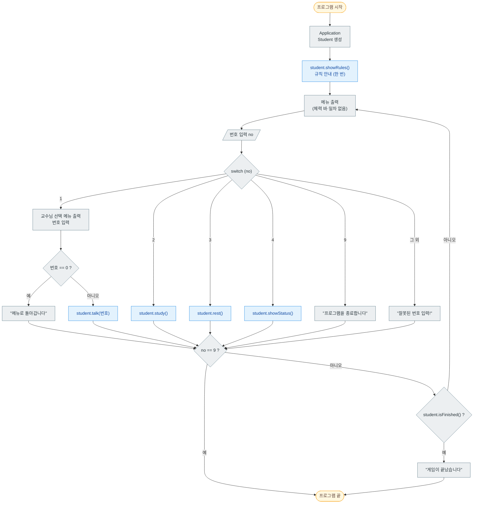
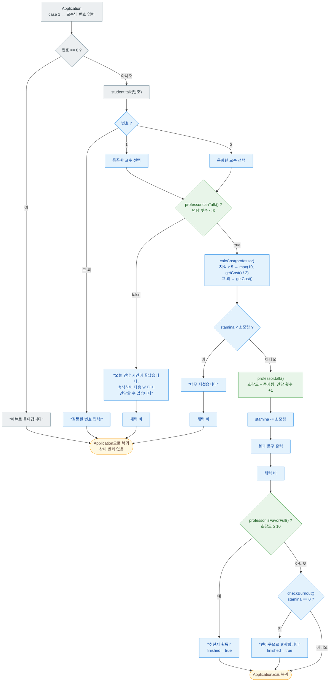
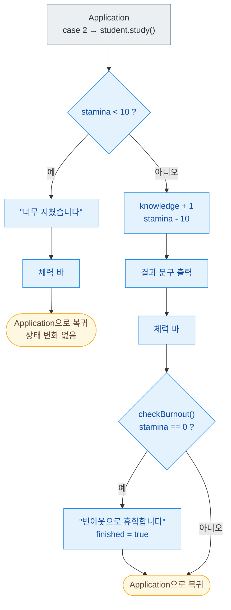
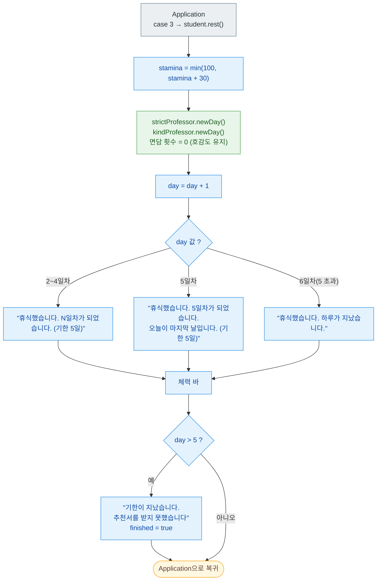
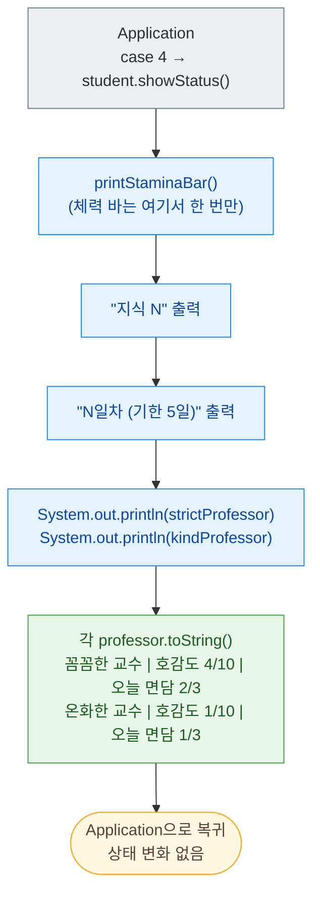

# 연구실 생존기 기획서

| 항목 | 내용 |
|---|---|
| 프로젝트명 | 연구실 생존기 (콘솔 게임) |
| 작성일 | 2026-10-02 |
| 대상 단원 | 클래스, 캡슐화, 추상화, 생성자 (상속·인터페이스·컬렉션 제외) |
| 기준 구조 | `d_abstraction/run` (Application / 행위자 / 대상 3개 파일) |
| 산출 위치 | `d_abstraction/lab` (패키지 `com.wanted.oop.b_oop.d_abstraction.lab`) |

---

## 1. 기획 의도

- `d_abstraction`의 카레이서 예제 구조(메뉴 루프 → 행위자 → 대상)를 그대로 따른다.
- 기존 구조에 **체력 바, 지식, 호감도, 클리어/게임오버**를 얹어 기능이 추가되는 과정을 연습한다.
- **교수님 두 명**(같은 클래스를 다른 값으로 두 번 생성)과 **기한**(일차)을 얹어 선택과 시간 압박을 만든다.
- 구현은 학습자가 직접 한다. 이 문서는 설계와 힌트까지만 담는다.

## 2. 게임 개요

학교가 배경이다. 학생은 꼼꼼한 교수와 온화한 교수 중 누구와 면담할지 고른다. 꼼꼼한 교수는 체력을 많이 쓰지만 호감도가 빨리 오르고, 온화한 교수는 체력을 적게 쓰지만 호감도가 천천히 오른다. 공부하면 지식이 올라 꼼꼼한 교수와 면담할 때 체력 소모가 줄어든다. 5일 안에 한 교수님의 호감도를 10 이상 모으면 추천서를 받아 클리어한다. 체력이 0%가 되면 번아웃으로, 5일 안에 추천서를 받지 못하면 기한 초과로 게임이 끝난다. 교수님을 공략하는 게임이 아니라, 성실하게 공부하고 면담해서 추천서를 받는 성장 게임이다.

### 2-1. 일차와 기한

**휴식 한 번이 하루**다. 면담, 공부, 상태 보기는 일차를 바꾸지 않는다. 학생은 1일차에서 시작하고, 5일차에 휴식하면 기한이 끝난다.

| 항목 | 규칙 |
|---|---|
| 시작 | 1일차, 체력 100%, 지식 0 |
| 하루가 지나는 때 | 3번 휴식을 고를 때만 지난다. 체력 +30%(최대 100%), 일차 +1, 두 교수님의 면담 횟수 0(호감도는 유지) |
| 하루에 할 수 있는 일 | 교수님마다 면담 3번까지. 공부와 상태 보기는 횟수 제한이 없다(공부는 체력이 허락하는 만큼). |
| 일차를 알 수 있는 곳 | 게임 시작 때 한 번 나오는 규칙 안내(기한), 휴식 결과 문구(N일차), 4번 상태 보기. 메뉴 화면에는 나오지 않는다. |
| 기한 판정 | 일차가 5를 넘으면 기한 초과다. 5일차에 휴식하면 6일차가 되어 게임이 끝난다. 휴식하고도 게임이 계속되는 횟수는 4번(2~5일차)이고, 5번째 휴식에서 끝난다. |
| 마지막 날 | 5일차가 되는 휴식에서 "오늘이 마지막 날입니다"를 알려 준다. 5일차 안에 추천서를 받아야 한다. |

| 시점 | 일차 | 교수님마다 면담 가능 | 휴식 결과 문구 |
|---|---|---|---|
| 시작 | 1일차 | 3번 | (규칙 안내가 한 번 나온다) |
| 1번째 휴식 | 2일차 | 3번 | "휴식했습니다. 2일차가 되었습니다. (기한 5일)" |
| 2번째 휴식 | 3일차 | 3번 | "휴식했습니다. 3일차가 되었습니다. (기한 5일)" |
| 3번째 휴식 | 4일차 | 3번 | "휴식했습니다. 4일차가 되었습니다. (기한 5일)" |
| 4번째 휴식 | 5일차 | 3번 | "휴식했습니다. 5일차가 되었습니다. 오늘이 마지막 날입니다. (기한 5일)" |
| 5번째 휴식 | (6일차) | - | "휴식했습니다. 하루가 지났습니다." → 기한 초과로 게임 끝 |

- 참고: 꼼꼼한 교수만 면담하면 3일차에, 온화한 교수만 면담하면 4일차에 호감도 10에 도달한다. 첫날 공부로 지식 5를 쌓고 꼼꼼한 교수와 면담하면 2일차에 도달한다(12장 점검 시나리오). 공부에는 체력 50%가 들고 지식은 하루가 지나도 유지된다. 어느 쪽이든 5일 안에 가능하지만 하루도 허투루 쓰기는 어렵다.

## 3. 추상화

- **남길 것**: 학생의 체력(%)·지식·일차, 교수님의 이름·소모량·호감도 증가량·호감도·면담 횟수
- **버릴 것**: 학과, 학점, 시간표, 교수님 성격 묘사, 건물과 이동, 돈

## 4. d_abstraction과의 대응

| 카레이싱 (기존) | 연구실 생존기 (신규) | 달라지는 점 |
|---|---|---|
| `Application` | `Application` | 구조 동일. 종료 조건에 "게임 끝남"만 추가. 1번 메뉴에서 교수님 번호를 한 번 더 입력받는다 |
| `CarRacer` (행위자, `private Car car = new Car();`) | `Student` (행위자, `private Professor strictProfessor = new Professor("꼼꼼한 교수", 30, 2);`, `private Professor kindProfessor = new Professor("온화한 교수", 10, 1);`) | Student는 체력·지식·일차라는 자기 상태도 가진다. 대상 객체를 두 개 가진다 |
| `Car` (대상, 상태 + 검사 + 안내 문구 출력) | `Professor` (대상) | 생성자로 이름·소모량·호감도 증가량을 받는다. 같은 클래스로 객체를 두 번 만든다. 안내 문구는 Professor가 아니라 Student가 출력한다 |
| 메뉴 화면에는 메뉴만 출력 | 메뉴 화면에는 메뉴만 출력 | 체력 바는 메뉴 선택 뒤 결과에서만 보여준다. 일차도 메뉴 화면에 보여주지 않는다 |

- `Application`은 `Student`만 만들고 `Professor`는 모른다. `Professor` 두 개는 `Student` 안에서 만든다. `Application`은 교수님 번호(1, 2)만 `Student`에게 넘긴다.

## 5. 프로그램 요구사항

```java
/* comment. 프로그램 요구사항 작성
 *   주제 : 학생이 두 교수님 중 한 분과 면담하고 공부하며 5일 안에 추천서를 받는 콘솔 게임 「연구실 생존기」
 *   1. 학생은 체력 100%, 지식 0, 1일차로 시작한다. 체력과 현재 일차는 시작 화면과 메뉴 화면에 보여주지 않는다(규칙 안내는 32번).
 *   2. 교수님과 면담하면 그 교수님의 호감도가 교수님의 호감도 증가량만큼 오르고, 학생 체력이 교수님의 소모량(%)만큼 줄어든다.
 *   3. 학생 지식이 5 이상이면 면담 체력 소모가 절반이 된다(소수점 버림, 최소 10%). 지식은 하루가 지나도 유지된다.
 *   4. 공부하면 지식이 1 오르고 체력이 10% 줄어든다.
 *   5. 휴식하면 체력이 30% 회복된다(최대 100%).
 *   6. 체력이 부족하면 면담과 공부를 할 수 없고 "너무 지쳤습니다"라고 안내한다.
 *   7. 한 교수님과는 하루에 최대 3번까지만 면담할 수 있다(교수님마다 따로 센다). 초과하면 "오늘 면담 시간이 끝났습니다. 휴식하면 다음 날 다시 면담할 수 있습니다"라고 안내한다.
 *   8. 어느 한 교수님의 호감도가 10 이상이 되면 "추천서 획득!"을 출력하고 게임을 클리어한다.
 *   9. 체력이 0%가 되면 "번아웃으로 휴학합니다"를 출력하고 게임이 끝난다.
 *  10. 교수님은 이름, 체력 소모량(%), 호감도 증가량을 생성자로 받는다(꼼꼼한 교수 30, 2 / 온화한 교수 10, 1).
 *  --- 애매한 규칙을 정해서 추가한 부분 ---
 *  11. 체력은 10칸짜리 바와 %로 보여준다(10%당 1칸, 소수점 버림). 예) [███████░░░] 70%
 *  12. 체력 바는 1~3번 메뉴를 선택한 뒤 나오는 결과 문구 바로 뒤에 출력한다(성공과 실패 모두).
 *      4번 상태 보기는 체력 바를 한 번만 출력한다. 메뉴 화면, 교수님 선택 화면, 9번, 잘못된 번호에는 출력하지 않는다.
 *  13. 4번 상태 보기는 체력 바, 지식, 일차, 두 교수님의 호감도와 오늘 면담 횟수를 보여준다.
 *  14. 학생이 휴식하면 하루가 지난 것으로 본다. 일차가 1 늘고, 두 교수님의 면담 횟수가 모두 0으로 초기화된다. 호감도는 유지된다.
 *  15. 실패한 행동(체력 부족, 면담 횟수 초과, 잘못된 교수님 번호)은 체력·지식·일차·호감도·면담 횟수를 바꾸지 않는다.
 *  16. 면담할 때는 면담 횟수 초과를 먼저 검사하고, 그다음 체력 부족을 검사한다.
 *  17. 체력 부족이란 현재 체력이 필요 소모량보다 작은 경우다(면담은 지식을 반영한 소모량, 공부는 10%).
 *  18. 한 번의 면담으로 호감도가 10 이상이 되면서 체력이 0%가 되면, 클리어가 번아웃보다 우선한다.
 *  19. 클리어, 번아웃, 기한 초과가 되면 게임이 끝나고 메뉴 반복이 멈춘다.
 *  20. 게임이 끝날 때는 행동 결과 → 체력 바 → 종료 문구("추천서 획득!", "번아웃으로 휴학합니다", "기한이 지났습니다. 추천서를 받지 못했습니다") → "게임이 끝났습니다" 순서로 출력한다.
 *  21. 체력이 0%보다 크지만 어떤 행동에도 부족하면(예: 5%) 번아웃이 아니다. 휴식만 할 수 있다.
 *  22. 지식에는 상한이 없다. 5 이상부터는 효과가 같다.
 *  23. 휴식은 체력이 100%일 때도 할 수 있고, 이때도 하루가 지나 일차가 늘고 면담 횟수가 초기화된다.
 *  24. 9를 입력하면 "프로그램을 종료합니다"를 출력하고 끝난다. "잘못된 번호 입력!"은 나오지 않는다.
 *  25. (알려진 한계) 숫자가 아닌 입력(예: abc)은 이번 단원에서 다루지 않는다. 프로그램이 멈출 수 있다.
 *  26. (알려진 한계) 콘솔에서 █, ░ 문자가 깨지면 #, - 로 바꿔 쓴다. 예) [#######---] 70%
 *  --- 교수님 두 명과 기한을 넣으면서 추가한 부분 ---
 *  27. 학생은 꼼꼼한 교수와 온화한 교수 두 분과 면담할 수 있다. 1번 메뉴를 고르면 면담할 교수님을 번호로 고른다(1 꼼꼼한 교수, 2 온화한 교수, 0 뒤로 가기).
 *  28. 호감도와 면담 횟수는 교수님마다 따로 쌓인다. 두 교수님의 호감도를 합치지 않는다.
 *  29. 교수님 선택 화면에서 1, 2 이외의 번호를 입력하면 "잘못된 번호 입력!"을 출력하고 면담 없이 메뉴로 돌아간다. 체력 바는 출력하지 않는다.
 *  30. 기한은 5일이다(1일차~5일차). 5일차에 휴식해서 일차가 5를 넘으면 "기한이 지났습니다. 추천서를 받지 못했습니다"를 출력하고 게임이 끝난다.
 *  31. 온화한 교수(소모량 10%)는 최소 소모량 10% 규칙 때문에 지식 보너스가 적용되지 않는다. 의도한 규칙이다. 지식은 꼼꼼한 교수와의 면담에만 도움이 된다.
 *  --- 일차 설명을 구체화하면서 추가한 부분 ---
 *  32. 프로그램을 시작하면 메뉴가 처음 나오기 전에 규칙 안내를 한 번 출력한다(기한 5일, 휴식하면 하루가 지남, 교수님마다 하루 3번 면담, 호감도 10 이상이면 추천서, 체력 0%이면 번아웃). 이어서 면담·공부·휴식의 차이를 안내한다(면담은 호감도를 올리고 체력을 쓴다, 공부는 지식을 올리고 지식 5 이상이면 꼼꼼한 교수와의 면담 체력 소모가 절반이 된다, 휴식은 체력을 회복하고 하루가 지난다). 두 교수님의 체력 소모량과 호감도 증가량도 함께 보여준다. 현재 체력과 일차는 보여주지 않는다.
 *  33. 휴식 결과 문구에 몇 일차가 되었는지를 보여준다. 예) "휴식했습니다. 2일차가 되었습니다. (기한 5일)". 5일차가 되면 "휴식했습니다. 5일차가 되었습니다. 오늘이 마지막 날입니다. (기한 5일)"로 알려 준다. 기한이 지나는 휴식(일차가 5를 넘음)은 "휴식했습니다. 하루가 지났습니다."로 쓴다.
 *  34. 면담 횟수 초과 안내(7번)에는 휴식하면 다음 날 다시 면담할 수 있다는 힌트가 붙는다.
 *  --- 뒤로 가기를 넣으면서 추가한 부분 ---
 *  35. 메뉴를 고른 뒤 바로 실행되지 않고 한 번 더 고르는 화면(교수님 선택)에서는 0을 입력하면 "메뉴로 돌아갑니다"를 출력하고 메뉴로 돌아간다. 이때 면담은 하지 않고 체력 바도 출력하지 않으며, 체력·지식·일차·호감도·면담 횟수는 바뀌지 않는다.
 *  */
```

## 6. 클래스 후보 도출

```java
/* comment. 은/는 , 이/가 <- 이 키워드 앞 단어가 대부분 클래스 후보이다.
 *   여기서 필요한 객체는 학생과 교수님 객체이다. 교수님 객체는 두 개(꼼꼼한 교수, 온화한 교수)다.
 */
```

| 주어 단어 | 분류 | 이유 |
|---|---|---|
| 학생 | 클래스(행위자) | 사용자 명령을 받아 교수님에게 전달하고, 자기 체력·지식·일차를 바꾼다. |
| 교수님 | 클래스(대상) | 이름, 소모량, 호감도 증가량, 호감도, 면담 횟수라는 상태와 동작을 가진다. 같은 클래스로 객체를 두 개 만든다. |
| 체력, 지식, 일차 | 필드 | 학생의 변하는 상태다. |
| 호감도, 면담 횟수 | 필드 | 교수님의 변하는 상태다. 교수님마다 따로 가진다. |
| 이름, 소모량, 호감도 증가량 | 필드(final) | 생성자로 받은 뒤 바뀌지 않는다. |
| 기한 | 제외 | 클래스가 아니라 숫자 5다. Student의 `private final` 상수(`MAX_DAY`)로 둔다. |
| 체력 바 | 제외 | 클래스가 아니라 출력 방식이다. Student의 `private` 메서드로 처리한다. |
| 게임 | 제외 | 상태는 `finished` 한 값으로 충분하다. |

## 7. 객체별 수신 메시지

```java
 *   학생이 수신할 수 있는 메세지   : 면담해라(교수님 번호와 함께) / 공부해라 / 휴식해라 / 상태를 보여줘라 / 규칙을 알려줘라 / 게임이 끝났는지 알려줘라
 *   교수님이 수신할 수 있는 메세지 : 면담 가능한지 알려줘라 / 이름을 알려줘라 / 소모량을 알려줘라 / 호감도 증가량을 알려줘라 / 면담받아라
 *                                   / 호감도가 가득 찼는지 알려줘라 / 하루 넘겨라 / 정보를 문자열로 알려줘라
```

| 위임 관계 | 설명 |
|---|---|
| `Student.talk(번호)` → 고른 교수님의 `canTalk()`, `getName()`, `getCost()`, `getGain()`, `talk()`, `isFavorFull()` | 번호로 교수님을 고르고, 검사하고 소모량을 계산한 뒤 면담을 전달한다. |
| `Student.rest()` → 두 교수님의 `newDay()` | 하루를 넘기고 두 교수님의 면담 횟수를 초기화한다. |
| `Student.showStatus()` → 두 교수님의 `toString()` | 교수님 정보를 문자열로 돌려받아 Student가 출력한다. |
| `Student.study()` | 교수님에게 위임하지 않는다. |
| `Student.showRules()` | 교수님에게 위임하지 않는다. 게임 시작 때 Student가 규칙을 한 번 출력한다. |

## 8. 클래스 설계

```
Student    (private int stamina = 100, private int knowledge, private int day = 1, private boolean finished,
            private Professor strictProfessor = new Professor("꼼꼼한 교수", 30, 2),
            private Professor kindProfessor = new Professor("온화한 교수", 10, 1))
  talk(int no)  study()  rest()  showStatus()  showRules()  isFinished()
  private void talkWith(Professor professor)  private printStaminaBar()
  private int calcCost(Professor professor)  private void checkBurnout()
Professor  (private final String name, private final int cost, private final int gain,
            private int favor, private int talkCount)
  Professor(String name, int cost, int gain)
  canTalk()  getName()  getCost()  getGain()  talk()  isFavorFull()  newDay()  toString()
Application  main: Student 생성 → Scanner 메뉴 루프 (1번에서 교수님 번호를 입력받아 0이면 메뉴로 돌아가고, 아니면 student.talk(번호) 호출)
```

| 클래스 | 변하는 상태 | 변하지 않는 값 | 책임 |
|---|---|---|---|
| Student | stamina, knowledge, day, finished | (strictProfessor, kindProfessor 참조) | 시작 규칙 안내, 교수님 선택, 행동 검사, 체력·지식·일차 계산, 안내 문구와 체력 바 출력, 종료 판정(클리어·번아웃·기한) |
| Professor | favor, talkCount | name, cost, gain | 자기 호감도와 면담 횟수를 관리하고, 자기 정보를 문자열로 알려준다 |
| Application | 없음 | 없음 | 입력을 받아 Student 메서드만 호출 |

상수 (`static`을 아직 배우지 않았다면 `private final` 필드로 둔다):

| 상수 | 값 | 위치 | 쓰이는 곳 |
|---|---|---|---|
| MAX_STAMINA | 100 | Student | rest() 상한 |
| STUDY_COST | 10 | Student | study() 검사·소모 |
| REST_AMOUNT | 30 | Student | rest() 회복 |
| BONUS_KNOWLEDGE | 5 | Student | calcCost() 조건 |
| MIN_COST | 10 | Student | calcCost() 최솟값 |
| MAX_DAY | 5 | Student | rest() 기한 판정 |

`Professor`는 상수를 두지 않고 `isFavorFull()`에서 호감도 목표 10을, `canTalk()`에서 하루 최대 면담 횟수 3을 숫자로 직접 쓴다.

### 8-1. Student.talk(번호) 상태 전이표 (위에서부터 차례로 검사)

| 현재 상태 | 결과 | 출력 |
|---|---|---|
| 교수님 번호가 1, 2가 아님 | 변화 없음 | "잘못된 번호 입력!" (체력 바 없음) |
| 고른 교수님의 면담 횟수 3 이상 | 변화 없음 | "오늘 면담 시간이 끝났습니다. 휴식하면 다음 날 다시 면담할 수 있습니다" → 체력 바 |
| 체력 < 필요 소모량 | 변화 없음 | "너무 지쳤습니다" → 체력 바 |
| 정상 | 호감도 + 증가량, 면담 횟수 +1, 체력 − 소모량 | 결과 문구 → 체력 바 |
| 정상 후 호감도 10 이상 | `finished=true` | 결과 → 체력 바 → "추천서 획득!" → "게임이 끝났습니다"(Application) |
| 정상 후 체력 0% (호감도 10 미만) | `finished=true` | 결과 → 체력 바 → "번아웃으로 휴학합니다" → "게임이 끝났습니다"(Application) |

### 8-2. study() / rest() / showStatus() 전이표

| 현재 상태 | 메시지 | 결과 |
|---|---|---|
| 체력 < 10% | study | "너무 지쳤습니다", 변화 없음, 체력 바 |
| 체력 ≥ 10% | study | 지식 +1, 체력 −10%. 체력이 0%가 되면 번아웃 |
| 항상 | rest | 체력 +30%(최대 100%), 두 교수님의 `newDay()`, 일차 +1. 결과 문구에 일차를 보여주고(5일차가 되면 마지막 날 안내) 체력 바 출력 |
| rest 후 일차 > 5 | rest | `finished=true`. 체력 바 → "기한이 지났습니다. 추천서를 받지 못했습니다" → "게임이 끝났습니다"(Application) |
| 항상 | showStatus | 체력 바(한 번), 지식, 일차, 두 교수님의 호감도와 오늘 면담 횟수 출력 |
| 시작할 때 한 번 | showRules | 규칙 안내(기한, 하루 경과, 면담 횟수, 추천서 조건, 번아웃)와 면담·공부·휴식의 차이, 두 교수님의 소모량·증가량 출력. 상태 변화 없음 |

### 8-3. 캡슐화 포인트

- Application은 `Student`만 알고 `Professor`를 모른다. 교수님 번호(1, 2)만 `Student`에게 넘긴다.
- 값을 꺼내는 메서드는 묻기만 하는 것(`getName`, `getCost`, `getGain`, `canTalk`, `isFavorFull`, `isFinished`)만 둔다. 상태는 의미 있는 행동 메서드(`talk`, `newDay`)로만 바꾸고 setter는 만들지 않는다.
- 안내 문구는 `Student`만 출력한다. 묻는 메서드(`canTalk`, `isFavorFull`)와 `toString()`은 출력하지 않는다.
- 호감도와 면담 횟수는 각 `Professor` 객체가 따로 가진다. `Student`에 호감도 변수를 두지 않는다.

## 9. Application 메뉴 설계

기존 `Application` 구조를 그대로 쓴다. 메뉴 화면에는 체력과 일차가 보이지 않는다.

| 번호 | 메뉴 | 호출 |
|---|---|---|
| 1 | 교수님 면담 | 교수님 선택 메뉴 출력 → 번호 입력 → 0이면 "메뉴로 돌아갑니다" 출력 후 메뉴로, 아니면 `student.talk(번호)` |
| 2 | 공부 | `student.study()` |
| 3 | 휴식 | `student.rest()` |
| 4 | 상태 보기 | `student.showStatus()` |
| 9 | 프로그램 종료 | `case 9`에서 안내 출력 → `switch` 뒤 `if (no == 9) break` |
| 그 외 | 잘못된 번호 | `default`에서 "잘못된 번호 입력!" |

교수님 선택 메뉴는 "1. 꼼꼼한 교수 / 2. 온화한 교수 / 0. 뒤로 가기"를 출력하고 같은 `Scanner`로 번호를 한 번 더 입력받는다. 0은 `Application`이 직접 처리한다(`Student`와 `Professor`는 뒤로 가기를 모른다).

`Student`를 만든 직후, 메뉴 반복문에 들어가기 전에 `student.showRules()`를 한 번 호출해서 규칙을 안내한다.

- `switch` 안에 `case 9`를 둔다. 9가 `default`로 떨어지면 안 된다.
- `switch` 뒤에서 `if (no == 9) break`, 그 아래에서 `if (student.isFinished())`이면 "게임이 끝났습니다"를 출력하고 `break`한다.

### 9-1. 전체 메뉴 루프

> 색 구분: 회색 = Application, 파랑 = Student, 초록 = Professor, 노랑 = 시작·끝(복귀)



- 9번과 그 외 번호는 이 그림에서 끝난다. 1~4번의 내부 흐름은 9-2에 있다.

### 9-2. 메뉴별 워크플로

**1번 교수님 면담** — `student.talk(번호)`



1. [Application] `case 1` → 교수님 선택 메뉴("1. 꼼꼼한 교수 / 2. 온화한 교수 / 0. 뒤로 가기") 출력 → 번호 입력
   - 번호가 0이면 "메뉴로 돌아갑니다" → 끝(면담 없음, 체력 바 없음, 변화 없음). 이 경우 아래 단계는 실행되지 않는다.
   - 그 외 번호면 `student.talk(번호)` 호출
2. [Student] 번호가 1이면 `strictProfessor`, 2이면 `kindProfessor`를 고른다. 그 외 번호면 "잘못된 번호 입력!" → 끝(변화 없음, 체력 바 없음)
3. [Student] 고른 교수님의 `canTalk()`가 false면 → "오늘 면담 시간이 끝났습니다. 휴식하면 다음 날 다시 면담할 수 있습니다" → 체력 바 → 끝(변화 없음)
4. [Student] `calcCost(professor)`: `knowledge >= 5`이면 `Math.max(MIN_COST, professor.getCost() / 2)`, 아니면 `professor.getCost()`
5. [Student] `stamina` < 소모량이면 → "너무 지쳤습니다" → 체력 바 → 끝(변화 없음)
6. [Professor] `professor.talk()`: 호감도 + 증가량, 면담 횟수 +1
7. [Student] `stamina -= 소모량`
8. [Student] 결과 문구("꼼꼼한 교수님과 면담했습니다. 호감도가 2 올랐습니다.") → 체력 바. 교수님 이름은 `getName()`, 증가량은 `getGain()`으로 가져온다.
9. [Student] `professor.isFavorFull()`이면 → "추천서 획득!" → `finished = true` → 끝
10. [Student] 아니면 `checkBurnout()`: `stamina == 0`이면 → "번아웃으로 휴학합니다" → `finished = true`
11. [Application] `switch` 뒤 `if (no == 9)` 검사 → `if (student.isFinished())`면 "게임이 끝났습니다" → `break`

- 상태 변화: 성공 시 고른 교수님의 호감도·면담 횟수와 학생 체력 / 실패 시 없음
- 게임 종료 가능: 예(클리어 또는 번아웃, 9번이 10번보다 먼저)

**2번 공부** — `student.study()`



1. [Application] `case 2` → `student.study()` 호출
2. [Student] `stamina < STUDY_COST`면 → "너무 지쳤습니다" → 체력 바 → 끝(변화 없음)
3. [Student] `knowledge +1`, `stamina -= STUDY_COST`
4. [Student] 결과 문구("공부했습니다. 지식이 1 올랐습니다.") → 체력 바
5. [Student] `checkBurnout()`: `stamina == 0`이면 → "번아웃으로 휴학합니다" → `finished = true`
6. [Application] `isFinished()` 확인 → 끝났으면 "게임이 끝났습니다" → `break`

- 상태 변화: 성공 시 지식·체력 / 실패 시 없음
- 게임 종료 가능: 예(번아웃만)

**3번 휴식** — `student.rest()`



1. [Application] `case 3` → `student.rest()` 호출
2. [Student] `stamina + REST_AMOUNT`가 `MAX_STAMINA`보다 크면 `MAX_STAMINA`, 아니면 `stamina + REST_AMOUNT`를 `stamina`에 넣는다(삼항연산자 `? :`)
3. [Professor] 두 교수님에게 `newDay()`: 면담 횟수 = 0 (호감도는 유지)
4. [Student] `day`를 1 올린다.
5. [Student] 결과 문구 → 체력 바. 일차가 2~4면 "휴식했습니다. N일차가 되었습니다. (기한 5일)", 5이면 "휴식했습니다. 5일차가 되었습니다. 오늘이 마지막 날입니다. (기한 5일)", 5를 넘으면 "휴식했습니다. 하루가 지났습니다."
6. [Student] `day > MAX_DAY`이면 → "기한이 지났습니다. 추천서를 받지 못했습니다" → `finished = true`
7. [Application] `isFinished()` 확인 → 끝났으면 "게임이 끝났습니다" → `break`

- 상태 변화: 체력, 두 교수님의 면담 횟수, 일차
- 게임 종료 가능: 예(기한 초과만)

**4번 상태 보기** — `student.showStatus()`



1. [Application] `case 4` → `student.showStatus()` 호출
2. [Student] `printStaminaBar()` (이 메뉴에서는 체력 바를 이것 한 번만 출력)
3. [Student] "지식 N" 출력
4. [Student] "N일차 (기한 5일)" 출력
5. [Student] `System.out.println(strictProfessor)`, `System.out.println(kindProfessor)` → [Professor] 각 `toString()`이 "꼼꼼한 교수 | 호감도 4/10 | 오늘 면담 2/3" 같은 문자열을 돌려주고, Student가 출력

- 상태 변화: 없음
- 게임 종료 가능: 아니오

**게임 시작 규칙 안내** — `student.showRules()`

1. [Application] `Student`를 만든 직후, 메뉴 반복문에 들어가기 전에 `student.showRules()`를 한 번 호출
2. [Student] 규칙 안내 출력: "기한은 5일입니다. 휴식하면 하루가 지납니다." / "교수님마다 하루에 3번까지 면담할 수 있습니다." / "교수님의 호감도가 10 이상이 되면 추천서를 받습니다." / "체력이 0%가 되면 번아웃으로 휴학합니다." / "면담 : 교수님의 호감도를 올립니다. 체력을 씁니다." / 두 교수님의 "이름 : 체력 N% 소모, 호감도 +N"(`getName()`, `getCost()`, `getGain()`으로 가져온다) / "공부 : 지식을 올립니다. 체력을 10% 씁니다. 지식이 5 이상이면 꼼꼼한 교수와의 면담 체력 소모가 절반이 됩니다." / "휴식 : 체력을 30% 회복하고 하루가 지납니다."

- 상태 변화: 없음 / 체력 바와 현재 일차는 보여주지 않는다.

**9번 프로그램 종료**

1. [Application] `case 9` → "프로그램을 종료합니다"
2. [Application] `switch` 뒤 `if (no == 9) break`

- 상태 변화: 없음 / 체력 바 출력 없음

**그 외 번호**

1. [Application] `default` → "잘못된 번호 입력!"
2. 메뉴로 돌아간다

- 상태 변화: 없음 / 체력 바 출력 없음

체력 바는 Application이 아니라 Student 메서드 안에서 출력한다. Application은 입력과 호출만 한다.

## 10. 화면 흐름 예시

문구는 9-2 워크플로와 같다. 형식 참고용이다.

**시작 화면** (규칙 안내는 한 번만 나온다)

```
===========연구실 생존기 규칙===========
기한은 5일입니다. 휴식하면 하루가 지납니다.
교수님마다 하루에 3번까지 면담할 수 있습니다.
교수님의 호감도가 10 이상이 되면 추천서를 받습니다.
체력이 0%가 되면 번아웃으로 휴학합니다.
면담 : 교수님의 호감도를 올립니다. 체력을 씁니다.
  꼼꼼한 교수 : 체력 30% 소모, 호감도 +2
  온화한 교수 : 체력 10% 소모, 호감도 +1
공부 : 지식을 올립니다. 체력을 10% 씁니다. 지식이 5 이상이면 꼼꼼한 교수와의 면담 체력 소모가 절반이 됩니다.
휴식 : 체력을 30% 회복하고 하루가 지납니다.
=======================================
(이어서 메뉴가 나온다)
```

**정상 면담 1회** (꼼꼼한 교수)

```
메뉴를 선택해주세요: 1
1. 꼼꼼한 교수 / 2. 온화한 교수
교수님을 선택해주세요: 1
꼼꼼한 교수님과 면담했습니다. 호감도가 2 올랐습니다.
체력 [███████░░░] 70%
```

**뒤로 가기** (교수님 선택 화면에서 0)

```
메뉴를 선택해주세요: 1
1. 꼼꼼한 교수 / 2. 온화한 교수 / 0. 뒤로 가기
교수님을 선택해주세요: 0
메뉴로 돌아갑니다
(체력 바 없이 메뉴가 다시 나온다)
```

**실패 1회** (체력 10%에서 면담)

```
메뉴를 선택해주세요: 1
1. 꼼꼼한 교수 / 2. 온화한 교수
교수님을 선택해주세요: 1
너무 지쳤습니다
체력 [█░░░░░░░░░] 10%
```

**클리어** (꼼꼼한 교수 호감도 8, 체력 40%에서 면담)

```
메뉴를 선택해주세요: 1
1. 꼼꼼한 교수 / 2. 온화한 교수
교수님을 선택해주세요: 1
꼼꼼한 교수님과 면담했습니다. 호감도가 2 올랐습니다.
체력 [█░░░░░░░░░] 10%
추천서 획득!
게임이 끝났습니다
```

**면담 횟수 초과** (같은 교수님과 하루 4번째 면담)

```
메뉴를 선택해주세요: 1
1. 꼼꼼한 교수 / 2. 온화한 교수
교수님을 선택해주세요: 1
오늘 면담 시간이 끝났습니다. 휴식하면 다음 날 다시 면담할 수 있습니다
체력 [█░░░░░░░░░] 10%
```

**휴식** (1일차에서 휴식)

```
메뉴를 선택해주세요: 3
휴식했습니다. 2일차가 되었습니다. (기한 5일)
체력 [████░░░░░░] 40%
```

**기한 초과** (5일차에 휴식)

```
메뉴를 선택해주세요: 3
휴식했습니다. 하루가 지났습니다.
체력 [██████████] 100%
기한이 지났습니다. 추천서를 받지 못했습니다
게임이 끝났습니다
```

**상태 보기** (시작 직후)

```
메뉴를 선택해주세요: 4
체력 [██████████] 100%
지식 0
1일차 (기한 5일)
꼼꼼한 교수 | 호감도 0/10 | 오늘 면담 0/3
온화한 교수 | 호감도 0/10 | 오늘 면담 0/3
```

- 클리어나 기한 초과 뒤에는 메뉴가 다시 나오지 않는다.
- 체력 줄과 일차는 메뉴를 고른 뒤에만 나온다. 메뉴 화면과 교수님 선택 화면에는 나오지 않는다.

## 11. 구현 계획

### 11-1. 구현 순서

**기본 구현 (완료)**

1. `Professor` 필드와 생성자, 그리고 `canTalk()`, `getCost()`, `isFavorFull()`
2. `Professor.talk()`, `newDay()`, `toString()`
3. `Student` 필드와 `printStaminaBar()` (먼저 출력만 확인해 본다)
4. `rest()`: 체력 상한 100 처리
5. `calcCost()`와 `checkBurnout()`
6. `study()`: 체력 검사 → 변경 → 번아웃 판정
7. `talk()`: 분기가 가장 많다. 전이표 순서대로 `if`를 쓴다.
8. `Application`에 `case 9`와 `isFinished()` 종료 처리 추가

**교수님 두 명과 기한 적용 (이번에 바꿀 순서)**

1. `Professor`: `gain` 필드와 생성자 매개변수 3개, `getName()`, `getGain()`. `talk()`에서 호감도를 `gain`만큼 올리고, `isFavorFull()`은 `>= 10`, `toString()`은 `/10`으로 고친다.
2. `Student`: 필드를 `strictProfessor`, `kindProfessor`로 바꾸고 `day`와 `MAX_DAY`를 추가한다.
3. `calcCost(Professor professor)`로 매개변수를 추가한다.
4. 기존 `talk()` 본문을 `private void talkWith(Professor professor)`로 옮긴다. `professor.`로 쓰던 곳은 매개변수를 쓰므로 그대로 둬도 된다. 결과 문구는 `getName()`과 `getGain()`을 쓴다.
5. 새 `talk(int no)`를 만든다. 번호로 교수님을 고르고, 그 외 번호는 "잘못된 번호 입력!"을 출력한다.
6. `Application` `case 1`에서 교수님 선택 메뉴를 출력하고 번호를 입력받아 `student.talk(번호)`를 호출한다.
7. `rest()`: 두 교수님의 `newDay()`, `day` 증가, 기한 검사를 추가한다.
8. `showStatus()`: 일차와 두 교수님 정보를 출력한다.

**일차 설명 보강 (이번에 바꿀 순서)**

1. `Student`에 `public void showRules()`를 만들어 규칙 안내(요구사항 32번)를 출력한다. 기한은 `MAX_DAY`로 쓴다.
2. `Application`에서 `Student`를 만든 직후, 반복문 앞에서 `student.showRules()`를 한 번 호출한다.
3. `rest()`의 결과 문구를 일차에 따라 세 갈래로 나눈다(요구사항 33번). 문구를 출력한 뒤 체력 바를 출력하는 순서는 그대로다.
4. `talkWith()`의 면담 횟수 초과 문구에 휴식 힌트를 붙인다(요구사항 34번).

### 11-2. 구현 힌트

- 체력 바는 `stamina / 10`개를 채우고 나머지를 비운다. `for`문 두 개로 충분하다.
  - 예) 55% → 5칸 → `[█████░░░░░] 55%`
- 실제 소모량은 `knowledge >= BONUS_KNOWLEDGE`이면 `Math.max(MIN_COST, professor.getCost() / 2)`, 아니면 `professor.getCost()`다.
- 체력 상한은 삼항연산자로 한 줄에 처리한다. `stamina + REST_AMOUNT`가 `MAX_STAMINA`보다 크면 `MAX_STAMINA`, 아니면 `stamina + REST_AMOUNT`를 쓴다.
- 호감도 판정은 `favor >= 10`으로 쓴다. `==`로 쓰면 증가량이 2씩 오를 때 10을 건너뛸 수 있다.
- 같은 `Professor` 클래스로 객체를 두 개 만든다. 생성자에 넘기는 값만 다르다(`new Professor("꼼꼼한 교수", 30, 2)`, `new Professor("온화한 교수", 10, 1)`). 각 객체가 자기 호감도와 면담 횟수를 따로 가진다.
- 면담 처리는 `talkWith(Professor professor)` 하나로 두 교수님을 함께 처리한다. 교수님별로 코드를 복사하지 않는다.
- `talk(int no)`는 `if-else`로 번호를 나눈다. 1이면 `talkWith(strictProfessor)`, 2이면 `talkWith(kindProfessor)`, 그 외에는 안내 문구를 출력한다.
- 뒤로 가기(0)는 `Application`의 `case 1`에서 처리한다. 교수님 번호를 입력받은 뒤 `if (번호 == 0)`이면 안내 문구만 출력하고, 아니면 `student.talk(번호)`를 호출한다. `Student`에는 뒤로 가기 코드를 넣지 않는다.
- 기한 판정은 `rest()` 안에서 한다. `day`를 올린 뒤 `day > MAX_DAY`이면 종료한다. `>=`로 쓰면 5일차에 휴식하기 전에 끝나 버린다.
- 휴식 결과 문구는 `day`를 올린 뒤에 `if-else`로 고른다. `day > MAX_DAY`(기한 초과) → `day == MAX_DAY`(마지막 날) → 그 외 순서로 나누면 6일차 문구가 나오지 않는다.
- 규칙 안내의 "5일"은 숫자를 직접 쓰지 말고 `MAX_DAY`를 이어 붙인다. 면담 3번과 호감도 10은 `Professor`의 숫자와 같아야 한다.
- 실패 분기에서 `return;`으로 중간에 끝내지 않고 `if-else`로 나눈다. 실패하면 `if` 쪽만, 성공하면 `else` 쪽만 실행되므로 실패 시 상태가 바뀌지 않는다(`study()`, `talkWith()`).
- Student가 먼저 검사하지만, 대상 객체도 자기 상태를 스스로 지킨다(캡슐화). `Professor.talk()`는 `canTalk()`가 true일 때만 호감도와 면담 횟수를 올리고, false면 아무것도 바꾸지 않는다.
- `canTalk()`, `isFavorFull()`처럼 묻는 메서드는 출력하지 않고 true/false만 돌려준다.
- 번아웃 판정은 `study()`와 `talkWith()` 양쪽에 필요하다. `checkBurnout()`으로 묶으면 중복이 줄어든다.

### 11-3. 흔한 실수

- 체력 바를 메뉴 화면이나 교수님 선택 화면에 같이 출력한다. 요구사항 12번 위반이다.
- 체력 바를 Application에서 출력한다.
- 실패 분기에서 호감도·면담 횟수를 먼저 올린다.
- 검사 순서를 바꾼다(체력 검사 → 횟수 검사). 요구사항 16번 위반이다.
- 면담 성공 후 번아웃을 먼저 검사한다. 요구사항 18번 위반이다.
- `rest()`에서 한 교수님에게만 `newDay()`를 부른다. 다른 교수님의 면담 횟수가 초기화되지 않는다(요구사항 14번 위반).
- `rest()`에서 `day`를 올리지 않거나, 기한 비교를 `>=`로 쓴다.
- `Student`에 호감도 변수를 따로 두고 두 교수님의 호감도를 합친다. 요구사항 28번 위반이다.
- 잘못된 교수님 번호에서 체력 바를 출력하거나, 면담 횟수·체력을 바꾼다(요구사항 29번 위반).
- `Application`에서 교수님 이름으로 분기하거나 `Professor`를 만들거나 접근한다. Application은 번호만 넘긴다.
- 호감도 목표를 예전 값 5로 남겨 두어 클리어가 너무 빨리 된다.
- `canTalk()` 안에서 안내 문구를 출력해서 면담 실패 시 문구가 두 번 나온다.
- 상태 보기에서 체력 바가 두 번 출력된다.
- `switch`에 `case 9`가 없어서 9 입력 시 "잘못된 번호 입력!"이 같이 나온다.
- 규칙 안내를 반복문 안에 넣어서 메뉴가 나올 때마다 안내가 반복된다(요구사항 32번 위반).
- 기한 초과가 되는 마지막 휴식에도 "6일차가 되었습니다"를 출력한다(요구사항 33번 위반).
- 뒤로 가기(0)를 `student.talk(0)`으로 넘겨서 "잘못된 번호 입력!"이 나온다(요구사항 35번 위반).
- 뒤로 가기에서 체력 바를 출력하거나 면담 횟수를 바꾼다(요구사항 35번 위반).

## 12. 점검 시나리오

입력 표기: `1-1`은 메뉴 1번 뒤에 교수님 1번(꼼꼼한 교수), `1-2`는 메뉴 1번 뒤에 교수님 2번(온화한 교수)을 고르는 두 번의 입력이다. `1-0`은 메뉴 1번 뒤에 0(뒤로 가기)을 입력하는 두 번의 입력이다. 나머지는 메뉴 번호 한 번이다.
교수님은 꼼꼼한 교수(소모량 30%, 호감도 +2)와 온화한 교수(소모량 10%, 호감도 +1)이고, 호감도 목표는 10, 기한은 5일이다.
모든 시나리오에서 프로그램을 시작하면 메뉴가 나오기 전에 규칙 안내가 한 번 나온다(요구사항 32번). 아래 기대 결과에는 따로 적지 않는다.
휴식 결과 문구는 요구사항 33번을 따른다(2일차~4일차는 "N일차가 되었습니다. (기한 5일)", 5일차는 마지막 날 안내, 기한 초과는 "하루가 지났습니다.").

| 입력 순서 | 기대 결과 | 확인하는 규칙 |
|---|---|---|
| `1-1,1-1,1-1,1-1` | 체력 100→70→40→10%, 네 번째는 "오늘 면담 시간이 끝났습니다. 휴식하면 다음 날 다시 면담할 수 있습니다" | 7, 15, 34 |
| `1-1,1-1,1-1,3,1-1,3,1-1` | 면담 3회(10%, 호감도 6) → 휴식(40%, 2일차) → 면담(10%, 호감도 8) → 휴식(40%, 3일차) → 면담(10%, 호감도 10) → "추천서 획득!" 후 종료 | 8, 14 |
| `1-1,1-1,1-1,3,1-1,1-1` | 면담 3회(10%) → 휴식(40%) → 면담(10%, 호감도 8) → "너무 지쳤습니다"(호감도 8 그대로, 체력 바 10%) | 6, 15 |
| `2` 열 번 | 체력 90→…→0%, 열 번째에 "번아웃으로 휴학합니다" 후 종료 | 4, 9 |
| `2,2,2,2,1-1,2,1-1` | 공부 4번(지식 4, 체력 60%) 뒤 꼼꼼한 교수 면담은 소모량 30% 그대로 → 30%. 공부 한 번 더(지식 5, 20%) 뒤 면담은 소모량 15% → 5% (지식 5부터 절반) | 3 (지식 4와 5의 경계) |
| `2,2,2,2,2,1-2` | 지식 5여도 온화한 교수는 소모량 10% 그대로, 체력 50→40% | 31 |
| `2,2,2,2,2,1-1,1-1,1-1,3,1-1,1-1` | 공부 5번(체력 50%, 지식 5) → 면담 3번(소모량 15%씩, 체력 35→20→5%, 호감도 6) → 휴식(35%, 2일차) → 면담(20%, 호감도 8) → 면담(5%, 호감도 10) → "추천서 획득!" 후 종료. 2일차 클리어 | 3, 8, 14 |
| `1-1,1-1,1-1,3,2,1-1` | 면담 3회(10%) → 휴식(40%) → 공부(30%, 지식 1) → 면담(0%, 호감도 8) → "번아웃으로 휴학합니다" | 9 (면담으로 번아웃) |
| `1-1,1-1,1-1,3,1-1,3,2,1-1` | 면담 3회(10%, 호감도 6) → 휴식(40%) → 면담(10%, 호감도 8) → 휴식(40%) → 공부(30%, 지식 1) → 면담(0%, 호감도 10) → "추천서 획득!"만 출력, 번아웃 문구 없음 | 18, 20 |
| `2,2,2,2,2,1-1,1-1,1-1,1-1,2` | 공부 5번(체력 90→80→70→60→50%), 면담 3번(소모량 15%씩, 체력 35→20→5%). 네 번째 면담 `1-1`은 "오늘 면담 시간이 끝났습니다. 휴식하면 다음 날 다시 면담할 수 있습니다"(체력 부족보다 먼저), 10번째 입력 2는 "너무 지쳤습니다". 체력 5%지만 종료되지 않음 | 16, 21 |
| `1-1,1-2,4` | 체력 100→70→60%. 상태 보기에서 꼼꼼한 교수 호감도 2/10, 오늘 면담 1/3, 온화한 교수 호감도 1/10, 오늘 면담 1/3 (호감도가 따로 쌓임) | 13, 28 |
| `1-2,1-2,1-2,3,1-2,1-2,1-2,3,1-2,1-2,1-2,3,1-2` | 온화한 교수만 면담: 하루 3번씩 3일, 4일차 첫 면담에서 호감도 10 → "추천서 획득!" 후 종료 (체력은 계속 70% 이상) | 8, 14 |
| `3,3,3,3,4` | 휴식 문구가 2일차, 3일차, 4일차, 5일차(마지막 날 안내) 순서로 나오고, 상태 보기에서 "5일차 (기한 5일)", 게임은 계속됨 | 13, 30, 33 |
| `3,3,3,3,3` | 앞의 네 번은 2일차~5일차 휴식 문구, 다섯 번째 휴식은 "하루가 지났습니다."(일차 표시 없음) → 체력 바 100% → "기한이 지났습니다. 추천서를 받지 못했습니다" → "게임이 끝났습니다" | 20, 30, 33 |
| `3,4` | 휴식 문구 "2일차가 되었습니다. (기한 5일)", 체력 100% 유지, 상태 보기에서 "2일차 (기한 5일)" | 5, 23, 33 |
| `4` | 시작 직후 상태 보기, 체력 바 한 번만 출력, 지식 0, 1일차, 두 교수님 호감도 0/10, 오늘 면담 0/3 | 12, 13 |
| `1-3` | 교수님 선택에서 3 입력 → "잘못된 번호 입력!", 체력 바 없음, 변화 없음 | 15, 29 |
| `1-0,4` | 교수님 선택에서 0 입력 → "메뉴로 돌아갑니다", 체력 바 없음. 이어서 상태 보기에서 체력 100%, 두 교수님 호감도 0/10, 오늘 면담 0/3 그대로 | 15, 35 |
| `7` | "잘못된 번호 입력!", 체력 바 없음 | 12 |
| `9` | 규칙 안내 뒤에 "프로그램을 종료합니다"만 출력, "잘못된 번호 입력!" 없음 | 24, 32 |

## 13. 확장 아이디어

교수님 두 명과 기한은 본문에 반영했다. 남은 확장은 아래와 같다.

1. **랜덤 이벤트**: 면담할 때 `Math.random()`으로 20% 확률로 "교수님이 칭찬해 주셨다"가 나와 호감도 증가량이 두 배가 된다.
2. **면담 질문 퀴즈**: 면담할 때 간단한 자바 문제를 출력하고, 맞히면 증가량 +1, 틀리면 그대로. Scanner는 Application에만 두고, Application이 답을 입력받아 `student.talk(번호, answer)`로 넘긴다(Professor가 직접 입력받지 않는다).
3. **논문 진행도**: 새 클래스 `Paper`(대상)를 만들어 공부가 논문 진행률(바)에 쌓이게 한다. `Student`가 `Professor`와 `Paper`를 모두 가진다.
4. **교수님 세 명 이상**: 교수님 필드를 계속 늘리면 `talk(int no)`의 분기가 길어진다. 다음 단원의 배열로 이어진다.

## 14. 변경 이력

| 구분 | 변경 내용 |
|---|---|
| A1 | 안내 문구는 Student만 출력한다. `canTalk()`는 출력하지 않는다. 8장 책임 표의 Professor 칸을 고쳤다. |
| A2 | `Professor.talk()`가 안에서 `canTalk()`를 한 번 더 확인한다. 구현 힌트에 반영했다. |
| A3 | 필드 이름을 `isFinished`에서 `finished`로 바꿨다. 메서드 `isFinished()`는 그대로다. |
| A4 | 8-3 getter 문장을 "묻기만 하는 메서드만 공개"로 고쳤다. |
| A5 | 호감도 판정을 `>= 5`로 썼다(요구사항 8·18번, 전이표, 힌트). |
| A6 | `case 9`에서 종료 안내를 출력하고, `switch` 뒤 `if (no == 9) break` → `if (student.isFinished())` 순서로 고쳤다. 9장 표도 고쳤다. |
| A7 | 9번 메뉴 이름을 "프로그램 종료"로 통일했다. |
| B1 | "깐깐한 교수"를 "꼼꼼한 교수"로 바꿨다. |
| B2 | "오늘은 그만 와라"를 "오늘 면담 시간이 끝났습니다"로 바꿨다. |
| B3 | 행동 이름을 "대화"에서 "면담"으로 통일했다(메서드·필드 이름은 그대로). 수신 메시지는 "면담받아라"로 바꿨다. |
| B4 | 2장 게임 개요 끝에 성장 게임 문장을 추가했다. |
| C | 5장 요구사항을 최종본(1~26번)으로 교체했다. 11-3의 "12번", "16번", "18번" 참조를 최종 번호에 맞췄다. |
| D | 클래스 설계 블록에 `calcCost()`, `checkBurnout()`을 추가하고 상수 표를 넣었다. 전이표는 요구사항 20번 순서를 따랐다. |
| E | 메뉴별 워크플로를 추가했다. |
| F | 화면 흐름 예시를 3개(정상, 실패, 클리어)로 늘렸다. |
| G | 점검 시나리오를 11개로 교체했다. |
| H | 흔한 실수에 6개를 추가했다. |
| I | 확장 2·3번에 주의 문장을 넣고, 4번(면담 질문 퀴즈)을 추가했다. |
| J1 | 8-3 두 번째 줄을 "값을 꺼내는 메서드는 묻기만 하는 것만 두고, 상태는 의미 있는 행동 메서드로만 바꾼다"로 고쳤다. |
| J2 | 11-2 소모량 힌트의 `cost`를 `professor.getCost()`로 고쳤다. |
| J3 | 4장 대응표 Professor 행에 "안내 문구는 Student가 출력한다"를 추가했다. |
| J4 | 7장 학생 수신 메시지에 "게임이 끝났는지 알려줘라"를 추가했다. |
| J5 | 요구사항 12번의 "결과 끝에"를 "결과 문구 바로 뒤에"로 바꿨다. |
| J6 | 8-1 전이표의 "게임이 끝났습니다" 뒤에 "(Application)"을 붙였다. |
| K | 9-1에 전체 메뉴 루프 순서도를, 9-2에 1~4번 메뉴별 순서도(Mermaid)를 추가했다. 색으로 Application·Student·Professor를 구분했다. |
| L | `Professor.printInfo()`를 `toString()`으로 바꿨다. Professor는 문자열만 돌려주고, 출력은 `Student.showStatus()`가 `System.out.println(professor)`로 한다(4·7·8장, 9-2 순서도·워크플로, 11-1). |
| M1 | 구현 순서를 메뉴(case)별로 나눠 진행했다: 0·1단계(Professor 생성자, 9번·잘못된 번호) → 2 공부 → 3 휴식 → 4 상태 보기 → 1 면담. 겹치는 메서드(`printStaminaBar`, `checkBurnout`, `isFinished`)는 먼저 쓰이는 case에서 한 번만 만들었다. |
| M2 | 코드에서는 `return;`으로 중간에 끝내는 대신 `if-else`로 나눴다(`Professor.talk()`, `Student.study()`, `Student.talk()`). 동작은 요구사항 15번과 같다. 11-2 구현 힌트에 반영했다. |
| M3 | 코드에서 `rest()`의 체력 상한 처리는 삼항연산자(`? :`)로 한 줄로 썼다. 9-2 3번 워크플로와 11-2 구현 힌트의 `Math.min` 설명을 이에 맞게 고쳤다. |
| M4 | 코드의 `Professor`에는 `MAX_TALK`, `GOAL_FAVOR` 상수를 두지 않고 숫자 3, 5를 직접 썼다. 8장 상수 표에서 두 행을 지우고 설명 한 줄을 넣었으며, 11-2의 `favor >= GOAL_FAVOR`는 `favor >= 5`로 고쳤다. |
| N1 | 교수님 두 명(확장 A)을 본문에 반영했다. 꼼꼼한 교수(소모량 30%, 호감도 +2)와 온화한 교수(소모량 10%, 호감도 +1)를 같은 `Professor` 클래스로 만들고, 생성자에 호감도 증가량을 추가했다. 1번 메뉴에서 교수님 번호를 한 번 더 입력받는다. 호감도와 면담 횟수는 교수님마다 따로 센다. |
| N2 | 기한(확장 B)을 본문에 반영했다. `Student`에 `day`(1일차 시작)와 `MAX_DAY`(5)를 추가했다. 휴식하면 일차가 늘고 두 교수님의 면담 횟수가 모두 초기화된다. 5일차에 휴식하면 기한 초과로 게임이 끝난다. |
| N3 | 호감도 목표를 5에서 10으로 올렸다. 교수님 두 명이면 호감도 증가량이 달라 목표 5로는 꼼꼼한 교수와 면담 3번에 클리어되어 기한이 의미가 없기 때문이다. 기한을 10일에서 5일로 줄인 이유도 같다(가장 느린 경로인 온화한 교수가 4일 만에 클리어된다). |
| N4 | 5장 요구사항 1·2·7·8·10·12·13·14·15·18·19·20·23번을 고치고 27~31번을 추가했다. 번호는 바꾸지 않았다. |
| N5 | 4·6·7·8장, 9장 표·9-1·9-2 순서도와 워크플로(1·3·4번), 10장 화면 예시(기한 초과, 상태 보기 추가), 11장 구현 순서·힌트·흔한 실수를 교수님 두 명과 기한에 맞게 고쳤다. 11-1에 "교수님 두 명과 기한 적용" 순서를 추가했다. |
| N6 | 12장 점검 시나리오를 18개로 교체하고 입력 표기(`1-1`, `1-2`)를 추가했다. 13장 확장에서 교수님 여러 명·날짜 넘기기를 빼고 논문 진행도와 교수님 세 명 이상을 추가했다. |
| 검증 1 | 점검 시나리오 11개를 요구사항 5장과 9-2 워크플로대로 한 줄씩 따라갔다. 체력, 호감도, 출력 문구 모두 기대 결과와 일치해 고친 곳은 없다. (교수님 두 명·기한 반영 이전의 기록이다.) |
| 검증 2 | 교수님 두 명과 기한을 반영한 점검 시나리오 18개를 요구사항 5장과 9-2 워크플로대로 한 줄씩 따라갔다. 체력, 호감도, 일차, 출력 문구 모두 기대 결과와 일치해 고친 곳은 없다. (코드 반영 전의 기록이다. 코드 실행 확인은 O5에 있다.) |
| O1 | 코드에 교수님 두 명을 반영했다. `Professor`는 생성자를 `Professor(String name, int cost, int gain)`으로 바꾸고 `gain` 필드, `getName()`, `getGain()`을 추가했다. `talk()`는 호감도를 `gain`만큼 올리고, `isFavorFull()`은 `>= 10`, `toString()`은 `/10`으로 고쳤다. |
| O2 | 코드에 교수님 두 명과 기한을 반영했다. `Student`는 `strictProfessor`(꼼꼼한 교수, 30, 2)와 `kindProfessor`(온화한 교수, 10, 1) 필드, `day`(1일차 시작), `MAX_DAY`(5)를 가진다. 새 `talk(int no)`가 번호로 교수님을 고르고, 기존 면담 로직은 `talkWith(Professor)`로 옮겼다. `calcCost(Professor)`는 매개변수를 받는다. |
| O3 | `Student.rest()`는 두 교수님의 `newDay()`를 부르고 `day`를 올린 뒤, `day > MAX_DAY`이면 "기한이 지났습니다. 추천서를 받지 못했습니다."를 출력하고 `finished`를 `true`로 바꾼다. `showStatus()`는 일차와 두 교수님 정보를 출력한다. |
| O4 | `Application`은 `case 1`에서 교수님 선택 메뉴를 출력하고 번호를 입력받아 `student.talk(번호)`를 호출한다. 위쪽 주석(추상화, 요구사항 1~24·27~31번, 수신 메시지)을 기획서 5·7장 문구로 맞췄다. 기획서 25·26번(알려진 한계)은 코드 주석에 넣지 않았다. |
| O5 | 컴파일은 통과했다. 12장 점검 시나리오 18개를 모두 실제로 실행했다(입력을 파이프로 넣고 UTF-8 출력으로 확인). 체력, 호감도, 일차, 출력 문구, 종료 순서가 모두 기획서의 기대 결과와 일치했다. 이때 코드 문구 끝에 마침표가 붙어 있었는데, 이후 기획서 표기에 맞춰 뺐다(O6). 공부 결과 문구("지식이 1 상승했습니다!")도 기획서 표기("올랐습니다.")와 달랐는데, 이후 맞췄다(O7). |
| O6 | 코드 안내 문구의 끝 마침표를 기획서 표기에 맞춰 뺐다("너무 지쳤습니다", "오늘 면담 시간이 끝났습니다", "번아웃으로 휴학합니다", "기한이 지났습니다. 추천서를 받지 못했습니다", "프로그램을 종료합니다", "게임이 끝났습니다"). 면담·휴식 결과 문구는 기획서도 마침표로 끝나 그대로 뒀다. 컴파일과 시나리오 1번(`1-1` 네 번)으로 바뀐 문구를 확인했다. |
| O7 | 공부 결과 문구를 기획서 9-2 표기에 맞춰 "공부했습니다. 지식이 1 올랐습니다."로 고쳤다. |
| O8 | 문구 수정(O6·O7) 뒤 12장 점검 시나리오 18개를 다시 실행했다. 각 시나리오의 체력 변화, 안내 문구, 호감도·일차 표시, 종료 순서를 기획서의 기대 결과와 자동으로 비교했고 18개 모두 일치했다. |
| O9 | `Student.java` 주석을 새 규칙에 맞췄다. 클래스 설명(교수님 두 명, 일차, 클리어·번아웃·기한 초과 판정, Application은 교수님 번호만 넘김), 필드·상수 설명, `talk(int no)`의 잘못된 번호 처리, `talkWith`의 검사 순서와 클리어 우선, `rest()`의 기한 초과, `calcCost`의 온화한 교수 보너스 없음, `checkBurnout` 호출 조건을 추가했다. 이미 구현된 `study()`에 남아 있던 `// TODO.` 표시는 지웠다. 코드는 바꾸지 않았다. |
| O10 | `Professor.java` 주석을 새 규칙에 맞췄다. "자기 정보를 출력한다"를 "문자열로 알려준다"로 고치고, 같은 클래스로 객체 두 개를 만든다는 설명, 변하지 않는 값(30·2, 10·1)과 변하는 상태(교수님마다 따로 쌓임) 설명, 묻는 메서드와 `toString()`은 출력하지 않는다는 설명, `newDay()`를 두 교수님 모두에게 부른다는 설명을 넣었다. 코드는 바꾸지 않았다. 주석 수정 뒤 컴파일과 18개 시나리오 재확인을 했고 모두 통과했다. |
| P1 | 일차와 기한 설명을 구체화했다(기획서). 2장에 "2-1. 일차와 기한"(하루가 지나는 때, 일차를 알 수 있는 곳, 기한 판정, 마지막 날, 휴식 횟수별 타임라인)을 추가했다. 요구사항 1번(현재 체력과 일차는 보여주지 않고 규칙 안내는 32번)과 7번 문구를 고치고 32~34번(시작 규칙 안내, 휴식 결과 문구에 일차 표시, 면담 횟수 초과 힌트)을 추가했다. 7·8장에 `showRules()`를, 9장과 9-1·9-2 순서도에 시작 규칙 안내를, 10장에 화면 예시 3개(시작 화면, 면담 횟수 초과, 휴식)를 추가했다. 11장 구현 순서·힌트·흔한 실수와 12장 점검 시나리오 기대 결과도 맞췄다. 12장 머리말에 "모든 시나리오에서 규칙 안내가 한 번 나온다"는 설명과 휴식 문구 규칙을 넣고, 규칙 열에 32·33·34번을 추가했다. |
| P2 | 일차 설명 구체화를 코드에 반영했다. `Student.showRules()`를 추가하고 `Application`이 메뉴 반복문 앞에서 한 번 호출한다. `rest()`는 일차에 따라 문구를 세 갈래로 고른다(2~4일차 "N일차가 되었습니다. (기한 5일)", 5일차 마지막 날 안내, 기한 초과 "하루가 지났습니다."). 면담 횟수 초과 문구에 "휴식하면 다음 날 다시 면담할 수 있습니다"를 붙였다. `Application` 주석도 요구사항 1·7·32~34번과 수신 메시지에 맞췄다. `Student.java`에는 `showRules()`와 `rest()`의 문구 선택에 대한 주석을 추가했다. |
| P3 | 코드 반영 뒤 컴파일하고 12장 점검 시나리오 18개를 다시 실행했다. 새 문구(규칙 안내, 일차 표시 휴식 문구, 면담 횟수 초과 힌트)를 기대 결과로 바꿔 자동 비교했고 18개 모두 일치했다. 규칙 안내는 모든 시나리오에서 한 번만 나왔다. |
| P4 | 면담·공부·휴식의 차이를 규칙 안내에 넣었다. 기획서 요구사항 32번, 9-2 "게임 시작 규칙 안내" 워크플로, 10장 시작 화면 예시, 8-2 표의 `showRules` 행을 고쳤다. 코드는 `Student.showRules()`가 면담(호감도를 올리고 체력을 씀), 두 교수님의 소모량·호감도 증가량, 공부(지식을 올리고 체력 10%, 지식 3 이상이면 꼼꼼한 교수와의 면담 소모가 절반), 휴식(체력 30% 회복, 하루 경과)을 출력한다. 교수님 값은 `getName()`, `getCost()`, `getGain()`으로, 공부·휴식 값은 상수로 가져와 숫자를 중복해서 쓰지 않았다. `Application` 주석도 맞췄다. |
| P5 | P4 반영 뒤 컴파일하고 12장 점검 시나리오 18개를 다시 실행했다. 새 안내 줄을 걸러서 비교했고 18개 모두 일치했다. 시작 화면도 직접 확인했다. IDE 빌드 폴더(`out`)의 클래스는 P4 이전 빌드이므로, 화면을 확인하려면 IDE에서 다시 빌드한 뒤 실행해야 한다. |
| P6 | 메뉴 화면 문구를 고쳤다. 제목 "연구실 졸업 시뮬레이션"을 "연구실 생존기 메뉴"로 바꿔 규칙 안내 제목("연구실 생존기 규칙")과 맞췄고, 메뉴 아래 줄의 "프로그램 종료" 문구는 구분선(`=`)으로 바꿨다. 기획서 본문에는 메뉴 제목 문구가 없어 본문은 그대로이고, 컴파일과 18개 시나리오 재확인은 모두 통과했다. |
| P7 | 면담 소모량이 절반이 되는 지식 기준을 3에서 5로 올렸다(기획서). 지식은 하루가 지나도 유지되므로 공부 3번(체력 30%)만 투자하면 이득이 너무 컸기 때문이다. 기준별 가장 빠른 클리어는 공부 안 함 3일차, 지식 3~5 2일차, 지식 6 이상 3일차(공부해도 하루를 못 줄임)라서 5로 정했다. 요구사항 3·22·32번, 8장 상수 표(`BONUS_KNOWLEDGE` 5), 9-2 면담 순서도·워크플로·시작 규칙 안내, 10장 시작 화면 예시를 고치고, 요구사항 3번에 "지식은 하루가 지나도 유지된다"를 넣었다. 2-1 참고 문구에는 공부 5번 뒤 2일차 클리어를 추가했다. |
| P8 | 12장 점검 시나리오 중 지식 3 기준이던 것을 지식 5 기준으로 바꾸고 1개를 추가해 19개가 되었다. `2,2,2,2,1-1,2,1-1`(지식 4와 5의 경계, 30%→5%), `2,2,2,2,2,1-2`(온화한 교수는 지식 5여도 소모량 10%), `2,2,2,2,2,1-1,1-1,1-1,1-1,2`(면담 횟수 초과가 체력 부족보다 먼저, 체력 5%), 추가한 `2,2,2,2,2,1-1,1-1,1-1,3,1-1,1-1`(공부 5번 뒤 2일차 클리어)이다. |
| P9 | 코드에 반영했다. `Student.BONUS_KNOWLEDGE`를 3에서 5로 바꾸고 `calcCost` 주석과 `Application` 주석(요구사항 3·22번)을 맞췄다. 규칙 안내의 "지식이 5 이상이면"은 상수에서 가져와 자동으로 바뀐다. 컴파일하고 점검 시나리오 19개를 실행해 모두 일치했다. 처음 실행에서 S05가 실패했는데 점검 입력(`1-1`은 두 번 입력)을 잘못 넣은 것이었고, 입력을 고치자 통과했다. IDE에서는 다시 빌드해야 한다. |
| P10 | 뒤로 가기를 넣었다(기획서). 메뉴를 고른 뒤 바로 실행되지 않고 한 번 더 고르는 화면(교수님 선택)에서 0을 입력하면 "메뉴로 돌아갑니다"를 출력하고 메뉴로 돌아간다. 면담, 체력 바, 상태 변화는 없다. 요구사항 27번에 0을 추가하고 35번을 새로 넣었다. 8장 Application 설명, 9장 메뉴 표·설명, 9-1·9-2 순서도와 워크플로, 10장 화면 예시, 11-2 힌트와 11-3 흔한 실수를 고쳤고, 12장 입력 표기에 `1-0`을 추가했다. |
| P11 | 12장 점검 시나리오에 `1-0,4`(뒤로 가기 뒤 상태 변화 없음)를 추가해 20개가 되었다. |
| P12 | 코드에 뒤로 가기를 반영했다. `Application`의 `case 1`이 교수님 선택 메뉴에 "0. 뒤로 가기"를 보여주고, 0이면 "메뉴로 돌아갑니다"만 출력하고 `student.talk()`를 호출하지 않는다. 뒤로 가기는 `Application`이 직접 처리하며 `Student`와 `Professor`는 바꾸지 않았다. `Application` 주석도 요구사항 27·35번에 맞췄다. 컴파일하고 점검 시나리오 20개를 실행해 모두 일치했다. 처음에는 점검 스크립트에 이 문구의 기호 변환 규칙이 빠져 한 개가 실패로 나왔는데 점검 쪽 문제였고, 기대 값을 고치자 통과했다. IDE에서는 다시 빌드해야 한다. |
