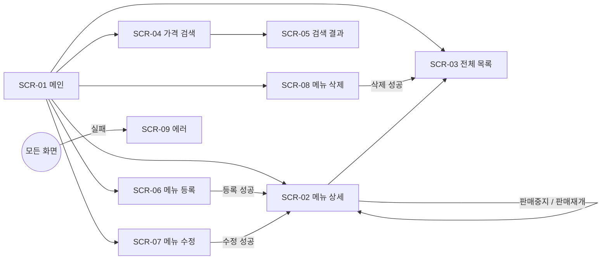
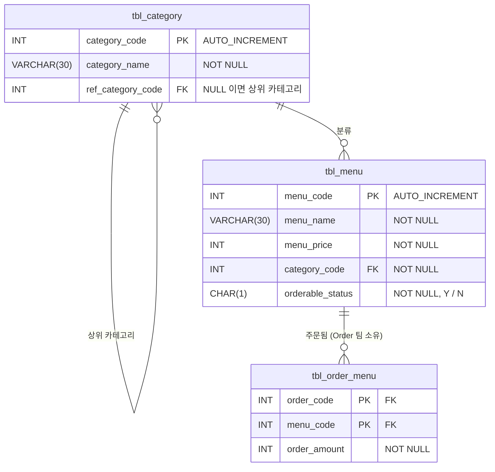

# 원티드 메뉴 레스토랑 - PRD (제품 요구사항 문서)

> **이 문서 하나만 보고 개발할 수 있어야 한다.**
>
> 좋은 PRD 는 "무엇을 만들지" 를 빠짐없이 정해 둔 문서다. 화면, API, 정책, 데이터가 정해져 있으면
> 코드는 그 내용을 옮겨 적는 일이 된다. 코드를 짜다가 막히면 코드가 아니라 **이 문서를 먼저 본다.**
> 문서에 답이 없다면 코드를 짜기 전에 문서부터 고친다.

| 문서 | 이 PRD 의 위치 | 코드로 옮겨지는 곳 |
|---|---|---|
| 화면 설계서 | [4. 화면 설계](#4-화면-설계) | `templates/**.html`, Controller 의 View 이름 |
| API 명세서 | [5. API 명세](#5-api-명세) | `MenuController` 의 `@GetMapping` / `@PostMapping` |
| 정책 정의서 | [6. 정책 정의](#6-정책-정의) | `MenuDTO`(입력 검증), `Menu`(도메인 규칙), `policy` 패키지(비즈니스 규칙) |
| 에러 정의 | [7. 에러 정의](#7-에러-정의) | `ErrorCode`, `GlobalExceptionHandler` |
| 데이터베이스 설계 | [8. 데이터베이스](#8-데이터베이스) | `Menu`, `Category` Entity 매핑, Repository |
| 협업 계약 | [9. 다른 팀과의 계약](#9-다른-팀과의-계약) | `MenuOrderHistoryChecker` |

---

## 1. 개요

| 항목 | 내용 |
|---|---|
| 제품 | 레스토랑 메뉴 관리 웹 서비스 |
| 사용자 | 매장 관리자 (메뉴를 조회 / 등록 / 수정 / 판매중지 / 삭제) |
| 목표 | 메뉴 정보를 한 곳에서 관리하고, 잘못된 데이터가 저장되지 않게 한다 |
| 담당 | **Menu 팀** (우리). 주문 데이터는 **Order 팀** 소유 ([9장](#9-다른-팀과의-계약)) |
| 기술 | Java 21, Spring Boot 3.5, Spring Data JPA, Thymeleaf, MySQL 8 |

## 2. 실행 방법

1. MySQL `menudb` 스키마에서 `sql/menudb-script.sql` 을 실행한다. (데이터를 초기화할 때도 다시 실행)
2. `global/config/Module07JpaMiniProjectApplication` 의 `main` 을 실행한다.
3. 브라우저에서 `http://localhost:8080` 접속

## 3. 기능 목록

| ID | 기능 | 화면 | API | 관련 정책 |
|---|---|---|---|---|
| F-01 | 메뉴 1건 조회 | SCR-02 | API-02 | POL-11 |
| F-02 | 전체 메뉴 조회 (메뉴번호 오름차순) | SCR-03 | API-03 | - |
| F-03 | 가격으로 메뉴 검색 (입력 가격 **초과**, 가격 오름차순) | SCR-04, 05 | API-04, 05 | POL-02 |
| F-04 | 메뉴 등록 | SCR-06 | API-06, 07, 08 | POL-01~04, 08, 09 |
| F-05 | 메뉴 이름 수정 | SCR-07 | API-09, 10 | POL-01, 08, 11 |
| F-06 | 메뉴 판매중지 / 판매재개 | SCR-02 | API-13, 14 | POL-05, 06, 11 |
| F-07 | 메뉴 삭제 | SCR-08 | API-11, 12 | POL-07, 10, 11 |

---

## 4. 화면 설계

### 화면 흐름



### 화면 목록

| ID | 화면 | URL | 템플릿 | 화면에 전달되는 값 (Model) |
|---|---|---|---|---|
| SCR-01 | 메인 | `/`, `/main` | `main/main.html` | - |
| SCR-02 | 메뉴 상세 | `/menu/{menuCode}` | `menu/detail.html` | `result` : 메뉴 1건 |
| SCR-03 | 전체 메뉴 목록 | `/menu/list` | `menu/list.html` | `menuList` : 메뉴 목록 |
| SCR-04 | 가격 검색 | `/menu/querymethod` | `menu/querymethod.html` | - |
| SCR-05 | 검색 결과 | `/menu/search` | `menu/searchResult.html` | `menuList`, `price` : 입력한 가격 |
| SCR-06 | 메뉴 등록 | `/menu/regist` | `menu/regist.html` | - (카테고리는 API-07 을 fetch 로 호출) |
| SCR-07 | 메뉴 수정 | `/menu/modify` | `menu/modify.html` | - |
| SCR-08 | 메뉴 삭제 | `/menu/delete` | `menu/delete.html` | - |
| SCR-09 | 에러 | (예외 발생 시) | `error/error.html` | `status` : HTTP 상태코드, `message` : 에러 메시지 |

> 템플릿(HTML)은 모두 제공된다. 개발자는 **Model 에 어떤 이름으로 무엇을 담을지** 만 지키면 된다.

### 화면 상세

**SCR-01 메인**: 버튼 6개

| 버튼 | 이동 |
|---|---|
| 🍽 특정 메뉴 조회 | `/menu/13` |
| 📋 전체 메뉴 조회 | `/menu/list` |
| 🔍 쿼리 메소드 | `/menu/querymethod` |
| ➕ 메뉴 등록 | `/menu/regist` |
| ✏ 메뉴 수정 | `/menu/modify` |
| 🗑 메뉴 삭제 | `/menu/delete` |

**SCR-02 메뉴 상세 / SCR-03 전체 목록 / SCR-05 검색 결과**: 같은 표 형식

```
┌──────────┬──────────┬────────┬──────────┬──────────┐
│ 메뉴번호  │ 메뉴이름  │ 가격    │ 카테고리  │ 판매상태  │
├──────────┼──────────┼────────┼──────────┼──────────┤
│ 13       │ 직화구이젤라또 │ 8000원 │ 12   │ [판매중]  │   ← orderableStatus Y: 판매중 / N: 판매중지
└──────────┴──────────┴────────┴──────────┴──────────┘
SCR-02 만 :  [ ⏸ 판매중지 ]  [ ▶ 판매재개 ]  [ 📋 전체 메뉴 목록 ]
```

- SCR-02 의 판매중지 / 판매재개 버튼은 **현재 상태와 상관없이 항상 둘 다 보인다.**
  잘못된 요청(이미 판매중지된 메뉴를 판매중지)은 화면이 아니라 서버가 막는다. (POL-05, 06)

**SCR-06 메뉴 등록**

| 입력 | name | 형식 | 비고 |
|---|---|---|---|
| 메뉴 이름 | `menuName` | 텍스트 | POL-01 |
| 메뉴 가격 | `menuPrice` | 숫자 | POL-02 |
| 카테고리 | `categoryCode` | 선택 | **하위 카테고리만** 표시 (API-07 결과), POL-03, 09 |

- 판매 여부는 입력받지 않는다. (POL-04)

**SCR-07 메뉴 수정**: `menuCode`(숫자), `menuName`(텍스트)
**SCR-08 메뉴 삭제**: `menuCode`(숫자)
**SCR-09 에러**: 상태코드(큰 글씨), 메시지, [⬅ 뒤로가기] [🏠 홈으로]

---

## 5. API 명세

모든 요청은 화면(HTML) 을 응답한다. 단, API-07 은 JSON 을 응답한다.
실패하면 모든 API 는 **SCR-09 에러 화면**을 [7장](#7-에러-정의)의 상태코드와 함께 응답한다.

| ID | Method | URL | 요청 값 | 성공 응답 | 실패 (정책) |
|---|---|---|---|---|---|
| API-01 | GET | `/`, `/main` | - | SCR-01 | - |
| API-02 | GET | `/menu/{menuCode}` | path `menuCode`(int) | SCR-02 | POL-11 |
| API-03 | GET | `/menu/list` | - | SCR-03 | - |
| API-04 | GET | `/menu/querymethod` | - | SCR-04 | - |
| API-05 | GET | `/menu/search` | query `menuPrice`(int) | SCR-05 | POL-02 |
| API-06 | GET | `/menu/regist` | - | SCR-06 | - |
| API-07 | GET | `/menu/category` | - | **JSON** 하위 카테고리 목록 | - |
| API-08 | POST | `/menu/regist` | form `menuName`, `menuPrice`, `categoryCode` | redirect `/menu/{새 menuCode}` | POL-01~03, 08, 09 |
| API-09 | GET | `/menu/modify` | - | SCR-07 | - |
| API-10 | POST | `/menu/modify` | form `menuCode`, `menuName` | redirect `/menu/{menuCode}` | POL-01, 08, 11 |
| API-11 | GET | `/menu/delete` | - | SCR-08 | - |
| API-12 | POST | `/menu/delete` | form `menuCode` | redirect `/menu/list` | POL-07, 10, 11 |
| API-13 | POST | `/menu/stop` | form `menuCode` | redirect `/menu/{menuCode}` | POL-05, 11 |
| API-14 | POST | `/menu/resume` | form `menuCode` | redirect `/menu/{menuCode}` | POL-06, 11 |

- 등록 / 수정 / 삭제 / 상태 변경은 성공 후 **redirect** 한다. (새로고침해도 요청이 반복되지 않게: PRG 패턴)

**API-07 응답 예시**

```json
[
  { "categoryCode": 4, "categoryName": "한식", "refCategoryCode": 1 },
  { "categoryCode": 5, "categoryName": "중식", "refCategoryCode": 1 }
]
```

---

## 6. 정책 정의

정책은 **어디서 판단하는지**에 따라 세 종류로 나눈다. 정책을 구현하기 전에 아래 질문으로 위치를 정한다.

```
입력값 자체만 보면 판단 가능한가? (빈 값, 길이, 범위)    -> 입력 정책    : MenuDTO / Controller (@Valid)
Entity 의 "현재 상태" 를 봐야 판단 가능한가?             -> 도메인 정책  : Entity (Menu)
DB 조회나 다른 도메인 정보가 필요한가?                   -> 비즈니스 정책 : Policy 클래스
```

| ID | 종류 | 정책 | 적용 기능 | 위반 시 | 판단 위치 |
|---|---|---|---|---|---|
| POL-01 | 입력 | 메뉴 이름은 필수이며 30자 이하 | 등록, 수정 | 400 "메뉴 이름은 필수입니다." / "메뉴 이름은 30자 이하로 입력해주세요." | `MenuDTO`, `MenuController`(수정) |
| POL-02 | 입력 | 가격은 0원 이상 | 등록, 가격 검색 | 400 "메뉴 가격은 0원 이상이어야 합니다." (검색: "가격은 0원 이상으로 입력해주세요.") | `MenuDTO`, `MenuController`(검색) |
| POL-03 | 입력 | 카테고리는 반드시 선택 | 등록 | 400 "카테고리를 선택해주세요." | `MenuDTO` |
| POL-04 | 도메인 | 신규 메뉴는 항상 **판매중(Y)** 으로 시작 | 등록 | - | `Menu.create()` |
| POL-05 | 도메인 | 이미 판매중지된 메뉴는 판매중지할 수 없다 | 판매중지 | `ALREADY_STOPPED_MENU` | `Menu.stopSelling()` |
| POL-06 | 도메인 | 이미 판매중인 메뉴는 판매재개할 수 없다 | 판매재개 | `ALREADY_ON_SALE_MENU` | `Menu.resumeSelling()` |
| POL-07 | 도메인 | 판매중인 메뉴는 삭제할 수 없다 (먼저 판매중지) | 삭제 | `ON_SALE_MENU_CANNOT_DELETE` | `Menu.validateDeletable()` |
| POL-08 | 비즈니스 | 메뉴 이름은 중복될 수 없다 (수정 시 자기 자신은 제외) | 등록, 수정 | `DUPLICATE_MENU_NAME` | `MenuNamePolicy` |
| POL-09 | 비즈니스 | 메뉴는 **하위 카테고리**에만 등록할 수 있다 | 등록 | `CATEGORY_NOT_FOUND`, `NOT_SUB_CATEGORY` | `MenuCategoryPolicy` |
| POL-10 | 비즈니스 | 주문 이력이 있는 메뉴는 삭제할 수 없다 | 삭제 | `ORDERED_MENU_CANNOT_DELETE` | `MenuDeletionPolicy` (+ Order 팀 계약) |
| POL-11 | 공통 | 존재하지 않는 메뉴는 조회 / 수정 / 상태변경 / 삭제할 수 없다 | 전체 | `MENU_NOT_FOUND` | `MenuService` |

정책 보충

- **POL-07, POL-10 의 검사 순서**: 판매중 여부(Menu 자신의 상태)를 먼저, 주문 이력(다른 팀에 질문)을 나중에 확인한다.
- **POL-09**: 등록 화면은 하위 카테고리만 보여주지만, 서버도 **반드시 다시 검사**한다. 요청은 화면을 거치지 않고도 보낼 수 있다.
- **"하위 카테고리" 의 정의**: 상위 카테고리(`ref_category_code`)가 있는 카테고리. 판단은 `Category.isSubCategory()` 가 한다.
- **판매상태**는 `Y`(판매중) / `N`(판매중지) 두 가지다. 상태 변경은 setter 가 아니라 `stopSelling()`, `resumeSelling()` 으로만 한다.

---

## 7. 에러 정의

### 비즈니스 예외 (`ErrorCode`)

도메인 / 비즈니스 정책을 어기면 `BusinessException(ErrorCode.XXX)` 을 던진다. 화면은 `GlobalExceptionHandler` 가 만든다.

| ErrorCode | 상태 | 메시지 | 정책 |
|---|---|---|---|
| `MENU_NOT_FOUND` | 404 | 메뉴를 찾을 수 없습니다. | POL-11 |
| `CATEGORY_NOT_FOUND` | 404 | 카테고리를 찾을 수 없습니다. | POL-09 |
| `ALREADY_STOPPED_MENU` | 409 | 이미 판매중지된 메뉴입니다. | POL-05 |
| `ALREADY_ON_SALE_MENU` | 409 | 이미 판매중인 메뉴입니다. | POL-06 |
| `ON_SALE_MENU_CANNOT_DELETE` | 409 | 판매중인 메뉴는 삭제할 수 없습니다. 먼저 판매중지해주세요. | POL-07 |
| `DUPLICATE_MENU_NAME` | 409 | 이미 존재하는 메뉴 이름입니다. | POL-08 |
| `NOT_SUB_CATEGORY` | 400 | 메뉴는 하위 카테고리에만 등록할 수 있습니다. | POL-09 |
| `ORDERED_MENU_CANNOT_DELETE` | 409 | 주문 이력이 있는 메뉴는 삭제할 수 없습니다. | POL-10 |

### 그 밖의 예외 (`GlobalExceptionHandler`)

| 상황 | 예외 | 상태 | 메시지 |
|---|---|---|---|
| 등록 입력값 검증 실패 (POL-01~03) | `BindException` (`MethodArgumentNotValidException`) | 400 | 첫 번째 필드 에러의 message |
| 등록 시 숫자 칸에 문자 입력 | `BindException` (바인딩 실패) | 400 | `{필드명} 의 입력 형식이 올바르지 않습니다.` |
| 수정 / 검색 파라미터 검증 실패 | `HandlerMethodValidationException` | 400 | 첫 번째 검증 에러의 message |
| 필수 값 누락, 타입 불일치 (`/menu/abc`) | `MissingServletRequestParameterException`, `MethodArgumentTypeMismatchException` | 400 | 요청 값을 확인해주세요. |
| 정책이 막지 못한 DB 제약조건 위반 | `DataIntegrityViolationException` | 409 | 다른 데이터와 연결되어 있어 처리할 수 없습니다. |
| 없는 URL | `NoResourceFoundException` | 404 | 요청하신 페이지를 찾을 수 없습니다. |
| 그 외 모든 예외 | `Exception` | 500 | 일시적인 오류가 발생했습니다. 잠시 후 다시 시도해주세요. (원인은 `log.error` 로 기록) |

---

## 8. 데이터베이스

스키마 `menudb`, 스크립트 `sql/menudb-script.sql`. 테이블은 스크립트로 만들고 JPA 는 만들지 않는다. (`ddl-auto: none`)



### Entity 매핑

| 테이블 | Entity | 필드 | 비고 |
|---|---|---|---|
| `tbl_menu` | `Menu` | `menuCode`, `menuName`, `menuPrice`, `categoryCode`, `orderableStatus` | `menuCode` 는 `@GeneratedValue(IDENTITY)` |
| `tbl_category` | `Category` | `categoryCode`, `categoryName`, `refCategoryCode` | `refCategoryCode` 는 NULL 이 가능하므로 `Integer` |
| `tbl_order_menu` | (Menu 팀은 매핑하지 않음) | - | Order 팀 소유. 9장의 계약으로만 접근 |

- `Menu.categoryCode` 는 `@ManyToOne Category` 가 아닌 `int` 로 둔다. (다른 도메인은 ID 로 참조)

### 카테고리 데이터

| 상위 카테고리 (등록 불가) | 하위 카테고리 (등록 가능) |
|---|---|
| 1 식사 | 4 한식, 5 중식, 6 일식, 7 퓨전 |
| 2 음료 | 8 커피, 9 쥬스, 10 기타 |
| 3 디저트 | 11 동양, 12 서양 |

### 필요한 조회

| 용도 | 조회 | Repository 메서드 |
|---|---|---|
| F-02 | 전체 메뉴, 메뉴번호 오름차순 | `findAll(Sort)` (기본 제공) |
| F-03 | 가격 초과, 가격 오름차순 | 쿼리 메서드 |
| API-07 | 하위 카테고리만, 카테고리번호 순 | native query (`ref_category_code IS NOT NULL`) |
| POL-08 | 같은 이름 존재 여부 (등록 / 수정 시 자기 제외) | `existsBy~` 쿼리 메서드 |

---

## 9. 다른 팀과의 계약

POL-10(주문 이력)은 **Order 팀의 데이터**가 필요하다. Menu 팀은 Order 팀의 테이블, Entity, Repository 를 직접 쓰지 않고,
아래 인터페이스로 합의한 값만 받는다.

| 항목 | 내용 |
|---|---|
| 계약 | `MenuOrderHistoryChecker` (Menu 팀이 정의, `domain/menu/model/policy`) |
| 메서드 | `boolean hasOrdered(int menuCode)` : 주문 이력이 있으면 `true` |
| 제공 | Order 팀이 구현한다 |
| 현재 상태 | Order 팀 구현 전. **`FakeMenuOrderHistoryChecker` 가 1, 2, 3번 메뉴는 주문 이력이 있다고 응답** |
| 교체 | Order 팀 구현이 완성되면 Fake 만 삭제한다. Menu 팀 코드는 바뀌지 않는다 |

협업 규칙

1. 다른 팀의 Repository / Entity 를 import 하지 않는다. 합의한 인터페이스로만 묻는다.
2. 값은 Entity 가 아닌 기본형 / DTO 로 주고받는다.
3. 필요한 쪽이 인터페이스를 정의하고, 정보를 가진 쪽이 구현한다. (순환 의존 방지)
4. 상대 구현이 없으면 Fake 로 먼저 개발한다.
5. 계약을 바꿔야 하면 상대 팀과 합의한 뒤 바꾼다.

---

## 10. PRD 로 개발하는 방법

### 기능 하나를 PRD 에서 코드로 옮기는 순서

예시: **F-06 판매중지**

| 순서 | PRD 에서 읽을 것 | 결정되는 코드 |
|---|---|---|
| 1 | 화면 SCR-02: 판매중지 버튼은 `menuCode` 를 `POST /menu/stop` 으로 보낸다 | (템플릿 제공) |
| 2 | API-13: `POST /menu/stop`, form `menuCode`, 성공 시 `/menu/{menuCode}` 로 redirect | `MenuController.stopSelling()` |
| 3 | POL-11: 없는 메뉴면 `MENU_NOT_FOUND` | `MenuService.stopSelling()` 에서 조회 |
| 4 | POL-05: **현재 상태**가 판매중지면 안 된다 -> 도메인 정책 | `Menu.stopSelling()` |
| 5 | 8장: `tbl_menu.orderable_status` 를 `N` 으로 | 변경 감지로 UPDATE (save 불필요) |
| 6 | 7장: `ALREADY_STOPPED_MENU` = 409 "이미 판매중지된 메뉴입니다." | `GlobalExceptionHandler` 가 SCR-09 로 응답 |

이 표처럼 **PRD 의 각 장이 코드의 한 계층**에 대응한다. 그래서 PRD 가 정확하면 "어디에 무엇을 짤지" 고민할 필요가 없다.

```
화면 설계  ->  templates, View 이름, Model 이름
API 명세   ->  Controller
정책 정의  ->  DTO(입력) / Entity(도메인) / Policy(비즈니스)  ->  Service 는 이것들을 순서대로 호출
에러 정의  ->  ErrorCode, GlobalExceptionHandler
DB 설계    ->  Entity, Repository
협업 계약  ->  인터페이스 + Fake
```

### 개발 순서 (코드의 TODO 와 같은 순서)

1. **DB → Entity → Repository → DTO** : 8장을 보고 매핑과 조회 메서드를 만든다.
2. **기능 F-01 ~ F-05, F-07** : 메인 화면 버튼 순서대로 Controller 와 Service 의 같은 번호 TODO 를 채운다.
3. **에러** : 7장대로 `GlobalExceptionHandler` 를 완성하고, 6장의 입력 정책(POL-01~03)을 `@Valid` 로 적용한다.
4. **정책 분리** : 도메인 정책(POL-04~07)은 Entity 로, 비즈니스 정책(POL-08~10)은 Policy 로 옮긴다. F-06 을 추가한다.

### 요구사항이 바뀌면

코드보다 **PRD 를 먼저 고친다.** 예: "판매상태에 품절(S) 을 추가한다"

1. 6장 정책 정의에 품절 관련 정책을 추가한다. (품절 메뉴는 삭제 가능한가? 판매재개 가능한가?)
2. 7장에 필요한 ErrorCode 를 추가한다.
3. 8장 `orderable_status` 의 허용 값을 바꾼다.
4. 그 다음에 코드를 고친다. 정책이 Entity 에 모여 있다면 `Menu` 한 곳만 고치면 된다.
